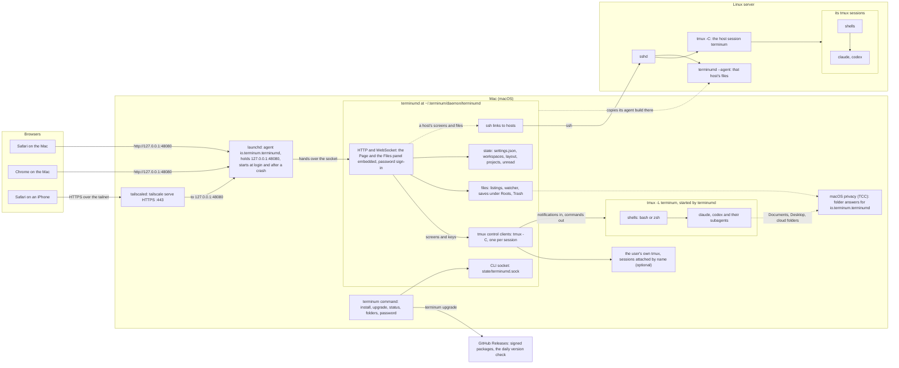

# terminum's architecture

One picture of every part: terminumd on a Mac, the tmux servers it drives (its own, the user's,
a Linux server's over ssh) and the browsers that show them. Behavior and limits live in the
specs ([docs/specs/](specs/)); this page only maps the parts.

- **Browsers** reach terminumd on `127.0.0.1:48080`, which launchd holds; other devices come
  through `tailscale serve` over HTTPS. Every browser signs in with the password set by
  `terminum password` (SECURITY.md).
- **terminumd** is the only client of every tmux server: its control clients (`tmux -C`) read
  screens and layouts as notifications and send keys and commands. It serves the Page and the
  Files panel, reads and writes files under its Roots and keeps the state in `~/.terminum/state`.
- **Folder access on a Mac**: macOS judges every program in terminum's terminals by the program
  that started the tmux server, `daemon/terminumd`, so one Allow covers them all (AC-08).
- **A Linux server** is reached over ssh: its tmux in control mode for the terminals, and a
  `terminumd --agent` for its files, which terminumd copies there and keeps at its own version.
- **terminumd on a Linux server** is the same picture with systemd's user service
  `io.terminum.terminumd` in launchd's place (terminumd binds the port itself, `KillMode=process`
  keeps the terminals through every restart) and no macOS privacy prompts; its page is reached
  through an ssh tunnel or `tailscale serve` on the server.
