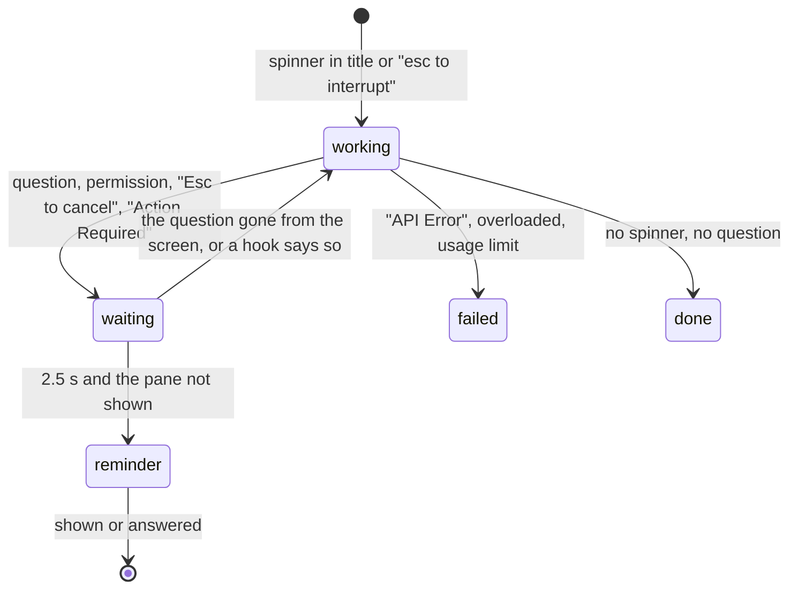

# terminum — Specification (coding agents)

Sibling of `terminum.md` (the core). This spec holds coding agents in terminum: their states in the list, unread, plans and progress, the bookmarks and reminders they keep for the user, and the exit of agents left idle. A host's agents are in `terminum-remote.md` AC-99. Cases are numbered across the specs.

## 0. Metadata

| Field | Value |
|---|---|
| Status | current |

A snapshot of what terminum must do, not a record of how it came to be: git holds that.

## 1. Overview

**Problem.** A coding agent works for minutes or hours in a terminal, and what the user needs from it is easy to miss: that it waits for an answer, that it stopped on an error, how far its plan has come, and the final report or open question scrolled away in thousands of lines.

**Who it affects.** Users of Claude Code and Codex who keep several sessions, and read and answer from a Mac or a phone.

**Expected outcome.** The session list and the header show each agent's state and, from its hooks, its tool, what it waits for and its subagents. A reminder names an agent waiting in a pane not shown. A session whose turn ended unseen is unread. A plan shows as a percent and in a Plan pane. What an agent finds or defers becomes a task on the board (`terminum-kanban.md` AC-115); its older records stay for the user.

**Scenario.** Alex runs six agents and reads another session on a phone. A line over the terminal says "api waits for your answer"; a press opens that pane. Another row is hatched: its turn ended unseen, and its Plan pane says 9 of 9 done.

## 2. Scope and non-goals

In scope:
- Reading agents' states from their screens and hooks; subagents; reminders of a waiting or failed agent; unread.
- `terminum hooks`, `terminum hook`, `terminum mcp`, and the installation of hooks and MCP server into Claude Code and Codex.
- Plans, progress and the stale reminder; agents' records kept from before tasks.
- Asking an agent left idle and unopened for days to exit (AC-153).

Out of scope (explicit):
- A host's agents: `terminum-remote.md` AC-99.
- The user's own bookmarks and reminders, and the panes that list them: `terminum-terminal.md` AC-33, AC-91.
- Sent history: `terminum-terminal.md` AC-90.
- States for other agents: OpenCode gets only a mark (`terminum.md` AC-01).
- Tasks and agents' task tools: `terminum-kanban.md`.
- Typing into a pane for an agent's hook or tool: a hook only observes, a reminder reaches the agent as context. What types: this spec's AC-153 (fixed keys only), `terminum-kanban.md` AC-114 and `terminum-dispatcher.md`.

## 3. Assumptions, dependencies, open questions

The core's and the terminal spec's assumptions, dependencies and questions are about tmux and the page. Rows of this spec:

Assumptions:

| ID | Assumption | Owner | Status |
|---|---|---|---|
| AS-71 | Claude Code's and Codex's screens and titles carry the words `tmux/agentstate.rs` reads. | Claude | measured on Claude Code 2.1 and Codex 0.162; §7 says what a changed wording does |
| AS-72 | Claude Code does not deliver an async hook's output in an interactive session; Codex delivers its async PostToolUse's. | Claude | measured; the reason for the synchronous PostToolBatch (AC-39) |
| AS-73 | A subagent interrupted, closed, killed or failed fires no SubagentStop in either program. | Claude | read from both programs' source (AC-39) |

Dependencies:

| ID | Dependency | Owner | Status |
|---|---|---|---|
| DEP-71 | Claude Code's plugin commands (`claude plugin marketplace add\|update\|remove`, `claude plugin install\|update\|uninstall\|list`), hooks and `.mcp.json`. | Owner | optional (AC-39) |
| DEP-72 | Codex's `hooks.json`, `config.toml` `[mcp_servers]` and its trust of hooks in /hooks. | Owner | optional |

Open questions: none.

## 4. Acceptance cases

| ID | Priority | Case |
|---|---|---|
| AC-39 | [MUST / P0] | A pane running a coding agent shows its state (working, waiting, failed; done shows no mark) in the list and the header, breathes while it works, and a reminder over the terminal names an agent that waits for an answer in a pane not shown. |
| AC-93 | [SHOULD / P1] | A session whose coding agent finished a turn while no page in sight showed it is marked unread until a page shows it. |
| AC-97 | [SHOULD / P1] | A coding agent's plan (its own plan tool through the hooks, or terminum's MCP tools) shows as a percent and a track on its session's row and in the header, and in a Plan pane with the items, the current step and the agent's ETA; a plan not updated for a while is asked for through the hooks. |
| AC-98 | [SHOULD / P1] | Agents make no bookmarks or reminders; the records they kept stay for the user to read, close, delete or make into tasks. |
| AC-153 | [SHOULD / P1] | Claude Code or Codex left idle in a row no page has shown for the days set in Settings (0: off, the default) gets Ctrl+C twice, then `/exit` while it still runs; its shell and session stay. |

## 5. BDD scenarios

### AC-39 — Coding agents in the list [MUST / P0]

```gherkin
Scenario: AC-39 happy path — states
  Given panes run Claude Code and Codex (by #{pane_current_command}, the window's name, Claude Code's title marks, or Codex's words on the screen of a pane whose program is `node`)
  Then each shows, in the list and the header: its bar pulsing while it works, no other mark (a spinner in the title, "✻ Doing… (…)" on screen, "esc to interrupt"); before its title a flashing amber question mark while it waits for the user (a question, a permission prompt, "Esc to cancel", Codex's "[ ! ] Action Required" title or "enter to submit answer"; its words read as one line, so a narrow pane that breaks them over rows, "Esc to" / "cancel", still says so), a red alert sign when it stopped on an error ("API Error", overloaded, a usage limit, out of credits, a retry limit, high load), no mark when done; only the screen's last 25 rows count, read by terminumd when the title changed or 6 s passed
  And Claude Code's turn line "✻ Waiting for 2 background agents to finish" ("1 background agent and 1 dynamic workflow") is working: its subagents still run; the newest turn line counts (a later "✻ Worked for 3m 2s" is done)
  And Claude Code whose footer, under its input box, counts work in the background ("⏵⏵ bypass permissions on · 1 shell, 1 monitor"; also local agents, teams, dynamic workflows, cloud sessions, MCP tasks, "N background tasks") is working until that count goes: its session goes on; a turn line's "· 1 shell still running" alone is not (it stays after the shell ended), nor an Artifact comment monitor; only the rows right under Claude Code's input box (a rule, "❯", a rule) count, each item a number and its word ("1 shell script added" is not one); with hooks, a Stop's turn waits while that footer, read for that pane only then, counts work (the row shows working), and ends once the count has gone
  And a count of shells, monitors or tasks alone keeps the session working for 10 minutes at most (BACKGROUND_LIMIT), from when it alone kept it so (with hooks, from the Stop): a background job that never ends (a dev server, `tail -f`, a monitor) then leaves it done, its turn ended; the count counts anew after a turn of the agent itself
  And done so, its row and the header show a quiet terminal mark after the state's place ("Done; a shell, a monitor or a task it started still runs") while the footer still counts them, read every 6 s (with hooks too, for that pane only); the mark goes when the count goes or a turn of the agent starts, and never shows while it works, waits or failed
  But a count of agents (local agents, teams, background and remote dynamic workflows, cloud sessions) keeps it working however long they run: they end on their own; "← 1 agent" is Claude Code's agents view's count of other background sessions waiting on the user, not this turn's work
  And on a screen without Claude Code's input box (Codex) the last 10 rows saying agents still run ("2 agents still running", "1 subagent is running", "3 background agents are still running", "Waiting for 2 agents") keep it working; "2 agents finished, none running" does not
  And the row's bar (one color per theme) breathes every 1.4 s while the agent works (not with reduced motion); a dot reads as an unread message; the header's bar stands still
  And a waiting row's ? goes from the row and the header as soon as the user shows that session (it was seen), and comes back only when the agent waits anew after it stopped waiting

Scenario: AC-39 happy path — a turn that stopped and needs the user
  Given a coding agent's turn ends and what it last did leaves it to the user: Codex's request_user_input_async (drawn "? title" with its options, gone from its title at the turn's end), a last message that ends in a question mark of any script ("?", "？", "؟", "՞", "፧", the Greek one), Claude Code's "Session paused" (safeguards' retry dialog), an error line of the program saying a safety stop ("■ This request has been flagged for possible cybersecurity risk.", "API Error: … can't help with this", "Chat stopped as a precaution")
  Then its row and header show the flashing amber ? and the reminder of the next scenario, as for a question it asks mid-turn, also while a shell of its runs on; it stands until the next prompt, and goes from sight when the user shows that session or closes its reminder
  And the turn counts as ended: unread and reminders come as for any end
  And its hook only works out one bit from the last message and posts that: the message itself never leaves the hook's process
  When a turn failed (API error, rate limit, login, context full; Codex's "■ " lines, which fire no event)
  Then a reminder says "<title> failed" with why when known, beside the row's red mark

Scenario: AC-39 happy path — how many subagents
  Given hooks count at least one subagent of a pane
  Then its row shows the number beside a small bot icon, "N subagents" on hover: the higher of the hooks' count and the agents Claude Code lists under its footer ("○ rust-flakes  Fix flaky tests" below "● main", which is not counted)
  And a pane whose hooks count none is not read for it: its screen is not read every 2 s for a list that may not be there

Scenario: AC-39 edge — a turn's end is never lost
  Given a pane whose hooks spoke, and a turn that ended with no Stop counted: Codex's errors, review and compact (no Stop), Claude Code's Esc (no Stop), a Stop that never came (its hooks not trusted in that session)
  When its screen shows it done for 10 s
  Then its turn ends: unread and reminders; a Stop already counted for that turn makes no second end
  And SubagentStop does not always fire (AS-73), so the count must not trust it: Codex's turn ends at its own Stop whatever subagents it counts; Claude Code's Stop with subagents counted is checked against the screen from 5 s on, and with no agents in the footer or turn line the count goes and the turn ends
  And a subagent's own prompt starts no turn and its failure marks no pane

Scenario: AC-39 happy path — reminders
  When an agent in a pane not shown has waited 2.5 s
  Then "<title> waits for your answer" stands at the terminal's top under the banners: a line across its whole width for each waiting session (three at most on a computer, one with "+N more" on a phone), its ? in the waiting yellow on a faint tint of it (no card, no shadow), starting where the terminal's text does, its words cut by an ellipsis where they would not fit; a click opens that pane, × closes it; it goes 2.5 s after the pane stops waiting or when shown; a reminder closed or seen comes back only when the pane asks again

Scenario: AC-39 edge — a question's words in the transcript
  Given Claude Code's screen read (no hooks) shows its input box (a rule, "❯ ", a rule) and, above it, text that reads like a question ("Would you like to run…", "Do you want to …", "(y/n)": printed by a tool, quoted by the agent)
  Then the session is not waiting: a question of Claude Code's replaces its input box, so words above the box are the transcript

Scenario: AC-39 edge — a named pane, a shell
  Then a pane or window the user named hides the title marks, so the screen decides; a pane at a shell prompt shows no state; "shell" in the layout says a tap may move the cursor along the line (not in htop, less, mc)

Scenario: AC-39 edge — Codex
  Given Codex, which keeps its title while it works and marks it "[ ! ] Action Required | " (blinking "[ . ]") only when it asks
  Then its question waits although its footer says "esc to interrupt"; a turn the user cancelled ("Conversation interrupted") is done, not failed; the list's title leaves out the mark, so the row does not blink
  And Codex started through npm runs as `node`: a `node` pane is Codex while its screen, read as an agent's is, shows Codex's own words ("OpenAI Codex (v", "Ask Codex to do anything", "tell Codex what to do differently", "enter to submit answer", "tab to add notes"); the title never makes it Codex (a killed Codex can leave its mark to the next program); another `node` program, a dev server asking "(Y/n)" too, shows no state and no reminder, also right after Codex in the same pane
  And Codex started without "--no-alt-screen" (as "codex resume" is) draws on tmux's alternate screen, where tmux keeps no scrollback: scrolling up there says so once a pane, naming "codex --no-alt-screen" and Codex's setting alternate_screen = "never" under [tui]

Scenario: AC-39 edge — shared hook matchers
  Given one Codex matcher contains both terminum's hook and another command
  When terminum's hooks are removed
  Then the other command, matcher and unrelated metadata remain; only entries emptied by this removal go

Scenario: AC-39 edge — a complete answer on an open socket
  Given a hook or MCP call has received a complete Content-Length or chunked HTTP answer, or a no-body 204 answer
  Then the client acknowledges it without waiting for the connection to close; an incomplete framed answer still fails within the shared request budget

Scenario: AC-39 happy path — the agents' own hooks
  Given Claude Code or Codex is found (its program on PATH, ~/.claude, $CODEX_HOME or ~/.codex) without terminum's hooks
  Then "terminum status", "terminum open" and "terminum install" say so in one line naming "terminum hooks install"
  When the user runs "terminum hooks install" (or "terminum hooks install claude|codex")
  Then Claude Code gets terminum's plugin: a local marketplace in ~/.terminum/hooks/claude added with Claude Code's own "claude plugin marketplace add" and "claude plugin install terminum@terminum-local --scope user" (terminum never edits Claude Code's settings); Codex gets terminum's entries in $CODEX_HOME/hooks.json (default ~/.codex), the file backed up beside it first and others' entries kept, and is told to trust them in Codex's /hooks (terminum's SessionEnd entry runs without `async`, which Codex would run synchronously with a warning at each start; an older entry with `async` is migrated alone, every other byte kept, by an install or an upgrade's refresh, which says to trust the changed hook once, as Codex trusts a hook by its entry's hash); a second install changes nothing; an upgrade's refresh updates Claude Code's plugin in place (never removed first) and checks it with `claude plugin list`, keeping the old install on failure (the warning: AC-97); "terminum hooks remove" takes out only terminum's; each "claude" it runs has a session of its own (no terminal to stop on: a read of /dev/tty fails at once) and a Ctrl-C, a closed terminal or a stop of terminum ends it with terminum; "terminum hooks" says for each agent: not found, found without, or installed and when its hooks last spoke
  And each lifecycle event (session start and end, a prompt, a tool before and after, an approval asked, a notification, a stop, a failure, a subagent's start and stop, Codex's interrupt) runs "terminum hook <agent>" in the background, which reads the event, posts a few fields of it (never a tool's output, a file's text or the agent's answer; a command's first two words with values left out; a plan tool's items for AC-97; the user's prompt for the sent history, AC-90) to terminumd's socket within 150 ms and exits 0 without output
  And Claude Code's plugin also runs "terminum hook claude" synchronously (timeout 2 s) on PostToolBatch, the carrier of AC-97's reminder (AS-72); Codex's reminder rides its async PostToolUse; that event does nothing else, stays within the 150 ms and prints nothing without a reminder
  Then the pane's row shows the state its hooks say over the screen's reading (the screen is not read for it), the tool it runs in its mark's title ("Working: Bash: npm test"), what it waits for ("Approve Bash: rm -rf", the question it asks; the reminder card says "<title> asks: …"), why a turn failed ("rate_limit"), and the number of subagents running under the mark
  When Claude Code's turn stops (its Stop) while subagents it started still run in the background
  Then the pane stays working with their number under the mark until the last one stops (SubagentStop), also through Claude Code's idle notice (the main thread waits for the user) and the user's next prompts (the subagents run on); its turn ends then (reminders, unread); a background subagent's tools keep it so, and one quiet for 10 minutes gives way to the screen; an interrupt (Esc) or a failure ends it at once; background shells and monitors are not counted (a dev server would keep it working for ever)

Scenario: AC-39 edge — a previous session's delayed events
  Given a new agent session has started in a pane
  When a delayed non-start event or SessionEnd of a different session arrives
  Then its current state, subagents, folder and plan stay unchanged; rejected events trigger no sent-history, turn or reminder side effects

Scenario: AC-39 edge — hooks that stopped speaking
  Then a working state no hook renewed in 30 s (waiting: 120 s) is the screen's to say again (an interrupt in Claude Code fires no Stop, a crash no end); a tool event of a turn that stopped, come late from the background, changes nothing; another program in the pane, or another agent session, drops what the hooks said; Codex's done is read from its screen (it has no failure event); a hook from a pane no terminumd server lists changes nothing
  And a pane's hook record gone with a host's link or a restart of terminumd comes back with its session's next event of any kind, so the plan tools and the Plan pane stop saying the hooks are not running; a late event of a session seen to end makes none
  And a hook's wait gives way to a screen showing the agent at work: an approval answered fires no event

Scenario: AC-39 failure — the screen cannot be read, no terminumd, a broken hooks.json
  When terminumd cannot capture the pane (closed meanwhile)
  Then the row shows no state this refresh and the next refresh tries again; nothing else is delayed
  When terminumd does not run, the hook returns at once and the agent goes on as without it
  When a person runs "terminum hook" (an unknown agent such as "terminum hook install", or a terminal for its input), it says "terminum hooks install" sets them up and exits 2 instead of waiting for keys
  When Codex's hooks.json does not parse or is not an object of lists, "terminum hooks install" refuses with why and changes nothing; without "claude" on PATH it says so
```

### AC-93 — Unread [SHOULD / P1]

```gherkin
Scenario: AC-93 happy path — a finished turn nobody saw
  Given the user sent a prompt to Claude Code in %3 and went to another session (or locked the phone)
  When its turn ends: its hook's Stop with no subagent left running (else the last one's SubagentStop), or, read from its screen, its pane done for 10 s on end (not working, not waiting, no subagents: a moment's done between two steps of the turn ends nothing); either way not while Claude Code's footer counts work it runs in the background (AC-39)
  Then %3's row is hatched over its whole box: pale see-through diagonal lines one whole pixel wide (none blurred over two) in the color of the session's name, its text and the shown row's fill readable through them, hover or not; "Unread: its agent finished" for a screen reader, on every page, while no page in sight showed %3 at that moment
  When a page in sight shows %3 (opened, or a hidden page showing it comes back)
  Then the mark goes on every page; a turn that ends while a page in sight shows it leaves none
  And "in sight" is as for sizing (AC-13): a page in front and, on a computer, focused (its stream: terminum.md AC-02); a window on another display while the user types elsewhere is not looking, so a turn that ends there is unread
  And the marks are kept in state/unread.json with each tmux server's identity (`@terminum-id`): a restart of terminumd (an upgrade) keeps them; a pane gone takes its mark with it; a tmux server started anew (a reboot, a killed tmux; its pane ids start again at %0) keeps the marks of the panes its restore makes again (AC-15), each on the pane made in its place, and loses the others
  And a row that is busy again (working, waiting, its subagents running) shows no mark while it is: its work goes on

Scenario: AC-93 happy path — mark it unread
  When the user picks Mark as Unread in a row's menu (a right click or a long press; any session, an agent's or not)
  Then the row is unread on every page, as after a turn nobody saw, until a page in sight shows it again; the session shown on this page now stays unread until it is opened again
  And an unread row's menu has Mark as Read instead, which takes the mark away on every page
```

### AC-97 — Session plans and progress [SHOULD / P1]

```gherkin
Scenario: AC-97 happy path — the agent's own plan
  Given Claude Code with terminum's hooks in pane %3
  When its TaskCreate makes "Write the parser" (id 1) and "Add tests" (id 2) and its TaskUpdate sets id 1 completed
  Then terminumd keeps the pane's plan from the successful PostToolUse events only: 2 items, 1 completed, 50%
  And the session's row shows "50%" right of its title over a thin track in the row's color, its hover "1 of 2 · updated 1 min ago"; the floating buttons' column a circle "50%" with its ring half filled (first in the column; on a phone under ⟨…⟩, unfolded with the others), its hover "Plan: 1 of 2 · updated 1 min ago"
  And the header's Plan button shows "50%" beside its icon; at 0% its icon alone and no circle in the column
  When TodoWrite sends the whole list (3 items) or Codex's update_plan its steps (a result "Plan updated")
  Then that list replaces the plan; a TaskUpdate with status "deleted" removes its item
  When a subagent of the session (an event carrying its agent_id) calls a plan tool
  Then the session's plan is not changed and that event gets no reminder
  And an update_session_plan whose _meta.sessionId is another than the pane's hooked session is not applied, its answer says only the main agent updates the plan
  And a pane making MCP calls with no hook event of terminum's gets, at the end of update_session_plan's and get_session_plan's answers, "terminum's hooks are not running in this session (Codex: trust them in /hooks); send the whole plan with update_session_plan.", and the Page's `plan` carries `hooks: false`

Scenario: AC-97 happy path — the Plan pane
  When the user presses the percent, the column's progress circle or the header's Plan button
  Then the Plan pane opens (modal, a window placed as the reminders' pane, terminum-terminal.md AC-91), laid out in sections: the plan's title (15 px, 600); "Now" and the current step ("doing") on a raised strip with a gray pill inside it at its left (as a row's folder bar; no stripe along its rounded edge); the progress, "3 of 9 done" and "33%" over a bar filled to it, the ETA "~17:40 (agent's estimate, given 16:55)" under it; "Steps", each item with its mark in a round badge (✓ on green, ▶ on the text color with its row tinted, an empty ring pending, a large "!" on amber) and its text hanging beside it; under a rule "Updated 2 min ago (16:57)" and where the plan came from (terminumd's times, aged by the browser's clock); "Tasks" and this session's tasks, each opening its window on the board (terminum-kanban.md AC-113), or "No task in this session."
  And every text the agent wrote is kept without control or bidi characters (U+202A–U+202E, U+2066–U+2069) and shown as plain text (never Markdown or HTML: "<b>x</b>" reads as typed); on a phone the pane is full-width under the header, its buttons at least 44 px

Scenario: AC-97 happy path — found before a plan
  Given a pane runs a coding agent that has made no plan yet
  Then the header shows a Plan button (its icon alone, right of ✎, its hover "Plan: none yet"), and the column no progress circle; a row's menu and the header's ⋯ menu have "Plan and Tasks…" for any session
  And the Plan pane without a plan says "No plan: the agent has not sent one for this session.", then the notes

Scenario: AC-97 edge — the agent exited
  Given the pane's plan was archived because its program changed
  Then its Plan pane shows the pane's last archived plan marked "Finished session (agent exited hh:mm)" (terminumd's `plan` with `finished: true`) until a new agent session there makes a plan; its row shows no percent for it, the column no circle

Scenario: AC-97 happy path — terminum's MCP tools
  Given `terminum mcp` started by the agent in pane %3 (TMUX and TMUX_PANE from its environment)
  When the agent calls update_session_plan {items: 7 with 3 completed, doing: "Run the tests", eta_minutes: 45}
  Then it answers "Plan stored: 3 of 7 completed (43%), ETA ~17:40." and the row shows "43%"; the ETA is the call's time plus 45 minutes, shown as the agent's estimate; an absolute time from the agent is never taken
  When the session also keeps a built-in plan (TaskCreate, TodoWrite, update_plan)
  Then the MCP call's items are not applied ("Doing and ETA stored; items follow your own plan tool (3 of 7 completed), so the items sent were not taken, ETA ~17:40.") and a later built-in plan replaces MCP items; doing, title and ETA are kept on either
  When the agent calls get_session_plan {}
  Then it answers the stored plan as lines "[x] …", "[>] …", "[ ] …", "[!] …"

Scenario: AC-97 happy path — the stale reminder
  Given a pane whose hooks say working, its turn started at its UserPromptSubmit
  When a PostToolUse of the main agent comes and the plan was last updated longer ago than clamp(turn's time / 6, 10 min, 30 min), counted from the later of its update and the turn's start, or there is no plan and the turn has worked 10 min
  Then terminumd answers the hook with terminum's fixed text and numbers only ("terminum: this session's plan was last updated 14 min ago. Update it now: …"), which `terminum hook` gives the agent as the event's additionalContext; nothing is typed into the pane; the row's percent and the column's circle dim while stale
  And no second reminder comes within one threshold, and a turn without a plan gets one at most
  And a plan whose items are all completed gets no reminder; only the agent's reminder event carries one (never PreToolUse, a prompt or a stop): the events of AC-39's hooks, the printed hookEventName that event's; Claude Code's async PostToolUse never takes it

Scenario: AC-97 edge — partial, ETA, reuse, restart
  Given two plan items and a successful TaskUpdate deleting the first with a subject
  Then only the first item disappears; the next item's text and status stay unchanged
  When a TaskUpdate names id 9, which no TaskCreate made (an event lost)
  Then no item is invented; the plan is marked partial ("partial: some updates were missed"), its known counts shown, until a whole list (TodoWrite, update_plan, update_session_plan) heals it
  When the items change without a new eta_minutes
  Then the ETA is dropped (it said nothing about the new list)
  When the agent ends and a new agent session starts in the same pane (SessionStart, another session id, another program)
  Then the old plan is archived (kept in plans.json, never shown) and the row shows no percent until the new session keeps a plan
  When every item of a plan is completed
  Then its row and the header show 100% while its turn works and for 10 minutes after its last update, then none (the list's next refresh); the Plan pane keeps it
  When the user's next request starts a turn (UserPromptSubmit) on a finished plan
  Then that plan is archived as the old one above and the request starts with none, the row as above; a plan with an item not completed stays across requests
  When terminumd restarts
  Then every plan comes back from `state/plans.json` with its updated time; a pane gone is archived when its hook record is dropped; a tmux server started anew (another `@terminum-id`: its pane ids start again at %0) takes its plans with it
  And an MCP call that terminumd cannot yet tie to an agent or session (its hooks not heard since the restart) keeps the restored plan, never archives it
  When the turn is interrupted or stopped mid-plan
  Then the plan stays as it was, not stale; the next prompt of the same session goes on with it
  When the pane is idle, waiting or stopped
  Then no reminder comes; after the Mac slept, the first PostToolUse may remind once

Scenario: AC-97 failure — tools refused
  When a plan tool's call fails (PostToolUseFailure, Codex's update_plan refused in Plan mode, a result that is not a success)
  Then the plan is not changed
  When `terminum mcp` starts outside a terminum pane (no TMUX or TMUX_PANE: it starts in every Claude Code and Codex session of the Mac)
  Then it offers no tools and no instructions, so it costs that session nothing
  When a tool is called anyway, or terminumd does not know the pane
  Then the tool answers an error "This session does not run in a terminum pane; do not call terminum's tools again."
  When terminumd is not running (no answer on its private socket in 2 s)
  Then each tool answers an error "terminum is not running; go on without it."
  When nothing answers as the agent starts in a pane (terminumd restarting, a host's link down)
  Then the tools and instructions are offered all the same (an agent lists them once, at its start): each call answers that error until terminumd or the link is back, then works, or says the session is not in a terminum pane; the sinks (a host's `run/mac-*.sock` too) are listed at each call, so a link that comes up later serves the session. An agent in a pane terminum does not serve, started while nothing answered, carries the tools; terminum's MCP server is installed only where the user asked for it (`terminum hooks install`, a host's coding agents' progress)
  When update_session_plan has no items, over 50, an item over 200 characters, or a status not pending, in_progress, completed or blocked
  Then it answers an error naming the limit or the allowed values (an empty list: "send the whole plan"), and nothing is stored; eta_minutes outside 1–1440 is refused the same way
  When plans.json cannot be written or does not parse
  Then terminumd's log says why; a file that does not parse is set aside as plans.json.bak and an empty state starts

Scenario: AC-97 happy path — installed with the hooks
  When the user runs `terminum hooks install`
  Then Claude Code's terminum plugin carries `.mcp.json` naming `terminum mcp`, and Codex's config.toml gets one block between "# >>> terminum: MCP server …" and "# <<< terminum" ([mcp_servers.terminum], env_vars TMUX and TMUX_PANE, tools approved), the file backed up first; hooks.json's entries stay byte for byte; `terminum hooks` says whether each agent has the MCP server; `terminum hooks remove` takes the block out; the install says to restart running Codex sessions (they read config.toml when they start)
  And install and remove change only the lines terminum wrote: a line of another's inside the markers (a table Codex added there) is kept; a config.toml that is a symlink is written where it points, the link kept
  When config.toml already has an [mcp_servers.terminum] table outside terminum's block, or the file changed while the install ran
  Then the install refuses and says why, the file untouched
Scenario: AC-97 happy path — kept current by an install or upgrade of terminum
  Given the user ran `terminum hooks install` for an agent before
  When `terminum install` or `terminum upgrade` succeeds
  Then Claude Code's plugin is updated in place (AC-39) when its marker names another build, the plugin lacks `.mcp.json` or its hooks file differs from this build's (the synchronous PostToolBatch entry added), and Codex's MCP block is added or made current while hooks.json stays byte for byte; one line per agent refreshed
  And an agent where terminum's hooks were never installed gets nothing
  When the refresh fails (claude not on PATH or not answering within 20 s a call, config.toml refused)
  Then a "Warning: …; run terminum hooks install" line is said and the install or upgrade still succeeds; `terminum status`, `open` and `install` say in one line that the agent has terminum's hooks without its MCP server, naming `terminum hooks install`
```

### AC-98 — Agents' records kept from before tasks [SHOULD / P1]

```gherkin
Scenario: AC-98 happy path — agents make tasks instead
  Then `terminum mcp` offers no add_notes_for_user, get_notes_for_user, update_notes_for_user or delete_notes_for_user; bookmarks and reminders are the user's own (terminum-terminal.md AC-33, AC-91)
  And what an agent would have kept goes as terminum-kanban.md AC-115 says, and its MCP instructions say so

Scenario: AC-98 happy path — what is kept stays
  Given records an agent kept earlier, open or not
  Then they stay in their sessions and are listed with the user's bookmarks and reminders, the agent's mark before the title, the text as Markdown with raw HTML off (as rendered output, AC-31)
  And a reminder among them comes up as AC-91 says until the user resolves it
  And the user closes or deletes them as their own, or makes a task of one (terminum-kanban.md AC-116)
  And no record turns into a task unless the user asks

Scenario: AC-98 edge — an agent of an older session
  Given an agent started before the upgrade, holding the old tool list
  When it calls add_notes_for_user
  Then it is answered: "This tool is gone. Use create_task for what must not get lost. If your tools do not list it, this session started before the upgrade: say so and put the text in your report; the user's /mcp reconnect or a new session brings it." and nothing is kept
```

### AC-153 — Idle agents exit [SHOULD / P1]

```gherkin
Scenario: AC-153 happy path — an agent nobody opened for days ends
  Given the user set "Exit idle agents after, days" in Settings to 3 (settings.json `"agentExitDays": 3`)
  And Claude Code runs in %3 under the pane's shell, idle (not working, no subagents running, not waiting mid-turn), its input box shown empty
  And no page in sight (as AC-93: a page in front, focused on a computer) has shown %3 for 3 days, nor has a page on another display shown it while open there, nor a tmux client of the user's own (`tmux attach` in a terminal, on terminum's tmux, the user's own servers of AC-89 or a host's)
  When terminumd looks (every 10 minutes)
  Then it sends Ctrl+C to %3, 300 ms later Ctrl+C again (inside the agent's window for a second press), and the agent ends
  And the pane's shell is in front again; the window and the tmux session stay
  And each key is in the input log (terminum.md AC-147) as Dispatcher's (terminum's system user), component `idleexit`
  When Codex runs in a pane instead
  Then the same goes

Scenario: AC-153 happy path — /exit when Ctrl+C does not end it
  Given the agent still runs 10 s after the second Ctrl+C, its box still shown empty, the same program in front
  Then terminumd types `/exit` and Enter, and the agent ends
  And when it still runs 10 s later the pane is left as it is, `idleexit.stayed` is logged with why, and it is tried again only after another 3 days unopened

Scenario: AC-153 failure path — nothing the user left is typed over
  Given the box holds a draft, or the agent asks a question (a permission, a choice), or its screen reads as neither (an unknown screen is not empty, as at Dispatcher's typing gate)
  Or the agent is working, waiting mid-turn or its subagents run; or the pane is in a tmux mode (copy mode)
  Or a page shows the pane meanwhile; or another program is in front
  Then no key is sent, or no further key: each is sent only after all of this is read again just before it
  And when no key went, the pane's days are not restarted: the next look tries again; once a key went, the next try is 3 days later

Scenario: AC-153 edge — what is never ended, and when nothing ends
  Given "agentExitDays" is 0 (the default), or any number under 1
  Then nothing is ended; the days of each pane are counted all the same, so a later setting acts on the days already passed
  Given a pane terminumd has never stamped (an older terminumd, a pane just made, a tmux server started anew)
  Then its days start when terminumd first sees it: nothing ends at once on an upgrade
  Given terminumd started, or its looks stood still over 20 minutes (the Mac slept)
  Then nothing is ended for the next hour: the user's pages come back and show what they showed
  Given the agent is the pane's own program, or a shell's command (tmux started the pane with `claude` or `zsh -c claude`, not a bare shell), or Dispatcher started the pane (its run ends it)
  Then that pane is skipped: its exit would close the pane, or the run is Dispatcher's
  And an agent the pane's shell started with `exec` cannot be told apart from tmux: its exit closes the pane
  And what the agent ran in the background (a dev server, a shell it started) ends with it; its conversation can be resumed (`claude --resume`, `codex resume`)
```

## 6. Flow and sequence diagrams

### An agent's state (AC-39)



terminumd decides the state from the pane's screen, or from the agent's hooks while they hold (their lease); the page draws it and times the reminder. A turn's end puts its pane's reminders up (AC-91).

### Hooks and tools (AC-39, AC-97, AC-98)

```mermaid
sequenceDiagram
  participant A as Claude Code or Codex
  participant H as terminum hook / terminum mcp
  participant D as terminumd
  participant P as Page
  A->>H: an event on stdin (hook), a tool call (MCP)
  H->>D: POST /hook, POST /agent, to every sink
  D->>D: state, turn's end, plan, records; plans.json, web-bookmarks.json
  D->>P: the list's item (state, tool, why, subagents, plan, unread), marks
  D-->>H: 204, {remind}, or {text, error}
  H-->>A: nothing, additionalContext on the reminder event, or the tool's answer
```


## 7. Current behavior and gaps

| AC | Gap | Evidence |
|---|---|---|
| AC-39 | A changed wording of Claude Code or Codex shows no state. | `terminumd/src/tmux/agentstate.rs:25` |
| AC-39 | Codex's startup prompts (trust, update) show no state; nor does a `node` Codex with a typed draft and no other mark, until it is sent; nor does a custom `[tui].terminal_title` mark a question. | `terminumd/src/tmux/agentstate.rs:37`, `terminumd/src/tmux/agentstate.rs:62` |
| AC-39 | An error still in the last 25 rows after a later finished turn reads as failed. | `terminumd/src/tmux/agentstate.rs:325` |

## 8. Recommendation and ownership

**Recommended approach.** terminumd reads an agent's state from its screen, the only source without an install. Where the agent's own hooks are installed they say the state over the screen under leases, and add what AC-39 and AC-97 list: `terminum hook` posts to terminumd's private socket. `terminum mcp` is a stdio MCP server, the agent's way to send a plan and records, and it posts to the same socket. A turn's end is taken from either source, once (AC-39). Records are bookmarks and reminders with `by` set, in the store the user's already use.

**Rejected alternative.** A store of notes beside the bookmarks: one tool and one store are the choice, and an older `notes.json` is imported once (AC-98). Typing a plan reminder into the pane is rejected too: `send-keys` is only for an explicit key or paste of the user (CLAUDE.md §2), so the reminder goes back as the hook's `additionalContext`.

| Part | Owner |
|---|---|
| terminumd: agent state, hooks, plans, records, unread; `terminum hook`, `hooks`, `mcp` | Claude |
| Page: rows' marks, reminders, Plan pane | Claude |
| Acceptance with real agents on a Mac and a phone | Owner |

## 9. Technical details and specifications

### Interfaces

| Interface | Shape |
|---|---|
| `terminum hooks [status\|install\|remove] [claude\|codex]` | AC-39, AC-97; a person's command |
| `terminum hook claude\|codex` | run by the agent's hooks: the event's JSON on stdin (its first 1 MiB kept, the rest read and dropped); posts to every sink at once: the local terminumd's socket (`TM_APP_DIR`, else `~/.terminum/state`), then the Macs' links in `~/.terminum/run`; prints at most `{"hookSpecificOutput":{"hookEventName":…,"additionalContext":…}}` |
| `POST /hook` on `terminumd.sock` | `{agent, socket, socket_path, pane, event, session?, turn?, sub?, subtype?, kind?, error?, cwd?, model?, tool?, message?, asks?, plan?, prompt?}` → 204, or 200 `{"remind": text}` for a reminder |
| `POST /agent` on `terminumd.sock` | `{socket, socket_path, pane, tool, args, session?}` → always 200 `{text, error}`; the tool `probe` asks whether terminumd knows the pane |
| `GET /health` on the socket | adds `hooks: {claude\|codex: <Unix seconds last heard>}` |
| `terminum mcp` | MCP over stdio, one JSON-RPC message a line, at most 1 MiB; protocol versions 2025-11-25, 2025-06-18, 2025-03-26 (default 2025-06-18); serverInfo name `terminum`; the pane from `TMUX` and `TMUX_PANE`, the session from `_meta.sessionId` |
| WebSocket, page → terminumd | `unread {id, on}` (AC-93) |
| The list's item | may carry `tool`, `why`, `subagents`, `plan`, `unread` |
| WebSocket `plan` | page asks for a pane's plan; the answer's `plan` has title, doing, items, done, total, pct, eta and more, `hooks` and `finished` (AC-97) |

Hook fields, cut to these characters: event 40, socket 64, socket_path 300, session, turn and sub 100, subtype 60, kind 40, error 60, cwd 1000, model 80, tool 80, message 200, prompt 20,000. `asks` is one bit: the last message ended in a question mark. `turn` is `turn_id`, else `prompt_id`.

Events run: Claude Code SessionStart, UserPromptSubmit, PreToolUse, PostToolUse, PostToolUseFailure, PermissionRequest, Notification, Stop, StopFailure, SubagentStart, SubagentStop, SessionEnd, each async with a 3 s timeout, and PostToolBatch (AC-39); Codex SessionStart, UserPromptSubmit, PreToolUse, PermissionRequest, PostToolUse, Stop, SubagentStart, SubagentStop, SessionEnd, Interrupt, each async with 3 s but SessionEnd (AC-39).

MCP tools:

| Tool | Arguments |
|---|---|
| `update_session_plan` | `items` (required): `[{text, status}]`; `doing`, `eta_minutes`, `title` |
| `get_session_plan` | none |

### Files

| File | Holds |
|---|---|
| `state/plans.json` | 0600, `{version: 1, current, archived, servers}`; `servers` each tmux server's identity by its keys' start |
| `state/unread.json` | `{unread: [keys], servers}`; a file that cannot be read is set aside |
| `web-bookmarks.json` | format in `terminum-terminal.md` §9 |
| `~/.terminum/hooks/claude/` | the local marketplace `terminum-local`: `.claude-plugin/marketplace.json`, `plugins/terminum/{.claude-plugin/plugin.json, hooks/hooks.json, .mcp.json}` |
| `~/.terminum/hooks/claude.installed` | the build that installed the plugin |
| `$CODEX_HOME/hooks.json`, `config.toml` | terminum's entries and block; each one's backup is `<file>.terminum-<time>` |

### Configuration

| Key (settings.json) | Default | Example | Effect |
|---|---|---|---|
| `agentExitDays` | `0` (off) | `3` | days an idle agent's row may stay unopened before it is asked to exit (AC-153); a whole number up to 3650, under 1 is off; the menu's field writes it (WebSocket `agentexit {days}`) |

The time a page last showed a pane is the tmux pane option `@terminum-seen` (Unix seconds by terminumd's clock, on a remote host's tmux too). `CODEX_HOME` (default `~/.codex`), `TMUX`, `TMUX_PANE` and `TM_APP_DIR` are read.

### Limits

Limits a scenario states are not repeated.

| What | Limit | Beyond it |
|---|---|---|
| A question's words on the screen | the last 12 rows of the 25 | older text is history |
| Claude Code's footer | 4 rows under its input box | not read as a count |
| Hook records | 500 panes | a further pane's event changes nothing |
| Ended sessions remembered | 500 | the oldest goes |
| Plan | title 80, doing 120 characters | answered an error |
| Archived plans | 50 | the oldest goes |
| A `claude` call at `terminum hooks install` (in a refresh: AC-97) | 60 s | said |

### Security

- Hooks: `terminum hook` sends only to terminumd's private socket (0600 in a 0700 folder: only the user's own processes reach it), or a Mac's link on a host. What a made-up event can do: `SECURITY.md`.
- The installer writes only terminum's plugin folder, Codex's `hooks.json` and `config.toml` and its own marker.
- Plan items, the current step, titles and records are model-written text: cleaned and shown as AC-97 and AC-98 say, never run. `SECURITY.md` has the threat.
- The idle exit (AC-153) types only Ctrl+C, `/exit` and Enter, fixed by terminumd, and only as that scenario allows; it is off until the user sets the days.

### Compatibility

An older Codex SessionEnd entry: AC-39.

### Logging and observability

`hook.turn_end {key, by}`, `idleexit.ended {key, kind, days}`, `idleexit.stayed {key, kind, why}`, `plans.unsaved`, `unread.unsaved`, `bookmark.deleted_by_agent`, `bookmark.changed_by_agent`, `record.closed_by_other_session {id, pane, of}`, `notes.import`.

## 10. Delivery stages

All cases are shipped; nothing is staged.

## 11. Checklist with Definition of Done

- [x] AC-39 — `cargo test tmux::agentstate`, `cargo test tmux::hookstate`, `cargo test tmux::titles`, `cargo test cli::` (`terminumd/src/cli/tests/hooks_tests.rs`), `scripts/e2e_agentstate.py`, `scripts/e2e_hooks.py`, `web/test/e2e_app.mjs`, `web/test/e2e_rows.mjs`, `web/test/e2e_look.mjs`
- [x] AC-93 — `cargo test page::unread`, `cargo test page::turns`, `scripts/e2e_hooks.py`, `web/test/e2e_projects.mjs`
- [x] AC-97 — `cargo test plans`, `cargo test page::plans`, `cargo test cli::` (`terminumd/src/cli/mcp_tests.rs`, `hookplan_tests.rs`, `tests/refresh_tests.rs`), `web/test/plans.test.mjs`, `web/test/e2e_plans.mjs`, `web/test/e2e_plansfind.mjs`, `web/test/e2e_planslook.mjs`, `web/test/e2e_liveplans.mjs`
- [x] AC-98 — `cargo test agentapi`, `cargo test agentmarks`, `cargo test page::bookmarks`, `web/test/e2e_marksscope.mjs`
- [x] AC-153 — `cargo test idle_exit` (keys on a private tmux with a stand-in agent), `cargo test settings`, `web/test/e2e_header.mjs`
