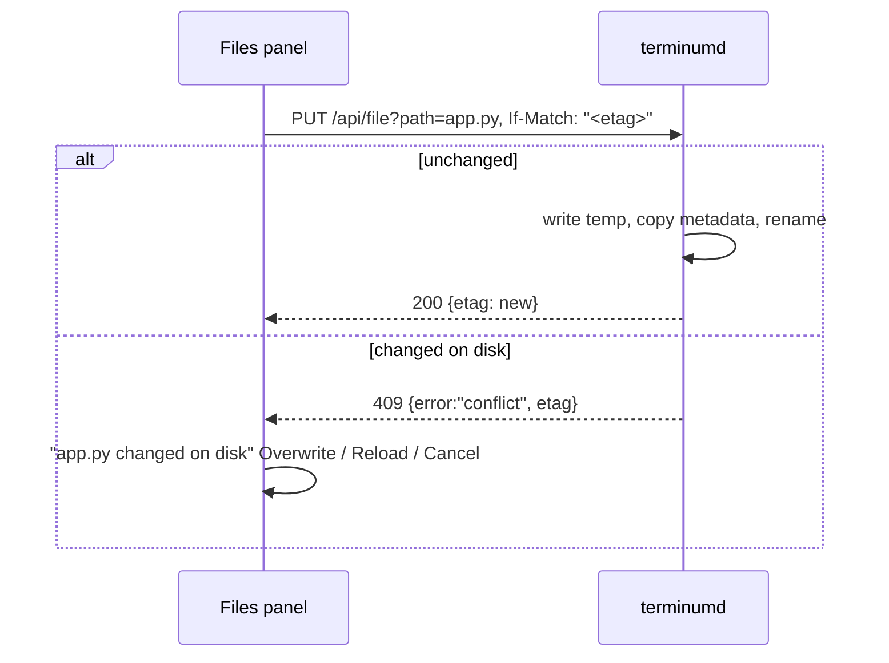

# terminum — Specification (Files panel)

Sibling of `terminum.md` (the core). This spec holds the Files panel: the tree, viewer and editor against terminumd, following the pane the page shows. Cases are AC-51…AC-73, AC-94 and AC-95. A case of another spec names its spec beside it.

## 0. Metadata

| Field | Value |
|---|---|
| Status | current |

A snapshot of what terminum must do, not a record of how it came to be: git holds that.

## 1. Overview

**Problem.** Reading the current directory in a terminal means `ls`, `cat`, `less` or another app; trees, Markdown and code are hard to scan; IDE trees do not follow `cd`; huge folders freeze GUI browsers.

**Who it affects.** Developers working in terminum's terminals, locally and on remote hosts, from a Mac, a tablet or a phone.

**Expected outcome.** A Files panel beside (or in place of) the terminal always shows the folder of the pane the page shows. It works like an IDE tree: browse, open, read with highlighting, render Markdown and HTML, edit and save, create, rename, Trash; it stays responsive in a huge folder; it remembers per pane which folders were open, what was selected and which files were open; it wears the pane's theme.

**Scenario, before and after.**
- Before: Alex runs `cd ~/work/api/docs`, `ls`, `less ci-design.md`, reads raw Markdown, `cd ../src`, opens vim to fix a typo, and forgets which files they looked at.
- After: Alex runs `cd ~/work/api/docs`. The panel shows `docs/`. Alex clicks `ci-design.md` and reads it rendered. Alex fixes the typo in Source and presses ⌘S. Switching panes switches trees; coming back, everything is where it was.

## 2. Scope and non-goals

In scope:
- The tree, viewer, editor, workspaces, watcher, file operations, utility actions, theme, keyboard, filter, media players, data views, hidden files, multi-select, links between documents, expand all, icons, upload by drop, the View window and docked layout, state persistence and cleanup; git colors and moving files by drag as later items.

Out of scope (explicit):
- Files of a remote host without the files helper (the tree says so; enabling it is `terminum-remote.md` AC-83).
- IDE features (LSP, project search), a second user, writes outside Roots.

## 3. Assumptions, dependencies, open questions

Assumptions:

| ID | Assumption | Owner | Status |
|---|---|---|---|
| AS-51 | The panel (`ui/`) runs in the page's iframe in its proxied mode (`PROXIED`, `ui/src/api.ts`) under `/fb/` against terminumd's Files API at `/fb/api/*`, pinned to the pane the page names in the frame's URL (`key`, `cwd`, `host`) and themed by the page's message, with its own workspace key `web:[host, key]` (`ui/src/embed.ts:17`). | Claude | verified: `ui/test/e2e_panel.mjs`, `web/test/e2e_live.mjs` |
| AS-52 | Reading a 500K-entry folder takes about 1 s with the OS's disk cache warm. | Claude | verified: `scripts/bench_ls.sh` |
| AS-53 | `#{pane_current_path}` is the pane's shell cwd (the foreground job's for a program that changed it, as tmux reports the active process's cwd on macOS through libproc), within 0.5 s of a `cd` at the prompt. | Claude | verified for shells; vim `:cd` unverified |

Dependencies:

| ID | Dependency | Owner | Status |
|---|---|---|---|
| DEP-51 | terminumd's Files modules: `listing.rs`, `files.rs`, `ops.rs`, `watcher.rs`, `workspace.rs`, `api_fs.rs`, `remote.rs`, `agent.rs`. | Claude | available |
| DEP-52 | CodeMirror 6, markdown-it 15, Mermaid 11, Tabler Icons (MIT, vendored) in `ui/`. | Claude | available |
| DEP-53 | rustysynth (`terminumd/src/midi.rs`) and GeneralUser GS 2.0.3 in the package (`scripts/package.py`), for MIDI (AC-64). | Claude | available |

Open questions:

| ID | Question | Owner | Status | Decision |
|---|---|---|---|---|
| OQ-51 | Should the Files panel follow the pane's folder on every `cd` (tree state cleared) also when the user is editing in the viewer? | Owner | resolved | Yes: tree state clears on `cd`, tabs stay (they hold absolute paths and unsaved edits). |
| OQ-52 | Where may the panel write? | Owner | resolved | Under `$HOME` and `/tmp` by default (`TM_WRITABLE_ROOTS`). |

## 4. Acceptance cases

| ID | Priority | Case |
|---|---|---|
| AC-51 | [MUST / P0] | The tree re-roots at the shown pane's folder within 1 s of a `cd` there, on this Mac or on an enabled host, and says why when the folder is unavailable. |
| AC-52 | [MUST / P0] | The user expands a folder with 500,000 entries and scrolls it smoothly; first rows within 2.5 s; the panel never freezes. |
| AC-53 | [MUST / P0] | The user reads a text file in a viewer tab with syntax highlighting by file name; binary, huge and gone files say so. |
| AC-54 | [MUST / P0] | Markdown opens rendered with typography and switches to highlighted source with one click; raw HTML in it is inert. |
| AC-55 | [MUST / P0] | Per pane, the expanded folders, selection, scroll and open tabs come back after switching panes or reloading; tree state clears on `cd`. |
| AC-56 | [SHOULD / P1] | The user edits a text file and saves with ⌘S; unsaved tabs are marked; a save over a file changed on disk is refused with a clear choice; saves are atomic and keep metadata. |
| AC-57 | [SHOULD / P1] | The user creates an empty file or a folder in the selected folder with the name typed inline. |
| AC-58 | [SHOULD / P1] | The user renames a file or folder inline; open tabs follow the new path. |
| AC-59 | [SHOULD / P1] | The user moves files and folders to the Trash after one confirmation. |
| AC-60 | [SHOULD / P1] | The user copies absolute or relative paths, reveals in Finder, opens with the default app, inserts a path into the pane, and `cd`s the pane to a folder, without anything running until the user presses Return. |
| AC-61 | [SHOULD / P1] | Changes made by other programs (create, delete, rename, edit) show in expanded folders and open tabs within 1 s, locally and on a host. |
| AC-62 | [SHOULD / P1] | Every tree and tab action works from the keyboard with IDE-standard shortcuts that never reach the terminal. |
| AC-63 | [SHOULD / P1] | The user filters the tree by name, including inside a 500K-entry folder. |
| AC-64 | [SHOULD / P1] | Images (png, jpg, gif, webp, svg), PDFs, videos and sounds preview in a tab; SVG scripts never run. |
| AC-65 | [SHOULD / P1] | Hidden (dot) files toggle on or off; the choice is remembered. |
| AC-66 | [SHOULD / P1] | Several items select with ⌘-click and ⇧-click, trashed or copied in one action, also across unloaded pages. |
| AC-67 | [SHOULD / P1] | Links in rendered Markdown and HTML open local documents in tabs at their `#anchor`, web links in the reader's browser, and the panel never navigates away; HTML renders sandboxed. |
| AC-68 | [SHOULD / P1] | Every folder below the root or a chosen folder expands in one action, bounded, and collapses again. |
| AC-69 | [SHOULD / P1] | A file's type shows as an icon in the tree and the tabs. |
| AC-70 | [SHOULD / P1] | On a wide page (a Mac browser) Files docks on the right beside the terminal and a file opens in a View window over it; on a narrow page (an iPhone) Files and View are views in the terminal's place. |
| AC-71 | [SHOULD / P1] | Per-pane state survives terminumd restarts with the scroll position; state of panes gone for 14 days is removed continuously; a corrupt state file is set aside. |
| AC-72 | [NICE TO HAVE / later] | Git status colors (modified, added, ignored) show in the tree. |
| AC-73 | [NICE TO HAVE / later] | Files move between folders by drag and drop. |
| AC-94 | [SHOULD / P1] | JSON, YAML, CSV and TSV open rendered (a tree that folds, a table), with a Source toggle. |
| AC-95 | [SHOULD / P1] | Files dragged from Finder onto the tree upload into the folder under the pointer, on this Mac or the pane's host, never over an existing file. |

## 5. BDD scenarios

### AC-51 — The tree follows the shown pane [MUST / P0]

```gherkin
Scenario: AC-51 happy path — cd re-roots the tree
  Given the page shows pane %3 (zsh) and Files is open
  When the user runs "cd /Users/alex/work/api" in %3
  Then within 1 s (every frame of the shown pane reads #{pane_current_path}; a change is sent to the page as `files`, whatever made it: Enter, a hot key, a script) the panel header shows the badge "TMUX" and "~/work/api", and the tree lists that folder
  And a remote pane shows "REMOTE devbox" and the host's folder once its helper is enabled (`terminum-remote.md` AC-82)
  When the user opens pane %4 in "/tmp"
  Then within 1 s the tree root is "/tmp" with %4's own state (AC-55)

Scenario: AC-51 happy path — the coding agent's folder
  Given the pane's Claude Code works in "/Users/alex/work/api/worktrees/fix" (it moved there; the pane's folder is still "/Users/alex/work/api")
  Then with "Follow the agent's folder" on (the default) the tree's root and the header's folder are "~/work/api/worktrees/fix", the folder its hooks last said (its own events, not a subagent's), and they move when it moves (within a frame of the pane's output)
  And with it off they are the pane's folder; a pane with no agent's hooks shows the pane's folder either way

Scenario: AC-51 edge — a foreground program in a subdirectory
  Given the shell's cwd is "/Users/alex/work/api" and vim runs there after ":cd src"
  Then the root follows what tmux reports (AS-53); the badge names the program ("vim")

Scenario: AC-51 failure — the folder is gone
  Given the pane's folder "/Users/alex/old" was deleted
  Then the tree's row says "⚠ No such file or directory (os error 2)"
  And the badge shows "GONE" and the tree keeps the last known root marked "cwd unavailable — showing last known"

Scenario: AC-51 failure — no folder to show
  Given tmux does not answer for the pane
  Then Files shows "The pane's folder is not known: <tmux's error>" in the frame's place
  Given the pane is on a host whose files are not enabled
  Then the badge shows "REMOTE", and Files says so and how to fix it (enable the host in Files on the Mac), offering Enable and Not now (`terminum-remote.md` AC-83)
```

### AC-52 — Very large folders [MUST / P0]

```gherkin
Scenario: AC-52 happy path — 500K folder
  Given "/tmp/fb-big" holds 500,000 files "f000000.txt".."f499999.txt"
  When the user expands it
  Then a spinner row shows while terminumd reads and other folders stay usable; within 2.5 s (warm cache) the first rows are visible sorted naturally; the scrollbar reflects 500,000 rows; the tree never renders more than 300 DOM rows
  When the user drags the scrollbar to the bottom
  Then within 300 ms rows "f499700.txt".."f499999.txt" are visible and j/k move the selection without delay

Scenario: AC-52 failure — permission denied
  When the user expands "/private/var/root"
  Then the folder shows one row "⚠ Permission denied (os error 13)" and the rest stays usable

Scenario: AC-52 edge — invalidation and unreadable names
  Given a scan runs with two callers waiting and the folder changes before it publishes
  Then one scanner rereads and both callers get the fresh listing; empty and failed listings count toward the cache budget
  And a byte-invalid UTF-8 name is reported as unreadable and never aliases a valid replacement-character name

Scenario: AC-52 happy path — sorting
  When the user right-clicks the tree (on a phone: holds a finger on it 0.5 s without moving) and picks Sorting › Recent First, Alphabetical or By Extension (the current one checked; Sorting opens with the pointer over it, a tap, → or ↩)
  Then every folder of the tree is listed in that order, folders always before files and sorted the same way among themselves: Recent First by last modified, newest first (a link by its own time); Alphabetical as Finder's names, case-insensitive with numbers by value (the default); By Extension case-insensitive, names without one (".gitignore", "Makefile") first, then by name (folders by name)
  And terminumd sorts (the tree pages the order, a filter keeps it, a host's agent the same); the order is made once per listing, a request for another order never waiting for it, and Recent First alone reads every entry's time (on up to 8 threads, within the 2.5 s; read again after each change in that folder, as the listing is); the choice is kept with the panel's prefs for every pane and page; expanded folders, the selection and the scroll stay
  And on a touch screen a finger never drags a row (it holds: the menu), a hold in a name being typed is the field's
```

### AC-53 — Read with highlighting [MUST / P0]

```gherkin
Scenario Outline: AC-53 happy path — highlighting by name
  When the user clicks "<file>"
  Then a read-only viewer tab opens with "<language>" highlighting and line numbers

  Examples:
    | file        | language   |
    | server.rs   | Rust       |
    | app.py      | Python     |
    | Dockerfile  | Dockerfile |
    | config.yaml | YAML       |
    | notes.txt   | Plain text |

Scenario: AC-53 edge — binary, huge, not UTF-8
  Then "logo.ico" shows "Binary file (image/vnd.microsoft.icon), 15 K" with "Open with default app" (on the Mac only); a 48.2 MB "access.log" shows its first 1 MB with "48.2 MB — showing first 1 MB, editing disabled"; non-UTF-8 text shows with U+FFFD and "Not UTF-8 — editing disabled"

Scenario: AC-53 error — gone or not a regular file
  When the user clicks a file deleted meanwhile
  Then the tab shows "⚠ No such file or directory (os error 2)" and no other tab changes
  And /api/file and /api/raw answer 400 "Not a regular file" at once for a FIFO or a device ("/dev/zero"), without reading
```

### AC-54 — Markdown rendered and source [MUST / P0]

```gherkin
Scenario: AC-54 happy path — rendered by default, source on a click
  When the user clicks "README.md"
  Then the tab opens Rendered: proportional text, headings, tables, task lists, footnotes, fenced ```rust highlighted (as the editor highlights it), relative images shown
  And a ```mermaid fence is drawn as its diagram (Mermaid in strict mode, as the terminal's widgets draw one, `terminum-terminal.md` AC-31; in the theme's light or dark), with "Source" over it to show its highlighted text and "Diagram" back; a fence Mermaid cannot draw shows its source with Mermaid's message above it
  When the user clicks "Source"
  Then Markdown source with Markdown highlighting; the choice is remembered for the tab

Scenario: AC-54 edge — raw HTML is inert
  Given "evil.md" contains ""
  Then it appears as literal text and no script runs

Scenario: AC-54 failure — a huge document
  Given a 12 MB Markdown file
  Then it opens as text with the size banner (AC-53), not rendered
```

### AC-55 — Per-pane memory [MUST / P0]

```gherkin
Scenario: AC-55 happy path — switching panes restores state
  Given in pane %3 (root ~/work/api) "src" and "src/db" are expanded, "src/db/pool.rs" selected, tabs "README.md" and "pool.rs" open with "pool.rs" active
  When the page shows %4 and then %3 again (or reloads)
  Then "src" and "src/db" are expanded, "pool.rs" selected and scrolled into view, the tabs back with "pool.rs" active (the workspace is keyed by the panel's web:["", "tmux:local:default:%3"], kept by terminumd)

Scenario: AC-55 edge — cd clears the tree, keeps tabs
  When the user runs "cd ~/work/web" in %3
  Then the tree shows "~/work/web" with nothing expanded or selected, and the tabs stay (OQ-51)

Scenario: AC-55 edge — stale answers
  Given a workspace read or a listing for a pane is pending
  When the page switched panes, or a newer read or write restored the current pane
  Then the older answer never replaces the current root, tabs or rows; a terminumd restart with reset revisions is still accepted; an expanded folder that was deleted is dropped silently

Scenario: AC-55 failure — a write races
  When two pages write the same pane's workspace
  Then the second gets 409 {"error":"stale_rev"}, re-reads and merges; nothing is lost
```

### AC-56 — Edit and save [SHOULD / P1]

```gherkin
Scenario: AC-56 happy path — save
  Given "app.py" is open
  When the user types "import os" at line 1 and presses ⌘S
  Then the "●" marker goes, the file holds the text, keeps its mode and extended attributes, CRLF separators stay CRLF; the write is a temp file renamed over the original

Scenario: AC-56 error — changed on disk, outside Roots, during a gap
  Given "app.py" was opened with etag "1727690000123456789-8812345-2048" and changed by vim
  When the user presses ⌘S
  Then "app.py changed on disk" with "Overwrite", "Reload (discard mine)", "Cancel"; the file is unchanged until Overwrite (If-Match: *)
  And "/etc/hosts" is read-only with "Read-only: outside writable folders"; a save while terminumd is unreachable fails at once with "Not saved: server restarting — save again"

Scenario: AC-56 edge — closing, competing saves, renames, size
  Then closing a dirty tab asks "Save changes to app.py?" (Save, Don't Save, Cancel); text typed before a closing save finishes stays unsaved in the open tab
  And text typed while a save is in flight stays unsaved; a ⌘S pressed before that save ends saves again once it does, so that text is written too
  And of two pages saving the same etag (symlink aliases included) exactly one succeeds and the other sees the conflict; a save pending across a rename retries on the current path and a stale old-path reply cannot mark it clean
  And a 9 MB file saves; a body over 6 × the text limit answers 413 as JSON; a 255-byte basename saves with no temp file left; a conflict dialog of one host's file is discarded only for that document when the pane switches hosts
```

### AC-57 — Create [SHOULD / P1]

```gherkin
Scenario: AC-57 happy path — file and folder
  Given "src" is selected
  When the user presses ⌥N (or "New File…"), types "util.rs", Enter
  Then "src/util.rs" exists empty, is selected and opens in a tab
  When the user presses ⌥⇧N, types "db/migrations", Enter
  Then "src/db/migrations" exists (intermediate folders made) and is expanded

Scenario: AC-57 edge — a selection whose folder does not open here
  Given the selection kept with the pane is "/Users/alex/elsewhere/notes.txt" (another folder) or a file under a closed folder whose parent is closed too
  When the user presses "New File…"
  Then the name's field opens at the top of the root, and the file is made there

Scenario Outline: AC-57 error — invalid name
  When the user types "<name>"
  Then the inline field shows "<message>" in red and nothing is created

  Examples:
    | name    | message                          |
    | util.rs | "util.rs" already exists in src   |
    | (empty) | A name is required               |
    | ..      | ".." is not a valid name         |

Scenario: AC-57 edge — outside Roots
  Then "New File…" and "New Folder…" are disabled in "/usr/local"
```

### AC-58 — Rename [SHOULD / P1]

```gherkin
Scenario: AC-58 happy path — rename with an open tab
  Given "notes.md" is selected and open
  When the user presses F2, types "ideas" (the extension stays), Enter
  Then "ideas.md" exists, "notes.md" does not, the tab is "ideas.md", and ⌘S saves the new path

Scenario: AC-58 error — target exists, also when made meanwhile
  Then ""ideas.md" already exists" and both files stay; Esc cancels; a target created by another writer during the rename is reported, both preserved

Scenario: AC-58 edge — a symlink
  Then a symlink is renamed where it lives (never its target), judged against Roots there
```

### AC-59 — Trash [SHOULD / P1]

```gherkin
Scenario: AC-59 happy path — trash a folder
  When the user selects "build", presses ⌘⌫ and confirms "Move "build" to Trash?"
  Then "build" is in ~/.Trash (a host's file manager trash on a host) and gone from the tree; tabs under it close; with unsaved tabs inside the dialog adds "1 unsaved file will be lost"

Scenario: AC-59 error — gone already, or the request fails
  Then "build: No such file or directory" as a toast and the tree refreshes; a request-level failure keeps every tab and edit, and only files reported trashed close their tabs
  And Enter activates the focused dialog button: Cancel or Close never chooses Move to Trash, Overwrite or Don't Save
```

### AC-60 — Utility actions [SHOULD / P1]

```gherkin
Scenario Outline: AC-60 happy path — context menu actions
  Given the root is "/Users/alex/work/api" and "src/db/pool.rs" is selected in pane %3
  When the user picks "<action>"
  Then "<result>"

  Examples:
    | action                  | result                                                                 |
    | Copy Path (⌥⌘C)         | the clipboard holds "/Users/alex/work/api/src/db/pool.rs"              |
    | Copy Relative Path      | the clipboard holds "src/db/pool.rs"                                   |
    | Reveal in Finder        | Finder opens "src/db" with "pool.rs" selected (the Mac's page only)    |
    | Open with Default App   | macOS opens it (the Mac's page only)                                   |
    | Insert Path in Terminal | %3 gets "src/db/pool.rs " (send-keys -l), no Enter                     |
    | Open Terminal Here      | %3 gets "cd /Users/alex/work/api/src/db", no Enter                     |

Scenario Outline: AC-60 security — quoting follows the pane's shell, nothing runs
  Given the pane's shell (#{pane_current_command}) is "<shell>" and the name is "<name>"
  Then "<typed>" is typed, or the toast "<refused>" shows; terminumd never sends Enter or a control character; "cd" goes only into an idle shell ("Terminal is busy (vim) — command not sent")

  Examples:
    | shell                         | name       | typed            | refused                                                                |
    | zsh, bash, sh, dash, ksh      | it's a\b   | 'it'\''s a\b'    |                                                                        |
    | fish                          | it's a\b   | 'it\'s a\\b'     |                                                                        |
    | tcsh, csh, nu, xonsh, unknown | it's       |                  | Name cannot be typed safely into tcsh                                  |
    | any                           | -rf        | ./-rf            |                                                                        |
    | any                           | a‮b (U+202E)|                  | Name contains control or invisible characters — not sent to the terminal |

Scenario: AC-60 edge — another device and remote files
  Then Finder and "Open with Default App" are not offered on a page from another device or for remote files; "Insert Path in Terminal", "Open Terminal Here" and "Open in Window" are offered only at the Mac; terminumd refuses a forwarded /api/os or /api/terminal request with 403 and a remote file's with "Not available for remote files"; queued text is checked at delivery: a pane or shell that changed meanwhile gets nothing and the page is told
```

### AC-61 — Live refresh [SHOULD / P1]

```gherkin
Scenario: AC-61 happy path — new file, clean tab reloads, dirty tab asks
  Given "src" is expanded and "app.py" open clean
  When another program runs "touch src/new.rs" and edits "app.py"
  Then within 1 s "new.rs" appears sorted and the tab shows the new content keeping its scroll; a dirty tab shows "Changed on disk" with "Reload" and "Keep mine"

Scenario: AC-61 edge — a failed watch, bursts and stale listings
  Given installing a filesystem watch failed temporarily
  When the same folder is requested again after the cause clears
  Then the watch is retried and only successfully installed subscriptions count as watched
  When "npm install" writes 40,000 files into an expanded "node_modules"
  Then the tree updates at most twice a second; an older listing page arriving after a fresh one cannot replace it

Scenario: AC-61 failure — a lagged remote stream
  Given a host's event stream falls behind and reconnects
  Then a host-scoped rescan refreshes the visible folders and re-checks open files' etags; dirty buffers stay, also a file whose rename was missed
```

### AC-62 — Keyboard [SHOULD / P1]

```gherkin
Scenario Outline: AC-62 happy path — shortcuts in the tree
  Given the tree has focus and "src" is selected
  When the user presses "<key>"
  Then "<result>"

  Examples:
    | key       | result                                          |
    | ↓ / ↑     | selection moves one row                         |
    | → / ←     | expand / collapse (or go to the parent)         |
    | Enter     | open a file; expand or collapse a folder        |
    | F2        | rename (AC-58)                                  |
    | ⌥N, ⌥⇧N   | new file, new folder (AC-57)                    |
    | ⌘⌫        | Trash (AC-59)                                   |
    | /         | focus the filter                                |
    | ⌥W, ⌃Tab  | close tab, next tab                             |
    | ⌥→ / ⌥←   | expand all / collapse all below (AC-68)         |

Scenario: AC-62 edge — shortcuts stay in the panel
  Then keys pressed in the panel never reach the terminal, and ⌘N, ⌘W, ⌘T are left to the browser; End or PageDown on an unloaded page selects the loaded target row and Delete cannot delete the previous one
```

### AC-63 — Filter [SHOULD / P1]

```gherkin
Scenario: AC-63 happy path — loaded tree and a 500K folder
  When the user types "pool"
  Then every shown folder lists only names containing "pool", expanded folders stay visible, matches highlighted
  When "fb-big" is expanded and the user types "f49999"
  Then within 500 ms it shows the 10 matching rows and "10 of 500,000" (filtered by terminumd)

Scenario: AC-63 edge — no match
  When the user types "zzz"
  Then a folder with no match shows the row "no matches", and Esc clears the filter
```

### AC-64 — Images, PDFs, videos and sounds [SHOULD / P1]

```gherkin
Scenario: AC-64 happy path — a picture and a closer look
  When the user clicks "docs/arch.png" (1920×1080, 240 K)
  Then a tab shows it fitted with "1920 × 1080 · 240 K", in the middle of the tab, a checkerboard behind it alone (its transparent parts show within its edges)
  When the user clicks the picture
  Then it opens full screen in the page's viewer, fitted: two fingers pinch, the wheel zooms around the pointer, a drag pans, a double click toggles fitted and 1:1; −, +, Fit and × (or Esc) in its corner
  And in a View of its own (no page around) a click shows it at its own size, scrolled, and another fits it again

Scenario: AC-64 happy path — a PDF, a video, a sound
  When the user opens "docs/spec.pdf", "demo.mp4" or "note.mp3"
  Then its tab shows the PDF in the browser's own viewer, filling the tab (its pages, zoom, find, print, its own download), or the video or the sound in the browser's player with its controls, not started, Download (Open with default app on this Mac's own page) under it
  And the file is fetched with the sign-in's header and shown from a blob: address of its own type, revoked once its tab closed (a picture's too: it opens by its address while shown); within `/api/raw`'s limit (§9), as an image
  And a video or a sound no longer shown (another file, its tab closed) is stopped and let go at once

Scenario: AC-64 happy path — every sound
  When the user opens a sound
  Then one the browser plays (MP3, AAC and M4A, WAV, FLAC, Ogg, Opus; AIFF and AU in Safari) plays in the browser's player
  And an AU (.au, .snd: μ-law, A-law, 8-, 16-, 24-, 32-bit and float PCM) or an AIFF (.aif, .aiff: 8-, 16-, 24- and 32-bit PCM) the browser does not play is decoded in the panel into a WAV and plays in the same player; one it cannot decode says why
  And a MIDI file (.mid, .midi, .kar; formats 0 and 1) is sent to terminumd (POST /api/midi, at most 4 MB, also from a remote host's file: the page has its bytes), which renders it with the SoundFont named in settings.json's midi.soundfont (else ~/.terminum/soundfont.sf2, else the package's GeneralUser GS 2.0.3; read once and kept while its file is unchanged; at most 10 minutes, 44.1 kHz stereo, rendered a block at a time, two at once, the others waiting; one whose tab closed or file changed is called off) into a WAV the same player plays: it seeks, pauses and sets its volume as any sound; the bank's name shows under it
  But with none of them readable the tab says "No SoundFont for MIDI: put a General MIDI .sf2 at ~/.terminum/soundfont.sf2 or name one in settings.json (midi.soundfont)"; a file it cannot read says why
  And a sound nothing here plays says "This browser cannot play <type>" with the same Download

Scenario: AC-64 edge — svg is inert
  Given "icon.svg" holds a <script>
  Then it shows as an image element and nothing runs
```

### AC-65 — Hidden files [SHOULD / P1]

```gherkin
Scenario: AC-65 happy path — toggle
  When the user clicks the eye button (or ⌘⇧.)
  Then ".git" and ".env" disappear and the choice persists after a reload

Scenario: AC-65 edge — the selected item becomes hidden
  Then the selection moves to the parent folder
```

### AC-66 — Multi-select [SHOULD / P1]

```gherkin
Scenario: AC-66 happy path — two files, a range
  When the user clicks "a.log", ⌘-clicks "c.log", presses ⌘⌫ and confirms "Move 2 items to Trash?"
  Then both are in the Trash; a ⇧-click from "a.log" to "e.log" selects 5 rows and "Copy Path" copies 5 lines

Scenario: AC-66 edge — remembered, across unloaded pages
  Then a selection of 3 items comes back after a pane switch (AC-55); a range across unloaded pages loads them in bounded batches and selects all; a pane or root switch cancels it without a partial destructive target
```

### AC-67 — Links and HTML documents [SHOULD / P1]

```gherkin
Scenario: AC-67 happy path — Markdown, HTML, anchors, web
  When the user clicks a link to "docs/guide.md" in a rendered file
  Then "docs/guide.md" opens in a new tab Rendered; a link to "docs/report.html#sec2" opens report.html rendered in a sandboxed frame scrolled to "#sec2" with its relative images; "<a href='../README.md#sandbox'>" inside report.html opens README.md at "#sandbox"; "Reveal in tree" expands the file's folders and selects it; it is offered only for a file under the folder Files shows (the pane's, which the page tells View)
  When the user clicks a link to "https://github.com/tmux/tmux"
  Then the reader's default browser opens it (new tab, noopener) and the panel stays

Scenario: AC-67 edge — scripts, frames, odd names
  Then report.html's scripts and handlers never run, nor do those of a picture or video it names opened as a page (an SVG is shown from a data: address, a file of another type than a picture, a video or a sound as bytes)
  And a file's own data-raw attribute is dropped with its handlers: a planted '<link data-raw="/etc/hosts">' reads nothing, and only its local src and href are fetched with the sign-in
  And a video's or a sound's address is let go once its document closed; a local image name with "#", "?" or "%" is addressed exactly through its percent-encoded path; a resource URL with an invalid escape leaves the document visible and marks the resource broken

Scenario: AC-67 error — broken link
  Then "gone.md: No such file or directory" as a toast
```

### AC-94 — JSON, YAML, CSV and TSV [SHOULD / P1]

```gherkin
Scenario: AC-94 happy path — JSON and YAML as a tree
  When the user opens "package.json" or "config.yaml"
  Then its tab is Rendered (the Source toggle shows the text, to edit, as for Markdown): a tree of its objects (mappings) and arrays (sequences), each key before its value, a folded one with its count ("{12}", "[3]"), keys, strings, numbers, true, false and null in the editor's syntax colors; open as far as 2000 rows allow (level by level: a level that would pass them stays folded), a click on a row folds or unfolds it, Expand all (as far as 20,000 rows) and Collapse all at the top; a YAML file of several documents shows each
  And a row's value copies with its button (a JSON text of its subtree); a long string wraps
  And a folder of more than 1000 children, the top level too, shows the first 1000 and "… 2,300 more" (a press shows the next 1000)
  And every key is a member as named (`__proto__`, `constructor` too), shown, counted and copied
  And YAML explicit block indentation keeps spaces beyond its indicated indent, and a backslash-escaped quoted line end joins the next line without an added space

Scenario: AC-94 happy path — CSV and TSV as a table
  When the user opens "data.csv" or "data.tsv"
  Then its tab is Rendered: a table whose first row is the head (sticky), its rows numbered, quoted fields (RFC 4180: commas, quotes and new lines inside) read as one cell, numbers right-aligned, as many columns as its widest row; at most 5000 rows shown with "… 12,000 more rows" (a press shows the next 5000); a last record `""` (an empty field) is a row with or without a line end after it

Scenario: AC-94 failure — a file that does not parse
  When the JSON or YAML is not valid (a YAML key twice in one mapping, an escape past Unicode too), or the CSV has an unclosed quote
  Then Rendered says why and where ("Line 12, column 4: …") over the Source, which still edits it; a file over the text limit shows as the others do
  And a YAML alias must name an earlier anchor in its own document; an undefined or cross-document alias reports its line and column
```

### AC-95 — Upload by dropping files on the tree [SHOULD / P1]

```gherkin
Scenario: AC-95 happy path — the folder under the pointer
  Given the tree shows "src" expanded (its files "a.ts", "b.ts"), "docs" collapsed and "README.md" at the root
  When the user drags "photo.png" and "notes.txt" from Finder over "b.ts"
  Then "src" is the target while the pointer is there: its row and its rows under it marked in the accent, a line at the top of the tree says "Upload 2 files to src"; over "docs" (a folder's own row) "docs"; over "README.md" or below the last row the root
  When the user drops them over "b.ts"
  Then each is saved in "src" under its own name (one after another, the bytes as they are, by the tree's host: this Mac or the pane's host, `terminum-remote.md` AC-82), the tree shows them, a toast says "Uploaded 2 files to src"

Scenario: AC-95 edge — a name taken, a folder, a read-only place
  When "notes.txt" exists in "src"
  Then the panel asks "“notes.txt” is in src already" with Keep Both (saved as "notes 2.txt", the next free number) and Skip; nothing is ever written over; a name taken by a link (to a file outside the writable roots too) is a name taken, and the link is left as it is
  And a folder dropped is not uploaded (said in the toast with the others' outcome); a folder outside the writable roots is no target (the drag shows "Read-only: outside writable folders" and drops nothing)

Scenario: AC-95 failure — too large, refused, gone
  When a file is over 100 MB, the host does not answer or terminumd refuses it
  Then the toast names the file and terminumd's reason; the files before it stay, those after it are not sent
  And a third upload while two run is refused with a 429 (`terminum-terminal.md` AC-36)
```

### AC-68 — Expand and collapse all [SHOULD / P1]

```gherkin
Scenario: AC-68 happy path — header buttons and keys
  Given the root holds "src/a/b", "docs", "node_modules/x", ".git/objects"
  When the user clicks "Expand all" (or ⌥→ on "src")
  Then "src", "src/a", "src/a/b", "docs" expand, "node_modules" and ".git" stay collapsed, one workspace write stores it, a toast says "Expanded 4 folders · skipped 2 (node_modules, .git)"; "Collapse all" (⌥←) collapses everything

Scenario Outline: AC-68 edge — limits
  Then "<folder>" "<result>"

  Examples:
    | folder                                                      | result                                        |
    | node_modules, .git, target, dist, build, .venv, venv, __pycache__, .next, .cache, Pods, DerivedData | stays collapsed, named in the toast |
    | a symlink to a folder                                       | stays collapsed (no cycles)                   |
    | a folder with more than 500 entries                         | stays collapsed, counted as "too large"       |
    | depth 9, or the 201st folder                                | stays collapsed; the toast says the limit     |

Scenario: AC-68 failure — interrupted or unreadable
  Then a pane switch, re-root or collapse stops the expansion within one folder load with no workspace write; an unreadable folder shows its error row and the others expand
  And a delayed locate answer after Collapse all cannot reopen the folder or restore its expanded children
```

### AC-69 — File-type icons [SHOULD / P1]

```gherkin
Scenario Outline: AC-69 happy path — icon by name
  Then "<name>" shows the "<icon>" icon in the "<color>" theme color

  Examples:
    | name               | icon     | color   |
    | main.rs, app.py    | code     | code    |
    | package.json       | braces   | config  |
    | Cargo.toml, .env   | settings | config  |
    | README.md          | markdown | doc     |
    | logo.png, a.svg    | photo    | image   |
    | dist.tar.gz        | zip      | archive |
    | id.pem, tls.key    | key      | config  |
    | a.out, lib.dylib   | binary   | faint   |

Scenario: AC-69 edge — names win, folders and tabs
  Then "Makefile" and "Dockerfile" use settings, "id_ed25519" key; folders show a folder icon (open while expanded); each tab shows its file's icon
```

### AC-70 — Docked Files and the View window [SHOULD / P1]

```gherkin
Scenario: AC-70 happy path — a wide page
  Given the page is at least 1400 px wide
  Then Files is docked on the right, full height, until its × closes it; the Files button and ⌘B open and close it; it wears the shown pane's theme
  And open or closed is remembered for each session in this browser: closing Files in one session leaves it open in the others, and switching to a session shows Files as that session last had it (a session never changed: docked); the view's new width reaches tmux with the opening's own size, never as a second resize
  And the band between the terminal and Files is a separator: dragging it sets Files' width (at least 260 px, at most 60% of the page's column beside the list, never leaving the terminal under 45 columns), the terminal following at once and tmux once the drag rests; the width is kept in this browser for every session; with the keyboard, ← → move it 16 px; a double click puts back 380 px
  And on a switch Files shows nothing of the session left until the shown session's folder is in, also after a quick switch away and back (half a second or less)
  When the user opens a file (a click in the tree, or a file just made with New File…: it never opens under the tree inside the page)
  Then View is a window over the terminal with its tabs and a bar showing the full path (selectable, with a copy button and a toast "Copied …"); × or closing its last file closes it; the terminal keeps its keys
  When the user presses Esc in View (its file, its tabs or its head; at any width)
  Then View hides as its × hides it (its tabs stay) and the terminal is shown with the keys; an Esc the editor takes first (its search panel, a completion list, a dialog, a rename) does only that
  When the user opened a file from the tree (Enter or a click: the tree keeps the keys) and presses Esc in the tree
  Then View hides and the keys stay in the tree, so the next file is a ↓ and Enter away; an Esc in the filter or a rename does what AC-63 and AC-58 say
  And at WIDE it has no Terminal key (its × closes it); its head, the path bar and the tab row stand on one grid: their text 12 px from the left, their keys (×, copy, Reveal beside the tabs) 24 px with 6 px above, below and to the right

Scenario: AC-70 happy path — a narrow page
  Given the page is narrower than 1400 px
  Then Files and View are views in the terminal's place (the view tabs Terminal, Files, View); View has a "Terminal" key at its bottom left (a key as the others: their fill, radius and edge, a finger's height); closing View's last file shows the terminal and disables the View button; widening docks Files again and an open View becomes the window

Scenario: AC-70 happy path — a second browser tab
  When the user ⌘-clicks a file (or ⌘↩, "Open in Window") on the Mac
  Then the browser opens a new tab of the page at "/view" showing View alone with that file, signed in by the page's own sign-in (its storage is per origin, so no secret is in the address); further files from the first tab join it as tabs (a BroadcastChannel); on a phone the item is not offered

Scenario: AC-70 edge — View belongs to its session
  Given View shows "pool.rs" opened from session "api"
  When the user shows session "docs" in the session list
  Then View is closed (the terminal of "docs" is shown, or "docs"'s own View if it had one open) and the View button is enabled only when "docs" has files open
  When the user shows "api" again
  Then its View is back as it was: its tabs, unsaved edits and scroll, open or closed as the user left it
  And while it waited it heard nothing from terminumd (its event stream paused) and on coming back it rechecks its files and folders
  When session "api" closes
  Then its View goes with it, unless it holds unsaved edits (then it waits until they are saved or the page closes); a host that is only reconnecting keeps its sessions' Views

Scenario: AC-70 edge — the viewer and hosts
  Then pending viewer files keep their host: a local and a remote file with the same path never share a tab or unsaved edits
```

### AC-71 — State survives and expires [SHOULD / P1]

```gherkin
Scenario: AC-71 happy path — terminumd restarts
  Given in %3 "src" and "src/db" are expanded and the tree is scrolled to row 412
  When terminumd restarts (`terminum-lifecycle.md` AC-14)
  Then the panel reconnects and shows the same, scrolled to row 412 (workspaces.json, debounced 500 ms, atomic, written complete at shutdown)

Scenario: AC-71 failure — a save of the panel's state fails
  When terminumd refuses or does not answer a write of the workspace or the preferences
  Then the panel says "Panel state not saved: <message>" or "Preferences not saved: <message>" once, until that kind of save works again, and sends it again on the next change or reconnect
  And an answer lost for a write that landed is recognized by its pane and content: the newer change is kept
  And a panel sends one write of each kind at a time, the newest snapshot when it starts, so terminumd keeps its writes in their order
  When terminumd accepted a write but cannot put workspaces.json on disk (the disk full, the folder refused)
  Then every panel's banner says "Panel state not saved to disk <message>", also one that connects meanwhile; terminumd tries again by itself after 1 s, doubling to every 60 s, and the banner goes once a write works
  When a write is not a pane's state (a root that is not a full path, a tab's view not auto, rendered or source, the active tab not one of its tabs; preferences not an object)
  Then it is refused with 400 and why, and nothing changes

Scenario: AC-71 edge — expiry
  Given a pane's state was last used 15 days ago and the pane is not in any tmux server
  Then it is removed at the next inventory (every 5 minutes) without a restart; a live pane's state stays however old; an unknown host's panes are kept until the host answers

Scenario: AC-71 failure — a corrupt file
  Given "workspaces.json" holds "{not json"
  Then terminumd renames it to "workspaces.json.bak", starts empty and logs "event=workspace.reset reason=parse_error"
```

### AC-72 — Git status colors [NICE TO HAVE / later]

```gherkin
Scenario: AC-72 happy path — a modified file
  Given "src/app.rs" is modified in git
  Then its name shows in the "modified" color with "M" on the right

Scenario: AC-72 edge — not a repository
  Then no colors and no git process more than once per 5 s
```

### AC-73 — Drag and drop [NICE TO HAVE / later]

```gherkin
Scenario: AC-73 happy path — move a file
  When the user drags "notes.md" onto "docs"
  Then "docs/notes.md" exists and "notes.md" does not

Scenario: AC-73 error — name clash
  Then the drop is refused with ""notes.md" already exists in docs"
```

## 6. Flow and sequence diagrams

### Following the shown pane (AC-51, AC-55)

```mermaid
sequenceDiagram
  participant T as tmux
  participant D as terminumd
  participant P as Page
  participant F as Files panel (iframe)
  T-->>D: a frame of the shown pane (pane_current_path)
  D-->>P: {"t":"files","key":"tmux:local:default:%3","cwd":"/Users/alex/work/api","home":"/Users/alex","host":null}
  P->>F: frame URL /fb/?key=…&cwd=…&host=… ; message fb-theme
  F->>D: GET /api/workspace?key=…&cwd=… ; PUT /api/watch ; GET /api/ls?path=…
  D-->>F: workspace {rev, expanded, tabs…} ; rows
```

The shown pane is the one: there is no focus tracking.

### Save with conflict check (AC-56, AC-61)



A crash never leaves a half-written file.

## 7. Current behavior and gaps

| AC | Gap | Evidence |
|---|---|---|
| AC-51 | The badge shows only `tmux` or `remote`: never "GONE" or the program's name. Nothing sends `stale` or `note`, so "cwd unavailable — showing last known" never shows. A gone folder shows its error row in the tree instead. | `ui/src/main.ts:151`, `ui/src/main.ts:162`, `terminumd/src/panel_api.rs:34` |
| AC-51 | `web/test/e2e_files.mjs`, named as the measure of "p95 < 1 s over 20 cds", does not exist; only a single wait with a budget checks it. | `ui/test/e2e_panel.mjs:54` |
| AC-52 | j and k do not move the selection; ↓ and ↑ do. | `ui/src/tree-input.ts:102` |
| AC-62 | ⌥W, ⌃Tab and `/` work but no test presses them. | `ui/src/main.ts:397`, `ui/src/main.ts:417`, `ui/src/main.ts:418` |
| AC-63 | "10 of 500,000" is not shown: a filtered folder shows its rows and no count. The 500 ms budget is not measured: `scripts/bench_ls.sh` sends no filter. | `ui/src/tree-rows.ts:60`, `scripts/bench_ls.sh:19` |
| AC-65 | ⌘⇧. is not bound: only the eye button toggles. A selected item that becomes hidden leaves the selection; the selection does not move to its parent. | `ui/src/main.ts:383`, `ui/src/tree.ts:119` |
| AC-72 | Not built: a listing row has no git field and nothing runs git. | `terminumd/src/listing.rs:86` |
| AC-73 | Not built: a row dragged inside the tree is not taken as a move. | `ui/src/tree-drop.ts:7` |
| AC-95 | A hidden part file stays in the folder if terminumd dies during an upload's write. | `terminumd/src/ops.rs:224` |

## 8. Recommendation and ownership

**Approach.** The panel is its own bundle, embedded by the page as an iframe (AS-51). A page shows one pane, and the panel's `web:` key for it is its workspace. terminumd owns listings, the watcher, file operations and workspaces, and proxies a host's requests to its Agent.

**Rejected alternative.** A tree inside the terminal view (one DOM): an iframe keeps the panel's own tests, and its CSP and sandbox for rendered HTML, apart from the terminal.

**Ownership.** terminumd's Files modules, `ui/` and the page's embedding are maintained together; the maintainer accepts on their Mac and hosts.

## 9. Technical details and specifications

### Interfaces

All `/fb/api/*` need the sign-in header (`terminum.md` AC-09), a remote host's its `X-TM-Host` too (`terminum-remote.md` AC-82). JSON in and out; errors `{"error","message"}`.

| Method and path | Purpose | Case |
|---|---|---|
| `GET /fb/api/ls?path&offset&limit&filter&hidden&sort&locate` (every path below under `/fb/api/`) | a page of a folder, `writable`, `located`; `sort` is `name`, `recent` or `ext` | AC-52, AC-63, AC-65 |
| `GET /api/file?path` (`If-None-Match`) | text and meta; 304 when unchanged | AC-53, AC-54, AC-61 |
| `GET /api/raw?path` | bytes with MIME, streamed, never read whole; one `Range: bytes=` answers 206 with `Content-Range` (416 when past the end; several ranges get the whole file), also through a host's Agent | AC-64, AC-67 |
| `PUT /api/file?path` (`If-Match`) | save | AC-56 |
| `POST /api/fs/{mkdir,touch,rename,trash}` | operations | AC-57–AC-59, AC-66 |
| `POST /api/fs/upload?dir&name&both` | a dropped file's bytes as the body; with `both=1` a taken name is saved as "name 2.ext" | AC-95 |
| `POST /api/midi` | a MIDI file's bytes in, its WAV out, the bank's name in `x-tm-soundfont` | AC-64 |
| `POST /api/os/{reveal,open}` | Finder, default app | AC-60 |
| `POST /api/terminal/{insert,cd}` | `{key, paths}` / `{key, path}` | AC-60 |
| `GET/PUT /api/workspace?key&cwd` | per-pane state with `rev`, `X-TM-Client`; a GET's `cwd` re-roots it when the folder moved | AC-55, AC-71 |
| `PUT /api/watch` | `{root, expanded}`: the folders this panel watches | AC-61 |
| `GET/PUT /api/prefs` | `{hidden, split, sort}` | AC-52, AC-65, AC-70 |
| `GET /api/state?host` | the build, `unsaved` (the last failed write of workspaces.json, or null) and a host's files offer | AC-71, `terminum-remote.md` AC-83 |
| `GET /api/ws` | the panel's socket: `{"event","data"}` frames `state`, `fs-change {host, dirs, files, moved}`, `workspace {key, rev, by}`, `rescan {host}`, `host {host}` (a host's files offer changed: read `/api/state` again) and `unsaved {error}` (workspaces.json not written, or written again: null) | AC-61, AC-71 |

Example:

```bash
curl -s -H "X-TM-Session: …" "http://127.0.0.1:48080/fb/api/ls?path=/tmp/fb-big&offset=0&limit=3"
# {"path":"/tmp/fb-big","status":"ready","total":500000,"offset":0,"writable":true,"gen":1,
#  "entries":[{"n":"f000000.txt","k":"f","s":0},{"n":"f000001.txt","k":"f","s":0},{"n":"f000002.txt","k":"f","s":0}]}
```

### Data formats

`workspaces.json`:

```json
{"version": 1, "prefs": {"hidden": true, "split": 0.5, "sort": "name"},
 "panes": {"web:[\"\",\"tmux:local:default:%3\"]": {"rev": 17, "root": "/Users/alex/work/api",
   "expanded": ["/Users/alex/work/api/src"], "selected": ["/Users/alex/work/api/src/db/pool.rs"], "scroll": 412,
   "tabs": [{"path": "/Users/alex/work/api/README.md", "view": "rendered"}], "active_tab": 0, "updated": 1792000000}}}
```

A tab's `view` is `auto`, `rendered` or `source`. `prefs.hidden` true shows dot files. The etag is `<mtime ns>-<inode>-<size>`. Unsaved edits live in the panel's memory per key, never in the file.

### Configuration

| Key | Default | Example | Effect |
|---|---|---|---|
| `TM_WRITABLE_ROOTS` | `$HOME:/tmp` | `$HOME:/tmp:/opt/work` | Roots (OQ-52) |
| `TM_LIST_CACHE_MB` | `128` | `64` | listing cache, its sort and filter indexes counted |
| `TM_TEXT_MAX_BYTES` | `10485760` | `5242880` | the text limit: above it, AC-53's banner |
| `TM_WORKSPACE_TTL_DAYS` | `14` | `30` | idle pane state removed after |

### Performance

| Operation | Target | Measured by |
|---|---|---|
| cd → tree re-rooted | p95 < 1 s | no repeated measure (section 7); `ui/test/e2e_panel.mjs` waits once |
| First page of a 500K folder, not in terminumd's cache (the OS's disk cache warm) | p95 < 2.5 s | `scripts/bench_ls.sh /tmp/fb-big` (fresh terminumds; p50, p95, max) |
| Later page of a cached folder | p95 < 50 ms | same |
| terminumd RSS with one 500K folder cached | < 150 MB in every run | same |
| Filter a 500K folder | p95 < 500 ms | not measured (section 7) |
| Scroll | no frame over 50 ms | by hand, Web Inspector timeline |

### Constraints and limits

| Limit | Value | When exceeded |
|---|---|---|
| Page size | 500 entries | clamped |
| Binary detection | NUL in the first 8 KB | binary tab |
| Name length | 255 bytes | "Name is too long (max 255 bytes)" |
| `/api/raw` | 64 MB, judged from the size first | 400 "Larger than 64 MB" |
| Watched folders | expanded folders of shown panes + open tabs | others re-validated by mtime |

### Security

Writes only under Roots after `realpath` (a symlink cannot escape; a symlink itself is judged where it lives for rename and trash); `..` refused; CSP `default-src 'self'; img-src 'self' data: blob:; media-src 'self' blob:; style-src 'self' 'unsafe-inline'; font-src 'self' data:; script-src 'self'; connect-src 'self' ws://{host} wss://{host}; frame-src 'self' blob:; frame-ancestors 'self'; base-uri 'self'; form-action 'self'`; `/api/raw` answers with `default-src 'none'; img-src data:; style-src 'unsafe-inline'; sandbox`; a `blob:` has the page's origin, hence what may be shown from one (AC-64, AC-67).

Denied request:

```bash
curl -s -X POST -H "X-TM-Session: …" -H "Content-Type: application/json" -d '{"path":"/etc/newdir"}' http://127.0.0.1:48080/fb/api/fs/mkdir
# 403 {"error":"outside_writable_roots","message":"Read-only: outside writable folders"}
```

### Compatibility

`terminum import` takes the `workspaces.json` of iterm-enhancer: `web:` entries whose pane key is `tmux:…` are kept, entries of iTerm2 sessions dropped.

### Logging and observability

Logs as `terminum.md` §9 Logging and observability; no metrics are exported. Events: `ls.done {path, entries, ms}`, `ls.error {path, error}`, `save {path}`, `save.conflict {path}`, `mkdir`, `touch`, `upload {path}`, `rename {from, to}`, `trash {count, failed}`, `workspace.reset {reason, backup}`, `workspace.write_failed {path}`, `ws.lagged {missed}`.

## 10. Delivery stages

| Stage | Cases | What a user can do | Effort |
|---|---|---|---|
| Later | AC-72, AC-73 | See git status in the tree; move files between folders by dragging | — |

## 11. Checklist with Definition of Done

- [x] AC-51 — `ui/test/e2e_panel.mjs`, `ui/test/e2e_panel_more.mjs`, `ui/test/e2e_layout.mjs`, `web/test/e2e_header.mjs`, `scripts/e2e_hooks.py`
- [x] AC-52 — `ui/test/e2e_panel.mjs`, `ui/test/e2e_panel_more.mjs`, `cargo test listing`, `scripts/bench_ls.sh`
- [x] AC-53 — `ui/test/e2e_panel.mjs`, `cargo test files`
- [x] AC-54 — `ui/test/e2e_panel.mjs`, `ui/test/e2e_panel_docs.mjs`, `ui/test/e2e_panel_more.mjs`, `ui/test/markdown.test.mjs`
- [x] AC-55 — `ui/test/e2e_panel.mjs`, `cargo test workspace`
- [x] AC-56 — `ui/test/e2e_panel.mjs`, `cargo test ops`
- [x] AC-57 — `ui/test/e2e_panel.mjs`, `ui/test/tree-cancel.test.mjs`, `web/test/e2e_live.mjs`, `cargo test ops`
- [x] AC-58 — `ui/test/e2e_panel.mjs`, `cargo test ops`
- [x] AC-59 — `ui/test/e2e_panel.mjs`, `ui/test/e2e_panel_review.mjs`
- [x] AC-60 — `ui/test/e2e_panel.mjs`, `cargo test termtext`
- [x] AC-61 — `ui/test/e2e_panel.mjs`, `ui/test/stream.test.mjs`, `cargo test watcher`
- [x] AC-62 — `ui/test/e2e_panel.mjs`, `ui/test/e2e_panel_review.mjs`, `ui/test/e2e_review.mjs`
- [x] AC-63 — `ui/test/e2e_panel.mjs`, `cargo test listing`
- [x] AC-64 — `ui/test/e2e_panel.mjs`, `ui/test/e2e_panel_media.mjs`, `ui/test/pcm.test.mjs`, `web/test/e2e_liveview.mjs`, `cargo test midi`, `cargo test raw_body`
- [x] AC-65 — `ui/test/e2e_panel.mjs`
- [x] AC-66 — `ui/test/e2e_panel.mjs`, `ui/test/tree-select.test.mjs`
- [x] AC-67 — `ui/test/e2e_panel.mjs`, `ui/test/e2e_panel_docs.mjs`, `web/test/e2e_liveview.mjs`
- [x] AC-68 — `ui/test/e2e_panel.mjs`, `ui/test/e2e_panel_review.mjs`, `ui/test/tree-expand.test.mjs`
- [x] AC-69 — `ui/test/e2e_panel.mjs`, `ui/test/icons.test.mjs`
- [x] AC-70 — `ui/test/e2e_panel.mjs`, `ui/test/e2e_panel_more.mjs`, `web/test/e2e_dock.mjs`, `web/test/e2e_switch.mjs`, `web/test/e2e_app.mjs`, `web/test/e2e_viewpark.mjs`, `web/test/e2e_liveview.mjs`, `web/test/e2e_live.mjs`
- [x] AC-71 — `ui/test/e2e_panel.mjs`, `ui/test/e2e_panel_saves.mjs` (a write failed on disk: the banner, the retry), `cargo test workspace` (the retry, a PUT's shape)
- [ ] AC-72 — no automated check: not built; a test that modifies a file in a git repository and reads its row's "M"
- [ ] AC-73 — no automated check: not built; a test that drags a row onto a folder and finds the file moved
- [x] AC-94 — `ui/test/dataparse.test.mjs`, `ui/test/e2e_panel_media.mjs`, `ui/test/e2e_panel.mjs`
- [x] AC-95 — `ui/test/e2e_panel_drop.mjs`, `cargo test ops`, `scripts/e2e_remote.py`
