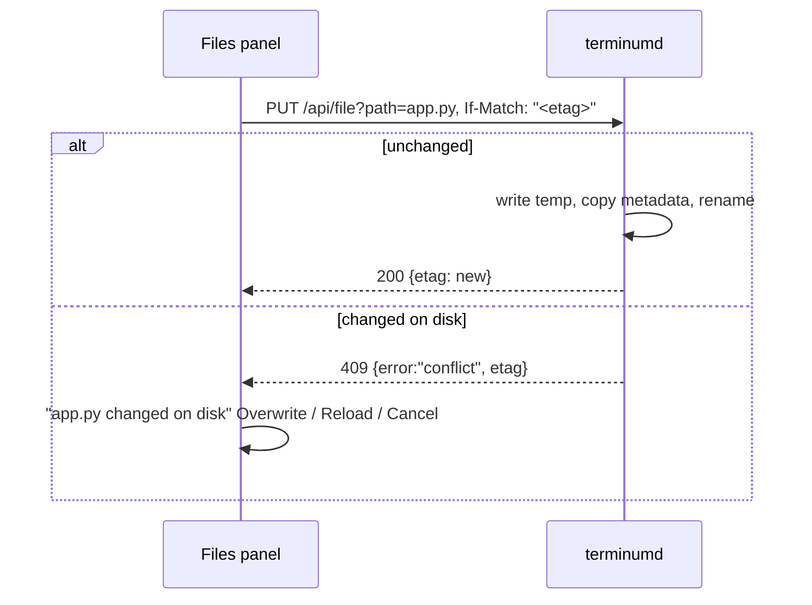

# terminum — Specification (Files panel)

Sibling of `terminum.md` (the core). This spec holds the Files panel: iterm-enhancer's panel (its AC 01–AC 32, AC 44, AC 53) against terminumd, following the pane the page shows. Cases are AC-51…AC-73. A case of another spec is written `AC nn` (a space); `AC-nn` is this spec's own.

## 0. Metadata

| Field | Value |
|---|---|
| Version | 0.4.1 |
| Date | 2026-10-21 |
| Status | draft |
| Author | Claude (Fable 5.1) for the owner |

Change log:

| Version | Date | Change |
|---|---|---|
| 0.5.1 | 2026-10-22 | Owner: View's Terminal button on a phone is a key as the others, not an accent pill (AC-70). |
| 0.5.0 | 2026-10-22 | Owner: docked Files' width follows a drag of its border with the terminal, remembered in this browser (AC-70). |
| 0.4.1 | 2026-10-21 | Owner: in Safari a quick switch to another session and back left docked Files blank (the emptied frame's about:blank loaded after the folder set meanwhile); Files is hidden, not emptied, until the shown session's folder is in (AC-70). |
| 0.4.0 | 2026-10-21 | Owner: the ```mermaid fences of a rendered Markdown document showed as plain text; they are drawn as diagrams, their source a click away (AC-54). Owner: docked Files opened or closed in one session did so in all; it is each session's now, in this browser (AC-70). |
| 0.3.2 | 2026-10-16 | Owner: a file made with New File… opens where a click opens files (View in the page), not in the panel's own editor under the tree (AC-70). |
| 0.3.1 | 2026-10-15 | AC-51: terminumd tells the page when the shown pane's folder changes (read with every frame); the page no longer asks again 0.7 s after Enter. |
| 0.3.0 | 2026-10-15 | Owner: no App (the Mac's browser and an iPhone are the clients): "Open in Window" and the App's viewer window go; the private tmux server. |
| 0.2.0 | 2026-10-15 | Pragmatic review: the panel stays in its proxied mode under `/fb/` with its `web:` workspace keys (`ui/src/embed.ts`), so it needs no edit; the files API paths are the page's `/fb/api/*`. |
| 0.1.0 | 2026-10-15 | Initial draft from iterm-enhancer 0.42: the panel follows the shown pane (not the focused iTerm2 pane); the viewer window is the page's View window and an App window; everything else kept. |

## 1. Overview

**Problem.** Reading the current directory in a terminal means `ls`, `cat`, `less` or another app; trees, Markdown and code are hard to scan; IDE trees do not follow `cd`; huge folders freeze GUI browsers.

**Who it affects.** Developers working in terminum's terminals, locally and on remote hosts, from a Mac, a tablet or a phone.

**Expected outcome.** A Files panel beside (or in place of) the terminal always shows the folder of the pane the page shows. It works like an IDE tree: browse, open, read with highlighting, render Markdown and HTML, edit and save, create, rename, Trash; it stays responsive in a folder of 500,000 entries; it remembers per pane which folders were open, what was selected and which files were open; it wears the pane's theme.

**Scenario, before and after.**
- Before: Alex runs `cd ~/work/api/docs`, `ls`, `less ci-design.md`, reads raw Markdown, `cd ../src`, opens vim to fix a typo, and forgets which files they looked at.
- After: Alex runs `cd ~/work/api/docs`. Within a second the panel shows `docs/`. Alex clicks `ci-design.md` and reads it rendered. Alex fixes the typo in Source and presses ⌘S. Switching panes switches trees; coming back, everything is where it was.

## 2. Scope and non-goals

In scope:
- The tree, viewer, editor, workspaces, watcher, file operations, utility actions, theme, keyboard, filter, images, hidden files, multi-select, links between documents, expand all, icons, the View window and docked layout, state persistence and cleanup, git colors and drag-and-drop as later items.

Out of scope (explicit):
- Files of a remote host without the files helper (the tree says so; enabling it is `terminum-remote.md`, AC 83).
- IDE features (LSP, project search), a second user, writes outside Roots.

## 3. Assumptions, dependencies, open questions

Assumptions:

| ID | Assumption | Owner | Status |
|---|---|---|---|
| AS-51 | The panel (`ui/`) runs unchanged in the page's iframe in its proxied mode (`PROXIED`, `ui/src/api.ts`) under `/fb/` against terminumd's Files API at `/fb/api/*` (fbd's paths), pinned to the pane the page names in the frame's URL (`key`, `cwd`, `host`) and themed by the page's message, with its own workspace key `web:[host, key]` (`embed.ts:16`). | Claude | unverified: `ui/test/e2e_panel.mjs` on terminumd |
| AS-52 | Reading a 500K-entry folder takes about 1 s warm (`ls -f`, measured 2026-09-30 in iterm-enhancer). | Claude | verified |
| AS-53 | `#{pane_current_path}` is the pane's shell cwd (the foreground job's for a program that changed it, as tmux reports the active process's cwd on macOS through libproc), within 0.5 s of a `cd` at the prompt. | Claude | verified for shells in iterm-enhancer (AS-03 there); vim `:cd` unverified |

Dependencies:

| ID | Dependency | Owner | Status |
|---|---|---|---|
| DEP-51 | fbd's Rust modules from iterm-enhancer (`listing.rs`, `files.rs`, `ops.rs`, `watcher.rs`, `workspace.rs`, `api_fs.rs`, `remote.rs`, `agent.rs`), moved into terminumd. | Claude | available |
| DEP-52 | CodeMirror 6, markdown-it 14, Tabler Icons (MIT, vendored) in `ui/`. | Claude | available |

Open questions:

| ID | Question | Owner | Status | Decision |
|---|---|---|---|---|
| OQ-51 | Should the Files panel follow the pane's folder on every `cd` (tree state cleared, as iterm-enhancer's OQ-02 decided) also when the user is editing in the viewer? | Owner | resolved | Yes: tree state clears on `cd`, tabs stay (they hold absolute paths and unsaved edits), 2026-09-30. |
| OQ-52 | Where may the panel write? | Owner | resolved | Under `$HOME` and `/tmp` by default (`TM_WRITABLE_ROOTS`), 2026-09-30. |

## 4. Acceptance cases

| ID | Priority | Case |
|---|---|---|
| AC-51 | [MUST / P0] | The tree re-roots at the shown pane's folder within 1 s of a `cd` there, on this Mac or on an enabled host, and says why when the folder is unavailable. |
| AC-52 | [MUST / P0] | The user expands a folder with 500,000 entries and scrolls it smoothly; first rows within 2.5 s; the panel never freezes. |
| AC-53 | [MUST / P0] | The user reads a text file in a viewer tab with syntax highlighting by file name; binary, huge and gone files say so. |
| AC-54 | [MUST / P0] | Markdown opens rendered with typography and switches to highlighted source with one click; raw HTML in it is inert. |
| AC-55 | [MUST / P0] | Per pane, the expanded folders, selection, scroll and open tabs come back after switching panes or reloading; tree state clears on `cd`. |
| AC-56 | [SHOULD / P1] | The user edits a text file and saves with ⌘S; unsaved tabs are marked; a save over a file changed on disk is refused with a clear choice; saves are atomic and keep metadata. |
| AC-57 | [SHOULD / P1] | The user creates an empty file or a folder in the selected folder with the name typed inline. |
| AC-58 | [SHOULD / P1] | The user renames a file or folder inline; open tabs follow the new path. |
| AC-59 | [SHOULD / P1] | The user moves files and folders to the Trash after one confirmation. |
| AC-60 | [SHOULD / P1] | The user copies absolute or relative paths, reveals in Finder, opens with the default app, inserts a path into the pane, and `cd`s the pane to a folder, without anything running until the user presses Return. |
| AC-61 | [SHOULD / P1] | Changes made by other programs (create, delete, rename, edit) show in expanded folders and open tabs within 1 s, locally and on a host. |
| AC-62 | [SHOULD / P1] | Every tree and tab action works from the keyboard with IDE-standard shortcuts that never reach the terminal. |
| AC-63 | [SHOULD / P1] | The user filters the tree by name, including inside a 500K-entry folder. |
| AC-64 | [SHOULD / P1] | Images (png, jpg, gif, webp, svg) preview in a tab; SVG scripts never run. |
| AC-65 | [SHOULD / P1] | Hidden (dot) files toggle on or off; the choice is remembered. |
| AC-66 | [SHOULD / P1] | Several items select with ⌘-click and ⇧-click, trashed or copied in one action, also across unloaded pages. |
| AC-67 | [SHOULD / P1] | Links in rendered Markdown and HTML open local documents in tabs at their `#anchor`, web links in the reader's browser, and the panel never navigates away; HTML renders sandboxed. |
| AC-68 | [SHOULD / P1] | Every folder below the root or a chosen folder expands in one action, bounded, and collapses again. |
| AC-69 | [SHOULD / P1] | A file's type shows as an icon in the tree and the tabs. |
| AC-70 | [SHOULD / P1] | On a wide page (a Mac browser) Files docks on the right beside the terminal and a file opens in a View window over it; on a narrow page (an iPhone) Files and View are views in the terminal's place. |
| AC-71 | [SHOULD / P1] | Per-pane state survives terminumd restarts with the scroll position; state of panes gone for 14 days is removed continuously; a corrupt state file is set aside. |
| AC-72 | [NICE TO HAVE / later] | Git status colors (modified, added, ignored) show in the tree. |
| AC-73 | [NICE TO HAVE / later] | Files move between folders by drag and drop. |

## 5. BDD scenarios

### AC-51 — The tree follows the shown pane [MUST / P0]

```gherkin
Scenario: AC-51 happy path — cd re-roots the tree
  Given the page shows pane %3 (zsh) and Files is open
  When the user runs "cd /Users/alex/work/api" in %3
  Then within 1 s (every frame of the shown pane reads #{pane_current_path}; a change is sent to the page as `files`, whatever made it: Enter, a hot key, a script) the panel header shows the pane's title, the badge "TMUX" and "~/work/api", and the tree lists that folder
  And a remote pane shows "REMOTE devbox" and the host's folder once its helper is enabled (AC 82)

Scenario: AC-51 happy path — another pane
  When the user opens pane %4 in "/tmp"
  Then within 1 s the tree root is "/tmp" with %4's own state (AC-55)

Scenario: AC-51 edge — a foreground program in a subdirectory
  Given the shell's cwd is "/Users/alex/work/api" and vim runs there after ":cd src"
  Then the root follows what tmux reports (AS-53); the badge names the program ("vim")

Scenario: AC-51 failure — the folder is unavailable
  Given the pane is on a host without the helper, or the folder is gone
  Then the badge shows "REMOTE" or "GONE", the footer says why ("remote host devbox: files not enabled", "/Users/alex/old: No such file or directory"), and the tree keeps the last known root marked "cwd unavailable — showing last known"
```

### AC-52 — Very large folders [MUST / P0]

```gherkin
Scenario: AC-52 happy path — 500K folder
  Given "/tmp/fb-big" holds 500,000 files "f000000.txt".."f499999.txt"
  When the user expands it
  Then a spinner row shows while terminumd reads and other folders stay usable; within 2.5 s (warm cache) the first rows are visible sorted naturally; the scrollbar reflects 500,000 rows; the tree never renders more than 300 DOM rows
  When the user drags the scrollbar to the bottom
  Then within 300 ms rows "f499700.txt".."f499999.txt" are visible and j/k move the selection without delay

Scenario: AC-52 failure — permission denied
  When the user expands "/private/var/root"
  Then the folder shows one row "⚠ Permission denied (os error 13)" and the rest stays usable

Scenario: AC-52 edge — invalidation and unreadable names
  Given a scan runs with two callers waiting and the folder changes before it publishes
  Then one scanner rereads and both callers get the fresh listing; empty and failed listings count toward the cache budget
  And a byte-invalid UTF-8 name is reported as unreadable and never aliases a valid replacement-character name
```

### AC-53 — Read with highlighting [MUST / P0]

```gherkin
Scenario Outline: AC-53 happy path — highlighting by name
  When the user clicks "<file>"
  Then a read-only viewer tab opens with "<language>" highlighting and line numbers

  Examples:
    | file        | language   |
    | server.rs   | Rust       |
    | app.py      | Python     |
    | Dockerfile  | Dockerfile |
    | config.yaml | YAML       |
    | notes.txt   | Plain text |

Scenario: AC-53 edge — binary, huge, not UTF-8
  Then "logo.ico" shows "Binary file (image/vnd.microsoft.icon), 15 K" with "Open with default app" (on the Mac only); a 48.2 MB "access.log" shows its first 1 MB with "48.2 MB — showing first 1 MB, editing disabled"; non-UTF-8 text shows with U+FFFD and "Not UTF-8 — editing disabled"

Scenario: AC-53 error — gone or not a regular file
  When the user clicks a file deleted meanwhile
  Then the tab shows "⚠ No such file or directory (os error 2)" and no other tab changes
  And /api/file and /api/raw answer 400 "Not a regular file" at once for a FIFO or a device ("/dev/zero"), without reading
```

### AC-54 — Markdown rendered and source [MUST / P0]

```gherkin
Scenario: AC-54 happy path — rendered by default, source on a click
  When the user clicks "README.md"
  Then the tab opens Rendered: proportional text, headings, tables, task lists, footnotes, fenced ```rust highlighted (as the editor highlights it), relative images shown
  And a ```mermaid fence is drawn as its diagram (Mermaid in strict mode, as the terminal's widgets draw one, AC-31 of terminum-terminal.md; in the theme's light or dark), with "Source" over it to show its highlighted text and "Diagram" back; a fence Mermaid cannot draw shows its source with Mermaid's message above it
  When the user clicks "Source"
  Then Markdown source with Markdown highlighting; the choice is remembered for the tab

Scenario: AC-54 edge — raw HTML is inert
  Given "evil.md" contains ""
  Then it appears as literal text and no script runs

Scenario: AC-54 failure — a huge document
  Given a 12 MB Markdown file
  Then it opens as text with the size banner (AC-53), not rendered
```

### AC-55 — Per-pane memory [MUST / P0]

```gherkin
Scenario: AC-55 happy path — switching panes restores state
  Given in pane %3 (root ~/work/api) "src" and "src/db" are expanded, "src/db/pool.rs" selected, tabs "README.md" and "pool.rs" open with "pool.rs" active
  When the page shows %4 and then %3 again (or reloads)
  Then "src" and "src/db" are expanded, "pool.rs" selected and scrolled into view, the tabs back with "pool.rs" active (the workspace is keyed by the panel's web:["", "tmux:local:default:%3"], kept by terminumd)

Scenario: AC-55 edge — cd clears the tree, keeps tabs
  When the user runs "cd ~/work/web" in %3
  Then the tree shows "~/work/web" with nothing expanded or selected, and the tabs stay (OQ-51)

Scenario: AC-55 edge — stale answers
  Given a workspace read or a listing for a pane is pending
  When the page switched panes, or a newer read or write restored the current pane
  Then the older answer never replaces the current root, tabs or rows; a terminumd restart with reset revisions is still accepted; an expanded folder that was deleted is dropped silently

Scenario: AC-55 failure — a write races
  When two pages write the same pane's workspace
  Then the second gets 409 {"error":"stale_rev"}, re-reads and merges; nothing is lost
```

### AC-56 — Edit and save [SHOULD / P1]

```gherkin
Scenario: AC-56 happy path — save
  Given "app.py" is open
  When the user types "import os" at line 1 and presses ⌘S
  Then the "●" marker goes, the file holds the text, keeps its mode and extended attributes, CRLF separators stay CRLF; the write is a temp file renamed over the original

Scenario: AC-56 error — changed on disk, outside Roots, during a gap
  Given "app.py" was opened with etag "1727690000123456789-8812345-2048" and changed by vim
  When the user presses ⌘S
  Then "app.py changed on disk" with "Overwrite", "Reload (discard mine)", "Cancel"; the file is unchanged until Overwrite (If-Match: *)
  And "/etc/hosts" is read-only with "Read-only: outside writable folders"; a save while terminumd is unreachable fails at once with "Not saved: server restarting — save again"

Scenario: AC-56 edge — closing, competing saves, renames, size
  Then closing a dirty tab asks "Save changes to app.py?" (Save, Don't save, Cancel); text typed before a closing save finishes stays unsaved in the open tab
  And of two pages saving the same etag (symlink aliases included) exactly one succeeds and the other sees the conflict; a save pending across a rename retries on the current path and a stale old-path reply cannot mark it clean
  And a 9 MB file saves; a body over 6 × the text limit answers 413 as JSON; a 255-byte basename saves with no temp file left; a conflict dialog of one host's file is discarded only for that document when the pane switches hosts
```

### AC-57 — Create [SHOULD / P1]

```gherkin
Scenario: AC-57 happy path — file and folder
  Given "src" is selected
  When the user presses ⌥N (or "New File…"), types "util.rs", Enter
  Then "src/util.rs" exists empty, is selected and opens in a tab
  When the user presses ⌥⇧N, types "db/migrations", Enter
  Then "src/db/migrations" exists (intermediate folders made) and is expanded

Scenario Outline: AC-57 error — invalid name
  When the user types "<name>"
  Then the inline field shows "<message>" in red and nothing is created

  Examples:
    | name    | message                          |
    | util.rs | "util.rs" already exists in src   |
    | (empty) | A name is required               |
    | ..      | ".." is not a valid name         |

Scenario: AC-57 edge — outside Roots
  Then "New File…" and "New Folder…" are disabled in "/usr/local"
```

### AC-58 — Rename [SHOULD / P1]

```gherkin
Scenario: AC-58 happy path — rename with an open tab
  Given "notes.md" is selected and open
  When the user presses F2, types "ideas" (the extension stays), Enter
  Then "ideas.md" exists, "notes.md" does not, the tab is "ideas.md", and ⌘S saves the new path

Scenario: AC-58 error — target exists, also when made meanwhile
  Then ""ideas.md" already exists" and both files stay; Esc cancels; a target created by another writer during the rename is reported, both preserved

Scenario: AC-58 edge — a symlink
  Then a symlink is renamed where it lives (never its target), judged against Roots there
```

### AC-59 — Trash [SHOULD / P1]

```gherkin
Scenario: AC-59 happy path — trash a folder
  When the user selects "build", presses ⌘⌫ and confirms "Move "build" to Trash?"
  Then "build" is in ~/.Trash (a host's file manager trash on a host) and gone from the tree; tabs under it close; with unsaved tabs inside the dialog adds "1 unsaved file will be lost"

Scenario: AC-59 error — gone already, or the request fails
  Then "build: No such file or directory" as a toast and the tree refreshes; a request-level failure keeps every tab and edit, and only files reported trashed close their tabs
```

### AC-60 — Utility actions [SHOULD / P1]

```gherkin
Scenario Outline: AC-60 happy path — context menu actions
  Given the root is "/Users/alex/work/api" and "src/db/pool.rs" is selected in pane %3
  When the user picks "<action>"
  Then "<result>"

  Examples:
    | action                  | result                                                                 |
    | Copy Path (⌥⌘C)         | the clipboard holds "/Users/alex/work/api/src/db/pool.rs"              |
    | Copy Relative Path      | the clipboard holds "src/db/pool.rs"                                   |
    | Reveal in Finder        | Finder opens "src/db" with "pool.rs" selected (the Mac's page only)    |
    | Open with Default App   | macOS opens it (the Mac's page only)                                   |
    | Insert Path in Terminal | %3 gets "src/db/pool.rs " (send-keys -l), no Enter                     |
    | Open Terminal Here      | %3 gets "cd /Users/alex/work/api/src/db", no Enter                     |

Scenario Outline: AC-60 security — quoting follows the pane's shell, nothing runs
  Given the pane's shell (#{pane_current_command}) is "<shell>" and the name is "<name>"
  Then "<typed>" is typed, or the toast "<refused>" shows; terminumd never sends Enter or a control character; "cd" goes only into an idle shell ("Terminal is busy (vim) — command not sent")

  Examples:
    | shell                         | name       | typed            | refused                                                                |
    | zsh, bash, sh, dash, ksh      | it's a\b   | 'it'\''s a\b'    |                                                                        |
    | fish                          | it's a\b   | 'it\'s a\\b'     |                                                                        |
    | tcsh, csh, nu, xonsh, unknown | it's       |                  | Name cannot be typed safely into tcsh                                  |
    | any                           | -rf        | ./-rf            |                                                                        |
    | any                           | a‮b (U+202E)|                  | Name contains control or invisible characters — not sent to the terminal |

Scenario: AC-60 edge — the web page and remote files
  Then Finder and "Open with Default App" are not offered on a network page or for remote files, "Open in Window" not on a phone; terminumd refuses them with "Not available for remote files" or 403; queued text is checked at delivery: a pane or shell that changed meanwhile gets nothing and the page is told
```

### AC-61 — Live refresh [SHOULD / P1]

```gherkin
Scenario: AC-61 happy path — new file, clean tab reloads, dirty tab asks
  Given "src" is expanded and "app.py" open clean
  When another program runs "touch src/new.rs" and edits "app.py"
  Then within 1 s "new.rs" appears sorted and the tab shows the new content keeping its scroll; a dirty tab shows "Changed on disk" with "Reload" and "Keep mine"

Scenario: AC-61 edge — bursts and stale listings
  When "npm install" writes 40,000 files into an expanded "node_modules"
  Then the tree updates at most twice a second; an older listing page arriving after a fresh one cannot replace it

Scenario: AC-61 failure — a lagged remote stream
  Given a host's event stream falls behind and reconnects
  Then a host-scoped rescan refreshes the visible folders and re-checks open files' etags; dirty buffers stay, also a file whose rename was missed
```

### AC-62 — Keyboard [SHOULD / P1]

```gherkin
Scenario Outline: AC-62 happy path — shortcuts in the tree
  Given the tree has focus and "src" is selected
  When the user presses "<key>"
  Then "<result>"

  Examples:
    | key       | result                                          |
    | ↓ / ↑     | selection moves one row                         |
    | → / ←     | expand / collapse (or go to the parent)         |
    | Enter     | open a file; expand or collapse a folder        |
    | F2        | rename (AC-58)                                  |
    | ⌥N, ⌥⇧N   | new file, new folder (AC-57)                    |
    | ⌘⌫        | Trash (AC-59)                                   |
    | /         | focus the filter                                |
    | ⌥W, ⌃Tab  | close tab, next tab                             |
    | ⌥→ / ⌥←   | expand all / collapse all below (AC-68)         |

Scenario: AC-62 edge — shortcuts stay in the panel
  Then keys pressed in the panel never reach the terminal, and ⌘N, ⌘W, ⌘T are left to the browser; End or PageDown on an unloaded page selects the loaded target row and Delete cannot delete the previous one
```

### AC-63 — Filter [SHOULD / P1]

```gherkin
Scenario: AC-63 happy path — loaded tree and a 500K folder
  When the user types "pool"
  Then every shown folder lists only names containing "pool", expanded folders stay visible, matches highlighted
  When "fb-big" is expanded and the user types "f49999"
  Then within 500 ms it shows the 10 matching rows and "10 of 500,000" (filtered by terminumd)

Scenario: AC-63 edge — no match
  Then "No items match "zzz"" and Esc clears the filter
```

### AC-64 — Images [SHOULD / P1]

```gherkin
Scenario: AC-64 happy path — png
  When the user clicks "docs/arch.png" (1920×1080, 240 K)
  Then a tab shows it fitted with "1920 × 1080 · 240 K"

Scenario: AC-64 edge — svg is inert
  Given "icon.svg" holds a <script>
  Then it shows as an image element and nothing runs
```

### AC-65 — Hidden files [SHOULD / P1]

```gherkin
Scenario: AC-65 happy path — toggle
  When the user clicks the eye button (or ⌘⇧.)
  Then ".git" and ".env" disappear and the choice persists after a reload

Scenario: AC-65 edge — the selected item becomes hidden
  Then the selection moves to the parent folder
```

### AC-66 — Multi-select [SHOULD / P1]

```gherkin
Scenario: AC-66 happy path — two files, a range
  When the user clicks "a.log", ⌘-clicks "c.log", presses ⌘⌫ and confirms "Move 2 items to Trash?"
  Then both are in the Trash; a ⇧-click from "a.log" to "e.log" selects 5 rows and "Copy Path" copies 5 lines

Scenario: AC-66 edge — remembered, across unloaded pages
  Then a selection of 3 items comes back after a pane switch (AC-55); a range across unloaded pages loads them in bounded batches and selects all; a pane or root switch cancels it without a partial destructive target
```

### AC-67 — Links and HTML documents [SHOULD / P1]

```gherkin
Scenario: AC-67 happy path — Markdown, HTML, anchors, web
  When the user clicks "[design](docs/design.md)" in a rendered file
  Then "docs/design.md" opens in a new tab Rendered; "[the page](page.html#sec2)" opens page.html rendered in a sandboxed frame scrolled to "#sec2" with its relative images; "<a href='../README.md#sandbox'>" inside page.html opens README.md at "#sandbox"; "Reveal in tree" selects the file
  When the user clicks "[tmux](https://github.com/tmux/tmux)"
  Then the reader's default browser opens it (new tab, noopener) and the panel stays

Scenario: AC-67 edge — scripts, frames, odd names
  Then page.html's scripts and handlers never run; a local image name with "#", "?" or "%" is addressed exactly through its percent-encoded path; a resource URL with an invalid escape leaves the document visible and marks the resource broken

Scenario: AC-67 error — broken link
  Then "gone.md: No such file or directory" as a toast
```

### AC-68 — Expand and collapse all [SHOULD / P1]

```gherkin
Scenario: AC-68 happy path — header buttons and keys
  Given the root holds "src/a/b", "docs", "node_modules/x", ".git/objects"
  When the user clicks "Expand all" (or ⌥→ on "src")
  Then "src", "src/a", "src/a/b", "docs" expand, "node_modules" and ".git" stay collapsed, one workspace write stores it, a toast says "Expanded 4 folders · skipped 2 (node_modules, .git)"; "Collapse all" (⌥←) collapses everything

Scenario Outline: AC-68 edge — limits
  Then "<folder>" "<result>"

  Examples:
    | folder                                                      | result                                        |
    | node_modules, .git, target, dist, build, .venv, venv, __pycache__, .next, .cache, Pods, DerivedData | stays collapsed, named in the toast |
    | a symlink to a folder                                       | stays collapsed (no cycles)                   |
    | a folder with more than 500 entries                         | stays collapsed, counted as "too large"       |
    | depth 9, or the 201st folder                                | stays collapsed; the toast says the limit     |

Scenario: AC-68 failure — interrupted or unreadable
  Then a pane switch, re-root or collapse stops the expansion within one folder load with no workspace write; an unreadable folder shows its error row and the others expand
```

### AC-69 — File-type icons [SHOULD / P1]

```gherkin
Scenario Outline: AC-69 happy path — icon by name
  Then "<name>" shows the "<icon>" icon in the "<color>" theme color

  Examples:
    | name               | icon     | color   |
    | main.rs, app.py    | code     | code    |
    | package.json       | braces   | config  |
    | Cargo.toml, .env   | settings | config  |
    | README.md          | markdown | doc     |
    | logo.png, a.svg    | photo    | image   |
    | dist.tar.gz        | zip      | archive |
    | id.pem, tls.key    | key      | config  |
    | a.out, lib.dylib   | binary   | faint   |

Scenario: AC-69 edge — names win, folders and tabs
  Then "Makefile" and "Dockerfile" use settings, "id_ed25519" key; folders show a folder icon (open while expanded); each tab shows its file's icon
```

### AC-70 — Docked Files and the View window [SHOULD / P1]

```gherkin
Scenario: AC-70 happy path — a wide page
  Given the page is at least 1400 px wide
  Then Files is docked on the right, full height, until its × closes it; the Files button and ⌘B open and close it; it wears the shown pane's theme
  And open or closed is remembered for each session in this browser: closing Files in one session leaves it open in the others, and switching to a session shows Files as that session last had it (a session never changed: docked); the view's new width reaches tmux with the opening's own size, never as a second resize
  And the band between the terminal and Files is a separator: dragging it sets Files' width (at least 260 px, at most 60% of the page's column beside the list, never leaving the terminal under 45 columns), the terminal following at once and tmux once the drag rests; the width is kept in this browser for every session; with the keyboard, ← → move it 16 px; a double click puts back 380 px
  And on a switch Files shows nothing of the session left until the shown session's folder is in, also after a quick switch away and back (half a second or less)
  When the user opens a file (a click in the tree, or a file just made with New File…: it never opens under the tree inside the page)
  Then View is a window over the terminal with its tabs and a bar showing the full path (selectable, with a copy button and a toast "Copied …"); × or closing its last file closes it; the terminal keeps its keys

Scenario: AC-70 happy path — a narrow page
  Given the page is narrower than 1400 px
  Then Files and View are views in the terminal's place (the view tabs Terminal, Files, View); View has a "Terminal" key at its bottom left (a key as the others: their fill, radius and edge, a finger's height); closing View's last file shows the terminal and disables the View button; widening docks Files again and an open View becomes the window

Scenario: AC-70 happy path — a second browser tab
  When the user ⌘-clicks a file (or ⌘↩, "Open in Window") on the Mac
  Then the browser opens a new tab of the page at "/view" showing View alone with that file, signed in by the page's own sign-in (its storage is per origin, so no secret is in the address); further files from the first tab join it as tabs (a BroadcastChannel); on a phone the item is not offered

Scenario: AC-70 edge — View belongs to its session
  Given View shows "pool.rs" opened from session "api"
  When the user shows session "docs" in the session list
  Then View is closed (the terminal of "docs" is shown, or "docs"'s own View if it had one open) and the View button is enabled only when "docs" has files open
  When the user shows "api" again
  Then its View is back as it was: its tabs, unsaved edits and scroll, open or closed as the user left it
  When session "api" closes
  Then its View goes with it, unless it holds unsaved edits (then it waits until they are saved or the page closes); a host that is only reconnecting keeps its sessions' Views

Scenario: AC-70 edge — the viewer and hosts
  Then pending viewer files keep their host: a local and a remote file with the same path never share a tab or unsaved edits

Scenario: AC-70 failure — nothing to show
  When the pane's folder is unknown or its host has no helper
  Then Files says so and how to fix it (enable the host in Files on the Mac)
```

### AC-71 — State survives and expires [SHOULD / P1]

```gherkin
Scenario: AC-71 happy path — terminumd restarts
  Given in %3 "src" and "src/db" are expanded and the tree is scrolled to row 412
  When terminumd restarts (AC 14)
  Then the panel reconnects and shows the same, scrolled to row 412 (workspaces.json, debounced 500 ms, atomic, written complete at shutdown)

Scenario: AC-71 edge — expiry
  Given a pane's state was last used 15 days ago and the pane is not in any tmux server
  Then it is removed at the next inventory (every 5 minutes) without a restart; a live pane's state stays however old; an unknown host's panes are kept until the host answers

Scenario: AC-71 failure — a corrupt file
  Given "workspaces.json" holds "{not json"
  Then terminumd renames it to "workspaces.json.bak", starts empty and logs "event=workspace.reset reason=parse_error"
```

### AC-72 — Git status colors [NICE TO HAVE / later]

```gherkin
Scenario: AC-72 happy path — a modified file
  Given "src/app.rs" is modified in git
  Then its name shows in the "modified" color with "M" on the right

Scenario: AC-72 edge — not a repository
  Then no colors and no git process more than once per 5 s
```

### AC-73 — Drag and drop [NICE TO HAVE / later]

```gherkin
Scenario: AC-73 happy path — move a file
  When the user drags "notes.md" onto "docs"
  Then "docs/notes.md" exists and "notes.md" does not

Scenario: AC-73 error — name clash
  Then the drop is refused with ""notes.md" already exists in docs"
```

## 6. Flow and sequence diagrams

### Following the shown pane (AC-51, AC-55)

```mermaid
sequenceDiagram
  participant T as tmux
  participant D as terminumd
  participant P as Page
  participant F as Files panel (iframe)
  T-->>D: %output / list-panes every 2 s (pane_current_path)
  D-->>P: {"t":"layout",…} and {"t":"files","key":"tmux:local:default:%3","cwd":"/Users/alex/work/api","host":null}
  P->>F: postMessage {key, cwd, host, theme}
  F->>D: GET /api/workspace?key=… ; GET /api/ls?path=…
  D-->>F: workspace {rev, expanded, tabs…} ; rows
```

The page tells the panel which pane it shows; the panel keeps its workspace under that key. No focus tracking exists: the shown pane is the one.

### Save with conflict check (AC-56, AC-61)



"Overwrite" repeats the PUT with `If-Match: *`. A crash never leaves a half-written file.

## 7. Current behavior and gaps

Today is iterm-enhancer 0.42; `fbd` and the panel are inherited.

| AC | Today | Gap | Evidence |
|---|---|---|---|
| AC-51 | The bridge resolves the focused iTerm2 pane's cwd (three modes). | The page's shown pane and `#{pane_current_path}`; no focus. | `iterm-enhancer/bridge/fbbridge/resolve.py:65`, `web/static/panefiles.js:1` |
| AC-52 | Rust listing cache, paging, virtual tree. | None (moved). | `iterm-enhancer/fbd/src/listing.rs:1`, `ui/src/tree-rows.ts:1` |
| AC-53 | CodeMirror viewer, limits, regular files only. | None. | `iterm-enhancer/fbd/src/files.rs:1`, `ui/src/viewer.ts:1` |
| AC-54 | markdown-it, html off, source toggle. | None. | `ui/src/markdown.ts:1` |
| AC-55 | Workspaces in fbd keyed by pane; web pages use `web:` keys. | None: the `web:` key is the key (no Mac panel competes for the pane). | `iterm-enhancer/fbd/src/workspace.rs:1`, `ui/src/embed.ts:16` |
| AC-56 | Atomic etag-checked save. | None. | `iterm-enhancer/fbd/src/ops.rs:1`, `ui/src/viewer-editor.ts:1` |
| AC-57 | mkdir, touch, inline names. | None. | `ui/src/tree-edit.ts:1` |
| AC-58 | rename, tabs follow. | None. | `ui/src/tree-edit.ts:1` |
| AC-59 | Trash via the `trash` crate, dialog. | None. | `iterm-enhancer/fbd/src/ops.rs:1` |
| AC-60 | Terminal actions through the bridge (`/internal/commands`). | terminumd types with `send-keys -l`; quoting rules moved from fbd. | `iterm-enhancer/fbd/src/termtext.rs:1` |
| AC-61 | FSEvents watcher, events over the WebSocket. | None. | `iterm-enhancer/fbd/src/watcher.rs:1` |
| AC-62 | Full shortcut set. | None. | `ui/src/binding.ts:1` |
| AC-63 | Server-side filter. | None. | `iterm-enhancer/fbd/src/listing.rs:1` |
| AC-64 | Image tab. | None. | `ui/src/viewer.ts:1` |
| AC-65 | Hidden toggle in prefs. | None. | `ui/src/tree.ts:1` |
| AC-66 | Multi-select across pages. | None. | `ui/src/tree-select.ts:1` |
| AC-67 | Links, anchors, sandboxed HTML. | None. | `ui/src/docview.ts:1`, `ui/src/viewer-path.ts:1` |
| AC-68 | Expand all with limits. | None. | `ui/src/tree-expand.ts:1` |
| AC-69 | Tabler icons. | None. | `ui/src/icons.ts:1` |
| AC-70 | Docked Files and View in the web app; a "Files Viewer" iTerm2 profile window on the Mac. | A second browser tab at `/view` instead of the iTerm2 window. | `web/static/views.js:1`, `iterm-enhancer/bridge/fbbridge/windows.py:1` |
| AC-71 | TTL at inventories from the bridge. | Inventory from tmux's pane list. | `iterm-enhancer/fbd/src/liveness.rs:1` |
| AC-72 | not implemented | everything | — |
| AC-73 | not implemented | everything | — |

## 8. Recommendation and ownership

**Recommended approach.** Move fbd's Files modules into terminumd unchanged (listing cache, watcher, ops, workspace, agent proxy) and serve the panel under `/fb/` in its proxied mode; the page embeds it as iterm-enhancer's web app does and names the shown pane's key, cwd and host in the frame's URL and sends the theme. The "focused pane" concept goes: a page shows one pane, and the panel's `web:` key for it is its workspace.

**Rejected alternative.** A tree inside the terminal view (one DOM) — rejected because the panel is 3.6 k lines of working TypeScript with its own tests, and an iframe keeps its CSP and sandbox for rendered HTML.

| Part | Owner |
|---|---|
| terminumd Files modules | Claude |
| Panel (`ui/`) and page embedding | Claude |
| Acceptance on the owner's Mac and hosts | Owner |

## 9. Technical details and specifications

### Interfaces

All `/fb/api/*` need the sign-in header (`terminum.md` AC 09); a remote host's request carries `X-TM-Host: devbox`. JSON in and out; errors `{"error","message"}`.

| Method and path | Purpose | Case |
|---|---|---|
| `GET /fb/api/ls?path&offset&limit&filter&hidden&locate` (every path below under `/fb/api/`) | a page of a folder, `writable`, `located` | AC-52, AC-63, AC-65 |
| `GET /api/file?path` (`If-None-Match`) | text and meta; 304 when unchanged | AC-53, AC-54, AC-61 |
| `GET /api/raw?path` | bytes with MIME | AC-64, AC-67 |
| `PUT /api/file?path` (`If-Match`) | save | AC-56 |
| `POST /api/fs/{mkdir,touch,rename,trash}` | operations | AC-57–AC-59, AC-66 |
| `POST /api/os/{reveal,open}` | Finder, default app (loopback page only) | AC-60 |
| `POST /api/terminal/{insert,cd}` | `{key, paths}` / `{key, path}`; quoted by terminumd, idle shell for cd | AC-60 |
| `GET/PUT /api/workspace?key` | per-pane state with `rev` (409 if stale), `X-TM-Client` | AC-55, AC-71 |
| `GET/PUT /api/prefs` | `{hidden, split}` | AC-65, AC-70 |
| `GET /api/ws` | the page's socket carries `fs-change {host, dirs, files, moved}`, `workspace {key, rev, by}`, `rescan {host}` and `host {host}` (a host's files offer changed: the panel reads `GET /api/state?host=` again, AC 83) events to the panel | AC-61 |

Example:

```bash
curl -s -H "X-TM-Session: …" "http://127.0.0.1:48080/fb/api/ls?path=/tmp/fb-big&offset=0&limit=3"
# {"path":"/tmp/fb-big","status":"ready","total":500000,"offset":0,"writable":true,"gen":1,
#  "entries":[{"n":"f000000.txt","k":"f","s":0},{"n":"f000001.txt","k":"f","s":0},{"n":"f000002.txt","k":"f","s":0}]}
```

### Data formats

`workspaces.json` (terminumd, debounced 500 ms, atomic):

```json
{"version": 1, "prefs": {"hidden": true, "split": 0.45},
 "panes": {"web:[\"\",\"tmux:local:default:%3\"]": {"rev": 17, "root": "/Users/alex/work/api", "host": null,
   "expanded": ["/Users/alex/work/api/src"], "selected": ["/Users/alex/work/api/src/db/pool.rs"], "scroll": 412,
   "tabs": [{"path": "/Users/alex/work/api/README.md", "view": "rendered"}], "active_tab": 0, "updated": 1792000000}}}
```

The etag is `<mtime ns>-<inode>-<size>`. Unsaved edits live in the panel's memory per key, never in the file.

### Configuration

| Key | Default | Example | Effect |
|---|---|---|---|
| `TM_WRITABLE_ROOTS` | `$HOME:/tmp` | `$HOME:/tmp:/opt/work` | Roots (OQ-52) |
| `TM_LIST_CACHE_MB` | `128` | `64` | listing cache |
| `TM_TEXT_MAX_BYTES` | `10485760` | `5242880` | above: read-only, first 1 MB |
| `TM_WORKSPACE_TTL_DAYS` | `14` | `30` | idle pane state removed after |

### Performance

| Operation | Target | Measured by |
|---|---|---|
| cd → tree re-rooted | p95 < 1 s | `web/test/e2e_files.mjs` (20 cds) |
| First page of a 500K folder, warm | p95 < 2.5 s | `scripts/bench_ls.sh /tmp/fb-big` |
| Later page of a cached folder | p95 < 50 ms | same |
| Filter a 500K folder | p95 < 500 ms | same, `filter=f49999` |
| Scroll | no frame over 50 ms | Web Inspector timeline |
| terminumd RSS with one 500K folder cached | < 150 MB | `ps -o rss` |

### Constraints and limits

| Limit | Value | When exceeded |
|---|---|---|
| Page size | 500 entries | clamped |
| Text viewer and editor | 10 MB | first 1 MB, read-only, banner |
| Binary detection | NUL in the first 8 KB | binary tab |
| Name length | 255 bytes | "Name is too long (max 255 bytes)" |
| Expand all | 200 folders, depth 8, 500 entries a folder | skipped, named in the toast |
| Watched folders | expanded folders of shown panes + open tabs | others re-validated by mtime |
| Workspace entries | idle 14 days and not live | removed at an inventory |

### Security

Writes only under Roots after `realpath` (a symlink cannot escape; a symlink itself is judged where it lives for rename and trash); `..` refused; delete moves to the Trash; only regular files read; HTML in a sandboxed frame without scripts; Markdown raw HTML off; SVG only through an image element; `Referrer-Policy: no-referrer`; CSP `default-src 'self'; img-src 'self' data:; style-src 'self' 'unsafe-inline'; script-src 'self'; connect-src 'self'; frame-ancestors 'self'`; terminal actions need an idle shell and never Enter; Finder actions only on the loopback listener.

Denied request:

```bash
curl -s -X POST -H "X-TM-Session: …" -H "Content-Type: application/json" -d '{"path":"/etc/newdir"}' http://127.0.0.1:48080/fb/api/fs/mkdir
# 403 {"error":"outside_roots","message":"/etc is outside writable folders"}
```

### Compatibility

`workspaces.json` of iterm-enhancer is imported by `terminum import`: `web:` entries whose pane key is `tmux:…` are kept, entries of iTerm2 sessions dropped. Every field optional with a default.

### Logging and observability

```text
2026-10-15T09:30:01.200Z level=info event=ls path=/tmp/fb-big total=500000 ms=812 cache=miss
2026-10-15T09:30:05.010Z level=info event=save path=/Users/alex/work/api/app.py bytes=2048 etag=1792000000000000000-8812345-2048
```

| Metric | Type | Alert when |
|---|---|---|
| `ls_ms_p95` | gauge | > 2.5 s |
| `save_conflicts` | counter | informational |
| `listing_cache_mb` | gauge | > 128 |

## 10. Delivery stages

| Stage | Cases | What a user can do once it ships | Effort |
|---|---|---|---|
| Stage 1 (fast lane) | AC-51, AC-52, AC-53, AC-54, AC-55 | See the shown pane's folder, browse huge folders, read code and Markdown, keep state per pane | — |
| Stage 2 | AC-56, AC-57, AC-58, AC-59, AC-60, AC-61, AC-62 | Edit, create, rename, Trash, utility actions, live refresh, keyboard | — |
| Stage 3 | AC-63, AC-64, AC-65, AC-66, AC-67, AC-68, AC-69, AC-70, AC-71 | Filter, images, hidden files, multi-select, document links, expand all, icons, docked layout and windows, durable state | — |
| Backlog | AC-72, AC-73 | Git colors, drag and drop | — |

## 11. Checklist with Definition of Done

Evidence of 2026-10-15: `node ui/test/e2e_panel.mjs` drives the panel in Chromium against a private terminumd and a private tmux server → 128 checks pass; `cd ui && npx tsc -p . && npm test` → 28 pass; `cargo test` (the moved fbd modules) → pass; `web/test/e2e_live.mjs` (Files docked beside the terminal, the pane's folder) → pass.

- [x] AC-51 … AC-71 — `ui/test/e2e_panel.mjs` (tree, viewer, Markdown, workspaces across reload and restart, edit and conflicts, create, rename, Trash, terminal insert and cd into a tmux pane, watcher, keyboard, filter, images, hidden files, multi-select, links, expand all, icons) → pass; `scripts/bench_ls.sh` on a 500,000-entry folder (10 runs, a new terminumd each): first page p95 333 ms (budget 2.5 s), a random cached page p95 9 ms, RSS 33 MB → pass.
- [x] AC-70 (2026-10-16) — a new file opens in the page's View: `web/test/e2e_live.mjs` "a new file opens in View, where a click opens files, not under the tree" in Chromium and WebKit; it fails with the panel's own editor (checked by reverting the fix).
- [x] AC-70 (2026-10-18) — View belongs to its session: `web/test/e2e_app.mjs` "View belongs to its session: another session hides it, coming back shows it as it was" and "a View whose last file closed does not come back with its session" in Chromium and WebKit → pass.
- [ ] AC-72, AC-73 — backlog, not implemented.
- [x] 0.4.0 (2026-10-21) — AC-54 `cd ui && node test/e2e_panel.mjs` (a ```mermaid fence drawn as an SVG image at its size, its source hidden; Source shows the fence's text, Diagram goes back; a fence Mermaid cannot draw keeps its source with Mermaid's message; a ```rust fence highlighted; a hostile fence (an HTML label with onerror, a click handler) drawn as an image only: no dialog, no element of its label); screenshots in Chromium and WebKit at 1200×800 and 390×844, dark and light (the toggle 44×44 on a touch screen; a dark theme's diagram drawn dark, again when the theme changes); AC-70 `web/test/e2e_switch.mjs` (docked Files closed in one session stays open in another and closed when back; "sub" carries the width the session's own Files leave, no other width after it) → pass.
- [x] 0.5.0 (2026-10-22) — AC-70 `web/test/e2e_dock.mjs` (Chromium and WebKit at 1400×900: dragging the separator left widens Files and narrows the terminal at once; one size message once the drag rests, none during; kept across a reload; at least 260 px, at most 60% and 45 columns; ← → 16 px; a double click back to 380; a narrower window clamps, a wider one restores the chosen width) → pass.
- [x] 0.5.1 (2026-10-22) — AC-70 `web/test/e2e_notes.mjs` (a phone: View's Terminal key has the header keys' fill, radius and matte, 44 px) → pass.
