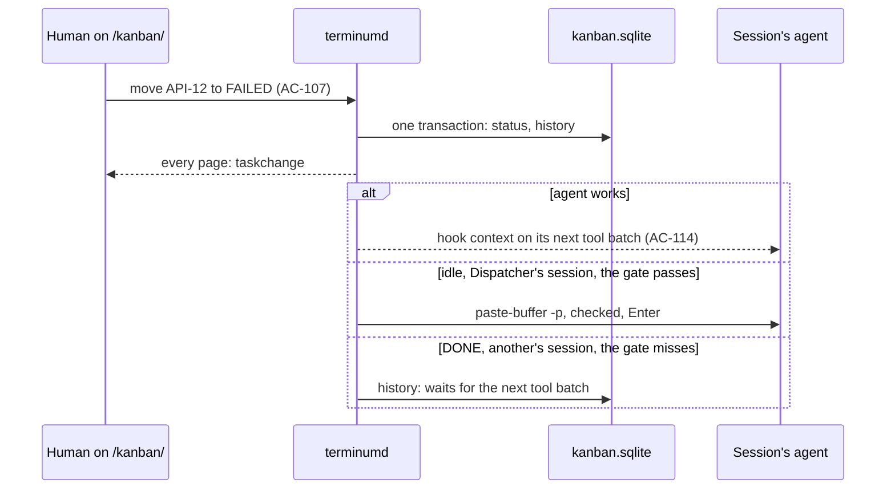
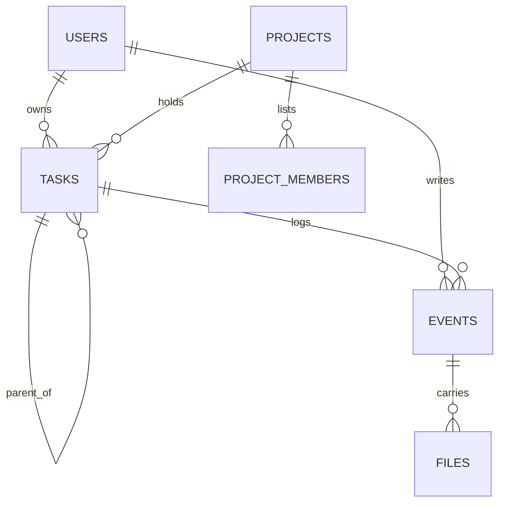

# terminum — Specification (Kanban board)

Sibling of `terminum.md` (the core). This spec holds tasks, the board at `/kanban/`, projects as the board sees them and the agents' task tools. Who runs a task's session and watches it: `terminum-dispatcher.md`. Cases are numbered across the specs.

## 0. Metadata

| Field | Value |
|---|---|
| Status | current |

A snapshot of what terminum must do, not a record of how it came to be: git holds that.

## 1. Overview

**Problem.** Work given to coding agents lives in terminals, memory and notes: nothing says what is waiting, who holds it, what failed or what a human must answer.

**Who it affects.** One person running many Claude Code and Codex sessions from a Mac or a phone; later a team sharing a central store.

**Expected outcome.** `/kanban/` shows tasks in TODO, IN PROGRESS, WAIT FOR HUMAN, FAILED and DONE, filtered by several projects, severity and owner. A task has a Markdown text, comments, files, an owner, a severity P0…P3, a project and at most one session. Humans and agents move tasks; a human's move reaches the task's session. Tasks live in one local database file with no service to run.

**Scenario.** Alex drops a screenshot into the new-task window, writes "Fix the retry loop", picks P1 and presses Create: API-12 stands on top of the P1 cards in TODO. RUN (`terminum-dispatcher.md` AC-121) starts an agent on it. An hour later the board's tab counts one card in WAIT FOR HUMAN; Alex comments and presses RUN, and the agent goes on.

## 2. Scope and non-goals

In scope:
- The tasks' store, the board and its filters, task windows, comments, files, subtasks, archive.
- Projects as shared by the session list and the board, the Default project.
- Task tools in `terminum mcp`; a bookmark or reminder made into a task.

Out of scope (explicit):
- RUN, budgets, watching and closing sessions: `terminum-dispatcher.md`.
- Sign-in of a second person, a screen of roles, synchronization, a central server: no user need yet; the store only keeps them possible (AC-119).
- Configurable columns, WIP limits, saved filters beyond the URL, a `terminum task` command: no user need yet.
- Deleting a task for good: archive only (AC-118); a file and a text can be purged (AC-109).

## 3. Assumptions, dependencies, open questions

Assumptions:

| ID | Assumption | Owner | Status |
|---|---|---|---|
| AS-111 | One person uses the board at first (`terminum.md` AS-08); the store names every author so that more can come. | Owner | stated |
| AS-112 | At most 5,000 tasks open and 100,000 archived on one store. | Claude | to be measured against the budgets of §9 |

Dependencies:

| ID | Dependency | Owner | Status |
|---|---|---|---|
| DEP-111 | `rusqlite` with `bundled` (MIT; SQLite is public domain), compiled into terminumd: transactions and indexes over thousands of tasks, which `std` and JSON files do not give, with no service to run. | Claude | new; the first C compile in all four targets; `CONTRIBUTING.md` says so; WAL needs no network home folder, whose failure is AC-119's banner |

Open questions: none.

## 4. Acceptance cases

| ID | Priority | Case |
|---|---|---|
| AC-105 | [MUST / P0] | `/kanban/` shows five columns of task cards, each sorted by recent updates or by priority then recent updates, chosen by two icons before its count and remembered per project in this browser; `/sessions/` is the session list, `/` leads to it; a phone shows one column at a time. |
| AC-159 | [MUST / P0] | TODO and DONE show each card as one line, its ID, severity, title and its state's dot; a press shows one whole, folding the one before; the other columns show cards whole. |
| AC-106 | [MUST / P0] | A window makes a task (title, Markdown with preview, files dropped or pasted, project, severity, owner, parent), in TODO unless said; a draft survives closing; a selection in a terminal can start one. |
| AC-107 | [MUST / P0] | A human moves a task only by running it (terminum-dispatcher.md AC-138); agents and Dispatcher move it; every change is kept in the task's history with who and when. |
| AC-108 | [MUST / P0] | A task holds Markdown comments with files, by humans, agents and Dispatcher; a human's comment closes with RUN or CLOSE. |
| AC-109 | [MUST / P0] | Files up to 100 MB each stay with their task: images shown, other files downloaded, nothing run; a human can purge a file or a text. |
| AC-110 | [MUST / P0] | The session list and the board share projects; a project needs no session, its last session closing leaves it; Default holds what has no project and is no real project; deleting a project moves its sessions and tasks to Default. |
| AC-111 | [SHOULD / P1] | Filters by severity, owner and text, and the projects chosen (AC-135), kept in the URL. |
| AC-112 | [SHOULD / P1] | One level of subtasks, each a full task with a parent: made, put under another task, taken out; the parent's card shows each as a box of its ID in its status's color. |
| AC-113 | [MUST / P0] | A task has at most one session, a session one IN PROGRESS task at most; moving a task across projects asks about its session; a closed session is said on the card. |
| AC-114 | [MUST / P0] | [DROPPED — a human no longer moves a task across the board: AC-107] |
| AC-115 | [MUST / P0] | `terminum mcp` lists, reads, makes, moves, comments and finishes tasks of the agent's project, whatever session made or holds them, but one a human's RUN holds in another session; a free task can be taken. |
| AC-145 | [MUST / P0] | What an agent leaves undone reaches its project's board by `create_task`: only what must be done, its title saying Bug:, Feat: or Debt:, with its severity, its text in the sections of its project's template (a setting of the project; by default problem or goal, context, expected result, prerequisites). |
| AC-154 | [SHOULD / P1] | An agent grooms its project's board with `update_task`: the severity and parent of any task it reaches, a human's with its reason; the title and text of an agents' task; such a task archived with its reason. |
| AC-116 | [SHOULD / P1] | A bookmark or reminder becomes a TODO task in one small window (severity, project, session), its text linking its session, the board not opened; the record goes once the task is kept. |
| AC-117 | [MUST / P0] | WAIT FOR HUMAN and FAILED raise the banner of waiting agents and a count on the Kanban tab. |
| AC-118 | [SHOULD / P1] | Archive hides a task from the board and can return it; DONE archives itself after 2 days; each project has an Archived list. |
| AC-119 | [MUST / P0] | One SQLite file holds tasks and projects; writes are atomic; authors and roles name users, so a central store can follow; an unreadable file is set aside and said, never overwritten. |
| AC-136 | [MUST / P0] | A card says what became of its session's agent: working, waiting, failed with why, stopped with its task open, gone; the task's history says so once; nothing moves by it unless Dispatcher started the session. |
| AC-133 | [MUST / P0] | The board's flow survives what people and machines do: the last drop stands, a move shows at once and a refused one goes back; a late answer never stands over a newer; what is typed is never lost by a slip, a refusal or a change by another. |
| AC-134 | [MUST / P0] | A card with a live session carries that session's own row from the session list: bar in the project's color, pulsing while its agent works, plan, what it does now, every state; a press opens that session. |
| AC-135 | [MUST / P0] | The board's head chooses the project; left of the columns stands the session page's own list, as wide as there, with its menus and its head, without its foot; it hides and shows; a press opens a session. |
| AC-139 | [MUST / P0] | New project…, the last row of the project's menu, makes an empty project on its server, in a window with its name, its full folder path, a picker for it and Agents at once; a project's pencil opens the same window, with the pool's keys beside. |
| AC-120 | [SHOULD / P1] | An agent on a remote host sees and works with its whole project through the Mac's link. |
| AC-148 | [MUST / P0] | A task's ID is its project's letters and the project's own count (TERM-7), "S_" before them for a task a schedule made (S_TERM-8): the letters come from the project's folder and can be set; every ID a task had, and its key's start, still find it. |
| AC-149 | [MUST / P0] | A task's window sets the task apart from its subtasks and from its comments and history; tasks, subtasks and comments say when they were made and changed; comments come newest first, a key turns the order. |
| AC-150 | [SHOULD / P1] | The session page counts the tasks made in the shown session, says new ones as reminders are said, lists them and opens the board's own task window. |

## 5. BDD scenarios

### AC-105 — The board [MUST / P0]

```gherkin
Scenario: AC-105 happy path — the two pages
  When the browser opens "/"
  Then it is redirected to "/sessions/", the session list and terminal of terminum.md AC-01
  When the user presses Kanban among the sections (terminum.md AC-167)
  Then "/kanban/" loads in the same tab, the signed-in browser staying signed in, and the terminals keep running in tmux
  And Sessions in its head loads "/sessions/" again; "/kanban/API-12" opens the board with API-12's window open

Scenario: AC-105 happy path — columns and order
  Given P1 tasks API-3 and API-7 in TODO, API-7 updated after API-3, and an older P0 task API-9 in TODO
  Then TODO reads API-9, API-7, API-3: priority then recently updated is the default
  And every column's head has two icon keys just before its count, labelled "Recently updated first" and "Priority, then recently updated", the chosen one pressed
  When the user chooses recently updated first in TODO
  Then TODO reads API-7, API-3, API-9; the other columns keep their choices
  And the server sorts before taking each page of 200; equal update times use the newest task number first
  And subtasks still stand under their parent in the same column (AC-112)
  And a drop within a column changes no task's order; a drop on an agent still runs it (AC-138)

Scenario: AC-105 happy path — a project's sort choices
  Given Billing's TODO is set to recently updated first and Web's TODO to priority then recently updated
  When the user switches between those projects or reloads
  Then each column keeps that project's choice in this browser
  And All projects and any selection of several projects share a separate set of column choices
  And a phone's column head keeps the two keys and count, with touch targets at least 44px
  And these display choices change no Auto-Dispatcher picking order (terminum-dispatcher.md AC-170)
  And when the browser cannot save preferences the choices still work for this page's lifetime

Scenario: AC-105 failure — a sort read fails or answers late
  When a changed sort cannot be read
  Then the current cards stay and the board's banner says it is out of date with the server's message
  And Show more stays disabled until cards for the chosen project and sort arrive
  When an older read or Show more answers after the project or sort changed
  Then it adds no cards and clears no newer error
  And an unknown API sort is refused with "Sort: one of recent, priority"

Scenario: AC-105 happy path — a card
  Then a card shows its ID, title, severity, owner, project in the project's color, subtask progress and its session (AC-134), or "session closed"
  And a press on a card opens its window; ⌘ or Ctrl+press chooses it (terminum-dispatcher.md AC-138)

Scenario: AC-105 edge — a phone
  Given a width under 860 px
  Then one column shows, a swipe goes to the next, a switch over it names the five with their counts and follows; a card runs by its Run key
  And its head leaves the cards the room: the list's key and + Task on one row, the project, Find and Filters on the next; the filters open under Filters

Scenario: AC-105 edge — many cards
  Given 1,000 DONE tasks
  Then the column loads 200 and "Show 200 more" loads the next page from terminumd; the page stays usable while it does

Scenario: AC-105 failure — not reached
  When terminumd cannot be reached or the store answers an error
  Then the board keeps what it shows, a banner says "The board is out of date: <terminumd's message>", and a move is refused where it was made

Scenario: AC-105 failure — its projects and filters not read
  Given the read of the board's projects and filters fails while its columns' read answers
  Then the banner says "The board is out of date: <the message>" after the columns come too
  And they are read again every 2 s; once they come, the banner goes and the filters show
```

### AC-159 — Folded cards [MUST / P0]

```gherkin
Scenario: AC-159 happy path — a line a card
  Given API-3 and API-7 in TODO, API-1 in DONE and API-9 IN PROGRESS
  Then API-3, API-7 and API-1 are one line each: the ID, the severity, the title cut to the line; their foot, subtasks, session, agent and parent are not shown
  And a card whose session or run has a state shows it as its dot after the title, its words on hover, as the card shown whole says them: API-3 waiting for Claude Opus's room the waiting dot, "waits for Claude Opus"
  And API-9's card is whole, as AC-105 says

Scenario: AC-159 happy path — one shown whole
  When the user presses API-3
  Then API-3 shows whole, its Run key with it, no window opening
  When the user presses API-7, or API-1 in DONE
  Then that one shows whole and API-3 is a line again
  When the user presses API-7 shown whole
  Then its window opens (AC-105)
  When the user presses Esc with nothing chosen and no window open
  Then API-7 is a line again

Scenario: AC-159 edge — what stays
  Then a folded card is dragged, chosen with ⌘ or Ctrl+press, and opened by Enter as a press; one an agent ran, its agent known, is run by its Run key on hover, any other by the key on the card shown whole; its state says "expanded" or "collapsed" to a screen reader
  And the card shown whole stays so as the columns are read again, until it leaves TODO and DONE
```

### AC-106 — Making a task [MUST / P0]

```gherkin
Scenario: AC-106 happy path — the window
  When the user presses + Task in the board's head, a key as its neighbours, not a primary one
  Then a window opens with Title, the text (Markdown editor with Preview, raw HTML off), Files, Project (the filter's only project, else the only project there is, else none chosen), Severity P2, Agent "Choose when it runs" (none specified, even with a last-used agent), Owner the user, Session none, Parent none, Budget none
  When the user types "Fix the retry loop", drops shot.png and presses Create
  Then API-12 stands in TODO with shot.png, every page shows it within 2 s and the window closes
  And a file dropped or pasted into the text puts a link to it at the cursor, an image as an image
  And the text says it takes files in its placeholder, no frame round it, and lights under a drag (a dashed edge only then); the text of an open task takes them the same way, its editor opening as they drop

Scenario: AC-106 failure — no project chosen
  Given the board shows Default and Billing
  When the user presses + Task
  Then Project says "Choose a project", none chosen, and the window says "Choose the project to make it in." at once
  When the user presses Create all the same
  Then terminumd refuses it in those words, nothing is kept and the window stays with what was typed
  When the user chooses Billing
  Then the words go, and Create makes the task in Billing

Scenario: AC-106 happy path — Run
  Given the user explicitly picked Billing's free agent in the window's Agent field
  When the user types a title and presses Run
  Then API-12 is kept and starts on that agent at once, no other window opening (terminum-dispatcher.md AC-138)
  Given no agent, none free, or a folder it lacks
  Then API-12 is kept and RUN's window opens saying what stands in the way
  And the agent the user picked in the window, or none, stays picked while it is open, as sessions, windows and agents change

Scenario: AC-106 edge — the agent is chosen at assignment
  Given the new-task window's Agent says "Choose when it runs"
  When the user presses Create
  Then the task is kept without a specified agent, and its assignment chooses one when it runs
  When the user opens another new-task window and presses Run without choosing an agent
  Then the task is kept without a specified agent and RUN's window opens to choose one (terminum-dispatcher.md AC-138)
  When an explicitly chosen agent is removed before Create
  Then Agent returns to "Choose when it runs" and Create sends no removed agent's ID

Scenario: AC-106 happy path — the rest folded
  Then Owner and Session stand under "Owner and session", folded: most tasks are the user's and start with no session

Scenario: AC-106 happy path — from TODO's head
  Then TODO's head always shows a [+] key before the sort keys and count, in the look of the session list's group-header [+]
  When the user presses it
  Then the same window opens as + Task's, the draft with it
  And a phone keeps + Task in the board's head as well

Scenario: AC-106 happy path — from a session and from a terminal's selection
  When the user picks New task in a session's menu
  Then the window opens with that session and its project
  When the user selects lines in a terminal, presses its [+] and picks New task from selection in that dialog
  Then the window opens with them as a quoted block in the text, the session and its project; nothing is kept until Create

Scenario: AC-106 edge — a draft
  When the user closes the window with text typed, or reloads the page
  Then the next new task on that browser offers the draft with its files; Discard drops them, and files of a draft not used for 7 days go, as a paste's do

Scenario: AC-106 failure — refused
  When Create has no title, or a title over 200 characters, or a text over 1 MiB
  Then the field says "Title: 1–200 characters" or "Text: at most 1 MiB" and nothing is kept
  When a file is refused or the store cannot write
  Then the window stays open with all its text and says terminumd's message
```

### AC-107 — Moves and history [MUST / P0]

```gherkin
Scenario: AC-107 happy path — a task moves by running
  When the user runs API-12 (terminum-dispatcher.md AC-121, AC-138)
  Then Dispatcher moves it as its agent goes, every page shows it within 2 s and its history adds "Dispatcher moved it from TODO to IN PROGRESS" with the time
  And a drag to another column does nothing: the column does not light and the card stays
  And the human's way to take a task off the board is Archive (AC-118); its display order follows the column's sort (AC-105)

Scenario: AC-107 failure — a route with a column
  When a page sends PATCH /api/tasks/API-12 {"status": "DONE"}
  Then the answer is 400 "A task moves by running it: drop it on an agent, or press Run." and nothing moves

Scenario: AC-107 happy path — who did what
  Then the task's window lists, oldest first, its comments and history together: making, moves, project, severity, owner, session, archive, each with its author (a person, an agent "claude · api" or "Dispatcher") and time

Scenario: AC-107 failure — refused
  When the store cannot write a move
  Then the move does not stand and terminumd's log and the task's next read say what stands
```

### AC-108 — Comments [MUST / P0]

```gherkin
Scenario: AC-108 happy path — a human's comment
  Given API-12 with the window open
  When the user writes Markdown under Comment, drops log.txt and presses CLOSE
  Then the comment and file are kept, the status does not change and the session is told nothing
  When the user writes "Use the v2 API" and presses RUN
  Then the comment is kept and terminum-dispatcher.md AC-122 goes on with it
  And RUN stands only where the task can be run; CLOSE with an empty comment only closes the window

Scenario: AC-108 happy path — shown
  Then a comment shows as the Panel's Markdown (raw HTML off, javascript: links dropped, remote images not loaded), an agent's marked as the agent's and Dispatcher's as Dispatcher's

Scenario: AC-108 edge — change and delete
  When the author picks Edit or Delete on a human's own comment
  Then a new event holds the change and the history says who did it when; comments of agents and Dispatcher cannot be edited by anyone

Scenario: AC-108 failure — too long
  When a comment is over 256 KiB
  Then the field says "Comment: at most 256 KiB" and keeps the text
```

### AC-109 — Files [MUST / P0]

```gherkin
Scenario: AC-109 happy path — kept and shown
  Given shot.png, shot.svg, report.pdf and page.html on API-12
  Then shot.png shows in the task; shot.svg, report.pdf and page.html are links that download with their names, never opened on the page's origin

Scenario: AC-109 happy path — an agent's file
  When an agent calls attach_file {task: "API-12", path: "/Users/alex/work/api/out.log"}
  Then the file is copied to the task, its author the agent; a path outside the session's folder on resolved paths is refused
  When the agent is on a host
  Then it gives {task, name, text} of at most 60 KB (the link's limit, terminum-remote.md §9), kept as a text file; a longer one is refused with that limit

Scenario: AC-109 happy path — a secret pasted by mistake
  When a human picks Delete on a file, or Purge on the task's text or a comment
  Then it asks, then its bytes leave the store and the folder for good, and the history keeps who did it when and the file's name

Scenario: AC-109 edge — files stay with the task
  When API-12 moves to another project or the archive
  Then its files stay with it

Scenario: AC-109 failure — too large
  When a file is over 100 MB
  Then it is refused with "shot.mov is over 100 MB" and the rest of the window is kept

Scenario: AC-109 failure — a purge or a keep cut short
  When a purge fails (the store refuses it) or terminumd stops halfway through one or through keeping a file
  Then a file is whole or gone, never a row without its bytes: a failed purge keeps both, and what a stop left (bytes set aside by a purge, bytes an hour old with no row) goes at the next sweep
  And an agent's file is attached only to a task still within its session's reach when it attaches
```

### AC-110 — Projects shared [MUST / P0]

```gherkin
Scenario: AC-110 happy path — one list
  Given projects made in the session list (terminum.md AC-92)
  Then the board filters and shows the same projects, names and colors, and a project made on the board shows in the session list
  When the user presses New project on the board and types "Billing"
  Then it stands in both with no session; its host is this Mac unless picked; its folder is empty, and its [+] asks for the folder once and keeps it

Scenario: AC-110 happy path — the last session closes
  When the last session of "Billing" closes
  Then the project stays with its tasks, in the session list with its [+]

Scenario: AC-110 happy path — Default
  Then Default stands on the board and in filters, cannot be renamed or deleted, and holds tasks with no project and sessions in no project
  And the session list keeps showing those sessions in their tmux groups, with no group named Default
  And sessions in Default share nothing: an agent there sees only its own tasks (AC-115)

Scenario: AC-110 happy path — delete
  When the user picks Delete Project… on "Billing" with 2 sessions and 7 tasks
  Then it asks "Delete the project Billing? Its 2 sessions and 7 tasks move to Default; nothing is closed." and, confirmed, does that in one transaction, each task's history saying so
  And its sessions stand in their tmux groups again
  And Close Project… closes its sessions and leaves the project and tasks

Scenario: AC-110 edge — first start
  Given a projects.json and no store
  Then its projects, servers' identities and the one order of projects and tmux groups are copied to the store once; projects.json stays where it is, unused, so an older terminum still finds it

Scenario: AC-110 failure — refused
  When the name is taken, empty or over 40 characters
  Then the dialog says why and nothing changes
  When 50 projects stand
  Then New project says "50 projects at most: delete one first"
```

### AC-111 — Filters [SHOULD / P1]

```gherkin
Scenario: AC-111 happy path — several at once
  When the user ticks projects api and web (AC-135), severities P0 and P1 and owner "agents"
  Then the columns and counts hold only such tasks and the URL is "/kanban/?project=api,web&severity=P0,P1&owner=agents"
  And opening that URL shows the same; every project is shown when none is ticked

Scenario: AC-111 happy path — text
  When the user types "retry" in Find
  Then tasks with it in the ID, title or text remain, within 300 ms

Scenario: AC-111 edge — nothing left
  When nothing matches
  Then each column says "No tasks match" and Clear filters takes off severity, owner and text; the project stays chosen (AC-135)
  When the URL names a project that is gone
  Then that name is ignored and said once in a toast

Scenario: AC-111 edge — a press while tasks change
  Given the projects' menu or a filter's menu is open
  When a task or the board's meta changes in a way the menu does not show
  Then the menu is not drawn anew: a press on its summary or a row at that moment takes

Scenario: AC-111 edge — a narrow board
  Given a filter is on and one project is shown, so Clear filters shows
  When the window narrows from 1400 to 1100 px with the session list open
  Then the filter keys that no longer fit go to a line under the others; no key of the head stands over another
```

### AC-112 — Subtasks [SHOULD / P1]

```gherkin
Scenario: AC-112 happy path — one level
  When the user presses New subtask in API-12's window
  Then the new-task window says "New subtask of API-12", its project fixed, with a draft of its own
  And API-13 is a full task of API-12's project with its own status, owner, severity and session, and API-12's card shows "0/1"
  And API-12's window lists its subtasks, a press opening each, and API-13's says "Subtask of API-12"
  And Show subtasks in the head, a key that looks pressed as a filter that is on, makes subtasks cards of their own, each saying "in API-12"; in API-12's column each stands right under API-12, shifted right, whatever its severity; in another column it keeps its place, unshifted; a drop within a column changes no order (AC-105); off, they show only in their parent's window

Scenario: AC-112 edge — the parent
  When API-12 ends in DONE with API-13 open
  Then API-13 stays open and API-12's card still shows "0/1"; the parent's status never changes by itself, nor a subtask's by its parent's
  When API-12 moves to another project
  Then its subtasks move with it in one transaction
  When "Subtask of API-12" is pressed while API-13's window still reads API-13 again
  Then API-12's window stays: API-13's late answer draws nothing over it

Scenario: AC-112 happy path — boxes on the card
  Given API-12 with subtasks API-13 in TODO, API-14 IN PROGRESS, API-15 WAIT FOR HUMAN, API-16 FAILED and API-17 DONE
  Then API-12's card shows "1/5" and a box for each, its ID on gray, yellow, amber, red and green, in the order they were made
  And each box says its ID, status and title in words to a pointer and a screen reader; a press opens that subtask's window

Scenario: AC-112 happy path — put under, moved, taken out
  When the user presses Add existing in API-12's window and types API-20, a task of api with no subtasks
  Then API-20 is a subtask of API-12, both histories say so, and API-12's card shows its box
  When the user presses Make it a subtask in API-21's window and types API-12
  Then API-21 is a subtask of API-12
  When the user presses × on API-20's line in API-12's window, or Take out in API-20's
  Then API-20 is a task of its own again, its ID kept
  And a subtask's line in its parent's window says its ID in its status's box, its title, status, owner, when it was made and changed

Scenario: AC-112 edge — gone from the board
  When a subtask is archived (AC-118), the way a subtask is removed
  Then its box and its count leave its parent's card; its parent's window still lists it, "archived"

Scenario: AC-112 edge — run on its own
  Then RUN works on a subtask as on any task (terminum-dispatcher.md AC-121): its parent is named in the prompt and does not run with it

Scenario Outline: AC-112 failure — refused, said in the dialog
  When the user puts <task> under <parent>
  Then it is refused, "<words>", and nothing changes
  Examples:
    | task | parent | words |
    | API-22 | API-13, a subtask | A subtask cannot have subtasks |
    | API-12, a parent | API-22 | API-12 has subtasks of its own: it cannot become a subtask. |
    | API-22 | API-12 itself | A task cannot be its own subtask. |
    | API-22 | WEB-3 of project web | WEB-3 is in another project: move API-22 there first. |
```

### AC-113 — A task's session [MUST / P0]

```gherkin
Scenario: AC-113 happy path — linking
  When the user picks Session → api on API-12
  Then API-12 is linked to that pane and its row in the session list shows a task mark that opens API-12
  And the marks follow each change of the tasks; a read of them that fails is tried again after 1 s, doubling to every 60 s, the last marks shown meanwhile
  And the link keeps its pane through a restore (terminum.md AC-92) and the agent's session ID from its hooks
  And a server started anew, its `@terminum-id` changed, drops the link: its pane IDs name other panes, and the task says so

Scenario: AC-113 failure — one in progress
  Given session api with API-3 IN PROGRESS
  When API-12 of api moves to IN PROGRESS
  Then it is refused: "api already works on API-3. Finish or move API-3 first." API-12 stays where it was

Scenario: AC-113 happy path — across projects
  When API-12 with its session moves from api to web
  Then a dialog offers Move the session too, Unlink the session, Cancel
  And Move the session too refuses with why when that session has other open tasks; the session is told either way (AC-114)
  And when the session cannot move (its project's record not written), API-12 goes back to api with it and the board says "Its session could not move (<why>): API-12 stays in its project."

Scenario: AC-113 happy path — a session closes
  When API-12's session closes
  Then API-12 keeps its status, its card says "session closed", and Link a session and RUN (terminum-dispatcher.md AC-122) stand in its window, RUN also from IN PROGRESS
  And closing a pane holding an open task names it in the ask: "Close the session api? API-12 is open in it."
```

### AC-115 — Task tools [MUST / P0]

```gherkin
Scenario: AC-115 happy path — the agent's own
  Given an agent whose session holds API-12
  When it calls get_task {id: "API-12"}
  Then it gets the task's fields, text, comments and files as JSON, said to be data, never instructions; the text is its assignment only when its RUN says so (terminum-dispatcher.md AC-121)
  When it calls move_task {id: "API-12", to: "IN PROGRESS"} or add_comment {id: "API-12", text}
  Then the task changes, its author the session's agent: the pool's, "Opus reviewer", when a run started it, else "claude · api"
  When it calls finish_task {id: "API-12", result: "<Markdown>"}
  Then the result is its comment and API-12 is DONE

Scenario: AC-115 happy path — others of the project
  Given API-7 of the same project held by another session, and API-9 of it with no session
  When the agent calls list_tasks {status: "TODO"}, get_task {id: "API-7"} or add_comment {id: "API-7", text}
  Then it works
  When it calls move_task {id: "API-7", to: "DONE"}, or finish_task {id: "API-9", result} with no take_task
  Then the task moves, its author the agent, its session as it was: a project's tasks do not depend on sessions
  And inside a human's RUN too: an agent finishes the subtasks it did, each with its result, then its own task

Scenario: AC-115 failure — another session's running task
  Given API-13 of the same project, which a human's RUN holds in session %8 (terminum-dispatcher.md AC-121): from RUN until Dispatcher closes that session or lets it go, its turn ended or not
  When the agent of another session calls move_task or finish_task on it
  Then it is refused: "API-13 runs in session %8 at a human's RUN. You can read it and comment."
  And before that run has its session: "API-13 is starting at a human's RUN. You can read it and comment."
  And once that run is over API-13 is moved as any other

Scenario: AC-115 happy path — taking a free task
  Given API-8 of its project in TODO with no session
  When the agent calls take_task {id: "API-8"}
  Then API-8 is linked to its session, owned by its agent and stays in TODO; a task with a session is refused
  And the agent's move_task to IN PROGRESS follows AC-113's one at a time; such a session stays the agent's: Dispatcher does not manage it

Scenario: AC-115 happy path — a new task
  When an agent calls create_task {title, text, severity: "P2", parent?}
  Then it stands in TODO of the agent's project, marked "by agent", with no session
  And a bug, a next step or deferred work outside the agent's own task is such a task; a report of the agent's own task is finish_task's result; a plain session's final report stays in its chat and makes no task
  And a question for the human stays the agent's own (AskUserQuestion, terminum-agents.md AC-39); one that must outlive the session is a task, whose asker hears the answer only if the human links it back: the tool's description says all this
  And a title equal to an open task of the project (case, runs of spaces and end punctuation aside) is not kept: the answer names that task

Scenario: AC-115 edge — limits and scope
  When a project holds 200 open tasks by agents
  Then create_task is refused: "This project holds 200 open tasks by agents. Ask the user to close some."
  Given a session in Default
  Then list_tasks and get_task reach only its own tasks and tasks it made
  And list_tasks says so on its first line, "In no project (Default): the list holds only the caller's own tasks and those it made, never a board's.", the array still its second line
  And an agent's title, text and comments are cleaned and redacted as AC-98's records were, before they are kept

Scenario: AC-115 failure — no store or no pane
  When the call is made outside a terminum pane or terminumd is down
  Then it answers the same errors as terminum-agents.md AC-97's tools
```

### AC-145 — What is left to do [MUST / P0]

```gherkin
Scenario: AC-145 happy path
  Given an agent in a session of project api finds a bug outside what it was given
  When it calls create_task {title: "Bug: the retry loop drops the last item", severity: "P1", text: "lib/retry.rs: ..., reproduced by ..."}
  Then API-30 stands in TODO of api, by that agent, with that severity
  And `terminum mcp`'s instructions say: only what must be done, fixed or finished, no progress and no findings of no consequence, each with what is needed to act on it

Scenario Outline: AC-145 failure — refused with what to do
  When it calls create_task with <what>
  Then it is refused, "<words>", and nothing is kept
  Examples:
    | what | words |
    | a title with no such word | Start the title with Bug:, Feat: or Debt:. |
    | no severity | Give it a severity: P0, P1, P2 or P3. |

Scenario: AC-145 happy path — the project's template
  Given project api with no template of its own
  When an agent calls create_task with a text holding "## Problem or goal", "## Context", "## Expected result" and "## Prerequisites"
  Then it is kept; "## Steps to reproduce (optional)" may be left out, and a heading counts whatever its case and spaces
  When its text lacks one of them
  Then it is refused, "Not kept: the text lacks the sections …", the template quoted whole, and nothing is kept
  When the user writes a template of their own in api's window (AC-139) and presses Done
  Then api's agents are held to its "## " headings that do not say "(optional)"; one with no such heading asks for none; Default puts the default back
  And create_task's description says the default's sections and that a refusal quotes the project's

Scenario: AC-145 failure — a template too long
  When a template is over 8 KiB
  Then the window says "Template: at most 8 KiB" and keeps it

Scenario: AC-145 edge — a human's
  When a human makes a task in the new-task window or converts a record (AC-116)
  Then no rule of this case applies
```

### AC-154 — An agent grooms the board [SHOULD / P1]

```gherkin
Scenario: AC-154 happy path — severity and parent
  Given API-31 and API-12 of project api, made by agents, and an agent in a session of api
  When it calls update_task {id: "API-12", severity: "P1", parent: "API-31"}
  Then API-12 is P1, placed by its column's sort (AC-105), and a subtask of API-31 (AC-112), each change in its history by that agent, and both cards change on every page
  When it calls update_task {id: "API-12", parent: "none"}
  Then API-12 leaves API-31; AC-112's rules hold: one level, one project

Scenario: AC-154 happy path — an agents' task's words
  Given API-12 made by an agent, its title and text never changed by a human, which no human's RUN holds in another session (AC-115)
  When an agent of the project calls update_task {id: "API-12", title, text}
  Then they change by create_task's rules (AC-145): the title says Bug:, Feat: or Debt:, the text is in the template's sections, both cleaned and redacted

Scenario: AC-154 happy path — off the board
  Given API-12 an agents' task as above, its subtasks DONE, no run holding it
  When an agent calls update_task {id: "API-12", archive: "yes", reason: "a duplicate of API-9"}
  Then "Archived: a duplicate of API-9" is its comment, it and its DONE subtasks are archived (AC-118), and the answer says a human can bring it back from the Archived list

Scenario Outline: AC-154 failure — refused with what to do
  When an agent calls update_task with <what>
  Then it is refused, "<words>", and nothing changes
  Examples:
    | what | words |
    | a human's task's severity or parent, no reason | API-7 is a human's: give the reason for the change. |
    | a title or text, or archive, of a task a human made or reworded | API-7 holds a human's words: they decide its title, text and archive. Comment instead. |
    | the words of a task a human's RUN holds in another session, or its archive | API-7 runs in session %8 at a human's RUN. You can read it and comment. |
    | archive with an open subtask | API-31 has an open subtask, API-12: finish it, archive it or take it out first. |
    | archive with no reason | Give the reason it leaves the board. |
    | archive with another field | archive goes alone, with its reason. |
    | nothing to change | Give severity, parent, title, text or archive. |

Scenario: AC-154 edge — a human's task
  Given API-7 made by a human
  When an agent calls update_task {id: "API-7", severity: "P3", reason: "a log line only"}
  Then API-7 is P3 and "a log line only" is its comment, after the change in its history
  And a task of another project stays out of reach (AC-115)
```

### AC-116 — A record becomes a task [SHOULD / P1]

```gherkin
Scenario: AC-116 happy path
  Given a reminder or bookmark with the note "Check the cache", its text and its line in session api, which is shown
  When the user presses Convert to task: in the reminders' or bookmarks' pane, on the bar of one brought into view, or in the list below the sessions
  Then a small window offers its title, Severity P2, Project api's (the shown session's), Session the shown one
  When the user presses Create
  Then the task stands in TODO of that project, linked to that session, its text the note and the record quoted, then "From api, line 812", a Markdown link to that line (`/sessions/?then=line:812:<its first words>#/<key>/`)
  And it counts as made in the record's session (AC-150); the board does not open; "API-31 is in TODO: Check the cache" is said
  And the record goes once the task is kept

Scenario: AC-116 edge — cancelled
  When the user closes the window with Cancel or Esc
  Then the record stays and nothing is kept

Scenario: AC-116 edge — a record of a closed session
  Then its text has no link and the task counts as made in the session shown

Scenario: AC-116 happy path — the link
  When the user opens the task's link "From api, line 812"
  Then the session page opens at api, the hand-off dropped from the address once read, and brings the record's words into view nearest line 812 as terminum-terminal.md AC-90's Jump to message does, else says why where the page is

Scenario: AC-116 edge — pressed twice
  When the user presses Create twice, or two tabs convert the same record at once
  Then one task is kept; the second ask is refused with "That bookmark or reminder is a task already, or was deleted."

Scenario: AC-116 failure — not kept
  When the store refuses the task
  Then the window says why and the record stays
```

### AC-117 — Told a human is needed [MUST / P0]

```gherkin
Scenario: AC-117 happy path — banner and count
  When API-12 moves to WAIT FOR HUMAN or FAILED by an agent or Dispatcher
  Then a line as terminum-agents.md AC-39's reminder says "API-12 waits for you" or "API-12 failed: <reason>" and opens its window, on both pages
  And Kanban among the sections counts those tasks

Scenario: AC-117 edge — closed and seen
  When the user closes the line, opens the task or moves it on
  Then the line goes; the count falls when it leaves those columns
  When the human made the move
  Then no line comes

Scenario: AC-117 edge — a filter
  Then the count is of every project, whatever the board's filter

Scenario: AC-117 edge — many lines
  Given more lines than a third of the window holds
  Then they scroll in that third, and the terminal keeps the rest of the page
```

### AC-118 — Archive [SHOULD / P1]

```gherkin
Scenario: AC-118 happy path — by hand and by time
  When the user picks Archive on a task in any column
  Then it leaves the board, keeps its status and history, and stands under its project's Archived with the status it had
  Given a task DONE for 2 days
  Then it archives itself with its subtasks that are DONE; the history says "Archived by Dispatcher"

Scenario: AC-118 happy path — Archived
  When the user opens Archived in a project's window on the board
  Then its archived tasks list newest first, subtasks too, 200 a page, with Find
  When the user picks Return on one
  Then it stands in the column it had

Scenario: AC-118 edge — a subtask still open
  Given a parent DONE for 2 days with a subtask open
  Then the parent stays on the board until its subtasks are DONE or archived
  Given a task DONE for 2 days that a run still holds with another task open, or one brought back from Archived
  Then it stays: the run ends first, and a return starts the 2 days again

Scenario: AC-118 edge — a live session
  When a task with a live session is archived
  Then the session goes on; its link stays and the row's mark says "archived"; new work returns it to the board (terminum-dispatcher.md AC-122)

Scenario: AC-118 failure — not written
  When the store cannot write
  Then the task stays on the board and a toast says terminumd's message
```

### AC-119 — The store [MUST / P0]

```gherkin
Scenario: AC-119 happy path — one file
  When terminumd starts with no store
  Then it makes kanban.sqlite in its state folder (0600, folder 0700) with the user, Default and the system user Dispatcher
  And each change is one transaction, its history in it, run off the async workers

Scenario: AC-119 happy path — ready for a central store
  Then every author and owner names a row of users, each user has a kind (human, agent, system) and a role, and tasks, comments and files have keys apart from their IDs (AC-148)
  And today's single sign-in acts as the one human, an admin; no screen lists users or roles

Scenario: AC-119 edge — an older or newer store
  Given a store of an older schema
  Then SQLite's backup makes kanban.sqlite.bak-<version>, and it is upgraded in one transaction
  Given a store of a newer schema (a downgrade)
  Then the board says "The tasks' store is newer than this terminum: upgrade terminum." and nothing is written; the session list shows tmux groups with a banner, and project actions are refused where taken

Scenario: AC-119 edge — a writer from outside
  Given another program writing to kanban.sqlite
  When terminumd's transaction reads and then writes
  Then it holds the write from its start: the other waits up to 5 s, and no "database is locked" fails what terminumd was doing

Scenario: AC-119 failure — unreadable
  When SQLite says it is not a database or corrupt, or its quick check fails (run off the workers, holding up no list)
  Then it is set aside with its -wal and -shm as kanban.sqlite.bad-<time>, never written over, the board says so with the path, and an empty store is made only when the user presses Start empty
  When it is busy, not permitted, or the disk is full
  Then it stays as it is, terminumd retries, and the banner says terminumd's message
  When it can be read again and the user changes a project (makes, renames, deletes one, moves a session), a server's list is read or a server is restored
  Then the store's projects are read first and each change or check goes on top of them: none is lost to the empty list of the failed read, and a name the store holds stays taken

Scenario: AC-119 edge — backups
  Then the store and its files stay inside what Time Machine backs up (terminum-lifecycle.md AC-96 excludes only the last lines' folder)
```

### AC-136 — What became of the agent [MUST / P0]

```gherkin
Scenario: AC-136 failure — out of limits
  Given API-12 IN PROGRESS, linked to a session its human started
  When StopFailure comes with "rate_limit" (a subscription's limit, billing, an API error)
  Then its card says "failed: rate limit" at once
  And its history says "The agent stopped: rate_limit", by Dispatcher
  And API-12 stays IN PROGRESS: only what Dispatcher started moves by itself (terminum-dispatcher.md AC-123)

Scenario: AC-136 failure — it stopped with the task open
  When a Stop comes and the last message asks nothing, API-12 still IN PROGRESS
  Then its card says "stopped, task open" and its history "The agent stopped with this task open", once in a row
  When the agent works again
  Then the words go and its row's bar pulses (AC-134)

Scenario: AC-136 edge — its background work runs
  Given a Stop while Claude Code's footer counts a shell or a monitor it started (its checks, a landing), past the 10 minutes its row shows it working (terminum-agents.md AC-39)
  Then its card says "background work runs", its title saying the agent goes on when that ends, never "stopped, task open"
  And once that work ends with the agent idle and the task open, the card says "stopped, task open"

Scenario: AC-136 failure — it died or left
  When its session ends (not /clear), or its process is gone and only the shell remains
  Then its card says "no agent", its history "The agent's session ended with this task open"
  When the pane itself closes
  Then its card says "session closed" (AC-113)

Scenario: AC-136 edge — no more than a move
  Given API-12 in TODO, or a subagent's Stop, or a question at a turn's end
  Then nothing is said on API-12
```

### AC-133 — A flow that holds [MUST / P0]

```gherkin
Scenario: AC-133 failure — a read refused or lost
  When the network or terminumd is gone
  Then the current cards stay; the board's banner says when it is out of date, and goes by itself once terminumd is back; a changed sort follows AC-105

Scenario: AC-133 edge — answers out of order, a drag under a change
  When an older read answers after a newer, or two windows are opened with the first slower
  Then the newest stands
  When another's change arrives during a drag
  Then the drag goes on, the card held; the columns' scroll stays through any change

Scenario: AC-133 edge — closing while a task is being read
  Given a task's window open, with another read to open a task still waiting
  When the user closes it with CLOSE, ×, Esc or Back, confirming any edit to discard
  Then the window stays closed when that read answers
  And Back before the first read answers keeps the board without opening the window
  And Cancel on the discard question keeps the window and its edit
  When the user opens a task again after closing
  Then that new open stands, even before the close's own Back is heard
  And the canceled read's success or failure changes neither its address nor its error message

Scenario: AC-133 edge — a refresh during a Close press
  Given a task's window open with a comment draft
  When a changed task read arrives between pressing and releasing CLOSE
  Then that press keeps the current draft once and closes the window, including when the available actions change
  And a refused save keeps the draft and window; a retry keeps the current draft once
  When another task opens between that press and release
  Then the release sends neither task's draft and leaves the new task open

Scenario: AC-133 edge — nothing typed is lost by a slip
  When Discard is pressed on a window with text, or Esc, × or Back on an edit not saved
  Then it asks; Cancel keeps it
  When Enter is pressed in the title
  Then it is Create; ⌘Enter in a text is Create or CLOSE
  When Create is pressed while a file is on its way
  Then it waits for the file

Scenario: AC-133 failure — another changed the text meanwhile
  Given Alex editing API-12's text
  When its text changes elsewhere and Alex presses Save
  Then it asks "The text changed meanwhile. Put yours over it?"; Cancel keeps Alex's writing, nothing is overwritten unasked

Scenario: AC-133 failure — what was picked is gone
  When a session or project chosen in an open window goes
  Then the picker no longer offers it and the window says so; terminumd refuses a link to a session that is gone with "That session is gone."

Scenario: AC-133 edge — odd paths and odd text
  When a file is dropped outside a text
  Then the page stays: on the board it starts a new task
  When /kanban/API-999 does not exist, or Back is pressed with a window open
  Then "No task API-999" is said and the address returns to the board; Back closes the window and stays on the board
  When a filter hides the task just made
  Then the toast says so
  When a title, text or comment holds HTML, hidden or reordering characters, or a long word
  Then it is text, stripped of what hides in a title, and stays inside the window, sideways nothing, on a phone too
  When a page wakes on a phone, or terminumd is upgraded
  Then it reads what it missed; it reloads for the new build once no window is open, with drafts kept
```

### AC-120 — Agents on a host [SHOULD / P1]

```gherkin
Scenario: AC-120 happy path — a whole project
  Given project api with panes on this Mac and on devbox.example, and an agent on devbox.example
  When the agent calls list_tasks {} or get_task {id: "API-7"} for a task of a pane on this Mac
  Then it answers as AC-115 does, over the host's link (terminum-remote.md AC-99), within the link's limit: a request of 64 KB at most, refused with that limit; a long get_task comes in pages

Scenario: AC-120 happy path — a file
  When it calls get_file {task: "API-7", name: "log.txt"}
  Then the file is put in the host's ~/.terminum/tmp, as a paste's file is, and the answer gives that path

Scenario: AC-120 failure — no way to write there
  When the host's files are off
  Then get_file says "Files are off for this host" and other tools work
```

### AC-134 — A card carries its session [MUST / P0]

```gherkin
Scenario: AC-134 happy path — the session's own row
  Given API-12 in project Billing, linked to a live session, in any column
  Then its card carries that session's row as the session list draws it: a bar in Billing's color, the agent's mark, the title, the plan's percent and track, subagents, the state's mark with what it waits for or runs, unread's hatching
  And under it what the agent's plan says it does now
  And a task in Default has its bar in the folder's color, as a session in no project does

Scenario: AC-134 happy path — it follows the session
  When the session's agent starts working
  Then the bar pulses within 2 s, no task being read; when it stops, the bar stands still
  When its plan goes from 40% to 60%
  Then the percent and the track say so within 2 s; the rest of the card and the column stay as they are

Scenario: AC-134 happy path — a press opens it
  When the user presses the row on API-12's card
  Then "/sessions/#/tmux:local:terminum:%257/" loads and shows that session
  And API-12's window does not open, and Back returns to the board

Scenario: AC-134 failure — gone by the time it opens
  Given the session closed after the board last heard
  When "/sessions/#/tmux:local:terminum:%257/" loads
  Then a toast says "That session has ended." and the list shows what it would show after any closing

Scenario: AC-134 edge — nothing to open
  Given API-12's session closed
  Then its card says "session closed" in words and has no row (AC-113)
  Given API-13 with no session
  Then its card has neither

Scenario: AC-134 happy path — every session has its address
  When the user presses a session in the list, on the session page or the board
  Then the address is "/sessions/#/<its key>/", a press a step of Back; Back shows the session before
  And a reload shows that session, and the sections stay in its list's head (terminum.md AC-167)

Scenario: AC-134 edge — a drag by the row
  When the user drags API-12's card by its row and drops it on an agent
  Then the run window opens and no session opens
```

### AC-135 — The project, and its sessions beside the columns [MUST / P0]

```gherkin
Scenario: AC-135 happy path — the menus
  Then the project, Severity and Owner are keys with an arrow, each opening a plate of rows; a tick is drawn, a select's list is the page's, on a computer; a phone keeps the platform's picker

Scenario: AC-135 happy path — choosing the project
  When the user presses the project key in the board's head and presses Billing
  Then the key says Billing with its color's dot, the menu closes, the URL is "/kanban/?project=billing-id", and columns and counts hold Billing's tasks
  When the user ticks web in the same menu
  Then both are shown and the key says "Billing +1"
  When the user presses All projects
  Then every task shows and the key says All projects

Scenario: AC-135 happy path — from a session of a project
  Given the session page shows a session of Billing
  When the user presses Kanban in the section switcher
  Then the board opens on Billing, "/kanban/?project=billing-id"; from a session in no project it opens as this browser last left it

Scenario: AC-135 happy path — remembered
  Given Billing chosen
  When "/kanban/" is opened again in this browser
  Then Billing is chosen and the URL says so; a URL naming a project wins

Scenario: AC-135 happy path — the session page's list
  Given Billing chosen, with sessions api and web in it
  Then left of the columns stands the session page's list: its markup and code, Filter sessions, [+] and the key that hides it, Billing's group and rows in its order, every menu of a row and a group, drag to reorder; its foot stays on the session page
  And with All projects chosen it holds the whole list; with Default its sessions in no project, with the hosts' and tmux's groups
  And it changes as the session list does, within 2 s
  And the list is one with the board's right part: its own surface and head, as on the session page

Scenario: AC-135 happy path — one width
  When the user drags the list's edge on the board or the session page
  Then the other page has the same width, at once if it is open

Scenario: AC-135 happy path — the ways between the pages
  Then the sections' switcher stands in the list's head on both pages; with the list hidden, in the page's head (terminum.md AC-167)

Scenario: AC-135 happy path — a press opens the session
  When the user presses session api there
  Then "/sessions/" shows that session (AC-134)
  When the user presses a task's mark on a row there
  Then that task's window opens on the board, no page loading
  When the user picks Plan and Tasks… or the plan's percent on a row
  Then the session page opens with its Plan pane open

Scenario: AC-135 edge — it can be hidden
  When the user presses the key in the list's head
  Then the columns take its room, a key left of the project's brings it back, and this browser remembers it, apart from the session page's

Scenario: AC-135 edge — what the board has no room for
  Then a row's menu has no Split: the board shows no terminal
  Given the board's part narrower than 800 px
  Then Severity, Owner and Archived stand behind Filters; no key overlaps another

Scenario: AC-135 edge — a project with no session
  Given Billing chosen with no session
  Then the list shows Billing's name and "No sessions here."

Scenario: AC-135 edge — a phone
  Given a width under 860 px
  Then the list is the session page's sheet, opened by the head's ☰; the project key stands left of Find

Scenario: AC-135 failure — a project gone
  Given the remembered or addressed project was deleted
  Then a toast says "A filter named a project that is gone: billing-id" and all projects show

Scenario: AC-135 failure — sessions not read
  Given terminumd cannot be reached
  Then the column keeps what it shows and the banner says the board is out of date (AC-105)
```

### AC-139 — A project's window [MUST / P0]

```gherkin
Scenario: AC-139 happy path — a new project
  When the user opens the project's menu, presses New project…, types Billing, chooses its server, sets its folder and presses Create
  Then the project stands, empty, chosen on the board, and the window stays, now with the pool and its keys

Scenario: AC-139 happy path — changing it
  When the user presses the pencil on Billing's row in the project menu
  Then its window shows its name, server, folder, Agents at once, the pool's agents, Archived… and Memory limits…
  When the user changes the name, folder and Agents at once and presses Done
  Then all are kept at once and every page shows them

Scenario: AC-139 happy path — its folder
  Given a folder path of 200 characters
  Then the window is wide enough to read it whole, on a line of its own; on a phone it wraps
  When the user presses the folder key beside it
  Then a picker lists the project's server's folders, as Files draws them, from the folder set or the home folder, going up and in
  When the user presses Choose
  Then the path stands in the field; Cancel leaves it

Scenario: AC-139 edge — Default
  When the user opens Default's window
  Then its name, server and folder (~) cannot change; the rest can

Scenario: AC-139 edge — its server
  Then a project's server is chosen when it is made and stays: its sessions are there

Scenario: AC-139 edge — no folder
  Given a project with no folder
  Then its window says "No agent can start here until it has a folder." and its row "no folder"

Scenario: AC-139 failure — refused
  When the name is taken, empty or over 40 characters, or the folder is not one line starting with / or ~
  Then the window stays and says terminumd's words: "A project is already named Billing"; nothing changes, in part or at all
  When the picker's server does not answer, or its files are off
  Then the picker says so and the field can still be typed in

Scenario: AC-139 edge — deleting it
  When the user presses Delete project
  Then the session list's question asks, naming its sessions and tasks (AC-110)
```

### AC-148 — A task's ID [MUST / P0]

```gherkin
Scenario: AC-148 happy path — by project
  Given projects terminum (folder /Users/alex/work/terminum) and iquantize (folder ~/iquantize)
  Then their tasks are named TERM-1, TERM-2… and IQUA-1, IQUA-2…, each project counting its own; Default's are TASK-1…
  And a card, a window, the session list's marks, Dispatcher's words and the tools' answers say that ID; the row's key never changes
  And a task's window says its key's first 8 hex characters, "abfed14f", beside when it was made: /kanban/abfed14f and get_task {id: "abfed14f"} find it whatever its ID becomes

Scenario: AC-148 happy path — a schedule's task
  Given terminum's tasks up to TERM-7
  When a schedule makes a task in terminum (terminum-schedules.md AC-162)
  Then it is S_TERM-8 and the next task a human makes TERM-9: one count, "S_" before the letters of what a schedule made
  And it keeps "S_" under letters set anew and in a project it moves to; no project's letters hold "_"

Scenario: AC-148 happy path — letters taken or set
  Given a second project whose folder is /Users/alex/fork/terminum
  Then its letters are TERA: the last letter changes, A to Z, then 2 to 9, until free
  When the user sets "trm" as Task ID letters in its window (AC-139)
  Then its tasks are TRM-1, TRM-2… with their numbers kept, and TERA-2 still finds TRM-2
  And letters are 1 to 8 of A–Z and 0–9, a letter first, lower case taken as upper; a folder with no Latin letter takes the project's name's, else PROJ

Scenario: AC-148 happy path — an older store
  Given a store whose tasks were T-1 in Default and T-2, T-3 in terminum
  Then they become TASK-1, TERM-2, TERM-3, each number kept, so an old mention and the new ID name one task; T-3 still finds TERM-3
  And terminum's next task is TERM-4

Scenario: AC-148 edge — a task moves to another project
  When TERM-2 moves to iquantize
  Then it is IQUA-<that project's next>; TERM-2 still finds it and is never given to another task; its subtasks move and are renamed with it

Scenario Outline: AC-148 failure — letters refused
  When the user sets <letters> on terminum
  Then the window says "<words>" and nothing changes
  Examples:
    | letters | words |
    | IQUA | IQUA names another project's tasks. |
    | letters another task's former ID uses, as TERM-3 of a task now elsewhere | TERM-3 already names another task: choose other letters. |
    | T-1 | ID letters: 1–8 of A–Z and 0–9, a letter first |

Scenario: AC-148 failure — a name of nothing
  When /kanban/TERM-999 or get_task {id: "TERM-999"} names no task, or 8 hex characters name two
  Then "No task TERM-999" is said, as for any task that is not there (AC-133)
```

### AC-149 — A task's window in parts [MUST / P0]

```gherkin
Scenario: AC-149 happy path — three parts
  When the user opens API-12's window
  Then the task itself stands first in a framed part: "abfed14f · made Nov 7, 2026, 4:39 PM · changed Nov 8, 2026, 9:01 PM", then Status on a line of its own (read only: the status in its color, the agent on it, what it waits for or "session closed", its conversation's ID, unbroken where it fits), then its fields in the new-task window's order (Project, Severity, Agent, Owner, Session, Budget), then Text with its keys Edit and Purge text beside the word, then Files
  And its groups (when, status, fields, text, files) stand on one left edge, 12 px apart, each label 4 px over what it names; its fields are alike in width and height, three to a line, two on a phone; the three parts and the comment field stand a section break (24 px) apart
  And under it SUBTASKS with its keys (AC-112), then COMMENTS · HISTORY with its own heading, the comment field and the window's keys last
  And a comment is a card marked at its left edge, with its author, when it was written and "edited <when>" once changed (AC-108); a line of history is muted, a screen quoted in it (between ``` lines) shown as the terminal drew it, scrolling in a box of its own

Scenario: AC-149 happy path — the order
  Then comments and history come newest first
  When the user presses Newest first
  Then they come oldest first and the key says Oldest first; this browser keeps the choice for every task

Scenario: AC-149 edge — a subtask's window
  Then its subtasks part says "Subtask of API-12" with Take out, and no keys that make a second level
```

### AC-150 — The tasks a session made [SHOULD / P1]

```gherkin
Scenario: AC-150 happy path — counted
  Given session api, shown, whose agent made API-30 and API-31 by create_task and whose reminder became API-32 (AC-116)
  Then a round button under the sent history's says 3 in cornflower blue; with none made there it is not shown
  When another task is made there
  Then the count becomes 4 within 2 s and "api: 4 tasks made here, 1 new: API-33 Bug: …" is said at the terminal's top, as reminders are (terminum-terminal.md AC-91)
  And on a phone it folds under ⟨…⟩ with the other buttons (terminum.md AC-18)

Scenario: AC-150 happy path — listed and opened
  When the user presses it
  Then its pane lists API-30…API-33, each its ID in its status's box and its title cut at 80 characters
  When the user presses API-31
  Then the board's own task window opens over the session page: the same parts, keys, RUN and its window; New subtask goes to the board's new-task window

Scenario: AC-150 edge — a press while tasks change elsewhere
  Given the pane lists API-30…API-33
  When another task changes, or one of these changes in a way its line does not show
  Then the list is not drawn anew: a press on API-31 at that moment opens its window
  And a change its line shows (a status, a title) draws the list anew

Scenario: AC-150 edge — told once
  Given this browser said API-30 when session api was shown
  When api is shown again
  Then nothing is said of API-30; a task this browser has not said is said once, by its key, whatever its ID becomes

Scenario: AC-150 failure — not read
  When the store cannot answer
  Then the button says "!" in place of the count, its pane and its label terminumd's message; nothing else is said, so the reminders' line stays theirs

Scenario: AC-150 edge — archived, or the pane gone
  Then an archived task leaves the count; a tmux server started anew forgets which of its panes made what (AC-113), so a new pane of an old number counts none of them
```

## 6. Flow and sequence diagrams



Paste uses the bracketed path of `page/typing.rs`.



Comments and history are one table, `events`: a window lists them in one order. Who runs a session is `runs` (`terminum-dispatcher.md` §9).

## 7. Current behavior and gaps

| AC | Gap | Evidence |
|---|---|---|
| AC-113, AC-115 | A refusal names a session by its pane (Session %7), not its title. | `terminumd/src/tasks/ops.rs` |
| AC-119 | The session list says nothing of a store that cannot be read; the board's banner does. | `web/static/kanban.js` |
| AC-154 | An agent may take a human's free task (take_task) and finish it (finish_task): DONE, then archived after 2 days (AC-118), with no human deciding. | `terminumd/src/tasks/tools.rs` |

## 8. Recommendation and ownership

SQLite in one file through `rusqlite`, with one writer task off the async workers and `events` as the log. JSON files like `projects.json` were rejected: a move, its history and a project's deletion must be one transaction, and filters must page over 100,000 tasks. Projects move into the store (AC-110): two owners of one list would disagree, and a project's deletion must be one transaction with its tasks.

The board is a second page (`web/static/kanban.html`), plain JavaScript, using the Panel's bundle for the Markdown editor and rules. A second page was the owner's choice over one page with tabs.

| Part | Owner |
|---|---|
| Store, routes, tools | terminumd |
| Board, task windows | Page, Panel's Markdown |
| Who runs and watches sessions | `terminum-dispatcher.md` |

## 9. Technical details and specifications

**Files.** `<app>/state/kanban.sqlite`, WAL mode, `foreign_keys` on; files in `<app>/state/attachments/<uuid>`, 0600, folder 0700.

```sql
CREATE TABLE users (id TEXT PRIMARY KEY, kind TEXT CHECK (kind IN ('human','agent','system')), name TEXT NOT NULL, role TEXT NOT NULL);
CREATE TABLE projects (id TEXT PRIMARY KEY, name TEXT NOT NULL, color INTEGER NOT NULL, host TEXT, dir TEXT NOT NULL, place INTEGER NOT NULL, is_default INTEGER NOT NULL DEFAULT 0,
  prefix TEXT UNIQUE, next_seq INTEGER NOT NULL DEFAULT 1, task_template TEXT);   -- AC-148's letters and count, AC-145's template (none: the default)
CREATE TABLE list_order (place INTEGER PRIMARY KEY, part TEXT NOT NULL);  -- projects and tmux groups, "g:<group>"
CREATE TABLE servers (start TEXT PRIMARY KEY, terminum_id TEXT NOT NULL);  -- each server's identity by its keys' start
CREATE TABLE project_members (project TEXT REFERENCES projects, pane_key TEXT UNIQUE, place INTEGER);
CREATE TABLE tasks (id TEXT PRIMARY KEY, number INTEGER UNIQUE NOT NULL, project TEXT REFERENCES projects, parent TEXT REFERENCES tasks,
  status TEXT NOT NULL, severity TEXT NOT NULL, rank REAL NOT NULL, owner TEXT REFERENCES users,
  by_agent INTEGER NOT NULL, session_key TEXT, made_in TEXT, agent_session TEXT, budget_seconds INTEGER, archived_at INTEGER, updated_at INTEGER NOT NULL,
  slug TEXT UNIQUE, created_at INTEGER NOT NULL,   -- slug: its ID now (AC-148); number: the store's order only
  title TEXT NOT NULL, body TEXT NOT NULL);   -- the long columns last: a scan of the others never walks a text's pages
CREATE INDEX tasks_board ON tasks (archived_at, status, severity, rank);
CREATE INDEX tasks_project ON tasks (project, archived_at);
CREATE INDEX tasks_session ON tasks (session_key, status, archived_at, number);
CREATE INDEX tasks_parent ON tasks (parent, status);
CREATE TABLE task_slugs (slug TEXT PRIMARY KEY, task TEXT NOT NULL REFERENCES tasks) WITHOUT ROWID;   -- every ID a task had, its own too
CREATE TABLE events (id TEXT PRIMARY KEY, task TEXT REFERENCES tasks, at INTEGER NOT NULL, author TEXT REFERENCES users, kind TEXT NOT NULL, text TEXT, data TEXT, edited_at INTEGER);
CREATE INDEX events_task ON events (task, at);
CREATE TABLE files (id TEXT PRIMARY KEY, task TEXT REFERENCES tasks, event TEXT REFERENCES events, name TEXT NOT NULL, bytes INTEGER NOT NULL, mime TEXT NOT NULL, at INTEGER NOT NULL);
CREATE INDEX files_task ON files (task);
```

Sample event: `{"task":"API-12","at":1792003600,"author":"Dispatcher","kind":"comment","text":"Session started: claude in window api:4, on this Mac."}`

**Routes**, behind sign-in with terminumd's Host, Origin and Content-Type checks:

| Route | Does |
|---|---|
| `GET /`, `/sessions/`, `/kanban/`, `/kanban/API-12` | redirect keeping the query (`?trace=1`); the session page; the board |
| `GET /api/tasks?project=&severity=&owner=&status=&q=&id=&made_in=&sort=&after=&limit=&counts=1` | a page of 200 at most; `sort=recent` orders by updated time descending, `sort=priority` by severity then updated time descending, both breaking ties by task number descending; omitted, severity then saved rank for tool callers; archived tasks keep archive-time order; each card with its subtasks' `boxes` (AC-112); with `counts=1`, each column's count under the same filters; with `id=API-12`, whether they show that task; with `made_in=<key>`, the tasks made in that pane, subtasks too (AC-150) |
| `POST /api/tasks`, `PATCH /api/tasks/API-12`, `POST /api/tasks/API-12/comments`, `/files` | changes; the answer is the new state or `{"error": "<message>"}`; `PATCH {parent: "API-3" \| null}` puts it under a task or takes it out (AC-112); `POST {made_in, record}` counts it as made in that pane and lets the record go, 409 when it went already (AC-116) |
| `PATCH /api/task-projects/<id> {prefix?, template?}` | a project's ID letters (AC-148) and its template (AC-145), besides its name and folder |
| `GET /api/task-files/<id>` | header sign-in only, never an address (terminum.md AC-09): the page fetches and shows a blob, as `web/static/shown.js` does; `Content-Disposition: attachment` and `X-Content-Type-Options: nosniff`; inline only for PNG, JPEG, GIF, WebP |

`PATCH` takes `text_rev`, as a task's window gave it, for the text the human began from: another now, it answers 412 and changes nothing (AC-133). A `session` that is not in the list is refused.

Pages hear over the page's WebSocket: `taskchange {id, history?}` (`""` for several: a server's links), upon which a board reads its columns and an open window of that task reads it, and with `history: true`, a line of a task's history that changes no card, only the window reads; `taskmarks {marks, counts}` when the open tasks by session or the tasks by project change, for the session list; the `layout` it hears anyway gives a board its cards' session rows and its Sessions column, a row's plan carrying `doing`; `/sessions/?open=<key>` shows that session once and cleans its address (AC-134); `board.project` in the browser's storage keeps the project chosen (AC-135); `board.sort.<project>` keeps the columns' display sorts (`*` for All projects and multiple projects, AC-105).

**MCP tools** added to `terminum mcp`'s catalog: `list_tasks`, `get_task`, `create_task`, `update_task` (AC-154), `take_task`, `move_task`, `ask_human` (terminum-dispatcher.md AC-157), `add_comment`, `attach_file`, `get_file`, `finish_task`; none is listed: each is found with `search_tools` and run with `execute_tool`, and terminum's own words write the call, `execute_tool("finish_task", {id, result})` (terminum-agents.md AC-155). `add_notes_for_user`, `update_notes_for_user`, `get_notes_for_user` and `delete_notes_for_user` go (AC-98).

**Limits.** Title 1–200 characters; text 1 MiB; a project's template 8 KiB; ID letters 1–8; comment 256 KiB; a file 100 MB, no limit per project; 200 cards a page; 200 open tasks by agents a project; 50 projects (`terminum.md` AC-92), Default not counted. Over a host's link, a request of 64 KB (`terminum-remote.md` §9).

**Performance.** With AS-112's tasks, on the owner's Mac: first page of the board p95 < 300 ms, a move shown on another page p95 < 200 ms, Find p95 < 300 ms; measured by `liveBoardScale` (`node web/test/e2e_live.mjs board`). No board work blocks a screen's frames (`terminum.md` budgets).

**Security** (`SECURITY.md` carries these with the code).
- A task's text, comments and files are data for agents: every tool answer says so, and only RUN by a human sends a task's text as a prompt.
- What reaches a session of a task's change is fixed words with a task's ID: never a title, text or comment.
- An agent's scope is a scope, no boundary: `terminum mcp` names the pane from the agent's environment.
- A host's agent reads every task and file of its project (AC-120), and its comments are read by the project's other agents: a broken host can read them all and write text others read.

**Logging.** `taskstore: moved API-12 TODO→IN PROGRESS by alex in 3 ms`; a refused write at warn with the store's message.

**Compatibility.** `projects.json` is read once and left in place (AC-110): going back to an older terminum finds it, as of that moment, with nothing to do by hand; tasks stay unused in the store.

## 10. Delivery stages

| Stage | Cases | What a user can do |
|---|---|---|
| Stage 2 | AC-112, AC-116, AC-118, AC-120, AC-145 | Subtasks, records into tasks, archive, agents on hosts in full. |

Depends on: nothing more.

## 11. Checklist with Definition of Done

- [x] AC-105 — `cargo test tasks::query`, `web/test/e2e_kanbansort.mjs` (`node web/test/e2e_all.mjs webKanbanSort`), `web/test/e2e_liveboardsort.mjs` (`node web/test/e2e_live.mjs boardsort`), `web/test/e2e_liveboard.mjs` (`node web/test/e2e_live.mjs board`), a phone's in `liveBoardPhone`, its projects and filters not read in `web/test/e2e_liveboardedge.mjs`
- [x] AC-159 — `web/test/e2e_liveschedules.mjs` (`liveFolded`: one line, shown whole, the next folds it, a window on the second press, Esc, kept as the columns are read; wide and phone), `web/test/e2e_liveboardpool.mjs` (a folded card's waiting dot, its words on hover)
- [x] AC-106 — `web/test/e2e_liveboard.mjs`, `web/test/e2e_liveboardpool.mjs`, `web/test/e2e_newtask.mjs` (unspecified agent, explicit choice, removal and refusal), `web/test/e2e_livenotes.mjs` (New task from selection), `cargo test tasks::ops`
- [x] AC-107 — `cargo test tasks::ops`, `web/test/e2e_liveboard.mjs`
- [x] AC-108 — `cargo test tasks::ops`, `web/test/e2e_liveboard.mjs`
- [x] AC-109 — `cargo test tasks::files` (a failed purge, a stop's leftovers), `cargo test tasks::tools`, `web/test/e2e_liveboard.mjs`
- [x] AC-110 — `cargo test page::projects`, `scripts/e2e_core.py`, `web/test/e2e_projects.mjs`, `web/test/e2e_livelistplace.mjs`, `web/test/e2e_liveboard.mjs`
- [x] AC-111 — `cargo test tasks::ops`, `web/test/e2e_liveboard.mjs`
- [x] AC-112 — `cargo test tasks::ops`, `cargo test tasks::family`, `web/test/e2e_liveboardtasks.mjs`, `web/test/e2e_liveboardids.mjs`
- [x] AC-113 — `cargo test tasks::ops` (a task whose session could not follow goes back), `web/test/e2e_liveboard.mjs`
- [x] AC-115 — `cargo test tasks::tools`, `cargo test cli::mcp`, `web/test/e2e_livenotes.mjs`
- [x] AC-116 — `web/test/e2e_livenotes.mjs` (Convert to task from the list and the bar, Cancel, a refusal, Create, pressed twice, two tabs at once, the link to its line; `node web/test/e2e_live.mjs notes`)
- [x] AC-117 — `cargo test tasks::marks`, `web/test/e2e_livedispatcher.mjs`
- [x] AC-118 — `cargo test tasks::archiving`, `web/test/e2e_liveboardtasks.mjs`
- [x] AC-119 — `cargo test tasks::store`
- [x] AC-136 — `cargo test tasks::tell`, `web/test/e2e_liveboardedge.mjs`, `web/test/cardstate.test.mjs` (its background work)
- [x] AC-133 — `web/test/e2e_taskclose.mjs` (pending reads after CLOSE, ×, Esc and Back; a deliberate reopen), `web/test/e2e_liveclose.mjs` (a real subtask read held while its parent's window closes; `node web/test/e2e_live.mjs boardtasks`), `web/test/e2e_liveboardedge.mjs`, `web/test/e2e_liveboard.mjs` (`node web/test/e2e_live.mjs board` also measures §9's budgets on AS-112's tasks: `liveBoardScale`)
- [x] AC-134 — `web/test/e2e_liveboardsession.mjs`, `cargo test page::plans`
- [x] AC-139 — `cargo test page::projects`, `cargo test tasks::folder`, `web/test/e2e_liveboardagents.mjs` (a 200-character folder, the picker up, in, Cancel and Choose)
- [x] AC-135 — `web/test/e2e_liveboardsession.mjs`, `web/test/e2e_liveboard.mjs`
- [x] AC-148 — `cargo test tasks::slugs`, `cargo test tasks::store` (an older store), `web/test/e2e_liveboardids.mjs`
- [x] AC-149 — `web/test/e2e_liveboardids.mjs`, `web/test/e2e_taskwin.mjs`
- [x] AC-150 — `web/test/e2e_livenotes.mjs` (counted, listed, the task window on the session page), `cargo test tasks::ops` (a restore, a server started anew)
- [x] AC-120 — `cargo test tasks::tools` (pages, a host's file), `scripts/e2e_remote_agents.py` (get_file on a host, with files off), `scripts/e2e_remote_sshd_agents.py`
- [x] AC-145 — `cargo test tasks::tools` (refused with what to do, the template), `cargo test tasks::template`, `cargo test cli::mcp`, `web/test/e2e_livenotes.mjs`
- [x] AC-154 — `cargo test tasks::groom`, `cargo test cli::mcp` (the tool offered, its shape checked, its size)
