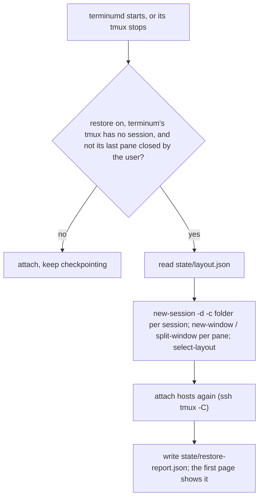

# terminum — Specification (install and lifecycle)

Sibling of `terminum.md` (the core). This spec holds installing, running, restarting, upgrading and removing terminum, what survives a restart or a reboot, and keeping the working tree and docs tidy for a release. Cases are numbered across the specs.

## 0. Metadata

| Field | Value |
|---|---|
| Status | current |

A snapshot of what terminum must do, not a record of how it came to be: git holds that.

## 1. Overview

**Problem.** A terminal workspace that holds the user's work has to be there without care: it must start by itself, survive its own crashes, upgrades and a reboot, and be removable, and none of that may end a running terminal or need a GUI open.

**Who it affects.** The user who installs terminum on a Mac or an Ubuntu/Debian server and keeps sessions in it; the maintainer who releases it.

**Expected outcome.** One line installs a signed package with nothing else needed but tmux. terminumd runs as a launchd agent (a systemd user service on Linux) from a stable path, so macOS's folder answers last. Terminals live in tmux and outlive terminumd; pages reconnect by themselves. After a reboot or a killed tmux, sessions, layouts, folders and each session's last lines come back. One command each upgrades, rolls back and uninstalls. A release starts from a machine with no leftovers, and the docs keep their shape.

**Scenario.** Alex runs the one line, sets a password, opens the page. A week later the header shows "↑ v0.4.0"; Alex runs `terminum upgrade`, the open page reloads itself, and vim in a pane never noticed. The Mac reboots: before Alex opens the page, the sessions are back in their folders, each terminal starting with its last lines, and a banner names the pane whose ssh must be started by hand.

## 2. Scope and non-goals

In scope:
- One-line install, launchd and systemd, signed packages, the upgrade, rollback, restart and uninstall commands, `terminum status`, `terminum folders`.
- What survives: terminumd's restart (AC-14), a reboot or a killed tmux (AC-15, AC-96), an upgrade or rollback (AC-16).
- The update notice (AC-17). Tidying before a release (AC-102, AC-103). Landing a worktree (AC-104); a release's full run on a quiet machine (AC-146).

Out of scope (explicit):
- A native app (AC-11 dropped; terminum.md OQ-04). No notarization and no hardened runtime (`docs/RELEASING.md`).
- Restarting programs: only shells are made again; programs are named for the user to start (AC-15). tmux's own contents are not restored beyond the last lines kept (AC-96).
- Asking for Full Disk Access or for iCloud Drive (AC-08).
- Enabling linger, starting an upgrade from the page, or upgrading by itself: the user runs the commands.
- Windows; Linux other than Ubuntu/Debian with systemd.

## 3. Assumptions, dependencies, open questions

Assumptions:

| ID | Assumption | Owner | Status |
|---|---|---|---|
| AS-111 | macOS asks for a protected folder for the process that started the tmux server, knows a bare binary by its path and its signature's designated requirement, asks again after every ad hoc build, and refuses unasked every program in a tmux whose starting binary was deleted. Hence `daemon/terminumd` and the signature. | Claude | verified on macOS 15.7 with a launchd agent starting a private tmux |
| AS-112 | launchd binds through a closing connection's TIME_WAIT, so only another program's listener makes it hand an unbound socket. | Claude | verified on macOS 15; `terminumd/tests/launchd.rs` |

Dependencies:

| ID | Dependency | Owner | Status |
|---|---|---|---|
| DEP-04 | macOS 14+; crates objc2 0.6, objc2-app-kit, objc2-web-kit (MIT/Apache-2.0) for the App; no Tauri, no wry. | Claude | dropped with AC-11 |
| DEP-111 | The system's `curl`, `ssh-keygen`, `tar` (`/usr/bin/` for the upgrade), `launchctl` on macOS; `systemctl --user`, `loginctl`, `sha256sum` on Linux. | Claude | available |
| DEP-112 | A Developer ID certificate for releases (`TM_CODESIGN_IDENTITY`) and the release key (`docs/RELEASING.md`). | Owner | available |

Open questions: none open. Which clients exist (AC-11's drop) is terminum.md OQ-04; tmux's versions are terminum.md DEP-02.

## 4. Acceptance cases

| ID | Priority | Case |
|---|---|---|
| AC-08 | [MUST / P0] | The user installs with one line, terminumd runs as a launchd agent (a systemd user service on Linux) that starts at login and after a crash, `terminum status` tells what runs, and macOS asks for the protected folders once, during the install, keeping the answers across upgrades. |
| AC-11 | [SHOULD / P1] | On the Mac the user opens terminum as an app: a WebKit window per ⌘N showing the page, with ⌘W closing the window (never a pane), ⌘+/⌘− for text size, full screen, the Dock icon, and windows remembered across launches. [DROPPED — the owner wants no app: a Mac browser and an iPhone browser are the clients] |
| AC-14 | [MUST / P0] | After terminumd crashes, restarts or is upgraded, every page reconnects by itself and shows the same pane, no terminal is lost, a tmux server that is gone is said so, and nothing depends on a GUI being open. |
| AC-15 | [SHOULD / P1] | After a reboot the sessions, windows, splits and their folders are back before the user opens a page, remote hosts attach again, and the user is told which panes ran programs that have to be started by hand. |
| AC-16 | [SHOULD / P1] | The user upgrades, rolls back and uninstalls with one command each, a new build is checked before it goes live, open pages reload themselves keeping unsaved edits, and state written by either build stays readable by both. |
| AC-17 | [SHOULD / P1] | The user learns from the page that a newer release exists and can copy the command that installs it, skip that release, or stop the check. |
| AC-96 | [SHOULD / P1] | After tmux restarts (a reboot, a killed server) a session's terminal begins with its last 300 lines from before the restart, and its menu opens them, the number set in settings.json. |
| AC-102 | [SHOULD / P1] | A release starts from a machine with no leftovers of old test runs: the one test helper that outlives its test is ended, dead tmux sockets and test folders are removed, and what may be someone's work is only named; a test run itself leaves nothing, and a step of `make check` that leaves something fails. |
| AC-103 | [SHOULD / P1] | The docs keep their shape on every `make test`, and a review of what changed since the last release removes duplicates and superseded requirements before a minor release. |
| AC-104 | [SHOULD / P1] | A finished worktree lands by itself: its targeted checks green on its own work, then a short smoke set of the basics on one platform, with no timed check, on its merge with what others landed; pushed, the primary checkout brought up to it and the tree deleted; the full test run is the release's gate, and only failing tests block a release. |
| AC-146 | [SHOULD / P1] | A release's full run starts only on a quiet machine: it queues behind another full run, waits for the load to stay low for 3 minutes, says each minute that it waits, and after 15 minutes ends the release with "the build server is not available"; a task's timed checks wait the same way and then run, saying so. |

## 5. BDD scenarios

### AC-08 — Install and run [MUST / P0]

```gherkin
Scenario: AC-08 happy path — one line
  When the user runs "curl -fsSL https://github.com/extractumio/terminum/releases/latest/download/install.sh | sh"
  Then it downloads the latest package and SHA256SUMS, checks the signature and the checksum, installs under "~/.terminum/builds/<build>/" with "current" linking to it and "~/.terminum/bin/terminum"
  And the installer is the package's own terminumd for this Mac's architecture ("sysctl -n hw.optional.arm64", right under Rosetta too) run as "terminumd install"; nothing needs Python, a compiler, npm or make
  And it copies the build's terminumd to "~/.terminum/daemon/terminumd" (a regular file, §9 Install), writes "~/Library/LaunchAgents/io.terminum.terminumd.plist" (§9 launchd) and loads it, so terminumd runs now and at every login
  And "~/.terminum/bin/terminum" links the newest installed build's terminumd (§9 One binary)
  And with a password set it prints "Installed <build>. Open http://127.0.0.1:48080/ and sign in with your password (terminum open)" and opens the page in the default browser; without one "Installed <build>. Set the password every browser signs in with: terminum password; then open http://127.0.0.1:48080/ (terminum open)"; then how other devices reach it (AC-10)
Scenario: AC-08 happy path — on a Linux server
  Given Ubuntu or Debian (x86_64 or aarch64) with systemd, tmux, curl and openssh-client
  When the user runs the same line
  Then install.sh picks "agents/linux-<arch>/terminumd" by "uname -m" ("sha256sum" for the checksum) from the same package and runs it as "terminumd install"; a missing curl, ssh-keygen or tar is said with "sudo apt install curl openssh-client tar"
  And it writes "~/.config/systemd/user/io.terminum.terminumd.service" (ExecStart "~/.terminum/daemon/terminumd" serve with absolute, quoted paths, a "%" in a path written "%%", Restart=always, RestartSec=1, StartLimitIntervalSec=0, KillMode=process, the log appended to ~/.terminum/logs/terminumd.log, WantedBy=default.target), daemon-reloads when it changed, reset-failed, enable and restart: terminumd runs now and at every login; terminumd binds 127.0.0.1:<port> itself (no socket unit: during a restart connections are refused for a moment and the page reconnects)
  And a log path with a space fails the install with "<log>: systemd cannot append to a path with spaces; set TM_HOME to another folder"
  And a stop (an upgrade, a rollback, "terminum restart", "terminum uninstall") ends terminumd alone: KillMode=process keeps the tmux server it started, in the service's cgroup, and every terminal with it
  And while "loginctl show-user" says Linger=no, the install and "terminum status" say "linger is off: terminumd and its terminals end when you log out; to keep them from boot and after logout: sudo loginctl enable-linger <user>" (never run by terminum)
  And with no desktop (no DISPLAY nor WAYLAND_DISPLAY) nothing is opened: install and "terminum open" say "From your computer: ssh -L 48080:127.0.0.1:48080 <this server>, then open http://127.0.0.1:48080/", then how tailscale serve publishes it
  And "Reveal in Finder" and "Open with Default App" are not offered (terminumd's proof says "apps": false) and their API answers 501 "Finder and default apps are on macOS only"
Scenario: AC-08 failure — no systemd user manager
  Given a shell of "su" or "sudo -u", or a container without systemd: systemctl --user says "Failed to connect to bus"
  Then the install fails with "systemd's user manager is not reachable (no session bus): log in as this user (not su or sudo -u), or run terminumd yourself with TM_NO_LAUNCHD=1"
Scenario: AC-08 happy path — macOS asks for a protected folder once
  Given a released package: its macOS terminumd carries an Info.plist (CFBundleIdentifier "io.terminum.terminumd", a reason for Documents, Desktop, Downloads, network and removable volumes and cloud folders) and is signed with the maintainer's Developer ID as "io.terminum.terminumd"
  When a program in terminum's tmux (a shell, Claude Code, its subagents) first reads ~/Documents
  Then macOS asks once on the Mac's screen for "terminumd" (the process that started the tmux server, run by launchd from "~/.terminum/daemon/terminumd"); after Allow every program in that tmux reads it with no further prompt
  When terminum is upgraded or rolled back, or terminumd restarts, while the tmux server runs on
  Then "daemon/terminumd" is the new build's (same path, same signature's requirement) and nothing is asked again: neither new windows nor programs already running get "Operation not permitted"
Scenario: AC-08 happy path — the install asks for the folders
  Given macOS, terminumd started by launchd (it got launchd's socket), and a first install or an upgrade to a build signed with a Developer ID
  When the new build answers
  Then the command asks terminumd (POST /folders on its socket) to open, one after the other, ~/Desktop, ~/Documents, ~/Downloads and each folder in ~/Library/CloudStorage that exists (not iCloud Drive, ~/Library/Mobile Documents: macOS's sandbox refuses it to every program without Full Disk Access and never asks; terminum does not ask for Full Disk Access): each only opened, nothing listed, read or sent; an open macOS has not decided waits for the user's answer on the Mac's screen, on a thread of its own
  And folders already decided answer at once: "Folders: Desktop, Documents, Downloads, Dropbox allowed" and for each refused one "Downloads: refused by macOS — allow terminumd in System Settings › Privacy & Security › Files and Folders"
  And while macOS asks it says once "macOS asks on this Mac's screen whether programs in terminum's terminals may read Desktop, Documents, … (Allow: asked once)", waits at most 5 s, then "macOS is still asking about Dropbox (then …): answer on the Mac's screen; terminum folders shows the answers"; the install succeeds whatever the answers
  When the user runs "terminum folders"
  Then it asks the same (a second request while one waits joins it) and waits up to 2 minutes for the answers, saying each as above
Scenario: AC-08 edge — terminum's tmux was started by another program
  Given the running tmux server has no "@terminum-started-by", or it names another program than ~/.terminum/daemon/terminumd (a build that does not set it, a build run by hand, "tmux -L terminum" typed in Terminal)
  Then "terminum status", the install and "terminum folders" say "terminum's tmux was started by <that program | a version before this one, or by hand>: macOS judges its terminals' folders by that, not by terminum; restart it once at a quiet moment: tmux -L terminum kill-server (sessions, windows, splits, folders and projects come back; running programs do not)"; with the folder result it reads "Folders: Desktop allowed for terminum; the terminals of the running tmux get them once it restarts"; nothing restarts it
  And terminumd sets "@terminum-started-by" to its own executable on the server it starts (a fresh main, a restore), the option living exactly as long as that server; on Linux or without launchd nothing is said
Scenario: AC-08 edge — nobody asks for folders
  Given terminumd was not started by launchd (TM_NO_LAUNCHD=1, "terminumd serve" typed, every test), or it is the launchd test's own agent (TM_LAUNCHD_LABEL: it sees the real home folder), or Linux, or an upgrade to an ad hoc build
  Then the install asks nothing; "terminum folders" says "terminumd was not started by launchd: macOS would ask for the app it runs in, not for terminum" (no launchd), "Nothing to ask: only macOS asks for folders" (Linux), or asks (an ad hoc build: the upgrade said "This build is signed ad hoc: macOS asks for its folders again on first use; terminum folders asks now")
Scenario: AC-08 edge — a package signed without a Developer ID
  Given a package built by `make install` with no TM_CODESIGN_IDENTITY (a contributor's Mac)
  Then package.py says "TM_CODESIGN_IDENTITY is not set: terminumd is signed ad hoc; macOS asks again for protected folders after an upgrade" and signs it ad hoc as "io.terminum.terminumd"; the install goes on, and programs in the tmux are asked again, never refused unasked
Scenario: AC-08 failure — a release without a Developer ID
  When `make release` runs with no TM_CODESIGN_IDENTITY, codesign fails or takes over 60 s, or a packaged macOS terminumd has no Team ID after signing
  Then nothing is tagged or published, and it exits with the reason
Scenario: AC-08 happy path — launchd holds the port
  Given the agent is loaded
  Then launchd listens on 127.0.0.1:48080 and hands the socket to terminumd ("launch_activate_socket"); while terminumd is killed, crashes, is restarted or upgraded, connections wait in launchd's queue and another program's bind of 127.0.0.1:48080 fails with "address in use", SO_REUSEPORT or not
  And before it loads the agent again (an install whose plist changed, `terminum restart`) the command waits until nothing answers on 127.0.0.1:<port> (at most 10 s), so an old terminumd that bound the port itself has let go of it
Scenario: AC-08 happy path — tmux missing
  Given tmux is not on PATH
  Then the install goes through and prints "tmux is needed for terminals: brew install tmux" ("sudo apt install tmux" on Linux), and the page says the same until tmux appears (terminum.md AC-01)
Scenario: AC-08 happy path — status
  When the user runs "terminum status"
  Then it prints the running build, terminumd's pid and uptime, the page's address, whether a password is set, the tmux servers and sessions attached, the hosts and their state, and the pages connected
  And when settings.json names another port than the one launchd holds, it says "port: settings.json says <a>, launchd holds <b>: run terminum restart"
Scenario: AC-08 edge — another program held the port when launchd loaded the agent
  Given another program listened on 127.0.0.1:48080 when the agent was bootstrapped (launchd then hands an unbound socket and never tries again)
  Then terminumd logs and prints "port 48080 was held by another program when launchd loaded terminum: free it, then run `terminum restart`" once and waits (exiting would only have launchd start it again on the same unbound socket), and "terminum status" says so
  And the install, restart or import that bootstrapped it exits non-zero with that message at once (AS-112)
  When the user frees the port and runs "terminum restart"
  Then the agent is booted out and bootstrapped again, launchd holds the port, and terminumd answers within 10 s
Scenario: AC-08 edge — the port is in use (terminumd not run by launchd, TM_NO_LAUNCHD=1)
  Given another program listens on 127.0.0.1:48080
  Then terminumd exits with "port 48080 is in use (set `port` in ~/.terminum/settings.json)" in its log after 9 s, and "terminum status" says so
Scenario: AC-08 failure — bad download or wrong user
  When the checksum or signature does not match, or the line runs as root
  Then nothing is installed and the line exits non-zero with the reason ("run it as your user, not root (it installs into your home folder)")
```

### AC-14 — Lifecycle [MUST / P0]

```gherkin
Scenario: AC-14 happy path — terminumd crashes or is upgraded
  Given a page shows %3 and vim runs in %5
  When terminumd is killed with SIGKILL
  Then launchd starts it again within 1 s, it attaches to the tmux servers within 1 s, the page reconnects within 3 s (amber dot meanwhile, no "not running" notice under 3 s) and shows %3 with its history again; vim in %5 never noticed
  And unsaved edits in the page's editor are still there
Scenario: AC-14 happy path — every page closes
  When the user closes every browser tab
  Then terminumd and every tmux session keep running; `terminum status` lists them; nothing of terminumd depends on a page being open
Scenario: AC-14 edge — the tmux server stops
  When the user runs "tmux -L terminum kill-server"
  Then within 2 s a shown pane says "This pane has closed. Pick another one.", terminumd starts the server again with a session "main" (AC-15 restores the layout when its checkpoint is newer than the kill), and the list shows it
Scenario: AC-14 edge — a long gap
  Given terminumd stays down for 3 s or more
  Then the page shows "terminum's server is not running" and retries every 2 s; typing is refused with "Not connected" and nothing is queued
Scenario: AC-14 failure — a hung control client
  Given a control client has not answered a command for 10 s and nothing else came from it for 10 s, or has not answered one for 60 s (a slow link: `terminum-remote.md` AC-132), while the process lives
  Then terminumd logs `tmux.timeout` "control client timed out", kills and restarts it, and the page shows the stall line meanwhile (AC-03)
```

### AC-15 — Layout survives a reboot [SHOULD / P1]

```gherkin
Scenario: AC-15 happy path — checkpoint and restore
  Given settings.json has {"restore": true} (the default) and sessions "main" (3 windows, one split, folders known) and "notes", host "devbox" attached
  Then terminumd writes "state/layout.json" within 5 s of a change: sessions, windows (name, whether tmux names it after its program, index, #{window_layout}), panes (folder, the program's kind: shell, ssh <recipe>, other; the title its coding agent gave it), hosts
  When the Mac reboots and terminumd starts with no local tmux server (or that server has no session)
  Then before any page connects it recreates "main" and "notes" with shells at the saved folders (a missing folder opens in ~ with a note), applies each window's layout string ("select-layout"), names each window the user named as before and leaves one tmux named after its program (automatic-rename, or a name that is only a version such as Claude Code's "2.1.310") to tmux; a pane whose coding agent had titled it ("✳ Fix the login form", or one restored so before) gets that title as `@tm-title`, its row's title while a shell runs there, until a coding agent runs there again and titles it itself (AC-01), attaches "devbox" again (its session survived on the host) and writes a report
  And the first page shows "Restored 2 sessions, 4 windows. 1 pane ran ssh devbox: start it again" with the pane's row linked; × closes it on every page; it goes by itself after 30 s and a page that connects more than 10 minutes later does not get it
Scenario: AC-15 happy path — tmux killed, a host's tmux started anew, the user's own tmux
  Given the checkpoint also keeps, by server, host devbox's "terminum" session and the sessions of the user's own tmux attached by name (AC-89), here and on hosts (windows, layouts, folders)
  When terminum's tmux server is killed while terminumd runs (the same boot)
  Then terminumd makes its sessions again as after a reboot, with the report
  When devbox's tmux starts anew (a reboot of the host, its server killed: #{start_time} after the checkpoint) and devbox is attached again
  Then its "terminum" session gets its windows back in their folders on the host (its fresh first window goes), and the user's sessions attached there that no longer run are made again
  When the user closes the last window of devbox's "terminum" session while devbox's tmux runs (another session keeps it)
  Then terminumd makes the session anew with one shell and restores nothing: what the user closed stays closed
  When the user closes the last pane of devbox's tmux (no other session keeps it), of terminum's here, or of an attached server of the user's own, and that tmux ends with it
  Then nothing is made again (tmux said %exit itself while terminumd showed one pane there, as its main control client saw): devbox's "terminum" is made anew with one shell, terminum's tmux starts "main" in ~, the user's own stays down; tmux ends the same way on kill-server and on SIGTERM (a host shut down cleanly), so a server stopped so while it showed one pane is not restored either (its one shell comes back in ~, not in its folder); one that showed more is restored as a killed server
  When the server of the user's own tmux on this Mac does not run (a reboot, it was killed)
  Then the sessions attached from it are made again with their windows and folders (once per checkpoint); a session the user closed while that server runs stays closed
  And a host or a server that cannot be read keeps what the checkpoint held for it
Scenario: AC-15 edge — nothing to restore, or the user said no
  Given the server runs already (terminumd restarted), or {"restore": false}
  Then nothing is recreated; the checkpoint goes on (or stops with "restore": false)
Scenario: AC-15 edge — what is never stored
  Then layout.json holds no output, history, environment, command lines other than an ssh recipe (destination and allowlisted options), or passwords; it names each server's identity (@terminum-id), whose files hold its panes' last lines (AC-96, kept apart)
Scenario: AC-15 failure — a session cannot be made
  When "new-session" fails (tmux missing, a bad name)
  Then the report names it, the other sessions are restored, and "Restore again" in the page's menu retries once
  And "Restore again" covers every server the checkpoint names that answers (terminum's, a host, the user's own tmux), sessions that run kept, one restore at a time (two asked at once make each session once); a host's `terminum` session takes its windows only while its own restore is owed
  When a host's or the user's own tmux's restore fails with nothing made (its link dropped meanwhile)
  Then its checkpoint is kept, and it is made again by itself once its link is a new one, else by "Restore again"; one that made some is not made again by itself
  And a report that cannot be written to the state folder says so among its errors
  And a failed checkpoint write is retried on the next checkpoint even when the layout has not changed
  And restored window names and folders containing "#S" or "#{session_name}" stay literal through both local commands and host control clients
```

### AC-16 — Upgrade, rollback, uninstall [SHOULD / P1]

```gherkin
Scenario: AC-16 happy path — upgrade
  Given build "A" runs
  When the user runs "terminum upgrade" (the latest signed release, or --to vX.Y.Z)
  Then the package is verified (signature, checksum), "builds/B" is unpacked, "B/terminumd --version" prints its id, "previous" → "A", "current" → "B", "daemon/terminumd" becomes B's terminumd (the tmux server started by A's keeps its folder access, AC-08), terminumd is restarted with "launchctl kickstart -k gui/<uid>/io.terminum.terminumd" while the plist it would write differs at most in PATH, so launchd keeps the port (otherwise, and after a failed kickstart, the plist is written and the agent loaded again; on Linux the service restarts), and within 10 s its health (on the socket) reports "build": "B"; then other build folders are pruned and it says "Upgraded A → B"
  And every open page learns the build from the WebSocket and reloads itself once; one with unsaved edits or a dialog waits and says "An update is ready: the page reloads after you save."; one that already reloaded for this build says "An update is ready: reload the page."
  And a Files panel reloads only once terminumd has its workspace: while that write is refused (said: "Panel state not saved: …") it waits, also inside the page, until a later change or reconnect saves it
Scenario: AC-16 happy path — rollback and uninstall
  When the user runs "terminum rollback"
  Then "current" → "A", "previous" → "B", "daemon/terminumd" becomes A's, terminumd restarts (kickstart) and reports "A" within 10 s, and it says "Rolled back B → A"; a state file written by "B" with fields "A" does not know is read by "A" (unknown fields ignored, every field has a default)
  When the user runs "terminum restart"
  Then the plist is written again (a changed port in settings.json takes effect), the agent is booted out and bootstrapped, terminumd answers within 10 s, and it says "Restarted terminumd: build B, port 48080"
  And a rollback leaves the agents' hooks and MCP server as they are: they run "~/.terminum/bin/terminum", which stays the newest build's, so an MCP tool A's terminumd does not know fails as a tool error, never the agent
  When the user runs "terminum uninstall"
  Then first terminum's hooks and MCP server are taken out of Claude Code and Codex where present (as "terminum hooks remove" does; a failure is a warning naming what to remove by hand, the uninstall goes on), so no agent calls a missing command; then terminumd stops, the launchd agent (or systemd service) is removed, builds, the command and "daemon/" are removed; settings, themes, state/ and logs/ are kept; tmux sessions are untouched; it says "Removed terminum: terminumd stopped, its launchd service, builds and command removed. Settings, state and logs kept in <root>; tmux sessions untouched."
  And after an install or upgrade, terminum's agent integration is refreshed only where its hooks were installed (AC-97, terminum-agents.md); a failure is a warning, never the install's
Scenario: AC-16 failure — the new build does not come up
  When "B" does not report its build within 10 s
  Then "current" → "A", "previous" as it was, terminumd restarts on "A", and the command exits non-zero with "Upgrade to B failed (<reason>); rolled back to A — see ~/.terminum/logs/"
  And when A does not come up either it says "Upgrade to B failed (<reason>); switched back to A, which did not come up either (<reason>)"
  And a timed-out CLI subprocess ends its own descendants and closes its output readers; no detached reader thread remains
  And direct-mode process records with a zero, overflowing pid or empty start time never name a process to signal
  And in direct mode a pid file that cannot be written ends the terminumd just started ("<pid file>: <reason>; terminumd was not left running"): no stop could find it
  And when "terminum uninstall" cannot remove a build, the command or "daemon/", it exits non-zero with "terminumd stopped, but these could not be removed: <path>: <reason>", never "Removed terminum"
Scenario Outline: AC-16 failure — nothing to do, or someone else is doing it
  When the user runs <command> <given>
  Then it exits non-zero with <message> and nothing changes

  Examples:
    | command           | given                                       | message                                                                     |
    | terminum rollback | with no previous build                      | No previous build to roll back to                                           |
    | terminum restart  | with no builds/current                      | terminum is not installed (no builds/current): nothing to restart           |
    | any of install, rollback, uninstall, restart, import | while another holds install.lock | Another install is running                  |
Scenario: AC-16 failure — the build rolled back to does not come up
  When A does not report its build within 10 s after "terminum rollback"
  Then "current" → "B" again, B restarts, and it exits non-zero with "A did not come up: <reason>; B runs again — see ~/.terminum/logs/"
Scenario: AC-16 edge — an install from before the server was named terminumd
  Given the launchd agent "io.terminum.terminusd" holds the port
  When a new build installs
  Then that agent is unloaded and its plist set aside before the new one loads; once the new build answers that plist is removed; when it does not come up, or the old agent cannot be unloaded or set aside, "current" names A again, the old agent is loaded again and it says "Upgrade to B failed (<reason>); A runs again as before — see ~/.terminum/logs/"
  When the user rolls back to such a build
  Then it is refused with "A is from before the server was named terminumd and cannot run as this agent: install that version again instead"
Scenario: AC-16 edge — imported state
  Given imported local and remote workspaces and an existing settings file
  Then remote workspace namespaces use the mapped host alias the Panel opens, with their root and tabs preserved
  And a settings file containing valid JSON of the wrong type is refused and kept byte for byte
```

### AC-17 — Update notice [SHOULD / P1]

```gherkin
Scenario: AC-17 happy path — a newer release
  Given the running build is release "v0.3.0"
  When terminumd's daily check finds the latest release tag "v0.4.0" (one HEAD request, no data of the user's)
  Then every page shows the chip "↑ v0.4.0" in its header; its menu offers "Copy upgrade command" (copies "terminum upgrade"), "Skip v0.4.0" and "Don't check for updates" (creates state/no-update-check)
Scenario: AC-17 edge — nothing to show
  Given the latest release is the running one or older, the check failed, or the build is from a checkout
  Then no chip, nothing reported; the first try is 30 s after terminumd starts, a failed try repeats within the hour, a successful one a day later
Scenario: AC-17 security — untrusted text
  When the redirect names anything but "vMAJOR.MINOR.PATCH", it is dropped: no text from the network reaches the page
```

### AC-96 — Last lines survive a restart [SHOULD / P1]

```gherkin
Scenario: AC-96 happy path — how a session ended, after its tmux restarted
  Given settings.json has {"lastLines": 300} (the default) and {"restore": true}, and window "api" of "main" shows a coding agent's last turn
  Then within 5 s of its output (a host's pane within 15 s) terminumd keeps the pane's last 300 lines as `capture-pane -J` gives them (its history's end and its screen, wrapped lines joined, trailing blanks and blank bottom lines dropped) in state/lastlines/<host>@<socket>/<identity>_<N>.json with the session's and window's names, the folder and the time (it reads twice that many rows: wrapped rows joined give fewer lines); a pane whose window printed nothing since the second before it was read is not read again, the same text is not written again
  And under a full-screen program (vim, htop) the lines kept are the terminal's under it (its history and the normal screen, `capture-pane -a`), never the program's own screen
  When terminum's tmux is killed or the Mac reboots and AC-15 makes "api" again
  Then the lines kept for the old pane become the new pane's "before the restart" (by the identity layout.json saved for that server and the pairs of the panes the restore made), and the report adds "Last lines before the restart: a session's menu, Show Last 300 Lines."
  And on a tmux of this Mac (terminum's, the user's own) the new pane starts by printing those lines, then "[terminum: the lines above are from before tmux restarted]" and a blank line, then its shell as tmux starts it (`default-shell`, a login shell): they are its history, the page shows them as the terminal's lines and the next restart keeps them; the text is the kept plain text with control characters dropped, from a 0600 file in the 0700 lastlines folder (`print-<identity>-<N>.txt`) the pane's command deletes once printed (a leftover goes with the next restore); nothing is printed when the server sets `default-command` (its panes start another program) or into a host's panes (their lines are on this Mac: the menu shows them)
  When the user picks Show Last 300 Lines in the row's menu (the number the setting's)
  Then a large window shows them as plain text in the terminal's font, scrolled to the end, under "Before the restart · main · api · /Users/alex/work/api · Oct 26, 14:05"; "Before restart | Now" switches to the lines kept since; Copy copies the lines shown; Esc or × closes it
  And the same holds for a host's "terminum" session and the user's own tmux sessions attached by name (AC-89) that AC-15 makes again; quick shells (AC-88) are not kept
Scenario: AC-96 edge — nothing kept, or off
  When a pane has nothing kept (a new pane in its first 5 s, a pane of a server that no restore made again)
  Then the window says "Nothing kept yet: a session's last lines are kept within 5 s of its output."
  Given {"lastLines": 0} or {"restore": false} (no restart would hand the lines on)
  Then nothing is kept, the menu has no Show Last Lines, and every line kept before is deleted
Scenario: AC-96 edge — when kept lines go
  When the user closes a pane (absent from reads of its running tmux 30 s apart)
  Then its lines go, those from before the restart with them; a pane that closes as its tmux ends (a reboot ends programs before tmux) keeps them
  And when a restore made panes again, the old server's lines it did not hand on go at once (panes not made again); a server's that no restore took (its last pane closed by the user, a host removed or not attached since) go 7 days after terminumd last read that server (an hourly sweep, the first an hour after terminumd started, so a restore comes first)
  And a second restart before a pane printed more than its prompt (2 lines) hands on the lines from before the first
Scenario: AC-96 edge — privacy
  Then the files are 0600 in 0700 folders, the folder is excluded from Time Machine on macOS, and their text reaches only a signed-in page that asks for one pane's; a host's lines are kept on this Mac
Scenario: AC-96 failure — a file cannot be written or read
  When a write fails (a full disk)
  Then terminumd logs `lastlines.unsaved` and writes that pane's lines again the next round, changed or not (a closed pane's file not deleted: `lastlines.undeleted`, deleted the next round); a file that cannot be read, a pane gone or its tmux not answering is said in the window in terminumd's words
```

### AC-102 — No leftovers of old test runs [SHOULD / P1]

```gherkin
Scenario: AC-102 happy path — a release clears what old runs left
  Given a test helper "terminumd-18e312ae2b0e93f4 --exact cli::tests::fake_terminumd" with parent 1, running for 10 days
  And 375 dead tmux sockets named tm-* and 16,000 folders named tm-settings-1091-add, all a day old
  When the maintainer runs make release TAG=v0.32.0
  Then the helper gets SIGTERM by its pid and ends before anything is built
  And it prints "removed 375 dead tmux sockets, 16000 test folders (0 could not go)"

Scenario: AC-102 edge — a plain look changes nothing
  Given the same leftovers
  When the maintainer runs make leftovers
  Then it prints "375 dead tmux sockets, 16000 test folders (--end removes them)" and nothing is removed
  And make leftovers END=1 removes them

Scenario Outline: AC-102 edge — someone's work is never removed
  Given <what>
  When make leftovers END=1 runs
  Then it stays, <said>

  Examples:
    | what                                                               | said                  |
    | a test binary with a parent, or younger than 6 h                   | not mentioned         |
    | any other test binary or a build folder's terminumd with parent 1, older than 6 h | named, not ended |
    | a live tmux server on a tm-* socket older than 6 h                 | named, not ended      |
    | a tm-* socket younger than 6 h                                     | not mentioned         |
    | a test folder with a file written in the last 6 h                  | not mentioned         |
    | a test folder a process holds a file open in                       | not mentioned         |
    | the folders tmux-501, tmate-501, tmp-work, terminum-audit-20261025 | not mentioned         |
    | the installed ~/.terminum/daemon/terminumd                         | not mentioned         |

Scenario: AC-102 edge — not knowing what is open keeps the folders
  Given lsof gives nothing or hangs for 2 minutes
  When make leftovers END=1 runs
  Then it prints "lsof says nothing of what is open: every test folder stays" and removes no folder

Scenario: AC-102 failure — a cleanup problem never stops a release
  Given a helper that stays after SIGTERM
  When make release runs
  Then it prints "still running <pid>: …" and goes on: leftovers.py exits 1, make ignores that, the helper gets no SIGKILL and the release is not refused

Scenario: AC-102 failure — the helper cannot outlive its test by long
  Given a fake terminumd of a test whose socket's folder is removed (its test's home), or that has run for five minutes
  Then it exits by itself within a second

Scenario: AC-102 edge — a run ended by a signal leaves nothing either
  Given node web/test/e2e_live.mjs or python3 scripts/e2e_remote.py is running with its own TMPDIR
  When it gets SIGTERM or SIGINT
  Then it exits 143 or 130, and its terminumd, tmux server, browser and folders go; terminumd's stand-in for ssh, ended by SIGKILL, keeps its files in the test's home, which the run removes

Scenario: AC-102 happy path — a run leaves nothing
  Given a step of make check or of a landing's targeted checks, run by scripts/check_step.py with its own short folder as TMPDIR and TMUX_TMPDIR
  When the step passes, fails or gets a signal
  Then its folders, tmux servers, tmux socket files and processes have gone and that folder is removed

Scenario: AC-102 failure — a step that leaves something fails
  Given a step that passes but leaves a file in its folder, or a process in its private process group or working in that folder or a folder under it
  When it ends
  Then each is printed as "LEFT …", the process is ended by its pid (SIGTERM, then SIGKILL when it is still there 2 s later: an interactive shell ignores SIGTERM), the folder is removed and the step fails

Scenario: AC-102 edge — a pane's program that ignores SIGHUP does not outlive its test
  Given a test's private tmux server whose pane runs a program that ignores SIGHUP, as macOS's bash does when it spins on a terminal gone
  When the test ends that server with end_tmux of scripts/e2e_ws.py
  Then the program has ended too, where kill-server alone leaves it running with no parent

Scenario: AC-102 edge — what a fake host still runs ends before its test's folder goes
  Given a private terminumd of scripts/e2e_ws.py whose fake host's program runs on in a session of its own after terminumd dropped its ssh, as a host's claude plugin call does, still writing into the fake home
  When the test's cleanup runs
  Then it ends its fake host's tmux server, waits up to 15 s for every process working in the test's folder or a folder under it, and only then removes the folder; one still there is ended by its pid (SIGTERM, then SIGKILL) and fails the run, its command named

Scenario: AC-102 edge — cleanup never reads process environments
  Given an unrelated process with credentials in its environment, whose command mentions the test's folder
  When the guard or a private terminumd's cleanup looks for leftover processes on macOS or Linux
  Then it reads process IDs, groups, commands and working directories only, never environments
  And the unrelated process and one working in a sibling folder with the same prefix are neither selected nor ended
  And a failed metadata query fails the check, never counting as no leftovers
  And each test still ends its recorded tmux servers, browsers and detached children that leave the private folder in its own cleanup

Scenario: AC-102 edge — another session's run is no leftover of this one
  Given another session's test run with folders in the temporary folder and sockets of its own
  When a step of make check ends
  Then none of them counts and none is touched, and tmux's own empty tmux-<uid> folder does not count either
```

### AC-103 — The docs keep their shape [SHOULD / P1]

```gherkin
Scenario: AC-103 happy path — make test reports the shape
  Given the specs in docs/specs, the docs and the code
  When make test runs scripts/check_docs.py
  Then it prints "docs: 0 findings"

Scenario Outline: AC-103 edge — a broken shape is reported and blocks nothing
  Given <what>
  When make test runs scripts/check_docs.py
  Then it exits 1 and prints <message>, and make test goes on: only failing tests block a release

  Examples:
    | what                                                  | message                                                       |
    | one case in two specs                                 | FAIL AC-nn in both <spec> and <other spec>                    |
    | a source file citing a number no spec has             | FAIL web/test/x.mjs: cites AC-nn, which no spec has           |
    | a citation naming the wrong spec                      | FAIL x.rs: says <spec> AC-nn; it is in <other spec>           |
    | a case with a tag other than the three allowed        | FAIL <spec>: AC-nn has the tag '[MAY / P2]'; allowed: …       |
    | a case with no scenarios                              | FAIL <spec>: AC-nn has no scenarios in section 5              |
    | a case with no line in section 11                     | FAIL <spec>: AC-nn has no line of proof in section 11         |
    | a relative link to a missing file                     | FAIL docs/USAGE.md: the link x.md leads nowhere               |
    | a change log in a spec's section 0                    | FAIL <spec>: a change log in section 0: a spec is a snapshot, … |

Scenario: AC-103 edge — a spec has no size limit
  Given a spec of 400 KB
  When scripts/check_docs.py runs
  Then its size is no finding

Scenario: AC-103 happy path — a review before a minor release
  Given the maintainer asks for a minor release
  When the release's steps run (CLAUDE.md §10)
  Then /docs-review goes over the changes since the newest tag, after /simplify and before make test and the release's commit
  And each requirement it deletes is named with what supersedes it, and one only absent in the code goes to the maintainer as a gap
```


### AC-104 — A green worktree lands by itself [SHOULD / P1]

```gherkin
Scenario: AC-104 happy path — targeted checks green, the tree lands
  Given the worktree fix-paste has its work committed, and scripts/check_changed.py passed on it: the security scan, the tests of the changed files, the tests citing the acceptance cases on the changed lines, and the critical functions, recorded as .checks/changed-<id>.ok, <id> naming the tree's content
  When the agent runs make land SLUG=fix-paste from the primary checkout
  Then the branch is merged with origin/main in the tree
  And the targeted checks do not run again, origin/main having changed none of the files the tree changed
  And on the merged result scripts/check_changed.py --land runs the smoke set: the security scan, terminumd's debug build, cargo test of the critical modules, scripts/e2e_core.py (terminum's own tmux), scripts/e2e_attach.py (the user's own tmux), and the real page in Chromium at one size (signing in, the list, a pane drawn, typing, Files), with no timed check
  And on green it is pushed to origin main, never forced
  And the primary checkout is fast-forwarded to it, the tree is deleted by scripts/delete_worktree.sh, and it prints "landed 4f2a91c07 on origin/main"

Scenario: AC-104 failure — a red check lands nothing
  Given a targeted check of the worktree fails, or a check of its smoke set
  When make land runs
  Then it exits 1 saying "targeted checks failed" or "smoke checks failed" and that nothing was pushed, shows the check's last lines, and the tree stays, with its merge of origin/main

Scenario Outline: AC-104 edge — when the targeted checks run again at landing
  Given <what>
  When make land runs
  Then the targeted checks run on the merged result before its smoke set

  Examples:
    | what                                                                   |
    | no targeted pass recorded for the tree's content                       |
    | origin/main changed a file the tree also changed since its pass        |

Scenario: AC-104 edge — the same content is checked once
  Given the targeted checks passed on a tree's content
  When they run again on the same content, as a landing does
  Then they print "targeted: passed already on 3f9a21c40b7d5e11" and run nothing

Scenario: AC-104 edge — builds leave room for others
  Given several trees check and land at once
  Then the targeted checks and the smoke set build terminumd under nice -n 10, and their browsers run as usual
  And while a release runs, the whole smoke set runs under nice -n 10
  And no landing builds the release build in its tree: the primary checkout's install builds it
  And scripts/worktree.py add gives a new tree copy-on-write clones of the primary checkout's debug and release dependencies' builds, so its first build compiles terminumd alone

Scenario: AC-104 edge — a session hears of a changed pipeline
  Given origin/main changed scripts/land.py since a tree's base
  When the session's prompt hook runs in that tree
  Then it says "origin/main changed the checks or the landing (scripts/land.py): read it there and merge it (CLAUDE.md §9)"

Scenario: AC-104 edge — the landing says GitHub CI's last verdict on main
  Given GitHub CI's last run on main to end, not cancelled, failed on origin/main's head 8f3c2a1d0
  When make land runs
  Then its first line is "CI on main: failure on 8f3c2a1d0: https://github.com/extractumio/terminum/actions/runs/42436430099"
  And a newer run still waiting or running is said after it, "; newer: in_progress on <commit>", the verdict staying the older run's
  And the same line is printed again last, landed or not, and the landing goes on as with a green run
  And without gh, or with no answer in 10 seconds, the line is "CI on main: unknown (<why>)" and the landing goes on

Scenario: AC-104 edge — a Rust source that names no case
  Given a tree changed terminumd/src/redaction.rs, whose first 6 lines name no AC-nn
  When python3 scripts/check_changed.py runs
  Then it prints "note: terminumd/src/redaction.rs names no case at its top: the e2e scripts of its area are not known"
  And it runs that module's cargo tests; a source naming cases there also runs the scripts/e2e_*.py citing them

Scenario: AC-104 edge — uncommitted work
  Given the worktree holds an uncommitted file
  When make land runs
  Then it exits 1 saying "has uncommitted changes: commit them first" before any check

Scenario: AC-104 edge — several worktrees land at once
  Given worktrees one and two are each checked on their own
  When one lands while two's checks run
  Then two merges what one landed; its targeted checks run again only if both changed the same file, its smoke set on every merge
  And only the last look at origin/main and the push take turns, so neither waits for the other's tests

Scenario: AC-104 edge — a tree that lost the race once
  Given worktree two's smoke set passed, and one landed while it ran
  When two tries again
  Then it says "lost the race once: holding the landing turn through this merge's checks", and holds the turn from its merge to its push and install, so no other landing pushes before it and it loses no second race
  And a landing waiting for that turn says "land: two's landing has its turn (its checks, push and install can take half an hour): waiting"
  And a smoke set still running after 90 minutes is ended with its processes, said, and fails as "smoke checks failed", freeing the turn

Scenario: AC-104 failure — others' code breaks the merged build
  Given one tree renamed a function and another, touching other files, added a caller of it
  When the second merges what the first landed
  Then its smoke set runs again before it pushes, building, and on a failed build exits 1 saying "smoke checks failed", pushes nothing, and the tree stays

Scenario: AC-104 failure — a new case with no test
  Given a change with code that adds a heading "### AC-nnn — …" to a spec, and no test cites it
  When its targeted checks run
  Then they fail with "new cases no test cites: AC-nnn"

Scenario: AC-104 edge — a case that is not built yet
  Given a change with only docs that adds a case no test cites
  When its targeted checks run
  Then they pass: a spec may hold what is not built

Scenario: AC-104 edge — a refused push
  Given a hook refuses the push and origin/main has not moved
  When make land pushes
  Then it exits 1 at once, with the refusal's own words

Scenario: AC-104 edge — a release is running
  Given make release is running its long checks
  When a tree lands
  Then it pushes, the primary checkout stays where it is and it prints "primary checkout stays where it is: a release is running"
  And the release goes on with the commit it checked, on origin/main though no longer its end

Scenario: AC-104 edge — installing, on the maintainer's machine
  Given TM_LAND_INSTALL=1 in the uncommitted local.mk
  When a change with code lands
  Then make build, make install and make installed run in the primary checkout before the next tree's turn, with their three results printed
  And a change with only docs installs nothing

Scenario: AC-104 failure — a conflict
  Given a file changed differently in the worktree and on origin/main
  When make land merges them
  Then it exits 2 naming the file, pushes nothing, and leaves the conflict in the tree to resolve and commit before landing again

Scenario: AC-104 edge — the primary checkout cannot move
  Given the maintainer's uncommitted change is in the way of the fast-forward
  When a landing ends
  Then their change stays, the landing still counts, and it prints "primary checkout stays where it is: …"

Scenario Outline: AC-104 — what a change is checked with
  Given a change to <changed>
  Then its targeted checks are <checks>

  Examples:
    | changed                       | checks                                                       |
    | only docs                     | the security scan and the docs' report, which blocks nothing; no build |
    | terminumd/src/hosts/tunnel.rs | the scan, the debug build, clippy, cargo test of hosts::tunnel and the critical modules, the real page in Chromium |
    | web/static/banners.js         | the scan, the debug build, the tests citing its cases, the real page in Chromium |
    | ui/src/tree.ts                | the scan, the debug build, the Panel's unit tests and browser check, the real page in Chromium |
    | scripts/worktree.py           | the scan, the scripts' unit tests                            |

Scenario: AC-104 happy path — the full run is the release's gate
  When the maintainer runs make release TAG=v0.32.0
  Then on a quiet machine (AC-146) the full check runs, once per tree: make test, clippy, the Panel, the live page, every e2e script, Docker's, the install, the page's browser checks, the security scan
  And then the Mac test runner's checks, when TM_MAC_RUNNER is set
  And a failing test in any of them stops the release

Scenario: AC-104 failure — failing tests on the Mac test runner are never read as a runner that could not run them
  Given make test fails on the Mac test runner, which makes the remote run exit 2
  When scripts/ci_mac.sh ends
  Then it exits 1 and make release stops: "failing tests on the Mac test runner stop it: nothing is public"

Scenario Outline: AC-104 edge — the Mac test runner could not run them
  Given <what>
  When make release runs
  Then it goes on, the release's notes get a Not verified line saying "the Mac test runner's checks did not run: <why>", and that is its last line too

  Examples:
    | what                                                 | why                                     |
    | no answer over ssh, a dropped link, a failed rsync   | the runner could not run them           |
    | no tmux, rustup or Playwright's browsers on it       | the runner could not run them           |
    | another run holds its lock for half an hour, or a stale one | the runner is busy, or its lock is stale |
    | it runs for over an hour (it gets SIGTERM)           | it took over 60 minutes                 |
    | no TM_MAC_RUNNER                                     | no TM_MAC_RUNNER                        |

Scenario: AC-104 failure — a commit the checks did not see
  Given make release's checks ran on 4f2a91c07
  When HEAD is another commit as it starts to build
  Then it exits saying "HEAD moved since the full checks": nothing is public
  And another session's make install during a release leaves main where it is, saying "a release is running"

Scenario: AC-104 happy path — the rehearsal
  When anyone runs make rehearse TAG=v0.32.0 in a tree at origin/main
  Then it runs make release's chain: leftovers, the full check, the Mac test runner's, the build of the package
  And it prints "v0.32.0: rehearsal passed on 4f2a91c07: no release signature, not tagged, not pushed, not published"
  And its macOS builds are codesigned with the Developer ID, as for real; it reads no release key, runs neither gh nor git tag nor git push, needs no release notes and holds no release mark
  And in the primary checkout, whose ui/dist and dist/package it would replace, it refuses: "make rehearse runs in a worktree"
  And while a release runs it refuses: "a release is running: rehearse after it"

Scenario Outline: AC-104 edge — Docker's step cannot run
  Given <what>
  When the full check runs
  Then its step says "SKIP docker: <why>", .checks/<id>.docker-skip keeps it, and the check can pass
  And a later make check of the same tree, once it could run, runs that step and not the rest

  Examples:
    | what                                  | why                                 |
    | Linux, or a Mac with Intel's chips    | not a Mac with Apple's chips        |
    | no pinned toolchain                   | no pinned toolchain: make toolchain |
    | docker info fails or takes over 10 s  | Docker does not answer              |
    | an image or package cannot be fetched | e2e_remote_sshd.py could not start its host |

Scenario: AC-104 failure — Docker's step fails on what is its own
  Given a test of scripts/e2e_remote_sshd*.py fails, or its script leaves its container tm-rr9-debian-4242 behind
  Then the step fails; the container is removed and named
  And two trees run these scripts at once, each with its own container and free ports, and neither ends the other's

Scenario Outline: AC-104 failure — a shell write in the primary checkout
  Given a Claude Code session with no TM_EDIT_PRIMARY runs <command> in the primary checkout
  Then its hook refuses it, naming scripts/worktree.py add

  Examples:
    | command                                                                      |
    | echo x > ui/package.json, tee, sed -i, perl -i, cp, mv, rm, touch on a tracked or new file |
    | git add, commit, stash, reset, clean, switch, pull, merge, rebase, checkout, restore       |
    | TM_EDIT_PRIMARY=1 anything                                                   |

Scenario: AC-104 edge — what the shell guard lets through
  Given a command that only reads, writes to an ignored file (project-memory, local.mk), to another folder, to a variable's path, or runs in a worktree
  Then it passes, as does make land and text in a here-document or quotes
  And a program writing the file itself passes too: it is a heuristic, and the commit hook is its backstop

Scenario: AC-104 failure — an agent's commit in the primary checkout
  Given CLAUDECODE is set and TM_EDIT_PRIMARY is not
  When git commit runs in the primary checkout
  Then scripts/hooks/pre-commit refuses it, and a tree's commit or the maintainer's own terminal is untouched

Scenario Outline: AC-104 edge — only failing tests block a release
  Given <what>
  When make release runs
  Then the release goes on, and it says so

  Examples:
    | what                                          |
    | a finding of scripts/check_docs.py            |
    | no /docs-review since the last release        |
    | a compiler or linker warning in the build     |
    | a leftover of an old test run that stays      |
```

### AC-146 — A release's full run on a quiet machine [SHOULD / P1]

```gherkin
Scenario: AC-146 happy path — a quiet machine starts at once
  Given the load average is 3.2 on 16 cores, the limit being 16 (the cores' count; TM_GATE_LOAD sets another)
  When make release or make rehearse reaches its full run
  Then it prints "gate: load 3.2, at most 16: starting" and the full run starts

Scenario: AC-146 edge — a busy machine is waited for
  Given the load average is 40.2
  When make release reaches its full run
  Then it prints "gate: load 40.2 over 16: waiting, a look each minute, 15 minutes at most" and runs no test
  And it looks at the load once a minute, printing each look
  And once the load is at most 16 it waits 3 minutes more, still looking each minute, a look over 16 starting those 3 minutes again
  And then it prints "gate: load 5.1, at most 16 for 3 minutes: starting" and the full run starts

Scenario: AC-146 failure — the machine stays busy
  Given the load average stays over 16 for 15 minutes
  When make release waits at its gate
  Then it ends with "release: the build server is not available for a release: load 31.0 over 16 for 15 minutes: nothing is public", having run no test

Scenario: AC-146 edge — one full run at a time
  Given a rehearsal's full run is running in another tree
  When make release reaches its full run
  Then it waits in line, saying so each minute, and that wait counts in its 15 minutes
  And a rehearsal started during a release is refused at once (AC-104)

Scenario: AC-146 edge — a tree that passed already
  Given the tree's full run passed on its content
  When make release runs
  Then it waits for nothing: the full run says it passed already and runs nothing

Scenario Outline: AC-146 edge — a task's timed checks
  Given <why>
  When a task's targeted checks reach their first timed step: the page's checks, the Panel's, an e2e script or the real page
  Then they wait the same way, printing each look
  And after 15 minutes the timed steps are skipped, each printing "SKIP page: load 31.0 over 16 for 15 minutes", and never fail for the wait
  And the other steps run, and the last line, red, is "targeted: SKIPPED timed checks, the machine busy for 15 minutes: page e2e_hooks"
  And make land says that line again after "landed", and the task's report names those checks under Not verified
  And the tree's next run whose timed steps run takes the line away
  And a landing's smoke set, which holds no timed check, never waits

  Examples:
    | why                                     |
    | the load average is over the limit      |
    | a release is running (its mark is held) |

Scenario: AC-146 edge — make check by hand
  Given the load average stays over 16 for 15 minutes
  When someone runs make check
  Then it ends with exit 75: "check: the machine is busy: load 31.0 over 16 for 15 minutes: nothing ran"
```

## 6. Flow and sequence diagrams

### Install, run and restart (AC-08, AC-14, AC-16)

```mermaid
sequenceDiagram
  participant U as User
  participant I as install.sh / terminumd install
  participant L as launchd
  participant D as terminumd
  participant T as tmux
  U->>I: curl … | sh
  I->>I: verify signature and checksum, unpack, run the package's terminumd install
  I->>I: copy builds/B, current → B, bin/terminum → B's terminumd, daemon/terminumd ← B's (one rename)
  I->>L: bootstrap io.terminum.terminumd (KeepAlive, Sockets 127.0.0.1:48080)
  L->>L: bind and listen on 127.0.0.1:48080 (held from now on)
  L->>D: start "terminumd serve"
  D->>L: launch_activate_socket("Listeners") → the listening fd
  D->>T: attach default server (or wait for one)
  I->>D: health over terminumd.sock → build B
  I-->>U: "Installed B. Set the password …: terminum password" (or, with one set, opens http://127.0.0.1:48080/)
  Note over D,L: crash → launchd restarts within 1 s; upgrade → current → C, kickstart -k; the port stays launchd's
```

The installer never talks to terminumd over TCP.

### Reboot restore (AC-15)




## 7. Current behavior and gaps

No known gaps.

## 8. Recommendation and ownership

**Recommended approach.** Versioned builds under `~/.terminum/builds/`, switched by one rename of a link, with a checked health answer before a build counts; launchd or systemd runs a stable copy at `daemon/terminumd`; launchd holds the port by socket activation, so it stays taken while terminumd is down. Restore is a layout file and tmux's own `select-layout`, plus plain files of last lines printed into the new pane.

**Rejected alternative.** Running each build from its own folder: macOS judges folder access by the binary that started the tmux server, and pruning old builds would leave a running tmux refused unasked. A systemd socket unit on Linux was rejected too: it guards a sub-second window at the price of most of systemd's failure modes, so the page simply reconnects.

| Part | Owner |
|---|---|
| Install, launchd, systemd, the commands, releases | Claude |
| The Developer ID, the release key, each release's go-ahead | Owner |
| Acceptance on the owner's Mac, phone and hosts | Owner |

Docs' upkeep (AC-103) keeps no log of reviews: it would prove only a row.

## 9. Technical details and specifications

### Data formats

Layout checkpoint `~/.terminum/state/layout.json` (AC-15):

```json
{"version": 1, "boot": "8F2C…", "at": 1792000000,
 "sessions": [{"name": "main", "windows": [{"index": 1, "name": "api", "layout": "b1a2,180x50,0,0{90x50,0,0,3,89x50,91,0,4}",
   "panes": [{"id": "%3", "dir": "/Users/alex/work/api", "kind": "shell"}, {"id": "%4", "dir": "/Users/alex/work/api", "kind": "other", "program": "claude"}]}]}],
 "hosts": ["devbox"]}
```

The checkpoint also names its server's identity: `"identity": "6db00afe9596fc57"` at the top for terminum's tmux, in each of `servers` for the others (AC-96).

Last lines `state/lastlines/local@terminum/6db00afe9596fc57_3.json` (AC-96; `…_3.before.json` from before a restart): `{"key": "tmux:local:terminum:%3", "session": "main", "window": "api", "dir": "/Users/alex/work/api", "at": 1792000000, "text": "…"}`.

### Configuration

| Key (settings.json) or env | Default | Example | Effect |
|---|---|---|---|
| `restore` | `true` | `false` | reboot restore (AC-15) |
| `lastLines` | `300` | `1000`, `0` | lines kept of each session's end (AC-96) |
| `TM_HOME` | `~/.terminum` | `/tmp/tme/r` | install root; a moved root is passed to terminumd in the plist |
| `TM_NO_LAUNCHD` | unset | `1` | run terminumd as a plain process with a pid file (tests, `scripts/e2e_install.sh`) |
| `TM_LAUNCH_AGENTS` | `~/Library/LaunchAgents` | `/tmp/tme/la` | where the plist goes (tests) |
| `TM_SYSTEMD_UNITS` | `~/.config/systemd/user` | `/tmp/tme/su` | where the unit goes (tests) |
| `TM_LAUNCHD_LABEL` | `io.terminum.terminumd` | `io.terminum.test-4242` | only `io.terminum.test-*` is accepted: the opt-in launchd test's own agent |
| `TM_PORT_WAIT_S` | `9` | `1` | seconds terminumd waits before exiting when it has no port |
| `TM_RELEASE_URL` | the GitHub releases page | `file:///tmp/rel` | where `upgrade` and `install.sh` download |
| `TM_BOOT_ID` | the machine's boot | `b2` | plays another boot (tests) |
| `TM_GATE_LOAD` | the cores' count | `12` | the load average at most which a full run starts and a task's timed checks run (AC-146); a day's load on a 16-core Mac with 4-5 sessions: 9-13 while working, 100-260 under builds and Spotlight's indexing |
| `TM_NO_OPEN`, `TM_WEB_PASSWORD`, `NO_COLOR` | unset | `1`, `…`, `1` | no browser after install; the password for `terminum password` without a prompt; no colors |
| `TM_CODESIGN_IDENTITY` | unset (ad hoc) | a Developer ID | what `scripts/package.py` signs with (AC-08) |

### Install, launchd and the command

| Item | Design |
|---|---|
| One binary | `terminumd` is the server and the command: run by the name `terminum` (`~/.terminum/bin/terminum`) or with a command as its first argument (`terminumd install`) it is the CLI; with no argument or `serve` it is the server; also `--agent`, `--version`, `--agent-id` |
| Package | `terminum.tar.gz`, one for every OS (each install carries the agents of every remote OS), also published as `terminum-macos.tar.gz` (for installs from before Linux servers; the same bytes, how long: `docs/RELEASING.md`); both in the signed SHA256SUMS; `terminum upgrade` takes `terminum.tar.gz`, else on a Mac `terminum-macos.tar.gz`, and on Linux refuses a release with only that name: "that release is from before terminum ran as a Linux server: nothing installed". Inside `terminum/`: `BUILD`, `AGENT_ID`, `agents/<platform>/terminumd` (macOS arm64 and x86_64, Linux x86_64 and arm64), `release-signers`, licenses, README |
| macOS identity | terminumd's macOS builds embed `terminumd/macos/Info.plist` as the `__TEXT,__info_plist` section (build.rs, Apple targets only). package.py signs each staged macOS terminumd `codesign --force -s <identity> -i io.terminum.terminumd` with `$TM_CODESIGN_IDENTITY` (set in the uncommitted `local.mk`; a keychain identity is never picked by itself: it may be another team's, and its key may ask in a dialog); a release adds `--timestamp` (Apple's secure timestamp, online) and checks each binary's Team ID; the Linux builds are not signed. `daemon/` holds the copy of the live build's terminumd and the links `agents` and `soundfonts` to that build's, so a build finds its files beside itself there as in its own folder, an older build rolled back to too |
| Install | umask 077; `install.lock` (flock, AC-16); `<pkg>/agents/<platform>/terminumd --version` must equal `BUILD`; copied to `builds/.<build>.tmp` then renamed; `current`, `previous`, `bin/terminum` switched by one rename each; before every start the live build's terminumd is copied to `daemon/.terminumd.new` (0755) and renamed over `daemon/terminumd`; the root is 0700, the log made 0600 before launchd opens it; builds pruned only after success |
| launchd | plist `io.terminum.terminumd`: ProgramArguments `[<root>/daemon/terminumd, serve]`, RunAtLoad, KeepAlive, ThrottleInterval 1, EnvironmentVariables (PATH: Homebrew's, the system's, then the installing shell's absolute folders outside the home folder; `TM_HOME`, `TM_APP_DIR` when moved), log paths, `Sockets` → `Listeners` = {SockNodeName `127.0.0.1`, SockServiceName `"<port>"` (settings.json `port`), SockFamily `IPv4`, SockType `stream`}; written with one rename and only when its content changes; bootstrap retried for 5 s; `launchctl` is called for the live label only when the install's folders are the real home's (`getpwuid`, not `$HOME`) |
| Socket activation | terminumd calls `launch_activate_socket("Listeners")`: `ESRCH` (not run by launchd) → it binds the port itself; another error or not exactly one fd → exits with the error; the fd gets `O_NONBLOCK` and `FD_CLOEXEC`; a socket not bound to `127.0.0.1:<port>` (launchd hands `0.0.0.0:0`) → the "held by another program" case of AC-08; `/health` reports the listener's real port; Linux builds have no activation |
| Upgrade | `/usr/bin/curl -q -fsSL --max-time 300` for the tarball, `SHA256SUMS` and its signature; `/usr/bin/ssh-keygen -Y verify` (namespace `terminum-release`) with the installed build's `release-signers`; the `# release` line (the tag asked for; not older than this build unless asked by name, terminum-remote.md AC-86); SHA-256 of the tarball; `/usr/bin/tar` into an empty 0700 folder, then every entry must be a folder or a regular file of one link, its mode set to 0755 or 0644; then the package's own `terminumd install` |
| Direct mode | `TM_NO_LAUNCHD=1`: terminumd started with `setsid`, its pid and start time (`ps -o lstart`) in `state/terminumd.pid`, so a reused pid is never signalled |
| Update check | `curl -sI --max-time 10 --proto =https -A terminum-update-check <releases>/latest`, no redirect followed; looked at hourly (AC-17); state in `update-checked`, `update-skip`, `no-update-check` in the state folder |

Other commands: `terminum help` lists them; usage is in `docs/USAGE.md`.

### Constraints and limits

| Limit | Value | When exceeded |
|---|---|---|
| Last lines kept per pane | 2000 (`lastLines`) | said as "settings.json: lastLines must be 0–2000"; the default is used |
| codesign | 60 s | the package fails (AC-08) |

### Security

- Install and upgrade: nothing from a download runs before the signature, the release line and the checksum passed (§9 Upgrade).
- launchd holds the port (AC-08), so no other program can serve a page in the page's origin. What is left: `SECURITY.md` ("A program on terminumd's port").
- Last lines (AC-96): the threat is in `SECURITY.md`.

### Compatibility

- State files (AC-16): unknown fields are dropped on the next write; `version` bumped only for a changed meaning.
- `terminum import` reads `workspaces.json`, `web-bookmarks.json` and `agents.json` from `~/.iterm-enhancer/state`, each only when terminum has none yet; what it keeps of each: §9 Compatibility of `terminum-files.md`, `terminum-terminal.md`, `terminum-remote.md`.

### Logging and observability

terminumd logs to `~/.terminum/logs/terminumd.log` (0600); `terminum logs` shows it. Events of these cases: `tmux.timeout`, `tmux.started`, `tmux.restored`, `lastlines.unsaved`, `start.failed`.

`/health` on the socket (its fields: `terminum.md` §9 Logging and observability) gives what `terminum status` prints and the upgrade waits for.

## 10. Delivery stages

All cases are shipped; nothing is staged.

## 11. Checklist with Definition of Done

- [x] AC-08 — `scripts/e2e_install.sh`; `scripts/e2e_core.py`; `cargo test cli::tests` (`install_tests`, `launch_tests`, `systemd_tests`, `folders_tests`, `upgrade_tests`); `cargo test folders`; `scripts/tests/test_package.py`; `terminumd/tests/launchd.rs` (opt-in, `TM_LAUNCHD_TEST=1`)
- [x] AC-14 — `scripts/e2e_core.py`; `web/test/e2e_live.mjs`; `terminumd/tests/launchd.rs` (opt-in); `cargo test tmux::control`
- [x] AC-15 — `scripts/e2e_restore.py` (Restore again on the user's own tmux, twice at once); `cargo test restore` (a failed restore retried on another link); `web/test/e2e_tmux.mjs`
- [x] AC-16 — `scripts/e2e_install.sh`; `ui/test/e2e_panel.mjs` (a Files panel's held reload); `cargo test cli::tests` (`install_tests`, `upgrade_tests`, `refresh_tests`, `import_tests`)
- [x] AC-17 — `cargo test update::`; `web/test/e2e_tmux.mjs`
- [x] AC-96 — `scripts/e2e_lastlines.py`; `cargo test lastlines` (a failed write tried again); `web/test/e2e_lastlines.mjs`
- [x] AC-102 — `scripts/check_step.py` guards each step of `scripts/check_all.sh` and `scripts/check_changed.py`; `scripts/tests/test_check_step.py`; `scripts/tests/test_process_ownership.py` (metadata only, directory boundaries and query failures on both platforms); `scripts/tests/test_leftovers.py`; `cargo test cli::tests::the_fake_terminumd_ends_when_its_home_goes`; `scripts/tests/test_testrun.py` (`WithItsFolder`)
- [x] AC-104 — `scripts/tests/test_land.py`, `scripts/tests/test_check_changed.py`, `scripts/tests/test_package.py`, `scripts/tests/test_release_turn.py`, `scripts/tests/test_release.py`, `scripts/tests/test_ci_mac.py`, `scripts/tests/test_check_docker.py`, `scripts/tests/test_worktree_fresh.py`
- [x] AC-146 — `scripts/tests/test_load_gate.py`, `scripts/tests/test_release_turn.py`, `scripts/tests/test_check_changed.py`
- [x] AC-103 — `scripts/tests/test_check_docs.py`; `python3 scripts/check_docs.py`
