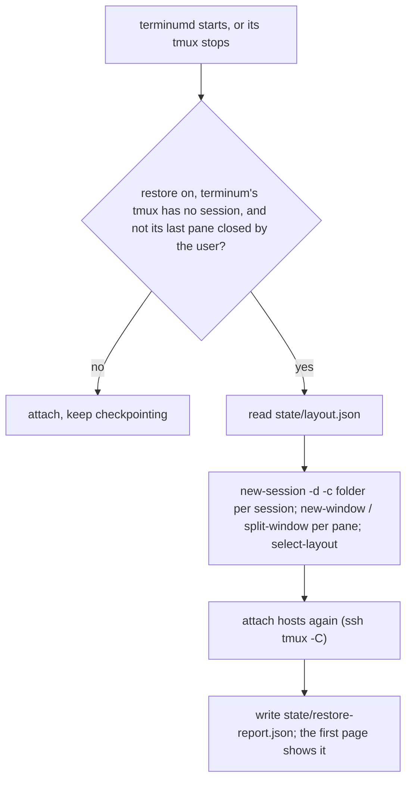

# terminum — Specification (install and lifecycle)

Sibling of `terminum.md` (the core). This spec holds installing, running, restarting, upgrading and removing terminum, what survives a restart or a reboot, and keeping the working tree and docs tidy for a release. Cases are numbered across the specs.

## 0. Metadata

| Field | Value |
|---|---|
| Status | current |

A snapshot of what terminum must do, not a record of how it came to be: git holds that.

## 1. Overview

**Problem.** A terminal workspace that holds the user's work has to be there without care: it must start by itself, survive its own crashes, upgrades and a reboot, and be removable, and none of that may end a running terminal or need a GUI open.

**Who it affects.** The user who installs terminum on a Mac or an Ubuntu/Debian server and keeps sessions in it; the maintainer who releases it.

**Expected outcome.** One line installs a signed package with nothing else needed but tmux. terminumd runs as a launchd agent (a systemd user service on Linux) from a stable path, so macOS's folder answers last. Terminals live in tmux and outlive terminumd; pages reconnect by themselves. After a reboot or a killed tmux, sessions, layouts, folders and each session's last lines come back. One command each upgrades, rolls back and uninstalls. A release starts from a machine with no leftovers, and the docs keep their shape.

**Scenario.** Alex runs the one line, sets a password, opens the page. A week later the header shows "↑ v0.4.0"; Alex runs `terminum upgrade`, the open page reloads itself, and vim in a pane never noticed. The Mac reboots: before Alex opens the page, the sessions are back in their folders, each terminal starting with its last lines, and a banner names the pane whose ssh must be started by hand.

## 2. Scope and non-goals

In scope:
- One-line install, launchd and systemd, signed packages, the upgrade, rollback, restart and uninstall commands, `terminum status`, `terminum folders`.
- What survives: terminumd's restart (AC-14), a reboot or a killed tmux (AC-15, AC-96), an upgrade or rollback (AC-16).
- The update notice (AC-17). Tidying before a release (AC-102, AC-103). Landing a worktree (AC-104); a release's full run on a quiet machine (AC-146); a release of a pinned commit in its own tree (AC-200); the full run's passes, retry, environment and record (AC-201); the nightly full run and the weekly review (AC-202).

Out of scope (explicit):
- A native app (AC-11 dropped; terminum.md OQ-04). No notarization and no hardened runtime (`docs/RELEASING.md`).
- Restarting programs: only shells are made again; programs are named for the user to start (AC-15). tmux's own contents are not restored beyond the last lines kept (AC-96).
- Asking for Full Disk Access or for iCloud Drive (AC-08).
- Enabling linger, starting an upgrade from the page, or upgrading by itself: the user runs the commands.
- Windows; Linux other than Ubuntu/Debian with systemd.

## 3. Assumptions, dependencies, open questions

Assumptions:

| ID | Assumption | Owner | Status |
|---|---|---|---|
| AS-111 | macOS asks for a protected folder for the process that started the tmux server, knows a bare binary by its path and its signature's designated requirement, asks again after every ad hoc build, and refuses unasked every program in a tmux whose starting binary was deleted. Hence `daemon/terminumd` and the signature. | Claude | verified on macOS 15.7 with a launchd agent starting a private tmux |
| AS-112 | launchd binds through a closing connection's TIME_WAIT, so only another program's listener makes it hand an unbound socket. | Claude | verified on macOS 15; `terminumd/tests/launchd.rs` |

Dependencies:

| ID | Dependency | Owner | Status |
|---|---|---|---|
| DEP-04 | macOS 14+; crates objc2 0.6, objc2-app-kit, objc2-web-kit (MIT/Apache-2.0) for the App; no Tauri, no wry. | Claude | dropped with AC-11 |
| DEP-111 | The system's `curl`, `ssh-keygen`, `tar` (`/usr/bin/` for the upgrade), `launchctl` on macOS; `systemctl --user`, `loginctl`, `sha256sum` on Linux. | Claude | available |
| DEP-112 | A Developer ID certificate for releases (`TM_CODESIGN_IDENTITY`) and the release key (`docs/RELEASING.md`). | Owner | available |

Open questions: none open. Which clients exist (AC-11's drop) is terminum.md OQ-04; tmux's versions are terminum.md DEP-02.

## 4. Acceptance cases

| ID | Priority | Case |
|---|---|---|
| AC-08 | [MUST / P0] | The user installs with one line, terminumd runs as a launchd agent (a systemd user service on Linux) that starts at login and after a crash, `terminum status` tells what runs, and macOS asks for the protected folders once, during the install, keeping the answers across upgrades. |
| AC-11 | [SHOULD / P1] | On the Mac the user opens terminum as an app: a WebKit window per ⌘N showing the page, with ⌘W closing the window (never a pane), ⌘+/⌘− for text size, full screen, the Dock icon, and windows remembered across launches. [DROPPED — the owner wants no app: a Mac browser and an iPhone browser are the clients] |
| AC-14 | [MUST / P0] | After terminumd crashes, restarts or is upgraded, every page reconnects by itself and shows the same pane, no terminal is lost, a tmux server that is gone is said so, and nothing depends on a GUI being open. |
| AC-15 | [SHOULD / P1] | After a reboot the sessions, windows, splits and their folders are back before the user opens a page, remote hosts attach again, and the user is told which panes ran programs that have to be started by hand. |
| AC-16 | [SHOULD / P1] | The user upgrades, rolls back and uninstalls with one command each, a new build is checked before it goes live, open pages reload themselves keeping unsaved edits, and state written by either build stays readable by both. |
| AC-17 | [SHOULD / P1] | The user learns from the page that a newer release exists and can copy the command that installs it, skip that release, or stop the check. |
| AC-96 | [SHOULD / P1] | After tmux restarts (a reboot, a killed server) a session's terminal begins with its last 300 lines from before the restart, and its menu opens them, the number set in settings.json. |
| AC-102 | [SHOULD / P1] | A release starts from a machine with no leftovers of old test runs: the one test helper that outlives its test is ended, dead tmux sockets and test folders are removed, and what may be someone's work is only named; a test run itself leaves nothing, and a step of `make check` that leaves something fails. |
| AC-103 | [SHOULD / P1] | The docs keep their shape on every `make test`, and a review of what changed since the last release removes duplicates and superseded requirements before a minor release. |
| AC-104 | [SHOULD / P1] | A finished worktree lands by itself: its targeted checks green on its own work, then a short smoke set of the basics on one platform, with no timed check, on its merge with what others landed; pushed, the primary checkout brought up to it and the tree deleted; the full test run is the release's gate, and only failing tests block a release. |
| AC-146 | [SHOULD / P1] | A release's full run starts only on a quiet machine: it queues behind another full run, waits for the load to stay low for 3 minutes, says each minute that it waits, and after 15 minutes ends the release with "the build server is not available"; a task's timed checks wait the same way, and after 15 minutes, or at once while a full run holds its turn, are skipped and said in red, never run under the load. |
| AC-196 | [SHOULD / P1] | Every diagnostic log has a bounded size and period under one rotation mechanism; active writers follow rotations without losing records. |
| AC-197 | [SHOULD / P1] | A worktree's step that runs real programs (panel, page, critical, smoke, an e2e script) and fails runs once more, unchanged, while the run is otherwise green: passing then, the targeted checks or the smoke set count it, say the first run's last lines and say it in red last; red again, or a leftover, it is red; other steps have no retry, and the full run retries by AC-201. |
| AC-200 | [SHOULD / P1] | A release promotes a commit: `make release` pins the newest commit of origin/main that passed the full run in 48 hours, or differs from one only in docs, else origin/main, or `PIN=`, and runs its full run, the Mac test runner's checks, the build and the tag in a tree of its own detached at it, by that commit's own code, while landings, Afters and installs go on; a fix for a red release lands first and is pinned. |
| AC-201 | [SHOULD / P1] | The full run keeps a pass per step and content, shared by every tree, and runs only the steps without one, or the scan alone after a docs-only change; its steps see only an allow-listed environment; a budget over under its own load is said and judged on a quiet machine; a red step of real programs runs its red checks once more, never for a check of code changed since the last full pass or one retried in 3 of the last 7 runs, said in red, in a task and in the release notes; each run and each release leaves a line in a record. |
| AC-202 | [SHOULD / P1] | A nightly schedule rehearses origin/main with every step run and judges the budgets on the quiet machine after it, a red step making a task that names the commits since the last full pass; a weekly schedule runs /simplify and /docs-review over what landed since its last run, their findings ordinary tasks; a release asks neither. |

## 5. BDD scenarios

### AC-08 — Install and run [MUST / P0]

```gherkin
Scenario: AC-08 happy path — one line
  When the user runs "curl -fsSL https://github.com/extractumio/terminum/releases/latest/download/install.sh | sh"
  Then it downloads the latest package and SHA256SUMS, checks the signature and the checksum, installs under "~/.terminum/builds/<build>/" with "current" linking to it and "~/.terminum/bin/terminum"
  And the installer is the package's own terminumd for this Mac's architecture ("sysctl -n hw.optional.arm64", right under Rosetta too) run as "terminumd install"; nothing needs Python, a compiler, npm or make
  And it copies the build's terminumd to "~/.terminum/daemon/terminumd" (a regular file, §9 Install), writes "~/Library/LaunchAgents/io.terminum.terminumd.plist" (§9 launchd) and loads it, so terminumd runs now and at every login
  And "~/.terminum/bin/terminum" links the newest installed build's terminumd (§9 One binary)
  And with a password set it prints "Installed <build>. Open http://127.0.0.1:48080/ and sign in with your password (terminum open)" and opens the page in the default browser; without one "Installed <build>. Set the password every browser signs in with: terminum password; then open http://127.0.0.1:48080/ (terminum open)"; then how other devices reach it (AC-10)
Scenario: AC-08 happy path — on a Linux server
  Given Ubuntu or Debian (x86_64 or aarch64) with systemd, tmux, curl and openssh-client
  When the user runs the same line
  Then install.sh picks "agents/linux-<arch>/terminumd" by "uname -m" ("sha256sum" for the checksum) from the same package and runs it as "terminumd install"; a missing curl, ssh-keygen or tar is said with "sudo apt install curl openssh-client tar"
  And it writes "~/.config/systemd/user/io.terminum.terminumd.service" (ExecStart "~/.terminum/daemon/terminumd" serve with absolute, quoted paths, a "%" in a path written "%%", Restart=always, RestartSec=1, StartLimitIntervalSec=0, KillMode=process, StandardOutput=null and StandardError=null, diagnostics written and rotated by terminumd (AC-196), WantedBy=default.target), daemon-reloads when it changed, reset-failed, enable and restart: terminumd runs now and at every login; terminumd binds 127.0.0.1:<port> itself (no socket unit: during a restart connections are refused for a moment and the page reconnects)
  And a root with spaces is accepted: the quoted ExecStart and Environment paths preserve them, and terminumd opens its log itself (AC-196)
  And a stop (an upgrade, a rollback, "terminum restart", "terminum uninstall") ends terminumd alone: KillMode=process keeps the tmux server it started, in the service's cgroup, and every terminal with it
  And while "loginctl show-user" says Linger=no, the install and "terminum status" say "linger is off: terminumd and its terminals end when you log out; to keep them from boot and after logout: sudo loginctl enable-linger <user>" (never run by terminum)
  And with no desktop (no DISPLAY nor WAYLAND_DISPLAY) nothing is opened: install and "terminum open" say "From your computer: ssh -L 48080:127.0.0.1:48080 <this server>, then open http://127.0.0.1:48080/", then how tailscale serve publishes it
  And "Reveal in Finder" and "Open with Default App" are not offered (terminumd's proof says "apps": false) and their API answers 501 "Finder and default apps are on macOS only"
Scenario: AC-08 failure — no systemd user manager
  Given a shell of "su" or "sudo -u", or a container without systemd: systemctl --user says "Failed to connect to bus"
  Then the install fails with "systemd's user manager is not reachable (no session bus): log in as this user (not su or sudo -u), or run terminumd yourself with TM_NO_LAUNCHD=1"
Scenario: AC-08 happy path — macOS asks for a protected folder once
  Given a released package: its macOS terminumd carries an Info.plist (CFBundleIdentifier "io.terminum.terminumd", a reason for Documents, Desktop, Downloads, network and removable volumes and cloud folders) and is signed with the maintainer's Developer ID as "io.terminum.terminumd"
  When a program in terminum's tmux (a shell, Claude Code, its subagents) first reads ~/Documents
  Then macOS asks once on the Mac's screen for "terminumd" (the process that started the tmux server, run by launchd from "~/.terminum/daemon/terminumd"); after Allow every program in that tmux reads it with no further prompt
  When terminum is upgraded or rolled back, or terminumd restarts, while the tmux server runs on
  Then "daemon/terminumd" is the new build's (same path, same signature's requirement) and nothing is asked again: neither new windows nor programs already running get "Operation not permitted"
Scenario: AC-08 happy path — the install asks for the folders
  Given macOS, terminumd started by launchd (it got launchd's socket), and a first install or an upgrade to a build signed with a Developer ID
  When the new build answers
  Then the command asks terminumd (POST /folders on its socket) to open, one after the other, ~/Desktop, ~/Documents, ~/Downloads and each folder in ~/Library/CloudStorage that exists (not iCloud Drive, ~/Library/Mobile Documents: macOS's sandbox refuses it to every program without Full Disk Access and never asks; terminum does not ask for Full Disk Access): each only opened, nothing listed, read or sent; an open macOS has not decided waits for the user's answer on the Mac's screen, on a thread of its own
  And folders already decided answer at once: "Folders: Desktop, Documents, Downloads, Dropbox allowed" and for each refused one "Downloads: refused by macOS — allow terminumd in System Settings › Privacy & Security › Files and Folders"
  And while macOS asks it says once "macOS asks on this Mac's screen whether programs in terminum's terminals may read Desktop, Documents, … (Allow: asked once)", waits at most 5 s, then "macOS is still asking about Dropbox (then …): answer on the Mac's screen; terminum folders shows the answers"; the install succeeds whatever the answers
  When the user runs "terminum folders"
  Then it asks the same (a second request while one waits joins it) and waits up to 2 minutes for the answers, saying each as above
Scenario: AC-08 edge — terminum's tmux was started by another program
  Given the running tmux server has no "@terminum-started-by", or it names another program than ~/.terminum/daemon/terminumd (a build that does not set it, a build run by hand, "tmux -L terminum" typed in Terminal)
  Then "terminum status", the install and "terminum folders" say "terminum's tmux was started by <that program | a version before this one, or by hand>: macOS judges its terminals' folders by that, not by terminum; restart it once at a quiet moment: tmux -L terminum kill-server (sessions, windows, splits, folders and projects come back; running programs do not)"; with the folder result it reads "Folders: Desktop allowed for terminum; the terminals of the running tmux get them once it restarts"; nothing restarts it
  And terminumd sets "@terminum-started-by" to its own executable on the server it starts (a fresh main, a restore), the option living exactly as long as that server; on Linux or without launchd nothing is said
Scenario: AC-08 edge — nobody asks for folders
  Given terminumd was not started by launchd (TM_NO_LAUNCHD=1, "terminumd serve" typed, every test), or it is the launchd test's own agent (TM_LAUNCHD_LABEL: it sees the real home folder), or Linux, or an upgrade to an ad hoc build
  Then the install asks nothing; "terminum folders" says "terminumd was not started by launchd: macOS would ask for the app it runs in, not for terminum" (no launchd), "Nothing to ask: only macOS asks for folders" (Linux), or asks (an ad hoc build: the upgrade said "This build is signed ad hoc: macOS asks for its folders again on first use; terminum folders asks now")
Scenario: AC-08 edge — a package signed without a Developer ID
  Given a package built by `make install` with no TM_CODESIGN_IDENTITY (a contributor's Mac)
  Then package.py says "TM_CODESIGN_IDENTITY is not set: terminumd is signed ad hoc; macOS asks again for protected folders after an upgrade" and signs it ad hoc as "io.terminum.terminumd"; the install goes on, and programs in the tmux are asked again, never refused unasked
Scenario: AC-08 failure — a release without a Developer ID
  When `make release` runs with no TM_CODESIGN_IDENTITY, codesign fails or takes over 60 s, or a packaged macOS terminumd has no Team ID after signing
  Then nothing is tagged or published, and it exits with the reason
Scenario: AC-08 happy path — launchd holds the port
  Given the agent is loaded
  Then launchd listens on 127.0.0.1:48080 and hands the socket to terminumd ("launch_activate_socket"); while terminumd is killed, crashes, is restarted or upgraded, connections wait in launchd's queue and another program's bind of 127.0.0.1:48080 fails with "address in use", SO_REUSEPORT or not
  And before it loads the agent again (an install whose plist changed, `terminum restart`) the command waits until nothing answers on 127.0.0.1:<port> (at most 10 s), so an old terminumd that bound the port itself has let go of it
Scenario: AC-08 happy path — tmux missing
  Given tmux is not on PATH
  Then the install goes through and prints "tmux is needed for terminals: brew install tmux" ("sudo apt install tmux" on Linux), and the page says the same until tmux appears (terminum.md AC-01)
Scenario: AC-08 edge — a tmux server before 3.8
  Given terminum's running tmux server (`#{version}`, which `terminum status`'s `/health` names; a newer binary on PATH changes it only after a restart) is older than 3.8, which can crash and end every terminal in it (terminum.md DEP-02)
  Then the install goes through and says last "tmux <version> runs terminum's terminals and can crash, ending every one of them (fixed in tmux 3.8): brew upgrade tmux, then restart it once at a quiet moment: tmux -L terminum kill-server (sessions, windows, splits, folders and projects come back; running programs do not)" ("upgrade tmux with your system's package manager" on Linux), and "terminum status" says the same line after "tmux:"
  And a server from 3.8, a version that is no number ("master", "next-3.9"), or none running says nothing; the install never refuses
Scenario: AC-08 happy path — status
  When the user runs "terminum status"
  Then it prints the running build, terminumd's pid and uptime, the page's address, whether a password is set, the tmux servers and sessions attached, the hosts and their state, and the pages connected
  And when settings.json names another port than the one launchd holds, it says "port: settings.json says <a>, launchd holds <b>: run terminum restart"
Scenario: AC-08 edge — another program held the port when launchd loaded the agent
  Given another program listened on 127.0.0.1:48080 when the agent was bootstrapped (launchd then hands an unbound socket and never tries again)
  Then terminumd logs and prints "port 48080 was held by another program when launchd loaded terminum: free it, then run `terminum restart`" once and waits (exiting would only have launchd start it again on the same unbound socket), and "terminum status" says so
  And the install, restart or import that bootstrapped it exits non-zero with that message at once (AS-112)
  When the user frees the port and runs "terminum restart"
  Then the agent is booted out and bootstrapped again, launchd holds the port, and terminumd answers within 10 s
Scenario: AC-08 edge — the port is in use (terminumd not run by launchd, TM_NO_LAUNCHD=1)
  Given another program listens on 127.0.0.1:48080
  Then terminumd exits with "port 48080 is in use (set `port` in ~/.terminum/settings.json)" in its log after 9 s, and "terminum status" says so
Scenario: AC-08 failure — bad download or wrong user
  When the checksum or signature does not match, or the line runs as root
  Then nothing is installed and the line exits non-zero with the reason ("run it as your user, not root (it installs into your home folder)")
```

### AC-14 — Lifecycle [MUST / P0]

```gherkin
Scenario: AC-14 happy path — terminumd crashes or is upgraded
  Given a page shows %3 and vim runs in %5
  When terminumd is killed with SIGKILL
  Then launchd starts it again within 1 s, it attaches to the tmux servers within 1 s, the page reconnects within 3 s (amber dot meanwhile, no "not running" notice under 3 s) and shows %3 with its history again; vim in %5 never noticed
  And unsaved edits in the page's editor are still there
Scenario: AC-14 happy path — every page closes
  When the user closes every browser tab
  Then terminumd and every tmux session keep running; `terminum status` lists them; nothing of terminumd depends on a page being open
Scenario: AC-14 edge — the tmux server stops
  When the user runs "tmux -L terminum kill-server"
  Then within 2 s a shown pane says "This pane has closed. Pick another one.", terminumd starts the server again with a session "main" (AC-15 restores the layout when its checkpoint is newer than the kill), and the list shows it
Scenario: AC-14 edge — a long gap
  Given terminumd stays down for 3 s or more
  Then the page shows "terminum's server is not running" and retries every 2 s; typing is refused with "Not connected" and nothing is queued
Scenario: AC-14 failure — a hung control client
  Given a control client has not answered a command for 10 s and nothing else came from it for 10 s, or has not answered one for 60 s (a slow link: `terminum-remote.md` AC-132), while the process lives
  Then terminumd logs `tmux.timeout` "control client timed out", kills and restarts it, and the page shows the stall line meanwhile (AC-03)
```

### AC-15 — Layout survives a reboot [SHOULD / P1]

```gherkin
Scenario: AC-15 happy path — checkpoint and restore
  Given settings.json has {"restore": true} (the default) and sessions "main" (3 windows, one split, folders known) and "notes", host "devbox" attached
  Then terminumd writes "state/layout.json" within 5 s of a change: sessions, windows (name, whether tmux names it after its program, index, #{window_layout}), panes (folder, the program's kind: shell, ssh <recipe>, other; the title its coding agent gave it), hosts
  When the Mac reboots and terminumd starts with no local tmux server (or that server has no session)
  Then before any page connects it recreates "main" and "notes" with shells at the saved folders (a missing folder opens in ~ with a note), applies each window's layout string ("select-layout"), names each window the user named as before and leaves one tmux named after its program (automatic-rename, or a name that is only a version such as Claude Code's "2.1.310") to tmux; a pane whose coding agent had titled it ("✳ Fix the login form", or one restored so before) gets that title as `@tm-title`, its row's title while a shell runs there, until a coding agent runs there again and titles it itself (AC-01), attaches "devbox" again (its session survived on the host) and writes a report
  And the first page shows "Restored 2 sessions, 4 windows. 1 pane ran ssh devbox: start it again" with the pane's row linked; × closes it on every page; it goes by itself after 30 s and a page that connects more than 10 minutes later does not get it
Scenario: AC-15 happy path — tmux killed, a host's tmux started anew, the user's own tmux
  Given the checkpoint also keeps, by server, host devbox's "terminum" session and the sessions of the user's own tmux attached by name (AC-89), here and on hosts (windows, layouts, folders)
  When terminum's tmux server is killed while terminumd runs (the same boot)
  Then terminumd makes its sessions again as after a reboot, with the report
  When devbox's tmux starts anew (a reboot of the host, its server killed: #{start_time} after the checkpoint) and devbox is attached again
  Then its "terminum" session gets its windows back in their folders on the host (its fresh first window goes), and the user's sessions attached there that no longer run are made again
  When the user closes the last window of devbox's "terminum" session while devbox's tmux runs (another session keeps it)
  Then terminumd makes the session anew with one shell and restores nothing: what the user closed stays closed
  When the user closes the last pane of devbox's tmux (no other session keeps it), of terminum's here, or of an attached server of the user's own, and that tmux ends with it
  Then nothing is made again (tmux said %exit itself while terminumd showed one pane there, as its main control client saw): devbox's "terminum" is made anew with one shell, terminum's tmux starts "main" in ~, the user's own stays down; tmux ends the same way on kill-server and on SIGTERM (a host shut down cleanly), so a server stopped so while it showed one pane is not restored either (its one shell comes back in ~, not in its folder); one that showed more is restored as a killed server
  When the server of the user's own tmux on this Mac does not run (a reboot, it was killed)
  Then the sessions attached from it are made again with their windows and folders (once per checkpoint); a session the user closed while that server runs stays closed
  And a host or a server that cannot be read keeps what the checkpoint held for it
Scenario: AC-15 edge — nothing to restore, or the user said no
  Given the server runs already (terminumd restarted), or {"restore": false}
  Then nothing is recreated; the checkpoint goes on (or stops with "restore": false)
Scenario: AC-15 edge — what is never stored
  Then layout.json holds no output, history, environment, command lines other than an ssh recipe (destination and allowlisted options), or passwords; it names each server's identity (@terminum-id), whose files hold its panes' last lines (AC-96, kept apart)
Scenario: AC-15 failure — a session cannot be made
  When "new-session" fails (tmux missing, a bad name)
  Then the report names it, the other sessions are restored, and "Restore again" in the page's menu retries once
  And "Restore again" covers every server the checkpoint names that answers (terminum's, a host, the user's own tmux), sessions that run kept, one restore at a time (two asked at once make each session once); a host's `terminum` session takes its windows only while its own restore is owed
  When a host's or the user's own tmux's restore fails with nothing made (its link dropped meanwhile)
  Then its checkpoint is kept, and it is made again by itself once its link is a new one, else by "Restore again"; one that made some is not made again by itself
  And a report that cannot be written to the state folder says so among its errors
  And a failed checkpoint write is retried on the next checkpoint even when the layout has not changed
  And restored window names and folders containing "#S" or "#{session_name}" stay literal through both local commands and host control clients
```

### AC-16 — Upgrade, rollback, uninstall [SHOULD / P1]

```gherkin
Scenario: AC-16 happy path — upgrade
  Given build "A" runs
  When the user runs "terminum upgrade" (the latest signed release, or --to vX.Y.Z)
  Then the package is verified (signature, checksum), "builds/B" is unpacked, "B/terminumd --version" prints its id, "previous" → "A", "current" → "B", "daemon/terminumd" becomes B's terminumd (the tmux server started by A's keeps its folder access, AC-08), terminumd is restarted with "launchctl kickstart -k gui/<uid>/io.terminum.terminumd" while the plist it would write differs at most in PATH, so launchd keeps the port (otherwise, and after a failed kickstart, the plist is written and the agent loaded again; on Linux the service restarts), and within 10 s its health (on the socket) reports "build": "B"; then other build folders are pruned and it says "Upgraded A → B"
  And every open page learns the build from the WebSocket and reloads itself once; one with unsaved edits or a dialog waits and says "An update is ready: the page reloads after you save."; one that already reloaded for this build says "An update is ready: reload the page."
  And a Files panel reloads only once terminumd has its workspace: while that write is refused (said: "Panel state not saved: …") it waits, also inside the page, until a later change or reconnect saves it
Scenario: AC-16 happy path — rollback and uninstall
  When the user runs "terminum rollback"
  Then "current" → "A", "previous" → "B", "daemon/terminumd" becomes A's, terminumd restarts (kickstart) and reports "A" within 10 s, and it says "Rolled back B → A"; a state file written by "B" with fields "A" does not know is read by "A" (unknown fields ignored, every field has a default)
  When the user runs "terminum restart"
  Then the plist is written again (a changed port in settings.json takes effect), the agent is booted out and bootstrapped, terminumd answers within 10 s, and it says "Restarted terminumd: build B, port 48080"
  And a rollback leaves the agents' hooks and MCP server as they are: they run "~/.terminum/bin/terminum", which stays the newest build's, so an MCP tool A's terminumd does not know fails as a tool error, never the agent
  When the user runs "terminum uninstall"
  Then first terminum's hooks and MCP server are taken out of Claude Code and Codex where present (as "terminum hooks remove" does; a failure is a warning naming what to remove by hand, the uninstall goes on), so no agent calls a missing command; then terminumd stops, the launchd agent (or systemd service) is removed, builds, the command and "daemon/" are removed; settings, themes, state/ and logs/ are kept; tmux sessions are untouched; it says "Removed terminum: terminumd stopped, its launchd service, builds and command removed. Settings, state and logs kept in <root>; tmux sessions untouched."
  And after an install or upgrade, terminum's agent integration is refreshed only where its hooks were installed (AC-97, terminum-agents.md); a failure is a warning, never the install's
Scenario: AC-16 failure — the new build does not come up
  When "B" does not report its build within 10 s
  Then "current" → "A", "previous" as it was, terminumd restarts on "A", and the command exits non-zero with "Upgrade to B failed (<reason>); rolled back to A — see ~/.terminum/logs/"
  And when A does not come up either it says "Upgrade to B failed (<reason>); switched back to A, which did not come up either (<reason>)"
  And a timed-out CLI subprocess ends its own descendants and closes its output readers; no detached reader thread remains
  And direct-mode process records with a zero, overflowing pid or empty start time never name a process to signal
  And in direct mode a pid file that cannot be written ends the terminumd just started ("<pid file>: <reason>; terminumd was not left running"): no stop could find it
  And when "terminum uninstall" cannot remove a build, the command or "daemon/", it exits non-zero with "terminumd stopped, but these could not be removed: <path>: <reason>", never "Removed terminum"
Scenario Outline: AC-16 failure — nothing to do, or someone else is doing it
  When the user runs <command> <given>
  Then it exits non-zero with <message> and nothing changes

  Examples:
    | command           | given                                       | message                                                                     |
    | terminum rollback | with no previous build                      | No previous build to roll back to                                           |
    | terminum restart  | with no builds/current                      | terminum is not installed (no builds/current): nothing to restart           |
    | any of install, rollback, uninstall, restart, import | while another holds install.lock | Another install is running                  |
Scenario: AC-16 failure — the build rolled back to does not come up
  When A does not report its build within 10 s after "terminum rollback"
  Then "current" → "B" again, B restarts, and it exits non-zero with "A did not come up: <reason>; B runs again — see ~/.terminum/logs/"
Scenario: AC-16 edge — an install from before the server was named terminumd
  Given the launchd agent "io.terminum.terminusd" holds the port
  When a new build installs
  Then that agent is unloaded and its plist set aside before the new one loads; once the new build answers that plist is removed; when it does not come up, or the old agent cannot be unloaded or set aside, "current" names A again, the old agent is loaded again and it says "Upgrade to B failed (<reason>); A runs again as before — see ~/.terminum/logs/"
  When the user rolls back to such a build
  Then it is refused with "A is from before the server was named terminumd and cannot run as this agent: install that version again instead"
Scenario: AC-16 edge — imported state
  Given imported local and remote workspaces and an existing settings file
  Then remote workspace namespaces use the mapped host alias the Panel opens, with their root and tabs preserved
  And a settings file containing valid JSON of the wrong type is refused and kept byte for byte
```

### AC-17 — Update notice [SHOULD / P1]

```gherkin
Scenario: AC-17 happy path — a newer release
  Given the running build is release "v0.3.0"
  When terminumd's daily check finds the latest release tag "v0.4.0" (one HEAD request, no data of the user's)
  Then every page shows the chip "↑ v0.4.0" in its header; its menu offers "Copy upgrade command" (copies "terminum upgrade"), "Skip v0.4.0" and "Don't check for updates" (creates state/no-update-check)
Scenario: AC-17 edge — nothing to show
  Given the latest release is the running one or older, the check failed, or the build is from a checkout
  Then no chip, nothing reported; the first try is 30 s after terminumd starts, a failed try repeats within the hour, a successful one a day later
Scenario: AC-17 security — untrusted text
  When the redirect names anything but "vMAJOR.MINOR.PATCH", it is dropped: no text from the network reaches the page
```

### AC-96 — Last lines survive a restart [SHOULD / P1]

```gherkin
Scenario: AC-96 happy path — how a session ended, after its tmux restarted
  Given settings.json has {"lastLines": 300} (the default) and {"restore": true}, and window "api" of "main" shows a coding agent's last turn
  Then within 5 s of its output (a host's pane within 15 s) terminumd keeps the pane's last 300 lines as `capture-pane -J` gives them (its history's end and its screen, wrapped lines joined, trailing blanks and blank bottom lines dropped) in state/lastlines/<host>@<socket>/<identity>_<N>.json with the session's and window's names, the folder and the time (it reads twice that many rows: wrapped rows joined give fewer lines); a pane whose window printed nothing since the second before it was read is not read again, the same text is not written again
  And under a full-screen program (vim, htop) the lines kept are the terminal's under it (its history and the normal screen, `capture-pane -a`), never the program's own screen
  When terminum's tmux is killed or the Mac reboots and AC-15 makes "api" again
  Then the lines kept for the old pane become the new pane's "before the restart" (by the identity layout.json saved for that server and the pairs of the panes the restore made), and the report adds "Last lines before the restart: a session's menu, Show Last 300 Lines."
  And on a tmux of this Mac (terminum's, the user's own) the new pane starts by printing those lines, then "[terminum: the lines above are from before tmux restarted]" and a blank line, then its shell as tmux starts it (`default-shell`, a login shell): they are its history, the page shows them as the terminal's lines and the next restart keeps them; the text is the kept plain text with control characters dropped, from a 0600 file in the 0700 lastlines folder (`print-<identity>-<N>.txt`) the pane's command deletes once printed (a leftover goes with the next restore); nothing is printed when the server sets `default-command` (its panes start another program) or into a host's panes (their lines are on this Mac: the menu shows them)
  When the user picks Show Last 300 Lines in the row's menu (the number the setting's)
  Then a large window shows them as plain text in the terminal's font, scrolled to the end, under "Before the restart · main · api · /Users/alex/work/api · Oct 26, 14:05"; "Before restart | Now" switches to the lines kept since; Copy copies the lines shown; Esc or × closes it
  And the same holds for a host's "terminum" session and the user's own tmux sessions attached by name (AC-89) that AC-15 makes again; quick shells (AC-88) are not kept
Scenario: AC-96 edge — nothing kept, or off
  When a pane has nothing kept (a new pane in its first 5 s, a pane of a server that no restore made again)
  Then the window says "Nothing kept yet: a session's last lines are kept within 5 s of its output."
  Given {"lastLines": 0} or {"restore": false} (no restart would hand the lines on)
  Then nothing is kept, the menu has no Show Last Lines, and every line kept before is deleted
Scenario: AC-96 edge — when kept lines go
  When the user closes a pane (absent from reads of its running tmux 30 s apart)
  Then its lines go, those from before the restart with them; a pane that closes as its tmux ends (a reboot ends programs before tmux) keeps them
  And when a restore made panes again, the old server's lines it did not hand on go at once (panes not made again); a server's that no restore took (its last pane closed by the user, a host removed or not attached since) go 7 days after terminumd last read that server (an hourly sweep, the first an hour after terminumd started, so a restore comes first)
  And a second restart before a pane printed more than its prompt (2 lines) hands on the lines from before the first
Scenario: AC-96 edge — privacy
  Then the files are 0600 in 0700 folders, the folder is excluded from Time Machine on macOS, and their text reaches only a signed-in page that asks for one pane's; a host's lines are kept on this Mac
Scenario: AC-96 failure — a file cannot be written or read
  When a write fails (a full disk)
  Then terminumd logs `lastlines.unsaved` and writes that pane's lines again the next round, changed or not (a closed pane's file not deleted: `lastlines.undeleted`, deleted the next round); a file that cannot be read, a pane gone or its tmux not answering is said in the window in terminumd's words
```

### AC-102 — No leftovers of old test runs [SHOULD / P1]

```gherkin
Scenario: AC-102 happy path — a release clears what old runs left
  Given a test helper "terminumd-18e312ae2b0e93f4 --exact cli::tests::fake_terminumd" with parent 1, running for 10 days
  And 375 dead tmux sockets named tm-* and 16,000 folders named tm-settings-1091-add, all a day old
  When the maintainer runs make release TAG=v0.32.0
  Then the helper gets SIGTERM by its pid and ends before anything is built
  And it prints "removed 375 dead tmux sockets, 16000 test folders (0 could not go)"

Scenario: AC-102 edge — a plain look changes nothing
  Given the same leftovers
  When the maintainer runs make leftovers
  Then it prints "375 dead tmux sockets, 16000 test folders (--end removes them)" and nothing is removed
  And make leftovers END=1 removes them

Scenario Outline: AC-102 edge — someone's work is never removed
  Given <what>
  When make leftovers END=1 runs
  Then it stays, <said>

  Examples:
    | what                                                               | said                  |
    | a test binary with a parent, or younger than 6 h                   | not mentioned         |
    | any other test binary or a build folder's terminumd with parent 1, older than 6 h | named, not ended |
    | a live tmux server on a tm-* socket older than 6 h                 | named, not ended      |
    | a tm-* socket younger than 6 h                                     | not mentioned         |
    | a test folder with a file written in the last 6 h                  | not mentioned         |
    | a test folder a process holds a file open in                       | not mentioned         |
    | the folders tmux-501, tmate-501, tmp-work, terminum-audit-20261025 | not mentioned         |
    | the installed ~/.terminum/daemon/terminumd                         | not mentioned         |

Scenario: AC-102 edge — not knowing what is open keeps the folders
  Given lsof gives nothing or hangs for 2 minutes
  When make leftovers END=1 runs
  Then it prints "lsof says nothing of what is open: every test folder stays" and removes no folder

Scenario: AC-102 failure — a cleanup problem never stops a release
  Given a helper that stays after SIGTERM
  When make release runs
  Then it prints "still running <pid>: …" and goes on: leftovers.py exits 1, make ignores that, the helper gets no SIGKILL and the release is not refused

Scenario: AC-102 failure — the helper cannot outlive its test by long
  Given a fake terminumd of a test whose socket's folder is removed (its test's home), or that has run for five minutes
  Then it exits by itself within a second

Scenario: AC-102 edge — a run ended by a signal leaves nothing either
  Given node web/test/e2e_live.mjs or python3 scripts/e2e_remote.py is running with its own TMPDIR
  When it gets SIGTERM or SIGINT
  Then it exits 143 or 130, and its terminumd, tmux server, browser and folders go; terminumd's stand-in for ssh, ended by SIGKILL, keeps its files in the test's home, which the run removes

Scenario: AC-102 happy path — a run leaves nothing
  Given a step of make check or of a landing's targeted checks, run by scripts/check_step.py with its own short folder as TMPDIR and TMUX_TMPDIR
  When the step passes, fails or gets a signal
  Then its folders, tmux servers, tmux socket files and processes have gone and that folder is removed

Scenario: AC-102 edge — macOS Python without os.waitid
  Given a guarded check runs on macOS under a Python that does not expose os.waitid
  When the guard inspects a running, exited or signalled child
  Then it uses the platform's non-reaping wait and keeps that child's PID reserved until cleanup ends
  And repeated inspection preserves the final exit or signal status for the eventual reap
  And interrupted native waits are retried and other native errors fail visibly

Scenario Outline: AC-102 edge — cancel the outer targeted runner
  Given scripts/check_changed.py has an active private guard, a foreground child that ignores signals, and a registered detached child outside the private folder
  When the outer runner receives <signal>, and another signal during cleanup
  Then it forwards cancellation to its guard once and waits for owned-child cleanup before exiting with <status>
  And the guard notifies its private process group once so shell descendants can finish orderly cleanup; cancellation first received during settling starts a fresh 15 s grace period, and repeated signals neither notify again nor extend it
  And both children and the private folder are gone, an unrelated process is untouched, no later step starts, and no passing result is recorded
  And a guard that fails or exceeds the 60 s cancellation wait is recovered using its private group, folder and registered children, with PID start identities checked before each signal and the guard kept unreaped until its children are ended
  And failed metadata queries fail cleanup visibly and retain the private folder for diagnosis; a cancellation still gets its single notice and grace, and the owned processes are read again when the grace ends

  Examples:
    | signal  | status |
    | SIGTERM | 143    |
    | SIGINT  | 130    |
    | SIGHUP  | 129    |

Scenario: AC-102 edge — a signal while the guarded command starts
  Given the guarded command starts before its parent has returned from starting it
  When the guard receives SIGTERM, SIGHUP or SIGINT
  Then it forwards that signal to the command's own process group once that group is known, waits for the command and performs the same leftover report and cleanup
  And a process group that has already ended needs no signal

Scenario: AC-102 failure — a step that leaves something fails
  Given a step that passes but leaves a file in its folder, or a process in its private process group or working in that folder or a folder under it
  When it ends
  Then each is printed as "LEFT …", the process is ended by its pid (SIGTERM, then SIGKILL when it is still there 2 s later: an interactive shell ignores SIGTERM), the folder is removed and the step fails

Scenario: AC-102 failure — working-directory inspection times out
  Given macOS working-directory inspection exceeds its 15 s deadline twice or fails
  When guarded cleanup runs
  Then the inspection error fails the check visibly, leftover files are reported and processes proven owned by the private group or registry are ended by identity
  And the private folder stays for diagnosis; unknown directory ownership is never an empty process set
  And one timed-out inspection is retried once, without using its partial output or retrying other errors

Scenario: AC-102 edge — real pane programs keep temporary files inside the run's cleanup
  Given the Linux live Chromium suite runs under scripts/check_step.py with Midnight Commander installed
  When its private tmux pane runs mc and the suite passes, fails or gets a signal
  Then the pane's TMPDIR is inside the live run's own folder, its mc cache goes with that folder, and the guard reports no leftovers

Scenario: AC-102 edge — a pane's program that ignores SIGHUP does not outlive its test
  Given a test's private tmux server whose pane runs a program that ignores SIGHUP, as macOS's bash does when it spins on a terminal gone
  When the test ends that server with end_tmux of scripts/e2e_ws.py
  Then the program has ended too, where kill-server alone leaves it running with no parent

Scenario: AC-102 edge — what a fake host still runs ends before its test's folder goes
  Given a private terminumd of scripts/e2e_ws.py whose fake host's program runs on in a session of its own after terminumd dropped its ssh, as a host's claude plugin call does, still writing into the fake home
  When the test's cleanup runs
  Then it ends its fake host's tmux server, waits up to 15 s for every process working in the test's folder or a folder under it, and only then removes the folder; one still there is ended by its pid (SIGTERM, then SIGKILL) and fails the run, its command named

Scenario: AC-102 edge — a registered child leaves the private working directory
  Given a test or fake ssh records its Popen child's PID and start time in a private registry before its parent ends
  And that child starts a separate session and changes its working directory outside the private folder
  When cleanup runs
  Then it waits for the same child to finish its delayed write, or ends it by its recorded identity
  And a PID with another start time receives no signal
  And the guard's own registry is metadata, not a leftover file
  And an unregistered descendant that leaves both the private group and folder cannot be discovered portably; its spawner must explicitly record and end it

Scenario: AC-102 edge — cleanup never reads process environments
  Given an unrelated process with credentials in its environment, whose command mentions the test's folder
  When the guard or a private terminumd's cleanup looks for leftover processes on macOS or Linux
  Then it reads process IDs, groups, commands and working directories only, never environments
  And the unrelated process and one working in a sibling folder with the same prefix are neither selected nor ended
  And a failed metadata query fails the check, never counting as no leftovers
  And each test still ends its recorded tmux servers, browsers and detached children that leave the private folder in its own cleanup

Scenario: AC-102 edge — another session's run is no leftover of this one
  Given another session's test run with folders in the temporary folder and sockets of its own
  When a step of make check ends
  Then none of them counts and none is touched, and tmux's own empty tmux-<uid> folder does not count either
```

### AC-103 — The docs keep their shape [SHOULD / P1]

```gherkin
Scenario: AC-103 happy path — make test reports the shape
  Given the specs in docs/specs, the docs and the code
  When make test runs scripts/check_docs.py
  Then it prints "docs: 0 findings"

Scenario Outline: AC-103 edge — a broken shape is reported and blocks nothing
  Given <what>
  When make test runs scripts/check_docs.py
  Then it exits 1 and prints <message>, and make test goes on: only failing tests block a release

  Examples:
    | what                                                  | message                                                       |
    | one case in two specs                                 | FAIL AC-nn in both <spec> and <other spec>                    |
    | a source file citing a number no spec has             | FAIL web/test/x.mjs: cites AC-nn, which no spec has           |
    | a citation naming the wrong spec                      | FAIL x.rs: says <spec> AC-nn; it is in <other spec>           |
    | a case with a tag other than the three allowed        | FAIL <spec>: AC-nn has the tag '[MAY / P2]'; allowed: …       |
    | a case with no scenarios                              | FAIL <spec>: AC-nn has no scenarios in section 5              |
    | a case with no line in section 11                     | FAIL <spec>: AC-nn has no line of proof in section 11         |
    | a relative link to a missing file                     | FAIL docs/USAGE.md: the link x.md leads nowhere               |
    | a change log in a spec's section 0                    | FAIL <spec>: a change log in section 0: a spec is a snapshot, … |

Scenario: AC-103 edge — a spec has no size limit
  Given a spec of 400 KB
  When scripts/check_docs.py runs
  Then its size is no finding

Scenario: AC-103 happy path — a review before a minor release
  Given the maintainer asks for a minor release
  When the release's steps run (CLAUDE.md §10)
  Then /docs-review goes over the changes since the newest tag, after /simplify and before make test and the release's commit
  And each requirement it deletes is named with what supersedes it, and one only absent in the code goes to the maintainer as a gap
```


### AC-104 — A green worktree lands by itself [SHOULD / P1]

```gherkin
Scenario: AC-104 edge — worktree inventory survives unknown process ownership
  Given working-directory inspection times out twice or fails
  When scripts/worktree.py list runs
  Then every worktree's branch, changes and merge state remain listed with an explicit unknown process count and the inspection error
  And removal and sweeping keep any tree whose process ownership cannot be inspected, even with discard requested
  And a listing takes one shared working-directory snapshot for all its trees

Scenario: AC-104 happy path — targeted checks green, the tree lands
  Given the worktree fix-paste has its work committed, and scripts/check_changed.py passed on it: the security scan, the tests of the changed files, the tests citing the acceptance cases on the changed lines, and the critical functions, recorded as .checks/changed-<id>.ok, <id> naming the tree's content
  When the agent runs make land SLUG=fix-paste from the primary checkout
  Then the branch is merged with origin/main in the tree
  And the targeted checks do not run again, origin/main having changed none of the files the tree changed
  And on the merged result scripts/check_changed.py --land runs the smoke set: the security scan, terminumd's debug build, cargo test of the critical modules, scripts/e2e_core.py (terminum's own tmux), scripts/e2e_attach.py (the user's own tmux), and the real page in Chromium at one size (signing in, the list, a pane drawn, typing, Files), with no timed check
  And on green it is pushed to origin main, never forced
  And the primary checkout is fast-forwarded to it, the tree is deleted by scripts/delete_worktree.sh, and it prints "landed 4f2a91c07 on origin/main"

Scenario: AC-104 failure — a red check lands nothing
  Given a targeted check of the worktree fails, or a check of its smoke set
  When make land runs
  Then it exits 1 saying "targeted checks failed" or "smoke checks failed" and that nothing was pushed, shows the check's last lines, and the tree stays, with its merge of origin/main when it had one

Scenario Outline: AC-104 edge — when the targeted checks run again at landing
  Given <what>
  When make land runs
  Then the targeted checks run <where>

  Examples:
    | what                                                                   | where                                                   |
    | no targeted pass recorded for the tree's content                       | on its own content, before it takes the landing turn    |
    | origin/main changed a file the tree also changed since its pass        | on the merged result, in the turn, before its smoke set |

Scenario: AC-104 edge — the same content is checked once
  Given the targeted checks passed on a tree's content
  When they run again on the same content, as a landing does
  Then they print "targeted: passed already on 3f9a21c40b7d5e11" and run nothing

Scenario: AC-104 edge — builds leave room for others
  Given several trees check and land at once
  Then the targeted checks and the smoke set build terminumd under nice -n 10, and their browsers run as usual
  And while a release runs, the whole smoke set runs under nice -n 10
  And no landing builds the release build in its tree: the primary checkout's install builds it
  And a step that builds or tests terminumd with cargo (the debug build, clippy, cargo test) of a tree at work, and a landing's install, runs holding one of the machine's heavy-build slots: the cores' count / 8, at least 1, or TM_HEAVY_SLOTS
  And the smoke set of the landing in the turn holds a slot of its own, so the queue of landings never waits behind trees at work
  And a step that finds every slot held says once "slot: cargo waits for one of 2 heavy-build slots: two cargo, three debug-build" and starts when one is free; a slot is freed with its holder, however it ends
  And scripts/worktree.py add gives a new tree copy-on-write clones of the primary checkout's debug and release dependencies' builds, so its first build compiles terminumd alone

Scenario: AC-104 happy path — script modules run in a small process pool
  Given the scripts' unit-test modules under scripts/tests
  When the targeted scripts step or make test runs them
  Then each module runs through unittest discovery in a separate interpreter, at most three at once
  And every discovered test runs once, with the same counts and verdict as serial discovery
  And each module's output is retained in its own log, with its elapsed time and the five slowest modules named
  And waits for a child to become ready check its condition within a deadline, rather than sleeping a fixed interval

Scenario Outline: AC-104 failure — a script module cannot produce a passing result
  Given a script module <outcome>
  When the scripts step ends
  Then the step fails and names that module, retaining its output
  And other modules still run and contribute their counts

  Examples:
    | outcome                       |
    | has a failing test            |
    | cannot be imported            |
    | exits without reporting       |
    | discovers zero tests          |

Scenario: AC-104 happy path — live checks share a bounded pool across trees
  Given two trees hold the two worker live-check slots
  When a third tree reaches the critical step of its targeted checks
  Then it says once "slot: critical waits for a live-check slot (2 slots): one panel, two critical" and waits until a slot is free
  And each panel, page, critical, smoke or e2e_* step holds one slot through its command, cleanup and any unchanged retry (AC-197)
  And other steps take no live-check slot, and cargo's heavy-build pool stays independent
  And TM_LIVE_SLOTS sets the worker count, default 2; zero or a negative value means 1, an invalid value uses the default

Scenario: AC-104 edge — a landing has its own live-check slot
  Given every worker live-check slot is held
  When the landing in the turn runs its smoke set
  Then its e2e_core, e2e_attach and smoke steps use the reserved landing live-check slot without waiting for a worker
  And that slot is shared by landings, independent of the worker count, allowing one live step beyond the worker limit
  And make check keeps its existing full-run gate and takes no live-check slot

Scenario Outline: AC-104 failure — a live-check holder ends
  Given a step holds a live-check slot
  When <end>
  Then the slot is free for another tree, and no process it started inherits the slot

  Examples:
    | end                                       |
    | the step succeeds or fails                 |
    | its quiet-machine gate skips timed checks  |
    | its runner raises an error or is cancelled |
    | its holder process dies                    |

Scenario: AC-104 edge — deterministic benchmark verdicts under concurrent checks
  Given concurrent script suites delay the startup of the listing benchmark's private stand-ins
  When the harness checks the benchmark command with supplied timing and RSS samples
  Then its bounded execution deadline allows for startup independently of the measured listing budgets in terminum-files.md section 9
  And samples just below each budget pass; a sample at any budget fails, and the slowest of ten samples counts toward p95
  And an explicitly stalled stand-in still hits the cleanup test's short deadline and leaves no running process in the harness's own group

Scenario Outline: AC-104 edge — a session hears of a changed pipeline
  Given origin/main changed <script> since a tree's base
  When the session's prompt hook runs in that tree
  Then it says "origin/main changed the checks or the landing (<script>): read it there and merge it (CLAUDE.md §9)"

  Examples:
    | script                 |
    | scripts/land.py         |
    | scripts/check_slots.py  |
    | scripts/heavy_slots.py  |
    | scripts/live_slots.py   |

Scenario: AC-104 edge — the landing says GitHub CI's last verdict on main
  Given GitHub CI's last run on main to end, not cancelled, failed on origin/main's head 8f3c2a1d0
  When make land runs
  Then its first line is "CI on main: failure on 8f3c2a1d0: https://github.com/extractumio/terminum/actions/runs/42436430099"
  And a newer run still waiting or running is said after it, "; newer: in_progress on <commit>", the verdict staying the older run's
  And the same line is printed again last, landed or not, and the landing goes on as with a green run
  And without gh, or with no answer in 10 seconds, the line is "CI on main: unknown (<why>)" and the landing goes on

Scenario: AC-104 edge — a Rust source that names no case
  Given a tree changed terminumd/src/redaction.rs, whose first 6 lines name no AC-nn
  When python3 scripts/check_changed.py runs
  Then it prints "note: terminumd/src/redaction.rs names no case at its top: the e2e scripts of its area are not known"
  And it runs that module's cargo tests; a source naming cases there also runs the scripts/e2e_*.py citing them

Scenario: AC-104 edge — an imported helper is not a standalone check
  Given scripts/e2e_ws.py is an imported helper with no top-level main entry point
  When targeted checks select changed files or tests citing AC-102
  Then they never schedule python3 scripts/e2e_ws.py as a check
  And a helper's citations alone do not count as test coverage
  And the real AC-102 runners, including e2e_attach.py, e2e_restore.py and the scripts' unit tests, remain selected
  And Python e2e runners declare a top-level if __name__ == "__main__" entry point; discovery parses their source without executing it

Scenario: AC-104 edge — uncommitted work
  Given the worktree holds an uncommitted file
  When make land runs
  Then it exits 1 saying "has uncommitted changes: commit them first" before any check

Scenario Outline: AC-104 failure — work changes during landing
  Given landing records the tree's commit and content before its checks
  And <change> while the checks run or the tree waits for its landing turn, including a retry's held turn
  When landing holds the turn before its push or retry merge
  Then it exits 1 saying "changed while landing" and "nothing pushed", leaving the tree and freeing the turn
  And only landing's own merge may replace the recorded state before checking the merged result
  And an unchanged tree pushes and reports the recorded commit, even if HEAD moves after the final comparison

  Examples:
    | change                                      |
    | another commit is added, even an empty one   |
    | a tracked file is edited or staged          |
    | an untracked file is added                  |
    | an executable bit is changed in the index   |

Scenario: AC-104 edge — several worktrees land at once
  Given worktrees one and two are finished at once
  When both run make land
  Then each runs its targeted checks on its own content when none passed, before the turn, as a working tree does
  And one takes the landing turn and holds it from its merge to its push: its smoke set, and its targeted checks when they run again on the merge, run in the turn
  And two says "land: one's landing has its turn (its checks and push can take half an hour): waiting", running no smoke set meanwhile
  And once one has pushed, two merges what one landed and runs its smoke set once, on that merge; its targeted checks run again only if both changed the same file
  And no landing's smoke set is made moot by another landing's push: one smoke set runs at a time

Scenario: AC-104 edge — a push from outside the landings
  Given someone pushed to origin main while one's smoke set ran
  When one looks at origin/main before its push
  Then it says "origin/main moved while this tree was checked", merges it and runs its smoke set again, still in the turn, at most 8 tries
  And a smoke set still running after 90 minutes is ended with its processes, said, and fails as "smoke checks failed", freeing the turn

Scenario: AC-104 failure — others' code breaks the merged build
  Given one tree renamed a function and another, touching other files, added a caller of it
  When the second merges what the first landed
  Then its smoke set runs again before it pushes, building, and on a failed build exits 1 saying "smoke checks failed", pushes nothing, and the tree stays

Scenario: AC-104 failure — a new case with no test
  Given a change with code that adds a heading "### AC-nnn — …" to a spec, and no test cites it
  When its targeted checks run
  Then they fail with "new cases no test cites: AC-nnn"

Scenario: AC-104 edge — a case that is not built yet
  Given a change with only docs that adds a case no test cites
  When its targeted checks run
  Then they pass: a spec may hold what is not built

Scenario: AC-104 edge — a refused push
  Given a hook refuses the push and origin/main has not moved
  When make land pushes
  Then it exits 1 at once, with the refusal's own words

Scenario: AC-104 edge — installing, on the maintainer's machine
  Given TM_LAND_INSTALL=1 in the uncommitted local.mk
  When a change with code lands
  Then the landing marks an install in the turn, and once it ends, landed or not, and finds the turn free, make build, make install and make installed run in the primary checkout, with their three results printed: once for all code landed since the last install
  And the host's terminumd compiles once for the three: make install packs the one make build left in cargo's release folder, compiled again only for what changed since; a UI build rewrites only the files of ui/dist whose bytes changed, since terminumd embeds them
  And a landing that ends while another holds the turn says "install: left to two's landing, which has the turn", and two installs after its own push or failure
  And a change with only docs installs nothing; a release, in a tree of its own (AC-200), holds no install back
  And an install that fails, or finds the primary checkout not on what landed, says "install: the next landing tries again" and the next landing's end, landed or not, tries again; the install never moves the primary checkout: only a landing in its turn does

Scenario: AC-104 edge — make install by hand beside another install
  Given a landing's install, or the integration queue's After (`terminum-integration.md` AC-198), holding the install turn in the primary checkout
  When `make install` runs there by hand
  Then it says "make install: a landing's After (pid 4242) holds the install turn: waiting for its end" and stages, installs and restarts terminumd only once that one ends; two by hand take turns the same way, so none fails on the shared `dist/package`
  And the make install a landing or After starts inside the turn it holds runs at once

Scenario: AC-104 failure — a conflict
  Given a file changed differently in the worktree and on origin/main
  When make land merges them
  Then it exits 2 naming the file, pushes nothing, and leaves the conflict in the tree to resolve and commit before landing again

Scenario: AC-104 edge — the primary checkout cannot move
  Given the primary checkout holds 2 uncommitted files: changed, new, in the way of the fast-forward or not
  When a landing ends
  Then nothing moves, neither the checkout nor its main ref when it is on another branch, their changes stay, the landing still counts, and it prints "primary checkout stays where it is: 2 uncommitted files in it; it moves only when git status --porcelain is empty; the push counts, nothing installed until it follows"
  And the install marked stays for the landing that ends with the checkout clean and following: "install: none, the primary checkout is not on what landed: the next landing tries again"
  When it is clean but on diverged commits
  Then it stays as well, with git's words after "primary checkout stays where it is: "

Scenario Outline: AC-104 — what a change is checked with
  Given a change to <changed>
  Then its targeted checks are <checks>

  Examples:
    | changed                       | checks                                                       |
    | only docs                     | the security scan and the docs' report, which blocks nothing; no build |
    | terminumd/src/hosts/tunnel.rs | the scan, the debug build, clippy, cargo test of hosts::tunnel and the critical modules, the real page in Chromium |
    | web/static/banners.js         | the scan, the debug build, the tests citing its cases, the real page in Chromium |
    | ui/src/tree.ts                | the scan, the debug build, the Panel's unit tests and browser check, the real page in Chromium |
    | scripts/worktree.py           | the scan, the scripts' unit tests                            |

Scenario: AC-104 happy path — the full run is the release's gate
  When the maintainer runs make release TAG=v0.32.0
  Then in the tree it pinned (AC-200), on a quiet machine (AC-146), the full check runs on that content, a pass per step (AC-201): make test, clippy, the Panel, the live page, every e2e script, Docker's, the install, the page's browser checks, the security scan
  And then the Mac test runner's checks, when TM_MAC_RUNNER is set, kept as a pass of that content too
  And a failing test in any of them stops the release

Scenario: AC-104 failure — failing tests on the Mac test runner are never read as a runner that could not run them
  Given make test fails on the Mac test runner, which makes the remote run exit 2
  When scripts/ci_mac.sh ends
  Then it exits 1 and make release stops: "failing tests on the Mac test runner stop it: nothing is public"

Scenario: AC-104 happy path — the Mac checks select a supported Node for the whole run
  Given the Mac runner has Node 26 on PATH or in the installed Homebrew node@26 keg
  When make test-mac starts its remote checks
  Then it selects Node 26, prints its version and executable path, and checks node:sqlite with repeated numbered parameters in memory before rustup or any checks
  And make, npm, npx and the browser checks inherit its bin directory first on PATH; the runner's global Node and shell configuration stay unchanged

Scenario Outline: AC-104 failure — the Mac checks reject an unusable Node before expensive work
  Given <runtime>
  When make test-mac starts its remote checks
  Then it starts no rustup, build or browser check, says the Node prerequisite and how to select a supported runtime, releases its lock and exits 2 (checks could not run)

  Examples:
    | runtime |
    | no Node 26 on PATH or in the installed Homebrew node@26 keg |
    | TM_MAC_NODE_BIN names a missing, relative, colon-containing or unsupported runner-side bin directory |
    | the selected Node 26 cannot bind repeated numbered SQLite parameters |

Scenario: AC-104 edge — an explicit Mac Node bin directory is authoritative
  Given TM_MAC_NODE_BIN names an absolute bin directory on the runner containing Node 26, with spaces or apostrophes in its path
  When make test-mac starts
  Then it passes that path literally and uses its Node even when another Node is on PATH
  And an unusable explicit directory fails instead of falling back to another runtime

Scenario Outline: AC-104 edge — the Mac test runner could not run them
  Given <what>
  When make release runs
  Then it goes on, the release's notes get a Not verified line saying "the Mac test runner's checks did not run: <why>", and that is its last line too

  Examples:
    | what                                                 | why                                     |
    | no answer over ssh, a dropped link, a failed rsync   | the runner could not run them           |
    | no tmux, rustup or Playwright's browsers on it       | the runner could not run them           |
    | another run holds its lock for half an hour, or a stale one | the runner is busy, or its lock is stale |
    | it runs for over an hour (it gets SIGTERM)           | it took over 60 minutes                 |
    | no TM_MAC_RUNNER                                     | no TM_MAC_RUNNER                        |

Scenario: AC-104 failure — a commit the checks did not see
  Given make release's checks ran on 4f2a91c07
  When HEAD is another commit as it starts to build
  Then it exits saying "HEAD moved since the full checks": nothing is public

Scenario: AC-104 happy path — the rehearsal
  When anyone runs make rehearse TAG=v0.32.0, from any checkout
  Then it pins origin/main as fetched, or PIN=, in .worktrees/rehearse (AC-200), and runs make release's chain there: leftovers, the full check with every step run (--force), the Mac test runner's, the build of the package
  And it prints "v0.32.0: rehearsal passed on 4f2a91c07: no release signature, not tagged, not pushed, not published"
  And its macOS builds are codesigned with the Developer ID, as for real; it reads no release key, runs neither gh nor git tag nor git push, and needs no release notes

Scenario Outline: AC-104 edge — Docker's step cannot run
  Given <what>
  When the full check runs
  Then its step says "SKIP docker: <why>", .checks/<id>.docker-skip keeps it, and the check can pass
  And a later make check of the same tree, once it could run, runs that step and not the rest

  Examples:
    | what                                  | why                                 |
    | Linux, or a Mac with Intel's chips    | not a Mac with Apple's chips        |
    | no pinned toolchain                   | no pinned toolchain: make toolchain |
    | docker info fails or takes over 10 s  | Docker does not answer              |
    | an image or package cannot be fetched | e2e_remote_sshd.py could not start its host |

Scenario: AC-104 failure — Docker's step fails on what is its own
  Given a test of scripts/e2e_remote_sshd*.py fails, or its script leaves its container tm-rr9-debian-4242 behind
  Then the step fails; the container is removed and named
  And two trees run these scripts at once, each with its own container and free ports, and neither ends the other's

Scenario Outline: AC-104 failure — a shell write in the primary checkout
  Given a Claude Code session with no TM_EDIT_PRIMARY runs <command> in the primary checkout
  Then its hook refuses it, naming scripts/worktree.py add

  Examples:
    | command                                                                      |
    | echo x > ui/package.json, tee, sed -i, perl -i, cp, mv, rm, touch on a tracked or new file |
    | git add, commit, stash, reset, clean, switch, pull, merge, rebase, checkout, restore       |
    | TM_EDIT_PRIMARY=1 anything                                                   |

Scenario: AC-104 edge — what the shell guard lets through
  Given a command that only reads, writes to an ignored file (project-memory, local.mk), to another folder, to a variable's path, or runs in a worktree
  Then it passes, as does make land and text in a here-document or quotes
  And a program writing the file itself passes too: it is a heuristic, and the commit hook is its backstop

Scenario: AC-104 failure — an agent's commit in the primary checkout
  Given CLAUDECODE is set and TM_EDIT_PRIMARY is not
  When git commit runs in the primary checkout
  Then scripts/hooks/pre-commit refuses it, and a tree's commit or the maintainer's own terminal is untouched

Scenario Outline: AC-104 edge — only failing tests block a release
  Given <what>
  When make release runs
  Then the release goes on, and it says so

  Examples:
    | what                                          |
    | a finding of scripts/check_docs.py            |
    | no /docs-review since the last release        |
    | a compiler or linker warning in the build     |
    | a leftover of an old test run that stays      |
```

### AC-146 — A release's full run on a quiet machine [SHOULD / P1]

```gherkin
Scenario: AC-146 happy path — a quiet machine starts at once
  Given the load average is 3.2 on 16 cores, the limit being 16 (the cores' count; TM_GATE_LOAD sets another)
  When make release or make rehearse reaches its full run
  Then it prints "gate: load 3.2, at most 16: starting" and the full run starts

Scenario: AC-146 edge — a busy machine is waited for
  Given the load average is 40.2
  When make release reaches its full run
  Then it prints "gate: load 40.2 over 16: waiting, a look each minute, 15 minutes at most" and runs no test
  And it looks at the load once a minute, printing each look
  And once the load is at most 16 it waits 3 minutes more, still looking each minute, a look over 16 starting those 3 minutes again
  And then it prints "gate: load 5.1, at most 16 for 3 minutes: starting" and the full run starts

Scenario: AC-146 failure — the machine stays busy
  Given the load average stays over 16 for 15 minutes
  When make release waits at its gate
  Then it ends with "release: the build server is not available for a release: load 31.0 over 16 for 15 minutes: nothing is public", having run no test

Scenario: AC-146 edge — one full run at a time
  Given a full run is running in another tree: make check by hand, a release's or a rehearsal's
  When another full run has a step to run
  Then it waits in line, saying so each minute, and that wait counts in its 15 minutes
  But a release finding a rehearsal's full run in the turn says "release: rehearse 4f2a91c07's full run holds the turn: waiting for its end, its passes reused" and waits for its end, however long, then reuses the passes it kept (AC-201)

Scenario: AC-146 edge — a tree that passed already
  Given the tree's full run passed on its content
  When make release runs
  Then it waits for nothing: the full run says it passed already and runs nothing

Scenario Outline: AC-146 edge — a task's timed checks
  Given <why>
  When a task's targeted checks reach their first timed step: the page's checks, the Panel's, an e2e script or the real page
  Then they acquire that step's live-check slot (AC-104) before looking at the load, so time spent waiting for a slot cannot leave a stale quiet reading
  And they wait the same way, printing each look
  And after 15 minutes the timed steps are skipped, each printing "SKIP page: load 31.0 over 16 for 15 minutes", and never fail for the wait
  And the other steps run, and the last line, red, is "targeted: SKIPPED timed checks, the machine busy for 15 minutes: page e2e_hooks"
  And make land says that line again after "landed", and the task's report names those checks under Not verified
  And the tree's next run whose timed steps run takes the line away
  And a landing's smoke set, which holds no timed check, never waits for the quiet-machine gate

  Examples:
    | why                                     |
    | the load average is over the limit      |

Scenario: AC-146 edge — a task's timed checks beside a full run
  Given a full run (a release's, a rehearsal's or a hand-run `make check`) holds its turn (about 70 minutes)
  When a task's targeted checks, or a queued task's Verify, reach their first timed step
  Then they wait for nothing: each timed step prints "SKIP page: a full run holds the machine" and the last line, red, is "targeted: SKIPPED timed checks, a full run held the machine: page e2e_hooks", said again as above
  And their other steps run, a cargo step under nice while a release runs (AC-104)
  When that release has ended its full run and runs the Mac test runner's checks or its build, holding no full run's turn
  Then a task's timed checks wait for a quiet machine as above: a release past its full run holds nothing back

Scenario: AC-146 edge — the access check waits for a login answer under load
  Given scripts/e2e_access.py sends a login request while the load average is 60 on 16 cores
  When the answer takes more than 10 seconds to arrive
  Then its request waits up to 37.5 seconds, 10 seconds times the load per core, clamped to 1 through 4
  And it sends the request only once and checks the same status, body and minimum password-brake duration
  And an unanswered or trickling request still reaches that deadline and closes its socket
  And on a quiet machine its request has a 10-second deadline

Scenario: AC-146 edge — make check by hand
  Given the load average stays over 16 for 15 minutes
  When someone runs make check
  Then it ends with exit 75: "check: the machine is busy: load 31.0 over 16 for 15 minutes: nothing ran"

Scenario: AC-146 edge — Copy preview's complexity guard excludes scheduling delays
  Given a copy of a million newlines followed by text, a million spaces followed by text, or half a million short lines
  When the page-unit checks run alongside other checks
  Then each preview has the expected line count and first line, and uses less than one second of user and system CPU time in its isolated test process
  And time spent waiting to be scheduled does not count toward that budget
  But a quadratic preview that exceeds the CPU budget fails the guard
```

### AC-197 — A worktree's flaky check runs once more [SHOULD / P1]

```gherkin
Scenario: AC-197 happy path — red once, green on its unchanged retry
  Given a worktree's targeted checks, or its landing's smoke set, run a step that runs real programs (panel, page, critical, smoke, an e2e script)
  And no step of the run has failed
  When that step fails
  Then check_changed.py says the failed run's last lines and runs the step once more with nothing changed
  And when it passes, the step counts as passed and the pass is recorded
  And "PASSED ONLY ON RETRY, the first run red: <step>: name each with its open task" is said in red last by check_changed.py and, with integration off, by make land after "landed"
  And the first run's log stays as .checks/changed.<step>.first.log while the tree stays

Scenario Outline: AC-197 happy path — integration keeps a retry pass where its result is read
  Given integration is on and a step passes only on its unchanged retry during <stage>
  When the stage ends
  Then <record> names the step and keeps the first run's last lines as quoted check output, redacted
  And the record stays after the stage's tree is removed or reused
  And Verify's notice reaches the task's agent at its next hook

  Examples:
    | stage  | record                          |
    | Verify | the queued task's history       |
    | Check  | the batch integration task's history |

Scenario: AC-197 edge — a reused integration tree has no old retry report
  Given a batch's Check left retry notes in its tree
  When another Check starts there and passes without a retry
  Then the earlier Check's retry is not reported for this Check

Scenario Outline: AC-197 failure — no retry, or red on it
  Given <what>
  Then the step is red at once, as any red check, and nothing lands

  Examples:
    | what                                                               |
    | the step fails again on its retry                                  |
    | the step passed but left a process or a file (exit 3, AC-102)      |
    | another step of the run has failed already                         |
    | the step runs no real program (the scan, a build, clippy, cargo tests, unit tests) |

Scenario: AC-197 edge — the full run retries by its own rules
  Given make check runs, by hand, from make release or from make rehearse
  When a step of real programs fails
  Then it is retried as AC-201 says, not as here: after every step's first run, even beside another red step

Scenario: AC-197 edge — what is said is this run's
  Given an earlier targeted run passed a step only on its retry
  When the targeted checks run again
  Then only this run's retries are said
  But a landing's smoke set adds its retries to its targeted run's, and make land says both
```

### AC-196 — Bounded diagnostic logs [SHOULD / P1]

```gherkin
Scenario: A running daemon or host agent reaches a segment limit
  Given terminumd or a host's agent is writing its own diagnostic log
  When its next record would exceed the size limit, or the segment is a day old
  Then the shared log mechanism renames that segment and opens the active path for subsequent records
  And the oldest archives beyond the count or retention period are deleted
  And every record within the retained history occurs once, including records written during rotation
  And two agents on the same host serialize rotation and reopen the active path before writing

Scenario: A log stays under its limits
  Given the active segment is younger and smaller than its limits
  When a record is written or the maintenance minute arrives
  Then that segment is appended to without a rename or a rewrite

Scenario: A removed log folder stays removed
  Given a writer has initialized its log folder
  When the owning host is removed and the folder is deleted
  Then late records and maintenance fail without recreating that folder
  And unlinked active logs and clock files are not recreated by ordinary appends
  And completed-log cleanup advances past a deleted project and continues with other projects
  And opening a new writer explicitly initializes its folder

Scenario: Clock metadata is missing, corrupt, or temporarily unwritable
  Given the active log exists
  When maintenance finds that its clock cannot be read
  Then the normal bounded rotation repairs the clock
  And a failed repair keeps records in an appendable active file and retries after a minute
  And after the obstruction is removed the same writer resumes its size and period limits

Scenario: Rotation does not hold an async worker
  When logs are written and maintained
  Then diagnostic records go through a bounded queue to one blocking writer thread
  And size is checked at writes and time and expiry at most once a minute
  And rotation uses renames and deletes, with no copying or compression of existing files
  And only one log maintenance operation runs at once per process, with a cross-process directory lock

Scenario: A bounded trace restarts within the same second
  Given a recording reached its byte limit
  When the user starts more recordings immediately
  Then each recording opens a fresh file with its own byte count
  And every trace file stays within its limit and only the newest ten remain

Scenario: Recent diagnostics cross a rotation
  Given terminumd's active log has rotated
  When the user runs "terminum logs -n 100" or "terminum logs -f"
  Then the newest requested lines include retained segments in order
  And following continues through replacement of the active path
  And an install or restart still reports a startup error after its log rotates

Scenario: Completed integration steps expire without another batch
  Given integration step logs exist for an idle or disabled project
  When the maintenance minute arrives
  Then logs older than 30 days and the oldest beyond 100 files per project are removed
  And each newly saved step log contains at most the newest 2 MiB of captured output
```

### AC-200 — A release promotes a pinned commit, in a tree of its own [SHOULD / P1]

```gherkin
Scenario: AC-200 happy path — the commit the nightly passed
  Given the nightly full run passed on 4f2a91c07 at 03:12 today (AC-202), and since then only docs/releases/v0.33.0.md landed, in 9b7e0d3c1
  When the maintainer runs make release TAG=v0.33.0, from any checkout
  Then it fetches and prints "release: pinned 9b7e0d3c1: docs only since 4f2a91c07's full pass (2026-11-18 03:12); 1 commits since 4f2a91c07's full pass"
  And it makes, or takes, .worktrees/release detached at 9b7e0d3c1 and runs the rest there by that commit's own code (make release-here): leftovers, the full run, the Mac test runner's checks, the build, the signature, the tag on 9b7e0d3c1, the publication
  And the full run runs the security scan alone and says "skip <step>: a docs-only change since 4f2a91c07's full pass" for every other step (AC-201)
  And the release notes are read as origin/main holds them, landed text, so notes that landed after code after the nightly's pass are found though the pin predates them; a link there is refused

Scenario Outline: AC-200 — what is pinned
  Given <state>
  When make release TAG=v0.33.0 runs
  Then it pins <pin>

  Examples:
    | state                                                                     | pin                                                        |
    | no commit of origin/main's last 200 passed the full run in 48 hours        | origin/main, saying the full run runs whole                |
    | a full pass on 4f2a91c07, then a landing with code                         | 4f2a91c07, "1 commits behind origin/main"                  |
    | a full pass on 4f2a91c07, then README.md changed                           | 4f2a91c07: a file the package carries is no docs here      |
    | PIN=8c1d2e3f4 on origin/main                                              | 8c1d2e3f4                                                  |
    | the tag v0.33.0 exists                                                     | its commit: a release is completed where it stands         |
    | make rehearse, no PIN                                                      | origin/main as fetched                                     |

Scenario: AC-200 happy path — landings go on beside a release
  Given make release runs its full run in .worktrees/release
  When a task lands through the integration queue, its After fast-forwards the primary checkout and installs
  Then nothing of the queue, the After or the install waits for the release or says it runs
  And the release's tree, commit and checks are as they were, and it tags the commit it pinned

Scenario: AC-200 happy path — a fix for a red release
  Given make release pinned 4f2a91c07 and a check is red twice (AC-201): nothing is public
  When the fix is made in a tree from the pin (scripts/worktree.py add fix-x --from 4f2a91c07), landed through the queue, its commit 6a7b8c9d0 merged by its own merge commit (terminum-integration.md AC-188)
  And the maintainer runs make release TAG=v0.33.0 PIN=6a7b8c9d0
  Then the release tree holds 4f2a91c07 and the fix alone, nothing else that landed meanwhile, and the full run runs on that content
  And a second fix starts from 6a7b8c9d0, not from the first pin

Scenario Outline: AC-200 failure — a pin it refuses before any check
  Given <what>
  When make release runs
  Then it exits 1 with "<said>" and nothing runs in the tree

  Examples:
    | what                                                     | said                                                                                     |
    | PIN= names a commit not on origin/main                   | release: 6a7b8c9d0 is not on origin/main: land it first                                  |
    | PIN= names no commit                                     | release: PIN=nope is no commit here                                                     |
    | the pin predates releases in a tree of their own          | release: 1a2b3c4d5 predates releases in a tree of their own (it has no scripts/check_all.py): pin a newer commit |
    | .worktrees/release holds an uncommitted file             | release: …/.worktrees/release holds uncommitted changes, nothing of a release's own      |
    | another make release runs in .worktrees/release           | release: another release runs in .worktrees/release: release v0.33.0 at 4f2a91c07, pid 4242 |
    | origin/main has no docs/releases/v0.33.0.md               | no release notes: write docs/releases/v0.33.0.md first, landed on origin/main           |

Scenario: AC-200 edge — the kept trees
  Given .worktrees/release and .worktrees/rehearse stay between runs, detached
  Then scripts/worktree.py sweep never takes them, which takes branches only, and worktree.py list shows them "(detached)"
  And a run moves its tree to its pin, keeping ui/node_modules and terminumd/target, which make and cargo rebuild for the pinned content, and its .checks with the passes kept there
  And make release and make rehearse each have their own tree, so a rehearsal and a release never share one; their full runs take turns (AC-146)

Scenario: AC-200 edge — the pinned commit's own code runs
  When make release runs in .worktrees/release
  Then make release-here there reads the tree's Makefile, scripts and local.mk (linked from the primary checkout: TM_CODESIGN_IDENTITY, TM_MAC_RUNNER)
  And scripts/ci_mac.sh sends that tree's files to the Mac test runner, so its checks test the pin
  And make release-here in the primary checkout refuses: "release: the chain runs in its pinned tree: make release (or make rehearse) pins one"
```

### AC-201 — The full run: a pass per step, one honest retry, a clean environment, a record [SHOULD / P1]

```gherkin
Scenario: AC-201 happy path — a second run runs the red step only
  Given make check on content 3f9a21c40b7d5e11 passed every step but live
  When make check runs again on the same content
  Then it says "skip test: passed on 2026-11-18 10:02" for each step that passed (each e2e script is one) and runs the build first, then live alone
  And live green, it says "check: PASS on 3f9a21c40b7d5e11" and keeps the whole run's pass
  And make check --force (CHECK_ARGS=--force) runs every step

Scenario: AC-201 happy path — a pass is the repository's, not the tree's
  Given the nightly passed every step on content 3f9a21c40b7d5e11 in .worktrees/rehearse
  When make release's full run runs in .worktrees/release on the same content
  Then it runs nothing and says "check: passed already on 3f9a21c40b7d5e11"
  And a pass older than 48 hours counts for make check by hand, never for a release

Scenario: AC-201 edge — the build no pass covers
  Given a step to run, after others were skipped on their passes
  Then the run first builds the UI and terminumd's debug build, with no pass of its own, so no step reads what an earlier content built
  And a red build runs no step: the run is red at "build"

Scenario Outline: AC-201 edge — what counts as docs
  Given the newest commit with a full pass is 4f2a91c07 and the content differs from it in <files>
  When the full run runs
  Then <steps>

  Examples:
    | files                                   | steps                                         |
    | docs/RELEASING.md, docs/releases/v0.33.0.md | the security scan alone                   |
    | README.md (the package carries it)       | every step                                    |
    | .claude/skills/x/SKILL.md                | every step                                    |
    | scripts/land.py                          | every step                                    |

Scenario: AC-201 security — a step sees only the allow-list
  Given make release runs from a Claude Code session with CLAUDECODE, TM_APP_DIR, TM_PORT, SSH_AUTH_SOCK, TM_TEST_NO_CLAUDE and TM_GATE_PASSED set
  When the full run starts a step
  Then the step's environment holds only PATH, HOME, USER, LOGNAME, SHELL, TMPDIR, LANG, LC_ALL, LC_CTYPE, TERM, XDG_CONFIG_HOME, TM_PRIVATE_PATTERNS, TM_HEAVY_SLOTS, TM_LIVE_SLOTS, CARGO_HOME, RUSTUP_HOME, PLAYWRIGHT_BROWSERS_PATH, DOCKER_HOST, DOCKER_CONTEXT and DOCKER_CONFIG as the caller had them, and TM_TIMING=report
  And no test reaches the user's hosts with the user's ssh agent

Scenario: AC-201 edge — a budget under the full run's own load
  Given a check with a wall-clock budget (§9 "Budgets in the full run"), such as AC-39's hook median under 50 ms
  When it measures 62 ms in the full run
  Then it prints "TIMING over budget (judged on a quiet machine): AC-39 a hook (median): 62 ms, budget 50 ms" and passes
  And it is red at 5 times its budget or more, a hang and no load
  And the line is kept with the step's record, and make check --timing, the nightly's last step (AC-202), runs those checks alone after a quiet-machine wait (AC-146) and fails on any budget over
  And outside the full run, by hand or in a task's targeted checks, the budget fails as before

Scenario: AC-201 happy path — a flaky check passes on its retry
  Given the full run's live step fails, and the page step fails in webBoardPanel
  When every step had its first run
  Then each runs once more, unchanged and one after the other: live's whole suite, and node web/test/e2e_all.mjs webBoardPanel alone (e2e_all.mjs says its red checks last: "red checks: webBoardPanel"); each e2e script is a step of its own, retried alone
  And each prints "note page failed (webBoardPanel), run once more unchanged; the first run's last lines:" with them, the first run's log kept as .checks/<id>.page.first.log
  And when both pass, the steps count as passed, "ok page (412 s) on its retry", and the run's last lines say, red, "PASSED ONLY ON RETRY, the first run red: live, page webBoardPanel: name each with its open task, here and in the release notes"
  And for each it prints the task for the run's agent to make, or to comment on when one is open: "Bug: flaky in the full run: page webBoardPanel", P2, with the first run's last lines
  And the step's pass keeps the retried checks, so a release on that content, by this run or reusing its pass, names them in its notes under "Passed only on retry, the first run red"

Scenario Outline: AC-201 failure — no retry
  Given <what>
  Then the step is red, saying "note page: no retry: <check>: <why>" where it names a check, and the release stops

  Examples:
    | what                                                                                          | why                                                   |
    | the change since the newest full pass changed web/test/e2e_boardpanel.mjs, which webBoardPanel runs | its code changed since 4f2a91c07's full pass      |
    | a red line names AC-111, and a change since the newest full pass touched AC-111                | AC-111 changed since 4f2a91c07's full pass            |
    | e2e_hooks was retried in 3 of the last 7 recorded full runs that ran it                         | retried in 3 of the last 7 runs                       |
    | the step passed but left a process or a file (exit 3, AC-102)                                  | (no note: a leftover is red)                          |
    | the step runs no real program: test, clippy, install, security, the build                     | (no note)                                             |
    | the check fails again on its retry                                                             | (it is red twice)                                     |

Scenario: AC-201 edge — a crash of a program the checks drive
  Given tmux's server ends with SIGSEGV while live runs, writing a crash report, or the log says "server exited unexpectedly"
  When live is red
  Then it prints, red, "crash: tmux's server gone, tmux-2026-11-18-031244.ips, while live ran: an external program, said as such", names only, never a report's content
  And the record keeps it as the step's crash; the retry rules stay as above

Scenario: AC-201 happy path — the record
  When a full run ends, passed or not
  Then git's common folder's terminum-gate.jsonl gets one line: the time, who ran it (check, rehearse, release), the content, the commit when the tree is clean, the result, the steps run, the wall time, and each step's result, seconds, retried checks, cause, crash and TIMING lines, never a log's content
  And each make release or make rehearse adds one line of its own: tag, commit, content, red steps by cause, retried checks, the Mac test runner's outcome, how it ended (published, rehearsed, red, stopped, busy), its wall time
  And python3 scripts/gate_record.py 20 prints the last 20 lines, where the next post-mortem reads them (docs/RELEASING.md)
```

### AC-202 — A nightly full run, a weekly review [SHOULD / P1]

```gherkin
Scenario: AC-202 happy path — the nightly
  Given the project's schedule "Nightly full run", daily at 02:30 on an agent of its pool (terminum-schedules.md AC-160)
  When it fires
  Then its agent runs make rehearse TAG=<the next patch version>, which pins origin/main and runs every step (AC-200, AC-104), then make check CHECK_ARGS=--timing in .worktrees/rehearse
  And green, the content's passes are what make release reuses the next day, and the result says the commit
  And red, it makes one task per red step, or comments on an open one of that title, "Bug: the nightly full run is red at <step> on <commit>", P1, naming the cause, the first run's last lines and the commits since the last full pass (git log --oneline <its commit>..<pin>); a red --timing makes one for each budget over
  And a check passed only on its retry is a task as AC-201 says

Scenario: AC-202 — what a nightly red teaches the landing
  Given a nightly red step the landing's checks could have caught (its code changed by one landing, its check outside that landing's targeted checks and smoke set)
  When the task that fixes it lands
  Then it also adds a landing check, or an entry of check_changed.py's mapping, that would have caught it (CLAUDE.md §8)

Scenario: AC-202 happy path — the weekly review
  Given the project's schedule "Weekly review", Mondays at 06:00
  When it fires
  Then its agent reads the commit last reviewed from git's common folder's terminum-reviewed, runs /simplify and /docs-review over what origin/main changed since, lands their fixes as ordinary tasks, and writes origin/main's commit there
  And with nothing changed since, it ends at once saying so
  And make release asks for neither: a release ships what main has (CLAUDE.md §10)
```

## 6. Flow and sequence diagrams

### Install, run and restart (AC-08, AC-14, AC-16)

```mermaid
sequenceDiagram
  participant U as User
  participant I as install.sh / terminumd install
  participant L as launchd
  participant D as terminumd
  participant T as tmux
  U->>I: curl … | sh
  I->>I: verify signature and checksum, unpack, run the package's terminumd install
  I->>I: copy builds/B, current → B, bin/terminum → B's terminumd, daemon/terminumd ← B's (one rename)
  I->>L: bootstrap io.terminum.terminumd (KeepAlive, Sockets 127.0.0.1:48080)
  L->>L: bind and listen on 127.0.0.1:48080 (held from now on)
  L->>D: start "terminumd serve"
  D->>L: launch_activate_socket("Listeners") → the listening fd
  D->>T: attach default server (or wait for one)
  I->>D: health over terminumd.sock → build B
  I-->>U: "Installed B. Set the password …: terminum password" (or, with one set, opens http://127.0.0.1:48080/)
  Note over D,L: crash → launchd restarts within 1 s; upgrade → current → C, kickstart -k; the port stays launchd's
```

The installer never talks to terminumd over TCP.

### Reboot restore (AC-15)




## 7. Current behavior and gaps

No known gaps.

## 8. Recommendation and ownership

**Recommended approach.** Versioned builds under `~/.terminum/builds/`, switched by one rename of a link, with a checked health answer before a build counts; launchd or systemd runs a stable copy at `daemon/terminumd`; launchd holds the port by socket activation, so it stays taken while terminumd is down. Restore is a layout file and tmux's own `select-layout`, plus plain files of last lines printed into the new pane.

**Rejected alternative.** Running each build from its own folder: macOS judges folder access by the binary that started the tmux server, and pruning old builds would leave a running tmux refused unasked. A systemd socket unit on Linux was rejected too: it guards a sub-second window at the price of most of systemd's failure modes, so the page simply reconnects.

| Part | Owner |
|---|---|
| Install, launchd, systemd, the commands, releases | Claude |
| The Developer ID, the release key, each release's go-ahead | Owner |
| Acceptance on the owner's Mac, phone and hosts | Owner |

Docs' upkeep (AC-103) keeps no log of reviews: it would prove only a row.

## 9. Technical details and specifications

### Data formats

Layout checkpoint `~/.terminum/state/layout.json` (AC-15):

```json
{"version": 1, "boot": "8F2C…", "at": 1792000000,
 "sessions": [{"name": "main", "windows": [{"index": 1, "name": "api", "layout": "b1a2,180x50,0,0{90x50,0,0,3,89x50,91,0,4}",
   "panes": [{"id": "%3", "dir": "/Users/alex/work/api", "kind": "shell"}, {"id": "%4", "dir": "/Users/alex/work/api", "kind": "other", "program": "claude"}]}]}],
 "hosts": ["devbox"]}
```

The checkpoint also names its server's identity: `"identity": "6db00afe9596fc57"` at the top for terminum's tmux, in each of `servers` for the others (AC-96).

Last lines `state/lastlines/local@terminum/6db00afe9596fc57_3.json` (AC-96; `…_3.before.json` from before a restart): `{"key": "tmux:local:terminum:%3", "session": "main", "window": "api", "dir": "/Users/alex/work/api", "at": 1792000000, "text": "…"}`.

### Configuration

| Key (settings.json) or env | Default | Example | Effect |
|---|---|---|---|
| `restore` | `true` | `false` | reboot restore (AC-15) |
| `lastLines` | `300` | `1000`, `0` | lines kept of each session's end (AC-96) |
| `TM_HOME` | `~/.terminum` | `/tmp/tme/r` | install root; a moved root is passed to terminumd in the plist |
| `TM_NO_LAUNCHD` | unset | `1` | run terminumd as a plain process with a pid file (tests, `scripts/e2e_install.sh`) |
| `TM_LAUNCH_AGENTS` | `~/Library/LaunchAgents` | `/tmp/tme/la` | where the plist goes (tests) |
| `TM_SYSTEMD_UNITS` | `~/.config/systemd/user` | `/tmp/tme/su` | where the unit goes (tests) |
| `TM_LAUNCHD_LABEL` | `io.terminum.terminumd` | `io.terminum.test-4242` | only `io.terminum.test-*` is accepted: the opt-in launchd test's own agent |
| `TM_PORT_WAIT_S` | `9` | `1` | seconds terminumd waits before exiting when it has no port |
| `TM_RELEASE_URL` | the GitHub releases page | `file:///tmp/rel` | where `upgrade` and `install.sh` download |
| `TM_BOOT_ID` | the machine's boot | `b2` | plays another boot (tests) |
| `TM_GATE_LOAD` | the cores' count | `12` | the load average at most which a full run starts and a task's timed checks run (AC-146); a day's load on a 16-core Mac with 4-5 sessions: 9-13 while working, 100-260 under builds and Spotlight's indexing |
| `TM_LIVE_SLOTS` | `2` | `1` | worker live-check slots shared by the repository's trees; a landing has one additional reserved slot (AC-104) |
| `TM_NO_OPEN`, `TM_WEB_PASSWORD`, `NO_COLOR` | unset | `1`, `…`, `1` | no browser after install; the password for `terminum password` without a prompt; no colors |
| `TM_CODESIGN_IDENTITY` | unset (ad hoc) | a Developer ID | what `scripts/package.py` signs with (AC-08) |

### Install, launchd and the command

| Item | Design |
|---|---|
| One binary | `terminumd` is the server and the command: run by the name `terminum` (`~/.terminum/bin/terminum`) or with a command as its first argument (`terminumd install`) it is the CLI; with no argument or `serve` it is the server; also `--agent`, `--version`, `--agent-id` |
| Package | `terminum.tar.gz`, one for every OS (each install carries the agents of every remote OS), also published as `terminum-macos.tar.gz` (for installs from before Linux servers; the same bytes, how long: `docs/RELEASING.md`); both in the signed SHA256SUMS; `terminum upgrade` takes `terminum.tar.gz`, else on a Mac `terminum-macos.tar.gz`, and on Linux refuses a release with only that name: "that release is from before terminum ran as a Linux server: nothing installed". Inside `terminum/`: `BUILD`, `AGENT_ID`, `agents/<platform>/terminumd` (macOS arm64 and x86_64, Linux x86_64 and arm64), `release-signers`, licenses, README |
| macOS identity | terminumd's macOS builds embed `terminumd/macos/Info.plist` as the `__TEXT,__info_plist` section (build.rs, Apple targets only). package.py signs each staged macOS terminumd `codesign --force -s <identity> -i io.terminum.terminumd` with `$TM_CODESIGN_IDENTITY` (set in the uncommitted `local.mk`; a keychain identity is never picked by itself: it may be another team's, and its key may ask in a dialog); a release adds `--timestamp` (Apple's secure timestamp, online) and checks each binary's Team ID; the Linux builds are not signed. `daemon/` holds the copy of the live build's terminumd and the links `agents` and `soundfonts` to that build's, so a build finds its files beside itself there as in its own folder, an older build rolled back to too |
| Install | umask 077; `install.lock` (flock, AC-16); `<pkg>/agents/<platform>/terminumd --version` must equal `BUILD`; copied to `builds/.<build>.tmp` then renamed; `current`, `previous`, `bin/terminum` switched by one rename each; before every start the live build's terminumd is copied to `daemon/.terminumd.new` (0755) and renamed over `daemon/terminumd`; the root is 0700, the log made 0600 before terminumd opens it; builds pruned only after success |
| launchd | plist `io.terminum.terminumd`: ProgramArguments `[<root>/daemon/terminumd, serve]`, RunAtLoad, KeepAlive, ThrottleInterval 1, EnvironmentVariables (PATH: Homebrew's, the system's, then the installing shell's absolute folders outside the home folder; `TM_HOME`, `TM_APP_DIR` when moved), log paths, `Sockets` → `Listeners` = {SockNodeName `127.0.0.1`, SockServiceName `"<port>"` (settings.json `port`), SockFamily `IPv4`, SockType `stream`}; written with one rename and only when its content changes; bootstrap retried for 5 s; `launchctl` is called for the live label only when the install's folders are the real home's (`getpwuid`, not `$HOME`) |
| Socket activation | terminumd calls `launch_activate_socket("Listeners")`: `ESRCH` (not run by launchd) → it binds the port itself; another error or not exactly one fd → exits with the error; the fd gets `O_NONBLOCK` and `FD_CLOEXEC`; a socket not bound to `127.0.0.1:<port>` (launchd hands `0.0.0.0:0`) → the "held by another program" case of AC-08; `/health` reports the listener's real port; Linux builds have no activation |
| Upgrade | `/usr/bin/curl -q -fsSL --max-time 300` for the tarball, `SHA256SUMS` and its signature; `/usr/bin/ssh-keygen -Y verify` (namespace `terminum-release`) with the installed build's `release-signers`; the `# release` line (the tag asked for; not older than this build unless asked by name, terminum-remote.md AC-86); SHA-256 of the tarball; `/usr/bin/tar` into an empty 0700 folder, then every entry must be a folder or a regular file of one link, its mode set to 0755 or 0644; then the package's own `terminumd install` |
| Direct mode | `TM_NO_LAUNCHD=1`: terminumd started with `setsid`, its pid and start time (`ps -o lstart`) in `state/terminumd.pid`, so a reused pid is never signalled |
| Update check | `curl -sI --max-time 10 --proto =https -A terminum-update-check <releases>/latest`, no redirect followed; looked at hourly (AC-17); state in `update-checked`, `update-skip`, `no-update-check` in the state folder |

Other commands: `terminum help` lists them; usage is in `docs/USAGE.md`.

### Constraints and limits

| Limit | Value | When exceeded |
|---|---|---|
| Last lines kept per pane | 2000 (`lastLines`) | said as "settings.json: lastLines must be 0–2000"; the default is used |
| codesign | 60 s | the package fails (AC-08) |

### Security

- Install and upgrade: nothing from a download runs before the signature, the release line and the checksum passed (§9 Upgrade).
- launchd holds the port (AC-08) from the moment the agent is loaded, so no other program can serve a page in the page's origin while terminumd is down (a login, an upgrade, a crash). Left: before the agent is loaded, after an uninstall, when the port was taken at load, and on Linux or with `TM_NO_LAUNCHD` (terminumd binds the port itself) while it is down, another program can serve a page on the port. That page runs its own script in the page's origin, can read the sign-in stored there (the per-boot credentials of `terminum.md` AC-09 do not help here) and can ask for the password, and `tailscale serve` forwards to it as well: `SECURITY.md` tells the user not to open the page then.
- Last lines (AC-96) put on disk what a terminal printed (a token, a `.env` the user displayed) for a shown pane's last lines, where tmux alone keeps it in memory only: where, who reads them, when they go and what turns them off are AC-96's.
- The macOS terminumd's Developer ID signature (AC-08; no hardened runtime, not notarized) keeps the folder access macOS grants it, which every program in terminum's tmux inherits, across upgrades, and keeps it from passing to a binary signed by anyone else.
- Releases are built and signed only on the maintainer's Mac, with locked dependencies; the release key exists only there and in its backups (`docs/RELEASING.md`); `install.sh` and `terminum upgrade` refuse root, and an upgrade installs only what the key signed. Left: whoever controls the maintainer's GitHub account can replace a release's `install.sh`, which a first `curl | sh` trusts; a program running as the maintainer while the Keychain is unlocked can sign.

### Compatibility

- State files (AC-16): unknown fields are dropped on the next write; `version` bumped only for a changed meaning.
- `terminum import` reads `workspaces.json`, `web-bookmarks.json` and `agents.json` from `~/.iterm-enhancer/state`, each only when terminum has none yet; what it keeps of each: §9 Compatibility of `terminum-files.md`, `terminum-terminal.md`, `terminum-remote.md`.

### Logging and observability

terminumd writes `~/.terminum/logs/terminumd.log` (0600); launchd and systemd send their standard streams to `/dev/null`. `terminum logs` reads retained segments and follows the active path through replacement (AC-196). Events of these cases: `tmux.timeout`, `tmux.started`, `tmux.restored`, `lastlines.unsaved`, `start.failed`.

`/health` on the socket (its fields: `terminum.md` §9 Logging and observability) gives what `terminum status` prints and the upgrade waits for.

### The full run's budgets (AC-201)

Every wall-clock assertion a step of the full run makes, and its side. "Quiet": it goes through `in_budget`
(`scripts/e2e_ws.py`): in the full run (`TM_TIMING=report`) a time over its budget is said and passes, red at 5 times
it; `make check CHECK_ARGS=--timing` (the nightly, AC-202) judges it alone on a quiet machine. "Gate": it stays a
verdict of the full run: a hang guard, a CPU-time guard, a lower bound, or already scaled by the load.

| Check | Budget | Side |
|---|---|---|
| `scripts/e2e_hooks.py` AC-39 a hook's median | 50 ms | quiet |
| `scripts/e2e_hooks.py` AC-168 the status line | 300 ms | quiet |
| `scripts/e2e_isolation.py` AC-132 local panes, keys, windows beside a hanging host | 1 s (2 s for an action) | quiet |
| `web/test/e2e_live.mjs board` AC-105 first page, AC-111 Find, AC-107 a move (`e2e_liveboardedge.mjs`) | p95 300 ms, 300 ms; 500 ms, by `slack` | quiet: never in the full run, run by `--timing` |
| `scripts/e2e_hooks.py` AC-39 without terminumd | 0.5 s | gate: a hang guard |
| `scripts/e2e_remote.py` AC-81 the host in the list | 5 s | gate: a hang guard |
| `ui/test/e2e_panel.mjs` AC-53 `/dev/zero` refused | 1 s | gate: a hang guard |
| `web/test/e2e_livejitter.mjs` AC-02 frames, `web/test/e2e_hold.mjs` AC-14 the banner | 60 frames in 3 s; 10 s | gate: a sample size; a hang guard |
| `web/test/e2e_clip.mjs` AC-52 key repeat, `web/test/e2e_edit.mjs` held delete | 12–25 in 1 s; 3–9 words | gate: behavior of a timer |
| cargo tests' `elapsed()` deadlines (`cli/sockhttp.rs`, `cli/sinks.rs`, `inputs/tests.rs`, `hosts/agentsinstall_tests.rs`, `links_tests.rs`, `page/reads_tests.rs`, `page/bookmarks_tests.rs` and the hang guards of 4 s to 120 s) | 50 ms to 120 s | gate: each asserts a deadline's or a guard's behavior, not a speed |
| `web/test/seltext.test.mjs` AC-146, `web/test/outparse.test.mjs` | 1 s, 500 ms of CPU | gate: CPU time, no scheduling |
| `scripts/e2e_access.py`, `web/test/check.mjs` `slack`, `cli/tests` `slack()` | scaled by load per core, 1–4 | gate |

### The full run's record (AC-201)

`terminum-gate.jsonl` in git's common folder, one JSON object a line, never pushed: `kind` `gate` (a full run: `by`,
`content`, `commit` when clean, `result` pass, fail or changed, `ran`, `seconds`, `steps` {name: `result`, `seconds`,
`retried`, `cause`, `crash`, `timing`}) or `release` and `rehearse` (`tag`, `commit`, `content`, `red` {step: cause},
`retried`, `mac`, `result`, `seconds`). Passes: `.checks/<id>.<step>.ok` and `.checks/<id>.ok` in the tree, the same
in git's common folder as `terminum-checks/full-<id>[.<step>].ok`, each a JSON object: `at`, and `retried`, `timing`,
`skip` (Docker's) when there were any.

### Log retention (AC-196)

All sizes are bytes (MiB = 1,048,576 bytes). `logs.rs` owns rotation and completed-file retention; diagnostics use its blocking writer. Numbered segments are `.1` (newest) through `.K`; their retention age is time since their last write. Segment start time persists across restarts and concurrent host agents. An existing oversized log is archived once without copying; subsequent segments obey the size limit. The old `terminusd.log` is adopted as a retained daemon segment by rename, never concatenated in memory. New log files and metadata are 0600, folders 0700. A failed rotation is recorded in the appendable active log and retried after a minute; records continue there even if it temporarily exceeds the bound. A wholly unwritable log reports its failure on stderr. The queue holds at most 256 records and applies backpressure rather than dropping records. Exit and panic flush the queue with a bounded wait.

| Log or store | Size / count limit | Period | Retention and mechanism |
|---|---|---|---|
| Daemon `logs/terminumd.log`, adopted `terminusd.log` | 10 MiB per segment; 7 older segments | Rotate at 24 h or size | Shared rotation; archives expire after 7 days; `terminum logs` spans retained files. |
| Host `logs/agent.log` | 1 MiB per segment; 3 older segments | Rotate at 24 h or size, while running | Same writer and rotation; archives expire after 3 days; agents share the directory lock. |
| `integration/<project>/batch-<n>.<round>.<step>.log` and `verify-<n>.<attempt>.log` | Newest 2 MiB per file; newest 100 files per project together | 30 days | Shared incremental completed-file sweep each minute, including idle or disabled projects; at most 500 entries and 16 deletes per minute across projects (a legacy backlog converges over later passes); snapshots are saved only after their step ends. |
| `logs/trace-*.jsonl` (AC-38) | 20 MiB per file; newest 10 files | Each recording ends after 15 min | Bounded recording exception: one diagnostic run must stay one file; the stop and newest-ten rule stays; every restart creates a fresh file, with fractional seconds in its name so the byte counter cannot reset on an existing file. |
| `sessions/<id>/ends.jsonl` (AC-90) | Trim at 2,500 entries to newest 2,000; over 4 MiB to newest 2 MiB | 180 days, trimmed at writes and filtered on reads | Record-index exception: bounded answer-location data is compacted as records, preserving its single-file readers. |
| SQLite `inputs` and `messages` (AC-147) | 500,000 rows each | 180 days | Store exception: transactional `trim_rows`, hourly on the input writer; no file rotation of SQLite. |
| SQLite `user_interaction` (AC-175) | 1,000,000 rows | 180 days | Same transactional hourly trim. |
| Worktree `.checks/*.log` and script-module `.checks/tm-scripts-*/<module>.log` (AC-104) | 10 MiB per segment; 2 older segments per check or module | Rotate at 24 h or size; archives expire after 7 days while checks run | The same Rust rotation core, compiled into a small local sink by the already-required Rust compiler; no Cargo bootstrap or remote dependency. A retry preserves the first attempt's retained segments and starts a new active path. Removed with the worktree. |

## 10. Delivery stages

All cases are shipped; nothing is staged.

## 11. Checklist with Definition of Done

- [x] AC-08 — `scripts/e2e_install.sh`; `scripts/e2e_core.py`; `cargo test cli::tests` (`install_tests`, `cmd_tests`, `launch_tests`, `systemd_tests`, `folders_tests`, `upgrade_tests`); `cargo test folders`; `cargo test tmux::version`; `scripts/tests/test_package.py`; `terminumd/tests/launchd.rs` (opt-in, `TM_LAUNCHD_TEST=1`)
- [x] AC-14 — `scripts/e2e_core.py`; `web/test/e2e_live.mjs`; `terminumd/tests/launchd.rs` (opt-in); `cargo test tmux::control`
- [x] AC-15 — `scripts/e2e_restore.py` (Restore again on the user's own tmux, twice at once); `cargo test restore` (a failed restore retried on another link); `web/test/e2e_tmux.mjs`
- [x] AC-16 — `scripts/e2e_install.sh`; `ui/test/e2e_panel.mjs` (a Files panel's held reload); `cargo test cli::tests` (`install_tests`, `upgrade_tests`, `refresh_tests`, `import_tests`)
- [x] AC-17 — `cargo test update::`; `web/test/e2e_tmux.mjs`
- [x] AC-96 — `scripts/e2e_lastlines.py`; `cargo test lastlines` (a failed write tried again); `web/test/e2e_lastlines.mjs`
- [x] AC-102 — `scripts/check_step.py` guards each step of `scripts/check_all.py` and `scripts/check_changed.py`; `scripts/tests/test_check_step.py`; `scripts/tests/test_check_cancel.py` (outer cancellation and guard recovery); `scripts/tests/test_child_status.py` (macOS non-reaping wait without the Python wrapper); `scripts/tests/test_process_ownership.py` (metadata only, directory boundaries and query failures on both platforms); `scripts/tests/test_leftovers.py`; `cargo test cli::tests::the_fake_terminumd_ends_when_its_home_goes`; `scripts/tests/test_testrun.py` (`WithItsFolder`)
- [x] AC-104 — `scripts/tests/test_land.py`, `scripts/tests/test_land_install.py`, `scripts/tests/test_land_said.py`, `scripts/tests/test_heavy_slots.py`, `scripts/tests/test_test_scripts.py`, `scripts/tests/test_live_slots.py`, `scripts/tests/test_check_live_slots.py`, `scripts/tests/test_check_changed.py`, `scripts/tests/test_package.py`, `ui/test/build-sync.test.mjs`, `scripts/tests/test_release_turn.py`, `scripts/tests/test_release.py`, `scripts/tests/test_ci_mac.py`, `scripts/tests/test_ci_mac_node.py`, `scripts/tests/test_check_docker.py`, `scripts/tests/test_worktree_fresh.py`
- [x] AC-146 — `scripts/tests/test_load_gate.py`, `scripts/tests/test_release_turn.py`, `scripts/tests/test_check_changed.py`, `scripts/tests/test_check_live_slots.py`, `scripts/tests/test_access.py`, `scripts/e2e_access.py`
- [ ] AC-200 — `scripts/tests/test_release_turn.py`, `scripts/tests/test_release_tree.py`, `scripts/tests/test_land_stages.py`, `scripts/tests/test_release.py`
- [ ] AC-201 — `scripts/tests/test_check_all.py`, `scripts/tests/test_gate_retry.py`, `scripts/tests/test_gate_record.py`, `scripts/tests/test_e2e_ws.py`
- [ ] AC-202 — the project's schedules "Nightly full run" and "Weekly review" (terminum's board), `scripts/tests/test_gate_record.py`
- [x] AC-197 — `scripts/tests/test_check_changed.py` (`test_ac197_*`), `cargo test integrate::retry_notes`, `cargo test integrate::stages::tests::ac197` (Verify and Check histories, cleanup, a reused tree), `cargo test integrate::retry_live_tests` (real retry commands through private tmux, Verify and Check)
- [x] AC-103 — `scripts/tests/test_check_docs.py`; `python3 scripts/check_docs.py`
- [x] AC-196 — `cargo test logs::`, `cargo test cli::tests`, `cargo test sent::`, `scripts/tests/test_check_logs.py`, `scripts/e2e_logs.py`
