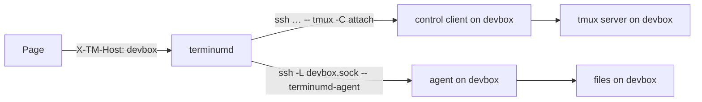
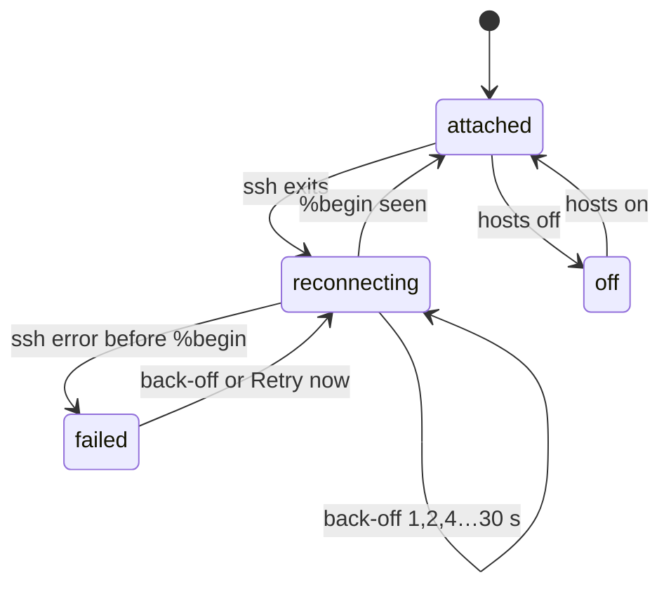

# terminum — Specification (remote hosts)

Sibling of `terminum.md` (the core). This spec holds remote hosts: their tmux sessions over ssh, their files through an agent, helpers that follow the Mac's build, and the builds and releases. Cases are AC-81…AC-87. A case of another spec is written `AC nn` (a space); `AC-nn` is this spec's own.

## 0. Metadata

| Field | Value |
|---|---|
| Version | 0.7.1 |
| Date | 2026-10-21 |
| Status | draft |
| Author | Claude (Fable 5.1) for the owner |

Change log:

| Version | Date | Change |
|---|---|---|
| 0.7.1 | 2026-10-21 | Owner, on what 0.7.0 left: a host with busybox's ps (no -U, no -p) is swept, through /proc; where tmux rewrites a client's command line (FreeBSD, OpenBSD) one of this server's socket with no terminal counts. Pragmatic review applied: no terminal read from /proc where ps cannot say (else none: kept), only this server's socket (AC-81). |
| 0.7.0 | 2026-10-21 | Owner: a Linux host (tmux 3.4) held 12 control clients of terminum's, up to 4 days old, each left by a dropped link: once ssh's end goes, tmux keeps the client's pipes and unsent output and the client never exits (`detach-client` cannot end it, a signal does). Now, once each connection of a host, terminumd ends those of its control clients there that are orphaned: their parent is init, or a shell whose parent is init. Pragmatic review applied: orphaned proved by the parent, never by the absence of sshd (Tailscale SSH, dropbear, a test's fake ssh are live without one); the shape matched by its arguments (`tmux … -C … -f ignore-size …`), not a prefix; quiet and in the background (`run-shell -b`), every failing `ps` skipping its client, a ppid that is not one number too. Owner, then: those stuck before tmux listed them are found by `ps` too (Linux names a client `tmux: client`), those whose command line tmux rewrote (FreeBSD, OpenBSD) by tmux's list (control clients with `ignore-size`); the script answers the pids it ended in a user option of the server (`@tm-orphans-<terminumd's pid>`, read and removed), so the log names exactly those; checked over real sshd and tmux 3.4, where it showed that a server started by terminum's command keeps that command line: the server's pid is never a candidate and `ps` takes only a process named `tmux: client`. Pragmatic review applied: `read -r` and a pid that is not a number skipped (a backslash ended line joined the next), a listed pid still a tmux process, shells by name (`ssh` is none), `ps -ww`, the answer option named per connection and removed before and after; the script itself run under dash, busybox ash and macOS sh against a stand-in `ps` (AC-81). |
| 0.6.0 | 2026-10-16 | Owner: OQ-81 amended: the host's other tmux sessions stay hidden unless the user attaches them by name (AC 89, `hosts.<name>.attach`); each attached session is a further ssh connection. |
| 0.5.0 | 2026-10-15 | Owner: the helper is `terminumd-agent` (was `terminusd-agent`): a host with only the old one has it started, sees its old build and replaces it (AC-84); install and removal delete the old files. |
| 0.4.0 | 2026-10-15 | Owner: Add host reads as `ssh <what you type>`; Name optional (the destination's host); "Browse its files" ticked in Add host enables files once attached (AC-81, AC-83). |
| 0.3.0 | 2026-10-15 | Owner: OQ-81 resolved: a host is one ssh string; terminumd creates the session `terminum` on the host when it is missing and holds it; windows and panes are made inside it; no session option. terminumd named. |
| 0.2.0 | 2026-10-15 | Pragmatic review: `-F` dropped from the recipe allowlist (a config file can hold ProxyCommand), a destination starting with `-` refused, the remote command quoted for the host's shell, `new-session -A` without `-D` (it would detach the host's other clients), paste on a host through the agent's file. |
| 0.1.0 | 2026-10-15 | Initial draft from iterm-enhancer 0.42 (AC 37, 38, 39, 42, 48): terminumd is the tmux control client over ssh; a host is an ssh destination the user gave terminum; the files agent as before. |

## 1. Overview

**Problem.** Work happens on remote hosts in tmux over ssh. In iterm-enhancer the host had to be found from the ssh process of an iTerm2 gateway; a dropped integration printed protocol into the terminal; reconnecting was iTerm2's.

**Who it affects.** Developers with tmux sessions on Linux and macOS hosts reached by ssh.

**Expected outcome.** A host is added once by its ssh string. terminumd attaches to its tmux in control mode over ssh, in a session `terminum` it creates when missing, shows its sessions beside the local ones, types into them, reconnects after a drop with back-off, and, once the user enables it, browses the host's files through a helper it installs itself and keeps up to date. The helper and terminumd are built for four platforms from one script and released signed.

**Scenario, before and after.**
- Before: Alex types `tms cc devbox work` in iTerm2, waits for windows to open, and after the Wi-Fi drops finds `%output` lines in a terminal.
- After: Alex adds `devbox` once in the page. Its session "terminum" is in the list in two seconds, also on the phone. After a drop the group says "reconnecting (4 s)" and comes back; nothing printed anywhere.

## 2. Scope and non-goals

In scope:
- Hosts (add, remove, reconnect), remote sessions in the list and the terminal, files through the agent, enabling a host's files, helper updates, upload to a host, builds for four platforms, signed releases on the owner's runner.

Out of scope (explicit):
- Hosts without tmux (plain ssh shells): a local pane running `ssh host` is a local pane; its files are not browsed.
- Password prompts over the control connection: ssh must authenticate without a prompt (keys, agent, ControlMaster); a host that needs one is reported.
- Mosh, et, other gateways.

## 3. Assumptions, dependencies, open questions

Assumptions:

| ID | Assumption | Owner | Status |
|---|---|---|---|
| AS-81 | `ssh -T -o BatchMode=yes <options> -- <destination> 'tmux -u -C new-session -A -f ignore-size -s terminum'` gives a control-mode client over ssh whose stdout is line-based and whose `%output` arrives within the link's latency; `pause-after` flow control (`refresh-client -f pause-after=2`) keeps a slow link from backing up. | Claude | verified 2026-10-15 with a stand-in ssh on this Mac (`scripts/fake_ssh.py`, `scripts/e2e_remote.py`); a real sshd not measured |
| AS-82 | The agent (`terminumd --agent --socket <path>`) is iterm-enhancer's `fbd --agent` moved: a Unix socket on the host, a token on stdin, exits on stdin EOF. | Claude | verified in iterm-enhancer |
| AS-83 | The hosts in the owner's use are Ubuntu and Debian x86_64 and arm64 and macOS arm64. | Owner | stated |

Dependencies:

| ID | Dependency | Owner | Status |
|---|---|---|---|
| DEP-81 | tmux ≥ 3.2 on the host (DEP 02). | Owner | available |
| DEP-82 | zig and cargo-zigbuild pinned in `./.toolchain` for Linux musl builds; the owner's self-hosted Linux runner. | Claude | available (inherited) |

Open questions:

| ID | Question | Owner | Status | Decision |
|---|---|---|---|---|
| OQ-81 | Does a host attach all its tmux sessions or one named session? | Owner | resolved | One session per host, named `terminum`: the user gives only the ssh string; terminumd runs `tmux -C new-session -A -s terminum` on the host, creating it when missing, and makes windows and panes inside it; other sessions on the host are not shown. Owner, 2026-10-15. Amended 2026-10-16: the user may attach other sessions of that tmux by name (AC 89); they are counted on the host's group, never listed or touched until attached. |
| OQ-82 | Should the files helper be installed with the host, without the Enable click? | Owner | open | Proposed: keep the click (nothing is copied to a host without it), as iterm-enhancer's AC 38. |

## 4. Acceptance cases

| ID | Priority | Case |
|---|---|---|
| AC-81 | [MUST / P0] | The user adds a host by its ssh string and sees its `terminum` session in the list within 5 s, opens and types into its panes, and after a dropped link the host reconnects with back-off and says so; nothing is printed into any terminal. |
| AC-82 | [SHOULD / P1] | The user browses, reads, edits, creates, renames and trashes a host's files as if local, with live refresh, once the host's files are enabled. |
| AC-83 | [SHOULD / P1] | The user enables a host's files with one click the first time its pane is shown; nothing is installed on a host without that click; a host's helper can be removed with one action. |
| AC-84 | [SHOULD / P1] | After the Mac's terminum is upgraded, the helper on every attached host follows by itself and the page says so. |
| AC-85 | [SHOULD / P1] | Pasted images and uploaded files reach a host's pane as paths on that host. |
| AC-86 | [SHOULD / P1] | The maintainer builds terminumd for macOS arm64 and x86_64 and Linux x86_64 and arm64 the same way on the Mac and on the owner's runner, and publishes signed releases from the Mac. |
| AC-87 | [SHOULD / P1] | Hosts are their ssh destinations: two hosts reporting the same name are two hosts; a host's identity and options live in settings and the `terminum hosts` command manages them. |

## 5. BDD scenarios

### AC-81 — A host's tmux sessions [MUST / P0]

```gherkin
Scenario: AC-81 happy path — add a host
  When the user presses "Add host" under the session list and types "alex@devbox.example -p 2222" after its "ssh" label (what follows `ssh` in a shell: a Host of ~/.ssh/config as is, a leading "ssh" dropped) and leaves Name empty (or runs "terminum hosts add devbox 'alex@devbox.example -p 2222'")
  Then terminumd records it in settings.json hosts (destination and allowlisted options: -p, -l, -i, -J, -4, -6, -C; anything else refused with "option not allowed: -o" (also -F: a config file can hold ProxyCommand); a destination starting with "-" refused), starts "ssh -T -o BatchMode=yes -o ServerAliveInterval=15 -o ServerAliveCountMax=2 -p 2222 -- alex@devbox.example 'tmux -u -C new-session -A -f ignore-size -s terminum'" (`--` before the destination: ssh reads everything after the destination as the command) (the remote command quoted for the host's shell; -A creates the session when missing and attaches otherwise, without -D, so the host's other clients stay attached) and within 5 s the list shows the group "devbox" in cornflower blue with the windows and panes of that session, every row naming the host in violet; other sessions on the host are not shown until the user attaches them by name (OQ-81, AC 89)
  And an empty Name is the destination's host ("alex@devbox.example" → "devbox", "10.0.0.5" as is); a name so made that another host has is refused with "devbox is already a host: give this one a name"; a typed Name of an existing host replaces its recipe
  And [+] on the group, splits and "New session" make windows and panes inside "terminum" on the host (AC 07)
  And opening a pane, typing, Screen mode, sizing, widgets, bookmarks and search work as for a local pane; the key is "tmux:devbox:default:%N"

Scenario: AC-81 happy path — the link drops and comes back
  When the network drops
  Then within 20 s (ServerAliveInterval × 2) the control client ends, the group "devbox" says "reconnecting (2 s)" on a line of its own under its name (a long state wraps there, never cut), a shown pane keeps its last screen with "Connection to devbox lost" over it, typing is refused with that message; terminumd reconnects after 1, 2, 4 … 30 s
  When ssh succeeds again
  Then the group is back within 5 s, the shown pane's screen is captured anew (its history too), and the notice goes; the tmux session on the host never noticed

Scenario: AC-81 edge — a dropped link left its control client on the host
  Given the link dropped while the host stayed up, and the host's tmux kept terminum's control client of it ("tmux -u -C new-session -A -f ignore-size -s terminum", its ssh end gone, its parent now init)
  When terminumd connects to the host again
  Then it ends that client (SIGTERM; detach-client cannot) once for that connection, logged as event=clients.orphans with exactly the pids ended; terminum's clients are those tmux lists as control clients with ignore-size (still a tmux process: a pid not reused), and (Linux) the user's processes named "tmux: client" with terminum's command line, also one stuck before tmux listed it
  And where tmux rewrote a client's command line (FreeBSD, OpenBSD: "tmux: client (<socket>)") one of this server's socket with no terminal counts too (an interactive client has one; a command's or another program's control client of this server left orphaned is ended as well, an accepted risk); on a host whose ps cannot say (busybox: no -U, no -p) processes, their names, parents and terminals are read from /proc
  And the tmux server is never one, though a server terminum's command started keeps that command line; a control client whose parent lives (this connection's, another Mac's, through any ssh server), one of another shape, one under a subreaper are left alone; a read that fails leaves its process

Scenario: AC-81 edge — the pane's folder and programs
  Then a remote pane's folder is the host's path (for Files and "cd"); the program is #{pane_current_command} on the host; the agent state is read from its screen as locally

Scenario: AC-81 failure — ssh fails
  When ssh exits before "%begin" (unknown host key, a password needed, tmux missing on the host)
  Then the group "devbox" shows ssh's last line under its name, wrapped in full and in the error color (BatchMode: "Permission denied (publickey)", "tmux: command not found"), nothing is retried faster than the back-off, and the log has ssh's full output; "Retry now" in the group's menu retries at once; while the host is not attached (connecting, reconnecting, failed, off) its group has no "+ New window": there is no tmux to make it in
```

### AC-82 — Files on a host [SHOULD / P1]

```gherkin
Scenario: AC-82 happy path — browse and edit
  Given devbox's files are enabled (AC-83) and the page shows its pane in "/home/alex/api"
  Then terminumd runs "ssh devbox -L <app>/agents/devbox.sock:<remote socket> -- ~/.terminum/bin/terminumd-agent --agent --socket <remote socket>" (one per host, token on stdin, back-off 1, 2, 4 … 30 s), and within 3 s Files shows "devbox:/home/alex/api" with a green dot
  And expanding, opening, editing, saving, creating, renaming and trashing work as locally (AC 52–AC 59): every request carries X-TM-Host: devbox and goes to that host's agent unchanged (token and Host replaced, Origin dropped), never to a local file; a change on the host shows within 2 s
  And "Reveal in Finder" and "Open with default app" are not offered; terminumd refuses them with "Not available for remote files"; a local and a remote file with one path never share a tab

Scenario: AC-82 edge — the agent connection drops, an older agent
  When the ssh of the agent closes
  Then the agent exits (stdin closed), the dot turns amber, terminumd reconnects with back-off; unsaved edits stay; a save meanwhile fails with "Not saved: devbox not reachable — save again"
  When the agent reports an agent id other than terminumd's
  Then terminumd installs the matching agent from the running build (AC-84) and reconnects; a build without an agent for that platform says "helper outdated · terminum hosts enable devbox"

Scenario: AC-82 failure — the agent stalls or answers badly
  Then a request that gets no bytes for 30 s, or no end within 120 s, fails and frees its connection; bodies are capped at 64 MB; a lagged event stream reconnects with a host-scoped rescan; a dialog answered after the page switched hosts does nothing ("The panel switched to another pane — nothing changed"); a document saves to the host it came from

Scenario: AC-82 security — the agent
  Then the agent listens only on a Unix socket with a random name in a 0700 folder on the host (removed on exit), takes its token on stdin (never a command line), exits on stdin EOF or SIGHUP, writes only under $HOME and /tmp on the host; on the Mac the forwarded socket is in the app folder (0700) and only terminumd connects to it; answers are untrusted (capped, streamed, Origin not forwarded)
```

### AC-83 — Enable a host's files [SHOULD / P1]

```gherkin
Scenario: AC-83 happy path — first time
  Given devbox is attached and its files never enabled or declined
  When the page shows a pane of devbox and the user opens Files
  Then Files says "devbox is a remote host. Browse its files? This copies a 6 MB helper to ~/.terminum/bin on devbox." with [Enable] and [Not now]
  When the user clicks Enable
  Then terminumd reads the platform over the host's ssh recipe, copies the agent the package carries for it to "~/.terminum/bin/terminumd-agent-<agent id>", links "~/.terminum/bin/terminumd-agent" to it, checks it through a trial tunnel, records "files": "enabled" in settings.json, and Files shows the host's folder within seconds; the agent logs to "~/.terminum/logs/agent.log" on the host (1 MB, one older kept)

Scenario: AC-83 happy path — ticked in Add host
  When the user ticks "Browse its files" in Add host (the tick is the click)
  Then "files": "wanted" is recorded, Files shows "Setting up…" instead of the question, and once the host is attached terminumd enables it as Enable does; at success "files": "enabled"
  When that enabling fails
  Then "wanted" is cleared, and Files shows the question with the reason; Enable tries again

Scenario: AC-83 edge — Not now, remove, later
  When the user clicks Not now
  Then "files": "declined" is recorded and the question is not asked again; Files' menu ("Browse files of devbox…") or "terminum hosts enable devbox" enables it any time
  When the user picks "Remove helper from devbox" or runs "terminum hosts files-remove devbox"
  Then the connection closes, "bin/terminumd-agent*" and "logs/agent.log*" are removed from the host's ~/.terminum (the folder when empty; a Mac host keeps its own install), and "files" is cleared
  And an enabled host asks nothing later, also after an upgrade (the agent is updated, AC-84)

Scenario: AC-83 failure — the host cannot take it
  When ssh fails, the platform has no agent in the package, the copy or the probe times out
  Then Files shows ssh's message or "no helper for <system>", nothing is recorded as enabled, and Enable can be tried again; concurrent enables, removes and updates keep every other host's record
```

### AC-84 — Helpers follow the Mac's build [SHOULD / P1]

```gherkin
Scenario: AC-84 happy path — after an upgrade
  Given devbox's files are enabled and its helper is of another build
  When terminumd starts after an upgrade, or devbox attaches
  Then within 30 s, without the user opening Files, terminumd copies the helper of its build over the host's ssh and connects to it; Files on a devbox pane says "updating the helper on devbox…", then a toast "Helper on devbox updated to <build>" and "(helper updated to <build>)" in the header for 60 s

Scenario: AC-84 edge — the same build, two Macs
  Then nothing is copied and no message shows when the helper is current; two Macs of different builds each run their own build's helper on one host (named by agent id) and neither copies again on every connect

Scenario: AC-84 failure — the update fails
  When the copy fails (ssh refused, disk full)
  Then Files says "Could not update the helper on devbox: <reason>", the host's files stay down, and terminumd tries again after 10 minutes or at its next start
```

### AC-85 — Paste and upload to a host [SHOULD / P1]

```gherkin
Scenario: AC-85 happy path — an image into a remote pane
  Given the page shows a devbox pane whose files are enabled
  When the user pastes an image
  Then terminumd writes it through the agent to "~/.terminum/tmp/<utc>-<8 hex>.png" on devbox (0700, 0600) and the page pastes that path quoted, no Enter (AC 36)

Scenario: AC-85 failure — not enabled or too slow
  When devbox's files are not enabled
  Then nothing is typed and the toast says "Enable the files of devbox in Files to paste there"
  When the agent does not take the bytes within 30 s plus 1 s per 256 KB
  Then nothing is typed, the toast says why, and no partial file is left under the name
```

### AC-86 — Builds and releases [SHOULD / P1]

```gherkin
Scenario: AC-86 happy path — build on the Mac and on the runner
  When the maintainer runs "make agents"
  Then the pinned toolchain (zig, cargo-zigbuild in ./.toolchain) builds terminumd for aarch64-apple-darwin, x86_64-apple-darwin, x86_64-unknown-linux-musl, aarch64-unknown-linux-musl (static Linux builds); the same script runs read-only on the owner's self-hosted runner for the Linux pair on a tag
  And the package "terminum-macos.tar.gz" holds terminumd for the four targets (the Mac's chosen at install), the installer and the command

Scenario: AC-86 security — signed releases, a public repository
  When the maintainer runs "make release TAG=vX.Y.Z" (only on their request, CLAUDE.md §10)
  Then it refuses unless the tree is clean, the version is above every v* tag and HEAD is origin/main; builds with "npm ci" and "cargo --locked"; signs SHA256SUMS through ssh-agent with the release key (loaded 2 minutes, passphrase from the login Keychain, never prompting); only then tags, pushes the tag and publishes a draft once complete; release notes come from "docs/releases/vX.Y.Z.md" (refused when empty, unreadable or a symlink out of the tree)
  And workflows run only on pushes to main, tags and manual dispatch, read-only, actions pinned; fork pull requests need approval; install.sh and "terminum upgrade" verify the signature with the key they carry before the checksum, and an older signed manifest never replaces a newer install

Scenario: AC-86 failure — a build or check fails
  Then nothing public is made; the command exits non-zero with the step that failed
```

### AC-87 — Hosts are ssh destinations [SHOULD / P1]

```gherkin
Scenario: AC-87 happy path — the command and the file
  When the user runs "terminum hosts"
  Then it lists each host: name, destination, options, "attached"/"reconnecting"/"off", files enabled or not, helper build; "hosts add", "hosts remove <name>", "hosts enable|files-remove <name>", "hosts off|on <name>" (detach without removing) change settings.json and take effect within 2 s

Scenario: AC-87 edge — same name, different hosts
  Given "vm1" and "vm2" both report the host name "ubuntu"
  Then they are two hosts with their own records, agents and keys ("tmux:vm1:…", "tmux:vm2:…"); "ubuntu" only labels them

Scenario: AC-87 failure — a bad record
  Given settings.json names a host with an option not allowed or a destination with control characters
  Then the host is not started, the list shows it with "settings.json: option not allowed: -o" and the other hosts run
```

## 6. Flow and sequence diagrams

### A host's two connections (AC-81, AC-82)



Terminals and files are separate ssh processes: the control client exists for every attached host; the agent only once files are enabled (AC-83).

### Reconnect (AC-81)



A shown pane keeps its last screen while reconnecting; typing is refused with the reason.

## 7. Current behavior and gaps

| AC | Today (iterm-enhancer 0.42) | Gap | Evidence |
|---|---|---|---|
| AC-81 | iTerm2 is the -CC client through a gateway session; the bridge sniffs the ssh argv. | terminumd runs ssh and tmux -C itself; a hosts record. | `iterm-enhancer/bridge/fbbridge/resolve.py:18`, `tmuxwatch.py:1` |
| AC-82 | fbd proxies to the agent over a forwarded socket. | Moved into terminumd. | `iterm-enhancer/fbd/src/remote.rs:1`, `fbd/src/agent.rs:1` |
| AC-83 | Enable from the panel; `agentctl.py`. | Port to Rust in terminumd. | `iterm-enhancer/bridge/fbbridge/agentctl.py:1`, `ui/src/host-offer.ts:1` |
| AC-84 | Sweep every 30 s in the bridge. | Port. | `iterm-enhancer/bridge/fbbridge/remote.py:1` |
| AC-85 | `paste.py` saves through a remote script over ssh. | Through the agent's API. | `iterm-enhancer/bridge/fbbridge/web/paste.py:85` |
| AC-86 | `scripts/agents.py`, `release.py`, the runner workflows. | Rename. | `iterm-enhancer/scripts/agents.py:1`, `release.py:1` |
| AC-87 | Hosts keyed by ssh args in `agents.json`. | `settings.json` hosts; a CLI. | `iterm-enhancer/bridge/fbbridge/hosts.py:1` |

## 8. Recommendation and ownership

**Recommended approach.** terminumd owns both ssh processes per host (control client and agent tunnel), both from the same allowlisted recipe; the agent is terminumd itself in agent mode; the page needs no notion of a gateway. Identity is the record's name; the recipe is checked before any shell sees it.

**Rejected alternative.** One ssh with the agent multiplexed over the control channel — rejected because tmux's control protocol is line-based text and file bodies would need their own framing; two ssh processes with ControlMaster share one connection anyway.

| Part | Owner |
|---|---|
| terminumd hosts, control clients over ssh, agent tunnel | Claude |
| Builds, runner, releases | Claude (maintainer runs releases) |
| Acceptance on the owner's hosts | Owner |

## 9. Technical details and specifications

### Interfaces

`terminum hosts add [<name>] '<destination and options>' [--files]`, `hosts remove|enable|files-remove|off|on <name>`, `hosts` (list). Page messages: `addhost {name, recipe, files}` (an empty name: the destination's host; answered `hostadded {name}` or `error`), `hostaction {name, action}`; the layout carries `host` per group and `state: attached|reconnecting|failed|off`, `files: enabled|declined|wanted|null`.

Control client command: `ssh -T -o BatchMode=yes -o ServerAliveInterval=15 -o ServerAliveCountMax=2 <options> -- <destination> '<remote command>'` where the remote command is `tmux -u -C new-session -A -f ignore-size -s terminum`; `refresh-client -f pause-after=2` after attach.

### Data formats

```json
{"hosts": {"devbox": {"ssh": ["-p", "2222", "alex@devbox.example"], "files": "enabled",
  "helper": "a1b2c3d4e5f6", "theme": "remote"}}}
```

### Configuration

| Key | Default | Example | Effect |
|---|---|---|---|
| `hosts.<name>.ssh` | — | `["-J", "bastion", "alex@devbox.example"]` | recipe (allowlist) |
| `hosts.<name>.attach` | `[]` | `["work"]` | sessions of the host's tmux attached by name (AC 89), each over its own ssh connection |
| `hosts.<name>.files` | `null` | `enabled` | files helper state: `enabled`, `declined`, `wanted` (ticked in Add host, until set up) or `null` |
| `TM_SSH` | `ssh` | `/opt/homebrew/bin/ssh` | the ssh binary |

### Performance

| Operation | Target | Measured by |
|---|---|---|
| Host attach to list | < 5 s | `scripts/e2e_remote.py` |
| Key echo over a LAN host | p50 < 60 ms | `scripts/bench_echo.py --host` |
| Remote file open | < 500 ms | `scripts/e2e_remote.py` |

### Constraints and limits

| Limit | Value | When exceeded |
|---|---|---|
| Hosts | 32 | "At most 32 hosts" |
| Reconnect back-off | 1, 2, 4 … 30 s | — |
| ssh connections per host | 1 + one per attached session (AC 89) + the files tunnel | sessions start one at a time, back-off 1 … 30 s each |
| Agent answers | 64 MB; 30 s idle, 120 s total | request fails, connection freed |
| Helper copy | 60 s | failure shown, retry later |

### Security

The recipe allowlist (no `-o`, no `-F`, no destination starting with `-`, no remote command but tmux or the agent, each shell-quoted for the host; `BatchMode=yes`, `RemoteCommand=none` for the agent tunnel); a host is its record, never a name it reports; the agent's token on stdin; on a host terminumd ends only the user's orphaned tmux control clients (AC-81: listed by that tmux with `ignore-size` and still a tmux process, or on Linux named `tmux: client` with terminum's command line; a parent that is init or a shell of init's; never the server; one with `ignore-size` that init runs on purpose is taken for one, an accepted risk); answers untrusted; nothing copied to a host before Enable; releases signed on the Mac only; a host's other sessions are never typed into or sized until the user attaches them (AC 89), attached by session id with `-E` (no name in the host's shell, no environment copied into them). Denied: `terminum hosts add x 'alex@h -o ProxyCommand=…'` → `option not allowed: -o`.

### Compatibility

`agents.json` of iterm-enhancer is imported by `terminum import` as hosts with `files: enabled`; tmux keys `tmux-remote:<dest>:…` become `tmux:<name>:…`.

### Logging and observability

```text
2026-10-15T10:01:02.300Z level=info event=host.attached host=devbox sessions=1 panes=8 ms=1840
2026-10-15T10:07:44.010Z level=warn event=host.lost host=devbox reason="ssh exited 255" retry_s=2
```

| Metric | Type | Alert when |
|---|---|---|
| `hosts_attached` | gauge | fewer than configured for 5 min |
| `host_reconnects` | counter | > 10 an hour |

## 10. Delivery stages

| Stage | Cases | What a user can do once it ships | Effort |
|---|---|---|---|
| Stage 1 (fast lane) | AC-81 | Add a host and work in its tmux sessions from every client; survive drops | — |
| Stage 2 | AC-82, AC-83, AC-87 | Browse and edit a host's files after one click; manage hosts | — |
| Stage 3 | AC-84, AC-85, AC-86 | Helpers follow upgrades; paste to a host; releases for four platforms | — |

## 11. Checklist with Definition of Done

Evidence of 2026-10-15: `scripts/e2e_remote.py` runs a private terminumd whose ssh is `scripts/fake_ssh.py` (this Mac plays the host with a private tmux server and a fake home; no sshd here) → 18/18.

- [x] AC-81 — `scripts/e2e_remote.py` (add, list within 5 s, type, a dropped link reconnecting, typing after, a failing ssh's words) → pass; `scripts/e2e_remote_sshd.py` against a Linux container (Alpine, OpenSSH, tmux 3.4) over real ssh: the session listed in 0.1 s, typing, a killed sshd session reconnecting → pass.
- [x] AC-81 orphans (2026-10-21) — `scripts/e2e_hostattach.py` through `scripts/fake_ssh.py` (macOS: tmux's list): on reconnect, orphaned control clients of terminum's (init's child, a shell's of init's, one of another command line that tmux lists with ignore-size) are ended and the log names exactly them; one of another shape and a live one of terminum's shape under a living parent are left; the answer option is removed; terminumd's new clients type on; `scripts/e2e_remote_sshd.py` (Alpine, OpenSSH 9.7, tmux 3.4, procps): a client planted under a shell of init's is ended after the sshd session is killed and logged as `ended=[<its pid>]`, the server started by terminum's command keeps its pid (a first version that matched `ps` by command line alone ended it: caught here, never installed); `cargo test tmux::orphans` (the script run by /bin/sh against a stand-in `ps`: ended only init's orphan, one under a shell of init's and a listed one whose command line tmux rewrote; left the server, clients under sshd, ssh or a living shell, a listed pid now another program, a line a backslash ends, a pid not a number; the same under dash and busybox ash in containers); dry runs on a Linux host (tmux 3.4, dash, procps): the first version chose exactly its 8 clients of parent init and left the 2 under sshd, the last chose none with only live clients and the server there → pass.
- [x] AC-82 — `cargo test remote::` and `scripts/e2e_remote.py` (listing and reading through the agent, Finder refused) → pass.
- [x] AC-83 — `scripts/e2e_remote.py` (enable copies the helper, remove takes it off) → pass; `scripts/e2e_remote_sshd.py`: the static linux-aarch64 helper copied, the host's home listed and a file read through it, removed → pass.
- [x] AC-84 — `scripts/e2e_remote_sshd.py`: a helper answering another agent id is replaced by this build's at terminumd's next start (1.1 s), the panel's state says `updated` with the build, the host's record names the helper → pass. The 10-minute retry after a failed copy is not exercised.
- [x] AC-85 — `scripts/e2e_remote.py` (a pasted image saved on the host) → pass.
- [ ] AC-86 — `make package` builds macOS arm64 and x86_64; the Linux pair builds with the pinned toolchain (`scripts/agents.py build linux-aarch64 linux-x86_64`, static musl ELF); `scripts/tests/test_release.py` covers the refusals.
- [x] AC-87 — `cargo test hosts::` (allowlist, names) and `scripts/e2e_remote.py` (refusal, record, removal) → pass.
- [x] AC-81 orphans 0.7.1 (2026-10-21) — `scripts/e2e_remote_sshd.py` with procps and with `TM_SSHD_BUSYBOX=1` (busybox's ps only): the planted orphan is ended and logged, the server keeps its pid, 13/13 each; the script run in an Alpine container with busybox against a real orphan: `KILL` of exactly it; `cargo test tmux::orphans` (a BSD client of no terminal ended, one with a terminal left; a ps that fails gives way to /proc and, with none, ends nothing) → pass. A FreeBSD or OpenBSD host itself was not tried: its ps is a stand-in in the test.
