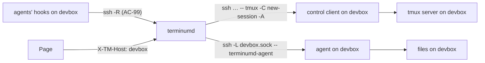
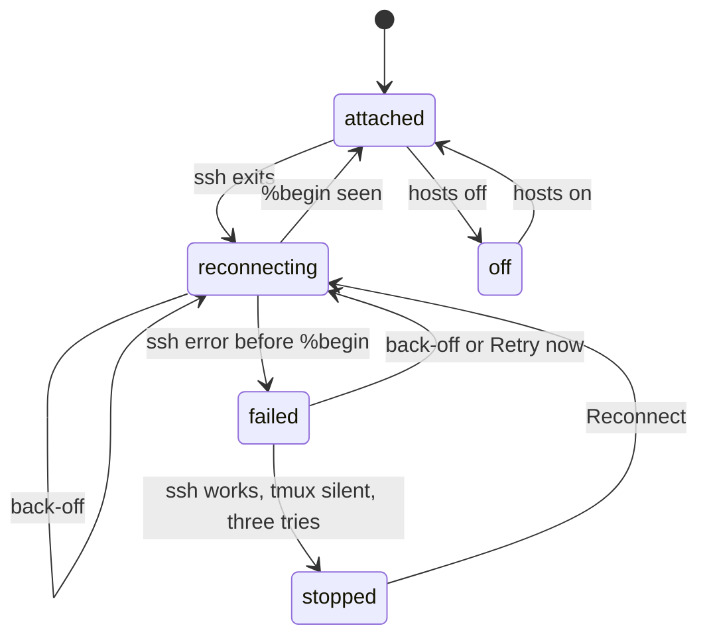

# terminum — Specification (remote hosts)

Sibling of `terminum.md` (the core). This spec holds remote hosts: their tmux sessions over ssh, their files through an agent, helpers that follow the Mac's build, and the builds and releases. Cases are AC-81…AC-87 and AC-99.

## 0. Metadata

| Field | Value |
|---|---|
| Status | current |

A snapshot of what terminum must do, not a record of how it came to be: git holds that.

## 1. Overview

**Problem.** Work happens in tmux on remote hosts reached by ssh. The user wants those terminals and files in the same page as local ones, through dropped links, with no protocol text ever printed into a terminal.

**Who it affects.** Developers with tmux sessions on Linux and macOS hosts reached by ssh.

**Expected outcome.** A host is added once by its ssh string. terminumd attaches to its tmux in control mode over ssh, in a session `terminum` it creates when missing, shows its sessions beside the local ones, types into them and reconnects after a drop with back-off. Once the user enables them, the host's files are browsed through a helper terminumd installs and keeps up to date, and coding agents on the host report to the page. The helper and terminumd are built for four platforms from one script and released signed.

**Scenario.** Alex adds `devbox` once in the page. Its session `terminum` is in the list, also on the phone. After a drop the group says it is reconnecting and comes back; nothing is printed anywhere.

## 2. Scope and non-goals

In scope:
- Hosts (add, remove, reconnect), remote sessions in the list and the terminal, files through the agent, enabling a host's files, helper updates, upload to a host, coding agents' progress on a host, builds for four platforms, signed releases from the Mac.

Out of scope (explicit):
- Hosts without tmux (plain ssh shells): a local pane running `ssh host` is a local pane; its files are not browsed.
- Password prompts over the control connection: ssh must authenticate without a prompt (keys, agent, ControlMaster); a host that needs one is reported.
- Mosh, et, other gateways.
- Accounts under rbash or a ForceCommand: not supported; AC-99 says why when no ready line comes.

## 3. Assumptions, dependencies, open questions

Assumptions:

| ID | Assumption | Owner | Status |
|---|---|---|---|
| AS-81 | `ssh -T -o BatchMode=yes <options> -- <destination> 'tmux -u -C new-session -A -f ignore-size -s terminum'` gives a control-mode client over ssh whose stdout is line-based and whose `%output` arrives within the link's latency; `pause-after` flow control (`refresh-client -f pause-after=2`) keeps a slow link from backing up. | Claude | verified with `scripts/fake_ssh.py` (`scripts/e2e_remote.py`) and over a real sshd (`scripts/e2e_remote_sshd.py`) |
| AS-82 | The agent (`terminumd --agent --socket <path>`) serves a Unix socket on the host, takes its token on stdin and exits on stdin EOF. | Claude | verified over a real sshd (`scripts/e2e_remote_sshd.py`) |
| AS-83 | The hosts in the owner's use are Ubuntu and Debian x86_64 and arm64 and macOS arm64. | Owner | stated |
| AS-84 | OpenSSH's `-R <host path>:<Mac path>` (AC-99): (a) every refusal (`AllowStreamLocalForwarding no`, `DisableForwarding yes`, Alpine's stock `AllowTcpForwarding no`, a missing folder, a stale file) prints the same line: with `ExitOnForwardFailure=no` `Warning: remote port forwarding failed for listen path <path>` (hidden by `LogLevel=ERROR`), exit 0, the command runs; with `=yes` `Error: …`, exit 255, the command never runs; the client cannot tell them apart, so the helper checks its `--link` socket itself; `DisableForwarding yes` also refuses the Files tunnel's own `-L` (Files fail with it), and `AllowStreamLocalForwarding no` forbids both directions by sshd's definition, so only a refusal of `-R` alone (`AllowStreamLocalForwarding local`) keeps Files working; (b) sshd binds the socket (0600, the user's) before the remote command starts (10 of 10 also with `=no`), never creates its folder, and leaves the file after the connection ends; (c) a stale file is refused (sshd: `Address in use`) and the client's `StreamLocalBindUnlink=yes` does not help: a fresh random name per connection; (d) `-o ControlPath=none` makes no mux master, yet a user config's `RemoteForward` still applies and, failing on the second login, ends the ssh under `ExitOnForwardFailure=yes` (hence `=no`); a mux client's `-R` outlives the client under ControlPersist; a user ControlPath of 104 bytes or more fails the ssh; `ClearAllForwardings=yes` drops the command line's `-R` too (never used); (e) the Mac-side target needs a `/` (a bare name: `Bad remote forwarding specification`, exit 255) and at most 104 bytes; a request takes about 0.7–1.0 ms on loopback; (f) a login shell's rc output (lines above the interactive guard of Debian's `.bashrc`) precedes the command's stdout, `exec /bin/sh -c` included, and `-tt` adds `\r` to each line: output is read after a marker line. Dropbear has no stream-local forwarding, so it refuses Files' `-L` as well as `-R`. | Claude | verified against real sshd: OpenSSH 9.7p1 (Alpine 3.20) and 9.2p1 (Debian 12), client OpenSSH 9.9p2 (macOS); the `-L` refusal under `DisableForwarding yes` seen (`scripts/e2e_remote_sshd_agents.py`, Alpine: Files "unreachable", connection closed); Dropbear not tested; a macOS host's sshd not verified (Remote Login off on the Mac at hand) |
| AS-85 | A control client of a newer tmux than its running server may get no answer at all while plain commands work (client 3.8, server 3.4): a new binary needs that server restarted. | Owner | measured |

Dependencies:

| ID | Dependency | Owner | Status |
|---|---|---|---|
| DEP-81 | tmux ≥ 3.2 on the host (DEP 02); before 3.6 every `capture-pane -p` from a control client leaks its whole buffer, about 1 GB a day on a busy host, so 3.6 or newer is wanted. Only a server restart gives that memory back. | Owner | available |
| DEP-82 | zig and cargo-zigbuild pinned by `scripts/agents.py` in `./.toolchain` for Linux musl builds; the owner's self-hosted Linux runner for CI. | Claude | available |

Open questions:

| ID | Question | Owner | Status | Decision |
|---|---|---|---|---|
| OQ-81 | Does a host attach all its tmux sessions or one named session? | Owner | resolved | One session per host, named `terminum` (AC-81): the user gives only the ssh string. The user may attach other sessions of that tmux by name (AC-89); they are counted on the host's group, never listed or touched until attached. |
| OQ-82 | Should the files helper be installed with the host, without the Enable click? | Owner | open | Proposed: keep the click or the tick in Add host (nothing is copied to a host without one), as shipped. |

## 4. Acceptance cases

| ID | Priority | Case |
|---|---|---|
| AC-81 | [MUST / P0] | The user adds a host by its ssh string and sees its `terminum` session in the list within 5 s, opens and types into its panes, and after a dropped link the host reconnects with back-off and says so; when ssh works and its tmux does not answer it stops after three tries, says why and offers Reconnect; nothing is printed into any terminal. |
| AC-82 | [SHOULD / P1] | The user browses, reads, edits, creates, renames and trashes a host's files as if local, with live refresh, once the host's files are enabled. |
| AC-83 | [SHOULD / P1] | A host's files are set up by themselves once it attaches, with no question: adding the host is the consent; a failure is said with why and tried again; a host's helper can be removed with one action, and what the user turned off stays off. |
| AC-84 | [SHOULD / P1] | After the Mac's terminum is upgraded, the helper on every attached host follows by itself and the page says so. |
| AC-85 | [SHOULD / P1] | Pasted images and uploaded files reach a host's pane as paths on that host. |
| AC-86 | [SHOULD / P1] | The maintainer builds terminumd for macOS arm64 and x86_64 and Linux x86_64 and arm64 with one script and publishes signed releases from the Mac, while every push is tested on the owner's runner. |
| AC-87 | [SHOULD / P1] | Hosts are their ssh destinations: two hosts reporting the same name are two hosts; a host's identity and options live in settings and the `terminum hosts` command manages them. |
| AC-99 | [SHOULD / P1] | Once a host attaches, coding agents' progress is turned on there by itself, unless the user turned it off for that host: Claude Code and Codex in that host's tmux report status and plans to the host's rows and the Plan pane as local panes do (AC-97), and use their project's tasks (terminum-kanban.md AC-120); a host that cannot forward says why and keeps its files. |
| AC-132 | [MUST / P0] | One tmux server's hang or slow link never slows another server's list, screens, typing or actions; a slow link is not cut while bytes arrive, and it carries less. |

## 5. BDD scenarios

### AC-81 — A host's tmux sessions [MUST / P0]

```gherkin
Scenario: AC-81 happy path — add a host
  When the user presses "Add host" under the session list and types "alex@devbox.example -p 2222" after its "ssh" label (what follows `ssh` in a shell: a Host of ~/.ssh/config as is, a leading "ssh" dropped) and leaves Name empty (or runs "terminum hosts add devbox 'alex@devbox.example -p 2222'")
  Then terminumd records it in settings.json hosts (destination and allowlisted options: -p, -l, -i, -J, -4, -6, -C; anything else refused with "option not allowed: -o" (also -F: a config file can hold ProxyCommand); a destination starting with "-" refused), starts "ssh -T -o BatchMode=yes -o ServerAliveInterval=15 -o ServerAliveCountMax=2 -o ConnectTimeout=10 -p 2222 -- alex@devbox.example 'tmux -u -C new-session -A -f ignore-size -s terminum'" (`--` before the destination: ssh reads everything after the destination as the command) (the remote command quoted for the host's shell; -A creates the session when missing and attaches otherwise, without -D, so the host's other clients stay attached) and within 5 s the list shows the group "devbox" in cornflower blue with the windows and panes of that session, every row naming the host in violet; other sessions on the host are not shown until the user attaches them by name (OQ-81, AC-89)
  And an empty Name is the destination's host ("alex@devbox.example" → "devbox", "192.0.2.5" as is); a name so made that another host has is refused with "devbox is already a host: give this one a name"; a typed Name of an existing host replaces its recipe
  And [+] on the group, splits and "New session" make windows and panes inside "terminum" on the host (AC-07)
  And opening a pane, typing, Screen mode, sizing, widgets, bookmarks and search work as for a local pane; the key is "tmux:devbox:default:%N"

Scenario: AC-81 happy path — the link drops and comes back
  When the network drops
  Then within about 30 s (ssh's ServerAliveInterval 15 s × ServerAliveCountMax 2 unanswered) the control client ends, the group "devbox" says "reconnecting (2 s)" on a line of its own under its name (a long state wraps there, never cut), a shown pane keeps its last screen with "Connection to devbox lost" over it, typing is refused with that message; terminumd reconnects after 1, 2, 4 … 30 s
  And the group's rows stay in the list where they were, dimmed, with no agent state, until the host answers or is turned off or removed, its state "failed" too; a shown pane is never left for another
  When ssh succeeds again
  Then the group is back within 5 s, the shown pane's screen is captured anew (its history too), and the notice goes; the tmux session on the host never noticed

Scenario: AC-81 failure — ssh works, tmux does not answer
  Given a control client over ssh gets no answer, and a plain "tmux -V" over the same ssh does
  When that happens three times in a row
  Then terminumd stops trying (`host.stopped`) and ends the orphaned control clients those tries left (the next scenario's rule): a try costs the host a client, unlike a network that is down, which goes on with back-off
  And the group says why under its name, with its versions when they differ ("tmux on devbox does not answer: its client is 3.8, its running server 3.4. Restart its server, or bring that version back."), its rows stay dimmed, and it has a [Reconnect] button
  When the user presses [Reconnect] (or "Retry now", or runs "terminum hosts retry devbox")
  Then one try is made: it attaches, and tries start from none again; or it says so and waits for the button again

Scenario: AC-81 edge — a dropped link left its control client on the host
  Given the link dropped while the host stayed up, and the host's tmux kept terminum's control client of it ("tmux -u -C new-session -A -f ignore-size -s terminum", or "attach-session -E -f ignore-size -t <session>" for a session attached by name, its ssh end gone, its parent now init)
  When terminumd connects to the host again (also through a host record replaced by a new one, AC-87: another connection)
  Then it ends that client, also one whose parent is a shell of init's (SIGTERM; detach-client cannot), once for that connection, logged as event=clients.orphans with exactly the pids ended (the script answers in a server option named at random for that sweep); terminum's clients are those tmux lists as control clients with ignore-size (still a tmux process: a pid not reused), and (Linux) the user's processes named "tmux: client" with terminum's command line, also one stuck before tmux listed it
  And where tmux rewrote a client's command line (FreeBSD, OpenBSD: "tmux: client (<socket>)") one of this server's socket with no terminal counts too (an interactive client has one; a command's or another program's control client of this server left orphaned is ended as well, an accepted risk); on a host whose ps cannot say (busybox: no -U, no -p) processes, their names, parents and terminals are read from /proc
  And the tmux server is never one, though a server terminum's command started keeps that command line; a control client whose parent lives (this connection's, another Mac's, through any ssh server), one of another shape, one under a subreaper are left alone; a read that fails leaves its process

Scenario: AC-81 edge — the pane's folder and programs
  Given a pane of devbox
  Then a remote pane's folder is the host's path (for Files and "cd"); the program is #{pane_current_command} on the host; the agent state is read from its screen as locally

Scenario: AC-81 failure — ssh fails
  When ssh exits before "%begin" (unknown host key, a password needed, tmux missing on the host), or the host's sshd sends no banner within ssh's 10 s (`ConnectTimeout`, unless ~/.ssh/config sets one for that host: "Connection timed out during banner exchange"; ssh ending before tmux answered with nothing said: "ssh: no answer from the host"; with no %exit, ssh's words on stderr are waited for up to 1 s after stdout ends, so a reason arriving late is still the one shown)
  Then the group "devbox" shows ssh's last line under its name, wrapped in full and in the error color (BatchMode: "Permission denied (publickey)", "tmux: command not found"), nothing is retried faster than the back-off, and the log has ssh's full output; "Retry now" in the group's menu retries at once (the menu opens under its button, above it where the window ends first, always whole inside the window); while the host is not attached (connecting, reconnecting, failed, off) its group has no new-window button: there is no tmux to make it in
```

### AC-82 — Files on a host [SHOULD / P1]

```gherkin
Scenario: AC-82 happy path — browse and edit
  Given devbox's files are enabled (AC-83) and the page shows its pane in "/home/alex/api"
  Then terminumd runs "ssh … -o ServerAliveInterval=15 -L <app>/agents/<hash>.sock:/tmp/tm-<12 hex>/s -- <destination> '~/.terminum/bin/terminumd-agent --agent --socket /tmp/tm-<12 hex>/s --log ~/.terminum/logs/agent.log'" (one per host, back-off 1, 2, 4 … 30 s), and within 3 s Files shows "devbox:/home/alex/api" with a green dot
  And expanding, opening, editing, saving, creating, renaming and trashing work as locally (AC-52–AC-59): every request carries X-TM-Host: devbox and goes to that host's agent unchanged (token and Host replaced, Origin dropped), never to a local file; a change on the host shows within 2 s
  And Finder's actions on a remote file are `terminum-files.md` AC-60, a tab's host AC-70

Scenario: AC-82 edge — the agent connection drops, an older agent
  When the ssh of the agent closes
  Then the agent exits (stdin closed), the dot turns amber, terminumd reconnects with back-off; unsaved edits stay; a save meanwhile fails with "Not saved: devbox not reachable — save again" (the forward failed)
  When the agent reports an agent id other than terminumd's
  Then terminumd installs the matching agent from the running build (AC-84) and reconnects; a build without an agent for that platform says "Could not update the helper on devbox: no helper for <platform> in this build"

Scenario: AC-82 failure — the agent stalls or answers badly
  Then a request that gets no bytes for 30 s, or no end within 120 s, fails and frees its connection; requests and answers are capped at 64 MB; a lagged event stream is `terminum-files.md` AC-61; a dialog answered after the page switched hosts does nothing ("The panel switched to another pane — nothing changed"); a document saves to the host it came from

Scenario: AC-82 security — the agent
  Then the agent listens only on a Unix socket with a random name in a 0700 folder on the host (removed on exit), takes its token on stdin (never a command line), also exits on SIGHUP or after 90 s with no event stream and no line on its stdin (the Mac's terminumd sends one every 15 s while that ssh runs, AC-99; "no Mac connected for 90 s" in its log), writes only under $HOME and /tmp on the host; on the Mac the forwarded socket is in the app folder (0700) and only terminumd connects to it; answers are untrusted (capped, streamed, Origin not forwarded; their type and policy terminumd's: a raw file's by its name with the `sandbox` policy, every other answer JSON)
```

### AC-83 — Enable a host's files [SHOULD / P1]

```gherkin
Scenario: AC-83 happy path — set up by itself
  Given the user added devbox (Add host, "terminum hosts add"), or devbox's record says nothing of its files
  When devbox attaches
  Then, with no question, terminumd reads the platform over the host's ssh recipe, copies the agent the package carries for it to "~/.terminum/bin/terminumd-agent-<agent id>", links "~/.terminum/bin/terminumd-agent" to it, checks it through a trial tunnel, records "files": "enabled" in settings.json, and Files shows the host's folder within seconds; the agent logs to "~/.terminum/logs/agent.log" on the host (1 MB, one older kept)
  And meanwhile Files says "devbox is a remote host. Setting up its files: a 6 MB helper in ~/.terminum/bin on devbox; it runs only while you use it." with [Setting up…] and [Not now] disabled
  And Add host has no tick: it says its files and its coding agents' progress are set up on the host by themselves; "terminum hosts add" takes an older script's "--files" and does the same without it
  And then its coding agents' progress is turned on the same way (AC-99)

Scenario: AC-83 edge — a host whose login shell is not sh
  Given devbox's login shell is zsh (macOS's since 10.15), fish or csh
  When terminumd probes it, copies or removes the helper, or starts it
  Then each command runs as "exec /bin/sh -c '…'" whatever the login shell, so zsh's nomatch never aborts a removal of old helpers none of which is there ("no matches found: …/terminusd-agent-*"), and fish or csh never read POSIX sh

Scenario: AC-83 edge — a login shell that prints
  Given devbox's rc file prints lines before the command's output (a ".bashrc" above its interactive guard)
  When terminumd probes the host or checks a copied helper
  Then the probe's answer is read after a random marker line and the helper's id from the last non-empty line, so enabling succeeds

Scenario: AC-83 failure — the setup fails
  When that setup fails (no helper for the platform, the copy or the trial refused)
  Then "files" is not recorded, and Files says "devbox is a remote host. Its files are not set up: they need a 6 MB helper in ~/.terminum/bin on devbox; it runs only while you use it." with the reason, [Try again] and [Not now]
  And a helper already copied by that setup is removed from devbox again, unless its agents are on; so is one copied by an enable that Not now overtook
  And it is tried again by itself when devbox attaches 10 minutes or more after the failure, or at once when the user adds devbox again; a link that keeps dropping copies nothing at each attach
  And a host that is off or not connected is not being set up: Files says the same without a reason

Scenario: AC-83 edge — Not now, remove, later
  When the user clicks Not now
  Then "files": "declined" is recorded and nothing sets its files up again by itself; Files' menu ("Browse Files of devbox…") or "terminum hosts enable devbox" enables it any time
  When the user picks "Remove Helper from devbox…" and confirms, or runs "terminum hosts files-remove devbox"
  Then the connection closes, "bin/terminumd-agent*" and "logs/agent.log*" are removed from the host's ~/.terminum (the folder when empty; a Mac host keeps its own install), and "files" is "declined": the helper does not come back at the next attach
  And a record with a helper's build and no "files" (a removal an older terminum made) counts as declined
  And an enabled host asks nothing later, also after an upgrade (the agent is updated, AC-84)

Scenario: AC-83 edge — a later decision while enabling or removing
  Given an enable of devbox runs (by itself or a click)
  When Not now or a removal of devbox comes meanwhile (another page, "terminum hosts")
  Then the later decision stands: the enable takes no step after it, "enabled" is never written over it, and no connection starts; Files says "Could not enable devbox: Not now or Remove came for this host meanwhile; nothing was recorded"
  When Enable comes again before the enable ends
  Then that click is the last decision, and the enable running goes on to "enabled"
  And an Enable that comes while one runs starts no second copy and answers with that enable's result, its failure too, never before it ends
  When a removal of the helper runs
  Then no connection to devbox starts until it ends, Enable says "Could not enable devbox: its helper is being removed; try again when that ends"; if the removal fails, its message is shown, "files" stays "enabled" and the connection returns
  When Not now comes just after an enable recorded "enabled"
  Then "declined" is recorded and the connection that enable started closes

Scenario: AC-83 edge — one operation at a host's helper at a time
  Given an operation that copies devbox's helper or removes it runs: Files' enable or removal, agents on or off, their setup by itself or their refresh (AC-99), the helper's update (AC-84)
  When another of them is asked for devbox
  Then it waits for the one running and runs after it, in the order asked, so no copy meets a removal on devbox; other hosts' run beside it
  And Files' enable, Files' removal and the helper's update are never stopped by a later one; among agents' on and off the last asked wins (AC-99)
  And each judges who else uses the helper in its turn: a removal of Files leaves the helper while agents are on and records "declined" only, an agents off leaves it while Files is enabled; so the helper is never gone with Files or agents on, nor left with both off
  And an operation asked by "terminum hosts" or a page runs to its end also when that command gave up waiting or that page closed meanwhile, and the setup by itself when devbox's connection is replaced: an off waiting for its turn is not lost

Scenario: AC-83 failure — the host cannot take it
  When ssh fails, the platform has no agent in the package, the copy or the probe times out
  Then Files shows ssh's message or "no helper for <system>", nothing is recorded as enabled, and Enable can be tried again; concurrent enables, removes and updates keep every other host's record
  And a connection to the helper that ends (an Enable's trial, an old link, an update) lets go of its own way to the host's files only, never one a newer connection made meanwhile
  When settings.json cannot be written after a good trial connection
  Then Files shows "Could not enable devbox: <reason>", the host leaves "Setting up…", and Enable tries again
  When devbox is off
  Then Enable is refused with "Could not enable devbox: it is off; turn it on first" and nothing reaches the host
```

### AC-84 — Helpers follow the Mac's build [SHOULD / P1]

```gherkin
Scenario: AC-84 happy path — after an upgrade
  Given devbox's files are enabled and its helper is of another build
  When terminumd starts after an upgrade, or devbox attaches
  Then within 30 s, without the user opening Files, terminumd copies the helper of its build over the host's ssh and connects to it; Files on a devbox pane says "updating the helper on devbox…", then a toast "Helper on devbox updated to <build>" and "(helper updated to <build>)" in the header for 60 s

Scenario: AC-84 edge — the same build, two Macs
  Then nothing is copied and no message shows when the helper is current; two Macs of different builds each run their own build's helper on one host (named by agent id) and neither copies again on every connect

Scenario: AC-84 edge — a helper named terminusd-agent
  Given devbox holds only "~/.terminum/bin/terminusd-agent"
  When terminumd installs its helper or removes it
  Then those files are removed too, and terminumd-agent replaces them

Scenario: AC-84 failure — the update fails
  When the copy fails (ssh refused, disk full)
  Then Files says "Could not update the helper on devbox: <reason>", the host's files stay down, and terminumd tries again after 10 minutes or at its next start
```

### AC-85 — Paste and upload to a host [SHOULD / P1]

```gherkin
Scenario: AC-85 happy path — an image into a remote pane
  Given the page shows a devbox pane whose files are enabled
  When the user pastes an image
  Then terminumd writes it on devbox through the agent, and the page pastes its path: place, name, modes and quoting as `terminum-terminal.md` AC-36

Scenario: AC-85 failure — not enabled or too slow
  When devbox's files are not enabled (it has no helper)
  Then nothing is typed and the toast says "Enable the files of devbox in Files to paste there"
  When ssh fails, or the agent does not take the bytes within 30 s plus 1 s per 256 KB
  Then nothing is typed, the toast shows ssh's message or says why, and no partial file is left under the name
```

### AC-86 — Builds and releases [SHOULD / P1]

```gherkin
Scenario: AC-86 happy path — build on the Mac
  When the maintainer runs "make agents"
  Then "scripts/agents.py" (DEP-82) builds terminumd for aarch64-apple-darwin, x86_64-apple-darwin, x86_64-unknown-linux-musl and aarch64-unknown-linux-musl (static Linux builds), and reuses a build while its agent id and build are unchanged
  And what the package holds is `terminum-lifecycle.md` §9 Package

Scenario: AC-86 security — signed releases, a public repository
  When the maintainer runs "make release TAG=vX.Y.Z" (only on their request, CLAUDE.md §10)
  Then it refuses unless the tree is clean, the version is above every v* tag and HEAD is origin/main (no Developer ID: `terminum-lifecycle.md` AC-08); builds with "npm ci --ignore-scripts" and "cargo --locked"; refuses a package without both Linux builds (a Linux server installs from the same package); signs SHA256SUMS through ssh-agent with the release key (loaded 2 minutes, passphrase from the login Keychain, never prompting, removed after) and checks the signature; refuses when HEAD moved during the build (another session's `make install` fast-forwards a clean main; "nothing is public; release again"); only then tags, pushes the tag, fills a draft and publishes it once all its files are attached; release notes come from "docs/releases/vX.Y.Z.md" (refused when empty, unreadable or a symlink out of the tree)
  And the CI workflow runs on the owner's runner only, on pushes and manual dispatch, with no permissions and pinned actions; it has no pull-request trigger and fork pull requests' workflows wait for approval; install.sh and "terminum upgrade" verify the signature with the key they carry before the checksum, and an older signed manifest never replaces a newer install

Scenario: AC-86 failure — a build or check fails
  Then nothing public is made; the command exits non-zero with the step that failed
```

### AC-87 — Hosts are ssh destinations [SHOULD / P1]

```gherkin
Scenario: AC-87 happy path — the command and the file
  When the user runs "terminum hosts"
  Then it lists each host as "<name>: <recipe>  <state>, files <state>, helper <build>, agents <state> — <why>"; "hosts add", "hosts remove <name>", "hosts enable|files-remove <name>", "hosts off|on <name>" (detach without removing) change settings.json and take effect within 2 s; "hosts retry <name>" retries at once

Scenario: AC-87 edge — same name, different hosts
  Given "vm1" and "vm2" both report the host name "ubuntu"
  Then they are two hosts with their own records, agents and keys ("tmux:vm1:…", "tmux:vm2:…"); "ubuntu" only labels them
  When a host's ssh recipe changes, is switched off or becomes invalid
  Then its old helper and coding-agent link stop and its Files registration is removed before another connection can use that name; the replacement probes its own home again

Scenario: AC-87 edge — settings.json edited under an attached host
  Given "devbox" is attached
  When the user edits its recipe in settings.json so that it is invalid ("-o ProxyCommand=x")
  Then its link stays, its group says "settings.json: option not allowed: -o; still connected with the previous recipe" under its name, and typing reaches it
  When the new recipe is valid but different ("-p 2223", "alex@refused.example")
  Then terminumd tries it first (`ssh … tmux -V`, BatchMode, 10 s) with the old link kept ("trying the new recipe; still connected with the previous one"); once it answers the host moves to it (its old helper and agents' link stop first, as above); if it fails the group says "the new recipe failed: <ssh's last line>; still connected with the previous one (terminum hosts retry devbox)", the same recipe is not tried again until Retry or another edit
  And a host that is not attached (connecting, reconnecting, failed) takes a new recipe at once, as a fix of it should; `hosts add`, `remove`, `off` and `on` act at once

Scenario: AC-87 failure — a bad record
  Given settings.json names a host with an option not allowed or a destination with control characters
  Then the host is not started, the list shows it with "settings.json: option not allowed: -o" and the other hosts run
```

### AC-99 — Coding agents' progress on a host [SHOULD / P1]

```gherkin
Scenario: AC-99 happy path — enable
  Given devbox is attached
  When its files were just set up or need no setup (AC-83) and its record says nothing of its agents, or the user picks "Coding agents' progress on devbox…" in the host menu, or runs "terminum hosts agents devbox on"
  Then terminumd copies or updates the helper as for files (AC-83, shared code), links "~/.terminum/bin/terminum-host" to it, creates "~/.terminum/run" (0700), and over ssh in "exec /bin/sh -c '…'" finds claude (known paths, then "$SHELL -lc", then "$SHELL -ic", each without input, 10 s, output between a random marker) and CODEX_HOME
  And runs "~/.terminum/bin/terminum-host hooks install --host-mode" there, with hook and MCP entries calling terminum-host by absolute path; the host's own "~/.terminum/bin/terminum" is never touched
  And records "agents": "enabled" for devbox and shows one result line per agent: "installed", "not found", "installed; trust terminum's hooks in Codex's /hooks once", "uses devbox's own terminum", "refused: an entry named terminum runs <command>, not <terminum-host>", or "failed: <why>"
  And by itself it waits for an on or off of the user's running for devbox, never stops one, and does nothing once the record says "enabled" or "off"
  And a host where no coding agent took the hooks stays off, with no message, and is tried again after terminumd next starts; the helper copied for it is removed unless Files uses it
  And another failure by itself (a timeout, a refused copy) is the host's agents' state, "failed: <why>", in "terminum hosts" and beside the host menu's "Coding agents' progress on devbox…", which turns them on; it is tried again when devbox next attaches
  And "terminum hosts agents devbox off" or the menu's "Turn off…" records "agents": "off": nothing turns them on again by itself
  And the whole action runs over the ssh recipe read when it began; when devbox's record changes or goes meanwhile, the install is not started after the helper copy, nothing is saved and it says "the host's record changed meanwhile; nothing was saved, try again"
  And "terminum hosts agents devbox on" first says "Enabling coding agents' progress on devbox… (copying the helper and installing)" and waits up to 635 s for the result lines

Scenario: AC-99 happy path — the link
  Given devbox's agents are enabled and its files not
  Then terminumd runs the helper's ssh (AC-82) for agents alone with "-o ControlPath=none" and "-R <devbox's $HOME>/.terminum/run/m-<mac id>-<rand8>.sock:<app>/links/<host id>.sock", registers no Files for devbox, and Files still offers Enable
  And the link counts as up only after the helper's ready line; the helper checks "run" (the user's, 0700, not a symlink) and the forwarded socket (a socket of the user's), points "run/mac-<mac id>.sock" at it atomically, and removes only its own Mac's sockets that refuse a connection
  And with files enabled too, the same ssh carries both: no extra connection

Scenario: AC-99 edge — a link in use stays up with files off
  Given devbox's agents are enabled and its files not, so no event stream runs to its helper
  When more than 90 s pass
  Then terminumd's line every 15 s on the helper's stdin keeps it running: it logs no "no Mac connected for 90 s", the same ssh and link stay, "terminum hosts" keeps saying the link is up, and devbox's hook state stays
  And a helper that hears neither that line nor an event stream for 90 s, with its stdin still open, exits, logging "no Mac connected for 90 s"

Scenario: AC-99 happy path — events and MCP from a host pane
  Given Claude Code runs in a pane of devbox's "terminum" session
  When its hooks fire and it calls update_session_plan through "terminum-host mcp"
  Then the hook posts to the host's own terminumd socket and to every "run/mac-*.sock" in parallel within 150 ms, each event with TMUX's full socket path
  And the Mac's terminumd takes the host from the listener the event came in on, matches the socket path to devbox's "#{socket_path}", and the pane's row shows the status and percent and the Plan pane its plan and notes, as for a local pane (AC-97, AC-98)
  And a prompt the agent was sent is kept under devbox, never under the Mac ("local")

Scenario: AC-99 failure — the host refuses the forward
  Given devbox's sshd refuses "-R" alone ("AllowStreamLocalForwarding local")
  When the helper says "link: refused"
  Then the same ssh keeps running without the link (it asked for "-R" with "ExitOnForwardFailure=no"), devbox's files keep working, the host menu and "terminum hosts" say "forwarding refused by devbox's sshd (AllowTcpForwarding/AllowStreamLocalForwarding/DisableForwarding, or Dropbear)", and the forward is tried again after 10 minutes (that ssh ends then and connects anew, even while files keep it busy), then after 20, 40, 80 and 160 minutes while the host keeps refusing; once the link is up the next refusal starts at 10 minutes again
  When devbox's sshd has "DisableForwarding yes" or "AllowStreamLocalForwarding no", or devbox runs Dropbear
  Then the Files tunnel's own "-L" is refused too: its trial request through the forward gets no answer, and devbox's Files say the same "forwarding refused by devbox's sshd (…)" and "Files cannot reach the helper": a limit of the ssh server that terminumd cannot work around (AS-84 a)

Scenario: AC-99 failure — no ready line
  Given devbox's account runs a ForceCommand, a restricted shell, or a login file that ends the session
  Then no ready line comes, the link is not up, and the host menu shows the last lines of the ssh's stdout and stderr; nothing claims events reach the Mac

Scenario: AC-99 edge — two Macs on one host
  Given two Macs, each with devbox's agents enabled
  Then each has its own "m-<mac id>-*.sock" and "mac-<mac id>.sock"; a hook posts to both; neither removes the other's live socket; one stopped leaves the other's events flowing
  And a refresh after AC-84 reinstalls only when the plugin's files, ".mcp.json" or the hook command differ, or the agent lacks terminum's entries, never because the two builds differ

Scenario: AC-99 edge — a TMUX_TMPDIR server also named "default"
  Given a user's own tmux on devbox with TMUX_TMPDIR=/x, so its socket is also named "default"
  When an agent in its pane %3 posts an event
  Then its socket path differs from devbox's "#{socket_path}", the event answers 204 (MCP: NOT_IN_PANE), and "tmux:devbox:default:%3" is untouched

Scenario: AC-99 edge — overlapping helper connections
  Given a replacement helper publishes its Mac link while an old helper exits
  Then publication and conditional cleanup are serialized across helper processes; the old cleanup never removes the replacement link

Scenario: AC-99 edge — link loss
  When devbox's link drops
  Then devbox's hook state is dropped, its rows fall back to the screen reading (AC-90, AC-91) instead of a "working" kept forever, and the link reconnects with the helper's back-off; events while down are lost

Scenario: AC-99 edge — upgrade
  When AC-84 updates devbox's helper
  Then "terminum-host hooks install --host-mode --refresh" runs there, through the updated helper, and refreshes by content; a current install changes nothing

Scenario: AC-99 edge — a coding agent installed after the agents were turned on
  Given devbox's agents are enabled, and Claude Code was not found there when they were turned on
  When Claude Code is installed on devbox and terminumd's link to devbox next comes up after terminumd starts or AC-84 updates the helper
  Then the refresh installs terminum's hooks and MCP server in Claude Code as an install does, and its next sessions there have terminum's tools; Codex likewise ("installed; trust terminum's hooks in Codex's /hooks once")
  And the refresh runs at the link's first up since terminumd started or since the helper's update, with the current helper; a link that drops and comes back runs none
  And terminum's entries taken out of an agent by hand come back at the next refresh: "terminum hosts agents devbox off" is the way to keep them out

Scenario: AC-99 edge — disable or remove the host
  When the user picks the menu item again and turns it off, runs "terminum hosts agents devbox off", or removes devbox
  Then "agents" is cleared and the link stops first ("<app>/links/<host id>.sock" removed: no event from devbox is taken any more), then "hooks remove --host-mode" runs on devbox within 90 s and removes only entries whose command is terminum-host, and the helper is removed only when files are off; a failure there says "Turned off here; could not take terminum's hooks out of devbox: <why>"

Scenario: AC-99 edge — on and off asked while the other runs
  Given "terminum hosts agents devbox on" is still installing (up to 635 s)
  When the user turns agents off for devbox (the menu or the CLI)
  Then the on is stopped at once and says "a later agents on or off for this host took over; this one was stopped": its ssh is ended, and its script on devbox with it (the script watches its ssh's input and ends its process group when it closes, as sshd leaves a command running); only then the off runs as above: the on saves nothing after it and installs nothing after its removal
  And one on or off runs at a time per host, the last asked winning: one still waiting when a later one is asked never begins; other hosts' run beside it; removing devbox stops one running and takes the entries out in its turn; the hooks' refresh after a helper update waits for the one running and is stopped by a later one
  And an on or off waits for Files' enable, Files' removal or the helper's update running for devbox and never stops it (AC-83, one operation at a host's helper at a time)

Scenario: AC-99 edge — a plugin command outlives the helper's process group
  Given an on is waiting for Claude's plugin install, or an off for its uninstall, without a terminal on devbox
  When the opposite operation takes over and the old ssh's input closes
  Then the helper ends the plugin command's process group, including its descendants; releasing a held plugin mutation after the newer operation answers cannot undo its plugin state
  And SIGTERM, SIGHUP and SIGINT end a host helper's plugin command without a terminal; ignored signals stay ignored, and terminumd's own graceful shutdown keeps its handlers

Scenario: AC-99 edge — a host with its own terminum
  Given devbox runs its own terminum whose hooks are installed
  Then the host-mode install skips each agent with "uses devbox's own terminum" and changes nothing; its hooks reach this Mac through the link once that terminum is of this build

Scenario: AC-99 limits
  Then only panes of devbox's default-named tmux server at its default socket path are served; panes of "tmux -L other", and agents under sudo, su, a container or a nested ssh post nothing the Mac takes
  And when "<devbox's $HOME>/.terminum/run/m-<mac id>-<rand8>.sock" exceeds 100 bytes, agents are refused with "the host's link path <path> is longer than 100 bytes" and nothing is installed
```

### AC-132 — One server's trouble stays its own [MUST / P0]

```gherkin
Scenario: AC-132 happy path — a host stops answering
  Given a host whose tmux does not answer, or whose link carries 40 KB/s
  When the user makes a window on the Mac, types in a local pane, or switches to one
  Then the list shows the window within 1 s, keys echo within the Mac's own target (AC-03), the pane opens within its target (AC-02): nothing waits for that host

Scenario: AC-132 happy path — actions and typing on a stalled host
  Given the user typed into, or asked for a window on, a host that stalled, and moved to a local pane
  Then what waits for that host waits alone, in order, each server's own queue; the local pane takes keys at once
  And a window that arrives late from the host does not take the user away from the pane moved to

Scenario: AC-132 happy path — a slow link is not a dead one
  Given a host's oldest command has waited over 10 s and bytes still arrive from its control client
  Then the client lives on, up to a command 60 s old (AC-14)
  And while its oldest command has waited 3 s nothing more is asked of it for the list, agents' states or last lines: its rows stay as last read, and after 30 s without a read they dim
  And the control ssh is compressed, and an agent's screen is read again only when its window printed, and once more after that, or 60 s after its last read

Scenario: AC-132 happy path — the banner stays with its server
  Given a server stalls
  Then its line "tmux on devbox is not responding (N s)" shows over the terminal's top rows only while one of its panes is shown, and its group in the list says "not responding"
  And the line takes no room: no pane changes size, no program redraws because of it

Scenario: AC-132 edge — terminumd restarts with a host's pane shown
  Given the page shows a host's pane and terminumd restarted, and the host is still connecting or not read yet
  Then the page stays on that pane and says so (AC-14), and goes to another only once the host's list, read, lacks it

Scenario: AC-132 edge — a turn while another server is down
  Given a pane's turn waits to settle on one server (AC-91) and another server is down or slow
  Then it settles by its own server's reads alone, as soon as they say so: another's list never ends it, nor holds it

Scenario: AC-132 failure — a page closes during an action
  Given the page closes while a window, a move or a restore waits on a server
  Then the action finishes in order on that server; only reads (history, unfolds, the folder) end with their page
```

## 6. Flow and sequence diagrams

### A host's two connections (AC-81, AC-82)



### Reconnect (AC-81)



## 7. Current behavior and gaps

| AC | Gap | Evidence |
|---|---|---|
| AC-82 | A save that fails on a host says terminumd's words, "devbox is not connected" or "devbox not reachable — try again", with no "Not saved": the page passes them on raw. | `ui/src/viewer-save.ts:58`, `terminumd/src/remote.rs:80` |
| AC-84 | The Files header's "(helper updated to <build>)" for 60 s is absent: the page shows only the toast. | `ui/src/host-offer.ts:19` |
| AC-84 | "updating the helper on devbox…" and "Could not update the helper on devbox: <reason>" (AC-82's no-helper case too) never reach the page or `terminum hosts`: a host's note is sent only for a failed ticked enabling. | `terminumd/src/hosts/tunnel.rs:408`, `terminumd/src/hosts/mod.rs:390` |
| AC-84 | The 10-minute retry after a failed copy has no test. | `terminumd/src/hosts/tunnel.rs:31` |
| AC-99 | Never run: a macOS host over real sshd, Dropbear, a ForceCommand account, two Macs on one host over real sshd, real Claude Code and Codex on a host. | no run on record |
| AC-99 | Cancellation after a plugin mutation but before its installation marker changes can leave the newer operation with the wrong plugin state; marker-based install and removal do not reconcile that partial result. | `e2e_remote_cancel.py` with the stub's mutation before its hold (TERM-244) |
| AC-81 | Key echo over a LAN host and remote file open have targets (§9 Performance) and no measurement: `bench_echo.py` has no host mode. | `scripts/bench_echo.py:30` |
| AC-81 | The metrics `hosts_attached` and `host_reconnects` do not exist; only the log events of §9 do. | `terminumd/src/hosts/mod.rs:251` |

## 8. Recommendation and ownership

**Recommended approach.** terminumd owns both ssh processes of a host: the tmux control client and the helper's tunnel. Both start from one allowlisted recipe, checked before any shell sees it. The helper is terminumd itself in agent mode; coding agents' events ride on the helper's ssh as a reverse forward.

**Rejected alternative.** One ssh with file traffic multiplexed over the control channel: tmux's control protocol is line-based text, so file bodies would need their own framing.

## 9. Technical details and specifications

### Interfaces

`terminum hosts add [<name>] '<destination and options>' [--files]`, `hosts remove|enable|files-remove|off|on|retry <name>`, `hosts agents <name> on|off`, `hosts` (list). Page messages: `addhost {name, recipe, files}` (an empty name: the destination's host; answered `hostadded {name}` or `error`), `hostaction {name, action}`, `hostagents {name, on}` (answered `hostagents {name, on, ok, lines}`); the layout carries `host` per group and `state: attached|reconnecting|failed|off`, `files: enabled|declined|wanted|null`.

Control client: AC-81's command; `refresh-client -f pause-after=2` after attach.

### Data formats

```json
{"hosts": {"devbox": {"ssh": ["-p", "2222", "alex@devbox.example"], "files": "enabled",
  "agents": "enabled", "helper": "a1b2c3d4e5f6", "theme": "remote"}}}
```

### Configuration

| Key | Default | Example | Effect |
|---|---|---|---|
| `hosts.<name>.ssh` | — | `["-J", "bastion", "alex@devbox.example"]` | recipe (allowlist) |
| `hosts.<name>.attach` | `[]` | `["work"]` | sessions of the host's tmux attached by name (AC-89), each over its own ssh connection |
| `hosts.<name>.files` | `null` | `enabled` | files helper state: `enabled`, `declined`, `wanted` (ticked in Add host, until set up) or `null` |
| `hosts.<name>.agents` | `null` | `enabled` | coding agents' progress (AC-99) |
| `TM_SSH` | `ssh` | `/opt/homebrew/bin/ssh` | the ssh binary |

### Performance

| Operation | Target | Measured by |
|---|---|---|
| Host attach to list | < 5 s | `scripts/e2e_remote.py` |
| Key echo over a LAN host | p50 < 60 ms | not measured (§7) |
| Remote file open | < 500 ms | not measured (§7) |
| A local window reaches the list, a host frozen | < 1 s | `scripts/e2e_isolation.py` |
| A local pane's key reaches tmux, a host frozen | < 1 s | `scripts/e2e_isolation.py` |

### Constraints and limits

| Limit | Value | When exceeded |
|---|---|---|
| Hosts | 32 | "At most 32 hosts" |
| ssh connections per host | 1 + one per attached session (AC-89) + one helper ssh while files or agents are enabled (agents' `-R` rides on it, AC-99) | sessions start one at a time, back-off 1 … 30 s each |
| Agents link (AC-99) | 64 KB a request; 50 requests a second in a burst, 20 sustained, per link; 16 connections at once, one request each, its head within 5 s and its body and answer within 5 s; a disable ends its open connections | 413; 429 (never queued); over 16 closed unread; 408 or closed |
| Refused forward (AC-99) | at each retry files pause a moment as that ssh reconnects | — |
| Upload or paste to a host | 100 MB (two at once: `terminum-terminal.md` AC-36) | "Larger than 100 MB" |
| Helper copy (enable, update, agents on) | 300 s | failure shown, retry later |
| Helper removal (files remove; agents off with files off) | 60 s | failure shown |
| A host's answers to terminumd's ssh (probe, install, agents) | 1 MB of stdout, the last 4 KB of stderr, a helper's ready line 4 KB | the step fails with ssh's last words |
| Network loss on the helper's ssh (the control client's: AC-81) | ~45 s (ServerAliveInterval 15, ssh's default count of 3) | reconnect with back-off |
| `terminum hosts <action>` wait | 5 s + enable 360 s, agents-on 630 s, agents-off 150 s, files-remove 60 s | "no answer from terminumd to /hosts/<action> within <n> s; it may still be working (see: terminum hosts)" |

### Security

The recipe allowlist (AC-81), with no remote command but tmux, the agent or terminumd's own helper scripts, each shell-quoted for the host; the remote command is always on ssh's command line, so a `RemoteCommand` of the user's ssh config makes ssh refuse to start, never run, and `RemoteCommand=none` is not passed: ssh older than OpenSSH 7.6 refuses that option; on a host terminumd ends only the user's orphaned tmux control clients (AC-81) and what Dispatcher started, by pid and start time (terminum-dispatcher.md AC-130), and one with `ignore-size` that init runs on purpose is taken for one, an accepted risk; releases signed on the Mac only; a host's other sessions are never typed into or sized until the user attaches them (AC-89), attached by session id with `-E` (no name in the host's shell, no environment copied into them).

Agents' link (AC-99): a process on the host (the user, or root) can, only for that host's rows: post status, plan and prompt events for panes of the host's default server, write and read their plans and their project's tasks (terminum-kanban.md AC-120), and receive reminder text; it cannot reach other routes, local or other hosts' keys, or the Mac's files (a note's file is shown as text). Other users of the host cannot connect: sshd binds the socket 0600 in a 0700 folder; root can, an accepted risk. The Mac-side socket `<app>/links/<host id>.sock` (0600, folder 0700) has two routes only, `POST /hook` and `POST /agent`, with the limits of §9 Constraints; a body never names the host. The helper's check of `run` (AC-99) is its own code, not shell glue, and the hook checks the folder the same way before connecting. A host's notes shown in a project mixing local panes carry the host's name.

### Compatibility

`agents.json` of iterm-enhancer is imported by `terminum import` as hosts with `files: enabled`; tmux keys `tmux-remote:<dest>:…` become `tmux:<name>:…`.

### Logging and observability

```text
2026-10-15T10:01:02.300Z level=info event=host.attached host=devbox ms=1840
2026-10-15T10:07:44.010Z level=warn event=host.lost host=devbox retry_s=2
```

Other events: `host.failed`, `host.stopped`, `host.recipe`, `clients.orphans`, `agent.updated`, `agent.failed`, `agent.enable_failed`, `agent.link_retry`, `remote.up`, `remote.down`, `remote.error`.

## 10. Delivery stages

All cases are shipped; nothing is staged.

## 11. Checklist with Definition of Done

- [x] AC-81 — `scripts/e2e_remote.py`, `scripts/e2e_remote_sshd.py`, `scripts/e2e_hostattach.py`, `web/test/e2e_tmux.mjs`, `cargo test tmux::orphans`, `cargo test tmux::once_tests` (a replaced host is a new connection), `cargo test an_ssh_link_that_never_reached_tmux_says_so`
- [x] AC-82 — `scripts/e2e_remote.py`, `scripts/e2e_remote_sshd.py`, `cargo test remote::`
- [x] AC-83 — `scripts/e2e_remote.py`, `scripts/e2e_remote_turns.py` (agents on or off beside Files' enable or removal, both orders), `scripts/e2e_remote_sshd.py`, `cargo test hosts::tunnel`, `cargo test hosts::consent`, `cargo test hosts::turns`, `cargo test hosts::link`, `cargo test remote::tests` (an ended connection lets go of its own only)
- [x] AC-84 — `scripts/e2e_remote_sshd.py`, `scripts/e2e_remote.py`
- [x] AC-85 — `scripts/e2e_remote.py`
- [x] AC-86 — `scripts/tests/test_release.py`, `scripts/tests/test_package.py`
- [x] AC-87 — `scripts/e2e_remote.py`, `scripts/e2e_review.py host`, `cargo test hosts::`, `cargo test hosts_list`
- [x] AC-99 — `scripts/e2e_remote_agents.py`, `scripts/e2e_remote_turns.py`, `scripts/e2e_remote_cancel.py`, `scripts/e2e_remote_sshd_agents.py`, `cargo test hosts::agents`, `cargo test hosts::turns`, `cargo test hosts::link`, `cargo test hosts::bounded`, `cargo test links`, `cargo test runlink`, `cargo test hostmode`
- [x] AC-132 — `scripts/e2e_isolation.py`, `web/test/e2e_isolation.mjs`, `cargo test tmux::control`, `cargo test lists`, `cargo test page::turns`, `cargo test page::typing`, `cargo test page::reads`, `cargo test tmux::agentstate`
