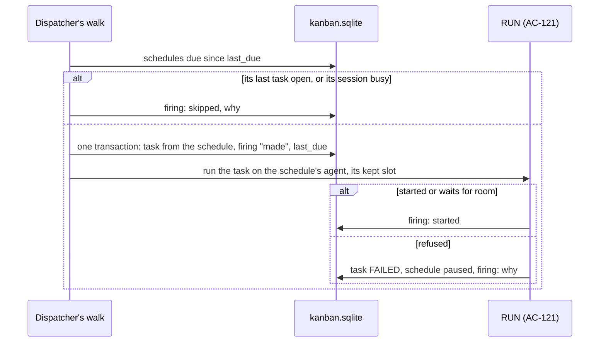

# terminum — Specification (Scheduled tasks)

Sibling of `terminum-kanban.md` (tasks and the board) and `terminum-dispatcher.md` (who runs a task). This spec holds schedules: a task a human sets to run on a cadence, on one agent of the pool, each run a new task on the board. Cases are numbered across the specs.

## 0. Metadata

| Field | Value |
|---|---|
| Status | approved by the owner's request; built, with the gaps of §7 |

A snapshot of what terminum must do, not a record of how it came to be: git holds that.

## 1. Overview

**Problem.** Some work comes back on its own: a nightly check of dependencies, a weekly report, a look at the error log every morning. Today each needs a human to make a task and press RUN at the right time.

**Who it affects.** One person running coding agents from a Mac that is often asleep at night.

**Expected outcome.** A schedule holds a title, a text, a project, a severity, an agent of the pool, a cadence and a time budget. When it is due, terminumd makes a new task from it as it is then and runs it on its agent in the project's folder; that task moves across the board as any other, and its result is read on its card. The agent keeps one slot for each schedule, so a schedule is never late for want of room. Every firing is listed in the Message history's Scheduled page with what went in and what came out.

**Scenario.** Alex sets "Nightly deps check" in Billing, on Opus reviewer, every day at 03:00, 30 minutes. The Mac sleeps until 08:12; on wake TERM-41 is made, runs, and stands in DONE with "Outcome: attention" and two outdated packages. The next morning TERM-44 asks which major version to take: it waits in WAIT FOR HUMAN, the next firing is skipped and says so, and Alex answers and presses RUN.

## 2. Scope and non-goals

In scope:
- Schedules: their window, cadence, kept slot, firing, the tasks they make, the board's section, the Scheduled page.

Out of scope (explicit):
- An agent making or changing a schedule: only a signed-in page does; `terminum mcp` has no tool for them (§9 Security).
- Files on a schedule, subtasks of one, a schedule per host's own clock: no user need yet.
- Runs closer than 15 minutes apart: each run is a task on the board and an agent with every tool (AC-156).
- A second run of a schedule while its last task is open: the firing is skipped and says so (AC-162).

## 3. Assumptions, dependencies, open questions

Assumptions:

| ID | Assumption | Owner | Status |
|---|---|---|---|
| AS-160 | The Mac's local time zone, as `localtime_r` reads it, is the clock the human means by "03:00". | Owner | stated |
| AS-161 | A Mac asleep at a due time is the usual case; one run on wake for any number missed is what a "daily at 03:00" is wanted for, as launchd's `StartCalendarInterval` does. | Owner | stated |

Dependencies:

| ID | Dependency | Owner | Status |
|---|---|---|---|
| DEP-160 | `terminum-dispatcher.md`'s RUN (AC-121), slots (AC-141), asking (AC-157) and waiting for room (AC-158). | Claude | required |
| DEP-161 | `libc::localtime_r`, already a dependency: the cadence is matched in the Mac's local time with no time zone crate. | Claude | present |

Open questions: none.

## 4. Acceptance cases

| ID | Priority | Case |
|---|---|---|
| AC-160 | [MUST / P0] | A human makes a schedule in its window: title, text, project, severity, an agent of the pool, a cadence picked by kind (every N minutes or hours, daily, weekdays, weekly on days, monthly on a day, once, or five cron fields) in the Mac's local time, at least 15 minutes apart, and a time budget; the window shows its next runs and the prompt that will go; it can be changed, paused or deleted at any time. |
| AC-161 | [MUST / P0] | A schedule not paused keeps one slot of its agent: other runs have the rest, every run of its own tasks takes the kept one; an agent with no slot left to keep is refused, as are an at once below its kept slots and deleting an agent with schedules. |
| AC-162 | [MUST / P0] | When a schedule is due, terminumd makes a task from it as it is then and runs it on its agent in the project's folder, the agent told it is a scheduled run and how to give its result; a firing while its last task is open is skipped; missed firings come as one on wake; a start that fails pauses it; each firing is written. |
| AC-163 | [MUST / P0] | The board's Scheduled section stands between the pool and the columns, folded to its head by default, a press away; its cards stand four to a row on the columns' tracks, each with its cadence, next run, agent and last task; a schedule's tasks carry its name. |
| AC-164 | [SHOULD / P1] | The Message history's Scheduled page lists every firing, newest first: when, the schedule, its task and agent, status, when it went IN PROGRESS and ended, what went in and what came out, or why nothing ran. |

## 5. BDD scenarios

### AC-160 — A schedule [MUST / P0]

```gherkin
Scenario: AC-160 happy path — made
  Given Billing chosen on the board and Opus reviewer in the pool with 2 at once
  When the user presses + Schedule in the board's Scheduled section
  Then a window opens with Title, Text (the task window's Markdown editor), Project (the board's only project, else Default), Severity P2, Agent (the pool), When, Time budget 60 minutes and Paused off
  When the user types "Nightly deps check", a text, picks Opus reviewer, Every day at 03:00, 30 minutes, and presses Save
  Then SCH-1 is kept by the user, every page shows it within 2 s and the window closes

Scenario: AC-160 happy path — the kinds of cadence
  Then When offers: Every N minutes (15, 20, 30, 45), Every N hours at a minute, Every day at a time, Weekdays at a time, Every week on the days ticked at a time, Every month on a day at a time, Once at a date and time, and Cron
  And each writes five cron fields, shown under it, "0 3 * * *"; Once keeps its date and time instead
  And a schedule whose fields have a kind's shape opens in that kind, any other in Cron
  And under it terminumd says the next three runs in the Mac's local time, "Tue 10 Nov 03:00, Wed 11 Nov 03:00, Thu 12 Nov 03:00", within a second of a change

Scenario: AC-160 happy path — what will go
  Then a fold "What the agent gets" shows the prompt of AC-162 as terminumd makes it, and the agent's command line in full (AC-156)

Scenario: AC-160 happy path — changed at any time
  Given SCH-1 with TERM-41 running
  When the user changes its text and presses Save
  Then TERM-41 goes on as it began, and the next firing's task has the new text

Scenario: AC-160 happy path — paused and deleted
  When the user ticks Paused and presses Save
  Then nothing fires, its kept slot is free (AC-161), and its card says "paused"
  When the user presses Delete and confirms "Delete SCH-1? Its tasks stay."
  Then it is gone from the board, its tasks and its firings in the Scheduled page stay under its name
  And a task of it waiting for room (AC-158) is called off, saying "Its schedule was paused." or "was deleted."

Scenario: AC-160 failure — refused
  When Save has no title or one over 200 characters, a text over 1 MiB, no agent, no time budget or one over 24 hours
  Then the window says "Title: 1–200 characters", "Text: at most 1 MiB", "Choose the agent that runs it.", "A scheduled run needs a time budget: no human watches it." or "Time budget: 1 to 1440 minutes." and nothing is kept
  When the cron has not five fields, a number out of its field's range, a range that runs backwards or a step of 0
  Then it says which: "The hour \"24\" is not 0 to 23."
  When two runs would come less than 15 minutes apart, "*/5 * * * *"
  Then it says "Runs come at least 15 minutes apart: this cadence has 5."
  When the cadence names no minute within eight years, "0 0 31 2 *", or Once is not in the future
  Then it says "This cadence never comes." or "Once: a time still to come."
  And what the user typed stays in the window (terminum-kanban.md AC-133)
```

### AC-161 — Its kept slot [MUST / P0]

```gherkin
Scenario: AC-161 happy path — kept
  Given Opus reviewer with 2 at once and SCH-1 on it
  Then the agent's card shows a clock mark "kept for SCH-1" before its dots and counts "1/2" with nothing running
  When the user runs API-12 on it
  Then it starts; API-13 next is told "Opus reviewer is at its limit of 2: API-12, SCH-1 (kept)." and waits (AC-158)

Scenario: AC-161 happy path — its own tasks take the kept slot
  Given Opus reviewer with 1 at once, SCH-1 on it, and API-12 running on it as a human's RUN before SCH-1 was set
  When SCH-1 fires
  Then TERM-41 starts on Opus reviewer: the kept slot is its own
  When TERM-41 asks a human and its session closes (AC-157), and the human answers and presses RUN
  Then the resume starts at once in the kept slot, never waiting behind another run
  And a human's RUN of a FAILED or DONE task of SCH-1 takes it the same way

Scenario: AC-161 failure — no slot to keep
  Given Opus reviewer with 1 at once and SCH-1 on it
  When the user saves SCH-2 on it
  Then the window says "Opus reviewer runs 1 at once, kept for SCH-1: raise its at once, or choose another agent." and nothing is kept
  When the user sets Opus reviewer's at once below the slots its schedules keep
  Then its window says "Opus reviewer keeps 1 slot for SCH-1: at once is at least 1."
  When the user deletes Opus reviewer
  Then its window says "Opus reviewer runs schedules SCH-1: give them another agent first." and it stays

Scenario: AC-161 edge — paused
  Given SCH-1 paused
  Then it keeps no slot and the agent's card has no clock mark for it
```

### AC-162 — A firing [MUST / P0]

```gherkin
Scenario: AC-162 happy path — due
  Given SCH-1 every day at 03:00 in Billing, folder ~/work/billing, on Opus reviewer, 30 minutes
  When Dispatcher's walk finds 03:00 passed since it last looked
  Then in one transaction a task TERM-41 is made by Dispatcher in Billing: SCH-1's title, text and severity as they are now, a budget of 30 minutes, its history saying "Dispatcher made it from schedule SCH-1, due Tue 10 Nov 03:00."
  And it runs on Opus reviewer as a RUN does (terminum-dispatcher.md AC-121): its window in ~/work/billing, IN PROGRESS once the agent takes the prompt, then across the board as any task
  And the firing is written: SCH-1, due 03:00, at 03:00:14, TERM-41

Scenario: AC-162 happy path — the prompt
  Then the prompt is, in this order: "terminum's schedule SCH-1 \"Nightly deps check\" (every day at 03:00), set by a human, ran task TERM-41: Nightly deps check. No human started this run or watches it now.", SCH-1's text, the budget's words (AC-126), and "This is a scheduled run: its result is read later on the board. When it is done, call finish_task with the result in this form, each on its own line:" then "Outcome: ok, attention or failed", "Summary: one or two sentences", "Details: what was checked or done", "For the human: what they should do, or nothing", then the words of AC-157 on asking a human
  And only the schedule's own text goes: nothing of an earlier task's comments, result or text, which an agent could have written

Scenario: AC-162 happy path — the result
  When the agent calls finish_task with its result
  Then TERM-41 is DONE with that comment, and the user reads it on its card's window in DONE
  When the agent asks a human (AC-157)
  Then TERM-41 is WAIT FOR HUMAN, its session closes, and the user's RUN resumes it in SCH-1's kept slot (AC-161)
  When its budget ends or its agent fails
  Then TERM-41 is FAILED as any task (AC-126, AC-123); SCH-1 is not paused

Scenario: AC-162 edge — its last task still open
  Given TERM-44 of SCH-1 in WAIT FOR HUMAN, IN PROGRESS, or in TODO waiting for room
  When SCH-1 is due again
  Then no task is made, the firing is written "Skipped: TERM-44 is still open.", and SCH-1's card says "skipped 1"

Scenario: AC-162 edge — its last session still holds the slot
  Given TERM-41 DONE, its session open and idle (terminum-dispatcher.md AC-141's idle holder)
  When SCH-1 is due
  Then that session closes as AC-141 closes an idle holder, its screen kept, and TERM-42 starts in the slot
  When that session is not idle (its agent works on, a draft stands in its box, a subagent runs)
  Then nothing closes, no task is made, and the firing is written "Skipped: TERM-41's session is still busy."

Scenario: AC-162 edge — a sleeping Mac
  Given SCH-1 daily at 03:00 and the Mac asleep from 01:00 to 08:12, or terminumd stopped
  When the walk runs again
  Then one task is made at 08:12, its history saying "due Tue 10 Nov 03:00, run 08:12: the Mac was asleep or terminumd was not running."
  And for any number of firings missed, only one: an every-15-minutes schedule after 8 hours makes one task, the firing written "31 missed, run once."
  And no other clock gains those hours (terminum-dispatcher.md AC-131)

Scenario: AC-162 edge — the clock
  Given SCH-1 at 02:30 and a night the clock skips from 02:00 to 03:00
  Then SCH-1 does not fire that night: that minute does not come
  Given a night the clock passes 01:00 to 02:00 twice, and SCH-2 at 01:30 or every 15 minutes
  Then a local minute comes once: SCH-2 fires at the first 01:30 and not in the hour passed again
  When the Mac's time zone changes
  Then the next runs follow the new zone from the next walk, nothing saved per zone

Scenario: AC-162 failure — it cannot start
  When Billing has no folder, the folder is not there, the hooks are not installed for its kind, the agent is gone, or its host does not answer
  Then TERM-41 is FAILED with RUN's words (terminum-dispatcher.md AC-140), SCH-1 is paused, its card says "Paused: Billing has no folder: set it in its window." and the firing is written with them
  And a later firing makes no task until the human unpauses it

Scenario: AC-162 failure — terminumd stops between the two
  Given TERM-41 made and its firing written, and terminumd ended before its run began
  When terminumd starts again
  Then the next walk runs TERM-41 as it would have, once; TERM-41 moved or archived by a human meanwhile stays as it is and the firing says so

Scenario: AC-162 edge — Once
  Given SCH-3 once at Thu 12 Nov 09:00
  When it fires
  Then it pauses itself, its card says "ran once", and its kept slot is free
```

### AC-163 — On the board [MUST / P0]

```gherkin
Scenario: AC-163 happy path — folded
  Given three schedules of the projects shown
  Then between the pool and the columns stands one line: a key "Scheduled 3" with its arrow and + Schedule
  When the user presses it
  Then the section opens under it and this browser remembers it open; a press again folds it

Scenario: AC-163 happy path — its cards
  Then its cards stand on the columns' own tracks, each a column wide, four to a row, the fifth track for its keys
  And a card shows SCH-1, its severity, its title, its cadence in words ("Every day at 03:00"), its next run ("next Tue 03:00") or "paused" with why, its agent in its color, and its last task as a box of its ID in its status's color, "waits for you" when that one is WAIT FOR HUMAN, and "skipped N" since it last made one
  When the user presses the box
  Then that task's window opens
  When the user presses the card elsewhere
  Then SCH-1's window opens (AC-160)
  And the section follows the board's project: Billing chosen, Billing's schedules only

Scenario: AC-163 happy path — a schedule's tasks
  Then TERM-41's card says "SCH-1" by its ID, and its window says "From schedule SCH-1: Nightly deps check", a press opening SCH-1's window

Scenario: AC-163 edge — a phone
  Given a width under 860 px
  Then the section's cards stand one a row, the whole width

Scenario: AC-163 edge — none
  Given no schedule in the projects shown
  Then the line says "Scheduled 0" and, open, "No schedules: + Schedule runs a task on a cadence."
```

### AC-164 — The Scheduled page [SHOULD / P1]

```gherkin
Scenario: AC-164 happy path — every firing
  When the user presses Scheduled in the Message history's head, beside History and Dashboard
  Then "/scheduled/" lists every firing, newest first, 100 at a time with "Show more": when it fired, SCH-1 and its title, TERM-41 (a press opens it on the board), its agent, its task's status now, when it went IN PROGRESS and when it ended
  When the user presses a row
  Then it shows "In": the prompt that went, and "Out": the agent's last comment, its finish_task result, or Dispatcher's words on why it failed
  And a skipped or missed firing's row says why, with no task

Scenario: AC-164 happy path — one schedule
  When the user picks SCH-1 in Schedule
  Then only its firings show, and the address says "?schedule=SCH-1"

Scenario: AC-164 failure — not read
  When terminumd cannot be reached
  Then the page says "The firings could not be read: <terminumd's message>" and keeps what it showed
```

## 6. Flow and sequence diagrams



## 7. Current behavior and gaps

| AC | Gap | Evidence |
|---|---|---|

## 8. Recommendation and ownership

| Part | Owner |
|---|---|
| Schedules, firings, cadence | terminumd (`terminumd/src/tasks/schedules.rs`, `cron.rs`, `dispatcher/fire.rs`) |
| The section, the window, the Scheduled page | Page |
| A task's run | `terminum-dispatcher.md` |

## 9. Technical details and specifications

**Store.** In `kanban.sqlite` of `terminum-kanban.md`:

```sql
CREATE TABLE schedules (id TEXT PRIMARY KEY, number INTEGER NOT NULL UNIQUE, project TEXT NOT NULL REFERENCES projects, title TEXT NOT NULL, body TEXT NOT NULL,
  severity TEXT NOT NULL, agent_id TEXT NOT NULL, cron TEXT, once_at INTEGER, budget_seconds INTEGER NOT NULL, paused INTEGER NOT NULL DEFAULT 0, paused_why TEXT,
  last_due INTEGER NOT NULL, author TEXT NOT NULL REFERENCES users, created_at INTEGER NOT NULL, updated_at INTEGER NOT NULL, deleted_at INTEGER);
CREATE TABLE schedule_fires (id INTEGER PRIMARY KEY, schedule TEXT NOT NULL REFERENCES schedules, due_at INTEGER NOT NULL, at INTEGER NOT NULL,
  task TEXT REFERENCES tasks, state TEXT NOT NULL, missed INTEGER NOT NULL DEFAULT 0, why TEXT);
```

A schedule is shown as `SCH-<number>`. Times are unix seconds. `cron` or `once_at`, never both. `last_due` is the due time of the last firing, or the moment of the last save, so an edit fires nothing it passed: due is the first cadence minute after it, by the Mac's clock read at each walk, so a zone's change needs nothing saved; a firing sets it to the last due time not after now, every one before it counted as missed. `state`: `made` (task made, its run not yet asked for: a restart's walk asks once), `started` (a run or a wait), `failed`, `skipped`, `called off`. A schedule's tasks are those its firings name: `schedule_fires.task` is the one fact, indexed.

**Cadence** (`terminumd/src/tasks/cron.rs`). Five fields: minute 0–59, hour 0–23, day 1–31, month 1–12, weekday 0–7 (0 and 7 Sunday); each `*`, `n`, `a-b`, `a-b/s`, `*/s`, `n/s`, lists by commas; names of days and months are refused. Both days named: either matches (Vixie cron). The next minute is found minute by minute in local time, skipping whole hours and days that cannot match, up to eight years. A candidate whose local date and time is not after that of the moment it follows (the last due time) is passed over, so a minute the clock passes twice comes once. The 15-minute floor is checked on the next 500 runs.

**Firing** (`terminumd/src/dispatcher/fire.rs`), on each walk before the runs: every schedule not paused or deleted, due ≤ now; its last firing's task open → skipped; its last run holding a slot → closed as AC-141's idle holder or skipped; else the task and the firing in one transaction, then the press of RUN's route (`api::press_again` with its agent), so every check of RUN holds. Made by Dispatcher, `by_agent` 0: its text is the human's.

**Slots** (`pool.rs`). `judge` counts, for an agent: its live runs whose tasks are no schedule's of it not paused, plus one per such schedule; a run whose task is a firing's of a schedule on that agent is checked against the project's limit only.

**Routes.**

```text
GET    /api/schedules → {"schedules": [{"id", "key": "SCH-1", "project", "title", "body", "severity", "agent", "cron", "once_at", "budget_seconds", "paused", "paused_why", "next": [ms…3], "words": "Every day at 03:00", "last": {"task": "TERM-41", "status": "DONE"}, "skipped": 0, "author_name", "updated_at"}]}
POST   /api/schedules {title, body, project, severity, agent, cron | once_at, budget_seconds, paused} → {"id", "key"}
PATCH  /api/schedules/{id} {same}        DELETE /api/schedules/{id}
POST   /api/schedules/preview {same} → {"next": [ms…3], "prompt": "…", "line": "claude --effort high …"} or 400 with the field's words
GET    /api/schedule-fires?schedule=SCH-1&before=<id> → {"fires": [{"id", "schedule": "SCH-1", "title", "due_at", "at", "task", "status", "agent", "started_at", "ended_at", "state", "missed", "why", "prompt", "result"}], "more": true}
```

Every page hears `{"t": "schedules"}` when one changes or fires.

**Security.** A schedule is a standing RUN by the human who saved it: only a signed-in page writes one (the same checks as a task's), `terminum mcp` has no tool for them, and its window shows the prompt and the agent's command before Save. Only its own text reaches the prompt. A process of the user's can write the store (SECURITY.md); a schedule makes such a write worth more, a recurring run with every tool, so the board shows each schedule's author and last change.

**Limits.** 200 schedules; firings kept with their tasks, none purged; the Scheduled page reads 100 rows a page by index.

## 10. Delivery stages

Single stage.

## 11. Checklist with Definition of Done

- [ ] AC-160 — `cargo test tasks::cron`, `cargo test tasks::schedules`, `web/test/e2e_liveschedules.mjs`
- [ ] AC-161 — `cargo test dispatcher::pool`, `cargo test tasks::agents`
- [ ] AC-162 — `cargo test dispatcher::fire`, `web/test/e2e_liveschedules.mjs` (a firing on a fake agent)
- [ ] AC-163 — `web/test/e2e_liveschedules.mjs` (Chromium and WebKit, wide and phone)
- [ ] AC-164 — `cargo test tasks::schedules`, `web/test/e2e_liveschedules.mjs`
