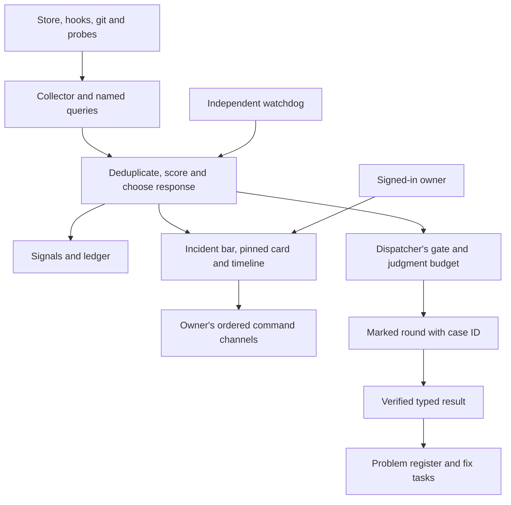
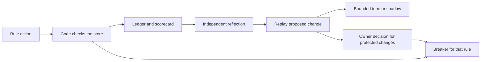

# terminum — Specification (Project Supervisor)

## 0. Metadata

| Field | Value |
|---|---|
| Status | Draft, with the open gaps of §7 |

## 1. Overview

An owner running many agents can see individual failures, waits and costs on the board and Dashboard. The Supervisor uses that evidence to detect recurring problems, measure their impact, drive fixes within the owner's authority and check whether the signals stay resolved.

For example, project API repeatedly returns changes from integration. The replay sizes the problem in task-days and ranks it against other issues. Once enabled, the Supervisor keeps measuring it, links a fix to the evidence and watches the same threshold after the fix lands. The owner sees the ranking, both kinds of spend and the outcome.

## 2. Scope and non-goals

One Supervisor per project, with four lenses: delivery flow, architecture, product outcomes and how the owner and agents work. Detectors, triage, paging, budgets and outcome checks run in code. Short rounds buy judgment when the evidence needs interpretation. The board, Dashboard, Dispatcher, Auto-Dispatcher and integration queue retain their responsibilities.

The Supervisor delegates fixes. Its tools carry no release, publishing or shell authority and no transcript access, and it keeps no standing model session; a round's agent keeps its pool command's own permissions (terminum-dispatcher.md AC-156). Telegram and replies through external channels belong to a separate notification feature. Project data stays within its project, with the owner-configured outbound line described in §9.

## 3. Assumptions, dependencies, open questions

| ID | Assumption | Owner | Status |
|---|---|---|---|
| AS-211 | The events history supports flow replay. Metrics that need snapshots, counters or probes start with the first available sample. | terminumd | Required |
| AS-212 | Impact and baselines use the project's own measurements. Missing inputs must be reported. | terminumd | Required |

| ID | Dependency | Owner | Status |
|---|---|---|---|
| DEP-211 | The tasks store and the Dashboard's measurements (terminum-kanban.md AC-119, terminum.md AC-152, AC-175, AC-176). | terminumd | Existing |
| DEP-212 | Task prompts and comments, WAIT FOR HUMAN, and scheduled tasks (terminum-kanban.md AC-117, terminum-dispatcher.md AC-122, AC-157, AC-185, AC-204, AC-209, AC-210, terminum-schedules.md AC-162). | Dispatcher and board | Existing; AC-230 extends questions |
| DEP-213 | Auto-Dispatcher owns task selection (terminum-dispatcher.md AC-170). Integration provides review inputs and a precedent for scoped rounds (terminum-integration.md AC-194, AC-198). | Dispatcher and integration | Existing |

Open questions: none. §9 defines the defaults.

## 4. Acceptance cases

| ID | Priority | Case |
|---|---|---|
| AC-211 | [MUST / P0] | A named engine query records a signal with verifiable evidence, a baseline, a fingerprint and a state; repeats update one signal. |
| AC-212 | [MUST / P0] | Every catalog detector is a named query tested firing and not firing on fixtures; detectors use project thresholds, report unmet needs and start in shadow when enabled after attach. |
| AC-213 | [MUST / P0] | Code measures impact in additive project units, applies recurrence and sample floors and records the resulting level and response. |
| AC-214 | [MUST / P0] | The scoreboard compares seven guarded indicators across two four-week windows without combining them. |
| AC-215 | [MUST / P0] | A read-only, model-free replay ranks evidence and reports unavailable detectors. |
| AC-216 | [MUST / P0] | Each project's Supervisor runs no background work and writes nothing until a human enables it. |
| AC-217 | [MUST / P0] | A separate detector timer reads through a lossless cursor and writes signals in a small transaction. |
| AC-218 | [SHOULD / P1] | Sweeps retain present-state metrics and bounded hook counters from the start of collection. |
| AC-219 | [MUST / P0] | A timer outside the collector reports a missed heartbeat. |
| AC-220 | [MUST / P0] | Per-project settings have defaults and travel in one text file; import never grants command authority. |
| AC-221 | [MUST / P0] | Attach scans, calibrates and replays the project, reports short history and shadows holds until qualified. |
| AC-222 | [MUST / P0] | The project window's Supervisor tab exposes all settings, import, export and test alert. |
| AC-223 | [MUST / P0] | A project's Supervisor screen shows measurements and evidence on a Mac and a phone. |
| AC-224 | [MUST / P0] | A critical signal or a failed Supervisor or line opens an incident with one timeline per subject. |
| AC-225 | [MUST / P0] | Within one minute, code shows an incident over every signed-in page, pinned on the board and on the Supervisor screen. |
| AC-226 | [MUST / P0] | Signed-in incident actions acknowledge or snooze, with an actor and timestamp recorded. |
| AC-227 | [MUST / P0] | Only fixed incident templates leave through the owner's ordered command channels. |
| AC-228 | [MUST / P0] | Unacknowledged alerts follow a repeat and escalation ladder with narrow quiet-hour exceptions. |
| AC-229 | [MUST / P0] | Manual and weekly tests check the line; a failed channel raises a signal while local surfaces stay available. |
| AC-230 | [SHOULD / P1] | A question records its options, recommendation, chosen option and kind, and accepts a free-text answer. |
| AC-231 | [MUST / P0] | A distinct project-scoped Supervisor caller can execute only the tools allowed at its level. |
| AC-232 | [MUST / P0] | The owner alone sets the Supervisor level; code delivers incidents at all levels. |
| AC-233 | [MUST / P0] | Code starts at most one eligible investigation per fingerprint through Dispatcher's gate; the owner can also request one. |
| AC-234 | [MUST / P0] | A budgeted round uses a kept slot, a durable case file, a fixed ID prompt and typed tool results. |
| AC-235 | [MUST / P0] | Code resolves every evidence ID and recomputes every number before accepting a finding. |
| AC-236 | [MUST / P0] | The register ranks evidence-backed problems using measured impact and a code-owned yardstick. |
| AC-237 | [MUST / P0] | Code governs round spend and signals stopped spending, failed rounds and refused findings. |
| AC-238 | [MUST / P0] | Only high-impact fixes get tasks, ranked under a spend ceiling with a charter breach exception. |
| AC-239 | [MUST / P0] | Marks, advisory ranks and a 24-hour human or manager override govern Supervisor tasks. |
| AC-240 | [MUST / P0] | A high-impact owner decision opens a waiting task; lesser decisions are grouped in the weekly review. |
| AC-241 | [SHOULD / P1] | A task receives one Supervisor comment per signal and task, with a fixed first line and the usual hook notice. |
| AC-242 | [MUST / P0] | The scheduled weekly review leads with decisions and ends with at most ten verdict items. |
| AC-243 | [SHOULD / P1] | Code publishes a daily-at-most exception digest only on news and shows the collector's last run. |
| AC-244 | [SHOULD / P1] | The incident card carries its thread; Talk opens a human-requested session with one fixed ID prompt. |
| AC-245 | [MUST / P0] | Operator holds are reversible and visible; project-wide holds open incidents and survive switch-off. |
| AC-246 | [MUST / P0] | Code judges later outcomes from store evidence and records undecided results. |
| AC-247 | [MUST / P0] | A breaker removes autonomy from one rule after two wrong outcomes or one alert marked Wrong. |
| AC-248 | [MUST / P0] | Independent reflection on the code-built timeline follows specified triggers and proposes versioned changes. |
| AC-249 | [SHOULD / P1] | Agent rates by task type show their sample sizes and cannot gate on a small sample. |
| AC-250 | [SHOULD / P1] | The surface map classifies paths and diff shapes and previews its effect against history. |
| AC-251 | [SHOULD / P1] | Design-first notices and Verify enforce a recorded review and reuse a review the project already requires. |
| AC-252 | [SHOULD / P1] | The hardest designs get budgeted review first, with owner sign-off at T3 and an escalation when review cannot finish. |
| AC-253 | [MUST / P0] | Versioned configuration changes follow their class, carry replay evidence and support one-key revert. |
| AC-254 | [MUST / P0] | A mute records the owner, reason and end date; quieting a detector is a mute; T3, level 3 and mutes over two weeks are the owner's. |
| AC-255 | [MUST / P0] | Code detects unraised problems from owner Bugs, red targets and watchdog pages and records their earliest evidence. |
| AC-256 | [SHOULD / P1] | The Supervisor screen shows its own measured outcomes, spend and burden on the owner. |
| AC-257 | [SHOULD / P1] | Unacted-on detectors move to the weekly review and may be proposed for removal, with T3 and level 3 exempt. |
| AC-258 | [MUST / P0] | The Supervisor cannot change its authority, protected settings, evidence or yardsticks. |
| AC-259 | [SHOULD / P1] | An independent quarterly audit reaches the owner unedited. |
| AC-260 | [SHOULD / P1] | Owner-set probes supply bounded, checked metrics; failure produces a signal instead of a zero. |
| AC-261 | [SHOULD / P1] | Tags and commits power release metrics, recorded question kinds split owner acts and the review shows effort allocation. |
| AC-262 | [SHOULD / P1] | Outside indicators use probes; outside text passes only closed fields through a tool-free reader, with gated task eligibility. |
| AC-263 | [SHOULD / P1] | Project-type templates bootstrap projects; one line orders the owner's incidents and only general definitions cross projects. |

## 5. BDD scenarios

### AC-211 — Signals [MUST / P0]

```gherkin
Scenario: AC-211 happy path — store evidence becomes a signal
  Given API has two FAILED runs for API-41
  When the named query for repeated failures runs with API's parameters
  Then one signal holds project, detector, subject, fingerprint, evidence row IDs, measure and baseline, scores, first and last seen, count and state

Scenario: AC-211 edge — a repeat updates one record
  Given the same fingerprint has count 1
  When it fires again for API
  Then the original signal keeps its ID and first seen time and records the later evidence, last seen time and count 2

Scenario: AC-211 edge — a persisting condition is not a repeat
  Given API's signal for API-41 has count 2
  When later sweeps find the same failed runs, or a measure over a window, such as a run's spend, grows with new input rows
  Then the signal records the later last seen time and keeps count 2, since only a counted event or a return after it resolved is a repeat

Scenario: AC-211 edge — a signal resolves and recurs
  Given API's raised signal for API-41 has count 2
  When a sweep finds its measure back under the threshold, and a later sweep finds it over again
  Then the signal's state is resolved after the first sweep and recurred after the second, on the same ID with count 3

Scenario: AC-211 failure — queries are an engine catalog
  Given a pack or round supplies an unregistered query name or SQL text
  When the engine validates the detector
  Then it reports the unknown query or invalid parameter and executes no supplied SQL
```

### AC-212 — Detector catalog [MUST / P0]

```gherkin
Scenario Outline: AC-212 happy path — each catalog detector fires and stays quiet
  Given a fixture where <detector>'s condition holds and one where it does not
  When the engine runs <detector>'s named query on each
  Then it fires on the first fixture only
  Examples:
    | detector |
    | each row of the §9 detector catalog |

Scenario: AC-212 happy path — three kinds of thresholds
  Given API has the event and usage history for its store-only checks
  When the engine loads a baseline percentile with a floor, an absolute limit and a change threshold
  Then each named check compares its measure to the configured threshold or preceding window and fires only when the condition holds

Scenario: AC-212 failure — data is missing
  Given Web has integration off and no recorded hook counts
  When the detector list is evaluated
  Then the integration and counter rules are off and say which input each is missing

Scenario: AC-212 edge — a rule is enabled after attach
  Given the owner enables a library detector on an attached project
  When it first crosses its threshold
  Then the firing is recorded in shadow and emits no live response
```

### AC-213 — Measured impact and response [MUST / P0]

```gherkin
Scenario: AC-213 happy path — sustained harm
  Given a named query attributes 14% of task-days to a cause in three of the last eight weeks, including the latest week, with 8% weekly noise and sufficient events
  When code scores that signal
  Then it records impact 2 and the level and response for the maximum of impact, blast radius and reversibility

Scenario: AC-213 edge — two quantities
  Given one current problem consumes 6% each of owner hours and tokens
  When code scores it
  Then it has impact 2

Scenario: AC-213 edge — a charter "never" is broken
  Given a problem breaks one of the charter's "never" rules with a measured share of 1%
  When code scores it
  Then it has impact 3

Scenario: AC-213 edge — a checked fact breaks a never the owner tied it to
  Given API's charter ties its never line "Lose user data." to the fact "An existing migration file is edited"
  When a live reading of `arch.migration_edited` fires on an edited migration
  Then its signal is a charter breach with impact 3, and the signal and its register problem name that never line, the detector and the evidence rows that established it
  And without the tie the same reading is an ordinary signal, and a signal at level 3 from blast radius or reversibility alone is no charter breach

Scenario: AC-213 failure — a tie code cannot check
  Given the owner ties a never line to a detector outside the checkable list, or to a line not in the never list
  When the owner saves
  Then the save is refused with the reason and the saved settings stay as they were

Scenario: AC-213 edge — a starved priority task
  Given 18 open P0 and P1 tasks all week, one of them a P1 in TODO five days past its age limit while slots are free
  When code scores its flow.starved signal
  Then its share is those five days of the week's open P0 and P1 task-days, and it has impact 1

Scenario: AC-213 edge — a signal without a share says why
  Given a firing signal whose metric has no additive project quantity, or whose measured amount exceeds its week's total
  When code scores it
  Then its impact basis and the replay state the reason in place of a share

Scenario: AC-213 edge — a round argues for a lower level
  Given a signal at level 2
  When a round proposes level 1 for it
  Then code refuses the proposal and the signal stays at level 2

Scenario Outline: AC-213 failure — floors and thresholds
  Given a single-indicator cause with a <share> share in <weeks> of the last eight weeks, <events> events in each such week, <noise> weekly noise, last firing <last>
  When code scores it
  Then its impact is <impact>
  Examples:
    | share | weeks | events | noise | last          | impact      |
    | 14%   | 3     | 2      | 8%    | this week     | 1           |
    | 14%   | 3     | 8      | 8%    | 3 weeks ago   | not ranked  |
    | 14%   | 1     | 8      | 8%    | this week     | 1           |
    | 12%   | 3     | 8      | 15%   | this week     | 1           |
    | 25%   | 3     | 8      | 28%   | this week     | 2           |
```

### AC-214 — Improvement scoreboard [MUST / P0]

```gherkin
Scenario: AC-214 happy path — seven guarded verdicts
  Given API has eight weeks of measures with sufficient data
  When the scoreboard compares the last four weeks with the four before
  Then it shows each of the seven measures, its guard, its number and whether it is better, flat or worse against its own weekly noise
  And the period is improved when at least one measure is better and none is worse

Scenario: AC-214 edge — a guard breaks
  Given releases per month rise beyond noise and stability worsens beyond noise
  When the release verdict is calculated
  Then it is worse and the stability guard is named; the period cannot qualify as improved

Scenario: AC-214 failure — an input is absent
  Given API lacks a release series
  When the scoreboard computes its verdicts
  Then the unavailable verdict identifies the missing input and the seven lines are never collapsed into one score
```

### AC-215 — Read-only history replay [MUST / P0]

```gherkin
Scenario: AC-215 happy path — repeatable ranked output
  Given a seeded API store contains a recurrent wait and a single over-budget run
  When terminum supervisor replay is run twice for API against the same store snapshot
  Then the ranking and supporting evidence agree, no model is started and the store has no writes

Scenario: AC-215 edge — some detectors cannot run
  Given the store has task events but no historical probe or snapshots
  When the replay measures what it can
  Then it identifies the checks it skipped and why and prints the rest in impact order

Scenario: AC-215 failure — schema mismatch
  Given the store schema does not match a named query's supported version
  When the replay is run
  Then it exits unsuccessfully with the schema mismatch and makes no changes
```

### AC-216 — Project switch [MUST / P0]

```gherkin
Scenario: AC-216 happy path — owner enables one project
  Given API and Web both start with Supervisor off
  When the owner enables API in its project window
  Then API starts attach and Web remains off

Scenario: AC-216 edge — switch off during work
  Given API has a round and a paused queue
  When the human switches it off
  Then Dispatcher ends the running round and frees its slot, the ended round raises no self.round_failed, no further round, collection or action runs for API, and the hold remains visible with its release control

Scenario: AC-216 failure — unauthorized change
  Given a round or imported settings attempts to enable Web
  When terminumd handles the request
  Then it refuses the change and no Supervisor worker or writes start for Web
```

### AC-217 — Collector and cursor [MUST / P0]

```gherkin
Scenario: AC-217 happy path — run outside Dispatcher's walk
  Given API is enabled and an event crosses a detector threshold
  When the independent read-only collector reads the new range off the async workers
  Then the signal appears within one minute and its write is batched into one small transaction
  And while a detector read is held open, the read holds no store write turn and Dispatcher's walk keeps its beat

Scenario: AC-217 edge — persisting signals
  Given API has a few hundred signals that persist from pass to pass, and a counted one with thousands of evidence rows
  When a pass finds them again, one of them with one new row
  Then the write rewrites no persisting signal's evidence, count or revision, and only that signal gains its new row and one repeat
  And the write reads a stored signal's evidence only when it differs, and compares each of its rows once

Scenario: AC-217 edge — same-time events and restart
  Given three events share a timestamp and have nonmonotonic IDs
  When the collector restarts after committing the first batch
  Then the durable cursor visits every event once in the committed results

Scenario: AC-217 failure — write fails
  Given the signal write fails after a batch read
  When the next detector beat retries
  Then the cursor has not passed that batch and its signals appear without duplicate counts once the write succeeds
```

### AC-218 — Snapshots and session counters [SHOULD / P1]

```gherkin
Scenario: AC-218 happy path — data at the time of observation
  Given the collector samples current queue waits and receives hook event names
  When sweeps and hooks record their measurements
  Then metric points retain the observed values and counts are grouped by session for failures, repeats, subagents and compactions
  And store points are taken every 15 minutes and baselines are recomputed daily

Scenario: AC-218 edge — history begins at collection
  Given the first queue snapshot is collected on a project with old tasks
  When a trend asks for an earlier period
  Then the series starts at the first point and earlier observations are unavailable

Scenario: AC-218 failure — retention
  Given a session counter ages past retention
  When the maintenance sweep prunes counters
  Then the expired counters are removed

Scenario: AC-218 failure — hook output
  Given a hook event carries free-form output
  When the hook counts it
  Then only the event name is counted, the output is discarded and the hook does no analysis
```

### AC-219 — Collector watchdog [MUST / P0]

```gherkin
Scenario: AC-219 happy path — independent timer
  Given the enabled collector last finished three beats ago
  When terminumd's watchdog runs
  Then it records self.collector_dead and shows the resulting incident with the last successful run

Scenario: AC-219 edge — one missed beat
  Given only one expected sweep has passed
  When the watchdog checks the heartbeat
  Then it opens no dead-collector incident

Scenario: AC-219 failure — collector cannot report its own failure
  Given the collector has stopped while terminumd still serves the signed-in page
  When two beats pass without a heartbeat
  Then the watchdog exposes the fault without asking the collector or a model to report it
```

### AC-220 — Portable settings [MUST / P0]

```gherkin
Scenario: AC-220 happy path — export and import
  Given the owner configures API's priorities and a notifier command
  When the owner exports the default file and imports it into Web
  Then eligible settings remain per project and the export excludes commands and secrets unless expressly selected

Scenario: AC-220 edge — confirm a candidate command
  Given an import contains a probe command
  When the owner views the candidate in full and separately confirms it
  Then terminumd enables that command only after the confirmation

Scenario: AC-220 failure — unconfirmed command
  Given the imported file says its notifier is active
  When the owner completes import without a command confirmation
  Then the notifier is listed as unset and never runs; import leaves activation to the signed-in owner
```

### AC-221 — Attach, calibration and hold shadow [MUST / P0]

```gherkin
Scenario: AC-221 happy path — project-specific bootstrap
  Given API has kept history and no tier agents selected
  When the owner enables the project
  Then the scan lists usable and unavailable detectors, derives thresholds, replays and seeds high-impact findings in the register; code operates with no rounds
  And the scan opens no card or question for the owner

Scenario: AC-221 edge — young project and protected signal
  Given Web has two weeks of history
  When its first scan finds both routine drift and a charter breach
  Then the scan reports short history; ordinary impact is capped at 1 and the breach can score 3 and bypass hold shadow

Scenario: AC-221 edge — a baseline without an earlier window
  Given API's fixing commits and hook counters start inside the current window
  When the scan derives the `arch.hotspot`, `drift.loop` and `drift.subagents` baselines
  Then each subject's baseline is the percentile over API's other subjects in both windows, the current day included: each window's files a fix touched, and the session-days
  And only that top share fires; a file changed without a fix does not lower the baseline, a lone subject meets the floor alone, and a score under the floor never fires

Scenario: AC-221 failure — insufficient hold evidence
  Given a live-at-attach rule has only two past firings inside its first week
  When it proposes a hold
  Then the ledger records a shadow hold and the work continues
  And a hold becomes eligible after seven days or a replay with at least three firings and at least two-thirds judged right
```

### AC-222 — Supervisor tab [MUST / P0]

```gherkin
Scenario: AC-222 happy path — edit the project
  Given the owner opens project API on a Mac or phone
  When the Supervisor tab is displayed
  Then it shows switch, level, tier agents, budgets, charter priorities, never list with the checked facts tied to its lines, allocation target and review dates, indicators, surface map and preview, detectors with their mutes, probes, channels, link base, quiet hours, repeat ladder, import, export and Send a test alert

Scenario: AC-222 edge — unconfigured tiers and channels
  Given API is attached using defaults
  When the owner opens the tab on a narrow screen
  Then agent selectors stay unchosen and channels unset; the project can run on code alone

Scenario: AC-222 failure — invalid settings
  Given the owner selects a tier agent from another project or submits an invalid threshold
  When the owner saves
  Then the tab identifies the field and error and retains the draft without applying it
```

### AC-223 — Supervisor screen [MUST / P0]

```gherkin
Scenario: AC-223 happy path — project evidence in view
  Given API has metrics and a signal with evidence rows
  When the owner opens the Supervisor screen for API
  Then it shows the scoreboard, signals, evidence and Investigate, plus the register, incidents, holds, both spends and its own scorecard when available

Scenario: AC-223 edge — portable layout
  Given the project has a long signal list
  When the owner uses the page at phone size and then at Mac size
  Then the evidence and actions remain reachable in both layouts

Scenario: AC-223 failure — no data available
  Given API lacks a metric input and Web has a similarly named signal
  When the owner opens API's screen
  Then its missing data is stated and Web's rows are absent
```

### AC-224 — Incident identity and updates [MUST / P0]

```gherkin
Scenario: AC-224 happy path — critical and health triggers
  Given an enabled project's target turns critically red, or its collector or line fails
  When code records the signal
  Then it opens an incident even with no round agents selected

Scenario: AC-224 edge — nearby firings on one subject
  Given API's grouping window is the default 15 minutes
  When a second target signal arrives 10 minutes after the first and a third 40 minutes after the second
  Then one incident, card and timeline carry the first two signals and their updates, and the third opens a new incident

Scenario: AC-224 failure — critical cause recurs or clears
  Given a signal updates an active incident, or the guarded measurement returns to normal
  When code writes the change
  Then it records the changed level or all-clear on the existing incident and opens no duplicate thread
```

### AC-225 — Incident visibility [MUST / P0]

```gherkin
Scenario: AC-225 happy path — critical alert without a model
  Given API has a level 3 incident with two blocked batches and a hold
  When code surfaces the incident
  Then within one minute each signed-in page has a red incident bar, WAIT FOR HUMAN pins its card first and the Supervisor screen shows its timeline

Scenario: AC-225 edge — status message order
  Given the owner views the incident from a phone without acting
  When the incident renders
  Then fixed words state what happened with counts, the hold, the requested action and by when, then that the hold stays without an answer

Scenario: AC-225 failure — no agent and no channel
  Given API has neither a round agent nor a configured channel
  When its target signal opens an incident
  Then the bar, card and timeline still appear and the bar remains until acknowledgment
```

### AC-226 — Incident acknowledgment and snooze [MUST / P0]

```gherkin
Scenario: AC-226 happy path — acknowledged from a signed-in page
  Given an open incident repeats
  When the owner presses Acknowledge on a phone or Mac
  Then repeats cease, the bar is acknowledged and the timeline records the actor and time; any hold remains

Scenario: AC-226 edge — one-hour snooze
  Given an incident has yet to be acknowledged
  When the owner presses Snooze
  Then repeats are deferred one hour, the press is recorded and the hold stays

Scenario: AC-226 failure — external action rejected
  Given the incident ID is supplied to an unsigned request or to the notifier
  When it attempts Acknowledge
  Then the action is refused and the timeline and repeat state remain intact
```

### AC-227 — Command channels [MUST / P0]

```gherkin
Scenario: AC-227 happy path — fixed outbound templates
  Given the owner has set two ordered command channels and an incident link base
  When code emits an incident, update, all-clear or answer notice
  Then the selected channel receives only the fixed template on standard input, with approved IDs, counts and optional link

Scenario: AC-227 edge — data exclusion
  Given a case contains task prose, a home path and a marked secret fixture, and there is no link base
  When code renders its notice
  Then the payload omits those fields and includes no link

Scenario: AC-227 failure — timeout and reply attempt
  Given a command emits output resembling an answer and exceeds its deadline
  When terminumd runs the channel with its fixed environment
  Then it times out and is reported failed; no command output acts as an owner reply
```

### AC-228 — Repeat ladder and quiet hours [MUST / P0]

```gherkin
Scenario: AC-228 happy path — unacknowledged incident
  Given API has a first and second channel and the default ladder
  When an incident remains unacknowledged outside quiet hours
  Then it first sends promptly, repeats at 10 and 30 minutes and hourly thereafter, never sooner than the ladder's next step
  And from the 30-minute repeat on it also goes to the second command, and not before

Scenario: AC-228 edge — urgent exception
  Given quiet hours are active
  When one incident breaks a charter never, another has reversibility 3 and a third meets neither condition
  Then the first two send and the third waits for the quiet period to end

Scenario: AC-228 failure — persistent incident noise
  Given four distinct critical incidents open and one of them repeats its fingerprint
  When the line processes the alerts
  Then none is suppressed by a daily count cap and the repeat shares the existing incident and cooldown

Scenario: AC-228 edge — updates after acknowledgment
  Given the owner acknowledged an urgent incident whose measure keeps changing
  When its signal changes several times within the ladder's first step
  Then no repeat is sent and its changes go out as one update, at most one per first step
```

### AC-229 — Line health [MUST / P0]

```gherkin
Scenario: AC-229 happy path — test from settings
  Given the owner configured a working notifier
  When Send a test alert is pressed
  Then the fixed test template travels through the chosen command and its result shows in the tab

Scenario: AC-229 edge — weekly check fails
  Given the enabled line's weekly silent self-test fails
  When the health timer checks it
  Then self.line_dead is recorded with the failure and the incident is available locally

Scenario: AC-229 failure — no functioning outbound path
  Given the active notifier exits unsuccessfully on an incident
  When the line handles the failure
  Then self.line_dead is recorded with the channel and exit status, the next channel in order is tried, the bar and Supervisor screen show the failure, the card remains pinned and the local incident can still be acted on
```

### AC-230 — Recorded question choices [SHOULD / P1]

```gherkin
Scenario: AC-230 happy path — one press saves an answer
  Given the agent asks API-41's operational question with options Retry and Wait, recommending Wait
  When the owner presses Wait on the task's window
  Then the question keeps its kind, options and recommendation, the answer records Wait, and RUN carries the saved human answer as terminum-dispatcher.md AC-157 says

Scenario: AC-230 edge — text and existing questions
  Given a question has stored options or predates option recording
  When the human answers in free text
  Then the text is retained and the answer works through the usual resume path; an old question shows without option buttons

Scenario: AC-230 failure — invalid or stale choice
  Given the recommendation references an unknown option, or a page submits an option on a question that has been superseded
  When terminumd validates the request
  Then it reports the invalid recommendation or stale question and records no choice

Scenario: AC-230 edge — repeated press and correction
  Given the human saved Wait for the current question
  When the page resends that choice or submits Retry
  Then the same Wait answer is returned or the second choice is refused
  When the human deletes their saved choice
  Then the question accepts a new choice
```

### AC-231 — Caller authorization [MUST / P0]

```gherkin
Scenario: AC-231 happy path — level-specific tool discovery and execution
  Given a live Advisor round belongs to API
  When it discovers tools and records a finding on API
  Then only the Advisor's allow-list appears and terminumd validates the action at execution

Scenario: AC-231 edge — levels and surfaces agree
  Given a round's cached tool list predates its owner's switch from Operator to Observer
  When it calls run_task from its pane
  Then terminumd checks the current level and refuses the call
  And a manager's token calling a Supervisor tool is refused, since a token caller is a manager (terminum-agents.md AC-174)

Scenario: AC-231 failure — forbidden authority and foreign state
  Given a Supervisor at any level calls a tool outside its level's allow-list (send_to_session, close_session, the pool's or the schedules' tools), requests another project's signal or tries to change a command
  When the server resolves the caller and arguments
  Then it refuses the action and writes no task, setting or pane input in the target

Scenario: AC-231 failure — words for a pane
  Given an Operator round calls its run_task with a comment, or a fresh or queue text
  When terminumd checks the arguments
  Then the call is refused; a run_task with the task ID and agent alone starts the task as Auto-Dispatcher's started task, told only its ID in fixed words (terminum-dispatcher.md AC-170)

Scenario: AC-231 failure — transcripts and outside files
  Given a round asks for a session transcript or a file outside its case file, citing the charter or a schedule's text as its grant
  When terminumd checks the call
  Then the call is refused; no charter, file or schedule widens the allow-list

Scenario: AC-231 failure — a local caller the system does not name
  Given a Supervisor pane is marked on this Mac
  When a tool call arrives on terminumd's socket from a process the system does not name
  Then terminumd refuses it with "terminumd cannot tell which process calls, so while a Supervisor session is open it runs no pane's tool for it." and logs supervisor.peer_unknown, whatever pane the call names
```

### AC-232 — Levels [MUST / P0]

```gherkin
Scenario: AC-232 happy path — owner selects the level
  Given API is enabled with defaults
  When the owner sets Observer in the signed-in page
  Then the prior default is Operator, the new level is Observer and it takes effect at the next authorization check

Scenario: AC-232 edge — incidents at each level
  Given each of the three levels is active in a test project
  When a deterministic charter breach is raised
  Then each project emits an incident through its configured line irrespective of model agents or level

Scenario: AC-232 failure — automatic level change attempted
  Given a rule's breaker opens or a round requests a lower or higher level
  When terminumd processes it
  Then the level stays as set by the owner; only that rule loses autonomous actions under AC-247
```

### AC-233 — Investigation trigger [MUST / P0]

```gherkin
Scenario Outline: AC-233 happy path — qualifying triggers
  Given API has a medium-tier agent, budget and a free slot, and no round is open for the fingerprint
  When <trigger>
  Then an investigation is admitted through Dispatcher's gate, on the tier its level calls for (§9)
  Examples:
    | trigger |
    | a level 2 or 3 signal arrives |
    | a level 1 signal fires in three of eight weeks with no cause in the register |
    | the owner presses Investigate on a signal or an incident |

Scenario: AC-233 edge — low-confidence high stakes
  Given a heuristic puts a signal at level 2 or 3 with confidence 0.5
  When code schedules verification
  Then verification has at most 15 minutes and an interim hold applies only if it costs less than waiting; a deterministic critical page never waits for a model

Scenario Outline: AC-233 failure — no room
  Given <condition>
  When another trigger arrives for API
  Then no round starts and <reason> is visible
  Examples:
    | condition | reason |
    | the judgment budget is spent | the budget notice |
    | the tier has no agent in the pool | the missing tier |
    | the fingerprint already has an active round | the active round's ID |
    | the signal repeats unchanged after its round ended | the round that judged it |

Scenario: AC-233 failure — waiters by impact
  Given two eligible rounds wait for one freed slot
  When the slot frees
  Then the round of the higher-impact signal starts first
```

### AC-234 — Round protocol [MUST / P0]

```gherkin
Scenario: AC-234 happy path — scoped, typed round
  Given API's investigation has a case file and medium-tier pool agent
  When Dispatcher admits it into a reserved slot
  Then the typing gate pastes a fixed prompt containing only its case ID as data, once in its marked pane; the round fetches the retained case file and submits a typed outcome through tools

Scenario: AC-234 edge — restart and bounded context
  Given a saved case refers to measurements, a scoped charter excerpt, owner rulings and a long task comment
  When the file is read for replay
  Then the same case is available, the comment is capped and marked as data, and no stored prose is put into the pane

Scenario: AC-234 failure — wrong pane or deadline
  Given a pane does not meet the gate, or the round spends its time limit without a typed result
  When Dispatcher handles the failure
  Then it refuses the paste or ends the marked round, frees the slot and records the failure without accepting a transcript as a result

Scenario: AC-234 failure — a sub-agent's result fails its schema
  Given a round's investigator returns a result without its cause, evidence, confidence or disproof field, or after its deadline
  When code checks the result
  Then it is refused, recorded, and raises self.round_failed
```

### AC-235 — Evidence verification [MUST / P0]

```gherkin
Scenario: AC-235 happy path — recomputed finding
  Given API event row 37 belongs to API and the named query returns 4
  When the round records a finding citing row 37 and the value 4
  Then code accepts the finding and stores its evidence pointers

Scenario: AC-235 edge — incomplete or foreign evidence
  Given the submitted row is absent or belongs to Web
  When the round calls record_finding
  Then the refusal identifies the unresolved evidence and raises self.round_failed

Scenario: AC-235 failure — number differs
  Given the finding claims 9 from a query that returns 4
  When code recalculates the measure
  Then the tool reports the mismatch, records a refusal signal and creates no problem or fix from the finding
  And each later refusal in the round adds one to that signal's count, since each refused finding is a counted event (AC-211)
```

### AC-236 — Problem register [MUST / P0]

```gherkin
Scenario: AC-236 happy path — cluster and rank
  Given a round identifies a recurrent cause for two API signals
  When the checked finding opens a problem
  Then the register shows its fingerprints, measured share, hypothesis and disproof, fix options and linked tasks, and ranks it by level then the formula in §9

Scenario: AC-236 edge — owner ruling and new evidence
  Given the owner accepts a problem as is
  When the same evidence repeats and later materially different evidence arrives
  Then the first repeat stays closed; the new evidence can reopen the problem and identifies what is new

Scenario: AC-236 failure — weakened yardstick
  Given a landed fix has been below threshold for less than its required observation window
  When a round seeks to mark it resolved by shortening the window
  Then code rejects the weaker yardstick and keeps the problem watching; recurrence reopens its evidence trail

Scenario: AC-236 failure — a problem with no signal
  Given a round calls open_problem without a signal fingerprint
  When terminumd checks the call
  Then the call is refused and no problem is opened
```

### AC-237 — Judgment governor [MUST / P0]

```gherkin
Scenario: AC-237 happy path — reserve for investigations
  Given the owner's judgment budget includes the default 30% reserve and routine work uses the unreserved part
  When a weekly review and a qualifying level 2 investigation ask for the remaining budget
  Then routine work cannot use the reserve; the investigation may, within round and day ceilings

Scenario: AC-237 edge — degraded operation
  Given the ceiling is reached
  When new deterministic signals and a review request arrive
  Then signals, pages, holds and digest continue, judgment rounds and new Supervisor tasks wait; the next owner message starts with the budget notice, and a review that cannot run becomes a decision card

Scenario: AC-237 failure — round or finding fails
  Given a round exceeds its token cap, or ends without a result
  When code checks the round
  Then the governor ends an overrunning round, records the failed round and raises self.round_failed or self.budget
```

### AC-238 — Fix spend [MUST / P0]

```gherkin
Scenario: AC-238 happy path — importance before count
  Given API has two high-impact problems and a low-impact one under the fixes ceiling
  When the Supervisor creates or starts fixes
  Then it uses impact order, attributes spend once for each run it made or started, and the Supervisor screen and the weekly review show fix spend beside judgment spend; the low-impact problem stays in the register
  And each task's severity follows the project's severity rule for its type and impact

Scenario: AC-238 edge — critical exception
  Given the fixes ceiling is reached and a charter never is breached
  When code applies the fix gate
  Then the breach gets a fix task immediately and the task and spend exception are visible

Scenario: AC-238 edge — a fix task from a measure alone
  Given code opened a problem from a detector's measure with no round, as when no tier agent is chosen
  When the fix gate makes its task
  Then its title starts with its type and names what fired with its number and threshold, such as "Bug: Backlog growth: 4 growing weeks, threshold 3"
  And its text, in the project's task sections, names each measure against its baseline with its weeks, the impact share, and a link to each evidence row and its signal
  And its hypothesis says that no investigation has run yet and what an investigation would check

Scenario: AC-238 failure — important work remains at the ceiling
  Given three eligible problems compete for a budget that can pay for one
  When it pays for the highest ranked one
  Then one decision card lists the remaining problems, their impact, and the choice to raise the ceiling for them or let them wait a week; there is no task-count quota
```

### AC-239 — Marks, rank and override [MUST / P0]

```gherkin
Scenario: AC-239 happy path — advisory rank and eligibility
  Given a deterministic finding creates a marked API task
  When the Supervisor proposes a rank for it
  Then Auto-Dispatcher's next selection can read the proposal under terminum-dispatcher.md AC-170, applies the project's eligibility setting, and retains the power to choose

Scenario: AC-239 edge — human or manager wins
  Given a human or project manager overrides a Supervisor action on API-41
  When any Supervisor rule proposes another action on API-41 within 24 hours
  Then it takes no action on that task and records self.fights with the override and actor
  And an action proposed after the 24 hours is allowed again

Scenario: AC-239 failure — rewrite another author's task
  Given the Supervisor requests a new severity, title or text for an owner's task
  When terminumd checks authorship
  Then the edit is refused and the task retains its fields
```

### AC-240 — Decision cards [MUST / P0]

```gherkin
Scenario: AC-240 happy path — high-impact owner decision
  Given confirmed high-impact work needs the owner to choose between two fixes
  When the Supervisor opens a decision card
  Then WAIT FOR HUMAN, the usual banner and the Supervisor screen show the task, with why the owner is needed, recommendation and reason, options, evidence and cost of waiting

Scenario: AC-240 edge — owner load
  Given several lesser decisions are pending
  When code prepares the weekly review
  Then it groups them into one list

Scenario: AC-240 edge — standing rules weighed
  Given the owner accepted a standing rule last week
  When code prepares the weekly review
  Then it shows the cards added beside the questions that rule removed

Scenario: AC-240 edge — the owner chose against the recommendation
  Given the owner answered API's decision card with another option than the one recommended
  When the same fingerprint recurs with the same evidence, and later with new evidence
  Then the first recurrence opens no card; the new evidence opens one that names what is new

Scenario: AC-240 edge — a charter review date passes
  Given API's charter has a priority review date that has passed
  When code prepares the next weekly review
  Then it asks the owner once, by one question card, and does not repeat it before the next review date

Scenario: AC-240 edge — drift worth mining
  Given session counters for two API sessions are above their drift threshold
  When the Supervisor reports it
  Then a decision card names the sessions and proposes that the owner run `/retro` on them, and no transcript is read

Scenario: AC-240 failure — decision does not belong to the owner
  Given a round asks to page or open an immediate card for a routine choice below the high-impact gate
  When terminumd evaluates the request
  Then no immediate card or page is sent and the item remains eligible for the weekly list
```

### AC-241 — Nudges [SHOULD / P1]

```gherkin
Scenario Outline: AC-241 happy path — fixed first line and existing notice
  Given <trigger> on API-41's active session, at level 1 or above
  When the Supervisor comments
  Then the fixed first line names <reason> with its evidence and any undo; the linked agent receives the notice at its normal hook opportunity under terminum-dispatcher.md AC-209; design-first and missing-review notices are AC-251's
  Examples:
    | trigger | reason |
    | a drift signal | the drift |
    | a known register problem applies | the problem |
    | a hold stops its run | the hold |

Scenario: AC-241 edge — repeat or idle agent
  Given there is already a comment on this task for that signal and its agent has no new hook activity
  When the signal repeats
  Then the existing comment is updated without stacking a second or claiming the agent has heard

Scenario: AC-241 failure — level 0
  Given a level 0 signal fires on API-41
  When the nudge rule runs
  Then API-41 gets no comment

Scenario: AC-241 failure — no linked agent
  Given a nudge-worthy signal on API-42, which has no linked open agent
  When the nudge rule runs
  Then API-42 has a visible comment and no delivery is claimed
```

### AC-242 — Weekly review and verdicts [MUST / P0]

```gherkin
Scenario: AC-242 happy path — scheduled result
  Given API has a weekly review schedule and open decisions
  When its task finishes
  Then the result appears in Routines and on the Supervisor screen, with the nine sections in §9 and decisions first

Scenario: AC-242 edge — owner critique and verdict workload
  Given one owner measure exceeds its usual band and more than ten items are available
  When the review is built
  Then critique names the data, cost and one proposal and stays in the review; at most ten raised or sampled shadow items get Useful, Not useful and Wrong keys and the time answering counts as owner load

Scenario: AC-242 edge — no review agent chosen
  Given API is attached and no strong-tier agent is chosen
  When the week passes
  Then API has no weekly review schedule and the exception digest still runs; choosing the agent makes the schedule, visible and editable in Routines

Scenario: AC-242 failure — no answer or undersized sample
  Given a sampled item receives no key press and the week's samples are small
  When the scorecard is refreshed
  Then the item has no verdict, and the review shows sample sizes and uncertainty without treating silence as approval or a verdict as a gate
```

### AC-243 — Exception digest [SHOULD / P1]

```gherkin
Scenario: AC-243 happy path — new signals
  Given one or more new level 1 or higher signals arrive since the last digest
  When the next daily digest runs
  Then code sends at most five signal lines with what, number against baseline, action and link to the review destination, ending with the collector's last run

Scenario: AC-243 edge — quiet project
  Given there is no new qualifying signal
  When the daily opportunity passes
  Then there is no digest and no model round

Scenario: AC-243 failure — collector late
  Given the digest has new news but its collector heartbeat is stale
  When code renders it
  Then the last line shows the actual last successful run and the watchdog reports the failure separately
```

### AC-244 — Incident thread and Talk [SHOULD / P1]

```gherkin
Scenario: AC-244 happy path — ask and receive an answer
  Given API's incident is linked to an investigation
  When the owner comments on its pinned card
  Then the comment reaches the live round as a comment notice (terminum-dispatcher.md AC-209), never typed; an answer appears in the same thread and code sends the fixed answer notice
  And after the round ends, the comment reaches an agent only through a human's RUN (terminum-dispatcher.md AC-122)

Scenario: AC-244 edge — owner's Talk press
  Given the owner presses Talk on the incident from a signed-in page
  When Dispatcher's first-prompt gate admits the pane that press started
  Then the pane gets the fixed words with the incident case-file ID once under terminum-dispatcher.md AC-204, and the session is the project's Supervisor caller (AC-231)
  And a ruling the owner makes there is saved as an owner ruling on the incident, and its fingerprint is not raised again on the same evidence

Scenario: AC-244 edge — a conversation with the Supervisor's skill
  Given the owner opens a session in API and starts it with the Supervisor's skill
  When the skill loads its context
  Then the session is API's manager (terminum-agents.md AC-174) and reads API's charter, register and open signals through the Supervisor's read tools; it reads no other project's

Scenario: AC-244 failure — pane changed or caller is a model
  Given the target pane is no longer the marked pane, or a round tries to invoke Talk itself
  When the request reaches the gate
  Then no prompt is pasted and the refusal is visible

Scenario: AC-244 failure — an answer or ruling out of bounds
  Given a round answers on API's incident with no text or over 4,000 characters, or the owner submits a ruling with no text or over 1,000
  When terminumd records it
  Then it refuses with "An incident answer needs 1–4,000 characters." or "An owner ruling needs 1–1,000 characters.", sends no notice and the incident stays as it was
```

### AC-245 — Holds [MUST / P0]

```gherkin
Scenario Outline: AC-245 happy path — apply and undo
  Given API's Operator has a qualifying signal at level 2 or above and its rule is live for holds
  When it applies <hold>
  Then the hold appears with its signal, reason and <undo>
  Examples:
    | hold | undo |
    | stop one marked run | RUN resumes the task |
    | pause Auto-Dispatcher | its project switch |
    | pause integration | the queue's key that resumes it (terminum-integration.md AC-193) |
    | take a task out of the queue | the queue's key that queues it again (terminum-integration.md AC-193) |

Scenario: AC-245 happy path — a project-wide hold opens an incident
  Given API's Operator pauses Auto-Dispatcher or integration
  When the hold applies
  Then an incident opens with Keep the hold and Release the hold

Scenario: AC-245 edge — shadow and off
  Given a shadow hold is proposed and a different hold is already active
  When the owner turns Supervisor off
  Then the ledger retains the shadow hold without effect, and the active hold stays listed until a permitted key releases it

Scenario: AC-245 failure — below threshold or beyond authority
  Given a low-level signal or an Advisor asks to stop a run, delete work or revert a commit
  When terminumd checks the hold
  Then it refuses the request; an Advisor's design-first comment and review blocker use AC-251
```

### AC-246 — Outcome checks [MUST / P0]

```gherkin
Scenario: AC-246 happy path — scheduled code checks
  Given the ledger contains a hold, fix, run or promotion, alert, cause, decision card and nudge
  When one day, one week and four weeks pass
  Then code reads the store and records right, wrong or undecided against the decision rules in §9

Scenario: AC-246 edge — a human releases an unchanged hold
  Given a human releases a hold on the same target or task it guarded
  When the release is recorded
  Then code records a wrong outcome at once and later successful work on the same target confirms it without counting it twice

Scenario: AC-246 failure — later evidence absent
  Given a rule's outcomes are mostly undecided because the evidence is missing
  When the checker reads the due actions
  Then it keeps them undecided and emits self.unjudged; it gives the rule no credit for success
```

### AC-247 — Per-rule breaker [MUST / P0]

```gherkin
Scenario: AC-247 happy path — two wrong outcomes
  Given one rule has one judged wrong hold
  When a distinct outcome of that rule is judged wrong
  Then the breaker opens at once, its holds, runs and alerts become owner cards and every other rule retains its authority

Scenario: AC-247 edge — one alert marked Wrong
  Given the owner uses This is wrong on an incident
  When code records the verdict
  Then that alert's rule opens its breaker immediately and a subsequent repeat becomes a card

Scenario: AC-247 failure — autonomous reset
  Given a reflection or a config apply tries to close the breaker
  When terminumd checks the request
  Then it refuses; closure requires the owner's key on a card showing the rule change and replay

Scenario: AC-247 failure — a replay review without a changed live rule
  Given an open breaker whose detector is muted or in shadow, whose measurement settings are unchanged, that has no historical query or too little retained history, or whose replay review is missing or stale
  When the owner asks to review its replay or to restore autonomy
  Then terminumd refuses with "Set this detector to Live and clear its mute before reviewing its replay.", "Change this detector's measurement settings before reviewing its replay.", "The detector has no retained historical replay.", "There is not enough retained history to replay this rule.", "Review this open breaker's replay before restoring autonomy." or "The breaker or its settings changed. Review the replay again.", and the rule stays paused
```

### AC-248 — Independent reflection [MUST / P0]

```gherkin
Scenario: AC-248 happy path — reflection on a trigger
  Given a breaker opens, a human overrides an action, a fix recurs, code finds a miss, an alert is marked Wrong, spending overruns, or the right-decision rate leaves its band with enough data
  When the governor admits a reflection
  Then one independent strong-tier round reads the code-built timeline and proposes changes that go through AC-253

Scenario: AC-248 edge — model-family choice and incident post-mortem
  Given the pool includes a different model family and a level 3 incident has ended
  When reflection reviews the post-mortem
  Then it uses that family and its own prompt and reads the observed sequence, while coincident triggers for the same action share the round

Scenario: AC-248 failure — low sample or budget exhausted
  Given a rate is outside its band on a small sample, or the reflection budget is full
  When the trigger is evaluated
  Then the rate does not trigger a round on its own and no reflection spends beyond the judgment budget
```

### AC-249 — Agent scorecards [SHOULD / P1]

```gherkin
Scenario: AC-249 happy path — rates by task type
  Given API has Bug and Feature runs by two pool agents
  When the scorecards are calculated
  Then they show failures, returns, questions and cost by agent and type, with each denominator

Scenario: AC-249 edge — small sample
  Given one agent ran 12 Debt tasks
  When the owner views its return rate
  Then it is shown with its interval and sample size and cannot gate a routing action

Scenario: AC-249 failure — routing data unavailable
  Given integration is off and the return rate is unavailable
  When a round proposes routing changes
  Then it marks the missing input, explains the available evidence and routes the proposal to a decision card
```

### AC-250 — Surface map [SHOULD / P1]

```gherkin
Scenario: AC-250 happy path — size a candidate map
  Given the owner adds a glob for API contracts and a rule for editing existing migrations
  When the tab replays the candidate map over the prior month
  Then it shows how many past tasks would have gated, grouped by tier, before the owner saves

Scenario: AC-250 edge — changed shape determines tier
  Given one diff adds a migration and another changes an existing persisted format incompatibly
  When the map matches both
  Then the new migration is at most T2 and the incompatible change is T3

Scenario: AC-250 failure — missing or empty map
  Given there is no saved T2 or T3 map for API
  When a task and its diff are checked
  Then no surface gate is active and the preview shows the empty map
```

### AC-251 — Design-first and review record [SHOULD / P1]

```gherkin
Scenario: AC-251 happy path — early review and reuse
  Given an API task's text matches a calibrated T3 term, or its first diff matches a T3 path
  When the Advisor marks it design first
  Then it posts the fixed comment, links a blocker when the brief is ready, and records the reviewer, verdict and rejected advice with reasons
    And a sufficient existing project review is used once

Scenario: AC-251 edge — multiple commits for one design
  Given the task already has a review record for its design
  When more commits of that design reach Verify
  Then the record is reused within the reviewed paths
    And a newly gated path needs review in a separate design task

Scenario: AC-251 failure — missing record
  Given a T2 contract or T3 surface reaches Verify without its required review evidence
  When Verify checks the task
  Then it fails with the required review named and adds one comment with the evidence and what must be recorded
```

### AC-252 — Design reviews [SHOULD / P1]

```gherkin
Scenario: AC-252 happy path — one budgeted round per design
  Given T2 and incompatible T3 designs await review with limited judgment room
  When the gate takes the queue
  Then it takes T3 first, starts one review per design, and T3 needs a design note, architecture and independent critics, owner sign-off, migration and rollback

Scenario: AC-252 edge — existing review
  Given the project's rules already produced the required independent review for this design
  When the architecture gate checks it
  Then it checks the recorded review and rejected advice and does not buy a second round

Scenario: AC-252 failure — review unaffordable or late
  Given the budget cannot pay for a review or the 20-minute review limit expires
  When the gate records its state
  Then it opens a decision card for the owner and leaves no indefinite hold
```

### AC-253 — Configuration changes [MUST / P0]

```gherkin
Scenario: AC-253 happy path — tune with reproducible replay
  Given a threshold tune stays inside its guardrail band and does not lower firing by more than 30%
  When code reproduces the proposed replay and applies the versioned change
  Then it records the diff and replay, lists it in the weekly review and exposes one-key revert

Scenario: AC-253 edge — extend, owner and engine classes
  Given a proposal enables a library rule, changes the T3 map or needs a new query
  When code classifies the proposals
  Then the added rule runs in shadow until an owner key makes it live, the map change needs an owner card, and the new query becomes an engine task

Scenario: AC-253 edge — a change that pages or amends the charter
  Given a proposal makes a detector page, or amends the charter
  When code classifies it
  Then it needs an owner card with its replay and applies only on the owner's key

Scenario: AC-253 failure — unsafe tuning or overstated replay
  Given a tune targets an open breaker, drops firings by more than 30% or claims quality on unlabelled weeks
  When code validates the proposal
  Then the breaker and coverage changes require the owner, and replay must distinguish calculable firings from measured quality before any change applies
```

### AC-254 — Mutes [MUST / P0]

```gherkin
Scenario: AC-254 happy path — auditable expiry
  Given an authorized owner mutes a noisy detector with a reason and end date
  When the mute starts and then expires
  Then the ledger names the owner, reason and end date and the detector returns to its prior delivery mode after expiry

Scenario: AC-254 edge — quieting still counts
  Given a tune moves a noisy live detector to shadow or weekly reporting
  When the configuration is checked
  Then the change is treated as a mute and follows the same authorization and recording rules

Scenario: AC-254 failure — protected detector
  Given the Supervisor seeks to mute T3 or level 3 or submits a mute with no end date
  When terminumd validates it
  Then it rejects an incomplete mute and requires the owner's decision for a protected detector or a mute over two weeks
```

### AC-255 — Misses [MUST / P0]

```gherkin
Scenario: AC-255 happy path — independent evidence
  Given the owner opens a P0 or P1 Bug about API, the target later turns red on a different subject, and a self timer's level 3 page fires (AC-219)
  When code looks for previous signals
  Then for each subject with earlier evidence still unraised it records a miss with the first evidence time

Scenario: AC-255 edge — earlier but suppressed
  Given the subject had an earlier signal in shadow or muted
  When the miss check runs
  Then it records its state and whether that evidence had been raised, so reflection can distinguish an absent rule from a suppressed signal

Scenario: AC-255 failure — absent proof
  Given there is no evidence before a new failure, or an earlier raised signal already covered the subject
  When the miss check runs
  Then it does not invent earlier evidence or count an already raised problem as a miss
```

### AC-256 — Supervisor scorecard [SHOULD / P1]

```gherkin
Scenario: AC-256 happy path — code-measured results
  Given API has fixes, judged decisions, misses, overrides and refused findings
  When the owner views the Supervisor screen
  Then it shows sample sizes, decisions right, stayed resolved, misses, time to detect, overrides, refusals, judgment and fix spend, and owner load

Scenario: AC-256 edge — verdicts supplement outcomes
  Given the weekly batch contains few verdicts and several fixes are still watching
  When the scorecard renders
  Then it shows verdict usefulness with its interval and n, uses the code-measured stayed-resolved ratio as the main score and labels incomplete observations

Scenario: AC-256 failure — causation or missing samples
  Given several aspects changed concurrently and a metric has no denominator
  When the report describes the results
  Then it says whether signals stayed resolved, leaves unsupported ratios unavailable and makes no causal attribution
```

### AC-257 — Sunset [SHOULD / P1]

```gherkin
Scenario: AC-257 happy path — consider removing an unproductive detector
  Given a live noncritical detector has raised nothing acted on for eight weeks
  When the sunset check runs and then checks again at sixteen weeks
  Then the rule moves to weekly review only, then is proposed for removal; the proposal alone removes nothing

Scenario: AC-257 edge — protected scope
  Given a T3 or level 3 detector passes sixteen weeks with no acted-on finding
  When the sunset check evaluates it
  Then the detector stays outside automatic sunset

Scenario: AC-257 failure — recent useful firing
  Given the detector led to action during the lookback
  When a sunset check runs
  Then it does not quiet that rule on inactivity grounds
```

### AC-258 — Protected state [MUST / P0]

```gherkin
Scenario: AC-258 happy path — owner writes protected settings
  Given the signed-in owner changes a budget and confirms a channel
  When the project saves the settings
  Then authorized owner changes apply and the Supervisor's later requests use the new policy

Scenario: AC-258 edge — revert still requires authority
  Given a stored config change includes an attempt to change a protected guardrail or breaker
  When the Supervisor applies or reverts the diff
  Then terminumd rejects the protected change and preserves the current authorization

Scenario: AC-258 failure — every protected target
  Given a Supervisor uses every level and both pane and token paths to try editing level, budgets, scorecard, yardstick, verdicts, ledger history, charter priorities or never list, guardrails, channels or probes
  When the server checks each call
  Then each is refused and all protected records retain their values
```

### AC-259 — Quarterly audit [SHOULD / P1]

```gherkin
Scenario: AC-259 happy path — independent report
  Given a quarter has elapsed and an audit agent is available
  When the audit reads the ledger and register
  Then the agent receives no Supervisor reflections and reports missed issues, noise and unsupported conclusions directly to the owner unedited

Scenario: AC-259 edge — available pool
  Given the project has a qualified auditor from a different model family
  When the audit reserves a slot
  Then it chooses that family and charges the judgment budget

Scenario: AC-259 failure — audit unavailable
  Given the budget, tier or eligible auditor cannot support the audit
  When it becomes due
  Then the review shows the reason and shows no completed audit
```

### AC-260 — Probes [SHOULD / P1]

```gherkin
Scenario: AC-260 happy path — owner-configured metrics
  Given the owner enables a git probe and a gate record probe or confirms a custom read-only command
  When the daily probe runs with its fixed environment and bounds
  Then it exits and yields schema-valid metric lines, and running the same input twice is idempotent

Scenario: AC-260 edge — independent schedules and scope
  Given the project lacks a git checkout or a gate record
  When the probe schedule finds the missing source
  Then the tab names the unavailable probe and retains other measured series

Scenario: AC-260 failure — failed or malformed probe
  Given the command times out, exits nonzero, exceeds the output cap or sends invalid lines
  When terminumd processes its result
  Then it records a probe failure signal and adds no zero or unsupported observation
```

### AC-261 — Release and owner indicators [SHOULD / P1]

```gherkin
Scenario: AC-261 happy path — tag, commit, kind and allocation
  Given API has a committed Feature task, release tags, typed questions and task spend
  When the scoreboard and review aggregate the inputs
  Then they compute task creation to containing release, releases per month, patches within three days, operations and strategic acts, and actual spend by type against target

Scenario: AC-261 edge — compatibility with old questions
  Given older questions lack a kind and some tasks are untyped
  When the report computes the split
  Then it shows the unknown and untyped shares without classifying them from prose

Scenario: AC-261 edge — no allocation target
  Given API's charter sets no allocation target
  When the review computes effort allocation
  Then it shows the actual shares by type and gives no verdict against a target

Scenario: AC-261 failure — release not found
  Given a task's commit is absent from all reachable release tags, or integration is off
  When code runs the release metric
  Then it shows unreleased or unavailable as applicable and retains the time-to-DONE metric
```

### AC-262 — Outside evidence [SHOULD / P1]

```gherkin
Scenario: AC-262 happy path — optional metric and closed output
  Given the owner adds a product measure and the quarantined reader receives issue text
  When the probe and reader complete
  Then the external series shows the probe name and uses its guard independently of the seven-indicator verdict
  And the reader yields only allowed categories and counts; a resulting task carries those fields, a link and an outside mark

Scenario: AC-262 edge — human promotion
  Given an outside-marked task is waiting
  When Auto-Dispatcher selects candidates and then a human moves the task
  Then the first selection excludes it even with ordinary Supervisor tasks enabled; the human move makes it eligible under normal gates

Scenario: AC-262 failure — unexpected free text or tool request
  Given the quarantined input asks to run a command or the reader emits a free-text field
  When the reader runs and output is validated
  Then it has no tools, and no outside sentence reaches a task, comment, case file or signal
```

### AC-263 — Multiple projects [SHOULD / P1]

```gherkin
Scenario: AC-263 happy path — template and shared line
  Given one owner attaches API and Store using different project-type templates
  When both raise incidents of different levels
  Then their settings and baselines stay separate, both tabs show the same owner-wide line and quiet hours, and that one line delivers the higher level first

Scenario: AC-263 edge — review a template
  Given the owner opens a project with the Supervisor off
  When the owner fills the draft with a prototype template
  Then the project tab shows the editable charter, indicator targets, surface paths and standard probes
  And saving those preferences leaves the switch off and gives no command authority

Scenario: AC-263 edge — general lesson
  Given a round proposes a new reusable named query
  When the owner or authorized workflow files the general definition on the engine's board
  Then the task carries the definition without project samples, identifiers or case data

Scenario: AC-263 failure — cross-project request
  Given a project case or settings import attempts to read another project's private state
  When terminumd checks the scope
  Then it refuses the request and shares no register, ledger, baselines or raw data
```

## 6. Flow and sequence diagrams

### Collection, triage and the owner's line (AC-211, AC-217, AC-224, AC-227, AC-233)



The incident path runs even if the round path has no agent or budget. The phone push command can report delivery status. Incident actions use the signed-in page.

### Configuration and feedback (AC-236, AC-246, AC-247, AC-248, AC-253)



The yardstick belongs to the detector and the outcome belongs to the store checker. An owner key is required to close an open breaker.

## 7. Current behavior and gaps

These cases have remaining behavior or verification gaps. Section 11 names the checks for their implemented paths.

| AC | Open gap |
|---|---|
| AC-212 | Named queries and firing and non-firing tests are missing for catalog entries including target red, scope and rule drift, several architecture and process checks, and outside metric drift and feedback age. Misrouting still reports unavailable. |
| AC-213 | A checked round needs to justify a critical escalation from evidence. A red target cannot break a never until its detector exists (AC-212). |
| AC-215 | The replay command needs to report judgment quality for weeks with retained outcome or miss labels. It currently reports historical firings and indicators. |
| AC-224 | A red target needs a named critical detector to open its incident (AC-212). |
| AC-225 | A deadline for an interim verification hold depends on AC-233. |
| AC-228 | Pending notices can arrive stale after quiet hours or after re-enabling a project. Quiet eligibility can also use a newer urgent firing for an older queued notice. |
| AC-233 | Verification below confidence 0.7 needs a measured comparison of holding and waiting, and a bounded hold when holding costs less. |
| AC-234 | Investigation cases need the bounded, project-scoped excerpt from indexed project memory. |
| AC-237 | A private run still needs to prove that exhaustion stops judgment, leaves detectors and paging active, and publishes the budget decision in a due weekly review. |
| AC-238 | A fix task's text uses the default task sections even where the project keeps its own template (terminum-kanban.md AC-145). |
| AC-240 | Two drifting sessions can still go to the weekly list instead of opening the specified decision card. Standing-rule reports need to attribute changes in recurring questions to the accepted rule. |
| AC-241 | A hold needs to trigger the fixed task comment and undo notice when its signal has no other nudge trigger. |
| AC-244 | The owner's manager session started with the Supervisor skill needs the project-scoped signal reader. Talk already has its own scoped path. |

## 8. Recommendation and ownership

terminumd owns the engine, evidence, permissions, governor and state. Dispatcher owns round admission and pane lifetime. The Page exposes project settings, evidence and owner actions. The project owner approves commands, priorities and protected changes. Independent reviewers own the threat-model review, the outbound-channel review and the caller-authorization review before their respective changes land.

## 9. Technical details and specifications

### State, collection and replay

Keep public engine code and defaults in `terminumd/src/supervisor/`. Store settings, signals, register, ledger, case files and the baseline series with the project in the tasks store. Project-specific settings are the pack. The pack comprises the charter, parameters and mutes, probes, surface map, model tiers, budgets, language and communication settings. The private charter records mission, users, indicators, never list, priorities, allocation, surfaces and risk appetite. At a priority or allocation review date, ask once. A charter grants no tool access. Project memory holds indexed owner rulings, traps and lasting facts under the project's own rules. Signals and working state stay in the store.

| Record | Fields |
|---|---|
| Signal | Project, detector, subject kind and ID, fingerprint, evidence references, measure with baseline and window, impact, blast, reversibility, confidence, level, response, first and last seen, count and state. States are `new`, `shadow`, `raised`, `held`, `resolved`, `recurred`, `muted`, `rejected`. |
| Round | Project, case file, kind, model, token usage, typed result, and self-check with assumptions, disconfirming evidence and confidence. |
| Problem | Title, lens, signal fingerprints, indicator and measured share, hypothesis and what would disprove it, state, fix options with layer and effort, linked tasks and yardstick. States are `suspected`, `confirmed`, `fix_in_work`, `watching`, `resolved`, `recurred`, `accepted` (shown as "fix in work" and "Accepted as is"). |
| Action and outcome | Rule (detector and response), action, undo, actor, override and its actor, due checks, later outcomes, first evidence of a miss and the owner's verdict when present. Append outcome and verdict events to the ledger. |
| Configuration | Project scope, version, diff, class, replay evidence, author and revert reference. Mutes also carry reason and expiry. |

A detector names a schema-pinned engine query plus typed parameters: `measure`, `threshold`, `group_by`, `score`, `escalate`, `needs` and `mode`. Validate names and conditions before reading data. A baseline threshold uses a project statistic and floor, an absolute threshold uses a charter limit, and a change threshold compares windows. For example, `flow.wait_human_age` uses `open_waits` and can apply the greater of a trailing p90 and a configured age floor. `live` can act, `shadow` records only, and `digest` controls reporting. An unavailable dependency disables the detector and shows the reason.

| Source | Read path and cadence |
|---|---|
| Events, runs, schedule fires and integration outcomes | Read in commit order through a persisted cursor on the detector timer, within one minute. Resume from a stable commit-order sequence and commit its cursor with signal writes. Use the event ID for evidence; IDs are random and do not sort by commit order. |
| Store trends and baselines | Measure store trends every 15 minutes. Store points for current waits, subscription readings and plan ETAs. Update baselines daily. |
| Hook sensors | Count tool use and failures, repeats, subagent starts and stops, stops and compactions per session in terminumd's memory; the collector flushes them in its one transaction a beat, so a hook never waits on the store. Do analysis on the collector and expire counters on their retention schedule. |
| Git and logs | Hourly, with the project's git checkout or log source where available. |
| Probes | Daily by default. A separate heartbeat watchdog signals two missed beats even when the collector stops. |
| Gates | Match calibrated terms at task creation, inspect the first worktree diff and check the review record at Verify. |

The collector runs off the async workers through a read-only store connection. Each enabled project uses one small transaction for its signals, measurements, heartbeat and cursor. The cursor acknowledges the enabled project’s change journal up to the high-water mark of the same read snapshot. The collector coalesces changes in one snapshot and prunes acknowledged journal entries in bounded batches. Reuse Dashboard measures and keep collection off Dispatcher's walk. On equal timestamps or restart, no committed event is skipped or counted twice. A store migration preserves old questions, event evidence references and existing project settings. Hook counter rows expire after 30 days. Hook repeat comparisons use only a digest of the tool name in memory. A schema mismatch in replay fails with the versions named and leaves the store untouched.

#### Detector catalog

| Rule | Measurement and input |
|---|---|
| `flow.wait_human_age` | Wait over the age threshold or blocking other tasks. Store. |
| `flow.failed_no_reason`, `flow.failed_repeat`, `flow.rerun_after_done` | Reasonless failures above baseline, two or more failed runs on one task, and reruns after DONE. A failure belongs to the run its FAILED move names, the task's latest run then, when that run launched; else to the task's latest launch in an earlier second. A named run never launched, or a launch in the failure's own second with no named run, leaves its run unavailable. Store. |
| `flow.returned` | Returned tasks above baseline, red rounds or a red target. Integration. |
| `flow.starved` | P0 or P1 TODO age beyond its limit while slots are free. Store. |
| `flow.lead_time_shift`, `flow.backlog_growth` | Median or p90 lead time shift, and created tasks outnumbering closed tasks for the configured number of weeks. Store. |
| `flow.cost_outlier`, `flow.schedule_health` | Dispatcher run spend above the type's p95 or failed-run spend above baseline, and skipped or failed firings or a routine failing twice. Store. |
| `flow.queue_growth`, `flow.limit_near` | Increasing waits over configured samples and predicted subscription limit at current use. Snapshots. |
| `flow.flaky`, `flow.main_red` | A retried check or nightly red, and target CI failing. Gate and CI probes. |
| `drift.ask_rate`, `drift.agent_scorecard` | Questions per task and agent failure, question and cost bands by task type. Store. |
| `drift.verify_red`, `drift.diff_outlier`, `drift.misrouted` | Own Verify fails, unusually large diffs by type, and model tier out of proportion to the work or repeated failures. Integration. |
| `drift.loop`, `drift.subagents`, `drift.stale_plan` | Tool failure or repetition, compaction or extra subagents above baseline, and an ETA that only grows. Hook counters for the first two; snapshots for the last. |
| `drift.rule_break`, `drift.scope` | Project lint failure, and work outside the task's scope. Probe for lint; a medium judgment round for scope only on a card opened by the owner or a diff outlier. |
| `arch.surface_touched`, `arch.migration_edited`, `arch.dependency` | T2 or T3 matches, edits to an existing migration or format, and a dependency added in a lockfile. Integration or git for surface touches; git probe for the other two. |
| `arch.hotspot`, `arch.spec_drift`, `arch.bug_cluster`, `arch.review_missing` | Churn × size × fix count or nearing a file cap, behavior changed without its mapped spec, clustered Bug fixes and Verify missing review. Git for the first two, integration for fixes and a review record for Verify. |
| `improve.involvement`, `improve.operations`, `improve.guard_broken` | Involvement or owner operations or strategic acts outside their bands, and a guard worsening despite a favorable move. Store with the required question and guard inputs. |
| `improve.release_time`, `improve.releases` | Change in creation-to-release time, release cadence or patches within three days. Tags plus task commits for time; git probe for cadence and patches. |
| `product.allocation`, `product.user_bug_age` | Spend by type versus target, untyped share and over-age P0 or P1 Bugs. Store. |
| `product.external`, `product.feedback_age` | Outside metric beyond its band and over-age unanswered issues. Optional probes. |
| `owner.answer_latency`, `owner.priority_churn`, `owner.load` | Median or pending answers, changed priorities and stopped runs, and session switching, concurrency and off-hours. Store. |
| `process.handoff_overdue`, `process.rules_growth` | Handoff or consolidation due and growth of rules without a check. Indexed project files and git probe respectively. |
| `owner.rubber_stamp`, `process.rule_recurs` | Same recommended option chosen for a configured streak in one kind; a recurrence of a fix in a prose retrospective. Recorded options and choice for the deterministic streak; budgeted judgment for prose. |
| `self.collector_dead`, `self.budget`, `self.line_dead`, `self.round_failed`, `self.fights`, `self.unjudged` | Missed beats, excess spend, channel failure, absent or refused results, overrides in 24 hours and mostly unjudgeable outcomes. Code. |

`terminum supervisor replay` reads kept history without writing or starting an agent, even before the project is attached. It prints impact order, measures, input provenance and reasons for skips. Full event, run and usage history supports the store queries and recorded integration history. Probe, snapshot and counter replay starts with its first point. A stored model case can be rerun on request at a token cost. Replay reports possible firings across available history and tests quality only in labelled weeks with verdicts, misses or resolved problems. For example, an output line can read `flow.failed_repeat API-41, 2 runs, threshold 2; impact 1` and a skipped line can read `flow.main_red: CI probe unavailable`. Attaching uses the replay to populate high-impact problems. The read-only replay command prints its list without a quota or a pass threshold based on owner votes.

### Impact, response and the improvement scoreboard

Impact scores use shares of additive quantities: owner hours, events, tokens, task-days of delay, tasks, switches, operations or weekly spend. A rate is sized through its counts or other additive inputs. Measure impact 2 for a share of at least 10% in three of the last eight weeks. When weekly noise exceeds 10%, the share must clear that noise, with 25% sufficient. A share of at least 5% of two quantities at once also qualifies. Breaking one of the charter's "never" rules is impact 3, whatever its measured share. Code establishes a break only from a checked fact the owner ties to a never line in the tab: a detector whose reading counts discrete facts, matched on its reading's metric, from a closed list in `Rule::checked_fact` (`arch.migration_edited`: an existing migration file edited). A statistic, a fact that fires most weeks in an active project such as `arch.dependency`, and a level 3 from blast radius or reversibility are never a break. The signal keeps the never line beside its evidence rows; the register problem, the screen and the fix task name the line, the detector and the signal. A tied detector is protected coverage: only the owner turns it off or raises its threshold (AC-253). A tie travels with the charter in export and import; it is a spend exception, never a command (AC-220). Impact 1 covers 3% up to the high threshold or one high week. Impact 0 covers under 3%. Event shares need at least three events in their week and a problem must still fire in the last two weeks to rank. Short history caps ordinary impact at 1. Confidence landmarks are 1.0 for facts, 0.7 for strong heuristics and 0.5 for unchecked judgment.

Every reading names its quantity or the reason it has none; the reason sits in the signal's impact basis and the replay prints it. An amount larger than its week's total yields no share, and the basis says so. A rate judged against peers is sized by its excess over the band times its observations.

| Rule | Quantity of its share |
|---|---|
| `flow.wait_human_age` | Task-days in WAIT FOR HUMAN; blocked tasks. |
| `flow.failed_no_reason`, `flow.failed_repeat` | Failure events, with tokens and spend of single-task runs. |
| `flow.rerun_after_done`, `flow.returned` | Run events: launches after DONE, and returned tasks; with tokens and spend for reruns. |
| `flow.starved`, `product.user_bug_age` | Open P0 and P1 task-days: the task's days past its age limit in each week, of all P0 and P1 tasks' open days by current priority. An age counts back only past the limit, since earlier slot state is not kept. |
| `flow.lead_time_shift`, `flow.backlog_growth` | Task-days to DONE above the earlier median or p90; net created tasks. |
| `flow.cost_outlier`, `product.allocation` | Tokens and spend of the runs; spend above the target share and untyped spend. |
| `flow.schedule_health` | Schedule events; failure events of routine tasks. |
| `drift.agent_scorecard` | Excess failed runs as failure events, returned runs as run events, dollars per run as spend. |
| `improve.involvement`, `improve.operations`, `owner.load` | Owner hours, operations, switches and off-hours above the earlier rate. |
| `owner.priority_churn` | Priority reversals as strategic acts, owner starts as operations, Dispatcher stops as run events. |

The rest size no impact and state why: questions per task (`drift.ask_rate`, `drift.agent_scorecard`), because answers come in several kinds and some stay unanswered; the median answer latency, because a question's wait is not WAIT FOR HUMAN time; concurrent sessions, a peak; red integration rounds and the red target, batches and a present state; Verify verdicts and diff sizes, whose rework `flow.returned` sizes; `arch.*` code-structure risks, whose later failures and returns are sized by the flow rules; gate retries and nightly results; release time and cadence, whole-project measures; guards, which compare indicators that are sized by their own rules; queue, limit and plan snapshots and hook counters, which have no weekly total; and `self.*`, the Supervisor's own health. Such a signal stays at impact 0 unless a round raises its level with evidence.

| Score | Blast radius | Reversibility |
|---|---|---|
| 0 | One task or session | Minutes |
| 1 | Several tasks or one area | Hours |
| 2 | Target, store or all project agents | Days or a costly migration |
| 3 | Users, public repository, other projects or credentials | Irreversible |

A detector sets blast radius and reversibility; its measured `escalate` rules may raise any of the three scores, and the signal records which rule raised which score. A round can propose raising a level with evidence; a proposal to lower one is refused. The level is the maximum of the three scores. Level 0 records (R0), with repeated findings in the review (R1). Level 1 can propose a fix through the high-impact task gate (R2) or nudge (R3) and appears in the digest. Level 2 calls for a reversible hold, if authorized, a card and diagnosis (R4). Level 3 opens the incident, applies an eligible hold and then diagnoses (R5). Confidence below 0.7 at level 2 or 3 starts a verifying investigation capped at 15 minutes; a hold goes on meanwhile only when it costs less than the wait, and a deterministic critical page runs independently. Depth follows level: level 1 uses the small tier or no round, level 2 the medium tier, level 3 the strong tier and the independent critic before a recommendation reaches the owner.

| Indicator | Measure | Guard |
|---|---|---|
| 1. Features per owner hour | Weekly Feature tasks DONE per active owner hour. Show untyped share. | Stability |
| 2. Stability | Bugs opened, P0 and P1 separately, FAILED share, red integration rounds, nightly reds, patch releases within three days of a release. | Stability is the reference guard. |
| 3. Lead time | Creation to DONE and to the first release containing the task's commit. | Stability |
| 4. Release cadence | Releases per month. | Stability |
| 5. Backlog | TODO size and age, and weekly created minus closed by type. | Report archived without DONE separately. |
| 6. Cognitive load | Switches per active hour, active hours, concurrent sessions and off-hours share. | Features per owner hour |
| 7. Operational and strategic work | Answers, runs, moves and edits per DONE task. Strategic acts include design sign-offs, owner Feature and Story creation and priorities set. | Strategic acts remain with the owner and do not fall. |

Compare the latest four weeks to the preceding four and show changes against the project's own weekly noise. Improvement in a period requires one better indicator and none worse. A favorable move whose guard is worse is itself worse. Question kind comes from AC-230. Older answers stay unknown. Count a recorded design sign-off once as a strategic act. Use tagged release dates and task commit ancestry. Count a stable patch tag if it follows the previous release within 72 hours and normalize cadence to an average calendar month. Integration off leaves release lead time unavailable. Additional indicators use the owner's charter and probe; missing optional inputs are visible.

### Project settings and attach

| Setting | Default |
|---|---|
| Supervisor switch and level | Off; Operator when enabled. |
| Tier agents | None selected, so code only; choose the project's pool agents for the small, medium, strong and independent roles. |
| Judgment and fixes | 3% and 10% of trailing weekly project spend respectively. Judgment has a floor of one million tokens and an investigation reserve (Budgets below). Configure ceilings in project settings. |
| Charter | Never list, its checked-fact ties, priorities, indicator targets, allocation target by type and review dates empty. Seven indicators enabled, with no outside indicators required. |
| Surface map | Empty, so no gate. Preview prior-month task count; size the T3 map toward three to four owner sign-offs per month. |
| Critical line | The owner's, one set for all their projects: every project's tab shows and edits it and says so, and per-project export and import leave it out. No command or link base. Local bar and card work without them. Default repeats after 10 minutes, 30 minutes, then hourly, and from the 30-minute repeat on also the next channel; a 15-minute grouping window; quiet hours 23:00–08:00 once a channel is configured. |
| Detectors | Enable applicable library detectors; calculate thresholds from history, with per-project overrides and off, shadow or live settings. |
| Probes | Applicable standard probes. Owner confirms additional commands. |
| Marked tasks | Eligibility is Auto-Dispatcher's setting (AC-239), shown here: deterministic Supervisor tasks eligible by default, subject to Auto-Dispatcher's gates. Outside-marked tasks need a human move. |
| Weekly review | A project schedule made once a strong-tier agent is chosen, weekly, visible and editable in Routines. |
| Guardrail bands | Each detector's threshold may be tuned within ±50% of its calibrated value; the decisions-right band is a rule's trailing rate ±2 standard errors, judged only from 30 decisions. Only the owner changes them. |

The project tab offers open-source tool, commercial app, prototype and internal tool templates.
Each fills the draft's never list, ordered priorities, seven indicator targets, candidate T2 and T3
paths, and standard Git and gate-record choices. The owner edits those fields and saves through the
revisioned settings API, then enables the project separately. Targets appear beside the scoreboard
readings as charter goals. The comparison and guard determine each measured verdict.

A signed-in switch starts a scan within seconds: read available integrations, code host, pool and schedules, list unmet needs, calibrate and replay. With fewer than three weeks of data report limited history. On attach, a live detector raises findings immediately, but holds shadow until replay shows at least two-thirds right over at least three prior firings, or seven days elapse. A breach of a charter "never" bypasses shadow. A detector enabled later shadows all actions. Export writes a text file without commands and redacts recognized secret formats unless the owner selects them. Import keeps the destination switch, level, pool choices and confirmed commands. It stages proposed probe commands unset. The signed-in page shows the full command and requires a separate confirmation tied to that preview. The collector commits the attachment report and high-impact register seeds with the settings revision and generation it read. Replay qualification uses distinct firings matched to retained verdicts for the same project and detector. Unjudged firings grant no credit. Turning a rule off retires its live-at-attach state.

### Caller, rounds and case files

| Authority | Allowed |
|---|---|
| Observer | Read its project signals, metrics and tasks, and record scoped findings and reports. Record a proposal concerning project rules or settings for review. Code delivers incidents. |
| Advisor | Observer plus `open_problem`, `update_problem`, `propose_decision`, `propose_rank`, `request_review` and `propose_config_change`. The governor creates authorized high-impact tasks from the ranked register after a checked finding or deterministic seed. Advisors can comment; mark design first under AC-251. |
| Operator | Advisor plus `hold`, `release_hold`, `run_task`, `promote_queued_task`, `stop_task`, `list_runs` and `get_dashboard`, under their scope, rule, signal and budget checks. Its `run_task` takes the task ID and agent alone and starts the task as Auto-Dispatcher's started task, told only its ID in fixed words (terminum-dispatcher.md AC-170); its `stop_task` applies a stop-run hold through Give up (terminum-dispatcher.md AC-138) and takes the signal and reason. No word of the caller reaches a pane. |

`list_signals`, `get_signal`, `get_metric` and `record_finding` use the project's data and checked IDs. A live round can fetch its case file by ID. Tool discovery and each execution use the server's current role, project, level and round authority. The launcher's store mark binds the pane to its project and enabled generation before the agent starts. A surviving pane with a stale mark has no tools. Local process ancestry must match the mark. A round's session and a Talk press's session are the project's Supervisor caller, neither worker nor manager (terminum-agents.md AC-174), though a human starts Talk's. There is no Supervisor token: a token caller is a manager and is offered no Supervisor tool. The Supervisor cannot impersonate a manager. A session the owner opens with the Supervisor's skill is the owner's own, a manager under AC-174, which may also call the Supervisor's read tools for its project. Comments and case-file text confer no additional authority. Its tools cannot type, close sessions, change pool agents, schedules, commands or other protected settings, delete tasks, data or trees, read secrets or transcripts, publish, tag or release, or send a page directly. When session counters point at drift worth mining, it opens a decision card proposing that the owner run `/retro` on the named sessions (AC-240).

| Kind | Trigger and tier | Limit and result |
|---|---|---|
| Investigation | Eligible signal or human press; medium, strong for the highest-stakes diagnosis | 15 min, cause, evidence and fix proposal. |
| Design | T2 or T3 gate; strong | 20 min, review record. |
| Weekly | Ordinary project schedule visible in Routines; strong | 30 min, review and rank updates. |
| Reflection | Code trigger or level 3 post-mortem; strong independent agent | 30 min, replay-backed config proposals. A short reflection can be part of the weekly review when no separate trigger is due. |
| Conversation | Owner opens a session or presses Talk; owner selects agent | No round time cap. Records owner rulings as applicable. |

Investigations and triggered reflections are requested by code, through Dispatcher's gate, on kept slots. Investigate accepts any signal or incident subject to slot and budget. Weekly review can nominate an investigation. A round with an active fingerprint suppresses duplicate launches, and a repeat of a signal starts a round only when its state changes (raised, recurred, a higher level or new evidence); waiters go in impact order. Review priority is by tier. The case file includes the relevant charter excerpt, signal or question, evidence rows and measures, baselines, matching register problems, rulings and indexed memory, tool scope and remaining budget. Task excerpts are capped and marked as data. Only quarantined closed-list fields may be included from outside the project.

A bootstrap prompt can read `Supervisor case case_0042. Read the case file and report through the Supervisor tools.` The case ID is the only variable data pasted. A role tool never types the prompt. Dispatcher types it through its §9 gate into the marked round pane, enforces the time budget and releases the slot (terminum-dispatcher.md §9). The result is a typed finding or review, never a transcript. A subagent has a brief, typed result, deadline and budget. Sub-agents where judgment is needed: read-only investigator, architecture critic, product analyst and independent critic. The quarantined reader runs locally on its own input as described under Probes, isolation and logging. None is standing.

### Budgets, register and holds

The governor reserves estimated room in the admission transaction and tracks actual use from the retained usage reports. Judgment spends on rounds, keeps 30% for level 2 and 3 investigations, enforces round and daily ceilings and ends overrunning rounds. Fixes attribute spend for work made or started by the Supervisor, including Auto-Dispatcher starts. A task the Supervisor both makes and starts counts each run's spend once. Use high-impact priority, never a task quota. When a budget is spent, judgment rounds and new Supervisor tasks wait; code keeps measuring, paging, reporting and applying eligible holds. The next owner message leads with the limit reached. At the fixes ceiling, the high-impact problems left are listed on one decision card with their impact: raise the ceiling for them, or let them wait a week. A breach of a charter "never" gets its fix task at once, even at the fixes ceiling, and the exception is visible.

Rank problems by impact level and, within it, `share × weeks standing × confidence ÷ effort class`. A fix uses the cheapest effective layer: script or check, test, hook or permission, setting, scoped doc rule, then memory note. Link tasks as Follow-ups. The firing detector specifies the threshold and the observation window of K weeks, a detector parameter, 4 by default. Round proposals may suggest a stricter check as a fix option. The existing yardstick and measured states are code-owned. A rule that restates an existing rule is no fix; the round says why the existing rule failed. Resolution needs the yardstick or an owner ruling. Reopen on recurrence or new evidence and retain the ledger. Fix links and rank are inputs to Auto-Dispatcher under terminum-dispatcher.md AC-170; the Supervisor has no second queue. An owner or project manager action overrides it on that task for 24 hours.

| Hold | Undo |
|---|---|
| Give up the marked run (terminum-dispatcher.md AC-138) | RUN resumes the task. |
| Pause Auto-Dispatcher | Its project switch. |
| Pause integration or take a queued task out | The corresponding queue action (terminum-integration.md AC-193). |
| Design first (Advisor) | Unlink the review blocker. This is distinct from an Operator's runtime hold. |

An Operator hold names a current signal at level 2 or higher, its detector and response, and its undo. A task hold requires evidence naming that task. The ledger records the actor and time of application and release, and records shadow proposals without effect. The signed-in owner or authorized Operator uses the hold's undo. Requeuing from the hold restores the withdrawn commit and result for a waiting entry outside an active batch. RUN reopens the tasks that were still open when the run was stopped. A project's pause joins the incident as an active cause until released. Disabling the Supervisor stops its work and lists every hold still in force.

### Incident line, decisions and reports

Group related signals on a subject into one active incident, within the line's grouping window (15 minutes by default). The pinned card carries thread and timeline; the bar remains until acknowledged. The fixed text orders what happened, what is held, what is needed, by when and what happens without an answer. Code picks the incident's actions from Acknowledge, Snooze one hour, Investigate now, Keep the hold, Release the hold and This is wrong. Acknowledge stops repeats. Snooze delays repeats one hour and keeps the bar visible. Both preserve any hold. Acknowledged incidents stay pinned while their causes are active. The Supervisor screen keeps the timeline after the card unpins.

The owner configures ordered absolute executables in the signed-in tab. A send runs the executable directly with a fixed environment and deadline, template on standard input and exit status as the only result. Example: `API · incident 27 · level 3. Target red, 2 batches blocked. Integration paused. No answer: pause stays.` Updates, all-clear and answer notices use their own fixed templates. Only approved IDs, counts and a link from the owner's optional base appear. Never insert task prose, home paths or secrets. Quiet hours defer notices except a charter-never breach or reversibility 3. Repeat per incident on the ladder, never sooner than its next step, and from the 30-minute repeat on also send to the next configured channel; there is no daily count cap. An owner test alert exercises delivery. The weekly check supplies the fixed `--check` argument for the executable to exercise its route silently. Failed delivery shows on the bar and screen, produces `self.line_dead` and tries the next channel in order. A configured link base is an HTTPS origin. Commands have send-only authority. All answers, including release of a hold, go through the signed-in page.

Decision cards use terminum-dispatcher.md AC-157 and appear on the board and in the review. High-impact owner choices include fix options, standing rules, exhausted fix budgets, T3 sign-off, hold disposition and rules with open breakers. A card names the evidence and cost of waiting. For AC-230, `ask_human` keeps the original question and optional `kind` in its comment event. With `options`, also give `kind` and `recommended`. For example, `{"kind":"operational","options":[{"id":"retry","label":"Retry"},{"id":"wait","label":"Wait"}],"recommended":"wait"}`. Give up to 12 distinct IDs and labels. IDs start with a lowercase letter or digit and contain at most 32 lowercase letters, digits, hyphens or underscores. Labels contain at most 240 characters on one line. The task window submits the selected ID and the current question's event ID. The human's comment records the two IDs, with a unique live answer per question. The label is plain text in the window and RUN carries the ID through AC-157. A free-text answer has no option ID. Old questions keep their text and an unknown kind.

Agent nudges and a human's incident comment to a live round go as comment notices (terminum-dispatcher.md AC-209), never typed; after the round, the comment reaches an agent only through a human's RUN (terminum-dispatcher.md AC-122). Talk uses terminum-dispatcher.md AC-204 with the case ID as its fixed first prompt. The owner can also open a conversation with the Supervisor's skill and its charter, register and open signals (AC-244). A ruling there or on a card goes into project memory as an owner ruling; the Supervisor makes its argument once per evidence set.

The weekly review's sections, in order:

1. Decisions by cost of waiting.
2. Three highest-ranked problems with evidence, cost per week, cause, options and recommendation.
3. Problems that stayed resolved and those that recurred.
4. Priced usage by task type, including untyped spend, against the charter target when configured. Terminum supplies the measures and labels incomplete pricing.
5. Agents' rates by task type, sample sizes and routing proposals.
6. Owner bottlenecks above baseline, with data, cost and one proposal each.
7. Seven indicator verdicts with guards, limiting register problems and what to build or stop.
8. Supervisor outcome score, misses, both budgets and config changes or proposals.
9. Up to ten verdict items, including sampled shadow firings. Keys are Useful, Not useful and Wrong.

Put the collector's last successful run in review status and at the end of the exception digest. The digest is code only, at most daily and at most five new level 1 or higher items, each with measure, baseline, action and link. The review and screen surface verdicts and limiting problems, with raw Dashboard series referenced. Small samples show intervals and gate only above the agent scorecards' floor below. Owner critique stays in the review.

### Architecture, verification and reflection

| Tier | Required evidence |
|---|---|
| T0 internal | Ordinary project process. |
| T1 component boundary | Owning spec updated. |
| T2 cross-component contract | Review record before Verify and a compatibility statement. |
| T3 incompatible persisted, public or irreversible surface | Review design before code, record architecture critic and independent critic, owner sign-off, migration and rollback. |

Map T1, T2 and T3 by repository-relative path globs. The owner's T3 globs identify
paths where an edit or removal is a breaking shape. An addition to such a path is T2.
Calibrated phrases are case-insensitive and match complete words at either end. Preview
counts each task once at its highest matched tier, using its associated integration merge
and its text. The sample is capped at 400 completed tasks from the preceding 30 days,
with missing diffs and truncation shown. An unmatched path is T0.

An Advisor flags text matches at creation and tracks the first qualifying diff of an
assigned local worktree. A T3 design brief records the affected paths, note, migration and
rollback before a critic can start. An owner-set existing-review path rule routes that design to the
project's existing reviewers. Their evidence and the Supervisor's saved evidence have the
same format. The task is the design identity across commits within the reviewed paths. A T3 approval adds a distinct
independent reviewer and a signed-in owner's decision tied to the recorded brief. The
judgment governor admits T3 before T2 and accounts for the critic sessions under one
20-minute design window. A review awaiting owner help releases its temporary blocker.
Verify checks the stored evidence for the submitted diff and returns a missing-review
task with a comment. A missing-review return permits a same-commit retry.

| Action | Right evidence | Wrong evidence |
|---|---|---|
| Hold | Target stays red during the hold, or the stopped run takes another approach. | Human releases the unchanged target or task; successful work on that same subject corroborates it. |
| Fix task made | Done and stayed resolved. | Archived unrun or done and recurred. |
| Task started or promoted | Done without return. | Failed, stopped by the human, or returned from integration by a typed red, conflict or out exit (`terminum-integration.md` AC-187) between its launch and the next one. |
| Alert | Owner acted or hold proved right. | Owner marked Wrong. |
| Cause | Fix built on it held. | Problem recurred with fix in place. |
| Decision card | Answered and chosen yardstick held. | Closed unanswered, or recommended answer's yardstick failed. |
| Nudge | Signal resolved. | Signal persisted. |

Outcome checks run after a day, a week and four weeks. Each check appends a verdict and its store evidence. The rule's counts use the latest check for each decision and give an immediate owner override precedence. Pending decisions are shown separately. A majority of undecided decisions emits `self.unjudged`. A human releasing an unchanged hold is counted wrong immediately. The main score is register problems whose signals stayed under threshold for K weeks after the last linked fix landed divided by register problems with a landed fix. Confirmed windows stay in the ledger. A retained recurrence after confirmation removes that fix from the numerator. Incomplete windows are shown separately. Independently check owner-created P0 and P1 Bugs, the red target and level 3 watchdog pages for earlier unraised evidence. Record the earliest supported evidence time and the earlier signal state. A matching parent or follow-up task can identify the subject of a new Bug. A target check knows the tested ref, commit and the Verify task whose failed steps it ran. When the independent observation is the first proof, keep its actual timestamp. The store counts each Bug, each red ref and commit, and each watchdog outage once. The scorecard also tracks judged outcomes by rule, overrides, refusals, cost per resolution, cards, pages, verdict minutes, usefulness with its interval and confidence calibration once sample size allows.

A breaker belongs to a detector and response pair. It opens on two distinct wrong decisions or an alert the owner marks **This is wrong**. Later holds, task starts and promotions, and pages for that rule become owner cards. The other rules of a grouped incident can still page. The Supervisor screen shows open breakers and outcomes by rule. After the owner changes the live detector's measurement settings, its review card compares firings before and after on the same retained history. The card's **Restore autonomy** key is bound to that breaker and the reviewed settings revision. Restoration starts a fresh count of wrong decisions and retains every judgment. Independent reflection reads the timeline and identifies missed evidence, noise, wrong decisions and changes that would address them. Budget excess, a miss, a recurrence, a human override, a wrong alert, an opened breaker and an out-of-band judged rate with enough observations trigger it. Code builds a level 3 post-mortem. The closed-incident post-mortem uses the incident's own retained events. The reflection entry keeps its triggering records and the exact settings revision read by the round. A reflection can read its case and submit proposals only. It draws from the routine judgment budget and leaves the investigation reserve intact. The decision-rate band compares successive four-week action cohorts at their observed verdicts. Each needs the owner-configured minimum. Staying outside a band keeps the same request.

Agent scorecards use seven-day samples by agent and task type. Failed and returned rates count distinct typed runs. The questions rate counts questions per distinct task, and cost averages runs with attributable pricing. Return data comes from typed integration exits and is unavailable when integration is off. Failure and return use Wilson intervals, questions use a Poisson count interval and the cost average uses a Student t interval when two or more prices exist. One price has no finite interval. Each rate needs at least 30 observations to gate. A cost sample with missing prices is advisory. Routing proposals ask the owner through a decision card.

A project schedule runs the quarterly audit at 09:00 local time on January 1, April 1, July 1 and October 1. It uses the eligible local independent tier and reserves routine judgment budget. Before any audit agent starts, Dispatcher binds its pane to the audit. Its only tools are the paged `get_supervisor_audit` and `finish_task` for that firing. The evidence projection excludes reflections. The scheduled task waits for the owner's review and the Supervisor screen shows the saved report text verbatim. Ineligible agents, skipped firings and known failures show their reason.

| Config class | Path |
|---|---|
| Tune | Reproduce the replay of the changed detector within the guardrail, apply, log and report. A drop in firings over 30% or an open breaker requires the owner. |
| Extend | Replay and shadow, then promote only with the owner's key. |
| Owner | Decision card with replay for pages, T3, long mutes, coverage reductions and charter amendments. |
| Engine | Propose code and tests for a new named query, tool, probe kind or recorded field on the engine board. |

Version every accepted change and record its one-key revert. A project-scoped replay receipt fixes the detector, action, settings revision, time range, input coverage and counts. Code reproduces the receipt before applying a change. Compare firing drops against both the immediate predecessor and the settings before a chain of automatic tunes. Snapshot and counter tunes require owner review because weekly cutoffs can miss short-lived firings. An owner approves the exact pending detector change through its board question. Paging, charter and surface-map requests point to owner-controlled settings. Revert restores the prior detector settings and preserves edits to other settings. An added rule stays in shadow until three distinct findings from the trial have weekly verdicts and the owner promotes it. The owner can select a local engine board; its tasks contain only the detector ID and the type of engine work required. Mutes name an owner, reason and expiry; reductions of protected coverage need the owner, including T3 or level 3 mutes, mutes over two weeks, full pauses and recent renewals. At eight weeks without an acted-on firing move eligible rules to weekly reporting and at sixteen propose removal; T3 and level 3 are exempt. The Supervisor can change neither guardrails and protected settings nor a fix's yardstick, verdicts, score formulas or historical ledger.

### Probes, isolation and logging

An owner-set probe is read-only, idempotent and bounded by time and output size. Run with a fixed environment and parse only metric lines matching name, numeric value, unit, timestamp and allowed dimensions. For example, `{"metric":"product.active_workspaces","value":63,"unit":"count","at":1800000120,"dims":{"plan":"standard"}}`. Malformed output, failure and timeout raise a signal. Standard probes read local Git and gate records. Custom commands use the local project directory and a fixed locale, timezone and PATH, with five seconds and 64 KiB of stdout. The same-user security boundary makes read-only and idempotent behavior an owner contract. Retain checked samples and availability for 90 days. A probe detector can replay only from the first retained sample of its source. Optional project probes can supply guarded product series.

Each outside indicator names two undimensioned series from one approved probe. The
latest point in each week supplies the four-week averages and weekly noise. Missing
weeks and inconsistent units withhold the comparison. The guard uses its own direction.
The scoreboard shows these rows beside the seven built-in indicators. The seven alone
determine the product verdict.

Only approved probes with an owner-set HTTPS reference base can supply raw outside
text. Each item gets one in-memory pass through a tool-free keyword reader. The
projection is theme, kind, sentiment and report count. The server appends the numeric
reference to the trusted base and keeps the resulting link without fetching it. A
transaction records the reference and creates at most one outside-marked review task
per project and link. Raw prose stays out of retained probe data, tasks, comments,
case files and signals. Auto-Dispatcher and the Supervisor require a human column
move before they can start the task. For project reuse, only general detector
definitions and lessons cross to the engine board. The owner can share the line and
quiet hours across projects, with incidents ordered by level. Private charter, ledger,
register, case files and baselines stay scoped to the project and out of tracked files.
The threat model in [SECURITY.md](../../SECURITY.md) describes the residual access of a
process running as the same user.

The ledger is the audit record. Log stable event names with project and record IDs, decision, counts and reason codes; omit task bodies, command input, credentials and transcripts. For example, `level=warn event=supervisor.channel_failed project=API incident=27 channel=2 reason=timeout`. Operator-visible health is the last successful beat, skipped sources, refused findings, active incidents and holds, and both budgets. Bound collection batches and probe output, keep detector work off the async workers, enforce the minute incident target with an independent clock and use private seeded stores, tmux and command stand-ins for tests.

## 10. Delivery stages

Enable none of the runtime cases by default. The stages below list the cases in dependency order. Keep dependent implementation tasks separately runnable (terminum-dispatcher.md AC-185, AC-210).

| Stage | Cases | What it enables |
|---|---|---|
| Signals and replay | AC-211, AC-212, AC-213, AC-214, AC-215 | Inspect ranked evidence over stored history without tokens. |
| Live collection | AC-216, AC-217, AC-218, AC-219 | Detect live changes and failed collectors. |
| Settings and screens | AC-220, AC-221, AC-222, AC-223 | Attach and inspect a project using its own measurements. |
| Local incidents and command channels | AC-224, AC-225, AC-226, AC-227, AC-228, AC-229 | See, send and acknowledge critical incidents, with independent review of outbound sends. |
| Structured questions and scoped caller | AC-230, AC-231, AC-232 | Answer in one press and restrict round authority, with independent review of the new caller. |
| Rounds and findings | AC-233, AC-234, AC-235 | Run verified, bounded investigations. |
| Register and spend | AC-236, AC-237, AC-238, AC-239 | Rank problems, allocate spend and propose fixes to Auto-Dispatcher. |
| Owner workflow and holds | AC-240, AC-241, AC-242, AC-243, AC-244, AC-245 | Use cards, nudges, reviews, the incident thread and reversible controls. |
| Judging and reflection | AC-246, AC-247, AC-248, AC-249 | Judge actions, break faulty rules and review agent performance. |
| Architecture gates | AC-250, AC-251, AC-252 | Size a map and get the right reviews before landing. |
| Controlled learning and audit | AC-253, AC-254, AC-257, AC-255, AC-256, AC-258, AC-259 | Evolve configuration and audit outcomes with owner controls. |
| Probes and reuse | AC-260, AC-261, AC-262, AC-263 | Complete the release and product measures and attach more projects. |

## 11. Checklist with Definition of Done

- [x] AC-211 — `supervisor::engine_tests` checks named queries, read-only snapshots, fingerprint repeats, persisting conditions and growing window inputs keeping their count, resolution and recurrence, and atomic retry.
- [ ] AC-212 — `supervisor::catalog_tests` and `ac212_off_missing_and_shadow` cover the store rules, typed thresholds, unavailable inputs and shadow enablement; `ac212_a_failure_and_a_later_launch_in_one_second` and `ac212_a_failed_move_names_the_run_it_failed_in` cover a failure's run beside a launch in its second. Remaining catalog and guard inputs are listed in §7.
- [ ] AC-213 — `ac213_impact_floors_and_ladder` and `ac213_records_per_finding_impact_and_reads_legacy_scores` cover thresholds, floors, level, response and recording; `supervisor::impact_tests` covers each detector's quantity and the stated reason of a signal without a share. `supervisor::breach::tests` covers a live migration edit breaking the never line the owner tied to it, the same reading without a tie, the tied detector's protection and the refused ties; `webSupervisor` and `liveSupervisor` cover the tie in the tab and the breach on the screen. Round escalation remains open.
- [x] AC-214 — `ac214_scoreboard_guard_verdicts` covers four-week comparisons, separate indicators, guards and missing inputs. `ac261_git_release_metrics_and_owner_split` and `e2e_supervisor_probes.py` check retained release, gate and owner inputs.
- [ ] AC-215 — `ac215_replay_rank_and_schema` covers the CLI ranking, repeatable output, unavailable detectors, project isolation, read-only bytes and schema refusal. Replay of labeled judgment quality remains open.
- [x] AC-216 — `e2e_supervisor.py` and `ac216_project_off_is_inert_and_a_new_generation_rejects_old_work` cover the signed-in switch, its project scope and disabling during collection. `e2e_supervisor_rounds.py` checks that switch-off ends the active round and frees its slot. `ac245_hold_undo_and_switch_off` covers retained holds.
- [x] AC-217 — `e2e_supervisor.py` checks live detection within a minute. `ac217_cursor_restart_and_rollback_with_same_time_nonmonotonic_ids` and `ac217_open_detector_snapshot_does_not_take_the_store_write_turn` cover durable order, retry and concurrent writes. `ac217_persisting_signals_write_only_what_changed` covers persisting signals and a counted one with thousands of rows. `scripts/bench_busy.py --supervisor` measures the active collector under load.
- [x] AC-218 — `e2e_supervisor.py`, `ac218_points_and_hook_counter_retention` and `ac218_queue_growth_uses_only_the_first_available_samples` cover the sample and baseline cadence, numerical hook counts, retention and unavailable history.
- [x] AC-219 — `e2e_supervisor.py` and `ac219_independent_watchdog_reports_two_misses_once_and_honors_recovery` cover the independent failure signal, the two-beat threshold and recovery. `liveIncidents` checks the signed-in incident and recovery.
- [x] AC-220 — `ac220_export_redaction_and_import_confirmation` in `scripts/e2e_supervisor_settings.py` covers per-project defaults and export, unset imports and preview-bound command confirmation on private terminumd. The project tab is AC-222.
- [x] AC-221 — `ac221_switch_attaches_two_projects` in `scripts/e2e_supervisor_settings.py` covers switch-only attachment, project-specific calibration and unavailable inputs. `ac221_attach_short_history_and_hold_shadow` covers the seven-day boundary and charter exception. `ac221_attach_replays_distinct_verdicts_seeds_problems_and_retires_disabled_rule` covers the collector's replay qualification, register seeds and fast off/on edits. `ac212_ac221_hotspot_baseline_ranks_the_projects_fixed_files` and `ac212_ac221_loop_baseline_ranks_the_projects_session_days` cover a baseline without an earlier window. `ac213_an_edited_migration_breaks_a_never_only_when_the_owner_tied_it` records a live breach on the signal that hold shadow reads.
- [x] AC-222 — `webSupervisor` in `web/test/e2e_supervisor.mjs` and `liveSupervisor` in `web/test/e2e_livesupervisor.mjs` cover the settings tab, switch, project pool, draft after refusal, portable settings, line test and surface preview.
- [x] AC-223 — `webSupervisor` covers the scoreboard, holds, scorecard, investigation and paged literal evidence at desktop and phone widths in Chromium and WebKit. `liveSupervisor` verifies the two-project collector and screen.
- [ ] AC-224 — `ac224_incident_grouping_and_clear` and `ac224_distinct_fingerprints_share_subject_and_clear_independently` cover grouping, level changes, missing input and recovery. `liveIncidents` covers an actual collector outage and recovery. `e2e_supervisor.py` checks delivery failure. The red-target detector remains open.
- [ ] AC-225 — `liveIncidents` in `web/test/e2e_liveincidents.mjs` drills a level 3 signal with two signed-in browsers and standalone Files, the pinned card and its timeline. Hold labels and action keys are exercised under AC-245.
- [x] AC-226 — `ac226_owner_keys_are_audited_once_and_do_not_clear_the_cause` and `liveIncidents` cover snooze, acknowledgment, the recorded actor and time, and refusal without sign-in.
- [x] AC-227 — `ac227_bounded_channel_stdin_and_exit` and `ac227_templates_exclude_case_prose_and_use_only_a_validated_origin` cover execution and the four templates. `scripts/e2e_supervisor.py` exercises signed-in configuration, the watchdog's notice and its all-clear. `e2e_supervisor_comms.py` covers the thread that queues the answer notice.
- [ ] AC-228 — `ac228_repeat_escalation_snooze_and_acknowledgment`, `ac228_acknowledged_incident_updates_keep_the_cool_down` and `ac228_quiet_hours_defer_ordinary_notices_and_keep_all_incidents` exercise the ladder, update cool-down and quiet hours. Stale backlogs remain open.
- [x] AC-229 — `ac229_next_channel_weekly_test_and_local_recovery` covers the weekly check, fallback and local recovery. `scripts/e2e_supervisor.py` exercises the signed-in test and the live failure path. `webSupervisor` checks the tab's test status.
- [x] AC-230 — `cargo test ac230` covers the old store, validation and answer records. `node web/test/e2e_all.mjs webQuestionChoices` checks wide and touch windows in Chromium and WebKit. `web/test/e2e_livedispatcher.mjs` checks the live answer and continuation.
- [x] AC-231 — `ac231_supervisor_tools_pane_and_token` in `scripts/e2e_roles.py` checks every existing catalog tool at all three levels, pane identity, project scope and the fixed Dispatcher prompt. `ac231_supervisor_marks_follow_only_restored_panes`, `ac231_ac232_each_level_allows_exactly_its_list_of_the_catalog` and `ac231_an_unknown_local_peer_is_refused_while_a_supervisor_pane_is_marked` cover restored identity, the precise allowlists and an unknown caller. `e2e_supervisor_rounds.py` and `e2e_supervisor_comms.py` exercise the launchers' real pane marks.
- [x] AC-232 — `scripts/e2e_roles.py` checks the owner changing a live pane's level, and `scripts/e2e_supervisor_settings.py` checks that importing preferences preserves it. `ac232_owner_sets_level_and_all_levels_page` delivers charter-breach notices to a private command at every level.
- [ ] AC-233 — `e2e_supervisor_rounds.py` covers automatic admission, the confidence gate, budget denial, deduplication and the owner's press. `ac233_waiters_use_distinct_weeks_and_impact` covers recurring signals and wait order. The dependent actions are listed in §7.
- [ ] AC-234 — `e2e_supervisor_rounds.py` checks exact case access, bounded data, the fixed prompt, a scoped mark before the first tool call, typed results, deadlines and cleanup in private tmux. Indexed memory remains open.
- [x] AC-235 — `e2e_supervisor_rounds.py` refuses a wrong number and an unresolved row, records the refusal signal, counting each refusal, and keeps the finding after the named query and evidence pass; `ac235_each_refusal_counts` proves the count.
- [x] AC-236 — `ac236_register_rank_ruling_and_recurrence` covers measured ranking, owner rulings, scoped evidence and protected yardsticks. The Supervisor browser check exercises the register and ruling form.
- [ ] AC-237 — `ac237_judgment_reserve_and_caps` covers the investigation reserve, shared day and round caps, and overrun signals. The due-review exhaustion drill remains open.
- [ ] AC-238 — `ac238_fix_budget_and_critical_exception` covers admission order, the single decision card, a seeded charter exception and attribution by run; `ac238_at_the_fixes_ceiling_only_a_checked_breach_gets_its_fix` covers a live breach's P0 fix at the ceiling beside a level 3 by reversibility that waits on the card. `ac236_ac238_an_automatic_fix_task_names_its_measure_weeks_share_and_evidence` covers the title, measures, weeks, share, evidence links and hypothesis of a task made from a measure alone.
- [x] AC-239 — `ac239_marked_task_policy_and_override` covers marked eligibility, advisory ranks and the timed override. The role end-to-end check exercises the Supervisor tools on a private board.
- [ ] AC-240 — `ac240_decision_card_routing` verifies the finding and impact gates, a deferred routine choice and deduplication. `ac242_review_schedule_and_charter_due_once` covers the charter review date. See §7 for drift and standing rules.
- [ ] AC-241 — `ac241_nudge_updates_one_comment` checks a level 0 refusal, a visible comment without a linked agent, and an in-place update. AC-209 covers ordinary hook delivery. The hold-only trigger remains open.
- [x] AC-242 — `scripts/e2e_supervisor_comms.py` runs a Routines task on a fake agent and checks the nine sections, project scope, ten-item cap and three recorded verdicts. `webSupervisor` exercises the review keys and `ac256_supervisor_scorecard_denominators` checks usefulness and owner load.
- [x] AC-243 — `ac243_digest_only_when_new` checks the daily cap, quiet day, five-item bound and retained stale heartbeat. `scripts/e2e_supervisor_comms.py` checks the quiet and live APIs.
- [ ] AC-244 — `scripts/e2e_supervisor_comms.py` checks the signed-in Talk press, the retained case prompt in private tmux, the hook notice and answer on the incident task. The manager skill path remains open.
- [x] AC-245 — `ac245_hold_undo_and_switch_off` in `scripts/e2e_roles.py` covers the four holds and their undo, audit, project incidents, shadow and switch-off. The same drill checks role refusals. `supervisor::holds_tests` covers grouped runs, retry after a failed launch, incident closure and a seeded level 3 signal without a round. `webSupervisor` exercises the hold and incident controls in Chromium and WebKit.
- [x] AC-246 — `supervisor::outcomes::tests` checks each decision type, three scheduled horizons and `self.unjudged`. `scripts/e2e_supervisor_outcomes.py` exercises the real collector with due decisions in a private store. `ac246_run_counts_each_typed_integration_return_of_its_episode` judges a run wrong on its episode's typed red, conflict or out exit, written by the queue's own writer, and ignore landed exits, earlier attempts and later ones.
- [x] AC-247 — `ac247_two_unchanged_owner_releases_divert_only_that_rules_hold` checks hold isolation. `supervisor::outcomes::tests` checks distinct decisions, grouped alerts and replay. `scripts/e2e_supervisor_outcomes.py` checks the signed-in owner key and socket refusal. `webSupervisor` exercises the incident and replay controls in Chromium and WebKit. `liveSupervisor` repeats the owner workflow against a private terminumd.
- [x] AC-248 — `supervisor::reflection_tests` checks trigger identity, lease generations and the decision band. `scripts/e2e_supervisor_reflection.py` runs each retained trigger through Dispatcher, private tmux and the proposal-only MCP role. `webSupervisor` shows the retained proposal.
- [x] AC-249 — `ac249_agent_rates_and_sample_floor` checks measured run, task and price samples. `scripts/e2e_supervisor_reflection.py` checks the owner routing card with missing return data. `webSupervisor` displays a small sample and its interval.
- [x] AC-250 — `ac250_surface_map_preview_and_diff` covers a multi-task batch, a new and an edited migration, missing diffs and an empty map. `webSupervisor` exercises unsaved preview and errors.
- [x] AC-251 — `ac251_design_first_and_verify_requires_review_record` covers the mark, blocker, absent-record comment and repeated Verify with a review. `scripts/e2e_supervisor_design.py` checks the private integration queue and same-commit retry.
- [x] AC-252 — `ac252_review_priority_budget_escalation_and_timeout` and `ac252_t3_needs_distinct_reviewers_and_the_owners_choice` cover priority, reuse, budget, time and sign-off. `scripts/e2e_supervisor_design.py` exercises the marked critic pane.
- [x] AC-253 — `supervisor::config_tests` checks reproducible replay, versioned tune, coverage and breaker routing, shadow promotion, engine routing and one-key revert. `e2e_supervisor_reflection.py` exercises the tools through a marked round. `webSupervisor` exercises the owner key in Chromium and WebKit.
- [x] AC-254 — `ac254_mute_authority_and_expiry` checks the reason, owner, escalation and expiration. `ac254_collector_resumes_at_mute_expiry_without_new_events` checks the detector resumes at the boundary on a private store.
- [x] AC-255 — `ac255_miss_from_owner_and_target_events` checks typed subject matching, shadow and muted evidence, missing proof and source deduplication.
- [x] AC-256 — `ac256_supervisor_scorecard_denominators` checks the seeded ledger, all metrics and the retention of measured results. `webSupervisor` checks samples and uncertainty on the screen.
- [x] AC-257 — `ac257_sunset_age_and_exemptions` checks the eight- and sixteen-week boundaries, acted-on findings and protected scope. `webSupervisor` shows the removal proposal.
- [x] AC-258 — `ac258_protected_state_denials` checks each level from its marked pane and with a manager token presented from that pane. Typed argument checks preserve the detector yardstick.
- [x] AC-259 — `ac259_quarterly_audit_unedited_result` checks cadence, independence, budget and exact publication. `scripts/e2e_supervisor_reflection.py` exercises the real scheduled run and its tool scope.
- [x] AC-260 — `ac260_probe_valid_invalid_timeout` checks approval, bounds, failures and discarded stale results. `ac260_standard_architecture_and_gate_detectors` checks real Git and gate inputs. `e2e_supervisor_probes.py` exercises the signed-in routes and independent collector.
- [x] AC-261 — `ac261_git_release_metrics_and_owner_split` checks commit ancestry, tags, the owner split and allocation. `ac261_only_an_own_verify_records_its_outcome` distinguishes Verify from Prepare. `e2e_supervisor_probes.py` checks the live scoreboard with integration on and off.
- [x] AC-262 — `ac262_outside_fields_and_deduplication` checks the closed reader projection, reference validation and duplicate suppression. `ac262_outside_indicator_uses_its_probe_and_guard` checks guard verdicts and probe replacement. `ac262_outside_task_needs_a_human_move_before_a_round` checks Auto-Dispatcher's round. `e2e_supervisor_probes.py` checks live collection and `webSupervisor` checks the settings and scoreboard in the browser.
- [x] AC-263 — `e2e_supervisor_projects.py` checks all templates, two private attachments, different baselines, owner edits, shared quiet hours and notices ordered by level. `webSupervisor` and `liveSupervisor` cover the editable draft and saved targets. `ac247_ac263_alert_verdict_scopes_a_grouped_notice_and_orders_the_shared_line` covers a downgraded notice. `ac253_ac263_enable_runs_in_shadow_and_engine_requests_keep_their_class` checks the exact engine task and refuses project samples. `e2e_supervisor_rounds.py` and `e2e_supervisor_projects.py` refuse a cross-project case read and a state import.
