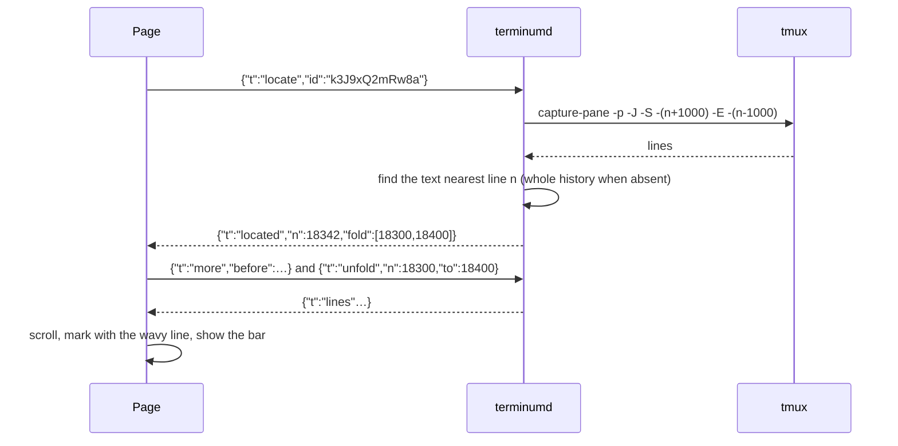
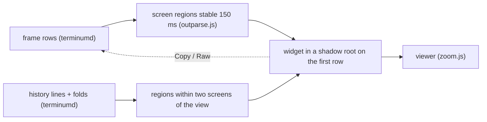
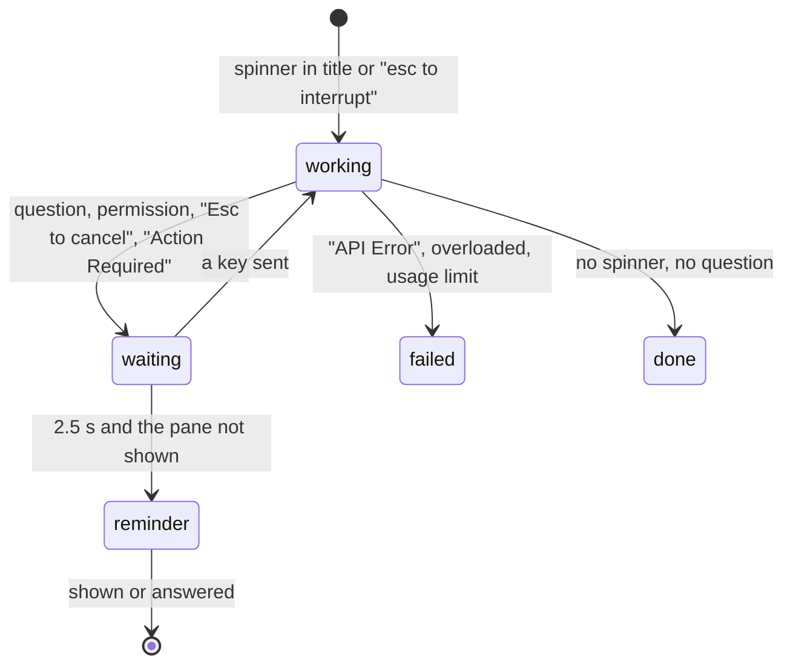

# terminum — Specification (terminal features)

Sibling of `terminum.md` (the core: tmux, screens, typing, sessions, install, security). This spec holds the reading and coding-agent features of the terminal view, inherited from iterm-enhancer's web app (its AC 52, AC 55, AC 56, AC 57, AC 58). Cases are AC-31…AC-40, AC-90, AC-91, AC-97 and AC-98; the core's AC 02 (screens), AC 03 (typing) and AC 04 (Lines modes) are assumed. A case of another spec is written `AC nn` (a space); `AC-nn` is this spec's own.

## 0. Metadata

| Field | Value |
|---|---|
| Version | 0.6.9 |
| Date | 2026-10-29 |
| Status | draft |
| Author | Claude (Fable 5.1) for the owner |

Change log:

| Version | Date | Change |
|---|---|---|
| 0.6.9 | 2026-10-29 | Owner: the panes the floating buttons open (Bookmarks, Reminders, Sent, Plan) each had their own size, place, chrome, type and keys; on a computer each is now a window as View's: 12 px under the terminal's top and 16 px over its end, 820 px wide at most, left of the floating buttons, View's chrome, corners and shadow, View's head (a 14 px title, its keys 24 px, × at the right), its text in View's Markdown type (16 px, 1.65 line height, 22 px in from its sides), its actions at its foot, the first at the left and the others at the right. Find's field stays as it is. The bookmarks' titles and texts in the terminal's font (0.6.3) are now in View's type, a bookmark's own text still in a code block (AC-33, AC-90, AC-91, AC-97). |
| 0.6.8 | 2026-10-29 | Owner: the bookmarks' navigator's Done is Resolve (the bar's too: it resolves a reminder, deletes a bookmark), and its actions are laid out as Show in terminal at the left, Resolve and Quote in chat together at the right (AC-33). |
| 0.6.7 | 2026-10-29 | Owner: two zips dragged from Finder (a Dropbox folder) onto a pane of this Mac were uploaded as copies and one refused ("larger than the 100 MB an upload may be"); a drop on a pane of this Mac in this Mac's browser pastes the files' own paths, one per line in a coding agent's box, nothing uploaded at any size, folders too. A browser never gives a page a dropped file's path: terminumd reads the drag's paths from macOS's drag pasteboard and takes them only when they are the files dropped (by name and kind, a file by size and time). 0.3.22's search of the disk by name, size and time was withdrawn at the owner's word; this reads no disk but the paths' own times and sizes. Pragmatic review applied: the drag pasteboard, not Finder's selection (it is the front window's only, and needs Automation, which an ad hoc build asks again for after each upgrade); a fallback says why; a path with a control character refuses the drop; a path is taken once. The over-100 MB message says how to copy a path in Finder (AC-36). |
| 0.6.6 | 2026-10-28 | Owner: the bookmarks' navigator as tall as the terminal (it started level with its button), and a record's long lines wrap (a code block scrolled sideways) (AC-33). |
| 0.6.5 | 2026-10-28 | Owner: a finished plan stayed at 100% on its row for good, also for the next requests (local:11: 9 of 9 done 12.7 h before, a new request 100% from its start); a finished plan is archived when the next request starts, and leaves the row 10 minutes after its last update once its turn is over (AC-97). |
| 0.6.4 | 2026-10-28 | Owner: the bookmarks' pane had too many buttons (a press jumped and opened the bar's seven); it is a navigator: the list at the left, the chosen one's content at the right rendered as Markdown by the file viewer's renderer (the user's bookmark as the terminal's text in a code block), Show in terminal, Done, Quote in chat; no ✓ on each row. "Insert into chat" of a bookmark or a reminder is "Quote in chat" and quotes an agent's record too (it was pasted as written); the sent history keeps Insert into chat (AC-33, AC-98). |
| 0.6.3 | 2026-10-28 | Owner: the bookmarks' pane as wide as View's window, its titles and texts in the terminal's font and size, to read them (AC-33); the Plan pane's "Now" has a gray pill inside its strip, not a rounded stripe along its edge (AC-97). |
| 0.6.2 | 2026-10-28 | Owner: a table Claude Code drew lost its top rule (left above the widget as text) after Ask typed into the agent's box: the page took the screen's first row, the table's head row then, for where the next scan starts, and that scan found a table without a top rule; the next scan never starts inside a drawn box, at the screen's first row either (AC-31). Files dropped from Finder or uploaded put their paths one per line in a coding agent's box, separated by spaces elsewhere (a shell would run each line at Enter: pragmatic review) (AC-36). |
| 0.6.1 | 2026-10-28 | Owner: the Plan pane was cramped, its lines one after another at one size. It is laid out in sections: a larger title, "Now" with the current step set apart, the progress as "3 of 9 done", its percent and a bar with the ETA under it, "Steps" with each mark in a round badge and the step in progress tinted, a rule before when it was updated and its source, "For you" with what the agent kept; in the theme's text color, never the cursor's (AC-97). |
| 0.6.0 | 2026-10-28 | Owner: a coding agent hands the user what must not get lost in the terminal's scroll (a final report, a next step, a gap seen elsewhere, deferred work, a question) through add_notes_for_user, now kept as the session's bookmarks, or reminders when the user must act or decide; the 0.23 notes (the Plan pane's list) are such records, imported once (AC-98). The bookmarks' pane goes through a session's bookmarks and reminders: by line, a press or ↑ ↓ jumps with the pane kept open, ✓ or Delete settles one with Undo for 5 s, Enter closes it; the bar has Done (AC-33). Pragmatic review applied: one tool, not a second beside the notes; a final report always a bookmark, when unsure a bookmark; agents' records limited on their own (50 open a scope, 500 in all), never the user's 300; a repeat by title not kept twice; text cleaned and redacted; Markdown with raw HTML off (0.5.0 had agent text as plain text: a self-contained report needs lists and code). Changed from the review: the record's place is found by its title where the agent's call was printed (the owner asked to jump to it), not dropped. The MCP tools' instructions 493 characters (511), all four tools' JSON 3,184 (2,858). |
| 0.5.9 | 2026-10-27 | Owner: no question mark and no waiting line for a Claude Code session waiting on its question (AskUserQuestion) in a pane its agent team's panes made narrow: past the hooks' 2 minutes the screen decides, and Claude Code broke its footer over rows ("Enter to select · ↑/↓" / "to navigate · Esc to" / "cancel"), so "Esc to cancel" was not found. The words that say it waits are read as one line (AC-39). |
| 0.5.8 | 2026-10-27 | Owner: the image buttons after a row as wide as the view stood alone on the line below it; they go on with the row's last word (a word joiner, generated, never copied) (AC-31). A path of 84 characters or more in a row of output shows its first 36 and last 40 with "[...]" between; a click on "[...]" shows it whole for as long as the page is open; copying, ⌘-click and its underline take it whole (AC-35). |
| 0.5.7 | 2026-10-27 | Owner: the reminders of sessions waiting for an answer were cards at the terminal's top right; now each is a line across the terminal's whole width at its top under the banners, one under another, its ? in the waiting yellow on a faint tint, its text cut by an ellipsis (AC-39). |
| 0.5.6 | 2026-10-27 | Owner: a link a program printed with a text of its own (an OSC 8 hyperlink: Claude Code's "⧉ Attack and Compromise Detection — MR !318") was plain text: terminumd dropped its address. It is kept with its cells and sent with their run; the text is underlined as an address is, its hover names the address, and it opens as one: http and https in a new tab, a file:// with no host or "localhost" as the pane's absolute path in View; another scheme, or an address with a control or bidi character, stays text; a row sends each address once (AC-35). |
| 0.5.5 | 2026-10-27 | Owner: the Plan button beside ✎ (a small gap: 10 px on a computer, 4 px on a phone), wide enough for its icon and the percent ("43%"); at 0% neither the percent nor the column's circle shows (AC-97). |
| 0.5.4 | 2026-10-27 | Owner, on a phone: the header's "Plan" was a text squeezed beside the title. The header has a Plan button (a key right of ✎, 10 px apart, on a phone 4 px; on the terminal view) for a session with a coding agent, a plan or notes, with the percent beside its icon ("43%", nothing at 0%); the progress is a circle with a ring and "43%" (✓ when all are done) first in the floating buttons' column (on a phone under ⟨…⟩, unfolded with the others), shown while the plan has an item done; either opens the Plan pane. The pane without a plan says only "No plan: the agent has not sent one for this session." (it explained the plan tools) (AC-97). |
| 0.5.3 | 2026-10-26 | Owner: a selection's Copy, [+] and Ask one gap apart (--sp-3, 12 px), with the same gap above Copy (and below Ask where the terminal's end keeps them in) on a phone and a computer; the floating buttons' column starts one gap under the terminal's top too (it was 14 px) (AC-37, AC-33). |
| 0.5.2 | 2026-10-26 | Owner: a long table Claude Code drew (13 rows, taller than the lines a scan keeps open) was half text, half a widget whose head was a row from its middle, the rows above it (with a redraw's repeated rows) left as text: a scan that met it off its grid settled inside it, and the next scan, from there, took that row for a head row without a top rule; a row after a line off the grid also passed for one. A scan now never settles inside a drawn box, and a head row without a top rule is one only when the line above it is no line of a box (AC-31). |
| 0.5.1 | 2026-10-26 | Owner: "I don't see where to look at the progress and the plan": a coding agent without a plan showed nothing. A pane running a coding agent shows a quiet "Plan" button in the header; "Plan and Notes…" in a row's menu; the Plan pane without a plan says so; a plan whose agent exited stays viewable, marked finished, until a new one (AC-97, AC-98). |
| 0.5.0 | 2026-10-26 | Owner: a session's plan and progress, and notes for the user (AC-97, AC-98). The plan comes from the agent's own plan tool, read by terminum's hooks from successful PostToolUse events (Claude Code's TaskCreate, TaskUpdate, TodoWrite; Codex's update_plan), and from `terminum mcp`, an MCP server `terminum hooks install` adds to both agents (update_session_plan, get_session_plan, add_notes_for_user, update_notes_for_user), whose items count only for a session with no built-in plan; the percent is completed of all items, never the agent's; the ETA is the agent's eta_minutes from the call's time, shown as its estimate; a plan not updated for clamp(turn / 6, 10, 30) minutes of a working turn is asked for once in that time through the hook's additionalContext, never typed; plans.json and notes.json in `state/`. Pragmatic review applied: an unknown id marks the plan partial, never an item; a failed tool call changes nothing; a new agent session in the pane archives the plan; model text as plain text only. Second review: a subagent's plan calls are not the session's; no reminder for an all-completed plan, staleness from the later of update and turn start; an unknown agent after a restart keeps the plan; notes bound to their tmux server, a pane's notes kept after it joins a project, 500 done notes at most; bidi controls dropped from model text; `terminum mcp` outside a pane offers nothing; Codex's block edits only terminum's lines, follows a symlink, refuses a file changed meanwhile. Deferred: get_other_sessions, the agent deleting notes, remote hosts. Production review: notes bounded (30 days for notes shown nowhere, 2000 in all); a pane making MCP calls with no hook event gets "terminum's hooks are not running in this session (Codex: trust them in /hooks); send the whole plan with update_session_plan." in the plan answers and `hooks: false` in the Page's `plan`; only the main agent calls update_session_plan (instructions), and a call whose _meta.sessionId is another than the pane's hooked session is not applied, said why; an install's refresh updates Claude Code's plugin over the old one (`plugin marketplace update`, `plugin update`, then seen in `plugin list`; on failure a warning, the old install kept); Codex's SessionEnd entry without `async` (Codex warned at each start), migrated alone by install and refresh, which then say to trust it once in /hooks (AC-39, AC-97, AC-98). |
| 0.4.17 | 2026-10-26 | Owner: a session whose agent started subagents and stopped its own turn showed done while they still ran. Claude Code's idle notice (sent while the main thread waits) set it done, a next prompt forgot the subagents, and the footer's agents counted 10 minutes at most, as a shell does. Now subagents keep it working through the idle notice and the next prompts until the last one stops; the footer's agents (local agents, teams, dynamic workflows, cloud sessions) keep it working however long they run, its shells and monitors 10 minutes as before; on a screen without Claude Code's input box (Codex) the last 10 rows' "2 agents still running", "1 subagent is running", "Waiting for 2 agents" keep it working. Claude Code's "← 1 agent" is its agents view's count of other background sessions waiting on the user, not this turn's work (read in its code, 2.1.310) (AC-39). |
| 0.4.16 | 2026-10-26 | Owner: in a split's embedded page (a quick shell, a split pane) a selection's Copy and [+] stood at the terminal's left, over the text: their column's place was read from find's button, which that page does not draw. They stand where the column stands, at the terminal's right, as on the tab's own page (AC-33, AC-37). |
| 0.4.15 | 2026-10-26 | An audit's findings fixed. Send to Agent's Enter, typed 0.2 s after the quote, went to whatever pane was shown by then (a shell's line there ran), and Send to Agent stayed in the dialog after the agent ended (the quote was then sent into the shell and run): the Enter goes only to the same pane while it still runs its agent, else a toast says it was not pressed; Send to Agent hides, said in the dialog, when the agent ends while it is open; after a number that did not come in 10 s, Add to Chat and Send to Agent ask again (they did nothing) (AC-37). On a touch screen the terminal no longer redraws while the page takes a selection away for 0.12 s to put iOS's menu away, so the selection comes back whole (AC-37). The sent history's and the reminders' panes keep Tab and Shift+Tab among their buttons and the keys from the terminal's input behind them (AC-90). A paste's or an upload's body is read only once one of the two upload slots is free (it was read first, so any number were held in memory) (AC-36). |
| 0.4.14 | 2026-10-25 | Owner: pasted and uploaded files older than 7 days went only at the next paste, so a Mac or host nobody pasted on kept them (264 files, 107 MB here); now they also go when terminumd starts and once a day, and on a host when its files agent starts and once a day while it runs (AC-36). |
| 0.4.13 | 2026-10-24 | Owner: on a computer a selection's Copy, [+] and Ask stand in the floating buttons' column, in one line with find and the sent history, Copy level with the selection's first line (kept inside the terminal), and the column's other buttons are hidden while they show (they stood left of the column, level with the selection's end, beside the column) (AC-33, AC-37). The floating buttons answer the pointer: they lift 2 px and grow 12% on a spring, and their icon nods once (docs/UI-GUIDELINES.md §2.8). |
| 0.4.12 | 2026-10-24 | Owner: files and folders dragged from the Files panel onto the terminal put their paths at the input's cursor (shell-quoted, separated by spaces, no Enter), nothing uploaded: they are already where the pane runs; several selected rows go together; a file of another host than the pane's is refused with a toast (AC-36; terminum-files.md AC-52). |
| 0.4.11 | 2026-10-24 | Owner: "artifacts/screenshots/…/row.png" and other paths a coding agent printed were no links: Claude Code worked in a worktree three folders below where it was started, and the pane's folder (tmux's, its process's) stayed there. A relative path is looked for from the folder the agent's hooks last said it works in (its own events, not a subagent's: `cwd`), then from the pane's, and opens where it is (AC-35). |
| 0.4.10 | 2026-10-23 | Owner: Ask's field has no "Question" label (it holds a comment or a task as often as a question) and says "Your comment or task about it"; a field in focus keeps its fill, edged in the accent, without the accent gradient (every field: the page's and the Files panel's filter) (AC-37; UI-GUIDELINES.md §6). |
| 0.4.9 | 2026-10-23 | Owner: the quotes ran together in the agent's box (no blank line after a quote or its question) and were folded into "[Pasted text #2 +5 lines]". The quote is a Markdown quote ("> Quote #0007", then each of its lines after "> "), a blank line after it and after the question; in a coding agent's box it is typed (its new lines Ctrl+J), so the agent shows it whole, unless it would fill more than half the pane's rows (a box taller than the pane breaks the agent's redraw, 0.4.7): then it is pasted and folded, as is any quote in a shell (AC-37). |
| 0.4.8 | 2026-10-23 | Owner: Add to Chat leaves the view where it was (the paste, as typing, brought it to the input's cursor for 3 s, away from the text the user was reading); Send to Agent still goes to the input, where the answer comes (AC-37). |
| 0.4.7 | 2026-10-23 | Owner: Ask's quote is compact: `Quote #0007: «…»` on its first line, the question under it, no Quote Start/End or rule, the quote's blank lines and line ends' spaces left out, a new line after it (not a blank one). Three quotes at a phone's 45 columns made Claude Code's box taller than the pane's 32 rows, and its redraw then wrote over the answer on the screen (an item of it gone, rows jumbled, the answer reprinted); each quote now takes 4–5 rows fewer (AC-37). |
| 0.4.6 | 2026-10-23 | Owner: the wavy line stood on the quote as sent (the message after it, Ask's `Quote Start ---- «`) instead of the text asked about: the agent had reprinted its answer and the original moved 130 lines away, so the sent copy was the nearest occurrence. That copy is never marked now (AC-37; `e2e_ask.mjs`, red before the fix). |
| 0.4.5 | 2026-10-22 | Owner: a quote asked about (Ask's Add to Chat or Send to Agent) keeps a light blue wavy line down its left in the terminal, as a reminder's quote (first drawn as an underline; the owner asked for the side), kept by terminumd per pane so every page shows it (AC-37). |
| 0.4.4 | 2026-10-22 | Owner: rendered output (a table, a diff's table, Markdown, a diagram) is never folded: a fold the history's look found over lines the page has and draws as a widget gives way, so a table no longer turns back into plain text a second after it was drawn; a fold of lines not sent (no text to draw) stays (AC-32, AC-56). |
| 0.4.3 | 2026-10-22 | Owner: a tool's output that scrolled into the history whole folds at once, while the agent's next line is still on the screen (the history's look reads the screen after it); before, it stayed open until that line scrolled off too, so the block just above the screen often stood unfolded while the agent thought (AC-32). |
| 0.4.2 | 2026-10-22 | Owner: iOS's menu still came over a finger's selection: the page now clears the selection when the finger leaves it and makes it again 120 ms later (measured in the iPhone simulator: a frame later the menu stays; 120 ms puts it away, the handles kept), after every lift, a tap on the selection too (AC-37). |
| 0.4.1 | 2026-10-22 | Owner: the reminders' bell blinks nowhere: up, it stands still with its count filled (AC-91). |
| 0.4.0 | 2026-10-22 | Owner: on a phone a selection in the terminal shows no iOS menu (Copy, Find Selection, Translate): the page's Copy, [+] and Ask stand at the terminal's top right in a column, where the folded floating buttons stand (AC-37, AC-33; terminum.md AC-18); a double tap on a word in an agent's input box selects it, and Cut or Clear on that selection deletes it as Backspace does (AC-40; terminum.md AC-03). |
| 0.3.29 | 2026-10-21 | Owner: the sent history's pane and the reminders' are modal: the page shaded behind them, a press outside closes them as × and Esc do, they take the keys while open and give them back (AC-90, AC-91). |
| 0.3.28 | 2026-10-21 | Owner: a drawn table the page first saw half-drawn (its last row cut, or blank rows under it: an agent's frame caught midway over ssh) stayed text for good; it waits for the rest (AC-31). |
| 0.3.27 | 2026-10-21 | Owner: Ask's dialog a quarter larger (600 px wide, a 4-line question, the quote up to 37.5% of the window's height) and centered on the terminal, not on the whole window (AC-37). |
| 0.3.26 | 2026-10-21 | Owner: a running tool's "⋯ 2 more lines of the command" came and went every 0.6 s, the page jumping: Claude Code blinks the running tool's dot and the rule needed it; a row with the dot blinked off counts when the tool's result follows (AC-32). |
| 0.3.25 | 2026-10-21 | Owner: Backspace or Delete over text selected in a coding agent's input deletes it, as in a text field (AC-40). |
| 0.3.24 | 2026-10-21 | Owner: Ask's Send to Agent, left of Add to Chat, sends the quote and the question to the coding agent at once (pasted, then Enter); shown only when the pane runs a coding agent (AC-37). |
| 0.3.23 | 2026-10-20 | Owner (iPhone): more typos than in the system's apps, the keyboard's space-bar trackpad moved nothing, the view jumped as the screen redrew. The keyboard field keeps what was typed since a line end or a move (iOS aims its keys by the word; an emptied field made every letter a word's first) and sends a change to it as backspaces and what is new (iOS's own corrections too); the trackpad's caret moves are ← and →; while the keyboard is up the field moves only when its row moves a row or more (iOS scrolls the page to a focused field that moves), and the page refits only when the visible area changed (AC-40). Not verified on an iPhone in this change: iOS's key aim and the jump need the owner's phone. |
| 0.3.22 | 2026-10-20 | Owner: uploads take 100 MB (a 22 MB zip failed at 20 MB); a larger file is not sent and the page says to give its path instead, never the server's raw text; Starship's prompt with a variation selector after ❯ ("at 19:20 ❯︎") is told apart from the command sent (AC-36, AC-90). A file found on this Mac by its name, size and time and pasted by its own path was built and withdrawn at the owner's word. |
| 0.3.21 | 2026-10-20 | Owner: a mark's press lands on its message (it went to a wrong place): an agent's prompt only on its prompt row, a folded paste's placeholder not looked for, a bar of several tries each, a hidden line brings what shows it; an answer's end never taken from a question's options (AC-90). Measured on a replayed real chat: 9 of 9 marks land in view. |
| 0.3.20 | 2026-10-20 | Owner: Ask's quote numbers count on across terminumd's restarts (the last given was kept in memory only, and a pane without hooks never had its folded paste in the sent history: numbers began again at 1) (AC-37). |
| 0.3.19 | 2026-10-20 | Owner: a bookmark's wavy line stands apart from the terminal's edge and the text (a 16 px gutter); a bookmark just saved is marked by it at once (it showed only once brought into view) (AC-33). |
| 0.3.18 | 2026-10-20 | Owner: Ask's quote has a blank line after it only, none before (AC-37). |
| 0.3.17 | 2026-10-20 | Owner: every dialog's fields and buttons share its type, the terminal's font at its size (Ask's question and a project's name were 16 px, the name in the interface font); the Bookmarks / Reminders window's head as a dialog's, its list as the session list's (AC-37, AC-33). |
| 0.3.16 | 2026-10-20 | Owner: a pale blue mark where each answer of the agent ended, kept by terminumd from the screen at the turn's end (AC-90); a question's words in the transcript above Claude Code's input box no longer make a session waiting (a false ?) (AC-39). Pragmatic review applied: the screen read at the hooks' Stop (not at the list's turn end, seconds later), the turn line, rules and rows too short to be found again passed over, nothing kept for a full-screen program, `endnew` rather than `sentnew`; rejected: the answer's last line from the hooks' payload (terminum hook never forwards the agent's answer). |
| 0.3.15 | 2026-10-20 | Owner: Ask's quote set off by a blank line before and after, typed as Ctrl+J in an agent's box (AC-37); the right edge's marks span the whole loadable history and a mark whose line left it is gone (it stayed at the top); Settings' Side marks switch (AC-90). |
| 0.3.14 | 2026-10-20 | Owner: the header's bar does not breathe; a waiting session's ? goes at once when it is shown (it stayed seconds after the answer) (AC-39). |
| 0.3.13 | 2026-10-20 | Owner: "Bookmarks / Reminders" at the list's foot opens a large window on the right, not a box in the session list; the terminal's text stops 6 px before the marks on its right edge (AC-33). |
| 0.3.12 | 2026-10-20 | Owner: the header's ⋯ stands over the floating buttons' column (AC-91); Ask stands under the selection's [+] on every screen, on a pastel cornflower blue fill (AC-37); the sent messages', bookmarks' and reminders' marks of a wide window move from a strip on the left to the right edge, as rounded bars like a bookmark's mark (AC-90). |
| 0.3.11 | 2026-10-20 | Owner: Ask on a selection pastes it quoted with a question and a running number per pane (AC-37); a wide window shows bookmarks on the left strip only (AC-33); the strip asks terminumd again only for a message kept in its own pane (`sentnew` names it) (AC-90). |
| 0.3.10 | 2026-10-20 | Owner: the sent history's pane has Jump to message (found by terminumd by its text near the line it was sent on); a 6 px strip on the terminal's left edge on a wide window shows the shown pane's sent messages (white), bookmarks (orange) and open reminders (pink) as dots that bring them into view; sent entries keep their pane and line (AC-90). Pragmatic review applied: a line is only a hint, found again by text on the server, never trusted as a position; a hooked prompt takes the page's line by text, not within a time window; rejected: bookmarks only on one rail (the owner asked for them on the left; both rails draw from one list). |
| 0.3.9 | 2026-10-20 | Owner: the floating buttons start 14 px below the terminal's top, 12 px apart; a pane opens 14 px left of its button with its first row centered on the button, which stays in sight (the magnifier too, ringed while its field is open); Send to Chat is "Insert into chat", one button alike on a bookmark's bar, a reminder's card and the sent history's pane, which pastes the message shown (AC-34, AC-90, AC-91, AC-33). |
| 0.3.8 | 2026-10-20 | Owner: Send to Chat on a bookmark's bar and a reminder's card pastes its note and, under it, its text quoted into the shown pane's input, no Enter (AC-33, AC-91); the list's foot button: the bookmark's icon orange, the bell pink before "Reminders" (AC-33); the reminders' bell blinks only on a touch screen, on a computer it stands still with its count filled (AC-91). |
| 0.3.7 | 2026-10-20 | Owner: on a touch screen only a tap on the input (the cursor's row, an agent's input box) or the keyboard button opens the keyboard; a tap elsewhere on the terminal (to read, on a link, a program's click) leaves it as it was (it opened it) (AC-37, AC-40). |
| 0.3.6 | 2026-10-20 | Owner: a bookmark or a reminder belongs to the project (AC-92) its session was in when it was made, else to that session alone: only there it shows, comes up and marks the list (a folder's sessions in other projects showed it); terminumd orphans it once that project goes (deleted, or its last session closed) or, outside projects, that session closes, and the foot's "Bookmarks / Reminders" (both icons) lists only those no session shows; the bell's pane closes when another session is shown (it stayed open over it, at the window's top left) (AC-33, AC-91). `web-bookmarks.json` version 3: `project`, `orphaned`; an older file's bookmarks take the project their session is in, once; a restored server's bookmarks take their panes' new keys. |
| 0.3.5 | 2026-10-19 | Owner: work in the background alone (a dev server, `tail -f`, a monitor) keeps a session working for 10 minutes at most, then it is done all the same (its turn ends, unread, reminders); the agent itself at work has no limit (AC-39, AC-93). |
| 0.3.4 | 2026-10-19 | Owner: without hooks, Claude Code's "Waiting for N background agents to finish" is working (its subagents still run; it read done, and the session came up unread and its reminders due while they worked); a turn read from the screen ends once its pane stayed done 10 s; Claude Code's footer counting a shell, a monitor or an agent in the background is working (a session done but for a background shell came up unread) (AC-39, AC-91). |
| 0.3.3 | 2026-10-19 | Owner: a turn that stops while its subagents run in the background stays working until the last of them stops (it showed done while they worked), and ends then (AC-39). |
| 0.3.2 | 2026-10-19 | Owner: a tool's output still on the screen folds by the same rules, terminumd sending the screen's folds with each screen that changes them; never a full-screen program's rows nor the cursor's (AC-32). A reminder's card has no colored edge; a quote in it has the list's wavy pink line (AC-91). |
| 0.3.1 | 2026-10-19 | Owner: bookmarks and reminders belong to a project (the host and folder of the session they were made in): every session of it shows them, orphaned ones only in the list below the sessions (Bookmarks \| Reminders, Open all, Delete for good) (AC-33, AC-91); the list marks them as wavy orange and pink lines; a Markdown table in an agent's diff is drawn as a table (AC-31); a tool's output in the history folds to its first line and two more, Codex's too (AC-32). |
| 0.3.0 | 2026-10-19 | Owner: AC-39 coding agents' own hooks (`terminum hooks install`: Claude Code's plugin, Codex's hooks.json; `terminum hook` posts each lifecycle event to terminumd's socket) say a pane's state, its tool, what it waits for and its subagents over the screen's reading, under leases; AC-90 sent history per project (a host and a folder) under the split; AC-91 reminders, a kind of bookmark that comes up when its session's agent ends a turn. Pragmatic review applied: only a start or a prompt makes a pane's hook record (a late event of an ended session made a false "working" and a false reminder), late approvals and notifications of a stopped turn change nothing, a hooked pane's turn ends by its Stop (a turn quicker than one layout was missed), a prompt is kept only from a known agent's UserPromptSubmit, redaction over any whitespace and of `key: value`, `Bearer`, private key blocks and the tool summary, a command after a space keeps its space (it was kept against the user's wish), Claude Code's plugin added anew (no "already" taken as success), timeouts within Codex's 3 s; a hooked wait gives way to a screen showing the agent at work (an approval answered fires no event). Rejected: a line-count cache for sent.jsonl (at most 4 MB, read at a person's pace). Open: Codex loading terminum's hooks.json is checked against Codex 0.163's event names and keys, not by a live Codex run. |
| 0.2.3 | 2026-10-18 | AC-39: Codex as measured on 0.162: started through npm (program `node`) it is known by its screen; its "Action Required" title and its question tool wait; its usage, credit, retry and load errors fail; the list title drops its blinking mark. Pragmatic review: no verdict kept per pane (a Codex followed by a dev server within one refresh would raise false reminders) and none from the title; rejected: skipping the screen read while the title says waiting (one pane, while it asks), backing off `node` panes (one batched capture each per 6 s, as agents), "an error above the last 'Worked for' is history" (unverified that an agent never prints "Worked for" after its error: a hidden failure is worse than a stale one), finding Codex by the process tree (needs a command on every host; the screen works over ssh as it is). |
| 0.2.2 | 2026-10-17 | AC-31: a table a program drew with rules (Claude Code's ┌─┬─┐, mysql's +---+) is a table widget, whose cells wrap where its drawn rules broke apart in a view narrower than the pane. Pragmatic review: an ASCII table's empty first value stays a row; rejected: a colored table starting in Raw (its colors carry meaning), as the request is HTML tables wherever they are read and Raw is one press away. |
| 0.2.1 | 2026-10-16 | AC-39: a coding agent that is done shows no mark (the green check is gone). |
| 0.2.0 | 2026-10-15 | Pragmatic review: AS-31 names the page edits the core's protocol table lists; renderers at `/fb/renderers.js` as the page loads them; bookmark keys per OQ-31 stay open. |
| 0.1.0 | 2026-10-15 | Initial draft from iterm-enhancer 0.42: widgets, folds, bookmarks, search, links, paste and upload, selection and phones, traces, coding agents, phone editing. |

## 1. Overview

**Problem.** A terminal shows output as rows of text. A coding agent's session is thousands of lines of Markdown, diffs, code, commands and images named by path; on a phone, finding a place again, reading a diagram, or putting the cursor into the agent's input box is slow or impossible in a plain terminal.

**Who it affects.** Users of coding agents (Claude Code, Codex) and long-running commands who read and answer from a Mac, a tablet or a phone.

**Expected outcome.** The terminal view renders what the output is (code, Markdown, diagrams, images), folds what nobody reads twice, remembers places as bookmarks, searches the whole loadable history, opens paths and links, takes pasted images and files, copies text cleanly on every device, shows an agent's state in the list and reminds when it waits, and lets the user edit the agent's input with taps and arrows as in a text field. The looks and behavior are iterm-enhancer's web app's; the source of screens and history is tmux through terminumd.

**Scenario, before and after.**
- Before: Alex scrolls 4,000 lines on a phone to find the table Claude printed an hour ago, reads its Markdown source with `|---|`, and taps three times to get the cursor into the right word of a long prompt.
- After: Alex taps the bookmark mark on the edge; the table is rendered, in view in a second. A tap in the input box puts the cursor on the word. The list shows which of six agents waits for an answer.

## 2. Scope and non-goals

In scope:
- Output widgets, history folds, bookmarks, search, links and file names, paste and upload, selection and copying on phones, the latency and context traces, coding-agent states and reminders, input-box navigation.

Out of scope (explicit):
- Rendering by the terminal of inline images or sixel (core §2).
- Editing a file from the terminal view (the Files panel's View does that, `terminum-files.md`).
- Programs' own mouse handling outside Screen mode (core AC 06).
- Plans and notes (AC-97, AC-98) in v1: an MCP tool listing other sessions (get_other_sessions), the agent deleting notes (delete_notes_for_user: the user deletes); panes of remote hosts are specified in terminum-remote.md AC 99 (coding agents' progress on a host).

## 3. Assumptions, dependencies, open questions

Assumptions:

| ID | Assumption | Owner | Status |
|---|---|---|---|
| AS-31 | The inherited page modules of this spec (`outparse.js`, `widgets.js`, `folds.js`, `marks.js`, `markjump.js`, `find.js`, `links.js`, `termlinks.js`, `upload.js`, `agentbox.js`, `boxnav.js`, `waiting.js`, `trace*.js`) work unchanged on terminumd's frames, because the frame, history, folds, found and marks messages keep iterm-enhancer's shape; the page's only edits are the renames and removals in the core's protocol table (`terminum.md` §9: `app.js`, `navtools.js`, `index.html`). | Claude | unverified: `web/test/e2e_web_all.mjs` on terminumd |
| AS-32 | The folds, bookmarks and search of iterm-enhancer's bridge (`fold.py`, `bookmarks.py`, `search.py`) are pure functions of the lines and port to Rust line for line. | Claude | verified by reading them (no iTerm2 call inside) |
| AS-33 | Claude Code's input box rows hold `cols - 2` characters, the prompt included; its footer and status lines follow the box; a redraw of its own can leave the cursor below the footer. Measured in iTerm2 at 54–151 columns; tmux's grid is the same program's output. | Claude | verified in iterm-enhancer 0.39–0.40 |

Dependencies:

| ID | Dependency | Owner | Status |
|---|---|---|---|
| DEP-31 | `renderers.js` bundled by `ui/` (markdown-it 14, the panel's CodeMirror highlighter, mermaid 11, ~3.6 MB in chunks), served by terminumd at `/fb/renderers.js` as the page loads it (`widgetui.js:13`). | Claude | available |
| DEP-32 | The CSS Custom Highlight API for underlines (Safari 17.2+, Chrome 105+); a browser without it shows none. | Claude | available |

Open questions:

| ID | Question | Owner | Status | Decision |
|---|---|---|---|---|
| OQ-31 | Bookmarks are keyed by the pane's key (`tmux:<host>:<socket>:%N`): a pane id is reused by tmux after a server restart. Add the session's creation time to the key? | Claude | open | Proposed: key + `#{session_created}` of the pane's session; a bookmark whose session is gone says "closed" as today. |

## 4. Acceptance cases

| ID | Priority | Case |
|---|---|---|
| AC-31 | [SHOULD / P1] | In the terminal, a file printed by a command, a fenced block, a Markdown document, a Mermaid diagram, a table drawn with rules and an image file named in the output are widgets: rendered in place with Raw, Copy and a full-screen viewer, while the text, selection and copying stay as they were. |
| AC-32 | [SHOULD / P1] | Diffs, written files, long tool output, blank runs, encoded data, repeated and similar lines in the history are folded into one line each with Show and Copy, found by terminumd before the page sees them. |
| AC-33 | [SHOULD / P1] | A selection in the terminal becomes a bookmark with a note, kept on the Mac for every signed-in client; marks on the terminal's edge and a list bring the text back into view, also in older, folded or rendered lines; a bookmark whose lines are gone keeps its text. |
| AC-34 | [SHOULD / P1] | The shown pane's whole loadable history is searched by terminumd: the count, the first match in view and marked, next and previous, every match a mark on the edge. |
| AC-35 | [SHOULD / P1] | Web addresses and file paths in the output are underlined and open: addresses in a new tab of the reader's browser, files in View on the pane's host, only when the file exists. |
| AC-36 | [SHOULD / P1] | The user pastes an image, uploads a file or drops files onto the page; they are saved where the pane's shell runs and their paths are pasted into the pane without Enter. |
| AC-37 | [MUST / P0] | The user selects and copies terminal text on a computer, a tablet and a phone with the system's own menus and handles, with line ends kept, while the screen pauses under a selection and catches up after. |
| AC-38 | [SHOULD / P1] | With `?trace=1` terminumd and the page record each key's stages and session opens for 15 minutes into a log a script sums up; with `?trace=2` the page keeps a ring of events and input-box snapshots a button copies for a coding agent. |
| AC-39 | [MUST / P0] | A pane running a coding agent shows its state (working, waiting, failed; done shows no mark) in the list and the header, breathes while it works, and a reminder over the terminal names an agent that waits for an answer in a pane not shown. |
| AC-90 | [SHOULD / P1] | Every message or command the user sends in a pane is kept per project (its host and folder) and read back as Markdown from a button under the magnifier: the last first, older and newer. |
| AC-91 | [SHOULD / P1] | A bookmark can be a reminder: a pale fuchsia button comes up, its count filled, over every session when its session's coding agent ends a turn, until pressed; its pane shows the open reminders as Markdown; Close puts one down until the next turn's end, Resolve ends it. |
| AC-97 | [SHOULD / P1] | A coding agent's plan (its own plan tool through the hooks, or terminum's MCP tools) shows as a percent and a track on its session's row and in the header, and in a Plan pane with the items, the current step and the agent's ETA; a plan not updated for a while is asked for through the hooks. |
| AC-98 | [SHOULD / P1] | A coding agent hands the user what must not get lost in the terminal's scroll (a final report, a next step, a gap seen elsewhere, deferred work, a question) through terminum's MCP tool: kept as its session's bookmarks, or reminders when the user must act; self-contained, found where the call was printed. |
| AC-40 | [MUST / P0] | In a coding agent's input box on a phone, a tap puts the cursor on the character under it, ↑ and ↓ move by the page's lines, a slide moves the cursor, held delete deletes words, the box is a panel above the keyboard with its status lines behind ⓘ, and the cursor is drawn in the box when the agent left it below the footer. |

## 5. BDD scenarios

### AC-31 — Output widgets [SHOULD / P1]

```gherkin
Scenario: AC-31 happy path — a file printed by a command
  Given the shown pane printed "cat README.md", 80 lines of Markdown, then its prompt "alex@mac api %"
  Then the lines from the command to the next line starting with that prompt (its numbers aside; a two-line prompt's blank and colored lines before it excluded) are a Markdown widget: a bar ("Markdown · Raw | Markdown · Copy") over the rendered document as wide as the terminal, fenced code highlighted in the theme's ANSI colors, Mermaid fences drawn
  And "cat", "bat", "head", "tail", "less", "more", "nl" with one file name are such commands; a prompt of one or two characters ("$ ") ends nothing; ".mmd" and ".mermaid" are diagrams, other names are code in the language of the name

Scenario: AC-31 happy path — fences, documents and diagrams in any output
  When the output holds a fenced block (``` or ~~~, closed by the same fence), a Markdown document (a run of lines with a heading after a blank line, a table or a fence, two kinds of Markdown signs and three lines with one, at most 6 plain lines between, less than 30 % code-like lines, never across a prompt line) or a diagram starting with its keyword alone on a line ("flowchart LR", "sequenceDiagram" …) up to the next blank line
  Then each region is a widget: a fence named "mermaid" is a diagram, another is code; a document's shared indentation is removed (an agent indents its tools' output), a document may start on a tool's first line ("  ⎿  # Title"); an unfenced diagram starts in Raw (text from anyone reaches Mermaid only when the user presses Diagram)
  And Raw shows the lines as before with the bar; the choice is kept per region while the page is open; Copy copies the source (a fence's code without the fence); a click on a diagram opens the viewer

Scenario: AC-31 happy path — a table drawn with rules
  Given Claude Code drew a table of 2 columns and 2 rows in a pane 140 columns wide ("┌───┬───┐", "│ Commit │ What │", "├───┼───┤" between rows, "└───┴───┘"), a cell wrapped over two lines, its code colored
  When the page shows the pane, also narrower than 140 columns (a phone, Wrap)
  Then the lines from the top rule to the bottom rule are a table widget: a bar ("Table · Raw | Table · Copy") over an HTML table, the first part (before the first rule) its head, each part between rules one row, a wrapped cell's lines one cell again; its cells wrap at the view's width, a table wider than that scrolls sideways in the widget
  And the rules may be light, heavy, double or rounded (rich, tabulate) or ASCII ("+----+", mysql, prettytable); a table without rules between its rows has a row per line, in a box table a line whose first cell is empty going on the row above (an ASCII table's never: mysql does not wrap); a column of numbers (units and "-" allowed) is aligned right; cells are put in as text
  And Copy copies it as a Markdown table ("|" in a cell as "\|"); Raw shows the drawn lines
  And it is a widget although the program colored it; one rule of a single column (an agent's box, a banner), or a line that does not fit the grid is no table; a table whose bottom rule is not printed yet, or whose line off the grid has only blank lines after it (a row printed halfway, a frame caught half-drawn), waits for the rest; a Markdown document ends before a drawn table
  And a table whose top rule is not there (scrolled away, or cut off where it was copied: "│ What │ Without │ With │" then "├───┼───┼───┤") starts at that head row, when the line above it is no line of a box (a row after a line off a table's grid is no head: that table stays text, all of it, never half a widget) and the middle rule under it has as many columns, also when the history ends inside the table and the screen begins at its head row (Claude Code redrawing its screen after Ask typed into its box): the scan goes on from its top rule
  And known limits: a table with rules between its rows and no head shows its first row as the head; a first cell wrapped without rules between rows (rich) becomes a row of its own; an unchanged table in a diff's context is a widget too; its colors are dropped in the widget (Raw keeps them)

Scenario: AC-31 happy path — a Markdown table in an agent's diff
  Given Claude Code shows its edit of a Markdown file as numbered diff rows ("  7 - | Version | 0.11.1 |", "  7 + | Version | 0.12.0 |")
  When two of the rows in a row or more are table rows
  Then they are drawn as a table widget: the header from the row above a "|---|" when the diff shows it, a removed row struck, an added row tinted; Raw shows the diff as it is
Scenario: AC-31 happy path — an image named in the output
  When a row names an image file (png, jpg, jpeg, gif, webp, svg, bmp, ico, avif) that exists in the pane's folder on the pane's host (its folder listed by name, nothing read; looked for again after 10 s)
  Then a small image button stands after the row's text, on the line of its last word (a row as wide as the view: the word goes on with the buttons, never the buttons alone on a line below it) (rows within a screen of the view only; not in a drawn box, an agent's input box or its footer)
  When the user presses it
  Then the image is read through the Files API on the pane's host and shown centered below the row within half the terminal's width and height, with its path and ×; the row stays where it was on screen; a click opens the viewer; a file that is not an image says why

Scenario: AC-31 happy path — the viewer
  When the viewer opens an image or a diagram
  Then it covers the window fitted (a photo never past its pixels), with −, +, Fit and × at the top right; pinch, drag, wheel and double tap zoom and move; Esc or × closes it and the terminal has the keys again on a computer

Scenario: AC-31 edge — the terminal stays the terminal
  Then rows' text does not change: a selection across a widget copies the region's lines; link underlines, cursor taps and the agent's input box work as before; output a program colored itself (bat, glow, delta, an agent's own rendering) is never a widget
  And a region on the screen becomes a widget once unchanged for 150 ms and stays one while the screen changes below it; the cursor's row and below are never part of one, nor an agent's input box; streaming output is looked at every 100 ms at most and never further back than 2000 lines; in the history only regions within two screens of the view are drawn (a 10,000-line chat loads as fast as without widgets); at most 150 widgets and 50 open images are kept
  And a widget acted on in sight keeps its line in place; one changing by itself keeps the first line wholly in sight in place; following the output, the view stays at its end; nothing grows after placement (images and diagrams go in once decoded, widgets once their stylesheet is in)

Scenario: AC-31 failure — the renderer cannot be loaded or a diagram does not parse
  When "/fb/renderers.js" does not load
  Then the bar says "The renderer did not load (<reason>); is terminumd running?", Markdown and diagrams show as text, code as plain text; pressing Markdown or Diagram tries again
  And a Mermaid fence that does not parse shows Mermaid's message in its bar and its lines as text; inside a document only that diagram stays source
```

### AC-32 — History folds [SHOULD / P1]

```gherkin
Scenario Outline: AC-32 happy path — what folds
  Given the pane's history holds "<what>"
  Then terminumd folds it into one line "<shown>" with Show and Copy, sent as {n, to, label} with the lines (null in a folded line's place)

  Examples:
    | what                                                                                   | shown                               |
    | an edit's diff under an agent's "⎿ Updated/Added/Removed/Deleted …" (6 lines or more)   | ⋯ 26 lines of diff                   |
    | a file it wrote ("⎿ Wrote …", "Created")                                               | ⋯ 81 lines of the file               |
    | a tool's command after its line and one more (2 more or more)                          | ⋯ 85 more lines of the command       |
    | a tool's output after its first 8 lines (8 more or more; its blank lines included)     | ⋯ 753 more lines of output           |
    | 3 or more blank lines before an agent's next "⏺" or "⎿" line                           | ⋯ 10 blank lines                     |
    | 3 or more rows of base64, base64url or hex (runs of 40+, digits and letters mixed)     | ⋯ 3.2 KB of base64 · 41 lines        |
    | one line 5 or more times with only blank or 1–3 character lines between (its first kept) | ⋯ 64 more copies of this line      |
    | 20 or more nearly equal lines (numbers, paths, long words aside), first 3 and last 2 kept; never a line saying something failed | ⋯ 4,386 similar lines |

Scenario: AC-32 happy path — a tool's output down to a summary
  Given Claude Code's ("⏺ Bash(…)", "  ⎿  …") or Codex's ("• Ran …", "  └ …") tool output has scrolled into the history
  Then its command keeps two lines at most, its output its first line and two more, and the rest is one line "⋯ N more lines of output", within a second, also while the agent's next line (its end) is still on the screen; an output going on from the history onto the screen folds once it scrolled off whole; neither agent can shorten what it shows itself (Claude Code's /focus collapses its own view; a PostToolUse hook changes only what the model reads)
Scenario: AC-32 happy path — on the screen too
  Given a tool's long output is still on the screen, under the agent's next line
  Then the same rules fold it there: the screen message carries its folds ([from row, to row, label], when they changed) and the page shows one line with Show and Copy in their place; Show keeps it open while its first row reads the same; the part that may go on (the last), a full-screen program's rows (vim, mc; Codex's own alternate screen is an agent's) and the cursor's never fold
Scenario: AC-32 edge — rendered output
  Given a fold found over lines the page has and draws as a widget (a Markdown table, a diff's table, a code block, a diagram: AC-56)
  Then the widget stays and the fold gives way; only a fold of lines terminumd did not send (no text to draw) stays a fold

Scenario: AC-32 edge — a running tool's dot blinks
  Given Claude Code runs a tool whose command takes 4 rows: while it runs it shows its dot for 600 ms and a space for 600 ms ("⏺ Bash(…" and "  Bash(…")
  Then the command folds alike in both phases ("⋯ 2 more lines of the command"), so the fold neither comes and goes nor moves the page, also on opening it; a row "  Name(" counts as a tool's only when the tool's result ("  ⎿") follows its command, so indented text that looks like a call never folds as one
Scenario: AC-32 happy path — show and copy
  When the user presses a fold's line
  Then the page asks terminumd for those lines ("unfold": only a fold terminumd told of, still in the history, at most 20,000) and shows them; the line says "Hide …"
  And Copy copies the fold's lines (asked for first when not here; copied in the same click over HTTPS, else "The lines are here: press Copy again")

Scenario: AC-32 edge — the whole, the screen, a clear
  Then only a whole part folds (one that may go on at the history's end waits); rows tmux wrapped are one line; the screen itself is never folded; lines that scroll off come with their folds in a "folds" message at most every second; a cleared scrollback drops the folds and new lines reuse the numbers; a selection across a fold copies its line

Scenario: AC-32 failure — lines terminumd cannot send
  When the lines are gone from tmux's history, the fold was not told, or more than 20,000 are asked
  Then terminumd refuses with why, the page shows it, and the fold stays
```

### AC-33 — Bookmarks [SHOULD / P1]

```gherkin
Scenario: AC-33 happy path — a selection becomes a bookmark
  When the user selects text in the history, the screen or a widget's rendered text
  Then a gray Copy and an orange [+] under it stand in the floating buttons' column (in one line with find and the sent history), Copy level with the selection's first line (kept inside the terminal, following the view), the column's other buttons hidden meanwhile, while the selection lasts (and 600 ms after); Copy, [+] and Ask one gap apart (--sp-3), the same gap between the terminal's top or end and the first or the last; on a phone or a narrow window they stand instead at the terminal's top right, Copy first, in place of the folded floating buttons (terminum.md AC-18); not for a selection in an agent's input box or status lines
  When the user presses [+], types a note and saves
  Then the bookmark holds the text (up to 2000 characters), the note (up to 1000), its line, and, stamped by terminumd, the pane's key (OQ-31), title, host and time, in "web-bookmarks.json" (0600) on the Mac, seen by every signed-in client at once

Scenario: AC-33 happy path — marks, the way back, the lists
  Given the shown pane has bookmarks
  Then each is an orange mark on the terminal's right edge, the text stopping 6 px before the marks (a narrow window or a phone; a wide one shows them among the sent messages' marks there, AC-90) placed by its line between the oldest loadable line and the last; the session's row has an orange strip; a round button at the top right shows the count and opens the session's list (note, text start, time)
  When the user presses a mark or a list entry
  Then terminumd looks for the text nearest its line (1000 lines either side first, the whole history after; tmux renumbers when it drops lines or the scrollback is cleared), the page loads older lines down to it, opens a fold it is in, scrolls so the text stands a third from the top, marked by a wavy orange line on its left; rendered text is found in the widget; "Its text was not found there: this is the line it was on." when only the line is found
  And the wavy line stands in the terminal's 16 px left gutter, 5 px from its edge and 5 px before the text; a bookmark just saved gets it at once, where its text stands (the view does not move)
  And the place stays put under widgets drawing until the user scrolls, taps, types or shows another pane; a bar shows the note with Quote in chat, Edit, Delete and ×
  When the user presses Quote in chat
  Then its note and, under it after a blank line, its text quoted ("> " a line) are pasted into the shown pane's input as one paste, no Enter; on a computer the terminal takes the keys, a phone's keyboard stays as it was
  When the user opens "Bookmarks / Reminders" at the list's foot (an orange bookmark's icon; on a computer "Bookmarks / Reminders" with a pink bell before "Reminders", on a phone both icons in one blob; the count of those it lists)
  Then a large window opens on the right (the whole width on a phone; × or Esc closes it) and the bookmarks no session shows are listed newest first with their session's title: "orphaned" (its project or session gone) or "out of reach" (its session not listed now, its host unreachable); picking one closes the window and shows its text and note, or that session and the bookmark when it is listed

Scenario: AC-33 happy path — going through a session's bookmarks and reminders
  When the user presses the bookmarks' button
  Then its pane is a navigator as large as View's window (as tall as the terminal, 12 px under its top and 16 px over its end; 820 px wide at most, left of the floating buttons; on a phone a sheet, the list above the content): at its left the session's bookmarks and open reminders together, its own in the session's order (top to bottom), the project's others' after, newest first, each its title (or its text's start) in the terminal's font and size and its time, a reminder with a pink bell, an agent's (AC-98) with its agent's mark; at its right the chosen one (the first when it opens): its title, where and when, its content rendered as the terminal renders Markdown (by the file viewer's renderer, raw HTML off: an agent's record its own Markdown, the user's bookmark the terminal's text exactly, in a code block; long lines wrap, never a sideways scroll), and three actions: Show in terminal at the left, Resolve and Quote in chat together at the right; on a computer the pane has the keys
  When the user presses an entry, or moves to it with ↑ or ↓
  Then its content shows at the right; nothing in the terminal moves
  When the user presses Show in terminal (or Enter)
  Then the pane closes and the session goes to its place as a mark's press does, its bar shown
  When the user presses Resolve (or Delete or ⌫)
  Then the chosen one is settled at once in the list: struck through, "Resolved" or "Deleted" and Undo in its place for 5 s, Resolve turning into Undo; only after it terminumd is told (a page closed meanwhile does nothing)
  When the user presses Quote in chat
  Then the pane closes and its note and its text quoted are pasted as the bar's Quote in chat does
  And the bar after a jump has Resolve (the same, its Undo in its place) before Quote in chat, Edit and Delete, and ↑ ↓ to the entry above or below
  And the bookmarks' button counts its bookmarks and open reminders; on a computer the pane says "↑ ↓ choose · Enter: show in terminal · Delete: done · Esc: close"

Scenario: AC-33 happy path — by project or session
  Given a bookmark made in a session of the project "iQuantize" (AC-92)
  Then every session of "iQuantize" lists it under its bookmarks' button, headed "Bookmarks of iQuantize" (its own session's top to bottom, then the others', newest first), and the session list marks those sessions with a wavy orange line; a session of another project, or outside projects, lists none, whatever its folder
  Given a bookmark made in a session outside projects
  Then only that session lists it ("Bookmarks of this session"), also after it joins a project
  When its own session closes while the project has other sessions
  Then it stays the project's: listed "closed" in their bookmarks' pane, its reminder comes up as before, Open shows its text and note
  When its project goes (deleted, or its last session closed), or a bookmark made outside projects loses its session
  Then terminumd orphans it: it is only in the list below the sessions (Bookmarks | Reminders), said "orphaned", until deleted there (for good); a bookmark is deleted from a session's list or bar too
  And "Open all" in that list shows its bookmarks or reminders as one document, full screen
  And a web-bookmarks.json before version 3 (bookmarks of a folder) has each bookmark take the project its session is in at terminumd's start, else that session, once
Scenario: AC-33 edge — the lines are gone, a rename, a server restart
  Then a bookmark whose text is no longer in the history says "These lines are no longer in this session's history." with its text and note; it stays until deleted
  And a renamed window keeps its bookmarks (the key is the pane's); a tmux server restored from its checkpoint (AC 15) gives its bookmarks their panes' new keys, those of a pane not made again orphaned (a project's stays with its project); one started anew without a restore (another @terminum-id) orphans its bookmarks: a reused pane id is another pane (OQ-31)

Scenario: AC-33 failure — cannot keep or reach
  When the Mac has 300 bookmarks, the pane closed meanwhile, or the file cannot be written
  Then the dialog stays open and says why; nothing is half saved; a save repeated after 10 s without an answer is kept once; an unreadable file is left as it is and every save says so
  When the lines do not arrive within 15 s or the pane changed
  Then the bar says the bookmark could not be reached and why
```

### AC-34 — Search [SHOULD / P1]

```gherkin
Scenario: AC-34 happy path — find in the history
  Given a magnifier stands at the terminal's top right (left of the bookmarks' button)
  When the user presses it, types "retry loop" and presses Find
  Then terminumd searches, case aside, every line the page could load (the loadable history and the screen, wrapped rows as one line) and answers each match's row and the matches before it (at most 2000, "1 / 2000+")
  And the page says "1 / 17", brings the first match into view as a bookmark is, marks it white; every match is a white mark on the edge, the shown one bolder

Scenario: AC-34 happy path — next, previous, close
  When the user presses ↓ (or Find, Enter) or ↑ (Shift+Enter)
  Then the next or previous match is shown, round the ends
  And the magnifier stays in sight, ringed while its field is open
  When the user presses ×, Esc, the magnifier, or shows another pane
  Then the field, the marks and the highlight go; the terminal has the keys again on a computer

Scenario: AC-34 edge — nothing, or too long
  Then "Not found" when nothing matches; a text over 200 characters is refused inline

Scenario: AC-34 failure — terminumd cannot search
  When the pane closed or the history cannot be read
  Then the field says why and keeps the text
```

### AC-35 — Links and file names [SHOULD / P1]

```gherkin
Scenario: AC-35 happy path — addresses and paths
  When the user clicks (⌘-click with a mouse; Ctrl on other systems) or taps a web address in the screen or history
  Then it opens in a new tab of the reader's browser (noopener), never on the Mac; an address wrapped over rows is taken whole
  When the user clicks or taps a file path or name the pane printed (absolute, "~/…", "./…", "../…", a path with a slash, or a name with a known extension, with ":line" or ":line:col")
  Then the page opens it in View as a tab on the pane's host; a relative one from the folder the pane's coding agent works in, as its hooks last said (its own events, not a subagent's: Claude Code may work in a worktree below the folder it started in, which stays the pane's), then from the pane's folder, where its file is; "~" is the home on the pane's machine
  But only a file that is there is a link: its folder is listed on the pane's host through the Files API (one page answers every name of a folder up to 500 entries; at most 4 listings at once, newest first; a file not there is looked for again after 10, 30 and 60 s, a found one after a minute); "and/or", dates and version numbers are not paths
  When the program printed a link with a text of its own (an OSC 8 hyperlink: "⧉ Attack and Compromise Detection — MR !318", its address https://…/merge_requests/318)
  Then its text is a link as an address is (the same underline, ⌘-click or tap), its hover names the address; an http or https address opens in a new tab, a file:// one with no host or "localhost" opens its path as a printed absolute path does; any other scheme (javascript:, data:, ssh:…) or an address over 2,048 characters or with a control or bidi formatting character stays text; a file:// link whose file is not there says so when pressed; a link that runs past a row is a link on its first row only (tmux 3.6a's capture, terminum.md AS-03)

Scenario: AC-35 edge — underlines and clicks
  Then such text has a faint dotted underline in the visible part and a screen above and below (CSS Custom Highlight API, DEP-32), redrawn after output and when scrolling stops; the pointer is a hand only with ⌘ held; a click that ends a selection, a long press or a drag opens nothing; a tap on the cursor's row moves the cursor instead (AC-40)

Scenario: AC-35 happy path — a long path shown short
  Given a row of output names a path of 84 characters or more within the row ("/private/tmp/claude-501/-Users-alex-p-terminum/8247383d-e6a6-4b78-bdcd-1e99c0bd7b52/scratchpad/hdr/after-top.png")
  Then it shows its first 36 and last 40 characters with "[...]" between in the accent color ("/private/tmp/claude-501/-Users-alex-[...]e99c0bd7b52/scratchpad/hdr/after-top.png"); the row's text stays whole, its middle hidden, so a copy, a ⌘-click or tap on what shows of it and its underline take the whole path
  When the user clicks or taps "[...]"
  Then the path shows whole, wherever it is folded, while the page is open (a redraw of its row keeps it whole); nothing is typed and the cursor does not move
  But a path in the cursor's row, an agent's input box or its footer, or a full-screen program's screen is always whole (text there is edited or laid out as a grid); a path over two rows is not folded

Scenario: AC-35 failure — the folder is unknown
  Given a remote pane whose host has no files helper
  When the user taps a path
  Then the page says "Files of <host> are not enabled: enable them in the Files panel" and opens nothing
```

### AC-36 — Paste an image, upload, drop [SHOULD / P1]

```gherkin
Scenario: AC-36 happy path — paste an image
  Given the shown pane runs on this Mac, or on a host whose files helper is enabled
  When the user pastes an image (a screenshot: PNG, JPEG, GIF, WebP; another type the browser can draw, such as TIFF from Preview or HEIC in Safari, is turned into a PNG first) into the terminal, or presses the hot key Paste over HTTPS with an image on the clipboard
  Then the image is never typed as text; the page uploads it (at most 100 MB, 2 at once, 300 s to arrive), terminumd saves it where the pane's shell runs ("~/.terminum/tmp/" on the Mac and on a host; folder 0700, file 0600, named by UTC time and 8 random hex digits), and the page pastes the absolute path shell-quoted as text (bracketed when on), no Enter; files older than 7 days go at the next paste, when terminumd starts and once a day (on a host: when its files agent starts and once a day while it runs)

Scenario: AC-36 happy path — upload and drop
  When the user presses Upload and picks a file, or drops files on the page
  Then each is saved as an image is, of any kind, named by time, hex digits and its own name in safe letters, and the paths are pasted together, one per line in a coding agent's box (with bracketed paste on), else separated by spaces (in a shell each line would run as a command of its own at Enter); the terminal is outlined while files are held over it; a folder is refused; a drop never makes the browser open the file

Scenario: AC-36 happy path — files dropped from Finder on a pane of this Mac
  Given the page is open in this Mac's browser (http://127.0.0.1:48080, not through tailscale serve) and the shown pane's shell runs on this Mac
  When the user selects "Drums Initial.zip" and "Drums Grade 1.zip" (230 MB) in Finder and drops them on the page
  Then terminumd reads the drag's file paths from macOS's drag pasteboard (`osascript -l JavaScript`: no Apple Events, so no Automation prompt; 3 s at most) and takes them only when each item dropped is one of them, by its name and kind, a file also by its size and its time within 2 s, each path taken once
  And the page pastes those paths as an upload's paths are pasted (shell-quoted, one per line in a coding agent's box, else separated by spaces), no Enter: nothing is uploaded, at any size, and a dropped folder is put as its path
  But when they are not the files dropped (a drag from a browser or Mail has no file on disk, the pasteboard holds an earlier drag's, a path holds a control character, osascript does not answer) the page uploads copies as below, its toast first saying "Their own paths were not found: <why>"; a host's pane and a page on another device (through tailscale serve: `/api/os` is refused there) always upload

Scenario: AC-36 happy path — drag from Files
  When the user drags a file or a folder from the Files panel (docked, in its window or its own tab) onto the terminal
  Then its absolute path is pasted at the input's cursor shell-quoted, as an upload's path is (nothing uploaded: it is where the pane runs), no Enter; a row of the selection drags every selected row, its own path first, the others as they were selected, separated by spaces; the terminal is outlined while they are held over it
  But a file of another host than the shown pane's is refused with a toast ("These files are on devbox; the session runs on this Mac: nothing was put."); a path that is not absolute or holds a control character is not put (each would be a key)

Scenario: AC-36 failure — refused or failed
  When the image is of another type, its bytes do not match, it is over 100 MB, or a third upload starts
  Then nothing is typed and a toast says why ("Two uploads are running already"); a file over 100 MB is not sent, the page saying "<name> is larger than the 100 MB an upload may be: type or paste the path to the file instead (in Finder ⌥⌘C copies it)." (a browser never gives a page a file's path), and terminumd's own "too large" answer says the same, never the server's raw text
  When the pane's host has no helper, or ssh fails or takes longer than 30 s plus 1 s per 256 KB
  Then nothing is typed, the toast says to enable the host or shows ssh's message, no partial file is left under the name; when one of several files fails, the rest are not sent and the saved paths are pasted
```

### AC-37 — Selection, copy, phones [MUST / P0]

```gherkin
Scenario: AC-37 happy path — a computer
  When the user selects text with the mouse and presses ⌘C (or the Copy button)
  Then the text is copied with its line ends: a hard end a newline, a row tmux wrapped continues, re-joined prose keeps one space and drops indentation, padding after a line is dropped; in Grid too
  And while the selection lasts the screen pauses with "Paused while you select" over the terminal's first line (taps pass through) and catches up when it is cleared

Scenario: AC-37 happy path — a phone
  When the user taps the input (the cursor's row, a coding agent's input box) or the keyboard button
  Then the keyboard opens and the page shrinks above it, growing back when it closes; a tap elsewhere on the terminal leaves it as it was
  When the user long-presses
  Then iOS selects the word with its handles and no menu of its own (no Copy, Find Selection, Translate over the text): the page's Copy, [+] and Ask stand at the terminal's top right (each paragraph a block; a long one cut every 400 lines, so a tap on a selection in 3,000 lines never freezes); with the keyboard up a finger held still 0.45 s closes it and selects the word, kept in sight; the page's Copy copies the selection, also after a tap cleared it and the terminal caught up
  And with a hardware keyboard ⌘C copies the selected terminal text and ⌘V pastes; the keyboard field gets the focus back when the user was typing when the selection began

Scenario: AC-37 happy path — Ask about a selection
  When the user selects text in the terminal
  Then an Ask button (a speech bubble with a question mark, no label, on a pastel cornflower blue fill) shows while the selection lasts, just under the selection's [+] on every screen (on a computer the three stand in the floating column from the selection's first line down, a split's embedded page too, which draws no other floating button and no Ask: its Copy and [+] at the same right column; on a phone at the terminal's top right); it is hidden otherwise
  When the user presses Ask
  Then its dialog opens centered on the terminal (not on the whole window, which also holds the session list and Files), kept inside the window, a quarter larger than other dialogs: 600 px wide, the quote up to 37.5% of the window's height, a 4-line question
  When the user types a question and presses Add to Chat
  Then terminumd gives the pane's next question number (one more than the highest "Quote #N" in the pane's sent history or the last it gave, kept per pane in the project's quotes.json, so it counts up across devices, reloads and terminumd's restarts; Claude Code's folded paste reaches the sent history only through its hooks), and the page puts at the input's cursor, no Enter, a Markdown quote, a blank line after it and after the question (none before), compact:
    "> Quote #0007\n> <the selected text's first line>\n> <its next line>\n\n<the question>\n\n"
  And the selected text's blank lines, line ends' spaces and control characters are left out and its tabs are spaces (each would be a key typed); a line ending in an @-word ends in a space (the agent's file list it opened closes before the new line)
  And the view stays where it was (typing elsewhere brings it to the cursor): the user reads on from the text asked about
  And in a coding agent's box it is typed, its new lines as Ctrl+J (a new line there), so the agent shows it whole: Claude Code folds a paste into "[Pasted text #1 +5 lines]", and so also more than 800 characters it reads at once, so terminumd types a long quote in parts (terminum.md AC-03)
  But when it would fill more than half the pane's rows it is pasted there (folded) and the blank line typed after it: a coding agent's box taller than the pane breaks its redraw, which then writes over the answer
  And in a shell, where Ctrl+J would run the line, it is pasted with the blank line inside the paste
  When the shown pane runs a coding agent and the user presses Send to Agent (left of Add to Chat) instead
  Then the same text, without the blank line after the question, is typed (or pasted, by the same rule) into the agent's box and Enter follows 0.2 s later (an Enter in the same read as a paste is a new line to Claude Code), so the agent gets it at once, and the view goes to the input, where the answer comes; in a shell the button is not shown
  But the Enter goes only to the pane the quote went to while it still runs its agent: another pane shown by then, or the agent ended, and it is not pressed and a toast says so; the agent ending while the dialog is open hides Send to Agent and the dialog says so (Add to Chat still puts the quote in)
  And a number that does not come within 10 s is said in the dialog, and Add to Chat or Send to Agent pressed again asks again
  And Cancel or Esc closes the dialog and pastes nothing; Add to Chat and Send to Agent are off while the question is empty

Scenario: AC-37 happy path — an asked quote stays marked
  Given the user asked about a selection (Add to Chat or Send to Agent; terminumd gave it its number)
  Then the quoted text in the terminal keeps a light blue wavy line (the Ask button's blue) down its rows' left, in the terminal's gutter, as a reminder's quote has (no underline), where it was selected: the occurrence nearest the line the selection began on (within 30 lines), never its copy in the message sent (after Ask's `> Quote #0007 >`, or `Quote #0007: «` and `Quote Start ---- «` of before)
  And terminumd keeps the quote (its number, text and that line) per pane in the project's asked.json, the newest 100 of each pane, so the line shows on every page of that pane, after a reload and after terminumd's restart
  And the line stands beside the rows, which stay as they are (copying, iOS's selection), for the rows within a screen of the visible ones; text in a fold or scrolled out of tmux's history has none

Scenario: AC-37 edge — a tablet's trackpad and a hidden page
  Then a trackpad selection on a tablet stays the browser's own and is copied by a tap on it and Copy; a hidden page (another app, a locked phone) or an unfocused page on a computer pauses its stream and gets the screen and the list within 2 s when it is back; a touch screen keeps about 2000 lines on the page while it follows the output, dropping the oldest blocks (loaded again on scrolling up)

Scenario: AC-37 failure — the clipboard is not available
  When the page runs over plain HTTP, where the browser's clipboard API is unavailable
  Then Copy uses the copy command on the selection; when that fails too the toast says "Copy is unavailable over HTTP: use HTTPS (tailscale serve)"
```

### AC-38 — Traces [SHOULD / P1]

```gherkin
Scenario: AC-38 happy path — ?trace=1
  Given the page is opened with "?trace=1"
  Then a badge says tracing is on, the minutes left, the last and median echo; a tap ends it; terminumd writes "logs/trace-<date>-<time>.jsonl" (0600), one JSON record per line
  When the user types
  Then each key carries a number k; terminumd records how long it took to hand the key to tmux, how long until a capture showed a change, captures that found none, what woke the capture (the key, %output, the poll), the capture, cut and encode times, and whether the cursor moved; the page records the input path, the key kind, event-to-send, buffered bytes, send-to-screen, parse, draw and the next frame; a session opened records click-to-first-screen and first frame with the session's mode (local or remote)
  And every 2 s a ping measures the round trip; frames over 100 ms apart, draws over 16 ms, terminumd messages handled over 20 ms, its loop late over 20 ms, list refreshes and a tmux "display" round trip every 6 s are noted

Scenario: AC-38 happy path — ?trace=2 for a coding agent
  Given the page is opened with "?trace=2"
  Then a "trace" button stands among the floating buttons (also on a computer); terminumd only times stages; the page keeps a ring of its last 640 events ("<ms> <name> <json>", 400 characters each): keys sent (cut at 40 characters, a run as "SEQ×n"), screen messages with the rows changed, the cursor and stages, session opens, pointer events with their place and the cell under them, keydowns and composition, focus, visibility, viewport, scroll, selection, other messages by kind, notices, slow draws, errors, and every 5 s the counts, the heap and a round trip; the input box's rows and the page's lines of it are snapshotted (the last 3)
  When the user presses the button
  Then the clipboard gets a header, the events oldest first, and the page's state (environment, sizes, session, history, bookmarks, the input box, the last 12 history rows, the screen's rows): at most 1000 lines of 4000 characters, 120,000 characters; "docs/web-trace.md" describes it and "web/test/tracereplay.mjs" replays one

Scenario: AC-38 edge — what is never recorded
  Then ?trace=1 holds no typed text, screen content, title or host name (kinds, lengths, times, ids, modes only); terminumd keeps a page record only with known names, numbers, booleans and listed words, a batch at most 500 records; the trace ends after 15 minutes or 20 MB and the page is told; the newest 10 files are kept; without the parameter nothing is recorded and no button exists
  And ?trace=2 stays in the page's memory, starts anew with each load, and leaves only by the user's copy; keys in other fields (password, filter, name, search, note) show as "·" and their messages as lengths

Scenario: AC-38 failure — the trace cannot write
  When the disk is full
  Then the trace ends with a line in terminumd's log; typing and screens go on
```

### AC-39 — Coding agents in the list [MUST / P0]

```gherkin
Scenario: AC-39 happy path — states
  Given panes run Claude Code and Codex (by #{pane_current_command}, the window's name, Claude Code's title marks, or Codex's words on the screen of a pane whose program is `node`)
  Then each shows, in the list and the header: its bar pulsing while it works, no other mark (a spinner in the title, "✻ Doing… (…)" on screen, "esc to interrupt"); before its title a flashing amber question mark while it waits for the user (a question, a permission prompt, "Esc to cancel", Codex's "[ ! ] Action Required" title or "enter to submit answer"; its words read as one line, so a narrow pane that breaks them over rows, "Esc to" / "cancel", still says so), a red alert sign when it stopped on an error ("API Error", overloaded, a usage limit, out of credits, a retry limit, high load), no mark when done; only the screen's last 25 rows count, read by terminumd when the title changed or 6 s passed
  And Claude Code's turn line "✻ Waiting for 2 background agents to finish" ("1 background agent and 1 dynamic workflow") is working: its subagents still run; the newest turn line counts (a later "✻ Worked for 3m 2s" is done)
  And Claude Code whose footer, under its input box, counts work in the background ("⏵⏵ bypass permissions on · 1 shell, 1 monitor"; also local agents, teams, dynamic workflows, cloud sessions, MCP tasks, "N background tasks") is working until that count goes: its session goes on; a turn line's "· 1 shell still running" alone is not (it stays after the shell ended), nor an Artifact comment monitor; only the rows right under Claude Code's input box (a rule, "❯", a rule) count, each item a number and its word ("1 shell script added" is not one); with hooks, a Stop's turn waits while that footer, read for that pane only then, counts work (the row shows working), and ends once the count has gone
  And a count of shells, monitors or tasks alone keeps the session working for 10 minutes at most (BACKGROUND_LIMIT), from when it alone kept it so (with hooks, from the Stop): a background job that never ends (a dev server, `tail -f`, a monitor) then leaves it done, its turn ended; the count counts anew after a turn of the agent itself
  But a count of agents (local agents, teams, background and remote dynamic workflows, cloud sessions) keeps it working however long they run: they end on their own; "← 1 agent" is Claude Code's agents view's count of other background sessions waiting on the user, not this turn's work
  And on a screen without Claude Code's input box (Codex) the last 10 rows saying agents still run ("2 agents still running", "1 subagent is running", "3 background agents are still running", "Waiting for 2 agents") keep it working; "2 agents finished, none running" does not
  And the row's bar (one color per theme) breathes every 1.6 s while the agent works (not with reduced motion); a dot reads as an unread message; the header's bar stands still
  And a waiting row's ? goes from the row and the header as soon as the user shows that session (it was seen), and comes back only when the agent waits anew after it stopped waiting

Scenario: AC-39 happy path — reminders
  When an agent in a pane not shown has waited 2.5 s
  Then "<title> waits for your answer" stands at the terminal's top under the banners: a line across its whole width for each waiting session (three at most on a computer, one with "+N more" on a phone), its ? in the waiting yellow on a faint tint of it (no card, no shadow), starting where the terminal's text does, its words cut by an ellipsis where they would not fit; a click opens that pane, × closes it; it goes 2.5 s after the pane stops waiting or when shown; a reminder closed or seen comes back only when the pane asks again

Scenario: AC-39 edge — a question's words in the transcript
  Given Claude Code's screen read (no hooks) shows its input box (a rule, "❯ ", a rule) and, above it, text that reads like a question ("Would you like to run…", "Do you want to …", "(y/n)": printed by a tool, quoted by the agent)
  Then the session is not waiting: a question of Claude Code's replaces its input box, so words above the box are the transcript (they made a false ?)

Scenario: AC-39 edge — a named pane, a shell
  Then a pane or window the user named hides the title marks, so the screen decides; a pane at a shell prompt shows no state; "shell" in the layout says a tap may move the cursor along the line (not in htop, less, mc)

Scenario: AC-39 edge — Codex
  Given Codex, which keeps its title while it works and marks it "[ ! ] Action Required | " (blinking "[ . ]") only when it asks
  Then its question waits although its footer says "esc to interrupt"; a turn the user cancelled ("Conversation interrupted") is done, not failed; the list's title leaves out the mark, so the row does not blink
  And Codex started through npm runs as `node`: a `node` pane is Codex while its screen, read as an agent's is, shows Codex's own words ("OpenAI Codex (v", "Ask Codex to do anything", "tell Codex what to do differently", "enter to submit answer", "tab to add notes"); the title never makes it Codex (a killed Codex can leave its mark to the next program); another `node` program, a dev server asking "(Y/n)" too, shows no state and no reminder, also right after Codex in the same pane
  And Codex started without "--no-alt-screen" (as "codex resume" is) draws on tmux's alternate screen, where tmux keeps no scrollback: scrolling up there says so once a pane, naming "codex --no-alt-screen" and Codex's setting alternate_screen = "never" under [tui]

Scenario: AC-39 happy path — the agents' own hooks
  Given Claude Code or Codex is found (its program on PATH, ~/.claude, $CODEX_HOME or ~/.codex) without terminum's hooks
  Then "terminum status", "terminum open" and "terminum install" say so in one line naming "terminum hooks install"
  When the user runs "terminum hooks install" (or "terminum hooks install claude|codex")
  Then Claude Code gets terminum's plugin: a local marketplace in ~/.terminum/hooks/claude added with Claude Code's own "claude plugin marketplace add" and "claude plugin install terminum@terminum --scope user" (terminum never edits Claude Code's settings); Codex gets terminum's entries in $CODEX_HOME/hooks.json (default ~/.codex), the file backed up beside it first and others' entries kept, and is told to trust them in Codex's /hooks (terminum's SessionEnd entry runs without `async`, which Codex would run synchronously with a warning at each start; an older entry is migrated alone, every other byte kept, by an install or an upgrade's refresh, which says to trust the changed hook once); a second install changes nothing; an upgrade's refresh updates Claude Code's plugin in place (never removed first) and checks it with `claude plugin list`, warning and keeping the old install on failure; "terminum hooks remove" takes out only terminum's; "terminum hooks" says for each agent: not found, found without, or installed and when its hooks last spoke
  And each lifecycle event (session start and end, a prompt, a tool before and after, an approval asked, a notification, a stop, a failure, a subagent's start and stop, Codex's interrupt) runs "terminum hook <agent>" in the background, which reads the event, posts a few fields of it (never a tool's output, a file's text or the agent's answer; a command's first two words with values left out) to terminumd's socket within 150 ms and exits 0 without output
  And Claude Code's plugin also runs "terminum hook claude" synchronously (timeout 2 s) on PostToolBatch, the carrier of AC-97's reminder, because Claude Code does not deliver an async hook's output in an interactive session; Codex's reminder rides its async PostToolUse; that event does nothing else, stays within the 150 ms and prints nothing without a reminder; an install's or upgrade's refresh updates a plugin whose hooks file differs from this build's
  Then the pane's row shows the state its hooks say over the screen's reading (the screen is not read for it), the tool it runs in its mark's title ("Working: Bash: npm test"), what it waits for ("Approve Bash: rm -rf", the question it asks; the reminder card says "<title> asks: …"), why a turn failed ("rate_limit"), and the number of subagents running under the mark
  When Claude Code's turn stops (its Stop) while subagents it started still run in the background
  Then the pane stays working with their number under the mark until the last one stops (SubagentStop), also through Claude Code's idle notice (the main thread waits for the user) and the user's next prompts (the subagents run on); its turn ends then (reminders, unread); a background subagent's tools keep it so, and one quiet for 10 minutes gives way to the screen; an interrupt (Esc) or a failure ends it at once; background shells and monitors are not counted (a dev server would keep it working for ever)

Scenario: AC-39 edge — hooks that stopped speaking
  Then a working state no hook renewed in 30 s (waiting: 120 s) is the screen's to say again (an interrupt in Claude Code fires no Stop, a crash no end); a tool event of a turn that stopped, come late from the background, changes nothing; another program in the pane, or another agent session, drops what the hooks said; Codex's done is read from its screen (it has no failure event); a hook from a pane no terminumd server lists changes nothing

Scenario: AC-39 failure — the screen cannot be read, no terminumd, a broken hooks.json
  When terminumd cannot capture the pane (closed meanwhile)
  Then the row shows no state this refresh and the next refresh tries again; nothing else is delayed
  When terminumd does not run, the hook returns at once and the agent goes on as without it
  When a person runs "terminum hook" (an unknown agent such as "terminum hook install", or a terminal for its input), it says "terminum hooks install" sets them up and exits 2 instead of waiting for keys
  When Codex's hooks.json does not parse or is not an object of lists, "terminum hooks install" refuses with why and changes nothing; without "claude" on PATH it says so
```

### AC-90 — Sent history [SHOULD / P1]

```gherkin
Scenario: AC-90 happy path — kept
  When the user presses Enter in a pane at a shell prompt or in a coding agent's input box
  Then the page tells terminumd what stood there before the key goes: the command after the shell's prompt with the rows it wrapped from, or the agent's typed rows (a faint suggestion is not typed); for a coding agent whose hooks spoke its prompt comes from its hooks exactly and the page's is dropped
  And terminumd keeps it in ~/.terminum/sessions/<project>/sent.jsonl (0600, the folder 0700; meta.json names the project), the project being the pane's host and folder, with the time, the agent and the pane's title

Scenario: AC-90 happy path — read back
  When the user presses the speech bubble under the magnifier
  Then a modal pane beside it (under it where the view is narrow; the page shaded behind it, the keys its own until it closes, a press outside it closing it as × and Esc do) shows the project's last one as Markdown (a shell's command as a shell block), its folder, "1 of N", the agent and the time; ↑ (the up key) the one before, ↓ the one after, Copy, × (Esc), and at its foot Insert into chat (the message pasted into the shown pane's input as it was sent, no Enter; the pane closes); another pane shown shows its project's; a new one in the project shows while the last is shown

Scenario: AC-90 happy path — where it was sent, Jump to message
  Then each entry keeps its pane and the history line its text began on, a hint only (tmux numbers lines anew when it drops them, re-wraps or is cleared); a coding agent's prompt from its hooks takes the line the page told for the same text in that pane (matched by its letters and digits, not by time)
  When the user presses Jump to message
  Then terminumd looks for the first line of its text in the shown pane's history, nearest the line it was sent on, the whole history after (another pane's message, or one kept without a line, nearest the end); the page brings it into view as a bookmark's text and closes the pane
  When it is not there
  Then the pane says "These lines are no longer in this session's history." and stays open

Scenario: AC-90 happy path — the marks on the right edge
  Given a window at least 861 px wide
  Then the terminal's right edge (where a narrow window shows the bookmarks' marks), placed over the loadable history as a scrollbar's thumb, shows a white rounded bar (4 × 14 px, as a bookmark's mark) where each message sent in the shown pane stands (its newest 200; terminumd finds each by its text near its line; one not found shows none), an orange one at each bookmark the session shows of its own and a pink one at each open reminder (one bar where they meet: pink over orange over white), each titled with its text
  When the user presses a bar
  Then that message, bookmark or reminder is brought into view (a bookmark's bar shows); a bar of several tries them in turn (its color's kind first) until one is found; a coding agent's prompt is found only on a row its transcript opens with "❯ " ("› ", "> "), never where an answer or a tool's output quotes the same words; Claude Code's "[Pasted text #3 +5 lines]" is left out of the text looked for (the transcript shows the paste); a line hidden under a widget or a fold brings the widget or the nearest row shown into view
  And where each answer of the pane's coding agent ended is a pale blue bar (under white, orange and pink where they meet), titled "Answer ended: <its last row>": at the turn's end (the hooks' Stop, else a turn read from the screen) terminumd reads the pane's screen and keeps the last row above the agent's input box (Claude Code's "❯ " between two rules, Codex's "› "; never a question's options, "❯ 1. Yes") that is not blank, a rule or the turn's "Worked for 43s" line and has 4 letters and digits at least, with its line, in the project's ends.jsonl (2000 kept, cut back as sent.jsonl is), never the sent history; a full-screen program's (no history), a screen at work or one without an input box keeps none; the answer's text never comes through the hooks; every page hears `endnew {key}` and the shown pane's asks for the places again
  And the rail's height is the whole loadable history (up to the history lines, 12,000 by default): a bar stands at its line's place in it, moves up as the history grows, and is gone once its line left the history
  And Settings' "Side marks" switch (on by default, kept in this browser) hides these marks and the bookmarks' marks of a narrow window, and terminumd is asked for no places while it is off
  And the bars are drawn again when the pane is shown, when its history starts anew, when a message is kept in that pane (not another's) and when the bookmarks change; a narrower window or a phone has no strip

Scenario: AC-90 edge — left out
  Then a line starting with a space (a shell's "not in history"), an empty one, the same text from the same pane within 10 s (one Enter told twice) and Enter in other programs (an editor, less) are not kept; the values of words named like secrets ("API_TOKEN=…", "--password …") and words of secrets' shapes ("sk-…", "ghp_…", "AKIA…", "eyJ…") are kept as "[redacted]"; 2000 per project are kept (cut back once 2500), 20,000 characters each

Scenario: AC-90 failure — not written
  When the file cannot be written
  Then the command goes to the terminal all the same and terminumd's log says why; a folder that cannot be read says "The pane's folder is not known: …" in the pane; a project with none says "Nothing sent in this folder yet."
```

### AC-91 — Reminders [SHOULD / P1]

```gherkin
Scenario: AC-91 happy path — a reminder
  When the user picks Reminder in the bookmark dialog (Bookmark | Reminder; its title and Save turn pale fuchsia) and saves
  Then it is kept as a bookmark of the kind reminder (AC-33: its text, note, line and pane); the sessions that show it have a wavy pink line in the list; a pale fuchsia bell (on the plain buttons' fill) under the bookmarks' button counts the open reminders the shown session shows
  And the floating buttons stand in one column at the terminal's top right: find, the split and the sent history, then, set apart, the colored ones (bookmarks, reminders) of one size and look without glow; 14 px below the terminal's top and 12 px apart, the header's ⋯ right above them (its middle on the magnifier's); find's field opens 14 px left of its button, centered on it, which stays in sight (under it where the view is too narrow, above it on a phone's bottom row); a split's embedded page shows none of them

Scenario: AC-33, AC-90, AC-91, AC-97 happy path — the panes are windows as View's
  Given a computer (not a phone or a narrow window, where each is a centered sheet, AC 18)
  When the user opens Bookmarks, Reminders, the sent history or Plan from its floating button (Plan also from the header or a row)
  Then it is a window of one size and place, as View's window (style.css #filewin): 12 px under the terminal's top, 16 px over its end, its right edge 14 px left of the floating buttons, 820 px wide at most and 16 px in from the terminal's left at least; View's chrome, corners and far shadow (View's window reaches 16 px from the terminal's right, over the floating buttons; these stop left of them, so the button that opened one stays in sight and closes it)
  And its head is View's: 36 px, its title 12 px in at 14 px weight 600 (Bookmarks, Reminders, the sent message's folder, Plan), its keys 24 px (× last), 6 px from its edges
  And its text is View's Markdown type: 16 px, line height 1.65, 22 px in from the window's sides; a label or a time in the small muted type; its actions at its foot, one look (the keys of controls.css), the first at the left and the others at the right
  And it scrolls inside, its head and foot staying put

Scenario: AC-91 happy path — up when the turn ends
  When the coding agent of its pane ends a turn: its hooks say it stopped, failed or was interrupted (also a turn too quick for the list to show it working), or the pane worked or waited and now is done, failed or shows no agent
  Then terminumd puts that pane's open reminders up, keeps that, and tells every page; the bell stands over whichever session is shown, still (nothing blinks, on any screen), its count filled, until pressed
  When the user presses it
  Then its pane lists every open reminder, those up first ("up now"), each its session, its note as Markdown and its text quoted, with Open (its session at its text, AC-33), Quote in chat (as a bookmark's, AC-33; the pane closes), Close (put down: up again at its pane's next turn's end) and Resolve (it comes up no more and stays in Bookmarks); a reminder seen there is marked again only once put down and up anew

Scenario: AC-91 happy path — by project or session
  Then a reminder belongs to its project, or its session, as a bookmark does (AC-33): it comes up when an agent of any session of the project ends a turn (outside projects: its own session's), the bell shows the reminders the shown session shows, the session list marks those sessions with a wavy pink line beside the orange one; an orphaned reminder never comes up and is listed under Reminders below the sessions; Delete (twice) in the bell's pane removes one
  When another session is shown while the bell's pane is open
  Then the pane closes (its reminders are the last session's)
Scenario: AC-91 edge — restarts, kinds
  Then a reminder up stays up across terminumd's restart; a first layout after a restart ends no turn; a bookmark made a reminder in its dialog (Edit) is open, and a reminder made a bookmark comes up no more

Scenario: AC-91 failure — not saved
  When web-bookmarks.json cannot be written
  Then a reminder does not come up and terminumd's log says why; a save in the dialog says why (AC-33)
```

### AC-97 — Session plans and progress [SHOULD / P1]

```gherkin
Scenario: AC-97 happy path — the agent's own plan
  Given Claude Code with terminum's hooks in pane %3
  When its TaskCreate makes "Write the parser" (id 1) and "Add tests" (id 2) and its TaskUpdate sets id 1 completed
  Then terminumd keeps the pane's plan from the successful PostToolUse events only: 2 items, 1 completed, 50%
  And the session's row shows "50%" right of its title over a thin track in the row's color, its hover "1 of 2 · updated 1 min ago"; the floating buttons' column a circle "50%" with its ring half filled (first in the column; on a phone under ⟨…⟩, unfolded with the others), its hover "Plan: 1 of 2 · updated 1 min ago"
  When TodoWrite sends the whole list (3 items) or Codex's update_plan its steps (a result "Plan updated")
  Then that list replaces the plan; a TaskUpdate with status "deleted" removes its item
  When a subagent of the session (an event carrying its agent_id) calls a plan tool
  Then the session's plan is not changed and that event gets no reminder
  And an update_session_plan whose _meta.sessionId is another than the pane's hooked session is not applied, its answer says only the main agent updates the plan
  And a pane making MCP calls with no hook event of terminum's gets, at the end of update_session_plan's and get_session_plan's answers, "terminum's hooks are not running in this session (Codex: trust them in /hooks); send the whole plan with update_session_plan.", and the Page's `plan` carries `hooks: false`

Scenario: AC-97 happy path — the Plan pane
  When the user presses the percent, the column's progress circle or the header's Plan button
  Then the Plan pane opens (modal, as the reminders' pane), laid out in sections: the plan's title (15 px, 600); "Now" and the current step ("doing") on a raised strip with a gray pill inside it at its left (as a row's folder bar; no stripe along its rounded edge); the progress, "3 of 9 done" and "33%" over a bar filled to it, the ETA "~17:40 (agent's estimate, given 16:55)" under it; "Steps", each item with its mark in a round badge (✓ on green, ▶ on the text color with its row tinted, an empty ring pending, ⚠ on amber) and its text hanging beside it; under a rule "Updated 2 min ago (16:57)" and where the plan came from (terminumd's times, aged by the browser's clock); "For you" and how many records its agent kept for the user ("2 kept for you by the agent: show them", a press opening the bookmarks' pane; "Nothing kept for you by the agent.", AC-98)
  And every text the agent wrote is kept without control or bidi characters (U+202A–U+202E, U+2066–U+2069) and shown as plain text (never Markdown or HTML: "<b>x</b>" reads as typed); on a phone the pane is full-width under the header, its buttons at least 44 px

Scenario: AC-97 happy path — found before a plan
  Given a pane runs a coding agent that has made no plan yet
  Then the header shows a Plan button (its icon alone, right of ✎, its hover "Plan: none yet"), and the column no progress circle; a row's menu and the header's ⋯ menu have "Plan and Notes…" for any session
  And the Plan pane without a plan says "No plan: the agent has not sent one for this session.", then the notes

Scenario: AC-97 edge — the agent exited
  Given the pane's plan was archived because its program changed
  Then its Plan pane shows the pane's last archived plan marked "Finished session (agent exited hh:mm)" (terminumd's `plan` with `finished: true`) until a new agent session there makes a plan; its row shows no percent for it, the column no circle

Scenario: AC-97 happy path — terminum's MCP tools
  Given `terminum mcp` started by the agent in pane %3 (TMUX and TMUX_PANE from its environment)
  When the agent calls update_session_plan {items: 7 with 3 completed, doing: "Run the tests", eta_minutes: 45}
  Then it answers "Plan stored: 3 of 7 completed (43%), ETA ~17:40." and the row shows "43%"; the ETA is the call's time plus 45 minutes, shown as the agent's estimate; an absolute time from the agent is never taken
  When the session also keeps a built-in plan (TaskCreate, TodoWrite, update_plan)
  Then the MCP call's items are not applied ("Doing and ETA stored; items follow your own plan tool (3 of 7 completed), so the items sent were not taken, ETA ~17:40.") and a later built-in plan replaces MCP items; doing, title and ETA are kept on either
  When the agent calls get_session_plan {}
  Then it answers the stored plan as lines "[x] …", "[>] …", "[ ] …", "[!] …"

Scenario: AC-97 happy path — the stale reminder
  Given a pane whose hooks say working, its turn started at its UserPromptSubmit
  When a PostToolUse of the main agent comes and the plan was last updated longer ago than clamp(turn's time / 6, 10 min, 30 min), counted from the later of its update and the turn's start, or there is no plan and the turn has worked 10 min
  Then terminumd answers the hook with terminum's fixed text and numbers only ("terminum: this session's plan was last updated 14 min ago. Update it now: …"), which `terminum hook` gives the agent as the event's additionalContext; nothing is typed into the pane; the row's percent and the column's circle dim while stale
  And no second reminder comes within one threshold, and a turn without a plan gets one at most
  And a plan whose items are all completed gets no reminder; only the agent's reminder event carries one (never PreToolUse, a prompt or a stop): Claude Code's synchronous PostToolBatch, because Claude Code does not deliver an async hook's output in an interactive session (its async PostToolUse never takes the reminder), Codex's async PostToolUse (delivered), the printed hookEventName that event's

Scenario: AC-97 edge — partial, ETA, reuse, restart
  When a TaskUpdate names id 9, which no TaskCreate made (an event lost)
  Then no item is invented; the plan is marked partial ("partial: some updates were missed"), its known counts shown, until a whole list (TodoWrite, update_plan, update_session_plan) heals it
  When the items change without a new eta_minutes
  Then the ETA is dropped (it said nothing about the new list)
  When the agent ends and a new agent session starts in the same pane (SessionStart, another session id, another program)
  Then the old plan is archived (kept in plans.json, never shown) and the row shows no percent until the new session keeps a plan
  When every item of a plan is completed
  Then its row and the header show 100% while its turn works and for 10 minutes after its last update, then none (the list's next refresh); the Plan pane keeps it
  When the user's next request starts a turn (UserPromptSubmit) on a finished plan
  Then that plan is archived (kept in plans.json, never shown) and the request starts with none: the row shows no percent until the agent keeps a plan; a plan with an item not completed stays across requests
  When terminumd restarts
  Then every plan comes back from `state/plans.json` with its updated time; a pane gone is archived when its hook record is dropped (kept in plans.json, not shown)
  And an MCP call that terminumd cannot yet tie to an agent or session (its hooks not heard since the restart) keeps the restored plan, never archives it
  When the turn is interrupted or stopped mid-plan
  Then the plan stays as it was, not stale; the next prompt of the same session goes on with it
  When the pane is idle, waiting or stopped
  Then no reminder comes; after the Mac slept, the first PostToolUse may remind once

Scenario: AC-97 failure — tools refused
  When a plan tool's call fails (PostToolUseFailure, Codex's update_plan refused in Plan mode, a result that is not a success)
  Then the plan is not changed
  When `terminum mcp` starts outside a terminum pane (no TMUX or TMUX_PANE: it starts in every Claude Code and Codex session of the Mac)
  Then it offers no tools and no instructions, so it costs that session nothing
  When a tool is called anyway, or terminumd does not know the pane
  Then the tool answers an error "This session does not run in a terminum pane; do not call terminum's tools again."
  When terminumd is not running (no answer on its private socket in 2 s)
  Then each tool answers an error "terminum is not running; go on without it."
  When update_session_plan has no items, over 50, an item over 200 characters, or a status not pending, in_progress, completed or blocked
  Then it answers an error naming the limit or the allowed values (an empty list: "send the whole plan"), and nothing is stored; eta_minutes outside 1–1440 is refused the same way
  When plans.json cannot be written or does not parse
  Then terminumd's log says why; a file that does not parse is set aside as plans.json.bak and an empty state starts

Scenario: AC-97 happy path — installed with the hooks
  When the user runs `terminum hooks install`
  Then Claude Code's terminum plugin carries `.mcp.json` naming `terminum mcp`, and Codex's config.toml gets one block between "# >>> terminum: MCP server …" and "# <<< terminum" ([mcp_servers.terminum], env_vars TMUX and TMUX_PANE, tools approved), the file backed up first; hooks.json's entries stay byte for byte; `terminum hooks` says whether each agent has the MCP server; `terminum hooks remove` takes the block out; the install says to restart running Codex sessions (they read config.toml when they start)
  And install and remove change only the lines terminum wrote: a line of another's inside the markers (a table Codex added there) is kept; a config.toml that is a symlink is written where it points, the link kept
  When config.toml already has an [mcp_servers.terminum] table outside terminum's block, or the file changed while the install ran
  Then the install refuses and says why, the file untouched
Scenario: AC-97 happy path — kept current by an install or upgrade of terminum
  Given the user ran `terminum hooks install` for an agent before
  When `terminum install` or `terminum upgrade` succeeds
  Then Claude Code's plugin is installed again (as `terminum hooks install` does) when its marker names another build, the plugin lacks `.mcp.json` or its hooks file differs from this build's (the synchronous PostToolBatch entry added), and Codex's MCP block is added or made current while hooks.json stays byte for byte; one line per agent refreshed
  And an agent where terminum's hooks were never installed gets nothing
  When the refresh fails (claude not on PATH or not answering within 20 s a call, config.toml refused)
  Then a "Warning: …; run terminum hooks install" line is said and the install or upgrade still succeeds; `terminum status`, `open` and `install` say in one line that the agent has terminum's hooks without its MCP server, naming `terminum hooks install`
```

### AC-98 — The agent's bookmarks and reminders [SHOULD / P1]

```gherkin
Scenario: AC-98 happy path — the agent hands the user a record instead of printing it
  Given the coding agent finds a next step, a gap or a bug in another part of the project, deferred work, a question only the user can answer, or ends with a final report
  When it calls add_notes_for_user {notes: [{title: "Final report: retry loop fixed", text: "<Markdown: what changed, files, why, how checked, next step>", kind: "report"}, {title: "Decide: rename the API to fetch_all?", text: "…", kind: "question", remind: true}]}
  Then terminumd keeps each as a bookmark of the agent's pane (AC-33) marked made by the agent (claude or codex): its title the bookmark's note, its text the body, its kind and file kept; one with remind true is a reminder (AC-91) and comes up when the turn ends
  And it answers each record's id, and for a reminder that it comes up at each turn end until the user resolves it
  And it is scoped as a bookmark the user makes there (its project, else its session), its title and text cleaned (control and bidi characters dropped) and redacted (`sent::redact`) before they are kept
  And its place is where the agent's call was printed: the pane's newest history line then, and its title, which the agent's transcript of the call shows; Open looks for the title nearest that line (AC-33's search), and where it is no longer in the history it shows the record with "Where it was made is no longer in this session's history."
  And the tool's description says what it covers and the rule: a final report, findings and deferred work are bookmarks; remind only when the user must act or decide (a blocker, a question, a risky leftover, a step only the user can take); when unsure, a bookmark; each record readable without the chat (what, where: files and paths, why, next step)

Scenario: AC-98 happy path — shown with the user's
  Then it is listed with the user's bookmarks and reminders (AC-33, AC-91), its agent's mark before its title, its text as Markdown with raw HTML off (as rendered output, AC-31), never quoted; Quote in chat pastes its title, a blank line, its text quoted
  And the Plan pane (AC-97) says how many open records the agent left, a press opening the session's bookmarks' pane

Scenario: AC-98 happy path — the agent updates one
  When the agent calls update_notes_for_user {id, status: "done"} (or a new title, text or remind)
  Then a reminder is resolved, a bookmark deleted (open reopens a resolved reminder); only a record an agent made in the caller's scope is found

Scenario: AC-98 edge — limits, repeats, the notes of 0.23
  When a scope holds 50 open records of agents (bookmarks and unresolved reminders)
  Then the call answers an error naming the limit and nothing is added; agents' records never count against the user's 300 bookmarks; at most 500 in all
  When a record of the same title (letter case aside) is open in the scope
  Then it is not added again; the answer names its id (an agent repeats itself after its context is compacted)
  And a call carries 1–20 records: title 1–120 characters, text 1–2000, kind bug, deferred, followup, question or report, file at most 300
  When terminumd starts with the notes.json of 0.23 (the Plan pane's notes)
  Then its open notes become agents' bookmarks of their scopes once (title: the text's first line, cut to 120), and the file is kept as notes.json.imported

Scenario: AC-98 failure — not kept
  When the call is made outside a terminum pane or terminumd is down
  Then it answers the same errors as AC-97's tools
  When web-bookmarks.json cannot be written
  Then the tool answers an error and nothing is kept
```

### AC-40 — Editing a coding agent's input on a phone [MUST / P0]

```gherkin
Scenario: AC-40 happy path — the cursor follows taps and arrows
  Given the shown pane runs Claude Code and the view is in Wrap
  When the user taps a character in the input box (the rules nearest above and below the cursor, the first row the prompt "❯", ">" or "!")
  Then the page sends ← or → as many as the characters between the cursor and the tap (a character at a time, one more at a wrap at a space or a line the user ended, none inside a word broken at the edge), never past the text typed; faint text after it is the program's suggestion and a tap on it moves nothing
  When the user presses ↑ or ↓ with no "@" or "/" list open
  Then the cursor goes to the character above or below by the page's lines at the view's width (a blank line and a line out of sight count), keeping the column; on the first line ↑ goes to the start, on the last ↓ to the end; on the input's first or last row in tmux too the key goes to the agent as it is (history recall), unless held
  And a menu the agent draws between rules (a question, a permission) is not the input box: ↑ and ↓ go to it as they are
  When the user taps a word in the input box twice quickly
  Then the word is selected with iOS's handles (the keyboard goes down; the handles take the touches while the selection lasts), and a finger held on it opens the page's menu with Cut, Clear and Copy (terminum.md AC-03): Cut and Clear send the keys Backspace over the selection sends; a selection the keys cannot reach exactly (outside the typed text) offers Copy only

Scenario: AC-40 happy path — the panel, status lines, the view
  Then on a phone the input box is a panel at least two rows high, without its rules; the status lines below it (folder, model, context, limits, permission mode) are behind the ⓘ button, remembered per browser; a "/" or "@" list the input opened stays in sight (every other footer line waits, also those it shows only while it works); typing keeps the panel in sight; empty rows below the last text and the cursor are not shown; whole-line key hints ("(ctrl+b to run in background)") are left out on a phone, and a notice pushed right by spaces loses them
  And the view keeps the cursor's row two rows above the bottom edge while typing and for 3 s after
  And in Wrap the box's rows re-join as Claude Code wrapped them (cols - 2 characters a row, AS-33): a row goes on when the next row's first word would not have fit; a line the user ended stays its own; a space typed at a full row's end keeps the cursor on the same line; when the cursor stands past a row's text on the space it wrapped at, its cell is that space

Scenario: AC-40 happy path — slides, held delete, iOS paste
  When the user rests a finger at least 250 ms (however long) on the cursor's row and slides sideways
  Then the cursor moves a character a step (← and →); a finger held still and lifted gets iOS's Paste (the keyboard field lies invisibly over the row or the box); a quick swipe scrolls
  When the user does so in a coding agent's input box, also up or down
  Then the cursor follows the finger onto the character under it, over the box's lines, as a text field's caret follows a held finger; lifting the finger leaves it there
  When the user holds delete on the on-screen keyboard
  Then it repeats as in a text field (the field keeps invisible characters on both sides of its caret), each delete one backspace, words after about 2 s where C-w is a word; deletes more than 150 ms apart are taps
  When the user types on the on-screen keyboard
  Then the field keeps what was typed since a line end, a key that sends a sequence (the keyboard's or the bar's), a paste, a tap or a move (60 characters at most), so iOS aims its keys by the word being typed; a change iOS makes to it (a correction, a suggestion, a held delete's word) reaches the pane as a backspace a character and what is new; a selection made in the field sends nothing
  When the user slides on the keyboard's space bar (its trackpad)
  Then each character the caret moves is ← or →; a jump to the field's start or end (an up or down move) and a caret a finger on the field moved within 0.6 s send nothing
  And while the keyboard is up the field stays where it is until its row moves a row or more, and the page refits to the visible area only when that area changed: the view does not jump as the screen redraws

Scenario: AC-40 happy path — a selection in the input deleted
  Given the shown pane runs Claude Code (or Codex) and the user selected part of its input text with the mouse or a finger, on one line or across lines
  When the user presses Backspace or Delete (no modifier)
  Then the page sends → or ← to the selection's end and a backspace for each character selected, counted as the cursor steps over the text (a wrap at a space and a line the user ended one each, a word broken at the edge none): exactly the selection goes, the cursor stands where it began, the selection is cleared and the keys go to the input again
  And a selection that is not wholly in the input's text (output above, the rules, the footer) deletes nothing and the key is not sent (nor takes the page back); a part over the faint suggestion after the text counts as the text's end

Scenario: AC-40 happy path — Codex's input
  Given the shown pane runs Codex (its prompt "›" on a background of its own, a blank row above and below it, its footer below: model · folder · branch · state · context)
  Then its input is a box as Claude Code's: on a computer between two thin lines; on a phone a panel, its footer behind ⓘ also while Codex works (its state word changes); taps, ↑ ↓ and slides move its cursor as in Claude Code's

Scenario: AC-40 edge — the cursor below the footer
  Given Claude Code left the terminal's cursor on a blank row below its footer after a redraw of its own, or on one of its status lines (the pane resized: the hot keys opened)
  Then the status lines stay behind ⓘ, and the page draws the cursor on the caret last seen in the box (its row's text unchanged), else at the end of the input's last row, and keeps taps, ↑ and ↓ going from there; the next key brings the agent's own cursor back; a new theme or a frame of changed rows leaves one cursor

Scenario: AC-40 failure — not an agent's box
  Given a shell, less or htop
  Then a tap on another row moves nothing (↑ and ↓ would recall history) and leaves the keyboard as it was; a tap on the cursor's row of a shell moves the cursor with ← and → as many as the columns between
```

## 6. Flow and sequence diagrams

### A bookmark's way back (AC-33, AC-32)



The text, not the number, is the anchor: tmux renumbers when it drops lines. Folds hide lines until the page asks; a bookmark inside one opens it.

### Output to widgets (AC-31)



Widgets never change the rows' text; they are drawn over the first row of a region and removed when the region's lines leave the kept window.

### An agent's state (AC-39)



terminumd decides the state from the last 25 rows of the pane, or from the agent's hooks while they hold (their lease); the page draws it and times the reminder. A turn that ends (working or waiting, then done, failed or no agent) puts its pane's reminders up (AC-91).

## 7. Current behavior and gaps

Today is iterm-enhancer 0.42; the page modules are inherited into `web/static/`.

| AC | Today | Gap | Evidence |
|---|---|---|---|
| AC-31 | Widgets in the page; renderers from fbd under `/fb/`. | Serve `/fb/` from terminumd; nothing else. | `web/static/outparse.js:1`, `web/static/widgets.js:1`, `web/static/zoom.js:1` |
| AC-32 | Folds in the bridge (Python). | Port `fold.py` to Rust over terminumd's history. | `iterm-enhancer/bridge/fbbridge/web/fold.py:50`, `web/static/folds.js:1` |
| AC-33 | Bookmarks in the bridge, keyed by the iTerm2 session and tmux pane key. | Port `bookmarks.py`; key per OQ-31. | `iterm-enhancer/bridge/fbbridge/web/bookmarks.py:1`, `web/static/marks.js:1`, `web/static/markjump.js:1` |
| AC-34 | Search in the bridge. | Port `search.py` over `capture-pane`. | `iterm-enhancer/bridge/fbbridge/web/search.py:1`, `web/static/find.js:1` |
| AC-35 | Links and paths in the page, folders listed through the proxy. | Same Files API in terminumd. | `web/static/links.js:1`, `web/static/termlinks.js:1`, `web/static/linkmarks.js:1` |
| AC-36 | Paste and upload through the bridge's `paste.py`. | Port to terminumd (local save, remote through the agent). | `iterm-enhancer/bridge/fbbridge/web/paste.py:1`, `web/static/upload.js:1` |
| AC-37 | Selection, pause, copy, iOS handling in the page. | None. | `web/static/seltext.js:1`, `web/static/touchcopy.js:1`, `web/static/term.js:170` |
| AC-38 | `trace.py` in the bridge, `trace.js`, `tracebuf.js`, `traceshot.js` in the page, `scripts/trace_report.py`. | Port the bridge's side; stages renamed (tmux instead of iTerm2). | `iterm-enhancer/bridge/fbbridge/web/trace.py:1`, `web/static/tracebuf.js:1` |
| AC-39 | Agent state from the screen in `layout.py`; reminders in `waiting.js`. | State read by terminumd from `capture-pane`. | `iterm-enhancer/bridge/fbbridge/web/layout.py:101`, `web/static/waiting.js:1` |
| AC-40 | Box navigation, cursor, held delete in the page. | None. | `web/static/boxnav.js:1`, `web/static/agentbox.js:1`, `web/static/cursor.js:1`, `web/static/heldelete.js:1` |

## 8. Recommendation and ownership

**Recommended approach.** Keep the page modules as they are and move the bridge's four line-based services (folds, bookmarks, search, paste) into terminumd as Rust modules over the same history source (`capture-pane` ranges), with iterm-enhancer's message names and fields. The agent state is read by terminumd from the pane's last 25 rows on the list refresh, as the bridge did. Renderers are served from the embedded panel bundle.

**Rejected alternative.** Moving folds and search into the page — rejected because the page sees at most 10,000 loaded lines and the search must cover the loadable history before it is loaded; terminumd reads tmux's history directly.

| Part | Owner |
|---|---|
| terminumd: folds, bookmarks, search, paste, agent state, traces | Claude |
| Page modules (inherited) | Claude |
| Acceptance on a phone and a tablet | Owner |

## 9. Technical details and specifications

### Interfaces

WebSocket messages (page → terminumd): `unfold {n, to}`, `find {q}`, `mark {text, note, n}` (a changed note: `mark {id, note}`), `unmark {id}`, `locate {id}` (a sent message's: `locate {id, text, n?}`), `upload` (HTTP `POST /api/upload` with the cookie, multipart, `X-TM-Host` for a host), `trace {…}`, `sent {text, agent, line}` (AC-90), `sentget {n}`, `sentmarks`, `askno` (AC-37), `remind {id, action: "close"|"resolve"}` (AC-91); `mark` carries `remind`. terminumd → page: `folds {sid, items: [{n, to, label}]}`, `lines {sid, first, lines}`, `found {sid, q, n, matches: [[row, k]…], more}`, `marks {items}`, `marked {id}`, `located {id, n, fold?, why?}`, `trace {…}`, `sentone {sid, n, total, item, host, path}` or `{error}`, `sentnew {host, path, key}`, `sentmarks {sid, items: [{n, text}], ends: [{n, text}]}`, `endnew {key}`, `askno {sid, n}`; a layout item may carry `tool`, `why` and `subagents` (AC-39).

terminumd's socket: `POST /hook` from `terminum hook claude|codex` (AC-39): `{agent, socket, pane, event, session?, turn?, sub?, subtype?, kind?, error?, cwd?, model?, tool?, message?, prompt?}` → 204 always; `GET /health` gains `hooks: {claude|codex: <Unix seconds last heard>}`.

Example:

```json
{"t":"folds","sid":"tmux:local:default:%3","items":[{"n":18300,"to":18400,"label":"⋯ 101 lines of diff"}]}
```

### Data formats

`web-bookmarks.json` (0600, written atomically by terminumd):

```json
{"version": 2, "items": [{"id": "k3J9xQ2mRw8a", "key": "tmux:devbox:default:%7", "created": 1792000000,
  "n": 18342, "text": "the retry loop never resets its counter", "note": "ask about this", "title": "api refactor", "host": "devbox", "at": 1792003600}]}
```

A bookmark may carry `"remind": true`, `"due": true` and `"resolved": 1792007200` (AC-91); a bookmark without them is as before. Version 3 (0.3.6) adds `"project": "a1b2c3d4e5f6"` (the project its session was in when it was made, AC-92; none: its session's) and `"orphaned": 1792007300` (when its project went or its session closed); a file of version 2 or 1 is read, its bookmarks given their projects once.

`sessions/<project>/sent.jsonl` (AC-90; project: the first 16 hex digits of SHA-256 of `host\0path`, `meta.json` `{"host", "path"}`), one entry a line, newest last:

```json
{"at": 1792003600, "text": "fix the failing tests", "agent": "claude", "title": "api", "via": "hook"}
```

Trace record (`logs/trace-*.jsonl`): `{"at": 1792003600123, "k": 17, "kind": "char", "to_tmux_ms": 0.4, "until_change_ms": 9.8, "woken": "output", "capture_ms": 1.1, "encode_ms": 0.6, "moved": true}`.

### Configuration

| Key | Default | Example | Effect |
|---|---|---|---|
| `web.history` (web.json) | `10000` | `20000` | lines a page may load |
| `page.widgets` (settings.json) | `true` | `false` | widgets off (text only) |
| `page.folds` | `true` | `false` | folds off |
| `TM_PASTE_DIR` | `~/.terminum/tmp` | `/tmp/tm-paste` | where pasted files go on the Mac |

### Performance

| Operation | Target | Measured by |
|---|---|---|
| Search 10,000 lines | < 100 ms terminumd | `cargo bench search` |
| Locate a bookmark (1000 lines either side) | < 50 ms | `cargo bench locate` |
| Folds of 1000 new lines | < 20 ms | `cargo bench folds` |
| Widgets on a 10,000-line history | load time within 10 % of no widgets | `web/test/e2e_web_widgets.mjs` |

### Constraints and limits

| Limit | Value | When exceeded |
|---|---|---|
| Widget region | 2000 lines | stays text |
| Widgets kept, images open | 150, 50 | drawn again when shown; an image closes |
| Unfold | 20,000 lines, a told fold | refused with why |
| Bookmarks | 300; text 2000, note 1000 characters | refused with why; a longer text is cut |
| Search | 2000 matches told; 200 characters | "2000+"; refused inline |
| Upload | 100 MB, 2 at once, 300 s | toast with why |
| Trace | 15 minutes, 20 MB, 10 files; ring 640 events, copy 120,000 characters | ends and says so; oldest events go first |
| Pasted files kept | 7 days | removed at the next paste, at terminumd's (or a host's files agent's) start and once a day |
| Agent states (AC-39) | an agent's or `node` pane's screen read at most once per 6 s unless its title changes, all of a server's in one batch | — |
| Agent hooks (AC-39) | a hook's event read up to 1 MB, posted within 150 ms; leases 30 s working, 120 s waiting; 500 panes kept | an older event is dropped; a lease ends: the screen says |
| Sent history (AC-90) | 2000 entries a project (cut back at 2500), 20,000 characters each, one Enter kept once within 10 s | the oldest go |
| Agent signs (AC-39) | Claude Code's and Codex 0.162's words, measured | a changed wording shows no state; known gaps: Codex's startup prompts (trust, update), a `node` Codex with a typed draft and no other mark (shown as no agent until sent), a custom `[tui].terminal_title`, an error still in the last 25 rows after a later finished turn (failed) |

### Security

- Terminal output reaches only the panel's Markdown rules (raw HTML off, `http(s)`, `mailto` and relative links only, no image loaded) and Mermaid `securityLevel: "strict"` without HTML labels; a diagram is an image element of its SVG; an unfenced diagram is drawn only on the user's press.
- Folded lines are sent only for a fold terminumd itself told of; the page cannot name other lines.
- An image button or a path's underline lists the file's folder through the Files API on the pane's host (at most 4 at once); nothing is read until the user opens it.
- Bookmarks hold selected terminal text: kept 0600, sent only over a signed-in WebSocket, shown as text; terminumd stamps the pane, key, title and host.
- Pasted files: 0600 in a 0700 folder; the name is terminumd's; the path is pasted quoted; no Enter.
- Traces: `?trace=1` holds no content; `?trace=2` stays in the page.
- Hooks (AC-39): `terminum hook` sends only to terminumd's private socket (0600 in a 0700 folder: only the user's own processes reach it); a process of the user can post a made-up event, which can only change a pane's shown state, its tool and wait texts and add a sent entry for a pane terminumd lists; nothing from a hook runs or reaches tmux. The installer writes only terminum's plugin folder, Codex's hooks.json (backed up) and its own marker; Claude Code's settings are changed by Claude Code's own command only.
- Sent history (AC-90): what the user typed, at rest on the Mac only (0600 files, 0700 folders), sent only to signed-in pages; words named like secrets and secrets' shapes are redacted before they are written; a line starting with a space is never kept.

Denied request: `{"t":"unfold","n":5,"to":40000}` → `{"t":"error","msg":"Not a fold terminumd told of"}`.

### Compatibility

iterm-enhancer's `web-bookmarks.json` (version 1, `sid` + `key`) is read: `key` is kept, `sid` dropped, `created` unknown (matched by key only until the pane is seen). `terminum import` copies it.

### Logging and observability

```text
2026-10-15T09:20:11.004Z level=info event=search sid=tmux:local:default:%3 lines=9800 matches=17 ms=41
2026-10-15T09:20:30.500Z level=warn event=bookmark.refused reason="300 bookmarks already"
```

| Metric | Type | Alert when |
|---|---|---|
| `search_ms_p95`, `locate_ms_p95` | gauge | > 200 ms |
| `uploads_failed` | counter | > 5 an hour |

## 10. Delivery stages

| Stage | Cases | What a user can do once it ships | Effort |
|---|---|---|---|
| Stage 1 (fast lane) | AC-37, AC-39, AC-40 | Copy text on every device; see which agent works, waits or failed; edit an agent's input on a phone | — |
| Stage 2 | AC-31, AC-32, AC-35 | Rendered output, folded noise, clickable paths and links | — |
| Stage 3 | AC-33, AC-34, AC-36 | Bookmarks, search, paste images and files | — |
| Stage 4 | AC-38 | Traces for latency and for a coding agent | — |

## 11. Checklist with Definition of Done

Evidence of 2026-10-15: `web/test/e2e_all.mjs` (the page against a fake terminumd, Chromium and WebKit, 509 checks) and `node --test web/test/*.test.mjs` (76) pass; terminumd's side by `cargo test` (288) and `scripts/e2e_core.py`.

- [x] AC-31 — `web/test/e2e_widgets.mjs` (inherited) → pass. Update 0.2.2 (drawn tables): `web/test/outparse.test.mjs` tables cases and `e2e_widgets.mjs` "a drawn table" → pass. Update 2026-10-18 (a table without its top rule): `outparse.test.mjs` "a drawn table without its top rule starts at its head row" → pass. Update 0.5.2 (a long table split in two): `outparse.test.mjs` "a long drawn table is one widget with its head" (fails on 3e78316: settled at line 35, inside the table at 30–54) → pass; `node --test web/test/*.test.mjs` 137/137; `e2e_widgets.mjs` chromium and webkit 41/41 each.
- [x] AC-32 — `cargo test page::folds` (fold.py's cases ported) and `e2e_widgets.mjs` folds → pass. On the screen (0.3.2): `cargo test page::folds` (a tool's output, never a full-screen program's or the cursor's rows), `cargo test screen::frame` (folds go when they change), `web/test/e2e_screenfolds.mjs` (one line, Show stays open, rows back when dropped), `scripts/e2e_core.py` (a real pane's screen carries its fold) → pass.
- [x] AC-33 — `cargo test page::bookmarks` and `web/test/e2e_marks.mjs` → pass.
- [x] AC-34 — `cargo test page::search` and `e2e_marks.mjs` search → pass. The `found` message keeps iterm-enhancer's shape `{ref, sid, q, hits, total}`, as `find.js` reads it.
- [x] AC-35 — `web/test/e2e_term.mjs` links cases → pass.
- [x] AC-36 — `web/test/e2e_livepaste.mjs` (in `e2e_live.mjs`, a real private terminumd and tmux, Chromium and WebKit): a screenshot pasted into the terminal lands in `~/.terminum/tmp` (0600) and the shell gets its path as one word, never the image as text; a TIFF is pasted as a PNG (WebKit; Chromium draws no TIFF and says so); `scripts/e2e_remote.py` (on a host, in its `~/.terminum/tmp`) → pass; `page::upload` unit tests. Not checked: a paste into a real Claude Code pane (its turning a pasted image path into an attachment is Claude Code's).
- [x] AC-37 — `web/test/e2e_touch.mjs`, `e2e_clip.mjs` (Chromium only: they need its touch tools) → pass. Ask (0.3.11, 2026-10-20): `node --test web/test/ask.test.mjs` (the pasted text), `cargo test sent::` (numbers per pane from the highest sent and the last given), `scripts/e2e_hooks.py` (1, 2, then 42 after a pane sent Quote #0041; `sentnew` names its pane), `web/test/e2e_marks.mjs` (Ask an icon under the sent history's button while text is selected, the column in sight beside Copy and [+]; the dialog, Add to Chat off until a question, the numbered quote pasted without Enter, Esc pastes nothing; on a narrow window above Copy; bookmarks on the left strip, none on the right edge) → pass. Update 0.3.24 (2026-10-21): `node --test web/test/ask.test.mjs` (Send to Agent: the paste, then Enter); `web/test/e2e_ask.mjs` through `e2e_marks.mjs` in Chromium and WebKit (no Send to Agent in a shell's pane; in a coding agent's the numbered quote pasted, then Enter alone; fails with the Enter or the shell's hiding undone) → pass.
- [x] AC-38 — `web/test/e2e_trace.mjs`, `e2e_ctxtrace.mjs` and `scripts/e2e_core.py` (a traced key's stages, the file without typed text) → pass.
- [x] AC-39 hooks (0.3.0, 2026-10-19) — `cargo test tmux::hookstate` (a turn with its tool and subagents, approvals, questions, failures, late events, leases, another program or session, Codex's done) and `cli::` (`terminum hook`'s fields: never a tool's output, values redacted; `terminum hooks`: Codex's file merged once, others' kept, removed, refused when broken, permissions kept, backed up; Claude Code through a stub, its settings never written; the hint); `scripts/e2e_hooks.py` with real `terminum hook` runs in a private tmux pane → 18/18 (working with its tool, a subagent, an approval, a failure, done, an unknown pane, `/health`, no terminumd, a median of about 5 ms a hook); `scripts/e2e_agentstate.py` 8/8; `terminum hooks install claude` and `remove` with the real Claude Code CLI in a temporary home (installed, enabled, read from terminum's folder; reinstalled; removed) and `claude plugin validate` of the plugin and the marketplace → pass.
- [x] AC-39 — `cargo test tmux::agentstate` and `web/test/e2e_app.mjs` reminders → pass. Update 0.2.3 (Codex, 2026-10-18): screens of a real Codex 0.162.1 installed with npm in a private tmux server (idle, working, done, approval, question tool, cancel, draft) → `cargo test tmux::` (Codex's measured screens, failures, a `node` pane by its screen, the title without its mark); `scripts/e2e_agentstate.py` (a private terminumd and tmux, `node` stand-ins drawing Codex's and a dev server's screens: done, working, a question over "esc to interrupt", the title, a dev server's "(Y/n)" without state, a pane leaving Codex for a dev server) → 8/8; against the build before the change → 3/8 (the dev-server checks only); a real Codex 0.162.1 (npm, `node`) under a private terminumd and tmux, asked for a question in Plan mode: its row went done ("play") → working ("play", the spinner's "| " dropped) → waiting ("Ask language choice | play", the mark dropped).
- [x] AC-90 (2026-10-19) — `cargo test sent::` (kept per project newest last, 0600 and meta.json, a space, an empty line, the same Enter twice, redaction cases, cut back by count) and `page::`; `node --test web/test/sent.test.mjs` (a shell's line after its prompt with wrapped rows and a leading space kept, an agent's typed rows, a faint suggestion, Codex's box); `scripts/e2e_hooks.py` (a hook's prompt kept with its secret's value redacted, a page's shell command, an agent's page entry dropped when its hooks speak, a line after a space dropped, the one before, the folder 0600 under TM_HOME/sessions); `web/test/e2e_sent.mjs` in Chromium and WebKit at both sizes (Enter tells the command before the key, the button under the split, Markdown, "1 of 2", ↑, a shell block, the pane in view). 0.3.10 (2026-10-20): `cargo test sent::` (a pane and a line kept, handed to the hook's prompt by text: an agent's own turn takes none, taken once, four kept) and `page::bookmarks` (`find_each`: many texts in one read, nearest each hint, no hint nearest the end, too short or gone none); `node --test web/test/sent.test.mjs` (the row a wrapped command or a box's text begins on); `scripts/e2e_hooks.py` 28/28 against a private terminumd and tmux (found without a line nearest the end; a hooked prompt takes the page's line for its text; the strip's places found by text with a hint 290 lines off; Jump found near its line, a text not there says so); `web/test/e2e_sent.mjs` and `e2e_projects.mjs` in Chromium and WebKit at both sizes (Enter tells the line, Jump with and without a line, the pane says why and stays open, Insert into chat alike everywhere, the strip 6 px at the left edge with a white and a pink dot, none on a phone, a dot asks for its text near its line; the magnifier ringed and in sight, panes 14 px from their buttons, their first row level with them) → pass.
- [x] AC-91 (2026-10-19) — `cargo test page::bookmarks` (up at each turn's end until resolved, closed and up again, kept across a restart, kinds switched in one save) and `manager::` (turn ends from layouts); `scripts/e2e_hooks.py` (a reminder up when its pane's turn ends by its hooks, closed then up again, resolved never again); `web/test/e2e_sent.mjs` (the bell blinking with its count, pressed: no blink, Markdown note and quoted text, Open, Close, Resolve sent, the fuchsia strip, the dialog's Reminder).
- [x] AC-33, AC-91 by project or session (0.3.6, 2026-10-20) — `cargo test page::bookmarks` (a reminder up for any session of its project, not another project's, a session outside projects its own only; orphaned when its project went or, outside projects, its session closed, a live project's kept with its session closed; an orphaned one never up, orphaned once, kept across a restart; a restored server's bookmarks on their panes' new keys, those not made again orphaned but a project's, a kept pane paired with itself unchanged; a version 2 file takes its sessions' projects once) and `page::projects` (a list read's closed panes: none right after a restore, then those not listed, all for a server started anew; a restore again keeps the running sessions in their projects); `web/test/e2e_marks.mjs` in Chromium and WebKit (outside projects a session's pane lists its own, "Bookmarks of this session"; in one project two sessions show each other's, "Bookmarks of Work", Open shows the other session; the project gone: off the rail, in the foot's list; "Bookmarks / Reminders" lists only the orphaned, its count theirs; an orphaned one shows its text) and `web/test/e2e_sent.mjs` (a project's bookmarks from its other session and from one closed, "closed", none of another project or another session; the foot's list: orphaned and out of reach only; the bell's pane closes when another session is shown); `scripts/e2e_restore.py` 14/14, `e2e_hooks.py` 24/24, `e2e_core.py` 42/42, `e2e_agentstate.py` 11/11; `node web/test/e2e_all.mjs` 812, Panel 129, `make test`, `scripts/security_check.sh` pass. Reviewed by the pragmatic agent: a restore again orphaned the running sessions' bookmarks (and took them out of their projects, as before) — fixed by pairing kept panes with themselves; the restore's rekey raced the next list read — awaited; orphans named again under the store's lock; the closed verdicts tested; projects sent before bookmarks at a page's hello. The owner's answer (2026-10-20): a project's bookmarks and reminders stay in the project while it lives; orphaned once all its sessions are gone (first built: when its own session closed).
- [x] AC-40 — `web/test/e2e_boxnav.mjs` (with `claude-input-60.json`) → pass. Update 0.3.23: `web/test/e2e_touch.mjs` (the field keeps 32 invisible characters each side and the typed word; a kept letter's delete one backspace; iOS's correction "a" → "the" sends a backspace and "the"; Enter empties the field; a key of the bar over the keyboard (Tab) drops what was kept, so a later correction sends no backspace for letters before the move (fails with that undone); an emoji typed and deleted is one character; the caret moved 2 left and 1 right sends ←← and →, a jump to the start nothing; the field over the whole input box) → pass in Chromium (a CDP touch screen). Not verified on an iPhone: iOS's key aim with the word kept, the trackpad's caret moves and the jump while typing.
- [x] 0.3.25 (2026-10-21) — AC-40 `web/test/e2e_boxnav.mjs` (Chromium and WebKit, Claude Code's input as measured in iTerm2: a selection from "wrapping" to "differs" over the page's lines and Backspace delete exactly it, the cursor where it began, one message of → and backspaces, the selection cleared, the keys back in the input; a selection reaching into the output above deletes nothing and the page does not go back) → pass. Then (0.3.26 evidence): a selection holding an emoji and wide characters deletes exactly it (`e2e_boxnav.mjs`, its stand-in stepping by graphemes as Claude Code does), and Codex's input sends ← to the selection's end and a backspace a character (`e2e_codex.mjs`), both engines.
- [x] 0.4.0 (2026-10-22) — AC-33, AC-37 `web/test/e2e_phonerow.mjs` (a phone: Copy, [+] and Ask in a column where ⟨…⟩ stands, Copy first) and the iPhone simulator (the same in iOS Safari; a selection the page makes has iOS's handles and no iOS menu); AC-40 `web/test/e2e_touch.mjs` (two quick taps select a word in the input, Cut and Clear delete it as Backspace does) → pass. Not measured: iOS's own menu over a finger's selection after the page makes it again (terminum.md 0.18.0).
- [x] 0.4.2 (2026-10-22) — AC-37 the iPhone 17 Pro simulator (iOS 26.3, Safari, a private terminumd): a tap on a selection brings iOS's menu (Copy, Find Selection, Look Up) with the selection made again a frame later (the old way) and none with the selection cleared and made again 120 ms later (the new way), twice in a row, the handles and the page's Copy, [+], Ask kept; a long press's own lift could not be driven there (the simulator's touches leave UIKit's gesture open), it takes the same path; AC-91 `web/test/e2e_sent.mjs`, `e2e_fold.mjs` (the bell and ⟨…⟩ up with a reminder: no blink, its count or ring filled) → pass.
- [x] 0.4.5 (2026-10-22) — AC-37 `cargo test asked_quotes_kept_per_pane` (per pane, one number once with its last text, across a restart, the newest 100, a long text cut at 4000), `web/test/e2e_ask.mjs` in `e2e_marks.mjs` (Chromium and WebKit: Add to Chat sends `asked {n: 7, text, line: 2500}`; terminumd's `askedmarks` puts one `.askline` beside "out 2500 lorem ipsum" once it is back in sight: its top and bottom the row's (±1 px), in the gutter left of the text, the Ask button's color, the wave mask; no underline) → pass; a WebKit screenshot: the wave left of the row; reviewed in-session (the pragmatic agent, sent twice, wrote no report in 5 minutes and was stopped); `node web/test/e2e_all.mjs` 1109, live 97, `make test` (cargo 446 + 1), `scripts/security_check.sh` pass.
- [x] 0.4.4 (2026-10-22) — AC-32, AC-56 `web/test/e2e_widgets.mjs` (Chromium and WebKit: a pipe table appended to the history is drawn as a table; then the bridge tells "⋯ 7 more lines of output" over its rows: the table stays drawn, no fold; with the fold's give-way off the same check fails: drawn false, folded true, as the owner saw) → pass.
- [x] 0.4.3 (2026-10-22) — AC-32 `cargo test page::folds` (an output in the history with the next ⏺ on the screen folds at the first look, "⋯ 10 more lines of output"; without the screen, or with rows missing between them, it waits; one going on onto the screen gives no fold, not a part); `web/test/e2e_livefolds.mjs` in `e2e_live.mjs` (Chromium and WebKit, a private terminumd and tmux: such an output printed in a pane folds in the page's history while the next ⏺ heads the screen; with the screen not read (the scan's rows emptied for the run) it does not: label null) → pass; found on the owner's own pane (read with `capture-pane`, nothing typed): the block above the screen had all its rows in the history and the next `⏺ Bash(…)` on the screen's first rows; `node web/test/e2e_all.mjs` 1103, live 97, `make test` (cargo 445 + 1), `scripts/security_check.sh` pass.
- [x] 0.4.9, 0.4.10 (2026-10-23) — AC-37 `node --test web/test/ask.test.mjs` (the Markdown quote, tabs and control characters, the @-word's space, typed or pasted by the pane's rows) and `web/test/e2e_ask.mjs` (Chromium and WebKit: pasted in a shell, typed in an agent's box of 40 rows, Send to Agent, no label, an aria-label, no gradient in focus) → pass. Not covered: typing into a real Claude Code.
- [x] 0.4.13 (2026-10-24) — AC-33, AC-37 `web/test/e2e_marks.mjs` (Chromium and WebKit: a selection's Copy and [+] in the floating column, same left as find and the sent history, 20 px under it; Ask under the [+], the bookmarks' button under them), `e2e_ask.mjs`, `e2e_phonerow.mjs` (a phone: the three where ⟨…⟩ stands, as before); UI-GUIDELINES §2.8 `web/test/e2e_motion.mjs` (a blob under the pointer: scale 1.12, lifted 2 px, its icon's "nod" played once; with reduced motion nothing moves) → pass.
- [x] 0.4.11 (2026-10-24) — AC-35 `cargo test tmux::hookstate` (the agent's own last cwd, not a subagent's or a relative one, gone at its end); `node --test web/test/panefiles.test.mjs` (a path under the agent's folder found there, one under the pane's there, none neither; red without the agent's folder); `web/test/e2e_app.mjs` (Chromium and WebKit: "shots/row.png" under the agent's worktree underlined and opened in View from there) → pass.
- [x] 0.4.12 (2026-10-24) — AC-36 `node --test web/test/upload.test.mjs` (absolute paths with their host; relative ones, control characters, not text dropped); `web/test/e2e_app.mjs` (Chromium and WebKit: a folder and a file dropped as Files' rows put their quoted paths, no Enter, nothing uploaded; another host's refused with a toast); `cd ui && node test/e2e_panel.mjs` (a row is draggable, carries its host and path, a selected row the selection itself first, plain text one path a line) → pass. Not covered: a real mouse drag between the frames (synthetic events on each side).
- [x] 0.4.15 (2026-10-26) — AC-37 `web/test/e2e_ask.mjs` through `e2e_marks.mjs` (Chromium and WebKit: the agent ending while the dialog is open hides Send to Agent and says so; another pane shown within the Enter's 0.2 s gets no Enter and a toast says so; both red with the ask.js before), `web/test/e2e_touch.mjs` (Chromium: a row's change while the selection is taken away waits, the selection comes back whole; red with the touchcopy.js before); AC-90 `web/test/e2e_sent.mjs` (Chromium and WebKit, both sizes: Tab and Shift+Tab stay in the pane, nothing typed reaches the terminal; red with the fabpane.js before); AC-36: the slot taken before the body (reviewed, the e2e uploads pass) → pass. `node web/test/e2e_all.mjs` 1182/1183 (the one: `motion: it goes back fast`, 359 ms against 250, under the full run's load; alone twice → pass). Not covered: Send to Agent when the agent exits within the 0.2 s before the page's list says so.
- [x] 0.4.16 (2026-10-26) — AC-33, AC-37 `web/test/e2e_sent.mjs` (Chromium and WebKit: a split's embedded page, a selection: Copy and [+] 26 px from the terminal's right, one under another; red before: both at its left edge) → pass.
- [x] 0.4.17 (2026-10-26) — AC-39 `cargo test tmux::` (hooks: a stop, Claude Code's idle notice and a next prompt's stop with a subagent running: working with 1 until its stop, then done and ended once; an idle notice with none: done; the footer: local agents, teams, workflows, cloud sessions are agents, unlimited; a shell, a monitor, tasks and "← 1 agent" are not; Codex's last 10 rows: four ways of saying agents run are working, four of finished or none are done, a line 12 rows up is not read) and `cargo test page::turns` (past ten minutes only agents keep a hook's turn), `scripts/e2e_hooks.py` 32/32, `scripts/e2e_agentstate.py` 11/11 → pass.
- [x] 0.5.0 — AC-97 `cargo test plans::` (each feed op, a failed call ignored, an unknown id partial and healed by a whole list, deleted, 50 items and 200 characters, MCP items only without a built-in plan, ETA dropped with new items, a new session archived, plans.json kept 0600 and set aside when it does not parse, the reminder's threshold, once per window, never idle), `cli::` (`terminum hook`'s plan field and additionalContext; `terminum mcp`'s protocol, tools, limits, not in a pane, terminumd down; `hooks install` and `remove`: `.mcp.json`, Codex's block backed up, refused beside a table of its own), `web/test/e2e_plans.mjs` (Chromium and WebKit, wide and phone: the row's percent and track, the header, the Plan pane, plain text, stale dimmed) → done 2026-10-26 on the session-plans tree: `make test` passed (cargo 563 + 1, ui, web node 136), `node web/test/e2e_all.mjs` PASS 1269 (webPlans 41 per browser), `node web/test/e2e_live.mjs` PASS 175 (e2e_liveplans: a pane's `terminum hook claude` and `terminum mcp` against a private terminumd and tmux, a restart keeps the plan and notes), `cd ui && node test/e2e_panel.mjs` PASS 157, `scripts/security_check.sh` PASS; a real Claude Code 2.1.310 (`claude -p --plugin-dir`, a private terminumd and tmux) made the plan from its TaskCreate/TaskUpdate (1 of 3), stored doing and ETA through `update_session_plan` and a note through `add_notes_for_user`. Production review: `cargo test agentapi` (hooks off line, another session's update not applied), `cli::tests::refresh_tests` (plugin updated over, failure keeps the old install, SessionEnd migrated alone, byte-for-byte, once) → 590 passed. Fix: in a real interactive Claude Code 2.1.310 session (2026-10-26) a reminder decided on the async PostToolUse was printed and never reached the model (async hook output is not delivered there; Codex 0.164 delivered its async PostToolUse's the same evening): Claude's reminder now rides a synchronous PostToolBatch hook (timeout 2 s) → `cargo test plans::store` (Claude's PostToolUse never reminds, its PostToolBatch once per window, Codex's PostToolUse), `cli::hook` (hookEventName per agent), `hooks_tests` (the sync entry, the rest async), `refresh_tests` (a plugin without the entry updated).
- [x] 0.5.0 — AC-98 `cargo test notes::` (scope as a bookmark's, 100 open, 1–20 a call, redacted, another scope not found, kept across a restart) and `web/test/e2e_plans.mjs` (Done, Reopen, Delete asks once, Insert into chat without Enter) → done 2026-10-26 on the session-plans tree: `make test` passed (cargo 563 + 1, ui, web node 136), `node web/test/e2e_all.mjs` PASS 1269 (webPlans 41 per browser), `node web/test/e2e_live.mjs` PASS 175 (e2e_liveplans: a pane's `terminum hook claude` and `terminum mcp` against a private terminumd and tmux, a restart keeps the plan and notes), `cd ui && node test/e2e_panel.mjs` PASS 157, `scripts/security_check.sh` PASS; a real Claude Code 2.1.310 (`claude -p --plugin-dir`, a private terminumd and tmux) made the plan from its TaskCreate/TaskUpdate (1 of 3), stored doing and ETA through `update_session_plan` and a note through `add_notes_for_user`. Production review: `cargo test notes::` (gone pane's and orphaned notes after 30 days, 2000 cap order, one-pass counts).
- [x] 0.5.3 (2026-10-26) — AC-37 `web/test/e2e_marks.mjs` (wide, Chromium and WebKit: Copy, [+], Ask 12 px apart), `e2e_phonerow.mjs` (phone, both browsers: 12 px above Copy and between the three, Copy where ⟨…⟩ stood).
- [x] 0.5.4 (2026-10-27) — AC-97 `web/test/e2e_plans.mjs` (Chromium and WebKit, both sizes: the Plan button an icon key in the header's keys before ⋯, its hover "Plan: 3 of 7 · ETA ~hh:mm · updated 5 min ago · 2 notes"; the circle "43%", its ring 43 of 100, round, first in the column above find, 32 px wide and 44 px on a phone; on a phone folded until ⟨…⟩ is tapped; a press on it opens the pane; gone with another session), `e2e_planslook.mjs` (light theme: the circle's percent ≥ 4.5:1, its ring ≥ 3:1; at --size 10 and 20 the percent inside the ring's inner circle; Tab reaches the Plan button), `e2e_plansfind.mjs` (no plan: the Plan button, no circle, the pane's one line), `e2e_liveplans.mjs` (a real `terminum hook` and `terminum mcp`: the circle 33%, the button's hover with the ETA) → `make test` (cargo 643 + 1, web units 137), `node web/test/e2e_all.mjs` PASS 1435, `node web/test/e2e_live.mjs` PASS 175, `scripts/security_check.sh` PASS; reviewed by the pragmatic agent (Esc on the kept menu, a menu item's press taking the keys, the button's leftover stopPropagation, an 8 px percent, the menu's lost user-select, the column's panes list: fixed; the Plan button on Files with its pane hidden: made terminal-only). Not checked on the owner's iPhone.
- [x] 0.5.5 (2026-10-27) — AC-97 `web/test/e2e_plans.mjs` (Chromium and WebKit, both sizes: the Plan button in the title line right after ✎, 10 px apart on a computer and 4 px on a phone, level with it, "43%" beside its icon, "100%" fits, clear of the title and ⋯; at 0% its icon alone, a square key, and no circle) → `make test` (cargo 643 + 1, web units 137), `node web/test/e2e_all.mjs` PASS 1443, `scripts/security_check.sh` PASS; `node web/test/e2e_live.mjs` not run to its end: a tmux server left on its private socket by an earlier run of it drops every client ("server exited unexpectedly"), its sign-in waits out.
- [x] 0.5.6 (2026-10-27) — AC-35 `cargo test screen::` (an OSC 8 link as tmux 3.6a gives it keeps its address with its run, its row's "h" holding each address once however many colors it spans; one over 2,048 characters, with a control or bidi character, or cut by the line's end is plain text; a link's blank cells kept), `node --test web/test/links.test.mjs` (http and https open, a local file:// is its path; javascript:, data:, ssh:, a remote file:// and a bad escape are no link), `web/test/keys.test.mjs` (the cursor's redraw keeps a run's link), `web/test/e2e_livelinks.mjs` in `e2e_live.mjs` (Chromium and WebKit, a private tmux: "Attack and Compromise Detection — MR !318" printed with its address is underlined, its hover the address, ⌘-click opens it; a javascript: one is plain text; a link wider than the pane is one on its first row, the text after it not) → `make test` (cargo 646 + 1, web units 138), `node web/test/e2e_all.mjs` PASS 1447, `node web/test/e2e_live.mjs` PASS 179, `scripts/security_check.sh` PASS; reviewed by the pragmatic agent (a link lost on the cursor's redraw, the address repeated in every run of a row, the hover showing the raw address with bidi characters, a missing file's link pressed in silence, the changelog's "this Mac": fixed; a file:// naming the pane's own host name, a touch's tap with no preview of the address: noted). Found by the new check: tmux 3.6a drops a link at each row's end (AS-03). Not checked: the owner's own Claude Code link on its host.
- [x] 0.5.7 (2026-10-27) — AC-39 `web/test/e2e_look.mjs` (Chromium and WebKit, a computer: a waiting session's line spans the terminal's width at its top under the banners, one line with an ellipsis, no shadow, over no floating button), `e2e_app.mjs` (its words, ×, a click opens the session) → `node web/test/e2e_all.mjs` PASS 1447.
- [x] 0.5.8 (2026-10-27) — AC-35, AC-31 `web/test/e2e_pathfold.mjs` (Chromium and WebKit, 1200×800 and 390×844: a 109-character path shows its first 36 and last 40 with "[...]", a short one whole; a copy of the row has the whole path; ⌘-click on its shown end opens the whole path; a click or a tap on "[...]" shows it whole, types nothing, and a redraw of its row keeps it whole; the image buttons after a row of 80 columns in an 80-column view stay on its last word's line, alone on the next line before the fix) → `node web/test/e2e_all.mjs`.
- [x] 0.5.9 (2026-10-27) — AC-39 `cargo test tmux::agentstate` (a question's footer wrapped at 22 columns is waiting; failed before the fix). Claude Code 2.1.311 in a private tmux, a question open: its hooks sent PreToolUse (AskUserQuestion) and a permission_prompt notice, then nothing for 2.5 minutes (no idle_prompt), and at 22 columns its footer reads "Enter to select · ↑/↓" / "to navigate · Esc to" / "cancel". Not checked: the owner's session itself.
- [x] 0.6.0 (2026-10-28) — AC-98 `cargo test agentmarks` (records are the agent's bookmarks and reminders of its pane, its title the note; a repeat by title kept once; text cleaned and redacted; 50 open a scope, the user's 300 apart; done resolves a reminder and deletes a bookmark, a reminder made a bookmark and done deleted, an unknown status refused, the pane's own records still the agent's after it joins a project; 0.23's notes imported once, a second import keeps nothing twice), `cargo test cli::mcp` (the schema, the description's rule, instructions within 512, all four tools within 3,200 characters), `web/test/e2e_marknav.mjs` (Chromium and WebKit: the pane's order, marks and bells, the keys, a press kept open, ✓ and Delete with Undo, terminumd told after 5 s, the bar's Done, an agent's record found where its call was printed, Markdown in the reminders' pane, Insert into chat unquoted), `e2e_plans.mjs`, `e2e_liveplans.mjs` in `e2e_live.mjs` (the real `terminum mcp`: a bookmark and a reminder in web-bookmarks.json, the bookmarks' pane, ✓ through terminumd), `scripts/e2e_remote_agents.py` 21/21 → `make test` (cargo 633, web units 38 + 136), `node web/test/e2e_all.mjs` PASS 1485, `node web/test/e2e_live.mjs` PASS 177, `scripts/e2e_remote.py` 32/32, `scripts/security_check.sh` PASS. Real cases: Claude Code 2.1.311 (Opus 5.5), interactive, in a private tmux under a private terminumd, four tasks naming neither terminum nor its tools, two runs with the final instructions: a final report kept as a bookmark both times; a decision only the user can take kept both times (a reminder once, a bookmark once); findings outside the task (a bug, a typo) kept in both of those sessions; a routine fix: no call; a session asked only to read a buggy file said the bug in its answer and kept nothing (both runs). Each record's title stood on the screen where its call was printed (12 of 12). Reviewed by the pragmatic agent before (design: one tool, not two; limits apart from the user's; when unsure a bookmark) and after (a second import, a resolved bookmark state, a project's own records: fixed; a page closed within Undo's 5 s: told at once; a short title found at another place: noted).
- [x] 0.6.1 (2026-10-28) — AC-97 `e2e_plans.mjs`, `e2e_planslook.mjs` (light theme ≥ 4.5:1, an 80-character title and a 120-character doing inside the pane, --size 10 and 20), `e2e_plansfind.mjs` → `node web/test/e2e_all.mjs` PASS 1485; looked at in Chromium on a dark and a light theme, 1200×860 and 390×844, with a nine-step plan.
- [x] 0.6.2 (2026-10-28) — AC-31 `node --test web/test/outparse.test.mjs` 28/28 (a box table across the history's end, a row of it drawn over and 10 lines after it: settled at its top rule, 66 before the fix; the next scan from there finds it whole with its head); AC-36 `node --test web/test/upload.test.mjs` (one per line, else spaces), `web/test/e2e_phonerow.mjs` (Attach's two files one per line inside the bracketed paste of an agent's pane); `node web/test/e2e_all.mjs` 1489/1489 → pass. Not verified: the owner's pane on ai4 (ssh refused from here) and a real drop from Finder (a drop is synthesized in the browser checks).
- [x] 0.6.4 (2026-10-28) — AC-33, AC-98 `web/test/e2e_marknav.mjs` (Chromium and WebKit: the first one shown at once, a bookmark's text in a code block, an agent's report as Markdown (bold, a list of 2); a press or ↓ shows another and nothing is located; Enter closes the pane, finds the agent's call by its title and gives the terminal the keys; Done and Delete with Undo, told after 5 s; the view's and the bar's Quote in chat paste the text quoted), `e2e_marks.mjs`, `e2e_sent.mjs` (Quote in chat looks as the sent history's Insert into chat), `e2e_liveplans.mjs`; AC-97 the Now pill looked at; looked at: the navigator wide (Chromium, WebKit) and on a phone (WebKit), the pane 688 px in a 1400 px window as View's, its titles 13 px TermFont as the terminal; `node web/test/e2e_all.mjs` 1493/1493, `make test` → pass. Not verified: a real iPhone.
- [x] 0.6.6 (2026-10-28) — AC-97 `cargo test plans` 26/26 (a finished plan: 100% while its turn works and 10 minutes after its last update, then gone from the row, the Plan pane keeping it; the next request archives it and starts with none, not as an exited session's; a plan with an item open stays across requests); AC-33 `web/test/e2e_marknav.mjs` (the navigator as tall as the terminal less 28 px, a code block's lines wrapped: pre-wrap); looked at: a 150-character Cyrillic line wrapped wide and on a phone; `make test` (637), `node web/test/e2e_all.mjs` 1493/1493 → pass.
- [x] 0.6.7 (2026-10-29) — AC-36 `cargo test dragged` 3/3 (same names told apart by size, a folder by its kind, the drop's order, 2 s at most, a path taken once, one missing refuses all, a control character or a relative path refuses the drop, a name matched composed and the path given as the disk has it), `cargo test checks` (`/api/os/dropped` refused through a proxy); `web/test/e2e_live.mjs` (Chromium and WebKit, a private terminumd and tmux, the drag pasteboard a stub: two files dropped on a shell pane of this Mac, one over 100 MB, put their own quoted paths, nothing uploaded; with another drag's paths a 22 MB file is uploaded and the toast says why, a file over 100 MB is not sent, the toast saying why and how to copy its path); the endpoint's JXA run on this Mac's real drag pasteboard gave each file's path and composed name; `node web/test/e2e_all.mjs` → pass. Not verified: a real drop from Finder in Safari and Chrome (synthesized in the browser checks), the 3 s timeout, macOS 26's pasteboard privacy.
- [x] 0.6.8 (2026-10-29) — AC-33 `web/test/e2e_marknav.mjs` (Chromium and WebKit, wide and phone: the actions read Show in terminal, Resolve, Quote in chat; Show in terminal at their left edge, Quote in chat at their right edge with Resolve beside it; the bar's Resolve turns into Undo and back) → pass.
- [x] 0.6.9 (2026-10-29) — AC-33, AC-90, AC-91, AC-97 measured and looked at in WebKit, 1400×900 against View's window over a private terminumd (12 px under the terminal's top, 16 px over its end, a 36 px head with its title 14 px 600 12 px in, Markdown 16 px, 1.65, 22 px in): Bookmarks, Reminders, Sent and Plan each 632 × 804 at 16, 12, 72, 16 px from the terminal's left, top, right and end, their heads 36 px 14 px 600 with 24 px keys, their text 16 px, 1.65; on a phone each a centered sheet; `node web/test/e2e_all.mjs` (the panes' checks webMarkNav, webSent, webPlans, webPlansFind, webMarks, webNotes, webSheets, webMotion, webPhoneRow 497/497, then all) → pass.
