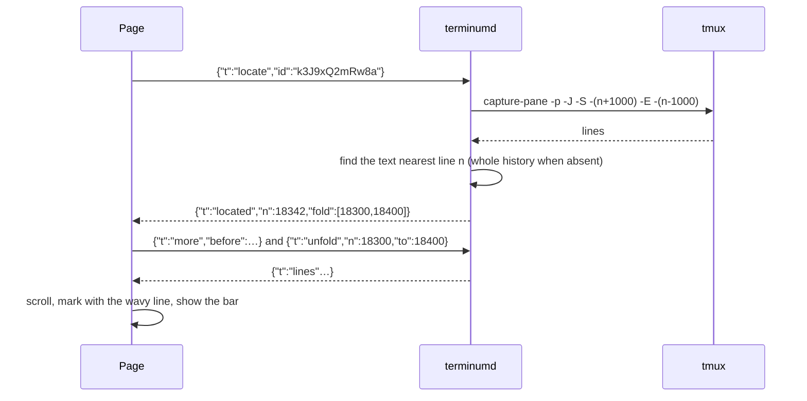
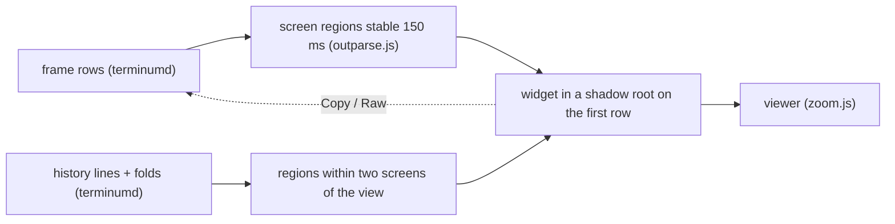
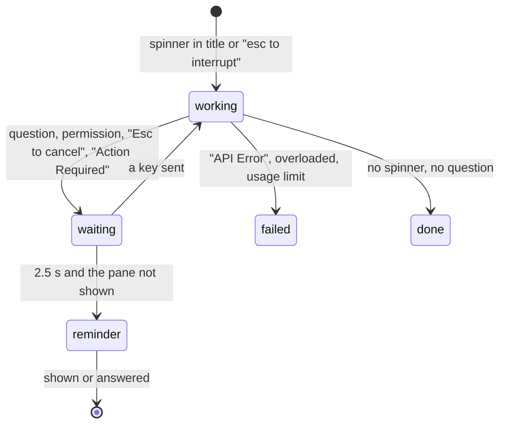

# terminum — Specification (terminal features)

Sibling of `terminum.md` (the core: tmux, screens, typing, sessions, install, security). This spec holds the reading and coding-agent features of the terminal view, inherited from iterm-enhancer's web app (its AC 52, AC 55, AC 56, AC 57, AC 58). Cases are AC-31…AC-40; the core's AC 02 (screens), AC 03 (typing) and AC 04 (Lines modes) are assumed. A case of another spec is written `AC nn` (a space); `AC-nn` is this spec's own.

## 0. Metadata

| Field | Value |
|---|---|
| Version | 0.3.3 |
| Date | 2026-10-19 |
| Status | draft |
| Author | Claude (Fable 5.1) for the owner |

Change log:

| Version | Date | Change |
|---|---|---|
| 0.3.3 | 2026-10-19 | Owner: a turn that stops while its subagents run in the background stays working until the last of them stops (it showed done while they worked), and ends then (AC-39). |
| 0.3.2 | 2026-10-19 | Owner: a tool's output still on the screen folds by the same rules, terminumd sending the screen's folds with each screen that changes them; never a full-screen program's rows nor the cursor's (AC-32). A reminder's card has no colored edge; a quote in it has the list's wavy pink line (AC-91). |
| 0.3.1 | 2026-10-19 | Owner: bookmarks and reminders belong to a project (the host and folder of the session they were made in): every session of it shows them, orphaned ones only in the list below the sessions (Bookmarks \| Reminders, Open all, Delete for good) (AC-33, AC-91); the list marks them as wavy orange and pink lines; a Markdown table in an agent's diff is drawn as a table (AC-31); a tool's output in the history folds to its first line and two more, Codex's too (AC-32). |
| 0.3.0 | 2026-10-19 | Owner: AC-39 coding agents' own hooks (`terminum hooks install`: Claude Code's plugin, Codex's hooks.json; `terminum hook` posts each lifecycle event to terminumd's socket) say a pane's state, its tool, what it waits for and its subagents over the screen's reading, under leases; AC-90 sent history per project (a host and a folder) under the split; AC-91 reminders, a kind of bookmark that comes up when its session's agent ends a turn. Pragmatic review applied: only a start or a prompt makes a pane's hook record (a late event of an ended session made a false "working" and a false reminder), late approvals and notifications of a stopped turn change nothing, a hooked pane's turn ends by its Stop (a turn quicker than one layout was missed), a prompt is kept only from a known agent's UserPromptSubmit, redaction over any whitespace and of `key: value`, `Bearer`, private key blocks and the tool summary, a command after a space keeps its space (it was kept against the user's wish), Claude Code's plugin added anew (no "already" taken as success), timeouts within Codex's 3 s; a hooked wait gives way to a screen showing the agent at work (an approval answered fires no event). Rejected: a line-count cache for sent.jsonl (at most 4 MB, read at a person's pace). Open: Codex loading terminum's hooks.json is checked against Codex 0.163's event names and keys, not by a live Codex run. |
| 0.2.3 | 2026-10-18 | AC-39: Codex as measured on 0.162: started through npm (program `node`) it is known by its screen; its "Action Required" title and its question tool wait; its usage, credit, retry and load errors fail; the list title drops its blinking mark. Pragmatic review: no verdict kept per pane (a Codex followed by a dev server within one refresh would raise false reminders) and none from the title; rejected: skipping the screen read while the title says waiting (one pane, while it asks), backing off `node` panes (one batched capture each per 6 s, as agents), "an error above the last 'Worked for' is history" (unverified that an agent never prints "Worked for" after its error: a hidden failure is worse than a stale one), finding Codex by the process tree (needs a command on every host; the screen works over ssh as it is). |
| 0.2.2 | 2026-10-17 | AC-31: a table a program drew with rules (Claude Code's ┌─┬─┐, mysql's +---+) is a table widget, whose cells wrap where its drawn rules broke apart in a view narrower than the pane. Pragmatic review: an ASCII table's empty first value stays a row; rejected: a colored table starting in Raw (its colors carry meaning), as the request is HTML tables wherever they are read and Raw is one press away. |
| 0.2.1 | 2026-10-16 | AC-39: a coding agent that is done shows no mark (the green check is gone). |
| 0.2.0 | 2026-10-15 | Pragmatic review: AS-31 names the page edits the core's protocol table lists; renderers at `/fb/renderers.js` as the page loads them; bookmark keys per OQ-31 stay open. |
| 0.1.0 | 2026-10-15 | Initial draft from iterm-enhancer 0.42: widgets, folds, bookmarks, search, links, paste and upload, selection and phones, traces, coding agents, phone editing. |

## 1. Overview

**Problem.** A terminal shows output as rows of text. A coding agent's session is thousands of lines of Markdown, diffs, code, commands and images named by path; on a phone, finding a place again, reading a diagram, or putting the cursor into the agent's input box is slow or impossible in a plain terminal.

**Who it affects.** Users of coding agents (Claude Code, Codex) and long-running commands who read and answer from a Mac, a tablet or a phone.

**Expected outcome.** The terminal view renders what the output is (code, Markdown, diagrams, images), folds what nobody reads twice, remembers places as bookmarks, searches the whole loadable history, opens paths and links, takes pasted images and files, copies text cleanly on every device, shows an agent's state in the list and reminds when it waits, and lets the user edit the agent's input with taps and arrows as in a text field. The looks and behavior are iterm-enhancer's web app's; the source of screens and history is tmux through terminumd.

**Scenario, before and after.**
- Before: Alex scrolls 4,000 lines on a phone to find the table Claude printed an hour ago, reads its Markdown source with `|---|`, and taps three times to get the cursor into the right word of a long prompt.
- After: Alex taps the bookmark mark on the edge; the table is rendered, in view in a second. A tap in the input box puts the cursor on the word. The list shows which of six agents waits for an answer.

## 2. Scope and non-goals

In scope:
- Output widgets, history folds, bookmarks, search, links and file names, paste and upload, selection and copying on phones, the latency and context traces, coding-agent states and reminders, input-box navigation.

Out of scope (explicit):
- Rendering by the terminal of inline images or sixel (core §2).
- Editing a file from the terminal view (the Files panel's View does that, `terminum-files.md`).
- Programs' own mouse handling outside Screen mode (core AC 06).

## 3. Assumptions, dependencies, open questions

Assumptions:

| ID | Assumption | Owner | Status |
|---|---|---|---|
| AS-31 | The inherited page modules of this spec (`outparse.js`, `widgets.js`, `folds.js`, `marks.js`, `markjump.js`, `find.js`, `links.js`, `termlinks.js`, `upload.js`, `agentbox.js`, `boxnav.js`, `waiting.js`, `trace*.js`) work unchanged on terminumd's frames, because the frame, history, folds, found and marks messages keep iterm-enhancer's shape; the page's only edits are the renames and removals in the core's protocol table (`terminum.md` §9: `app.js`, `navtools.js`, `index.html`). | Claude | unverified: `web/test/e2e_web_all.mjs` on terminumd |
| AS-32 | The folds, bookmarks and search of iterm-enhancer's bridge (`fold.py`, `bookmarks.py`, `search.py`) are pure functions of the lines and port to Rust line for line. | Claude | verified by reading them (no iTerm2 call inside) |
| AS-33 | Claude Code's input box rows hold `cols - 2` characters, the prompt included; its footer and status lines follow the box; a redraw of its own can leave the cursor below the footer. Measured in iTerm2 at 54–151 columns; tmux's grid is the same program's output. | Claude | verified in iterm-enhancer 0.39–0.40 |

Dependencies:

| ID | Dependency | Owner | Status |
|---|---|---|---|
| DEP-31 | `renderers.js` bundled by `ui/` (markdown-it 14, the panel's CodeMirror highlighter, mermaid 11, ~3.6 MB in chunks), served by terminumd at `/fb/renderers.js` as the page loads it (`widgetui.js:13`). | Claude | available |
| DEP-32 | The CSS Custom Highlight API for underlines (Safari 17.2+, Chrome 105+); a browser without it shows none. | Claude | available |

Open questions:

| ID | Question | Owner | Status | Decision |
|---|---|---|---|---|
| OQ-31 | Bookmarks are keyed by the pane's key (`tmux:<host>:<socket>:%N`): a pane id is reused by tmux after a server restart. Add the session's creation time to the key? | Claude | open | Proposed: key + `#{session_created}` of the pane's session; a bookmark whose session is gone says "closed" as today. |

## 4. Acceptance cases

| ID | Priority | Case |
|---|---|---|
| AC-31 | [SHOULD / P1] | In the terminal, a file printed by a command, a fenced block, a Markdown document, a Mermaid diagram, a table drawn with rules and an image file named in the output are widgets: rendered in place with Raw, Copy and a full-screen viewer, while the text, selection and copying stay as they were. |
| AC-32 | [SHOULD / P1] | Diffs, written files, long tool output, blank runs, encoded data, repeated and similar lines in the history are folded into one line each with Show and Copy, found by terminumd before the page sees them. |
| AC-33 | [SHOULD / P1] | A selection in the terminal becomes a bookmark with a note, kept on the Mac for every signed-in client; marks on the terminal's edge and a list bring the text back into view, also in older, folded or rendered lines; a bookmark whose lines are gone keeps its text. |
| AC-34 | [SHOULD / P1] | The shown pane's whole loadable history is searched by terminumd: the count, the first match in view and marked, next and previous, every match a mark on the edge. |
| AC-35 | [SHOULD / P1] | Web addresses and file paths in the output are underlined and open: addresses in a new tab of the reader's browser, files in View on the pane's host, only when the file exists. |
| AC-36 | [SHOULD / P1] | The user pastes an image, uploads a file or drops files onto the page; they are saved where the pane's shell runs and their paths are pasted into the pane without Enter. |
| AC-37 | [MUST / P0] | The user selects and copies terminal text on a computer, a tablet and a phone with the system's own menus and handles, with line ends kept, while the screen pauses under a selection and catches up after. |
| AC-38 | [SHOULD / P1] | With `?trace=1` terminumd and the page record each key's stages and session opens for 15 minutes into a log a script sums up; with `?trace=2` the page keeps a ring of events and input-box snapshots a button copies for a coding agent. |
| AC-39 | [MUST / P0] | A pane running a coding agent shows its state (working, waiting, failed; done shows no mark) in the list and the header, breathes while it works, and a reminder over the terminal names an agent that waits for an answer in a pane not shown. |
| AC-90 | [SHOULD / P1] | Every message or command the user sends in a pane is kept per project (its host and folder) and read back as Markdown from a button under the split: the last first, older and newer. |
| AC-91 | [SHOULD / P1] | A bookmark can be a reminder: a pale fuchsia button blinks over every session when its session's coding agent ends a turn, until pressed; its pane shows the open reminders as Markdown; Close puts one down until the next turn's end, Resolve ends it. |
| AC-40 | [MUST / P0] | In a coding agent's input box on a phone, a tap puts the cursor on the character under it, ↑ and ↓ move by the page's lines, a slide moves the cursor, held delete deletes words, the box is a panel above the keyboard with its status lines behind ⓘ, and the cursor is drawn in the box when the agent left it below the footer. |

## 5. BDD scenarios

### AC-31 — Output widgets [SHOULD / P1]

```gherkin
Scenario: AC-31 happy path — a file printed by a command
  Given the shown pane printed "cat README.md", 80 lines of Markdown, then its prompt "alex@mac api %"
  Then the lines from the command to the next line starting with that prompt (its numbers aside; a two-line prompt's blank and colored lines before it excluded) are a Markdown widget: a bar ("Markdown · Raw | Markdown · Copy") over the rendered document as wide as the terminal, fenced code highlighted in the theme's ANSI colors, Mermaid fences drawn
  And "cat", "bat", "head", "tail", "less", "more", "nl" with one file name are such commands; a prompt of one or two characters ("$ ") ends nothing; ".mmd" and ".mermaid" are diagrams, other names are code in the language of the name

Scenario: AC-31 happy path — fences, documents and diagrams in any output
  When the output holds a fenced block (``` or ~~~, closed by the same fence), a Markdown document (a run of lines with a heading after a blank line, a table or a fence, two kinds of Markdown signs and three lines with one, at most 6 plain lines between, less than 30 % code-like lines, never across a prompt line) or a diagram starting with its keyword alone on a line ("flowchart LR", "sequenceDiagram" …) up to the next blank line
  Then each region is a widget: a fence named "mermaid" is a diagram, another is code; a document's shared indentation is removed (an agent indents its tools' output), a document may start on a tool's first line ("  ⎿  # Title"); an unfenced diagram starts in Raw (text from anyone reaches Mermaid only when the user presses Diagram)
  And Raw shows the lines as before with the bar; the choice is kept per region while the page is open; Copy copies the source (a fence's code without the fence); a click on a diagram opens the viewer

Scenario: AC-31 happy path — a table drawn with rules
  Given Claude Code drew a table of 2 columns and 2 rows in a pane 140 columns wide ("┌───┬───┐", "│ Commit │ What │", "├───┼───┤" between rows, "└───┴───┘"), a cell wrapped over two lines, its code colored
  When the page shows the pane, also narrower than 140 columns (a phone, Wrap)
  Then the lines from the top rule to the bottom rule are a table widget: a bar ("Table · Raw | Table · Copy") over an HTML table, the first part (before the first rule) its head, each part between rules one row, a wrapped cell's lines one cell again; its cells wrap at the view's width, a table wider than that scrolls sideways in the widget
  And the rules may be light, heavy, double or rounded (rich, tabulate) or ASCII ("+----+", mysql, prettytable); a table without rules between its rows has a row per line, in a box table a line whose first cell is empty going on the row above (an ASCII table's never: mysql does not wrap); a column of numbers (units and "-" allowed) is aligned right; cells are put in as text
  And Copy copies it as a Markdown table ("|" in a cell as "\|"); Raw shows the drawn lines
  And it is a widget although the program colored it; one rule of a single column (an agent's box, a banner), a line that does not fit the grid, or a table whose bottom rule is not printed yet is no table; a Markdown document ends before a drawn table
  And a table whose top rule is not there (scrolled away, or cut off where it was copied: "│ What │ Without │ With │" then "├───┼───┼───┤") starts at that head row, when the middle rule under it has as many columns
  And known limits: a table with rules between its rows and no head shows its first row as the head; a first cell wrapped without rules between rows (rich) becomes a row of its own; an unchanged table in a diff's context is a widget too; its colors are dropped in the widget (Raw keeps them)

Scenario: AC-31 happy path — a Markdown table in an agent's diff
  Given Claude Code shows its edit of a Markdown file as numbered diff rows ("  7 - | Version | 0.11.1 |", "  7 + | Version | 0.12.0 |")
  When two of the rows in a row or more are table rows
  Then they are drawn as a table widget: the header from the row above a "|---|" when the diff shows it, a removed row struck, an added row tinted; Raw shows the diff as it is
Scenario: AC-31 happy path — an image named in the output
  When a row names an image file (png, jpg, jpeg, gif, webp, svg, bmp, ico, avif) that exists in the pane's folder on the pane's host (its folder listed by name, nothing read; looked for again after 10 s)
  Then a small image button stands after the row's text (rows within a screen of the view only; not in a drawn box, an agent's input box or its footer)
  When the user presses it
  Then the image is read through the Files API on the pane's host and shown centered below the row within half the terminal's width and height, with its path and ×; the row stays where it was on screen; a click opens the viewer; a file that is not an image says why

Scenario: AC-31 happy path — the viewer
  When the viewer opens an image or a diagram
  Then it covers the window fitted (a photo never past its pixels), with −, +, Fit and × at the top right; pinch, drag, wheel and double tap zoom and move; Esc or × closes it and the terminal has the keys again on a computer

Scenario: AC-31 edge — the terminal stays the terminal
  Then rows' text does not change: a selection across a widget copies the region's lines; link underlines, cursor taps and the agent's input box work as before; output a program colored itself (bat, glow, delta, an agent's own rendering) is never a widget
  And a region on the screen becomes a widget once unchanged for 150 ms and stays one while the screen changes below it; the cursor's row and below are never part of one, nor an agent's input box; streaming output is looked at every 100 ms at most and never further back than 2000 lines; in the history only regions within two screens of the view are drawn (a 10,000-line chat loads as fast as without widgets); at most 150 widgets and 50 open images are kept
  And a widget acted on in sight keeps its line in place; one changing by itself keeps the first line wholly in sight in place; following the output, the view stays at its end; nothing grows after placement (images and diagrams go in once decoded, widgets once their stylesheet is in)

Scenario: AC-31 failure — the renderer cannot be loaded or a diagram does not parse
  When "/fb/renderers.js" does not load
  Then the bar says "The renderer did not load (<reason>); is terminumd running?", Markdown and diagrams show as text, code as plain text; pressing Markdown or Diagram tries again
  And a Mermaid fence that does not parse shows Mermaid's message in its bar and its lines as text; inside a document only that diagram stays source
```

### AC-32 — History folds [SHOULD / P1]

```gherkin
Scenario Outline: AC-32 happy path — what folds
  Given the pane's history holds "<what>"
  Then terminumd folds it into one line "<shown>" with Show and Copy, sent as {n, to, label} with the lines (null in a folded line's place)

  Examples:
    | what                                                                                   | shown                               |
    | an edit's diff under an agent's "⎿ Updated/Added/Removed/Deleted …" (6 lines or more)   | ⋯ 26 lines of diff                   |
    | a file it wrote ("⎿ Wrote …", "Created")                                               | ⋯ 81 lines of the file               |
    | a tool's command after its line and one more (2 more or more)                          | ⋯ 85 more lines of the command       |
    | a tool's output after its first 8 lines (8 more or more; its blank lines included)     | ⋯ 753 more lines of output           |
    | 3 or more blank lines before an agent's next "⏺" or "⎿" line                           | ⋯ 10 blank lines                     |
    | 3 or more rows of base64, base64url or hex (runs of 40+, digits and letters mixed)     | ⋯ 3.2 KB of base64 · 41 lines        |
    | one line 5 or more times with only blank or 1–3 character lines between (its first kept) | ⋯ 64 more copies of this line      |
    | 20 or more nearly equal lines (numbers, paths, long words aside), first 3 and last 2 kept; never a line saying something failed | ⋯ 4,386 similar lines |

Scenario: AC-32 happy path — a tool's output down to a summary
  Given Claude Code's ("⏺ Bash(…)", "  ⎿  …") or Codex's ("• Ran …", "  └ …") tool output has scrolled into the history
  Then its command keeps two lines at most, its output its first line and two more, and the rest is one line "⋯ N more lines of output"; neither agent can shorten what it shows itself (Claude Code's /focus collapses its own view; a PostToolUse hook changes only what the model reads)
Scenario: AC-32 happy path — on the screen too
  Given a tool's long output is still on the screen, under the agent's next line
  Then the same rules fold it there: the screen message carries its folds ([from row, to row, label], when they changed) and the page shows one line with Show and Copy in their place; Show keeps it open while its first row reads the same; the part that may go on (the last), a full-screen program's rows (vim, mc; Codex's own alternate screen is an agent's) and the cursor's never fold
Scenario: AC-32 happy path — show and copy
  When the user presses a fold's line
  Then the page asks terminumd for those lines ("unfold": only a fold terminumd told of, still in the history, at most 20,000) and shows them; the line says "Hide …"
  And Copy copies the fold's lines (asked for first when not here; copied in the same click over HTTPS, else "The lines are here: press Copy again")

Scenario: AC-32 edge — the whole, the screen, a clear
  Then only a whole part folds (one that may go on at the history's end waits); rows tmux wrapped are one line; the screen itself is never folded; lines that scroll off come with their folds in a "folds" message at most every second; a cleared scrollback drops the folds and new lines reuse the numbers; a selection across a fold copies its line

Scenario: AC-32 failure — lines terminumd cannot send
  When the lines are gone from tmux's history, the fold was not told, or more than 20,000 are asked
  Then terminumd refuses with why, the page shows it, and the fold stays
```

### AC-33 — Bookmarks [SHOULD / P1]

```gherkin
Scenario: AC-33 happy path — a selection becomes a bookmark
  When the user selects text in the history, the screen or a widget's rendered text
  Then an orange [+] stands at the terminal's right edge level with the selection's end and a gray Copy above it while the selection lasts (and 600 ms after); both follow the view; not for a selection in an agent's input box or status lines
  When the user presses [+], types a note and saves
  Then the bookmark holds the text (up to 2000 characters), the note (up to 1000), its line, and, stamped by terminumd, the pane's key (OQ-31), title, host and time, in "web-bookmarks.json" (0600) on the Mac, seen by every signed-in client at once

Scenario: AC-33 happy path — marks, the way back, the lists
  Given the shown pane has bookmarks
  Then each is an orange mark on the terminal's right edge placed by its line between the oldest loadable line and the last; the session's row has an orange strip; a round button at the top right shows the count and opens the session's list (note, text start, time)
  When the user presses a mark or a list entry
  Then terminumd looks for the text nearest its line (1000 lines either side first, the whole history after; tmux renumbers when it drops lines or the scrollback is cleared), the page loads older lines down to it, opens a fold it is in, scrolls so the text stands a third from the top, marked by a wavy orange line on its left; rendered text is found in the widget; "Its text was not found there: this is the line it was on." when only the line is found
  And the place stays put under widgets drawing until the user scrolls, taps, types or shows another pane; a bar shows the note with Edit, Delete and ×
  When the user opens "Bookmarks" at the list's foot
  Then every bookmark is listed newest first with its session's current title ("closed" for a gone one); picking one shows that session and the bookmark, or the text and note of a closed one

Scenario: AC-33 happy path — by project
  Given a bookmark made in a session whose folder is /Users/alex/work/api on this Mac
  Then every live session of that host and folder lists it under its bookmarks' button (its own session's top to bottom, then the others', newest first) and the session list marks those sessions with a wavy orange line; a session of another folder lists none
  When the last session of that folder closes
  Then the bookmark is orphaned: it is only in the list below the sessions (Bookmarks | Reminders), said "orphaned", until deleted there (for good); a bookmark is deleted from a session's list or bar too
  And "Open all" in that list shows its bookmarks or reminders as one document, full screen; a bookmark made before 0.8.0 has no folder: its project is its pane
Scenario: AC-33 edge — the lines are gone, a rename, a server restart
  Then a bookmark whose text is no longer in the history says "These lines are no longer in this session's history." with its text and note; it stays until deleted
  And a renamed window keeps its bookmarks (the key is the pane's); after a tmux server restart a reused pane id with another creation time is another pane (OQ-31)

Scenario: AC-33 failure — cannot keep or reach
  When the Mac has 300 bookmarks, the pane closed meanwhile, or the file cannot be written
  Then the dialog stays open and says why; nothing is half saved; a save repeated after 10 s without an answer is kept once; an unreadable file is left as it is and every save says so
  When the lines do not arrive within 15 s or the pane changed
  Then the bar says the bookmark could not be reached and why
```

### AC-34 — Search [SHOULD / P1]

```gherkin
Scenario: AC-34 happy path — find in the history
  Given a magnifier stands at the terminal's top right (left of the bookmarks' button)
  When the user presses it, types "retry loop" and presses Find
  Then terminumd searches, case aside, every line the page could load (the loadable history and the screen, wrapped rows as one line) and answers each match's row and the matches before it (at most 2000, "1 / 2000+")
  And the page says "1 / 17", brings the first match into view as a bookmark is, marks it white; every match is a white mark on the edge, the shown one bolder

Scenario: AC-34 happy path — next, previous, close
  When the user presses ↓ (or Find, Enter) or ↑ (Shift+Enter)
  Then the next or previous match is shown, round the ends
  When the user presses ×, Esc, the magnifier, or shows another pane
  Then the field, the marks and the highlight go; the terminal has the keys again on a computer

Scenario: AC-34 edge — nothing, or too long
  Then "Not found" when nothing matches; a text over 200 characters is refused inline

Scenario: AC-34 failure — terminumd cannot search
  When the pane closed or the history cannot be read
  Then the field says why and keeps the text
```

### AC-35 — Links and file names [SHOULD / P1]

```gherkin
Scenario: AC-35 happy path — addresses and paths
  When the user clicks (⌘-click with a mouse; Ctrl on other systems) or taps a web address in the screen or history
  Then it opens in a new tab of the reader's browser (noopener), never on the Mac; an address wrapped over rows is taken whole
  When the user clicks or taps a file path or name the pane printed (absolute, "~/…", "./…", "../…", a path with a slash, or a name with a known extension, with ":line" or ":line:col")
  Then the page opens it in View as a tab on the pane's host; a relative one from the pane's folder; "~" is the home on the pane's machine
  But only a file that is there is a link: its folder is listed on the pane's host through the Files API (one page answers every name of a folder up to 500 entries; at most 4 listings at once, newest first; a file not there is looked for again after 10, 30 and 60 s, a found one after a minute); "and/or", dates and version numbers are not paths

Scenario: AC-35 edge — underlines and clicks
  Then such text has a faint dotted underline in the visible part and a screen above and below (CSS Custom Highlight API, DEP-32), redrawn after output and when scrolling stops; the pointer is a hand only with ⌘ held; a click that ends a selection, a long press or a drag opens nothing; a tap on the cursor's row moves the cursor instead (AC-40)

Scenario: AC-35 failure — the folder is unknown
  Given a remote pane whose host has no files helper
  When the user taps a path
  Then the page says "Files of <host> are not enabled: enable them in the Files panel" and opens nothing
```

### AC-36 — Paste an image, upload, drop [SHOULD / P1]

```gherkin
Scenario: AC-36 happy path — paste an image
  Given the shown pane runs on this Mac, or on a host whose files helper is enabled
  When the user pastes an image (a screenshot: PNG, JPEG, GIF, WebP; another type the browser can draw, such as TIFF from Preview or HEIC in Safari, is turned into a PNG first) into the terminal, or presses the hot key Paste over HTTPS with an image on the clipboard
  Then the image is never typed as text; the page uploads it (at most 20 MB, 2 at once, 300 s to arrive), terminumd saves it where the pane's shell runs ("~/.terminum/tmp/" on the Mac and on a host; folder 0700, file 0600, named by UTC time and 8 random hex digits), and the page pastes the absolute path shell-quoted as text (bracketed when on), no Enter; files older than 7 days go at the next paste

Scenario: AC-36 happy path — upload and drop
  When the user presses Upload and picks a file, or drops files on the page
  Then each is saved as an image is, of any kind, named by time, hex digits and its own name in safe letters, and the paths are pasted together separated by spaces; the terminal is outlined while files are held over it; a folder is refused; a drop never makes the browser open the file

Scenario: AC-36 failure — refused or failed
  When the image is of another type, its bytes do not match, it is over 20 MB, or a third upload starts
  Then nothing is typed and a toast says why ("Two uploads are running already")
  When the pane's host has no helper, or ssh fails or takes longer than 30 s plus 1 s per 256 KB
  Then nothing is typed, the toast says to enable the host or shows ssh's message, no partial file is left under the name; when one of several files fails, the rest are not sent and the saved paths are pasted
```

### AC-37 — Selection, copy, phones [MUST / P0]

```gherkin
Scenario: AC-37 happy path — a computer
  When the user selects text with the mouse and presses ⌘C (or the Copy button)
  Then the text is copied with its line ends: a hard end a newline, a row tmux wrapped continues, re-joined prose keeps one space and drops indentation, padding after a line is dropped; in Grid too
  And while the selection lasts the screen pauses with "Paused while you select" over the terminal's first line (taps pass through) and catches up when it is cleared

Scenario: AC-37 happy path — a phone
  When the user taps the terminal
  Then the keyboard opens and the page shrinks above it, growing back when it closes
  When the user long-presses
  Then iOS selects the word with its handles and Copy menu (each paragraph a block; a long one cut every 400 lines, so a tap on a selection in 3,000 lines never freezes); with the keyboard up a finger held still 0.45 s closes it and selects the word, kept in sight; a Copy button beside the keyboard button copies the selection, also after a tap cleared it and the terminal caught up
  And with a hardware keyboard ⌘C copies the selected terminal text and ⌘V pastes; the keyboard field gets the focus back when the user was typing when the selection began

Scenario: AC-37 edge — a tablet's trackpad and a hidden page
  Then a trackpad selection on a tablet stays the browser's own and is copied by a tap on it and Copy; a hidden page (another app, a locked phone) or an unfocused page on a computer pauses its stream and gets the screen and the list within 2 s when it is back; a touch screen keeps about 2000 lines on the page while it follows the output, dropping the oldest blocks (loaded again on scrolling up)

Scenario: AC-37 failure — the clipboard is not available
  When the page runs over plain HTTP, where the browser's clipboard API is unavailable
  Then Copy uses the copy command on the selection; when that fails too the toast says "Copy is unavailable over HTTP: use HTTPS (tailscale serve)"
```

### AC-38 — Traces [SHOULD / P1]

```gherkin
Scenario: AC-38 happy path — ?trace=1
  Given the page is opened with "?trace=1"
  Then a badge says tracing is on, the minutes left, the last and median echo; a tap ends it; terminumd writes "logs/trace-<date>-<time>.jsonl" (0600), one JSON record per line
  When the user types
  Then each key carries a number k; terminumd records how long it took to hand the key to tmux, how long until a capture showed a change, captures that found none, what woke the capture (the key, %output, the poll), the capture, cut and encode times, and whether the cursor moved; the page records the input path, the key kind, event-to-send, buffered bytes, send-to-screen, parse, draw and the next frame; a session opened records click-to-first-screen and first frame with the session's mode (local or remote)
  And every 2 s a ping measures the round trip; frames over 100 ms apart, draws over 16 ms, terminumd messages handled over 20 ms, its loop late over 20 ms, list refreshes and a tmux "display" round trip every 6 s are noted

Scenario: AC-38 happy path — ?trace=2 for a coding agent
  Given the page is opened with "?trace=2"
  Then a "trace" button stands among the floating buttons (also on a computer); terminumd only times stages; the page keeps a ring of its last 640 events ("<ms> <name> <json>", 400 characters each): keys sent (cut at 40 characters, a run as "SEQ×n"), screen messages with the rows changed, the cursor and stages, session opens, pointer events with their place and the cell under them, keydowns and composition, focus, visibility, viewport, scroll, selection, other messages by kind, notices, slow draws, errors, and every 5 s the counts, the heap and a round trip; the input box's rows and the page's lines of it are snapshotted (the last 3)
  When the user presses the button
  Then the clipboard gets a header, the events oldest first, and the page's state (environment, sizes, session, history, bookmarks, the input box, the last 12 history rows, the screen's rows): at most 1000 lines of 4000 characters, 120,000 characters; "docs/web-trace.md" describes it and "web/test/tracereplay.mjs" replays one

Scenario: AC-38 edge — what is never recorded
  Then ?trace=1 holds no typed text, screen content, title or host name (kinds, lengths, times, ids, modes only); terminumd keeps a page record only with known names, numbers, booleans and listed words, a batch at most 500 records; the trace ends after 15 minutes or 20 MB and the page is told; the newest 10 files are kept; without the parameter nothing is recorded and no button exists
  And ?trace=2 stays in the page's memory, starts anew with each load, and leaves only by the user's copy; keys in other fields (password, filter, name, search, note) show as "·" and their messages as lengths

Scenario: AC-38 failure — the trace cannot write
  When the disk is full
  Then the trace ends with a line in terminumd's log; typing and screens go on
```

### AC-39 — Coding agents in the list [MUST / P0]

```gherkin
Scenario: AC-39 happy path — states
  Given panes run Claude Code and Codex (by #{pane_current_command}, the window's name, Claude Code's title marks, or Codex's words on the screen of a pane whose program is `node`)
  Then each shows before its title, in the list and the header: a yellow hourglass while it works (a spinner in the title, "✻ Doing… (…)" on screen, "esc to interrupt"), a flashing amber question mark while it waits for the user (a question, a permission prompt, "Esc to cancel", Codex's "[ ! ] Action Required" title or "enter to submit answer"), a red alert sign when it stopped on an error ("API Error", overloaded, a usage limit, out of credits, a retry limit, high load), no mark when done; only the screen's last 25 rows count, read by terminumd when the title changed or 6 s passed
  And the row's bar (one color per theme) breathes every 1.6 s while the agent works (not with reduced motion); a dot reads as an unread message

Scenario: AC-39 happy path — reminders
  When an agent in a pane not shown has waited 2.5 s
  Then "<title> waits for your answer" stands over the terminal: top right on a computer (three at most), a slim line under the header on a phone (one, "+N more"); a click opens that pane, × closes it; it goes 2.5 s after the pane stops waiting or when shown; a reminder closed or seen comes back only when the pane asks again

Scenario: AC-39 edge — a named pane, a shell
  Then a pane or window the user named hides the title marks, so the screen decides; a pane at a shell prompt shows no state; "shell" in the layout says a tap may move the cursor along the line (not in htop, less, mc)

Scenario: AC-39 edge — Codex
  Given Codex, which keeps its title while it works and marks it "[ ! ] Action Required | " (blinking "[ . ]") only when it asks
  Then its question waits although its footer says "esc to interrupt"; a turn the user cancelled ("Conversation interrupted") is done, not failed; the list's title leaves out the mark, so the row does not blink
  And Codex started through npm runs as `node`: a `node` pane is Codex while its screen, read as an agent's is, shows Codex's own words ("OpenAI Codex (v", "Ask Codex to do anything", "tell Codex what to do differently", "enter to submit answer", "tab to add notes"); the title never makes it Codex (a killed Codex can leave its mark to the next program); another `node` program, a dev server asking "(Y/n)" too, shows no state and no reminder, also right after Codex in the same pane
  And Codex started without "--no-alt-screen" (as "codex resume" is) draws on tmux's alternate screen, where tmux keeps no scrollback: scrolling up there says so once a pane, naming "codex --no-alt-screen" and Codex's setting alternate_screen = "never" under [tui]

Scenario: AC-39 happy path — the agents' own hooks
  Given Claude Code or Codex is found (its program on PATH, ~/.claude, $CODEX_HOME or ~/.codex) without terminum's hooks
  Then "terminum status", "terminum open" and "terminum install" say so in one line naming "terminum hooks install"
  When the user runs "terminum hooks install" (or "terminum hooks install claude|codex")
  Then Claude Code gets terminum's plugin: a local marketplace in ~/.terminum/hooks/claude added with Claude Code's own "claude plugin marketplace add" and "claude plugin install terminum@terminum --scope user" (terminum never edits Claude Code's settings); Codex gets terminum's entries in $CODEX_HOME/hooks.json (default ~/.codex), the file backed up beside it first and others' entries kept, and is told to trust them in Codex's /hooks; a second install changes nothing; "terminum hooks remove" takes out only terminum's; "terminum hooks" says for each agent: not found, found without, or installed and when its hooks last spoke
  And each lifecycle event (session start and end, a prompt, a tool before and after, an approval asked, a notification, a stop, a failure, a subagent's start and stop, Codex's interrupt) runs "terminum hook <agent>" in the background, which reads the event, posts a few fields of it (never a tool's output, a file's text or the agent's answer; a command's first two words with values left out) to terminumd's socket within 150 ms and exits 0 without output
  Then the pane's row shows the state its hooks say over the screen's reading (the screen is not read for it), the tool it runs in its mark's title ("Working: Bash: npm test"), what it waits for ("Approve Bash: rm -rf", the question it asks; the reminder card says "<title> asks: …"), why a turn failed ("rate_limit"), and the number of subagents running under the mark
  When Claude Code's turn stops (its Stop) while subagents it started still run in the background
  Then the pane stays working with their number under the mark until the last one stops (SubagentStop); its turn ends then (reminders, unread); a background subagent's tools keep it so, and one quiet for 10 minutes gives way to the screen; an interrupt (Esc) or a failure ends it at once; background shells and monitors are not counted (a dev server would keep it working for ever)

Scenario: AC-39 edge — hooks that stopped speaking
  Then a working state no hook renewed in 30 s (waiting: 120 s) is the screen's to say again (an interrupt in Claude Code fires no Stop, a crash no end); a tool event of a turn that stopped, come late from the background, changes nothing; another program in the pane, or another agent session, drops what the hooks said; Codex's done is read from its screen (it has no failure event); a hook from a pane no terminumd server lists changes nothing

Scenario: AC-39 failure — the screen cannot be read, no terminumd, a broken hooks.json
  When terminumd cannot capture the pane (closed meanwhile)
  Then the row shows no state this refresh and the next refresh tries again; nothing else is delayed
  When terminumd does not run, the hook returns at once and the agent goes on as without it
  When a person runs "terminum hook" (an unknown agent such as "terminum hook install", or a terminal for its input), it says "terminum hooks install" sets them up and exits 2 instead of waiting for keys
  When Codex's hooks.json does not parse or is not an object of lists, "terminum hooks install" refuses with why and changes nothing; without "claude" on PATH it says so
```

### AC-90 — Sent history [SHOULD / P1]

```gherkin
Scenario: AC-90 happy path — kept
  When the user presses Enter in a pane at a shell prompt or in a coding agent's input box
  Then the page tells terminumd what stood there before the key goes: the command after the shell's prompt with the rows it wrapped from, or the agent's typed rows (a faint suggestion is not typed); for a coding agent whose hooks spoke its prompt comes from its hooks exactly and the page's is dropped
  And terminumd keeps it in ~/.terminum/sessions/<project>/sent.jsonl (0600, the folder 0700; meta.json names the project), the project being the pane's host and folder, with the time, the agent and the pane's title

Scenario: AC-90 happy path — read back
  When the user presses the speech bubble under the split
  Then a pane beside it (under it where the view is narrow) shows the project's last one as Markdown (a shell's command as a shell block), its folder, "1 of N", the agent and the time; ↑ (the up key) the one before, ↓ the one after, Copy, × (Esc); another pane shown shows its project's; a new one in the project shows while the last is shown

Scenario: AC-90 edge — left out
  Then a line starting with a space (a shell's "not in history"), an empty one, the same text from the same pane within 10 s (one Enter told twice) and Enter in other programs (an editor, less) are not kept; the values of words named like secrets ("API_TOKEN=…", "--password …") and words of secrets' shapes ("sk-…", "ghp_…", "AKIA…", "eyJ…") are kept as "[redacted]"; 2000 per project are kept (cut back once 2500), 20,000 characters each

Scenario: AC-90 failure — not written
  When the file cannot be written
  Then the command goes to the terminal all the same and terminumd's log says why; a folder that cannot be read says "The pane's folder is not known: …" in the pane; a project with none says "Nothing sent in this folder yet."
```

### AC-91 — Reminders [SHOULD / P1]

```gherkin
Scenario: AC-91 happy path — a reminder
  When the user picks Reminder in the bookmark dialog (Bookmark | Reminder; its title and Save turn pale fuchsia) and saves
  Then it is kept as a bookmark of the kind reminder (AC-33: its text, note, line and pane); the sessions of its project have a wavy pink line in the list; a pale fuchsia bell under the bookmarks' button counts the open reminders of the shown session's project
  And the floating buttons stand in one column at the terminal's top right: find, the split and the sent history, then, set apart, the colored ones (bookmarks, reminders) of one size and look without glow; each pane opens beside its button (under it on a phone); a split's embedded page shows none of them

Scenario: AC-91 happy path — up when the turn ends
  When the coding agent of its pane ends a turn: its hooks say it stopped, failed or was interrupted (also a turn too quick for the list to show it working), or the pane worked or waited and now is done, failed or shows no agent
  Then terminumd puts that pane's open reminders up, keeps that, and tells every page; the bell blinks once a second over whichever session is shown (with Reduce Motion a still ring) until pressed
  When the user presses it
  Then its pane lists every open reminder, those up first ("up now"), each its session, its note as Markdown and its text quoted, with Open (its session at its text, AC-33), Close (put down: up again at its pane's next turn's end) and Resolve (it comes up no more and stays in Bookmarks); a reminder seen there blinks again only once put down and up anew

Scenario: AC-91 happy path — by project
  Then a reminder belongs to its folder's project as a bookmark does (AC-33): it comes up when an agent of any session of the project ends a turn, the bell shows the shown session's project's reminders, the session list marks the project's sessions with a wavy pink line beside the orange one; an orphaned reminder never comes up and is listed under Reminders below the sessions; Delete (twice) in the bell's pane removes one
Scenario: AC-91 edge — restarts, kinds
  Then a reminder up stays up across terminumd's restart; a first layout after a restart ends no turn; a bookmark made a reminder in its dialog (Edit) is open, and a reminder made a bookmark comes up no more

Scenario: AC-91 failure — not saved
  When web-bookmarks.json cannot be written
  Then a reminder does not come up and terminumd's log says why; a save in the dialog says why (AC-33)
```

### AC-40 — Editing a coding agent's input on a phone [MUST / P0]

```gherkin
Scenario: AC-40 happy path — the cursor follows taps and arrows
  Given the shown pane runs Claude Code and the view is in Wrap
  When the user taps a character in the input box (the rules nearest above and below the cursor, the first row the prompt "❯", ">" or "!")
  Then the page sends ← or → as many as the characters between the cursor and the tap (a character at a time, one more at a wrap at a space or a line the user ended, none inside a word broken at the edge), never past the text typed; faint text after it is the program's suggestion and a tap on it moves nothing
  When the user presses ↑ or ↓ with no "@" or "/" list open
  Then the cursor goes to the character above or below by the page's lines at the view's width (a blank line and a line out of sight count), keeping the column; on the first line ↑ goes to the start, on the last ↓ to the end; on the input's first or last row in tmux too the key goes to the agent as it is (history recall), unless held
  And a menu the agent draws between rules (a question, a permission) is not the input box: ↑ and ↓ go to it as they are

Scenario: AC-40 happy path — the panel, status lines, the view
  Then on a phone the input box is a panel at least two rows high, without its rules; the status lines below it (folder, model, context, limits, permission mode) are behind the ⓘ button, remembered per browser; a "/" or "@" list the input opened stays in sight (every other footer line waits, also those it shows only while it works); typing keeps the panel in sight; empty rows below the last text and the cursor are not shown; whole-line key hints ("(ctrl+b to run in background)") are left out on a phone, and a notice pushed right by spaces loses them
  And the view keeps the cursor's row two rows above the bottom edge while typing and for 3 s after
  And in Wrap the box's rows re-join as Claude Code wrapped them (cols - 2 characters a row, AS-33): a row goes on when the next row's first word would not have fit; a line the user ended stays its own; a space typed at a full row's end keeps the cursor on the same line; when the cursor stands past a row's text on the space it wrapped at, its cell is that space

Scenario: AC-40 happy path — slides, held delete, iOS paste
  When the user rests a finger at least 250 ms (however long) on the cursor's row and slides sideways
  Then the cursor moves a character a step (← and →); a finger held still and lifted gets iOS's Paste (the keyboard field lies invisibly over the row or the box); a quick swipe scrolls
  When the user does so in a coding agent's input box, also up or down
  Then the cursor follows the finger onto the character under it, over the box's lines, as a text field's caret follows a held finger; lifting the finger leaves it there
  When the user holds delete on the on-screen keyboard
  Then it repeats as in a text field (the field keeps one invisible character), each delete one backspace, words after about 2 s where C-w is a word; deletes more than 150 ms apart are taps

Scenario: AC-40 happy path — Codex's input
  Given the shown pane runs Codex (its prompt "›" on a background of its own, a blank row above and below it, its footer below: model · folder · branch · state · context)
  Then its input is a box as Claude Code's: on a computer between two thin lines; on a phone a panel, its footer behind ⓘ also while Codex works (its state word changes); taps, ↑ ↓ and slides move its cursor as in Claude Code's

Scenario: AC-40 edge — the cursor below the footer
  Given Claude Code left the terminal's cursor on a blank row below its footer after a redraw of its own, or on one of its status lines (the pane resized: the hot keys opened)
  Then the status lines stay behind ⓘ, and the page draws the cursor on the caret last seen in the box (its row's text unchanged), else at the end of the input's last row, and keeps taps, ↑ and ↓ going from there; the next key brings the agent's own cursor back; a new theme or a frame of changed rows leaves one cursor

Scenario: AC-40 failure — not an agent's box
  Given a shell, less or htop
  Then a tap on another row moves nothing (↑ and ↓ would recall history) and opens the keyboard; a tap on the cursor's row of a shell moves the cursor with ← and → as many as the columns between
```

## 6. Flow and sequence diagrams

### A bookmark's way back (AC-33, AC-32)



The text, not the number, is the anchor: tmux renumbers when it drops lines. Folds hide lines until the page asks; a bookmark inside one opens it.

### Output to widgets (AC-31)



Widgets never change the rows' text; they are drawn over the first row of a region and removed when the region's lines leave the kept window.

### An agent's state (AC-39)



terminumd decides the state from the last 25 rows of the pane, or from the agent's hooks while they hold (their lease); the page draws it and times the reminder. A turn that ends (working or waiting, then done, failed or no agent) puts its pane's reminders up (AC-91).

## 7. Current behavior and gaps

Today is iterm-enhancer 0.42; the page modules are inherited into `web/static/`.

| AC | Today | Gap | Evidence |
|---|---|---|---|
| AC-31 | Widgets in the page; renderers from fbd under `/fb/`. | Serve `/fb/` from terminumd; nothing else. | `web/static/outparse.js:1`, `web/static/widgets.js:1`, `web/static/zoom.js:1` |
| AC-32 | Folds in the bridge (Python). | Port `fold.py` to Rust over terminumd's history. | `iterm-enhancer/bridge/fbbridge/web/fold.py:50`, `web/static/folds.js:1` |
| AC-33 | Bookmarks in the bridge, keyed by the iTerm2 session and tmux pane key. | Port `bookmarks.py`; key per OQ-31. | `iterm-enhancer/bridge/fbbridge/web/bookmarks.py:1`, `web/static/marks.js:1`, `web/static/markjump.js:1` |
| AC-34 | Search in the bridge. | Port `search.py` over `capture-pane`. | `iterm-enhancer/bridge/fbbridge/web/search.py:1`, `web/static/find.js:1` |
| AC-35 | Links and paths in the page, folders listed through the proxy. | Same Files API in terminumd. | `web/static/links.js:1`, `web/static/termlinks.js:1`, `web/static/linkmarks.js:1` |
| AC-36 | Paste and upload through the bridge's `paste.py`. | Port to terminumd (local save, remote through the agent). | `iterm-enhancer/bridge/fbbridge/web/paste.py:1`, `web/static/upload.js:1` |
| AC-37 | Selection, pause, copy, iOS handling in the page. | None. | `web/static/seltext.js:1`, `web/static/touchcopy.js:1`, `web/static/term.js:170` |
| AC-38 | `trace.py` in the bridge, `trace.js`, `tracebuf.js`, `traceshot.js` in the page, `scripts/trace_report.py`. | Port the bridge's side; stages renamed (tmux instead of iTerm2). | `iterm-enhancer/bridge/fbbridge/web/trace.py:1`, `web/static/tracebuf.js:1` |
| AC-39 | Agent state from the screen in `layout.py`; reminders in `waiting.js`. | State read by terminumd from `capture-pane`. | `iterm-enhancer/bridge/fbbridge/web/layout.py:101`, `web/static/waiting.js:1` |
| AC-40 | Box navigation, cursor, held delete in the page. | None. | `web/static/boxnav.js:1`, `web/static/agentbox.js:1`, `web/static/cursor.js:1`, `web/static/heldelete.js:1` |

## 8. Recommendation and ownership

**Recommended approach.** Keep the page modules as they are and move the bridge's four line-based services (folds, bookmarks, search, paste) into terminumd as Rust modules over the same history source (`capture-pane` ranges), with iterm-enhancer's message names and fields. The agent state is read by terminumd from the pane's last 25 rows on the list refresh, as the bridge did. Renderers are served from the embedded panel bundle.

**Rejected alternative.** Moving folds and search into the page — rejected because the page sees at most 10,000 loaded lines and the search must cover the loadable history before it is loaded; terminumd reads tmux's history directly.

| Part | Owner |
|---|---|
| terminumd: folds, bookmarks, search, paste, agent state, traces | Claude |
| Page modules (inherited) | Claude |
| Acceptance on a phone and a tablet | Owner |

## 9. Technical details and specifications

### Interfaces

WebSocket messages (page → terminumd): `unfold {n, to}`, `find {q}`, `mark {text, note, n}` (a changed note: `mark {id, note}`), `unmark {id}`, `locate {id}`, `upload` (HTTP `POST /api/upload` with the cookie, multipart, `X-TM-Host` for a host), `trace {…}`, `sent {text, agent}` (AC-90), `sentget {n}`, `remind {id, action: "close"|"resolve"}` (AC-91); `mark` carries `remind`. terminumd → page: `folds {sid, items: [{n, to, label}]}`, `lines {sid, first, lines}`, `found {sid, q, n, matches: [[row, k]…], more}`, `marks {items}`, `marked {id}`, `located {id, n, fold?, why?}`, `trace {…}`, `sentone {sid, n, total, item, host, path}` or `{error}`, `sentnew {host, path}`; a layout item may carry `tool`, `why` and `subagents` (AC-39).

terminumd's socket: `POST /hook` from `terminum hook claude|codex` (AC-39): `{agent, socket, pane, event, session?, turn?, sub?, subtype?, kind?, error?, cwd?, model?, tool?, message?, prompt?}` → 204 always; `GET /health` gains `hooks: {claude|codex: <Unix seconds last heard>}`.

Example:

```json
{"t":"folds","sid":"tmux:local:default:%3","items":[{"n":18300,"to":18400,"label":"⋯ 101 lines of diff"}]}
```

### Data formats

`web-bookmarks.json` (0600, written atomically by terminumd):

```json
{"version": 2, "items": [{"id": "k3J9xQ2mRw8a", "key": "tmux:devbox:default:%7", "created": 1792000000,
  "n": 18342, "text": "the retry loop never resets its counter", "note": "ask about this", "title": "api refactor", "host": "devbox", "at": 1792003600}]}
```

A bookmark may carry `"remind": true`, `"due": true` and `"resolved": 1792007200` (AC-91); a bookmark without them is as before.

`sessions/<project>/sent.jsonl` (AC-90; project: the first 16 hex digits of SHA-256 of `host\0path`, `meta.json` `{"host", "path"}`), one entry a line, newest last:

```json
{"at": 1792003600, "text": "fix the failing tests", "agent": "claude", "title": "api", "via": "hook"}
```

Trace record (`logs/trace-*.jsonl`): `{"at": 1792003600123, "k": 17, "kind": "char", "to_tmux_ms": 0.4, "until_change_ms": 9.8, "woken": "output", "capture_ms": 1.1, "encode_ms": 0.6, "moved": true}`.

### Configuration

| Key | Default | Example | Effect |
|---|---|---|---|
| `web.history` (web.json) | `10000` | `20000` | lines a page may load |
| `page.widgets` (settings.json) | `true` | `false` | widgets off (text only) |
| `page.folds` | `true` | `false` | folds off |
| `TM_PASTE_DIR` | `~/.terminum/tmp` | `/tmp/tm-paste` | where pasted files go on the Mac |

### Performance

| Operation | Target | Measured by |
|---|---|---|
| Search 10,000 lines | < 100 ms terminumd | `cargo bench search` |
| Locate a bookmark (1000 lines either side) | < 50 ms | `cargo bench locate` |
| Folds of 1000 new lines | < 20 ms | `cargo bench folds` |
| Widgets on a 10,000-line history | load time within 10 % of no widgets | `web/test/e2e_web_widgets.mjs` |

### Constraints and limits

| Limit | Value | When exceeded |
|---|---|---|
| Widget region | 2000 lines | stays text |
| Widgets kept, images open | 150, 50 | drawn again when shown; an image closes |
| Unfold | 20,000 lines, a told fold | refused with why |
| Bookmarks | 300; text 2000, note 1000 characters | refused with why; a longer text is cut |
| Search | 2000 matches told; 200 characters | "2000+"; refused inline |
| Upload | 20 MB, 2 at once, 300 s | toast with why |
| Trace | 15 minutes, 20 MB, 10 files; ring 640 events, copy 120,000 characters | ends and says so; oldest events go first |
| Pasted files kept | 7 days | removed at the next paste |
| Agent states (AC-39) | an agent's or `node` pane's screen read at most once per 6 s unless its title changes, all of a server's in one batch | — |
| Agent hooks (AC-39) | a hook's event read up to 1 MB, posted within 150 ms; leases 30 s working, 120 s waiting; 500 panes kept | an older event is dropped; a lease ends: the screen says |
| Sent history (AC-90) | 2000 entries a project (cut back at 2500), 20,000 characters each, one Enter kept once within 10 s | the oldest go |
| Agent signs (AC-39) | Claude Code's and Codex 0.162's words, measured | a changed wording shows no state; known gaps: Codex's startup prompts (trust, update), a `node` Codex with a typed draft and no other mark (shown as no agent until sent), a custom `[tui].terminal_title`, an error still in the last 25 rows after a later finished turn (failed) |

### Security

- Terminal output reaches only the panel's Markdown rules (raw HTML off, `http(s)`, `mailto` and relative links only, no image loaded) and Mermaid `securityLevel: "strict"` without HTML labels; a diagram is an image element of its SVG; an unfenced diagram is drawn only on the user's press.
- Folded lines are sent only for a fold terminumd itself told of; the page cannot name other lines.
- An image button or a path's underline lists the file's folder through the Files API on the pane's host (at most 4 at once); nothing is read until the user opens it.
- Bookmarks hold selected terminal text: kept 0600, sent only over a signed-in WebSocket, shown as text; terminumd stamps the pane, key, title and host.
- Pasted files: 0600 in a 0700 folder; the name is terminumd's; the path is pasted quoted; no Enter.
- Traces: `?trace=1` holds no content; `?trace=2` stays in the page.
- Hooks (AC-39): `terminum hook` sends only to terminumd's private socket (0600 in a 0700 folder: only the user's own processes reach it); a process of the user can post a made-up event, which can only change a pane's shown state, its tool and wait texts and add a sent entry for a pane terminumd lists; nothing from a hook runs or reaches tmux. The installer writes only terminum's plugin folder, Codex's hooks.json (backed up) and its own marker; Claude Code's settings are changed by Claude Code's own command only.
- Sent history (AC-90): what the user typed, at rest on the Mac only (0600 files, 0700 folders), sent only to signed-in pages; words named like secrets and secrets' shapes are redacted before they are written; a line starting with a space is never kept.

Denied request: `{"t":"unfold","n":5,"to":40000}` → `{"t":"error","msg":"Not a fold terminumd told of"}`.

### Compatibility

iterm-enhancer's `web-bookmarks.json` (version 1, `sid` + `key`) is read: `key` is kept, `sid` dropped, `created` unknown (matched by key only until the pane is seen). `terminum import` copies it.

### Logging and observability

```text
2026-10-15T09:20:11.004Z level=info event=search sid=tmux:local:default:%3 lines=9800 matches=17 ms=41
2026-10-15T09:20:30.500Z level=warn event=bookmark.refused reason="300 bookmarks already"
```

| Metric | Type | Alert when |
|---|---|---|
| `search_ms_p95`, `locate_ms_p95` | gauge | > 200 ms |
| `uploads_failed` | counter | > 5 an hour |

## 10. Delivery stages

| Stage | Cases | What a user can do once it ships | Effort |
|---|---|---|---|
| Stage 1 (fast lane) | AC-37, AC-39, AC-40 | Copy text on every device; see which agent works, waits or failed; edit an agent's input on a phone | — |
| Stage 2 | AC-31, AC-32, AC-35 | Rendered output, folded noise, clickable paths and links | — |
| Stage 3 | AC-33, AC-34, AC-36 | Bookmarks, search, paste images and files | — |
| Stage 4 | AC-38 | Traces for latency and for a coding agent | — |

## 11. Checklist with Definition of Done

Evidence of 2026-10-15: `web/test/e2e_all.mjs` (the page against a fake terminumd, Chromium and WebKit, 509 checks) and `node --test web/test/*.test.mjs` (76) pass; terminumd's side by `cargo test` (288) and `scripts/e2e_core.py`.

- [x] AC-31 — `web/test/e2e_widgets.mjs` (inherited) → pass. Update 0.2.2 (drawn tables): `web/test/outparse.test.mjs` tables cases and `e2e_widgets.mjs` "a drawn table" → pass. Update 2026-10-18 (a table without its top rule): `outparse.test.mjs` "a drawn table without its top rule starts at its head row" → pass.
- [x] AC-32 — `cargo test page::folds` (fold.py's cases ported) and `e2e_widgets.mjs` folds → pass. On the screen (0.3.2): `cargo test page::folds` (a tool's output, never a full-screen program's or the cursor's rows), `cargo test screen::frame` (folds go when they change), `web/test/e2e_screenfolds.mjs` (one line, Show stays open, rows back when dropped), `scripts/e2e_core.py` (a real pane's screen carries its fold) → pass.
- [x] AC-33 — `cargo test page::bookmarks` and `web/test/e2e_marks.mjs` → pass.
- [x] AC-34 — `cargo test page::search` and `e2e_marks.mjs` search → pass. The `found` message keeps iterm-enhancer's shape `{ref, sid, q, hits, total}`, as `find.js` reads it.
- [x] AC-35 — `web/test/e2e_term.mjs` links cases → pass.
- [x] AC-36 — `web/test/e2e_livepaste.mjs` (in `e2e_live.mjs`, a real private terminumd and tmux, Chromium and WebKit): a screenshot pasted into the terminal lands in `~/.terminum/tmp` (0600) and the shell gets its path as one word, never the image as text; a TIFF is pasted as a PNG (WebKit; Chromium draws no TIFF and says so); `scripts/e2e_remote.py` (on a host, in its `~/.terminum/tmp`) → pass; `page::upload` unit tests. Not checked: a paste into a real Claude Code pane (its turning a pasted image path into an attachment is Claude Code's).
- [x] AC-37 — `web/test/e2e_touch.mjs`, `e2e_clip.mjs` (Chromium only: they need its touch tools) → pass.
- [x] AC-38 — `web/test/e2e_trace.mjs`, `e2e_ctxtrace.mjs` and `scripts/e2e_core.py` (a traced key's stages, the file without typed text) → pass.
- [x] AC-39 hooks (0.3.0, 2026-10-19) — `cargo test tmux::hookstate` (a turn with its tool and subagents, approvals, questions, failures, late events, leases, another program or session, Codex's done) and `cli::` (`terminum hook`'s fields: never a tool's output, values redacted; `terminum hooks`: Codex's file merged once, others' kept, removed, refused when broken, permissions kept, backed up; Claude Code through a stub, its settings never written; the hint); `scripts/e2e_hooks.py` with real `terminum hook` runs in a private tmux pane → 18/18 (working with its tool, a subagent, an approval, a failure, done, an unknown pane, `/health`, no terminumd, a median of about 5 ms a hook); `scripts/e2e_agentstate.py` 8/8; `terminum hooks install claude` and `remove` with the real Claude Code CLI in a temporary home (installed, enabled, read from terminum's folder; reinstalled; removed) and `claude plugin validate` of the plugin and the marketplace → pass.
- [x] AC-39 — `cargo test tmux::agentstate` and `web/test/e2e_app.mjs` reminders → pass. Update 0.2.3 (Codex, 2026-10-18): screens of a real Codex 0.162.1 installed with npm in a private tmux server (idle, working, done, approval, question tool, cancel, draft) → `cargo test tmux::` (Codex's measured screens, failures, a `node` pane by its screen, the title without its mark); `scripts/e2e_agentstate.py` (a private terminumd and tmux, `node` stand-ins drawing Codex's and a dev server's screens: done, working, a question over "esc to interrupt", the title, a dev server's "(Y/n)" without state, a pane leaving Codex for a dev server) → 8/8; against the build before the change → 3/8 (the dev-server checks only); a real Codex 0.162.1 (npm, `node`) under a private terminumd and tmux, asked for a question in Plan mode: its row went done ("play") → working ("play", the spinner's "| " dropped) → waiting ("Ask language choice | play", the mark dropped).
- [x] AC-90 (2026-10-19) — `cargo test sent::` (kept per project newest last, 0600 and meta.json, a space, an empty line, the same Enter twice, redaction cases, cut back by count) and `page::`; `node --test web/test/sent.test.mjs` (a shell's line after its prompt with wrapped rows and a leading space kept, an agent's typed rows, a faint suggestion, Codex's box); `scripts/e2e_hooks.py` (a hook's prompt kept with its secret's value redacted, a page's shell command, an agent's page entry dropped when its hooks speak, a line after a space dropped, the one before, the folder 0600 under TM_HOME/sessions); `web/test/e2e_sent.mjs` in Chromium and WebKit at both sizes (Enter tells the command before the key, the button under the split, Markdown, "1 of 2", ↑, a shell block, the pane in view).
- [x] AC-91 (2026-10-19) — `cargo test page::bookmarks` (up at each turn's end until resolved, closed and up again, kept across a restart, kinds switched in one save) and `manager::` (turn ends from layouts); `scripts/e2e_hooks.py` (a reminder up when its pane's turn ends by its hooks, closed then up again, resolved never again); `web/test/e2e_sent.mjs` (the bell blinking with its count, pressed: no blink, Markdown note and quoted text, Open, Close, Resolve sent, the fuchsia strip, the dialog's Reminder).
- [x] AC-40 — `web/test/e2e_boxnav.mjs` (with `claude-input-60.json`) → pass.
