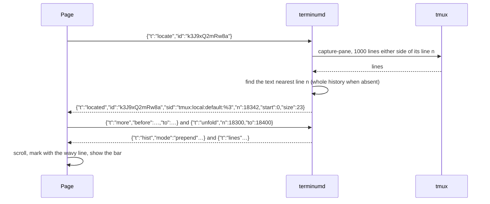
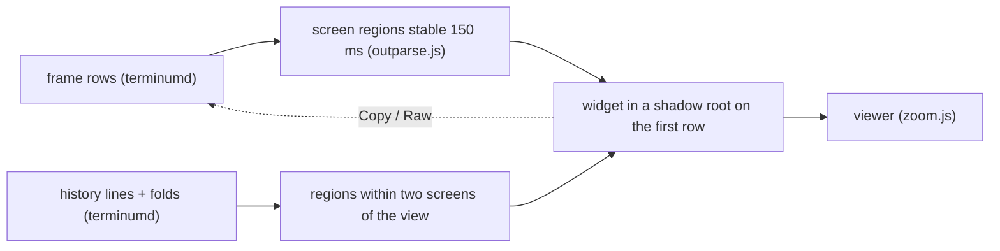

# terminum — Specification (terminal features)

Sibling of `terminum.md` (the core: tmux, screens, typing, sessions, security). This spec holds the terminal view's reading and input features. Cases: AC-31…AC-38, AC-40, AC-90, AC-91. It assumes terminum.md AC-02 (screens), terminum.md AC-03 (typing) and terminum.md AC-04 (Lines modes). Coding agents' states, plans and records are in `terminum-agents.md`.

## 0. Metadata

| Field | Value |
|---|---|
| Status | current |

A snapshot of what terminum must do, not a record of how it came to be: git holds that.

## 1. Overview

**Problem.** A terminal shows output as rows of text. A coding agent's session is thousands of lines of Markdown, diffs, code, commands and images named by path; on a phone, finding a place again, reading a diagram, or putting the cursor into the agent's input box is slow or impossible in a plain terminal.

**Who it affects.** Users of coding agents (Claude Code, Codex) and long-running commands who read and answer from a Mac, a tablet or a phone.

**Expected outcome.** The terminal view renders what the output is (code, Markdown, diagrams, tables), folds what nobody reads twice, remembers places as bookmarks and reminders, searches the whole loadable history, opens paths and links, takes pasted images and files, copies text cleanly on every device, keeps what the user sent, and lets the user edit a coding agent's input with taps and arrows as in a text field. Screens and history come from tmux through terminumd.

**Scenario, before and after.**
- Before: Alex scrolls 4,000 lines on a phone to find the table Claude printed an hour ago, reads its Markdown source with `|---|`, and taps three times to get the cursor into the right word of a long prompt.
- After: Alex taps the bookmark mark on the edge; the table is rendered, in view in a second. A tap in the input box puts the cursor on the word.

## 2. Scope and non-goals

In scope:
- Output widgets, history folds, bookmarks, search, links and file names, paste and upload, selection and copying on phones, reminders on bookmarks, the sent history, the latency and context traces, input-box navigation.

Out of scope (explicit):
- Rendering by the terminal of inline images or sixel (`terminum.md` §2).
- An image file named in the output shown in the terminal: it opens from Files or View.
- Editing a file from the terminal view (the Files panel's View does that, `terminum-files.md`).
- Programs' own mouse handling outside Screen mode (terminum.md AC-06).

## 3. Assumptions, dependencies, open questions

Assumptions:

| ID | Assumption | Owner | Status |
|---|---|---|---|
| AS-31 | The page's modules of this spec (`outparse.js`, `widgets.js`, `folds.js`, `marks.js`, `markjump.js`, `find.js`, `links.js`, `termlinks.js`, `upload.js`, `agentbox.js`, `boxnav.js`, `trace*.js`) work on terminumd's messages as §9 lists them. | Claude | verified: `web/test/e2e_live.mjs` |
| AS-32 | Folds, bookmarks and search are pure functions of the lines: terminumd computes them with no call to tmux inside. | Claude | verified: `cargo test page::folds`, `cargo test page::search` |
| AS-33 | Claude Code's input box rows hold `cols - 2` characters, the prompt included; its footer and status lines follow the box; a redraw of its own can leave the cursor below the footer. Measured at 54–151 columns. | Claude | verified: `web/test/claude-input-60.json` in `web/test/e2e_boxnav.mjs` |

Dependencies:

| ID | Dependency | Owner | Status |
|---|---|---|---|
| DEP-31 | `renderers.js` bundled by `ui/` (markdown-it, the panel's CodeMirror highlighter, mermaid; versions in `ui/package-lock.json`), served from the embedded panel at `/fb/renderers.js`, loaded on first need (`web/static/widgetui.js:15`). | Claude | available |
| DEP-32 | The CSS Custom Highlight API for underlines (Safari 17.2+, Chrome 105+); a browser without it shows none. | Claude | available |

Open questions:

| ID | Question | Owner | Status | Decision |
|---|---|---|---|---|
| OQ-31 | Bookmarks are keyed by the pane's key (`tmux:<host>:<socket>:%N`): a pane id is reused by tmux after a server restart. Add the session's creation time to the key? | Claude | resolved | No: the key stays the pane's, and the server's identity decides (AC-33; `terminumd/src/page/projects_tests.rs:126`). |

## 4. Acceptance cases

| ID | Priority | Case |
|---|---|---|
| AC-31 | [SHOULD / P1] | In the terminal, a file printed by a command, a fenced block, a Markdown document, a Mermaid diagram and a table drawn with rules are widgets: rendered in place with Raw, Copy (a table also as a PNG) and a full-screen viewer, while the text, selection and copying stay as they were. |
| AC-32 | [SHOULD / P1] | Diffs, written files, long tool output, blank runs, encoded data, repeated and similar lines in the history are folded into one line each with Show and Copy, found by terminumd before the page sees them. |
| AC-33 | [SHOULD / P1] | A selection in the terminal becomes a bookmark with a note, kept on the Mac for every signed-in client; marks on the terminal's edge and a list bring the text back into view, also in older, folded or rendered lines; a bookmark whose lines are gone keeps its text. |
| AC-34 | [SHOULD / P1] | The shown pane's whole loadable history is searched by terminumd: the count, the first match in view and marked, next and previous, every match a mark on the edge. |
| AC-35 | [SHOULD / P1] | Web addresses and file paths in the output are underlined and open: addresses in a new tab of the reader's browser, files in View on the pane's host, only when the file exists. |
| AC-36 | [SHOULD / P1] | The user pastes an image, uploads a file or drops files onto the page; they are saved where the pane's shell runs and their paths are pasted into the pane without Enter. |
| AC-37 | [MUST / P0] | The user selects and copies terminal text on a computer, a tablet and a phone with the system's own menus and handles, with line ends kept, while the screen pauses under a selection and catches up after. |
| AC-38 | [SHOULD / P1] | With `?trace=1` terminumd and the page record each key's stages and session opens for 15 minutes into a log a script sums up; with `?trace=2` the page keeps a ring of events and input-box snapshots a button copies for a coding agent. |
| AC-90 | [SHOULD / P1] | Every message or command the user sends in a pane is kept per project (its host and folder) and read back as Markdown from a button under the magnifier: the last first, older and newer. |
| AC-91 | [SHOULD / P1] | A bookmark can be a reminder: a pale fuchsia bell stands, its count filled, over its session when that session's coding agent ends a turn, until pressed; its pane is the bookmarks' navigator of the session's open reminders; Resolve ends one. |
| AC-40 | [MUST / P0] | In a coding agent's input box on a phone, a tap puts the cursor on the character under it, ↑ and ↓ move by the page's lines, a slide moves the cursor, held delete deletes words, the box is a panel above the keyboard with its status lines behind ⓘ, and the cursor is drawn in the box when the agent left it below the footer. |

## 5. BDD scenarios

### AC-31 — Output widgets [SHOULD / P1]

```gherkin
Scenario: AC-31 happy path — a file printed by a command
  Given the shown pane printed "cat README.md", 80 lines of Markdown, then its prompt "alex@mac api %"
  Then the lines from the command to the next line starting with that prompt (its numbers aside; a two-line prompt's blank and colored lines before it excluded) are a Markdown widget: a bar ("Markdown · Raw | Markdown · Copy") over the rendered document as wide as the terminal, fenced code highlighted in the theme's ANSI colors, Mermaid fences drawn
  And "cat", "bat", "head", "tail", "less", "more", "nl" with one file name are such commands; a prompt of one or two characters ("$ ") ends nothing; ".mmd" and ".mermaid" are diagrams, other names are code in the language of the name

Scenario: AC-31 happy path — fences, documents and diagrams in any output
  When the output holds a fenced block (``` or ~~~, closed by the same fence; any word after it is its language: `gherkin`, `json`…, highlighted where the viewer knows it; `mermaid`, `mermaidjs` or `mmd` a diagram; a fence the output went on past with no closer, at a coding agent's next message or result less indented than it or at a prompt, is text, and what follows is read), a Markdown document (a run of lines with a heading after a blank line, a table or a fence, two kinds of Markdown signs and three lines with one, at most 6 plain lines between, less than 30 % code-like lines, never across a prompt line) or a diagram starting with its keyword alone on a line ("flowchart LR", "sequenceDiagram" …) up to the next blank line
  Then each region is a widget: a document's shared indentation is removed (an agent indents its tools' output), a document may start on a tool's first line ("  ⎿  # Title"); an unfenced diagram starts in Raw (text from anyone reaches Mermaid only when the user presses Diagram)
  And Raw shows the lines as before with the bar; the choice is kept per region while the page is open; Copy copies the source (a fence's code without the fence); a click on a diagram opens the viewer

Scenario: AC-31 happy path — a table drawn with rules
  Given Claude Code drew a table of 2 columns and 2 rows in a pane 140 columns wide ("┌───┬───┐", "│ Commit │ What │", "├───┼───┤" between rows, "└───┴───┘"), a cell wrapped over two lines, its code colored
  When the page shows the pane, also narrower than 140 columns (a phone, Wrap)
  Then the lines from the top rule to the bottom rule are a table widget: a bar ("Table · Raw | Table · Copy") over an HTML table, the first part (before the first rule) its head, each part between rules one row, a wrapped cell's lines one cell again; its cells wrap at the view's width, a table wider than that scrolls sideways in the widget
  And the rules may be light, heavy, double or rounded (rich, tabulate) or ASCII ("+----+", mysql, prettytable); a table without rules between its rows has a row per line, in a box table a line whose first cell is empty going on the row above (an ASCII table's never: mysql does not wrap); a column of numbers (units and "-" allowed) is aligned right; cells are put in as text
  And Copy copies it as a Markdown table ("|" in a cell as "\|"); Raw shows the drawn lines
  And it is a widget although the program colored it; one rule of a single column (an agent's box, a banner), a line of a box that does not fit the grid, or rows with no whole rule among them is no table; a table whose bottom rule is not printed yet, or whose line of a box off the grid or blank line has only blank lines after it (a row printed halfway, a frame caught half-drawn), waits for the rest; a line of text (or the top rule of another table) right under its rows ends it, its bottom rule lost; a Markdown document ends before a drawn table
  And a table whose top rule is not there (scrolled away, lost by the terminal, or cut off where it was copied: "│ What │ Without │ With │" then "├───┼───┼───┤") starts at its first row of the grid or at a middle rule, when the line above it is no line of a box (a row after a line off a table's grid starts nothing: that table stays text, all of it, never half a widget) and the first rule under its rows has as many columns, also when the history ends inside the table and the screen begins at its head row (Claude Code redrawing its screen after Ask typed into its box): the scan goes on from its top rule; its first part is the head only as one line with all its cells and a rule under it, else it is a row
  And known limits: a table with rules between its rows and no head, or that lost its top down to a row of one line, shows its first row as the head; a two-line head that lost its top rule shows as a row; a table with no bottom rule and only the cursor under it stays text; a Markdown table that lost its head and separator stays text; a first cell wrapped without rules between rows (rich) becomes a row of its own; an unchanged table in a diff's context is a widget too; its colors are dropped in the widget (Raw keeps them)

Scenario: AC-31 happy path — a table copied as a picture
  Given a table widget, drawn or in Raw, in a pane of any width
  When the user presses PNG beside Copy in its bar
  Then the clipboard holds a PNG, nothing else, and a toast says "Copied the table as PNG."
  And the picture is the table as the widget lays it out: its head, its rows and their hairlines, wrapped cells, numbers to the right, a diff's removed rows struck and added rows tinted, in the widget's font, without the bar, on an opaque background, in the colors of the theme shown
  And it is laid out by itself at the table's natural width up to 800 px (wider only where words do not fit), so a phone's narrow pane gives the same picture as a wide one, and at twice its size, so it stays sharp in a document
  And a table too long for twice its size within 16 million pixels is drawn smaller, whole; when that is less than its size the toast says "Copied the table as PNG, smaller than its size: it is very long."
  And the widget, the view and the reader's place do not change
  And only the table widget has the button: a table inside a Markdown document, code and diagrams do not

Scenario: AC-31 failure — a table the browser does not take as a picture
  Given a page without the clipboard's API (not HTTPS or localhost), or a browser that refuses the picture
  When the user presses PNG
  Then a toast says so ("This browser can copy a picture only over HTTPS or on localhost.", "The table was not copied: <reason>")

Scenario: AC-31 happy path — a Markdown table in an agent's diff
  Given Claude Code shows its edit of a Markdown file as numbered diff rows ("  7 - | Version | 0.11.1 |", "  7 + | Version | 0.12.0 |")
  When two of the rows in a row or more are table rows
  Then they are drawn as a table widget: the header from the row above a "|---|" when the diff shows it, a removed row struck, an added row tinted; Raw shows the diff as it is
  Given such a row wider than the pane, which Claude Code continues in the next lines with no number, from its text's column (a space in its mark's column, or a removed row's "-")
  Then it is one row of the table, its parts joined as drawn (a word cut by the width is whole again)
  Given `git diff` of a Markdown file in an agent's tool output: each line's mark ("+", "-" or a space) in one column right before the "|", the head and separator context lines, a row the width cut going on in the next lines that start in that column
  Then it is one table widget from the head to the last row, each row whole and marked (a context line, a hunk's "@@" or a diff's own line ends a row), never the head alone with the rows left as text; a table in a diff with no row added or removed is a plain table

Scenario: AC-31 edge — a Markdown table a program wrapped at a phone's width
  Given Claude Code in a pane 44 columns wide printed a table's Markdown: each row padded to its columns' width and wrapped at its width, a row's first line ending at the bar in its middle, its padding wrapped into blank lines, its separator ("|---|---|") over several lines
  When the page reads the output
  Then the table is a table widget: from its head row to its separator a row goes on, blank lines and all (40 lines at most), until it has as many bars as the separator, the separator's pieces joined without a space; a row with a bar more than that is a row of its own and the next rows join again
  And a row starting with "|" outside such a table goes on in the next lines, four at most, until one ends with "|"
  And after a head and its separator every next line starting with "|" is a row, as GFM reads it, its closing "|" or not (rows cut short, `cut -c200`, or wrapped past repair) while it has two cells at least: never a head alone over raw rows nor a document starting at its separator; a line not starting with "|", and one of a single cell without its closing "|" (a tree's "|-- src", a pipeline's "| grep x"), ends the table; a head and separator followed by other text is a table of no rows
Scenario: AC-31 happy path — the viewer
  When the viewer opens a diagram
  Then it covers the window fitted, with −, +, Fit and × at the top right; pinch, drag, wheel and double tap zoom and move; Esc or × closes it and the terminal has the keys again on a computer

Scenario: AC-31 edge — the terminal stays the terminal
  Then rows' text does not change: a selection across a widget copies the region's lines; link underlines, cursor taps and the agent's input box keep working; output a program colored itself (bat, glow, delta, an agent's own rendering) is never a widget
  And a table drawn with rules is a widget in the frame its last rule appears, no frame showing its lines; its rows before that (a frame caught midway, a slow link, a program redrawing it) stay out of sight for at most 150 ms from the first, then show as text; an ASCII table's rule with no line after it and no part above a rule (its head or its only row) may not be its last: out of sight the same way, a widget after 150 ms unchanged; a Markdown table in pipes, which has no last line of its own, once a line follows it, else after 500 ms unchanged, as a table with no bottom rule; so one printed slowly is drawn once it stops, not again per row
  And a table is drawn once, its HTML kept as it scrolls into the history, as a program redraws it unchanged and when the same table is also printed elsewhere; in the history it is a widget however far from the view: scrolling to it changes nothing. Known limits: a table in a Markdown document is that document's widget (150 ms, then near the view); a table cut by the top of the history loaded so far is whole once the lines above it are loaded
  And when output scrolls a table off the screen in one batch, the history's lines arriving before the screen's, the widget keeps its top rule and whole head: a scan starts at no line inside a table
  And another region on the screen becomes a widget once unchanged for 150 ms and stays one while the screen changes below it; the cursor's row and below are never part of one, nor an agent's input box; streaming output is looked at every 100 ms at most and never further back than 2000 lines; in the history only regions within two screens of the view are drawn (a 10,000-line chat loads as fast as without widgets); at most 150 widgets are kept (out of sight: a table in the history stays attached)
  And a widget acted on in sight keeps its line in place; one changing by itself keeps the first line wholly in sight in place; following the output, the view stays at its end; nothing grows after placement (diagrams go in once decoded, widgets once their stylesheet is in)
  And an image file named in the output is a path as any other (its underline, a click opens it in View): no button after it, nothing shown below its row, on no row (a wrapped one, the agent's echo of the user's prompt)

Scenario: AC-31 failure — the renderer cannot be loaded or a diagram does not parse
  When "/fb/renderers.js" does not load
  Then the bar says "The renderer did not load (<reason>); is terminumd running?", Markdown and diagrams show as text, code as plain text; pressing Markdown or Diagram tries again
  And a Mermaid fence that does not parse shows Mermaid's message in its bar and its lines as text; inside a document only that diagram stays source
```

### AC-32 — History folds [SHOULD / P1]

```gherkin
Scenario Outline: AC-32 happy path — what folds
  Given the pane's history holds "<what>"
  Then terminumd folds it into one line "<shown>" with Show and Copy, sent as {n, to, label} with the lines (null in a folded line's place)

  Examples:
    | what                                                                                   | shown                               |
    | an edit's diff under an agent's "⎿ Updated/Added/Removed/Deleted …" (6 lines or more)   | ⋯ 26 lines of diff                   |
    | a file it wrote ("⎿ Wrote …", "Created")                                               | ⋯ 81 lines of the file               |
    | a tool's command after its line and one more (2 more or more)                          | ⋯ 85 more lines of the command       |
    | a tool's output after its first line and two more (3 more or more; its blank lines included) | ⋯ 753 more lines of output |
    | 3 or more blank lines before an agent's next "⏺" or "⎿" line                           | ⋯ 10 blank lines                     |
    | 3 or more rows of base64, base64url or hex (runs of 40+, digits and letters mixed)     | ⋯ 3.2 KB of base64 · 41 lines        |
    | one line 5 or more times with only blank or 1–3 character lines between (its first kept) | ⋯ 64 more copies of this line      |
    | 20 or more nearly equal lines (numbers, paths, long words aside), first 3 and last 2 kept; never a line saying something failed | ⋯ 4,386 similar lines |

Scenario: AC-32 happy path — a tool's output down to a summary
  Given Claude Code's ("⏺ Bash(…)", "  ⎿  …") or Codex's ("• Ran …", "  └ …") tool output has scrolled into the history
  Then its command and its output fold as the table above says, within a second, also while the agent's next line (its end) is still on the screen; an output going on from the history onto the screen folds once it scrolled off whole
Scenario: AC-32 happy path — on the screen too
  Given a tool's long output is still on the screen, under the agent's next line
  Then the same rules fold it there: the screen message carries its folds ([from row, to row, label], when they changed) and the page shows one line with Show and Copy in their place; Show keeps it open while its first row reads the same; the part that may go on (the last), a full-screen program's rows (vim, mc; Codex's own alternate screen is an agent's) and the cursor's never fold
Scenario: AC-32 edge — rendered output
  Given a fold found over lines the page has and draws as a widget (a Markdown table, a diff's table, a code block, a diagram: AC-31)
  Then the widget stays, its lines hidden, and the fold gives way, also a fold that starts on lines before the widget's (a tool's output folded from its third line); only a fold of lines terminumd did not send (no text to draw) stays a fold

Scenario: AC-32 edge — a running tool's dot blinks
  Given Claude Code runs a tool whose command takes 4 rows: while it runs it shows its dot for 600 ms and a space for 600 ms ("⏺ Bash(…" and "  Bash(…")
  Then the command folds alike in both phases ("⋯ 2 more lines of the command"), so the fold neither comes and goes nor moves the page, also on opening it; a row "  Name(" counts as a tool's only when the tool's result ("  ⎿") follows its command, so indented text that looks like a call never folds as one
Scenario: AC-32 happy path — show and copy
  When the user presses a fold's line
  Then the page asks terminumd for those lines ("unfold") and shows them; the line says "Hide …"
  And Copy copies the fold's lines (asked for first when not here; copied in the same click over HTTPS, else "The lines are here now: press Copy again.")

Scenario: AC-32 edge — the whole, the screen, a clear
  Then only a whole part folds (one that may go on at the history's end waits); rows tmux wrapped are one line; the screen itself is never folded; lines that scroll off come with their folds in a "folds" message at most every second; a cleared scrollback drops the folds and new lines reuse the numbers; a selection across a fold copies its line

Scenario: AC-32 failure — lines terminumd cannot send
  When the lines are gone from tmux's history, the fold was not told, or more than 20,000 are asked
  Then terminumd refuses with why, the page shows it, and the fold stays
```

### AC-33 — Bookmarks [SHOULD / P1]

```gherkin
Scenario: AC-33 happy path — a selection becomes a bookmark
  When the user selects text in the history, the screen or a widget's rendered text
  Then a gray Copy and an orange [+] under it stand in the floating buttons' column (in one line with find and the sent history), Copy level with the selection's first line (kept inside the terminal, following the view), the column's other buttons hidden meanwhile, while the selection lasts (and 600 ms after); Copy, [+] and Ask one gap apart (--sp-3), the same gap between the terminal's top or end and the first or the last; on a phone or a narrow window they stand instead at the terminal's top right, Copy first, in place of the folded floating buttons (terminum.md AC-18); not for a selection in an agent's input box or status lines
  When the user presses [+], types a note and saves (Save, or ⌘Enter or Ctrl+Enter in the dialog; a plain Enter is a new line of the note)
  Then the dialog, 80% of the terminal's width (480 px at least, the window's less 32 px at most), shows the text it keeps (a longer one: its first 2000 characters, never half an emoji, then "… (the first 2,000 characters are kept)") and the bookmark holds that text, the note (up to 1000), its line, and, stamped by terminumd, the pane's key (OQ-31), title, host and time, in "web-bookmarks.json" on the Mac, seen by every signed-in client at once

Scenario: AC-33 happy path — marks, the way back, the lists
  Given the shown pane has bookmarks
  Then each is an orange mark on the terminal's right edge, the text stopping 6 px before the marks (a narrow window or a phone; a wide one shows them among the sent messages' marks there, AC-90) placed by its line between the oldest loadable line and the last; the session's row has an orange strip; a round button at the top right, an orange bookmark on the plain buttons' fill (never a dark icon on an orange blob), shows the count of its bookmarks and open reminders (filled dark orange with no outline, as a reminder's up; round for one digit, an ellipse for two, on the button's corner clear of its icon) and opens the session's list (note, text start, time)
  When the user presses a mark or a list entry
  Then terminumd looks for the text nearest its line (1000 lines either side first, the whole history after; tmux renumbers when it drops lines or the scrollback is cleared), the page loads older lines down to it, opens a fold it is in, scrolls so the text stands a third from the top, marked by a wavy orange line on its left (a reminder's pink); rendered text is found in the widget; "Its text was not found there: this is the line it was on." when only the line is found
  And the wavy line stands in the terminal's 16 px left gutter, 5 px from its edge and 5 px before the text; a bookmark or a reminder just saved gets it at once, where its text stands (the view does not move); rows drawn again under it without its text (Claude Code's /clear, which leaves tmux's history) take it away, and it is back when its text is again on its line or just under it
  And the place stays put under widgets drawing until the user scrolls, taps, types or shows another pane; a bar shows the note with Quote in chat, Edit, Delete and × (where the buttons float, a phone, across the terminal under ⟨…⟩, 12 px in, "Quote" for Quote in chat, its keys inside it)
  When the user presses Quote in chat
  Then its note and, under it after a blank line, its text quoted ("> " a line) are pasted into the shown pane's input as one paste, no Enter; on a computer the terminal takes the keys, a phone's keyboard stays as it was
  When the user opens "Bookmarks / Reminders" at the list's foot (an orange bookmark's icon; on a computer "Bookmarks / Reminders" with a pink bell before "Reminders", on a phone both icons in one blob; the count of those it lists)
  Then a large window opens on the right (the whole width on a phone; × or Esc closes it) and every bookmark (or, under Reminders, every open reminder) is listed newest first with where it is: its project's name or its session's title, "orphaned" (its session gone) or "out of reach" (its session not listed now, its host unreachable); picking one closes the window and shows that session at the bookmark, or its text and note when no session shows it
  And the button counts them all (the bookmarks and the open reminders); the panes of a session (its bookmarks' button and the bell) list only its own

Scenario: AC-33 happy path — going through a session's bookmarks and reminders
  When the user presses the bookmarks' button
  Then its pane is a navigator in the panes' window (below, "the panes are windows as View's"): on top a list that scrolls, the session's bookmarks and open reminders together, in the session's order (top to bottom), each its time on a line of its own (1 px over the lists' size) with its place in the list and their count at that line's right ("1 / 52", the same type), under it its title (or its text's start, in the terminal's font and size) across the whole row, and under the title its text's start on one line: line breaks and frame lines (`─`, `│`, `⎿`) taken out, from an agent's record its Markdown's marks too (a heading's, a quote's and a list's marks, fences, a table's bars, a link's address; `**`, `__`, `~~`, `*`, `_` and backticks only in pairs around words, so `__init__.py` and `2 ** 10` stay), cut with … at the row's end; a reminder with a pink bell, an agent's (terminum-agents.md AC-98) with its agent's mark; the list as tall as its rows, at most its share of the height (half at first, 15% to 85%, the view keeping 200 px); under it, past a line the user drags from where it is (a double click: half again; ↑ ↓ on the focused line: 5%; kept in this browser; on a phone 44 px high, the view's title and content scrolling as one with its actions at its foot), the chosen one (the first when it opens): its title, where and when, its content rendered (its title and its text, code too, in the list's size: the window's) as the terminal renders Markdown (by the file viewer's renderer, raw HTML off: an agent's record its own Markdown, the user's bookmark the terminal's text exactly, in a code block; long lines wrap, never a sideways scroll), and three actions: Show in terminal at the left, Resolve and Quote in chat together at the right; on a computer the pane has the keys
  When the user presses an entry, or moves to it with ↑ or ↓
  Then its content shows under the list, the list scrolled to keep it in sight, a note the title cannot hold (its lines, its Markdown, its length) whole above its text; nothing in the terminal moves
  When the user presses Show in terminal (or Enter)
  Then the pane closes and the session goes to its place as a mark's press does, its bar shown
  When the user presses Resolve (or Delete or ⌫)
  Then the chosen one is settled at once in the list: struck through, "Resolved" or "Deleted" and Undo in its place for 5 s, Resolve turning into Undo; only after it terminumd is told (a page closed meanwhile does nothing)
  When the user presses Quote in chat
  Then the pane closes and its note and its text quoted are pasted as the bar's Quote in chat does
  And the bar after a jump has Resolve (the same, its Undo in its place) before Quote in chat, Edit and Delete, and ↑ ↓ to the entry above or below
  And on a computer the pane says "↑ ↓ choose · Enter: show in terminal · Delete: resolve · Esc: close"

Scenario: AC-33 happy path — a chosen list
  When the user opens the bookmarks' pane
  Then under its head stand two switches: Session | Project | All, and Everything | Reminders | Bookmarks (the bell's pane stays its session's open reminders, no switch); the head says what is listed ("Reminders of api", "All bookmarks and reminders")
  When the user picks Project
  Then it lists the records of the shown session's project, those of its sessions closed since too, said "closed" (Project is off for a session in no project); All lists every session's, orphaned ones said so; each record of another session with that session's name before its time, newest first
  And Show in terminal, Resolve, Quote in chat and the keys work on the list chosen, as on a session's: Show in terminal shows that record's session, or its text and note when its session is gone; Quote in chat of another session's record is off where the shown session runs no coding agent (a plain shell would run its lines)
  And the choice stays while the page is open, also when the button opens the pane again in another session; after a reload the pane opens on Session and Everything; "show them" in the Plan pane (Everything) and a banner's Open (its kind) open this once on Session, the choice kept
  And the button's count and the bell's stay the session's own, whatever the choice; under Project or All the pane stays open when the session's own run out

Scenario: AC-33 happy path — a session's own
  Given a bookmark made in a session, in a project (terminum.md AC-92) or not
  Then only that session lists it under the pane's Session ("Bookmarks and reminders of this session") and only its row has the wavy orange line, at its right edge past its program; another session, of the same project too, shows nothing of it on any path: the bookmarks' button (its count and pane), the bell (its count, pane and toast), the Plan pane's "kept for you" (its count, the header's hover and what its press opens), a banner's Open, the terminal's marks and the bar's steps
  And it stays its session's when that session joins, leaves or changes a project, or its project is deleted (terminum-kanban.md AC-110), or an attached session is detached (it shows again when attached)
  And a record of another session arriving while a pane is open changes nothing in it
  When its session closes
  Then terminumd orphans it: it is only in the list below the sessions (Bookmarks | Reminders), said "orphaned", until deleted there (for good); a bookmark is deleted from a session's list or bar too
  And that list shows every session's, on purpose: the one place to reach the others' and those of closed sessions
  And "Open all" in that list shows its bookmarks or reminders as one document, full screen
  And a web-bookmarks.json before version 3 (bookmarks of a folder) has each bookmark take the project its session is in at terminumd's start, else that session, once
Scenario: AC-33 edge — the lines are gone, a rename, a server restart
  Then a bookmark whose text is no longer in the history says "These lines are no longer in this session's history." with its text and note; it stays until deleted
  And one made on a full-screen program's own screen (tmux's alternate screen, terminum.md AC-06) is found while that screen shows its text, else it says "It was on a full-screen program's own screen, which tmux keeps no history of." with its text and note
  And the bookmark dialog shows the characters terminumd keeps (its `marks` message says how many), never the page's own number
  And a renamed window keeps its bookmarks (the key is the pane's); a tmux server restored from its checkpoint (terminum-lifecycle.md AC-15) gives its bookmarks their panes' new keys, those of a pane not made again orphaned (a restored pane may take its id); one started anew without a restore (another @terminum-id) orphans its bookmarks: a reused pane id is another pane (OQ-31)

Scenario: AC-33 failure — cannot keep or reach
  When the Mac has 300 of the user's bookmarks (a new bookmark, or a reminder made a bookmark in Edit) or 100 of the user's open reminders (a new reminder, or a bookmark made one), the pane closed meanwhile, or the file cannot be written
  Then the dialog stays open and says why; nothing is half saved; a save repeated after 10 s without an answer is kept once; an unreadable file is left as it is and every save says so
  When the lines do not arrive within 15 s or the pane changed
  Then the bar says the bookmark could not be reached and why
```

### AC-34 — Search [SHOULD / P1]

```gherkin
Scenario: AC-34 happy path — find in the history
  Given a magnifier stands at the terminal's top right (left of the bookmarks' button)
  When the user presses it, types "retry loop" and presses Find
  Then terminumd searches, case aside, every line the page could load (the loadable history and the screen, wrapped rows as one line) and answers each match's row and the matches before it (at most 2000, "1 / 2000+")
  And the page says "1 / 17", brings the first match into view as a bookmark is, marks it white; every match is a white mark on the edge, the shown one bolder

Scenario: AC-34 happy path — next, previous, close
  When the user presses ↓ (or Find, Enter) or ↑ (Shift+Enter)
  Then the next or previous match is shown, round the ends
  And the magnifier stays in sight, ringed while its field is open
  When the user presses ×, Esc, the magnifier, or shows another pane
  Then the field, the marks and the highlight go; the terminal has the keys again on a computer

Scenario: AC-34 edge — nothing, or too long
  Then "Not found" when nothing matches; a text over 200 characters is refused inline
  And Unicode lowercase expansions preserve the original match's row and DOM range: searching "x" in wrapped rows "İ", "x", "z" goes to the second row and highlights only "x"

Scenario: AC-34 failure — terminumd cannot search
  When the pane closed or the history cannot be read
  Then the field says why and keeps the text
  And after a request times out, Find retries the unchanged text; an old response cannot replace a newer request
```

### AC-35 — Links and file names [SHOULD / P1]

```gherkin
Scenario: AC-35 happy path — addresses and paths
  When the user clicks (⌘-click with a mouse; Ctrl on other systems) or taps a web address in the screen or history
  Then it opens in a new tab of the reader's browser (noopener), never on the Mac; an address wrapped over rows is taken whole
  When the user clicks or taps a file path or name the pane printed (absolute, "~/…", "./…", "../…", a path with a slash, or a name with a known extension, with ":line" or ":line:col")
  Then the page opens it in View as a tab on the pane's host; a relative one from the folder the pane's coding agent works in, as its hooks last said (its own events, not a subagent's: Claude Code may work in a worktree below the folder it started in, which stays the pane's), then from the pane's folder, where its file is; "~" is the home on the pane's machine
  But only a file that is there is a link: its folder is listed on the pane's host through the Files API (one page answers every name of a folder up to 500 entries; at most 4 listings at once, newest first; a file not there is looked for again after 10, 30 and 60 s, a found one after a minute); "and/or", dates and version numbers are not paths
  When the program printed a link with a text of its own (an OSC 8 hyperlink: "⧉ Fix the retry loop — MR !318", its address https://…/merge_requests/318)
  Then its text is a link as an address is (the same underline, ⌘-click or tap), its hover names the address; an http or https address opens in a new tab, a file:// one with no host or "localhost" opens its path as a printed absolute path does; any other scheme (javascript:, data:, ssh:…) or an address over 2,048 characters or with a control or bidi formatting character stays text; a file:// link whose file is not there says so when pressed; a link that runs past a row is a link on its first row only (tmux 3.6a's capture, terminum.md AS-03)

Scenario: AC-35 edge — underlines and clicks
  Then such text has a faint dotted underline in the visible part and a screen above and below (CSS Custom Highlight API, DEP-32), redrawn after output and when scrolling stops; the pointer is a hand only with ⌘ held; a click that ends a selection, a long press or a drag opens nothing; a tap on the cursor's row moves the cursor instead (AC-40)

Scenario: AC-35 happy path — a long path shown short
  Given a row of output names a path of 84 characters or more within the row ("/private/tmp/claude-501/-Users-alex-p-terminum/8247383d-e6a6-4b78-bdcd-1e99c0bd7b52/scratchpad/hdr/after-top.png")
  Then it shows its first 36 and last 40 characters with "[...]" between in the accent color ("/private/tmp/claude-501/-Users-alex-[...]e99c0bd7b52/scratchpad/hdr/after-top.png"); the row's text stays whole, its middle hidden, so a copy, a ⌘-click or tap on what shows of it and its underline take the whole path
  When the user clicks or taps "[...]"
  Then the path shows whole, wherever it is folded, while the page is open (a redraw of its row keeps it whole); nothing is typed and the cursor does not move
  But a path in the cursor's row, an agent's input box or its footer, or a full-screen program's screen is always whole (text there is edited or laid out as a grid); a path over two rows is not folded

Scenario: AC-35 failure — the folder is unknown
  Given a remote pane whose host has no files helper
  When the user taps a path
  Then the page says "Files of <host> are not enabled: enable them in the Files panel" and opens nothing
```

### AC-36 — Paste an image, upload, drop [SHOULD / P1]

```gherkin
Scenario: AC-36 happy path — paste an image
  Given the shown pane runs on this Mac, or on a host whose files helper is enabled
  When the user pastes an image (a screenshot: PNG, JPEG, GIF, WebP; another type the browser can draw, such as TIFF from Preview or HEIC in Safari, is turned into a PNG first) into the terminal, or presses the hot key Paste over HTTPS with an image on the clipboard
  Then the image is never typed as text; the page uploads it (300 s to arrive; its limits under "refused or failed"), terminumd saves it where the pane's shell runs ("~/.terminum/tmp/" on the Mac and on a host; folder 0700, file 0600, named by UTC time and 8 random hex digits: `<utc>-<8 hex>.png`), and the page pastes the absolute path shell-quoted as text (bracketed when on), no Enter; files older than 7 days go at the next paste, when terminumd starts and once a day (on a host: when its files agent starts and once a day while it runs)

Scenario: AC-36 happy path — upload and drop
  When the user presses Upload and picks a file, or drops files on the page
  Then each is saved as an image is, of any kind, named by time, hex digits and its own name in safe letters, and the paths are pasted together, one per line in a coding agent's box (with bracketed paste on), else separated by spaces (in a shell each line would run as a command of its own at Enter); the terminal is outlined while files are held over it; a folder is refused; a drop never makes the browser open the file

Scenario: AC-36 happy path — files dropped from Finder on a pane of this Mac
  Given the page is open in this Mac's browser (http://127.0.0.1:48080, not through tailscale serve: terminumd says so in its `build` message, the page never guesses it from its address) and the shown pane's shell runs on this Mac
  When the user selects "Drums Initial.zip" and "Drums Grade 1.zip" (230 MB) in Finder and drops them on the page
  Then terminumd reads the drag's file paths from macOS's drag pasteboard (`osascript -l JavaScript`: no Apple Events, so no Automation prompt; 3 s at most) and takes them only when each item dropped is one of them, by its name and kind, a file also by its size and its time within 2 s, each path taken once
  And the page pastes those paths as an upload's paths are pasted, no Enter: nothing is uploaded, at any size, and a dropped folder is put as its path
  But when they are not the files dropped the page uploads copies as below, its toast first saying "Their own paths were not found: <why>", where <why> tells the cases apart:
    | Case | <why> |
    | the drag held no file (from Mail, a browser, another app's window) | "the drag held no file on this Mac's disk (a drag from Mail, a browser or an app's window has none)" |
    | a name dropped is not among the drag's files (an earlier drag's are there) | "Cat Package.zip is not among the files the drag held (it held 2, Drums Initial.zip first), perhaps an earlier drag's" |
    | the drag's file of that name is another | "/Users/alex/Downloads/x.zip is not the file dropped: 10 bytes on the disk, 11 dropped, changed 3 h apart" (only what differs; a time as 4.0 s, 12 min, 3 h, 2 days; a kind: "… is not the folder dropped") |
    | the drag's file cannot be read | "/Users/alex/Downloads/x.zip cannot be read (is it gone?)" |
    | a name dropped more often than the drag held it | "x.zip was dropped more times than the drag held it" |
    | a path has a control or invisible character (a bidi override, a zero-width mark) or is not absolute | "a path the drag held has a control or invisible character or is not absolute" |
    | osascript fails or does not answer in 3 s | osascript's message, or "macOS's drag pasteboard did not answer within 3 s" |
  And a host's pane and a page on another device (through tailscale serve: `/api/os` is refused there) always upload

Scenario: AC-36 happy path — drag from Files
  When the user drags a file or a folder from the Files panel (docked, in its window or its own tab) onto the terminal
  Then its absolute path is pasted at the input's cursor shell-quoted, as an upload's path is (nothing uploaded: it is where the pane runs), no Enter; a row of the selection drags every selected row, its own path first, the others as they were selected, separated by spaces; the terminal is outlined while they are held over it
  But a file of another host than the shown pane's is refused with a toast ("These files are on devbox; the session runs on this Mac: nothing was put."); a path that is not absolute or holds a control character is not put (each would be a key)

Scenario: AC-36 failure — refused or failed
  When the image is of another type, its bytes do not match, it is over 100 MB, or a third upload starts
  Then nothing is typed and a toast says why ("Two uploads are running already"); a file over 100 MB is not sent, the page saying "<name> is larger than the 100 MB an upload may be: type or paste the path to the file instead (in Finder ⌥⌘C copies it)." (a browser never gives a page a file's path), and terminumd's own "too large" answer says the same, never the server's raw text
  And a third upload is refused before its body is read, so at most two bodies are in memory
  When the pane's host has no helper, or ssh fails or is too slow
  Then nothing is typed (`terminum-remote.md` AC-85)
  When one of several files fails
  Then the rest are not sent and the saved paths are pasted
```

### AC-37 — Selection, copy, phones [MUST / P0]

```gherkin
Scenario: AC-37 happy path — a computer
  When the user selects text with the mouse and presses ⌘C (or the Copy button)
  Then the text is copied with its line ends: a hard end a newline, a row tmux wrapped continues, re-joined prose keeps one space and drops indentation, padding after a line is dropped; in Grid too
  And bidi controls, zero-width characters, the soft hyphen, word joiners, line separators and tag characters are left out, ZWNJ and ZWJ kept (words, emoji): a pasted line never reads otherwise than it runs; ⌘C, [+] and Ask (a widget's selection too) leave them out alike, and a toast says "(2 hidden characters left out)"
  And the selection's Copy has the tooltip "Copy 3 lines: <its first line with text>" (blanks one space, cut at 48 characters), and its toast says "Copied 3 lines: …" once copied, as every Copy's does (a phone has the toast only)
  And while the selection lasts the screen pauses with "Paused while you select" over the terminal's first line (taps pass through) and catches up when it is cleared
  And a selection goes with its pane's lines: another pane opened while it lasts (a tap in the list on a phone keeps it) is drawn at once, not paused, nothing selected

Scenario: AC-37 happy path — a phone
  When the user taps the input (the cursor's row, a coding agent's input box) or the keyboard button
  Then the keyboard opens and the page shrinks above it, growing back when it closes; a tap elsewhere on the terminal leaves it as it was
  When the user long-presses
  Then iOS selects the word with its handles and no menu of its own (no Copy, Find Selection, Translate over the text): the page's Copy, [+] and Ask stand where AC-33 says (each paragraph a block; a long one cut every 400 lines, so a tap on a selection in 3,000 lines never freezes); with the keyboard up a finger held still 0.45 s closes it and selects the word, kept in sight; the page's Copy copies the selection, also after a tap cleared it and the terminal caught up
  And with a hardware keyboard ⌘C copies the selected terminal text and ⌘V pastes; the keyboard field gets the focus back when the user was typing when the selection began

Scenario: AC-37 happy path — Ask about a selection
  When the user selects text in the terminal
  Then an Ask button (a speech bubble with a question mark, no label, on a pastel cornflower blue fill) shows while the selection lasts, just under the selection's [+] on every screen (AC-33; a split's embedded page draws no other floating button and no Ask: its Copy and [+] at the same right column); it is hidden otherwise
  When the user presses Ask
  Then its dialog opens centered on the window, across and down, as every dialog, and stays there as the window or its field is resized, the dialog scrolling when it is taller than the window, a quarter larger than other dialogs: 600 px wide, the quote up to 37.5% of the window's height, a 4-line question
  When the user types a question and presses Add to Chat
  Then terminumd gives the pane's next question number (one more than the highest "Quote #N" the pane sent (terminum.md AC-147) or the last it gave, kept per pane in the project's quotes.json, so it counts up across devices, reloads and terminumd's restarts), and the page puts at the input's cursor, no Enter, a Markdown quote, a blank line after it and after the question (none before), compact:
    "> Quote #0007\n> <the selected text's first line>\n> <its next line>\n\n<the question>\n\n"
  And the selected text's blank lines, line ends' spaces and control characters are left out and its tabs are spaces (each would be a key typed); a line ending in an @-word ends in a space (the agent's file list it opened closes before the new line)
  And the view stays where it was (typing elsewhere brings it to the cursor): the user reads on from the text asked about
  And in a coding agent's box it is typed, its new lines as Ctrl+J (a new line there), so the agent shows it whole, a long quote in parts, unfolded (terminum.md AC-03)
  But when the agent's box with it would not stay inside the pane, two rows kept (the rows its box and footer take now, 6 when the page has not found the box, plus the quote's rows at the pane's width less 4), it is pasted there (folded) and the blank line typed after it: a coding agent's box taller than the pane breaks its redraw, which then writes over the answer
  And the pane is measured as the dialog opens, before its field brings a phone's keyboard up (which makes the pane shorter until the dialog closes); a box taller than the screen counts whole
  And in a shell, where Ctrl+J would run the line, it is pasted with the blank line inside the paste
  When the shown pane runs a coding agent and the user presses Send to Agent (left of Add to Chat) instead
  Then the same text, without the blank line after the question, is typed (or pasted, by the same rule) into the agent's box and Enter follows 0.2 s later (an Enter in the same read as a paste is a new line to Claude Code), so the agent gets it at once, and the view goes to the input, where the answer comes; in a shell the button is not shown
  But the Enter goes only to the pane the quote went to while it still runs its agent: another pane shown by then, or the agent ended, and it is not pressed and a toast says so; the agent ending while the dialog is open hides Send to Agent and the dialog says so (Add to Chat still puts the quote in)
  And a number that does not come within 10 s is said in the dialog, and Add to Chat or Send to Agent pressed again asks again
  And however the dialog closes (Add to Chat, Send to Agent, Cancel, Esc), the keys go back to the terminal: what the user types next reaches the pane, also when a Shift selection in a full-screen program had taken them from it
  And ⌘Enter or Ctrl+Enter in the dialog is Add to Chat (a plain Enter a new line of the question); Cancel or Esc closes the dialog and pastes nothing; Add to Chat and Send to Agent (and the keys) are off while the question is empty

Scenario: AC-37 happy path — an asked quote stays marked
  Given the user asked about a selection (Add to Chat or Send to Agent; terminumd gave it its number)
  Then the quoted text in the terminal keeps a light blue wavy line (the Ask button's blue) down its rows' left, in the terminal's gutter, as a reminder's quote has (no underline), where it was selected: the occurrence nearest the line the selection began on (within 30 lines), never its copy in the message sent (after Ask's `> Quote #0007 >`, or the forms `Quote #0007: «` and `Quote Start ---- «` still in a history)
  And terminumd keeps the quote (its number, text and that line) per pane in the project's asked.json, the newest 100 of each pane, so the line shows on every page of that pane, after a reload and after terminumd's restart
  And the line stands beside the rows, which stay as they are (copying, iOS's selection), for the rows within a screen of the visible ones; text in a fold or scrolled out of tmux's history has none

Scenario: AC-37 edge — a tablet's trackpad and a hidden page
  Then a trackpad selection on a tablet stays the browser's own and is copied by a tap on it and Copy; a hidden page and a page in sight without focus: terminum.md AC-02, AC-13, terminum-agents.md AC-93; while it follows the output the page keeps about 2000 lines on a touch screen and 5000 on a computer, dropping the oldest blocks (loaded again on scrolling up)

Scenario: AC-37 failure — the clipboard is not available
  When the page runs over plain HTTP, where the browser's clipboard API is unavailable
  Then Copy uses the copy command on the selection; when that fails too the toast says "Copying is blocked here; use the system Copy menu."
```

### AC-38 — Traces [SHOULD / P1]

```gherkin
Scenario: AC-38 happy path — ?trace=1
  Given the page is opened with "?trace=1"
  Then a badge says tracing is on, the minutes left, the last and median echo; a tap ends it; terminumd writes "logs/trace-<date>-<time>.jsonl" (0600), one JSON record per line
  When the user types
  Then each key carries a number k; terminumd records how long it took to hand the key to tmux, how long until a capture showed a change, captures that found none, what woke the capture (the key, %output, the poll), the capture, cut and encode times, and whether the cursor moved; the page records the input path, the key kind, event-to-send, buffered bytes, send-to-screen, parse, draw and the next frame; a session opened records click-to-first-screen and first frame with the session's mode (local or remote)
  And every 2 s a ping measures the round trip; frames over 100 ms apart, draws over 16 ms, terminumd messages handled over 20 ms, its loop late over 20 ms, list refreshes and a tmux "display" round trip every 6 s are noted

Scenario: AC-38 happy path — ?trace=2 for a coding agent
  Given the page is opened with "?trace=2"
  Then a "trace" button stands among the floating buttons (also on a computer); terminumd only times stages; the page keeps a ring of its last 640 events ("<ms> <name> <json>", 400 characters each): keys sent (cut at 40 characters, a run as "SEQ×n"), screen messages with the rows changed, the cursor and stages, session opens, pointer events with their place and the cell under them, keydowns and composition, focus, visibility, viewport, scroll, selection, other messages by kind, notices, slow draws, errors, and every 5 s the counts, the heap and a round trip; the input box's rows and the page's lines of it are snapshotted (the last 3)
  When the user presses the button
  Then the clipboard gets a header, the events oldest first, and the page's state (environment, sizes, session, history, bookmarks, the input box, the last 12 history rows, the screen's rows): at most 1000 lines of 4000 characters, 120,000 characters; the header of "web/static/tracebuf.js" describes it and "web/test/tracereplay.mjs" replays one

Scenario: AC-38 edge — what is never recorded
  Then ?trace=1 holds no typed text, screen content, title or host name (kinds, lengths, times, ids, modes only); terminumd keeps a page record only with known names, numbers, booleans and listed words, a batch at most 500 records; the trace ends after 15 minutes or 20 MB and the page is told; the newest 10 files are kept; without the parameter nothing is recorded and no button exists
  And ?trace=2 stays in the page's memory, starts anew with each load, and leaves only by the user's copy; keys in other fields (password, filter, name, search, note) show as "·" and their messages as lengths

Scenario: AC-38 failure — the trace cannot write
  When the disk is full
  Then the trace ends with a line in terminumd's log; typing and screens go on
```

### AC-90 — Sent history [SHOULD / P1]

```gherkin
Scenario: AC-90 happy path — kept
  When the user presses Enter in a pane at a shell prompt or in a coding agent's input box
  Then the page tells terminumd what stood there before the key goes: the command after the shell's prompt with the rows it wrapped from, or the agent's typed rows (a faint suggestion is not typed); for a coding agent whose hooks spoke its prompt comes from its hooks exactly and the page's is dropped
  And a prompt whose mark has a variation selector after it (Starship's "at 19:20 ❯︎ ") is told apart from the command: the entry holds the command alone
  And terminumd keeps it in the message history of the tasks' store (terminum.md AC-147), the project being the pane's host and folder, with the time, the agent and the pane's title; the Message history (terminum.md AC-151) searches them all

Scenario: AC-90 happy path — read back
  When the user presses the speech bubble under the magnifier
  Then a modal pane beside it (under it where the view is narrow; the page shaded behind it, the keys its own until it closes, a press outside it closing it as × and Esc do) shows the project's last one as Markdown (a shell's command as a shell block), its folder, "1 of N", the agent and the time; ↑ (the up key) the one before, ↓ the one after, Copy, × (Esc), and at its foot Insert into chat (the message pasted into the shown pane's input as it was sent, no Enter; the pane closes); another pane shown shows its project's; a new one in the project shows while the last is shown

Scenario: AC-90 happy path — where it was sent, Jump to message
  Then each entry keeps its pane and the history line its text began on, a hint only (tmux numbers lines anew when it drops them, re-wraps or is cleared); a coding agent's prompt from its hooks takes the line the page told for the same text in that pane (matched by its letters and digits, not by time)
  When the user presses Jump to message
  Then terminumd looks for the first line of its text in the shown pane's history, nearest the line it was sent on, the whole history after (another pane's message, or one kept without a line, nearest the end); the page brings it into view as a bookmark's text and closes the pane
  When it is not there
  Then the pane says "These lines are no longer in this session's history." and stays open

Scenario: AC-90 happy path — the marks on the right edge
  Given a window at least 861 px wide
  Then the terminal's right edge (where a narrow window shows the bookmarks' marks), placed over the loadable history as a scrollbar's thumb, shows a white rounded bar (4 × 14 px, as a bookmark's mark) where each message sent in the shown pane stands (its newest 200; terminumd finds each by its text near its line; one not found shows none), an orange one at each bookmark the session shows of its own and a pink one at each open reminder (one bar where they meet: pink over orange over white), each titled with its text
  When the user presses a bar
  Then that message, bookmark or reminder is brought into view (a bookmark's bar shows); a bar of several tries them in turn (its color's kind first) until one is found; a coding agent's prompt is found only on a row its transcript opens with "❯ " ("› ", "> "), never where an answer or a tool's output quotes the same words; Claude Code's "[Pasted text #3 +5 lines]" is left out of the text looked for (the transcript shows the paste); a line hidden under a widget or a fold brings the widget or the nearest row shown into view
  And where each answer of the pane's coding agent ended is a pale blue bar (under white, orange and pink where they meet), titled "Answer ended: <its last row>": at the turn's end (the hooks' Stop, else a turn read from the screen) terminumd reads the pane's screen and keeps the last row above the agent's input box (Claude Code's "❯ " between two rules, Codex's "› "; never a question's options, "❯ 1. Yes") that is not blank, a rule or the turn's "Worked for 43s" line and has 4 letters and digits at least, with its line, in the project's ends.jsonl (2000 kept: cut back to them at 2,500 or past 4 MB), never the sent history; a full-screen program's (no history), a screen at work or one without an input box keeps none; every page hears `endnew {key}` and the shown pane's asks for the places again
  And the rail's height is the whole loadable history (up to the history lines, `tmux.history`): a bar stands at its line's place in it, moves up as the history grows, and is gone once its line left the history
  And Settings' "Side marks" switch (on by default, kept in this browser) hides these marks and the bookmarks' marks of a narrow window, and terminumd is asked for no places while it is off
  And the bars are drawn again when the pane is shown, when its history starts anew, when a message is kept in that pane (not another's) and when the bookmarks change; a narrower window or a phone has no strip

Scenario: AC-90 edge — left out
  Then a line starting with a space (a shell's "not in history"), an empty one, the same text from the same pane within 10 s (one Enter told twice) and Enter in other programs (an editor, less) are not kept; the values of words named like secrets ("API_TOKEN=…", "--password …") and words of secrets' shapes ("sk-…", "ghp_…", "AKIA…", "eyJ…") are kept as "[redacted]"; 2000 per project are kept (cut back once 2500), 20,000 characters each
  And an entry index outside the history, including the largest unsigned integer, returns no entry and the actual history count without a panic
  And a secret value named by an option or assignment stays fully redacted across quoted spaces, escaped quotes and an unfinished quoted value; ordinary quoted command text stays readable
  And an apostrophe in prose before or inside a value ("it's", "don't") hides no more than that value's word: the rest of a prompt stays readable
  And a name whose part holds a secret word ("MAX_TOKENS", "secretKey") or whose parts side by side spell one ("X-API-Key:", "--api-key", never "go_to_kennel"), an assignment with spaces ("API_KEY = \"abc\"", "API_KEY =abc", "API_KEY= abc") and a key inside a word (compact JSON {"user":"alex","password":"a b"}: the value up to its closing quote, else to "," "}" "]") hide the value alone, a key without quotes before ':' only when it ends in a secret word; "a = b", "x == y", "=>", "std::token::parse", "secrets-manager:latest" and a URL's ":8080" stay as they are

Scenario: AC-90 failure — not written
  When the file cannot be written
  Then the command goes to the terminal all the same and terminumd's log says why; a folder that cannot be read says "The pane's folder is not known: …" in the pane; a project with none says "Nothing sent in this folder yet."
```

### AC-91 — Reminders [SHOULD / P1]

```gherkin
Scenario: AC-91 happy path — a reminder
  When the user picks Reminder in the bookmark dialog (Bookmark | Reminder; its title and Save turn pale fuchsia) and saves
  Then it is kept as a bookmark of the kind reminder (AC-33: its text, note, line and pane); a pale fuchsia bell (on the plain buttons' fill) under the bookmarks' button counts the open reminders the shown session shows
  And the floating buttons stand in one column at the terminal's top right: find, the split and the sent history, then, set apart, the colored ones (bookmarks, reminders) of one size and look without glow; 14 px below the terminal's top and 12 px apart, the header's ⋯ right above them (its middle on the magnifier's); find's field opens 14 px left of its button, centered on it, which stays in sight (under it where the view is too narrow, above it on a phone's bottom row); a split's embedded page shows none of them

Scenario: AC-33, AC-90, AC-91, AC-97 happy path — the panes are windows as View's
  Given a computer (not a phone or a narrow window, where each is a centered sheet, terminum.md AC-18)
  When the user opens Bookmarks, Reminders, the sent history or Plan from its floating button (Plan also from the header or a row)
  Then it is a window of one size and place, as View's window (style.css #filewin): 12 px under the terminal's top, 16 px over its end, its right edge 14 px left of the floating buttons, 820 px wide at most and 16 px in from the terminal's left at least; View's chrome, corners and far shadow (View's window reaches 16 px from the terminal's right, over the floating buttons; these stop left of them, so the button that opened one stays in sight and closes it)
  And its head is View's: 36 px, its title 12 px in at 14 px weight 600 (Bookmarks, Reminders, the sent message's folder, Plan), its keys 24 px (× last), 6 px from its edges
  And its text is the chat's in the terminal: the terminal's font at its size (the theme's font, − and + in the header), line height 1.5, 22 px in from the window's sides (a bookmark's list: its titles and their text's start too; Open all's document the same); a label or a time in the small muted type; its actions at its foot, one look (the keys of controls.css), the first at the left and the others at the right
  And it scrolls inside, its head and foot staying put
  And Markdown looks one way on every screen (the terminal's widgets, Bookmarks, Reminders, the sent history, Open all; one style sheet, markdown.css): code, quotes, tables and lists as the widgets', a link in the theme's link color (its `link`, else its ANSI 12, as View's; light and dark defaults otherwise) with a faint underline, never the browser's blue or visited purple

Scenario: AC-91 happy path — up when the turn ends
  When the coding agent of its pane ends a turn: its hooks say it stopped, failed or was interrupted (also a turn too quick for the list to show it working), or the pane worked or waited and now is done, failed or shows no agent
  Then terminumd puts that pane's open reminders up, keeps that, and tells every page; while that session is shown the bell stands over it, still (nothing blinks, on any screen), its count filled, until pressed
  When the user presses it
  Then its pane is the bookmarks' navigator (AC-33, the same window, list, line, view, keys and Undo), titled "Reminders of this session", listing only the shown session's open reminders, those up first ("up now" at an entry's right for its time), then newest first; its actions are the bookmarks' pane's: Show in terminal, Resolve (it comes up no more and stays in Bookmarks) and Quote in chat; a reminder seen there is marked again only once put down and up anew
  And a reminder is put down (up again at the next turn's end) only by terminumd's rules; the pane has no Close or Delete of its own; opening the pane marks the bell no more; a reminder is deleted from the bar after Show in terminal

Scenario: AC-91 happy path — said when they come up
  When reminders of the shown session come up
  Then a toast at the terminal's top says "<session's title>: 16 reminders, 3 new" ("1 reminder, 1 new"), the new ones being those up and not yet seen in the bell's pane, for 4 s; the bell stays filled
  When they came up in another session
  Then it says so when that session is shown next (an unread one, or any); each reminder up is said once in a page; a bookmark is never said
Scenario: AC-91 happy path — a session's own
  Then a reminder belongs to its session, as a bookmark does (AC-33): it comes up when that session's agent ends a turn, never another session's of its project; the session list marks only its row, with a wavy pink line beside the orange one; an orphaned reminder never comes up and is listed under Reminders below the sessions
  When another session is shown while the bell's pane is open
  Then the pane closes (its reminders are the last session's)
Scenario: AC-91 edge — restarts, kinds, resolved ones
  Then a resolved reminder (the user's or an agent's) counts in no limit and is deleted for good 30 days after it was resolved, at terminumd's start and once a day
  And a reminder up stays up across terminumd's restart; a first layout after a restart ends no turn; a bookmark made a reminder in its dialog (Edit) is open, and a reminder made a bookmark comes up no more

Scenario: AC-91 failure — not saved
  When web-bookmarks.json cannot be written
  Then a reminder does not come up and terminumd's log says why; a save in the dialog says why (AC-33)
```

### AC-40 — Editing a coding agent's input on a phone [MUST / P0]

```gherkin
Scenario: AC-40 happy path — the cursor follows taps and arrows
  Given the shown pane runs Claude Code and the view is in Wrap
  When the user taps a character in the input box (the rules nearest above and below the cursor, the first row the prompt "❯", ">" or "!")
  Then the page sends ← or → as many as the characters between the cursor and the tap (a character at a time, one more at a wrap at a space or a line the user ended, none inside a word broken at the edge), never past the text typed; faint text after it is the program's suggestion and a tap on it moves nothing
  When the user presses ↑ or ↓ with no "@" or "/" list open
  Then the cursor goes to the character above or below by the page's lines at the view's width (a blank line and a line out of sight count), keeping the column; on the first line ↑ goes to the start, on the last ↓ to the end; on the input's first or last row in tmux too the key goes to the agent as it is (history recall), unless held
  And a menu the agent draws between rules (a question, a permission) is not the input box: ↑ and ↓ go to it as they are
  When the user taps a word in the input box twice quickly
  Then the word is selected with iOS's handles (the keyboard goes down, a tap on the input brings it back; the handles take the touches while the selection lasts), and a finger held on it opens the page's menu with Cut, Clear and Copy (terminum.md AC-03): Cut and Clear send the keys Backspace over the selection sends; a selection the keys cannot reach exactly (outside the typed text) offers Copy only

Scenario: AC-40 happy path — the panel, status lines, the view
  Then on a phone the input box is a panel at least two rows high, without its rules; the status lines below it (folder, model, context, limits, permission mode) are behind the ⓘ button, remembered per browser; a "/" or "@" list the input opened stays in sight (every other footer line waits, also those it shows only while it works); typing keeps the panel in sight; empty rows below the last text and the cursor are not shown; whole-line key hints ("(ctrl+b to run in background)") are left out on a phone, and a notice pushed right by spaces loses them
  And the view keeps the cursor's row two rows above the bottom edge while typing and for 3 s after
  And in Wrap the box's rows re-join as Claude Code wrapped them (AS-33): a row goes on when the next row's first word would not have fit; a line the user ended stays its own; a space typed at a full row's end keeps the cursor on the same line; when the cursor stands past a row's text on the space it wrapped at, its cell is that space

Scenario: AC-40 happy path — slides, held delete, iOS paste
  When the user rests a finger at least 250 ms (however long) on the cursor's row and slides sideways
  Then the cursor moves a character a step (← and →); a finger held still and lifted gets iOS's Paste (the keyboard field lies invisibly over the row or the box); a quick swipe scrolls
  When the user does so in a coding agent's input box, also up or down
  Then the cursor follows the finger onto the character under it, over the box's lines, as a text field's caret follows a held finger; lifting the finger leaves it there
  When the user holds delete on the on-screen keyboard
  Then it repeats as in a text field (the field keeps invisible characters on both sides of its caret), each delete one backspace, words after about 2 s where C-w is a word; deletes more than 150 ms apart are taps
  When the user types on the on-screen keyboard
  Then the field keeps what was typed since a line end, a key that sends a sequence (the keyboard's or the bar's), a paste, a tap or a move (60 characters at most), so iOS aims its keys by the word being typed; a change iOS makes to it (a correction, a suggestion, a held delete's word) reaches the pane as a backspace a character and what is new; a selection made in the field sends nothing
  When the user slides on the keyboard's space bar (its trackpad)
  Then each character the caret moves is ← or →; a jump to the field's start or end (an up or down move) and a caret a finger on the field moved within 0.6 s send nothing
  And while the keyboard is up the field stays where it is until its row moves a row or more, and the page refits to the visible area only when that area changed: the view does not jump as the screen redraws

Scenario: AC-40 happy path — a selection in the input deleted
  Given the shown pane runs Claude Code (or Codex) and the user selected part of its input text with the mouse or a finger, on one line or across lines
  When the user presses Backspace or Delete (no modifier)
  Then the page sends → or ← to the selection's end and a backspace for each character selected, counted as the cursor steps over the text (a wrap at a space and a line the user ended one each, a word broken at the edge none): exactly the selection goes, the cursor stands where it began, the selection is cleared and the keys go to the input again
  And a hand rarely stops on the text's edge: a selection ending past its last row (on the rule or the footer under it, or a triple click's start of the next row) goes to the text's end, one starting on the rule above it from the text's start
  And a selection reaching the output above deletes nothing and the key is not sent (nor takes the page back); a part over the faint suggestion after the text counts as the text's end

Scenario: AC-40 happy path — Codex's input
  Given the shown pane runs Codex (its prompt "›" on a background of its own, a blank row above and below it, its footer below: model · folder · branch · state · context)
  Then its input is a box as Claude Code's: on a computer between two thin lines; on a phone a panel, its footer behind ⓘ also while Codex works (its state word changes); taps, ↑ ↓ and slides move its cursor as in Claude Code's

Scenario: AC-40 edge — the cursor below the footer
  Given Claude Code left the terminal's cursor on a blank row below its footer after a redraw of its own, or on one of its status lines (the pane resized: the hot keys opened)
  Then the status lines stay behind ⓘ, and the page draws the cursor on the caret last seen in the box (its row's text unchanged), else at the end of the input's last row, and keeps taps, ↑ and ↓ going from there; the next key brings the agent's own cursor back; a new theme or a frame of changed rows leaves one cursor

Scenario: AC-40 failure — not an agent's box
  Given a shell, less or htop
  Then a tap on another row moves nothing (↑ and ↓ would recall history); a tap on the cursor's row of a shell moves the cursor with ← and → as many as the columns between
```

## 6. Flow and sequence diagrams

### A bookmark's way back (AC-33, AC-32)



The text, not the number, is the anchor (AC-33).

### Output to widgets (AC-31)



Widgets are drawn over the first row of a region and removed when the region's lines leave the kept window.

## 7. Current behavior and gaps

| AC | Gap | Evidence |
|---|---|---|
| AC-35 | A tap on a path on a host with no files helper: the scenario's message "Files of <host> are not enabled: enable them in the Files panel" is in no code. | `web/static/termlinks.js:34` |
| AC-38 | `docs/web-trace.md`, named by comments as the trace format's description, does not exist. | `web/static/tracebuf.js:7` |
| AC-32, AC-33, AC-34 | No bench measures the budgets in §9: the only bench is `frame`. | `terminumd/Cargo.toml:36` |
| AC-33, AC-34, AC-36 | The metrics `search_ms_p95`, `locate_ms_p95` (alert over 200 ms) and `uploads_failed` (alert over 5 an hour) are not recorded anywhere. | `terminumd/src/page/find.rs:68` logs each search; nothing sums it |

## 8. Recommendation and ownership

**Recommended approach.** The page renders and terminumd reads. Folds, bookmarks, search and paste are Rust modules in terminumd over tmux's history (`capture-pane` ranges); widgets, links and input-box editing are page modules over its messages. Renderers are served from the embedded panel bundle.

**Rejected alternative.** Moving folds and search into the page: the page holds only the lines it has loaded, and the search must cover the loadable history before it is loaded; terminumd reads tmux's history directly.

| Part | Owner |
|---|---|
| terminumd: folds, bookmarks, search, paste, sent history, traces | Claude |
| Page modules | Claude |
| Acceptance on a phone and a tablet | Owner |

## 9. Technical details and specifications

### Interfaces

WebSocket messages, page → terminumd: `more {before, to}`, `unfold {n, to}`, `find {q, ref}`, `mark {text, note, n, remind?, ref}` (a changed note: `mark {id, note, ref}`), `unmark {id}`, `locate {id}` (a sent message's: `locate {id, text, n?}`), `remind {id, action: "close"|"resolve"}` (the page sends only `resolve`), `trace {…}`, `sent {text, agent, line}`, `sentget {n}`, `sentmarks`, `askno`, `asked {n, text, line}`, `askedmarks`.

terminumd → page: `hist {mode: "reset"|"append"|"prepend", sid, first, oldest, truncated, lines, folds?}`, `folds {sid, items: [{n, to, label}]}`, `lines {sid, first, lines, error?}`, `found {ref, sid, q, hits: [[row, k]…], total}` or `{ref, error}`, `marks {items}`, `marked {ref, id}` or `{ref, error}`, `located {id, sid, n, start, size}` or `{id, n: null, why}`, `trace {…}`, `sentone {sid, n, total, item, host, path}` or `{error}`, `sentnew {host, path, key}`, `sentmarks {sid, items: [{n, text}], ends: [{n, text}]}`, `endnew {key}`, `askno {sid, n}` or `{sid, error}`, `askedmarks`.

HTTP, signed in: `POST /paste?sid=` (an image's bytes), `POST /upload?name=&sid=` (a file's bytes), `POST /api/os/dropped {sid, files}` (this Mac's own browser only). On a host's files agent: `POST /api/paste?name=`.

Example:

```json
{"t":"folds","sid":"tmux:local:default:%3","items":[{"n":18300,"to":18400,"label":"⋯ 101 lines of diff"}]}
```

### Data formats

`web-bookmarks.json` (0600, written atomically by terminumd), version 4:

```json
{"version": 4, "items": [{"id": "k3J9xQ2mRw8a", "key": "tmux:devbox.example:default:%7", "created": 1792000000,
  "n": 18342, "text": "the retry loop never resets its counter", "note": "ask about this", "title": "api refactor",
  "host": "devbox.example", "at": 1792003600, "project": "a1b2c3d4e5f6"}]}
```

An item may also carry `remind`, `due`, `resolved` (Unix seconds), `orphaned` (Unix seconds), `alt` (made on a full-screen program's own screen), `by`, `kind`, `file` (an agent's record, terminum-agents.md AC-98) and `dir` (a file before version 3). Versions 1 to 3 are read: a file before 3 as AC-33 says; a file before 4 orphans, once, a project's record whose pane is not of that project.

`sessions/<project>/` (the project: the first 16 hex digits of SHA-256 of `host\0path`; `meta.json` is `{"host", "path"}`; files 0600, folder 0700): `ends.jsonl` (`{at, key, line, text}`); `quotes.json` (the last number per pane); `asked.json` (`{n, text, line}` per pane).

```json
{"at": 1792003600, "text": "fix the failing tests", "key": "tmux:local:default:%3", "line": 18342, "agent": "claude", "title": "api", "via": "hook"}
```

Trace record (`logs/trace-<date>-<time>.jsonl`): `{"at": 1792003600123, "k": 17, "via": "keys", "kind": "char", "to_tmux_ms": 0.4, "until_change_ms": 9.8, "polls": 0, "woken": "output", "capture_ms": 1.1, "encode_ms": 0.6, "total_ms": 12.0, "moved": true}`.

### Configuration

| Key | Default | Example | Effect |
|---|---|---|---|
| `page.widgets` (settings.json) | `true` | `false` | widgets off (text only), for a browser with no choice |
| `page.folds` (settings.json) | `true` | `false` | folds off, for a browser with no choice |
| `TM_PASTE_DIR` | `~/.terminum/tmp` | `/tmp/tm-paste` | where pasted files go on the Mac |

### Performance

| Operation | Target | Measured by |
|---|---|---|
| Search 10,000 lines | < 100 ms in terminumd | no bench (§7) |
| Locate a bookmark (1000 lines either side) | < 50 ms | no bench (§7) |
| Folds of 1000 new lines | < 20 ms | no bench (§7) |
| Widgets on a 10,000-line history | load time within 10 % of no widgets | no bench (§7) |

### Constraints and limits

Limits a scenario states are in §5. Only these are not:

| Limit | Value | When exceeded |
|---|---|---|
| Widget region | 2000 lines | stays text |
| An asked quote's text | 4000 characters | cut |

### Security

- Terminal output reaches only the panel's Markdown rules (raw HTML off, `http(s)`, `mailto` and relative links only, no image loaded) and Mermaid `securityLevel: "strict"` without HTML labels; a diagram is an image element of its SVG.
- The page cannot name lines outside a fold terminumd told of (AC-32).
- A path's underline only lists its folder (AC-35); nothing is read until the user opens it.
- Bookmarks hold selected terminal text: sent only over a signed-in WebSocket, shown as text.
- Pasted files: the name is terminumd's (AC-36).
- Traces: AC-38.
- Sent history: AC-90; the threat: `SECURITY.md`.

Denied request: `{"t":"unfold","n":5,"to":40000}` → `{"t":"lines","sid":"tmux:local:default:%3","first":5,"lines":[],"error":"Not a fold terminumd told of"}`.

### Compatibility

`web-bookmarks.json` of version 1 (`sid` + `key`, from iterm-enhancer) is read: `key` is kept, `sid` dropped, `created` unknown. `terminum import` copies it.

### Logging and observability

```text
2026-10-15T09:20:11.004Z level=info event=search sid=tmux:local:default:%3 lines=9800 matches=17 ms=41
2026-10-15T09:20:30.500Z level=warn event=bookmark.refused reason="300 bookmarks already"
```

Pasted files swept log `event=paste.swept`. Metrics: §7.

## 10. Delivery stages

All cases are shipped; nothing is staged.

## 11. Checklist with Definition of Done

- [x] AC-31 — `web/test/outparse.test.mjs`, `web/test/difftable.test.mjs`, `web/test/tableforms.test.mjs`, `web/test/e2e_widgets.mjs`, `web/test/e2e_widgettables.mjs`, `web/test/e2e_widgetsteady.mjs`, `web/test/e2e_widgetpng.mjs`, `web/test/e2e_tableforms.mjs`, `web/test/e2e_livewidgetsteady.mjs`, `web/test/e2e_livewidgetpng.mjs`
- [x] AC-32 — `cargo test page::folds`, `web/test/e2e_widgetfolds.mjs`, `web/test/e2e_screenfolds.mjs`, `web/test/e2e_livefolds.mjs`, `scripts/e2e_core.py`
- [x] AC-33 — `cargo test page::bookmarks`, `web/test/marktext.test.mjs`, `web/test/e2e_marks.mjs`, `web/test/e2e_marknav.mjs`, `web/test/e2e_marksdata.mjs`, `web/test/e2e_marksscope.mjs`, `web/test/e2e_phonerow.mjs`, `web/test/e2e_panewin.mjs`
- [x] AC-34 — `cargo test page::search`, `web/test/review-regressions.test.mjs`, `web/test/e2e_marks.mjs`, `web/test/e2e_review_regressions.mjs`
- [x] AC-35 — `web/test/links.test.mjs`, `web/test/panefiles.test.mjs`, `web/test/e2e_term.mjs`, `web/test/e2e_pathfold.mjs`, `web/test/e2e_livelinks.mjs`, `web/test/e2e_app.mjs`
- [x] AC-36 — `cargo test page::upload`, `cargo test dragged`, `web/test/upload.test.mjs`, `web/test/e2e_livepaste.mjs`, `web/test/e2e_app.mjs`, `scripts/e2e_remote.py`
- [x] AC-37 — `cargo test sent::`, `web/test/seltext.test.mjs`, `web/test/ask.test.mjs`, `web/test/e2e_clip.mjs`, `web/test/e2e_touch.mjs`, `web/test/e2e_ask.mjs`, `web/test/e2e_dialogcenter.mjs`, `web/test/e2e_liveclip.mjs`, `web/test/e2e_phonerow.mjs`, `web/test/e2e_switch.mjs`
- [x] AC-38 — `cargo test page::trace`, `web/test/trace.test.mjs`, `web/test/tracereplay.test.mjs`, `web/test/e2e_trace.mjs`, `web/test/e2e_ctxtrace.mjs`, `scripts/e2e_core.py`
- [x] AC-90 — `cargo test sent::`, `web/test/sent.test.mjs`, `web/test/e2e_sent.mjs`, `web/test/e2e_panewin.mjs`, `scripts/e2e_hooks.py`
- [x] AC-91 — `cargo test page::bookmarks`, `web/test/e2e_sent.mjs`, `web/test/e2e_fold.mjs`, `web/test/e2e_panewin.mjs`, `web/test/e2e_marks.mjs`, `scripts/e2e_hooks.py`
- [x] AC-40 — `web/test/boxnav.test.mjs`, `web/test/agentbox.test.mjs`, `web/test/rejoin.test.mjs`, `web/test/heldelete.test.mjs`, `web/test/kbdtouch.test.mjs`, `web/test/e2e_boxnav.mjs`, `web/test/e2e_codex.mjs`, `web/test/e2e_touch.mjs`
