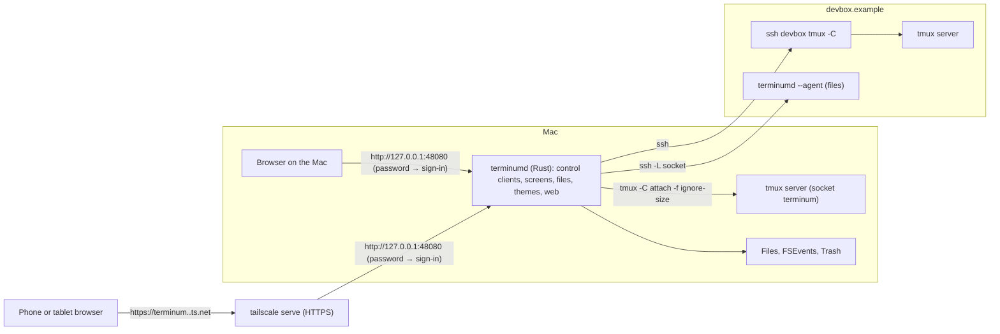

# terminum — Specification (core)

## 0. Metadata

| Field | Value |
|---|---|
| Status | current |

A snapshot of what terminum must do, not a record of how it came to be: git holds that.

## 1. Overview

**Problem.** A terminal tied to one window dies with it, and a program laid out for that window's width is unreadable on a phone: full-screen programs (vim, mc, htop) worst of all.

**Who it affects.** Developers on macOS who run shells, tmux sessions, ssh sessions and coding agents, locally and on remote hosts, and read them on a Mac, an iPad or a phone.

**Expected outcome.** Terminals live in tmux. One Rust server, `terminumd`, is tmux's control client for a private local server and for each remote host over ssh, and serves one page to a browser (AS-07). The pane's size follows the view that shows it, so text is laid out for the screen it is read on. Screens are tmux's own grid: terminumd never emulates a terminal. Sessions outlive terminumd, the page and the window. Everything is configurable from files in `~/.terminum/`.

**Scenario.** Alex opens the page on a phone. The pane is 48 columns wide, laid out by Claude Code itself for that width; the Mac's window of the same pane is wide again when Alex brings it to the front. `mc` fills the phone's screen as a 48×30 grid, arrows and F-keys work, a tap is a click. A key echoes in 25 ms.

This is the core of six specs; `docs/README.md` is their index and says which fact lives where.

## 2. Scope and non-goals

In scope: the session list, the screen and its history, typing, the pane's size, full-screen programs, the mouse, managing sessions, sign-in, other devices, themes, hot keys, customization, budgets, the quick shell, projects, sessions of the user's own tmux, diagnostics, tips.

In other specs: install, upgrades and restore (`terminum-lifecycle.md`); reading the terminal (`terminum-terminal.md`); coding agents' states, plans and records (`terminum-agents.md`); the Files panel and View (`terminum-files.md`); remote hosts (`terminum-remote.md`).

Out of scope (explicit):
- Terminal emulation of our own (no VT parser in terminumd or the page): tmux is the emulator. Inline images (OSC 1337, sixel) are not shown in the terminal, as tmux does not keep them (images named in the output open as widgets, `terminum-terminal.md`).
- A native terminal renderer (Metal, ligatures): the page draws text with web fonts; the browser is the renderer.
- Shells outside tmux: every local terminal is a tmux pane.
- Windows, and Linux desktops as the place of the page: terminumd runs as a server on Ubuntu/Debian (terminum-lifecycle.md AC-08) and as a remote host's agent; Finder and default apps are a Mac's only. The page works in any modern browser; acceptance is on the clients of AS-07.
- Several users or several passwords; HTTPS of our own (use `tailscale serve`).

## 3. Assumptions, dependencies, open questions

Assumptions:

| ID | Assumption | Owner | Status |
|---|---|---|---|
| AS-01 | Control mode (`tmux -C`) delivers `%output`, `%layout-change`, `%window-add`, `%window-close`, `%window-renamed`, `%session-changed`, `%sessions-changed`, `%pane-mode-changed`, `%extended-output`, `%pause`, `%continue`, and `%begin`/`%end` blocks for commands in order. | Claude | verified (man tmux 3.6a) |
| AS-02 | A control client attached with `-f ignore-size` does not take part in window sizing, so `window-size manual` plus `resize-window -x -y` sets a window's size exactly, also while another client is attached. | Claude | verified on tmux 3.6a; `scripts/e2e_core.py` |
| AS-03 | `capture-pane -p -e -J -t %N -S a -E b` returns the pane's rows with SGR sequences and joins rows tmux wrapped (never past `-E`), so hard line ends are where `-J` left a line break; a joined line is cut back into rows at `#{pane_width}` cells (wide characters two cells; one that would straddle the edge goes to the next row). SGR state runs across the lines of one capture. `-e` also emits OSC 8 links, whose address is kept with the cells (terminum-terminal.md AC-35); tmux 3.6a ends a link at every row's end and does not open it again on the next, so a link that runs past a row is a link on its first row only. | Claude | verified on tmux 3.6a; `screen/rows_tests.rs`, a real tmux fixture |
| AS-04 | `#{history_size}` is the number of lines above the screen until `history-limit` is reached; after that tmux drops the oldest lines silently. terminumd's config sets `history-limit` (OQ-01). | Claude | verified (man tmux) |
| AS-05 | `send-keys -l` delivers text as typed, key names (`Up`, `C-c`, `F5`, `BTab`) are encoded by tmux for the pane's mode (application cursor keys included), and `send-keys -H` sends hex bytes, so a mouse report (`ESC [ < 0;10;5 M`) reaches a program that asked for mouse events. | Claude | verified: `tmux/keys_tests.rs`, `scripts/e2e_core.py` (AC-06) |
| AS-06 | `%output` carries the pane's raw output as octal-escaped text and arrives for panes of every window of the attached session, not of other sessions; a `%output` is only a signal to capture, never parsed for content (one exception: section 6). | Claude | verified on tmux 3.6a |
| AS-07 | The clients are Safari or Chrome on the Mac (a window 1400 px and wider) and Safari on an iPhone; the page's e2e checks run in Chromium and WebKit at both sizes. | Owner | stated |
| AS-08 | One user, one Mac, local SSD. The owner keeps about 60 panes in 2 tmux sessions and 1–3 pages open. | Owner | stated |
| AS-09 | `resize-window` re-wraps the pane's history, so `#{history_size}` changes with the width; a resize is a history reset for the page unless the rows match (OQ-05). At its limit tmux drops the oldest tenth before adding a row, so `history_size` falls by limit/10 while rows still scroll off. | Claude | verified; `screen/history.rs` models it |
| AS-10 | With `extended-keys on` and `extended-keys-format csi-u` (tmux 3.5+; 3.4 has no `extended-keys-format` and types `send-keys S-Enter` as the text "S-Enter", so terminumd counts a server without that option as off), `send-keys S-Enter` reaches a program that asked for extended keys as `ESC[13;2u` and a plain shell as a plain Enter, so terminumd sends no raw bytes there. With `extended-keys off` (tmux's default, so a host's) S-Enter arrives as Enter even to a program that asked, hence the bytes there. | Claude | verified on tmux 3.6a; `tmux/keys_tests.rs` `shift_enter_is_csi_u_only_for_programs_that_ask` |
| AS-11 | Arguments tmux expands as formats (`-c` and `-n` of `new-window`, `new-session`, `split-window`; `rename-window`; `select-pane -T`) run `#(…)` and substitute `#{…}`; `##` escapes; `send-keys -l` expands nothing. | Claude | verified on tmux 3.6a |

Dependencies:

| ID | Dependency | Owner | Status |
|---|---|---|---|
| DEP-01 | Rust stable; crates: axum 0.8 (ws), tokio 1, notify 8, rust-embed 8, trash 5, serde_json 1, unicode-width 0.2 (cells of wide characters). The SGR parser is our own (`screen/sgr.rs`). `terminumd/Cargo.toml` lists the rest. | Claude | available |
| DEP-02 | tmux ≥ 3.2 on PATH on the Mac and on every remote host (`ignore-size`, `window-size manual`, `send-keys -H`). | Owner | available |
| DEP-03 | Node 26 and npm at build time only: esbuild, CodeMirror 6, markdown-it 15, mermaid 11 (`ui/package.json`). | Claude | available |
| DEP-05 | The page `web/static/` and the panel `ui/`, in this repository. | Claude | available |
| DEP-06 | crate rustysynth 1 (MIT, pure Rust) renders MIDI with a SoundFont for View (terminum-files.md AC-64): browsers play no MIDI. The package ships GeneralUser GS 2.0.3 (S. Christian Collins, License v2.0: free use in software, its LICENSE.txt beside it), fetched by `scripts/package.py` from github.com/mrbumpy409/GeneralUser-GS at commit 9704918 and checked by SHA-256. | Claude | available |

DEP-04 is in `terminum-lifecycle.md`.

Open questions:

| ID | Question | Owner | Status | Decision |
|---|---|---|---|---|
| OQ-01 | Which tmux server holds local terminals: the user's default server or a private `-L terminum` server? | Owner | resolved | A private server: socket `terminum`, started by terminumd with its own config `~/.terminum/tmux.conf` (history-limit 12000, window-size latest (per window: AC-13), extended-keys on, focus-events on, escape-time 0; the user may edit it), so the user's sessions and `~/.tmux.conf` are never touched; `tmux -L terminum attach` from any terminal works. The user may also attach sessions of their own server by name (AC-89). |
| OQ-02 | How many control clients: one per server, or one per session? | Claude | resolved | One per session for notices and typing (AS-06), plus one bulk client per server for history pages, search, `list-panes` and layout reads, so a bulk read never queues ahead of an echo. |
| OQ-03 | When two clients of different widths show one pane (a phone and the Mac's browser), whose width wins? | Owner | resolved | The active page (AC-13). |
| OQ-04 | Does an app replace the browser for daily use on the Mac, or is a browser tab enough? | Owner | resolved | No app: the clients to build and test for are those of AS-07. terminum-lifecycle.md AC-11 is dropped. |
| OQ-06 | Should the page ship JetBrains Mono Nerd Font as woff2 (OFL) so the phone shows the Mac's font, or keep `local()` with Menlo as the fallback? | Owner | resolved | Ship it: JetBrains Mono Nerd Font Mono 2.304 of Nerd Fonts 3.4.0, after the theme's font in every list (AC-12). |
| OQ-05 | Absolute line numbers after `history-limit` is reached (AS-04) or a resize re-wrapped the history (AS-09): keep counting by matching rows, or reset the page's history? | Claude | resolved | Reset when the last frame's rows cannot be matched, counted on where they can (AC-02); bookmarks and search marks are found again by their text. |

## 4. Acceptance cases

| ID | Priority | Case |
|---|---|---|
| AC-01 | [MUST / P0] | The user sees every tmux session, window and pane of the local server (and of attached hosts) in the session list within 2 s of a change, grouped by session, with each row's title, program, folder and host, and can filter them. |
| AC-02 | [MUST / P0] | The user opens a pane and sees tmux's screen in the session's theme within 1 s with the last 1000 lines of history, loads older lines up to 10,000, and sees output as it arrives, at most 30 frames a second, each frame only the rows that changed. |
| AC-03 | [MUST / P0] | The user types, pastes and presses hot keys and the bytes reach the pane as a terminal would send them: a key echoes within 100 ms on the Mac's network, held keys repeat, special keys go by tmux's names so a full-screen program gets its own encoding. |
| AC-04 | [SHOULD / P1] | The page draws the pane sized to the active browser window; on the normal screen its lines re-flow to the view whatever tmux's width, a full-screen program's grid is drawn as it is, scaled to the view when wider (7 px at least). |
| AC-05 | [SHOULD / P1] | A full-screen program (vim, mc, htop, a plain tmux inside) is drawn as its grid without history or widgets, and keys reach it as tmux key names. |
| AC-06 | [SHOULD / P1] | A click, a tap, a drag and the wheel reach a full-screen program that asked for mouse events as the mouse events a terminal would report; a coding agent gets the wheel only. |
| AC-07 | [MUST / P0] | The user creates a window, a session or a split next to the shown pane in its folder, renames a window or pane, reorders windows, moves a window to another session and closes a pane after a confirmation, and the list shows it within 2 s. |
| AC-09 | [MUST / P0] | A web page or local process cannot list sessions, read screens, type or touch files through terminumd without the sign-in, which only the password set by `terminum password` gets; wrong passwords are braked; writes need the exact Host, Origin and Content-Type. |
| AC-10 | [SHOULD / P1] | A browser on another device reaches the same page through `tailscale serve` over HTTPS and signs in with the same password; what only the Mac may do is refused to forwarded requests; Tailscale Funnel is refused. |
| AC-12 | [SHOULD / P1] | The user sees each session in a theme (colors, ANSI palette, font) chosen by rules per host and session from theme files, with light and dark variants following the system, changed live when a file changes; `local.json` and `remote.json` are the defaults. |
| AC-13 | [MUST / P0] | The pane's size follows the active page that shows it: a wide window gets a wide pane and a phone a narrow one, the shown pane of a window of several panes is zoomed to fill it, and a tmux client attached by hand keeps working. |
| AC-18 | [SHOULD / P1] | On a touch screen or a narrow window the hot keys panel, the keyboard button and the floating buttons work with a finger, and the panel's layout comes from a file the user can change. |
| AC-19 | [SHOULD / P1] | The user customizes the page with a stylesheet of their own (`custom.css`) and settings in `settings.json`, with the page reloading when they change and refusing nothing silently. |
| AC-20 | [SHOULD / P1] | terminumd stays within its budgets: under 60 MB with 60 panes and two pages, under 0.5 % CPU idle, a key echoed in 25 ms median on the Mac, a frame encoded in 3 ms; the page under 150 MB with 10,000 lines. |
| AC-88 | [SHOULD / P1] | On a computer the user opens a quick shell for the shown pane, below it or on its left, in the pane's folder: a terminal of its own taking a third of the view, resized by dragging its edge and closed with its ×; it stays with its pane until closed. |
| AC-92 | [SHOULD / P1] | The user groups sessions into named projects, each in a color of its own far from the others, listed first with a [+] that opens a window in the project's folder, reordered by dragging; every page shows the same. |
| AC-100 | [NICE TO HAVE / later] | A row's menu shows the pane's diagnostics to copy into a bug report: terminum's build, the browser and its window, the row as listed and tmux's own fields of the pane (size, cursor, alternate screen, mouse modes, history, command, folder); no screen lines, history or sign-in. |
| AC-101 | [NICE TO HAVE / later] | On a computer the session list shows a tip of the day, quiet, with Next, × until tomorrow and Turn off, and Settings turns tips on and off (on for a new browser). |
| AC-89 | [SHOULD / P1] | The user attaches a session of their own tmux on this Mac or on a host by its name ("Attach tmux sessions", offered after Add host): it is listed and used like terminum's own sessions, is never started or closed by terminum, is sized as any pane while a page in sight shows it and gets tmux's own size back after, and shows while it does not run as a group that says so. |
| AC-147 | [SHOULD / P1] | Everything terminum writes into a pane is a row of the input log in the tasks' store, for later analysis: what the user types, pastes or the Files panel types, from which page, browser and address, and what Dispatcher pastes and launches, with its run, tasks and agent; each row with its time, machine, session, window, program, folder and project; a secret typed at a password prompt is not kept. Beside it, each message sent (a shell's command at Enter, a coding agent's prompt) is kept with its sender, pane, folder and project, its words indexed.
| AC-151 | [SHOULD / P1] | The Message history at `/history/`, a key left of Settings: every message kept, the user's and Dispatcher's (marked), found by its words, the best matches first (BM25) or newest first by day, narrowed by days (a strip of a column a day), project, sender and agent or shell, all in the address; a message opens its session there, shows what was sent around it, copies. |
| AC-152 | [SHOULD / P1] | The Dashboard at `/dashboard/` shows how much the user drives sessions over 7, 30 or 90 days, never counting Dispatcher: messages, active time, active days, messages an active hour, sessions a day, the phone's share, each against the period before; messages and active time a day by project, the working day, the week's hours, the projects, the sessions a day; a day leads to its messages in the Message history.

## 5. BDD scenarios

### AC-01 — The session list is the tmux server [MUST / P0]

```gherkin
Scenario: AC-01 happy path — sessions, windows and panes
  Given the local tmux server has sessions "main" (windows 1 "api" in ~/work/api, 2 "docs") and "notes"
  And window 1 is split into panes %3 (running claude) and %4 (zsh)
  When the page opens
  Then the list shows group "main" with row "1 api", its second line "~/work/api" with "claude" at its right edge (host and folder first, then the titles; what runs there on the right), and, under it shifted in, "%4" as "~/work/api … zsh", then "2 docs"
  And group "notes" below it, each group with its count in words ("2 sessions": its rows, not the panes and quick shells under them), the counts of all groups in one column whatever buttons follow, with a pointer ending where the rows' programs end ("claude"); a header's buttons (copy, import, [+], ⋯) show while the pointer is over it, in the count's place, or while the keyboard's focus or their menu is there (a touch screen, which has no hover, keeps them, the count before them); each row with its Clone (AC-07)
  And the header names the shown pane under its title in one line: its folder with a Copy button (the full path, "/Users/alex/work/api"; a toast says it), then tmux's target "main:1", then what runs there (a host first, "claude", the profile, its titles); on a phone or a touch screen the Copy stands in a 44 px column of its own at the title block's right (left of ✎), its 44 × 44 target across both lines and inside the header, the title and the folder ending before it, so a tap on the title is the title's and one on the Files tab opens Files; in a window 860 px wide or narrower a tap on the title slides the header's buttons off to its sides and shows the session's full name and its full path (a host's as "host:/path") in their place for 3 s, wrapped, the header's height kept (a long one goes on below it on the header's fill), then all slides back (a tap on them: at once; showing another session: at once; the list drawn again, a title changed: they stay, kept current; Reduce Motion: no slide); ☰ opens the list there; the titles give way first, then the folder, down to a few letters each; on a computer the title, ✎ and the Plan button stand on the line of the header's keys (Terminal, Keyboard, Files, View, ⋯), as tall as they and centred with them and with the session list's and docked Files' heads, the folder line under it; there the mark, the title and the folder line start 7 px right of where the terminal's text does, the folder's bar in the gutter before them and the agent's state after the title, and the session list's first group starts level with the terminal's top
  And a row's window number names, on hover, the host the window runs on: "This machine" here, the host's name on a host
  And each group has a copy button (its title the command) that copies how another terminal attaches to that session: "tmux -L terminum attach -t '=main'" (a host's group: its session's name "terminum" beside the host's, and "ssh -t <recipe> -- <destination> "tmux attach -t '=terminum'""); the target is quoted, as zsh (macOS's shell) reads a word starting with "=" as a program's path
  And a window the user named (automatic-rename off) shows that name; one tmux names after its program shows the pane's title, else its program; status marks of coding agents (✳ ✻ ✶ ◐ ⏺) are stripped
Scenario: AC-01 happy path — what runs in a pane
  Given rows running Claude Code (its process named by its version, "2.1.302", whatever the window's title), Codex (also as npm's "node", by its screen), OpenCode (its program "opencode") and a shell
  Then a row's line under its title names Claude Code's program "claude", never its version
  And a subagent Claude Code runs in its own pane shows the name it was started with, its command's --agent-name ("simplify-altitude"), not its pane's title, which only says its type ("✳ general-purpose", the same for all of them): the type stays on the line under it; a window the user named keeps that name, and another program started with the same flag shows its own title
  And each row, before its title, and the header, before the shown pane's title, show Claude Code's mark, Codex's mark, OpenCode's mark (their owners' trademarks, outside terminum's licenses: NOTICE) or the terminal icon (`docs/UI-GUIDELINES.md`); a build without the marks' files shows the terminal icon for them
Scenario: AC-01 happy path — a folder's color
  Given rows in ~/work/api, ~/work/web, ~/notes and two in ~/tools, and a row in ~/work/api/db
  Then the bar left of each row (and of the header's title), at one place in every row, is a pastel color of its folder: rows in the same folder (on the same host) share it, folders not inside one another get hues as far apart as their count allows
  And a folder inside another listed folder gets a hue near that folder's, the nearer the deeper it lies, yet its own; "~" and "/" are no parent; a row with no folder has a grey bar
  And on a light theme the same hues are darker, so the bar keeps 3:1 against the list
  And with "Follow the agent's folder" on (`page.followAgent`, section 9), a row whose coding agent works in another folder (a worktree it moved to, as its hooks last said: terminum-files.md AC-51) names that folder on its second line, its bar takes that folder's color and the filter finds it by it; off, the pane's own folder
Scenario: AC-01 happy path — the list follows tmux
  Given the page is open
  When the user runs "tmux new-window -n build" in any terminal
  Then within 2 s the list shows "3 build" in "main" (the %window-add notice, then list-panes)
  When the user runs "tmux kill-window -t build"
  Then within 2 s the row is gone and the page, if it showed that pane, says "This pane has closed. Pick another one."
Scenario: AC-01 happy path — filter and ⌘K
  When the user types "doc" in the filter (or presses "/" or ⌘K and types)
  Then only rows whose title, folder, host or program contains "doc" stay, flat, and Enter opens the first
Scenario: AC-01 edge — a remote host's session
  Given host "devbox" is attached (terminum-remote.md AC-81)
  Then its group reads "devbox" in cornflower blue (its session on the host is always "terminum"), every row names the host in violet, and its folders are the host's
Scenario: AC-01 edge — the first start
  Given no tmux server on the "terminum" socket
  When terminumd starts
  Then it starts the server with ~/.terminum/tmux.conf and a session "main" (a shell in ~), and the page shows it; the user's default tmux server and its sessions are never touched
Scenario: AC-01 failure — tmux is missing
  Given tmux is not on PATH
  Then the list shows "tmux is needed for terminals: brew install tmux" (on Linux "tmux is needed for terminals: sudo apt install tmux (or your system's package manager)") and nothing else; terminumd looks again every 10 s
```

### AC-02 — The screen is tmux's screen [MUST / P0]

```gherkin
Scenario: AC-02 happy path — open a pane
  Given pane %3 is 150×50 with 4,200 lines of history
  When the user opens it
  Then within 1 s the page shows the last 1000 history lines and the screen (50 rows) with the cursor, in the session's theme
  And scrolling up loads older lines 1000 at a time, up to 10,000 (TM_HISTORY)
  And every line is tmux's: rows tmux wrapped join when copied, a hard line end stays one (AS-03)
  And the view stays on the last line through what settles late (fonts, widgets, images, a phone's list closing, the keyboard), until 4 s after the first frame or the user scrolls, presses, types or selects text, or a jump to a line takes the view
Scenario: AC-02 happy path — output streams
  When the pane prints 5,000 lines in 2 s
  Then terminumd captures the screen on its %output notices once the pane is quiet 6 ms (a write that came in parts is whole; 33 ms after the first notice at most), at most every 33 ms, and sends only the rows that changed ("full": false, "ch": [[row, line]…]); lines that scrolled off the screen are appended to the history ("hist", "append") with their absolute numbers
  And the page draws each frame in under 16 ms and follows the output while the view is at its end
Scenario: AC-02 edge — Claude Code's redraw comes in parts further apart than the quiet
  Given Claude Code's redraw takes the cursor up to its spinner row and back in two writes over 6 ms apart (the program stalled)
  When a frame is caught between them
  Then the page keeps the input box in its place and draws the cursor on the caret last seen in it (its row's text unchanged, terminum-terminal.md AC-40); above a box where no caret was seen, or whose caret's row changed, the cursor stays where it is
Scenario: AC-02 edge — the pane prints while its history is read
  Given a frame said tmux's history holds h rows, and before the rows that scrolled off are read the pane prints 60 more (a coding agent's long result, over a host's ssh)
  Then terminumd's capture reaches 64 rows above the range (further once more when more scrolled) and comes with #{history_size} and #{pane_width} read before and after it, and the rows asked for are taken from where the rows that scrolled meanwhile moved them: the page gets the rows it numbered, never those 60 rows on shown in their place (a paragraph doubled, text out of its place); rows tmux no longer has are empty, never others
  And where the count cannot say how far rows moved (a history that shrank, or 90% of history-limit or more: AS-09) one capture from 512 rows above the range down to the screen's end finds the last frame's top screen rows (six, two at least not blank) where they moved, and they number the rows (further once more when tmux still has rows above its reach); a width that changed meanwhile, those rows found nowhere or at two moves (output that repeats itself), sends no rows and the next frame starts the page's history anew
  And at 90% of history-limit or more a count the same as the frame's may be a trim and as many rows again: the screen's top rows (six), read with the capture, say whether anything moved; when they changed, the rows are found as above, and found nowhere (drawn over in place: a progress bar) the count numbers them
  And at history-limit, where tmux's count leaves several numbers of rows that scrolled off, the screen's top rows (half of those that moved, six at most) say which: the bottom rows are a coding agent's to redraw (its spinner, its input) and never decide it, so the screen's rows are never appended as rows that scrolled off (an answer drawn twice)
  And the page fills a folded line only into the record of its own number
Scenario: AC-02 edge — the scrollback is cleared
  When the user runs "clear && tmux clear-history" (or Claude Code's /clear)
  Then #{history_size} drops, terminumd sends "hist" "reset" and a full screen, and the page's history starts anew (folds and line numbers with it)
Scenario: AC-02 edge — the screen does not change
  Given a pane prints the same spinner frame twice
  Then the second capture equals the last frame sent and nothing is sent; a pane nobody shows is never captured
Scenario: AC-02 edge — the terminal hidden behind Files or View
  Given a phone shows Files or View in place of the terminal while its pane prints
  When the page says so ("screens" off)
  Then terminumd captures no screen and sends no "screen" or "hist" for that page, while Files still follows the pane's folder and the pane keeps the size that page gave it (no handover, unlike "pause")
  And when the terminal is shown again ("screens" on) terminumd sends "hist" "reset" and a full screen, with what was printed meanwhile
Scenario: AC-02 edge — a page out of focus and a hidden page
  Given a browser window in sight, its page out of focus ("pause" with hidden false), while the user types in another app
  Then terminumd keeps its stream and refreshes its list as for a page in front, drawn as they come; the page only gives up sizing (AC-13)
  When a page is hidden (another tab, a minimized window, a locked phone: "pause" with hidden true, or with no hidden field)
  Then its stream stops, also one it opens while hidden, and starts once the page is in sight, with the screen and the list within 2 s
Scenario: AC-02 failure — the capture fails
  When "capture-pane" answers %error (the pane closed meanwhile)
  Then the page shows "This pane has closed. Pick another one." for that pane only, and the log names the command and the error
```

### AC-03 — Typing [MUST / P0]

```gherkin
Scenario: AC-03 happy path — a paste Claude Code folds is unfolded
  Given Claude Code's pane and a paste of over 800 characters or two line breaks
  When it folds it into "[Pasted text #1 +6 lines]" and says "paste again to expand" within 0.8 s
  Then terminumd pastes the same text once more, so the input shows the text itself
  And a paste that stays as it is, in any other program or with no such words, goes once: it is never doubled

Scenario: AC-03 happy path — text and keys
  When the user types "ls -la", presses Enter, then ↑, Tab, ⌃C
  Then terminumd sends "send-keys -t %3 -l 'ls -la'" then "send-keys -t %3 Enter Up Tab C-c" (keys by tmux's names, text literal), in order, one command per run
  And the echo of each key shows within 100 ms on the Mac's network (AC-20 for the budget)
Scenario: AC-03 happy path — keys that arrive while one is on its way go together
  When the user holds → for a second
  Then the keys go as one "send-keys … Right Right Right…" per round trip, in order, at the keyboard's repeat rate, never one round trip a key
  And queued keys, pastes and mouse reports for equal pane numbers on different tmux servers stay in separate batches, each sent only to its complete state key
  And typed input of more than 512 bytes (a key counted as 8, its longest encoding: a line's worth of ← and → each, held; a quote Ask types) goes in parts of at most 512 bytes: each after the pane printed something since the last (the program read the part before) or after 250 ms, so the terminal never holds more than its buffer (1 KB) and never hands a program a key's bytes in two parts ("[D" typed into a busy coding agent's input, its ESC taken for Escape), and a program never reads more than 800 characters at once, which Claude Code takes for a paste and folds into "[Pasted text #1 +16 lines]" (a Linux terminal hands on 4 KB at once)
Scenario: AC-03 happy path — paste
  When the user pastes 20 KB of text
  Then terminumd loads it into a tmux buffer (on this Mac "load-buffer -b tm-<n>" from a 0600 file; on a host "set-buffer -b tm-<n>", 64 KB a command) and pastes it with "paste-buffer -p -d -b tm-<n> -t %3", so a program that asked for bracketed paste gets its markers
  And with the menu's "Bracketed paste" switch off the page sends the text as typed input, in parts as above
  And a paste holding control characters other than newline and tab is refused with "The text holds control characters and was not sent"
  And where the page may not read the clipboard (denied, or not HTTPS), Paste opens a field to paste into: Send, or ⌘Enter or Ctrl+Enter in it, sends its text; a plain Enter is a new line
  And a clipboard read or image conversion begun in one pane cannot paste or upload into another pane shown before it completes; the page says that nothing was pasted
  And text that starts with "-" (a paste on a host, a name, a path the Files panel types) is text: tmux takes a word that starts with "-" before the first other word for a flag, so every such argument comes after "--" (else a paste of "-x …" says "invalid flag -")
  When the user selects lines in the history, copies them (⌘C) and presses ⌘V with the keys anywhere but a field (the selection, the list, a button)
  Then the terminal's input takes the keys back first and the text is pasted into the pane at its cursor, typing going on there without a click (not under a dialog, nor while Files is shown in the terminal's place)
Scenario: AC-03 happy path — undo and redo
  When the user presses ⌘Z on the terminal's input, or with nothing holding the keys while the terminal is shown (a selection made with the pointer leaves them on the page; another field keeps its own undo)
  Then the shown program's undo goes: Ctrl+_ for Claude Code, zsh, bash and fish; another program gets nothing and a toast says so (Ctrl+_ is nano's Go To Line)
  When the user presses ⌘⇧Z
  Then fish gets its redo (Alt+/); Claude Code, Codex, zsh and bash have no redo by default, so nothing is sent and a toast says "zsh has no redo" (Codex has no undo either: "Codex has no undo")
  When the user presses ⌘X with text selected in a coding agent's input box
  Then the text is copied and deleted from the box as Backspace over a selection deletes it (terminum-terminal.md AC-40), the input keeping the keys; a selection elsewhere (the output, the history) is left as it is, as a page's text is
  When on a phone the user rests a finger on the keyboard button (half a second), or holds one still on the terminal's input (the cursor's row, an agent's input box) for half a second and lifts it
  Then the page's own menu opens there, modal, each item only when it applies: Cut, Clear and Copy while text is selected in the input box (Clear deletes it as Cut does, without the copy), Paste (left out when the browser lets the page read the clipboard and it is empty; Safari never does: there a Paste of an empty clipboard says "Nothing to paste: the clipboard holds no text." and sends nothing; Safari asks once, with its own small Paste, before the page may read the clipboard: one read for an image or text, never two), Undo where the program has an undo key, Redo after the page's Undo where the program has a redo key (fish); they do as ⌘X, ⌘V, ⌘Z and ⌘⇧Z
  And with the on-screen keyboard up (the input has the keys) the menu opens without taking them: the keyboard stays up and the menu stays where it opened, centered above it, over a shade that closes it
  And a finger that rests and then slides moves the cursor, one that moves at once scrolls; neither opens the menu; iOS's own undo on the input (three fingers, a shake) undoes as ⌘Z does
  When on a phone the user swipes quickly along the input (under 0.3 s, at least 48 px, at least twice as far across as up or down, not from a screen edge)
  Then a swipe to the right sends → (as the arrow key) and one to the left the program's Undo (as ⌘Z, with a toast "Undo"; where the program has none the toast says so and nothing is sent)
  When on a phone the user taps a word in an agent's input box twice quickly
  Then the word is selected and a finger held on it opens the menu above: terminum-terminal.md AC-40
Scenario Outline: AC-03 happy path — special keys by name
  When the user presses "<key>"
  Then terminumd sends "send-keys -t %3 <name>" and tmux encodes it for the pane's mode (application cursor keys in vim and mc)
  Examples:
    | key           | name   |
    | ↑             | Up     |
    | ⇧Tab          | BTab   |
    | F5            | F5     |
    | ⌃→            | C-Right|
    | Home          | Home   |
    | Delete (fwd)  | DC     |
Scenario: AC-03 edge — paging with the arrows
  When the user presses Option+↑ or ⌘↑ (Option+↓, ⌘↓)
  Then the pane gets Page Up (Page Down), as tmux's PPage (NPage); with Shift too the arrow goes with its modifiers
Scenario: AC-03 edge — Shift+Insert and Ctrl+Insert
  When the user presses ⇧Insert (⌃Insert) with the terminal's input holding the keys
  Then the browser pastes (copies) as with ⌘V (⌘C): the page's paste and copy take it, as xterm and Windows do
  But with Settings' "Shift+Insert and Ctrl+Insert paste and copy" off (on by default, kept in this browser) the pane gets ESC[2;2~ (ESC[2;5~); ⇧⌃Insert and ⌥Insert always go to the pane
  But on a Mac a PC keyboard's Insert is Help (the browser's e.key) and nothing changes: ⌘C and ⌘V copy and paste
Scenario: AC-03 edge — Shift+Enter and Ctrl+Enter
  When the user presses ⇧↩ or ⌃↩ (a key or the hot key)
  Then terminumd sends "send-keys S-Enter" or "C-Enter": a program that asked for extended keys (Claude Code) gets ESC[13;2u or ESC[13;5u and makes a new line, a shell gets Enter (AS-10)
  But on a server whose "extended-keys" is off (a host's own tmux by default; asked once per connection with "show-options -sv extended-keys") tmux would send Enter, so there the keys go as those bytes ("send-keys -H"): Claude Code makes a new line, a shell shows them as text
Scenario: AC-03 edge — a held delete
  When the user holds Backspace in a shell at its prompt or in a coding agent's input box
  Then a character goes at a time, and after 1.5 s a word (C-w) at a time, at most one every 90 ms; in other programs characters only (the pane's program comes with the list, AC-01)
Scenario: AC-03 failure — the pane is gone or the server stalls
  When "send-keys" answers %error, or the control client has not answered for 3 s
  Then the keys are dropped, not queued forever; the page shows "tmux did not take the keys: <error>" over the terminal; a line "tmux on this Mac is not responding (N s)" counts while the shown pane's server stalls and goes when it answers (another server's stays off this pane, `terminum-remote.md` AC-132); each such line (an error, a stall, "Sized for another screen") has an × that puts it away until it says something new (its seconds counting on are not new)
```

### AC-04 — The pane as tmux has it [SHOULD / P1]

```gherkin
Scenario: AC-04 happy path — one view, re-flowed to the browser
  Given the Mac's browser shows %3
  Then the page draws the pane's lines at the chosen text size, its history above (AC-02); the pane is sized to this view's grid (AC-13), so its rows fill the view; there is no view mode to pick
  And on the normal screen nothing is scaled or scrolled sideways: a row wider than the view wraps at its edge; while the pane has the view's width its rows stay as the program laid them out (its hanging indents too)
Scenario: AC-04 edge — a pane wider or narrower than the view
  Given the pane's width is not the view's: a window of several panes that stays as it is (AC-13), a split window another page zoomed, another page's size, a refused resize, the 45-column floor, a view whose new width is on its way to tmux
  Then on the normal screen its lines re-flow to the view's width (Wrap), at the chosen text size: a line tmux wrapped is one line again, prose a program wrapped at the pane's width re-joins (a word broken at the edge without a space), list items, agent marks and numbered lines start lines, separator lines span the view, and a narrow pane's lines fill the view
  And a full-screen program (AC-05) is drawn as its grid: scaled down to the view's width, at the chosen size with the rest by scrolling sideways when that would make the text smaller than 7 px (the smallest size − and + allow); "Sized for another screen (W×H)" says so when another page sized it
Scenario: AC-04 edge — the view changes width
  Given this page sized the pane to its view (its columns are the ones it sent)
  When the view's width or the text size changes (docked Files opened or closed, a dragged window, a phone turned, − and +)
  Then the lines re-flow to the new width at once, at the chosen size, and once tmux has the new width the rows are drawn as the program lays them out again
  And a full-screen program stays at the chosen text size, clipped at the view's edge with no sideways scrolling, until tmux's pane has the view's new width, so the text size changes once at most and never shrinks to the old width first; when the pane does not take the width within 2 s of the last change it is drawn as a wider grid
Scenario: AC-04 edge — another pane opened
  When the user opens another pane (the list, ⌘[ ⌘], a bookmark, a new window) whose window has another size than this view's grid
  Then the page lays the new pane's session out first (its own docked Files, terminum-files.md AC-70) and sends "sub" with the grid that leaves; terminumd sizes the window to it before the pane's first frame (AC-13), so that frame comes at this view's grid
  And the view keeps showing the pane shown before, still (never blank), until that first frame, 1.5 s at most, then draws the new pane at once, at the chosen text size: no frame at the window's old size is drawn first, so the text size never jumps; a window of several panes (never resized) comes at its own size, re-flowed to the view
```

### AC-05 — Full-screen programs [SHOULD / P1]

```gherkin
Scenario: AC-05 happy path — mc on a phone
  Given pane %5 (zsh) is shown on a phone whose view holds 48×30 cells at the chosen text size, and the pane is sized to it (AC-13)
  When the user runs "mc"
  Then tmux reports #{alternate_on} 1 with the next frame; the page hides the history and the widgets while it runs, shows a full-screen mark in the header after the agent's ("Full screen mode" on hover; for a coding agent's own TUI an orange ! beside it, below) and draws its 48×30 grid, blank rows included; mc draws itself for 48×30: both panels fit, the menu bar and function key bar are whole
  When the user presses F10 (the hot keys' Fn row), Esc, arrows, Enter, ⌃O
  Then they reach mc as tmux's key names (AC-03) and mc acts on them
Scenario: AC-05 edge — Claude Code's fullscreen TUI
  Given the shown pane runs Claude Code with "tui": "fullscreen", on the alternate screen
  Then the full-screen mark has an orange ! beside it, saying on hover, and as a toast for 6 s on a press (a phone), "terminum does more with fullscreen mode off: the history and widgets show only then. Turn it off in the agent's settings."; a program's full screen (mc, vim) has no !
Scenario: AC-05 edge — a program Claude Code starts in its pane (its Ctrl+G editor)
  Given Claude Code's fullscreen TUI is shown with the !
  When the user presses Ctrl+G and vim opens in the pane (tmux still names the pane's program Claude Code: vim is in its process group)
  Then the ! goes while the terminal's cursor shows (Claude Code's TUI hides it and draws its own; an editor shows it) and is back when the editor ends; a change counts once it held 400 ms (a program hides its cursor while it redraws)
  But an editor that draws its own cursor (Helix, Kakoune) still gets the ! (known limit)
Scenario: AC-05 edge — a coding agent's own full screen
  Given the shown pane runs Codex, which draws on the alternate screen
  Then its history and widgets stay (as on the normal screen), no full-screen mark shows, and its input box and footer are the page's (terminum-terminal.md AC-40)
Scenario: AC-05 happy path — the program ends
  When mc exits
  Then #{alternate_on} is 0, the full-screen mark goes and the screen shows the shell with its history again
```

### AC-06 — Mouse and touch for full-screen programs [SHOULD / P1]

```gherkin
Scenario: AC-06 happy path — click, drag, wheel
  Given mc runs on the alternate screen and asked for mouse events (#{mouse_any_flag} 1)
  When the user clicks cell (10, 5), drags from (10, 5) to (30, 5), or scrolls the wheel
  Then terminumd sends the SGR mouse reports a terminal would ("send-keys -H" of ESC [ < 0;11;6 M, motion and release, buttons 64/65 for the wheel), with the pane's cell coordinates (1-based)
  And mc selects the file, drags the selection, scrolls the panel
  And with a mouse the click also gives the terminal the keys, as a click on any terminal does: what is typed next goes to mc
Scenario: AC-06 happy path — a trackpad on a far host
  Given Codex asked for the mouse on a host 50 ms away and the user scrolls with a trackpad (120 small wheel events a second)
  Then each text line scrolled is one wheel step, at most one an event (a wheel's notch is one), and a frame's steps go as one message with their count
  And terminumd hands the reports that came while one round trip was on its way to tmux in the next, as one "send-keys -H", in order with the keys typed; the page's other messages never wait for them
  And the program has every step and the screen is drawn within 0.2 s of the last event
Scenario: AC-06 happy path — touch
  When the user taps a cell, or swipes up or down in the grid
  Then a tap is a click at that cell, a swipe is wheel events, a two-finger tap is a right click; a long press selects text as in the terminal (no event sent)
Scenario: AC-06 edge — the program did not ask for the mouse
  Given a program with #{mouse_any_flag} 0 (vim without "set mouse=a")
  Then clicks move no cursor and send nothing; a tap on the cursor's row opens the keyboard, elsewhere it leaves it as it was, as in the terminal; the wheel scrolls the page
Scenario: AC-06 edge — coding agents and selection
  Given Codex on the alternate screen asked for the mouse
  Then the wheel and a swipe go to it (it scrolls its own transcript), but presses and drags select text as on any page
  And on the normal screen nothing is sent: the wheel scrolls the history
Scenario: AC-06 happy path — what a full-screen program selected
  Given a full-screen program on the alternate screen has the mouse (Claude Code in its fullscreen mode, vim with "set mouse=a")
  When the user drags, double-clicks or triple-clicks over its text and it copies what it selected as a terminal's clipboard write (OSC 52: ESC ] 52 ; c ; <base64> BEL or ST) within 2 s of the release
  Then the press, the drag and the release reach the program as before (it draws its own selection)
  And the text is the program's copy as it made it, on the screen or not (Claude Code leaves out its ⏺ and ⎿, a drag may scroll its text away); Copy's tooltip and toast say its line count and first line (terminum-terminal.md AC-37), Ask and [+] show it whole
  And the page that sent the release shows Copy, [+] and Ask (terminum-terminal.md AC-37, AC-33) by the row of the press, with the program's text: Copy puts it on this browser's clipboard (a phone's too), [+] bookmarks it on that row's line, Ask asks about it
  And they go at the next press in the terminal or a key; the latest copy within the 2 s is the one shown (a triple click copies a word, then the line)
Scenario: AC-06 edge — a clipboard write nobody asked for
  Given no left release went from a page to that pane in the last 2 s (a `cat` of a file holding OSC 52, a program copying on its own, a normal screen, a program without the mouse, a right or middle click)
  Then nothing is shown or kept, nor decoded (only a page waiting for it has its base64 read); a clipboard read (52;c;?) is never answered; a write over 1 MB of text and one cut by tmux's flow control (%pause) are dropped; control characters but tab and line ends are taken out of what is shown, so a Copy pasted into a terminal never sends keys (ESC [201~ would end a bracketed paste), and so are bidi controls, zero-width characters, the soft hyphen, word joiners and tag characters, never ZWNJ and ZWJ, line separators becoming line ends (a pasted Copy never reads otherwise than it runs)
  And the program's own copy (pbcopy, tmux's buffer) is left as it is
Scenario: AC-06 happy path — Shift selects in every browser
  Given any full-screen program has the mouse and the terminal has the keys (its keyboard field holds the page's caret)
  When the user holds Shift and drags over its text in Safari, Chrome or Firefox
  Then the browser selects from the press to the release (a new selection, never the caret's or an old one extended), nothing reaches the program, and Copy, [+] and Ask show as for any selection
  And the next press without Shift goes to the program and ends that selection: the keyboard field has the keys again on the release, and what the program then copies is what the buttons hold
Scenario: AC-06 failure — the report cannot be sent
  When "send-keys -H" answers %error
  Then the event is dropped and the status line says "Mouse event not sent: <error>" once a second at most
```

### AC-07 — Manage sessions [MUST / P0]

```gherkin
Scenario: AC-07 happy path — new window, new session, split
  Given the page shows pane %3 of window "api" in session "main", folder /Users/alex/work/api
  When the user picks "Split Below", "Split Right" or "Split Left" from its row's menu (a right click or a long press; a phone: Split Below only; the three side by side, each a drawing of the split, every other item with its icon and Close Session's a red ×)
  Then the pane's quick shell opens there (AC-88); the page offers no tmux split, and a window of several panes made elsewhere (the user's own tmux, an agent, the `split` message) shows its panes under the window's first one
  When the user presses "New session" at the list's foot, or on a computer [+] in the list's head (left of the button that hides the list), and types "scratch"
  Then terminumd runs "new-session -d -s scratch -c ~" and the page shows its pane; a name tmux refuses (empty, with ":" or ".") is refused inline with tmux's message; the form opens where its button is: under the list's head for [+] (the foot stays folded), above the foot for the foot's
  And on a computer (a fine pointer, wider than 860 px) the foot is one slim row of its buttons' icons (the bookmarks' count beside theirs) with a ▸ at its right: one toggle button ("Session tools", its expanded state said to assistive tech; the icons are not buttons of their own); a click on it (Enter or Space) unfolds it upward within 0.2 s into New session, Bookmarks / Reminders, Add host and Attach tmux sessions and the version under them, the row staying on top with ▾; they stay until that row is clicked again (the pointer passing over or leaving it changes nothing), and the page remembers the state for the next load (a split's embedded page keeps none); while folded its buttons are out of the keyboard's way; a click on it while a form of theirs is open folds it and closes the form, as Esc does; [+] in the list's head opens its form with the foot left as it was (with reduced motion they appear and go without moving); a touch screen or a narrow window shows the four as a row of blobs, never folded
Scenario: AC-07 happy path — Clone and the row's menu
  Then every row has a Clone button at its right end, in a column of its own, shown while the pointer is over the row or the keyboard's focus is in it (a touch screen has no hover: there it is always shown)
  And a tmux session's group has a menu as a row's, on a right click on its header and on its ⋯ (a host's or an attached session's ⋯ keeps its own menu): New Window (a window after its last row, as Clone), Rename… (asks with the group's name; renames its tmux session, the name taken literally, `:` and `.` refused in words; the group keeps its fold, its place: AC-92), Move to the Top, Up, Down, to the Bottom (among the list's projects and groups, every page's, as a drag; AC-92), Close Group… (red: asks "Close the group <name> and its N sessions? …", then closes each); collapsed or filtered, the group keeps them: its sessions come from the list, not from its rows drawn
  And a pane under its window (a coding agent's subagent, a quick shell) has none: the pointer over it shows no Clone, its window's stays on that window's own row, at its middle
  When the user presses Clone on window "api" (or picks Clone in its menu)
  Then terminumd runs "new-window -a -t @2 -c '/Users/alex/work/api'" (right after it, in its folder, a shell: its program is not copied) and the page shows the new pane within 2 s (the `new` message, a group's window after the shown pane's, stays for scripts); a session of a project gives the project's window (AC-92); one a second per client, as New window; a host that is not attached offers no Clone
  When the user right-clicks a row, or rests a finger on it (0.35 s) and lifts it without moving
  Then a modal menu opens there (the page shaded behind it; a press outside closes it and reaches nothing under it; Esc too; below the finger; from the keyboard's menu key or ⇧F10 at the row, ↑ ↓ through it): Close Session first (asked first: "Close the session api? The program running in it (claude) ends."; the keys' focus starts on the item after it), then Clone, Add to Project…, Remove from <project> (in one), Move to the Top, Move Up, Move Down, Move to the Bottom (those its place allows); its head names the session and has × to close it
  And a move reorders the row among its group's rows: a tmux session's windows in tmux ("swap-window"), a project's sessions in the project
Scenario: AC-07 happy path — rename and reorder
  When the user presses the pencil beside the title, types "deploy" and presses Enter
  Then terminumd runs "rename-window -t @2 'deploy'" and "select-pane -t %3 -T 'deploy'", and the list, the header and tmux's own status line show it within 2 s; an empty name restores "automatic-rename on"
  When the user drags a window's row above another in its group (no grip: the row itself; with a mouse once it moved 6 px, a press that does not move still opens it; a finger rests 0.35 s on the row, which lifts, then moves, and the list scrolls by itself near its top and bottom edge; a finger that lifts without moving opens the row's menu; a finger that moves before then scrolls the list; while the list is filtered rows do not move, and a finger resting half a second opens the menu)
  Then the row follows the pointer, a dashed outline of its size stands where it will land, among its group's rows only; Esc or a cancelled touch puts it back
  And on release terminumd runs "move-window -s main:3 -t main:1" (and renumbers) and the list shows the new order within 2 s; rows of another session are never moved by a drag; a project's or a group's header: AC-92
Scenario: AC-07 happy path — move a window to another session
  When the user picks "Move to Session…" in a window's row menu (shown when its tmux server has another session) and chooses "notes"
  Then terminumd runs "move-window -s main:3 -t notes:" and the window appears under "notes"; tmux keeps its panes running
Scenario: AC-07 happy path — close a pane
  When the user picks "Close pane" (or presses the hot key ⌃D in a shell, which needs no dialog)
  Then the page asks "Close this pane? The program running in it (claude) ends." with "Close" and "Cancel"
  When the user confirms
  Then terminumd runs "kill-pane -t %3", the list drops it within 2 s, and the page shows the next pane of the same window, else the list
Scenario: AC-07 happy path — an IDE's keys
  Given the user showed "api", then "docs", then "notes"
  When the user presses ⌘[ twice and ⌘] once
  Then "docs", then "api", then "docs" again are shown, as an IDE's Back and Forward; past the first or the last nothing moves; showing another session drops what was ahead
  And the last 20 sessions shown are kept in this browser across reloads; a pane that is gone is skipped
  When the user presses ⌘F (the terminal shown) or ⌘B
  Then the search in the history opens with its field focused (terminum-files.md AC-56), or Files opens or closes (docked on a computer, in the terminal's place on a phone); the browser's own Back, Forward, Find and bookmarks bar do not take these keys; inside Files and View (their own frames) the editor keeps ⌘[, ⌘] and ⌘F for indent and its own search, and ⌘B does nothing there
Scenario: AC-07 edge — names and folders on tmux's command line
  Given a folder name holds a quote, "#(…)", "$" or a newline
  Then quoted names reach tmux as single arguments and run nothing; a name with a control character is not put on the command line: the window opens in the home folder with a note "folder name not usable: opened in ~"
Scenario: AC-07 failure — tmux refuses
  When a command answers %error ("no such window", "session exists")
  Then the status line shows the message in words and nothing else changes; at most one new window, session or split a second per client, a second press within it says "Wait a second: one new window, session or split a second."
```

### AC-09 — Only the page can use terminumd, with the password [MUST / P0]

```gherkin
Scenario: AC-09 happy path — every browser signs in with the password
  Given the user ran "terminum password" and typed a password of at least 8 characters twice
  Then web.json (0600) holds it as a salted PBKDF2-SHA256 hash (600,000 iterations; a hash of fewer is made again with 600,000 at the next right password, never over a password set meanwhile), every sign-in made before is revoked and every open page closes
  When a browser opens the page (the Mac's at "http://127.0.0.1:48080/", another device's through "tailscale serve") and sends the password in its form
  Then terminumd answers {"secret"}: a 256-bit sign-in (kept as its SHA-256 and proof key in state/signins.json, 0600, at most 20, the oldest dropped, 30 days), which the page keeps in its own origin's storage (not a cookie: a cookie on 127.0.0.1 would reach every local port) and sends as the header "X-TM-Session" on requests and as the WebSocket's subprotocol, never in an address: an image, a video, a document's stylesheet or a download is fetched with the header and shown from a "blob:" address (one copied from the page, as Copy Image Address does, signs nothing in); a blob: has the page's origin, so only a picture, a video, a sound or a PDF keeps its type there: an SVG is shown from a "data:" address and any other file as bytes, and none opened as a page (Open Image in New Tab) runs in terminum's origin; the page's address never holds it
Scenario: AC-09 happy path — no password yet
  Given no password is set (a new install)
  Then the page's form says "No password is set yet. On the Mac, run: terminum password" and cannot be sent, and asks again every 5 s; "POST /auth/login" answers 503 no_password; "terminum status" says "password: not set — no browser signs in: terminum password"; "terminum open" says to set it first
Scenario Outline: AC-09 error — requests without a sign-in or from elsewhere are refused
  When a client sends "<request>"
  Then the response is "<status>" with body {"error": "<code>"} and no screen, session or file is read or changed
  Examples:
    | request                                                                | status | code             |
    | GET /ws (no sign-in)                                                   | 401    | bad_session      |
    | GET /fb/api/ls?path=/Users/alex, Host: evil.example:48080              | 403    | bad_host         |
    | GET /ws with a sign-in, Origin: http://evil.example                    | 403    | bad_origin       |
    | POST /fb/api/fs/mkdir with a sign-in, Content-Type: text/plain         | 415    | bad_content_type |
    | POST /fb/api/os/reveal with X-Forwarded-Host (through a proxy)         | 403    | not_here         |
    | GET /fb/api/raw?path=/etc/hosts&t=<a valid sign-in> (no header)        | 401    | bad_session      |
    | GET /custom.css (no sign-in)                                           | 401    | bad_session      |
Scenario: AC-09 failure — wrong passwords
  When a wrong password is sent
  Then it answers 401 "Wrong password."; passwords are checked one at a time, a wrong one holds the next for 1 s, after 5 from one address that address waits 15 s doubling to 5 min, after 20 from all addresses every address waits (429, "Too many wrong passwords. Try again in <n> s."), all counted apart for this Mac's own requests and for forwarded ones, so guesses from the tailnet never hold the Mac's browser; behind "tailscale serve" the address is X-Forwarded-For's last entry, believed only from loopback and only with a forwarded name as Host (a request to 127.0.0.1 counts as this Mac's own whatever X-Forwarded-For says; a program on this Mac can still name any address with a forwarded Host: for it only the "all" count holds)
  And "terminum password" and "terminum signout" start the brakes over, so guesses from elsewhere never keep the owner out for long
Scenario: AC-09 edge — signed out
  When the user chooses Sign out in the menu
  Then that browser's sign-in is revoked ("POST /auth/logout" with its X-TM-Session), forgotten by the page, and the form shows
  And every page and Files panel still connected with that sign-in (another tab, another device) closes at once; another sign-in's stays
  When signins.json cannot be written at a Sign out, "terminum signout" or a new password
  Then the sign-ins end in terminumd all the same and their pages close; the answer (503 signout_unsaved; the CLI's error) says that until "terminum signout" succeeds a restart of terminumd would let them back; the page forgets its sign-in and shows that message in the form, or, when terminumd did not answer, that the sign-in may still be live and to run "terminum signout"
  When the page's sign-in has expired or was revoked ("terminum signout", a new password)
  Then every socket of it (page, Files panel) ends: a revoked one's at once, an expired one's at its next ping (15 s); no stream outlives it
  And the page drops it from its storage and shows the form with "Signed out: sign in again."; the page behind stays as it is, unsaved edits in its editor included, until the user signs in again
Scenario: AC-09 edge — the sign-ins of an old install
  Given an install that holds sign-ins from one-time codes on 127.0.0.1:47900 or cookie sign-ins of a second listener
  When terminumd starts
  Then local-sessions.json and web-sessions.json are removed: their secrets stay in the storage of an origin any program may serve, so none is carried over; web.json's "enabled", "host", "port" and "history" are dropped and its password kept
Scenario: AC-09 security — the page proves the server, and never sends its secret
  Given another program may hold the port (terminumd down during a load)
  When the page or the Files panel loads or reconnects
  Then it asks "/api/hello?n=<nonce>&id=<the first 16 hex of SHA-256(secret)>" and goes on only when the answer's proof is HMAC-SHA256(proof key, "tm-hello-v1:" + nonce), the proof key being HMAC-SHA256(secret, "tm-proof-key") (terminumd keeps it, never the secret); an unknown id answers 404 unknown_signin (signed out)
  And every request then carries "<id>.<HMAC-SHA256(proof key, "tm-cred-v1:" + boot)>" as X-TM-Session (the WebSocket in its subprotocols), boot being the 256 random bits this terminumd drew at start and said in the answer; the secret itself never goes out after the sign-in
  And a request that reached another program on the port before the page noticed gave it a credential for a boot that is gone: the next terminumd refuses it
  And a 401 bad_session (a new terminumd under a loaded page: an upgrade) is proved again and the request, which no handler ran, sent once more; only a second refusal is "signed out"
  And Sign out with a credential of another boot is 401 bad_session too, proved again and sent once more, so the sign-in it meant ends
  But terminumd refuses the secret itself from a browser that sends Sec-Fetch-Site (Chrome, Firefox, Safari 16.4 and later on fetch; WebKit on a WebSocket's upgrade too, Chromium not), so a page that sent it fails loud; a script or test, which sends none, may still use it
Scenario: AC-09 security — private files and the socket
  Then "~/.terminum" is 0700 and everything terminumd and the installer create in it is 0600 (files) or 0700 (folders), while what it makes for the user keeps the umask terminumd was started with (launchd's or systemd's, or the shell's that ran `terminum` in direct mode): the tmux server it starts, so every terminal and what runs in it, and the files and folders Files makes (new, a new file saved, a drop on the tree), on a host's Agent too (pasted and uploaded files for a pane stay 0600 in their 0700 folder, terminum-terminal.md AC-36: a copy keeps that mode); the CLI talks to terminumd through the Unix socket "~/.terminum/state/terminumd.sock" (health, the password, sign-out), never with a sign-in over TCP; "/internal/*" and the socket's routes over TCP answer 404
Scenario: AC-09 security — the page runs no content
  Then the page's CSP is "default-src 'self'; img-src 'self' data: blob:; media-src 'self' blob:; frame-src 'self' blob:; style-src 'self' 'unsafe-inline'; script-src 'self'; connect-src 'self'; frame-ancestors 'self'", terminal output reaches only what `terminum-terminal.md` §9 Security names, and a link never navigates the page
  And every answer, a refusal too, carries "X-Content-Type-Options: nosniff", "Referrer-Policy: no-referrer", "Cache-Control: no-store" (unless it sets its own), "Permissions-Policy: camera=(), microphone=(), geolocation=(), payment=(), usb=()", "Cross-Origin-Opener-Policy: same-origin" and "Cross-Origin-Resource-Policy: same-origin"
```

### AC-10 — Other devices through tailscale serve [SHOULD / P1]

```gherkin
Scenario: AC-10 happy path — a phone on the tailnet
  Given "tailscale serve --bg --service=svc:terminum --https=443 http://127.0.0.1:48080" (or "--https=443" on the Mac's own name; README "Over Tailscale")
  When a phone on the tailnet opens "https://terminum.<tailnet>.ts.net/" and signs in with the password
  Then it gets the same page as the Mac, over HTTPS (Tailscale's certificate); terminumd itself listens only on 127.0.0.1:48080 and speaks plain HTTP there, which never leaves the Mac
  And "terminum password" and the install say how to serve it: "Other devices: serve it over HTTPS on your tailnet: tailscale serve --bg --https=443 http://127.0.0.1:48080 (it takes the Mac's name; a name of its own: README "Over Tailscale")"
Scenario: AC-10 failure — other names, other schemes
  Then a request whose Host is not "127.0.0.1:<port>" exactly, a "*.ts.net" name or one of web.json's "allow_hosts" is refused (403 bad_host: DNS rebinding); the Origin of a write, a sign-in or the WebSocket must be the page's own: "http://127.0.0.1:<port>" for the loopback name, "https://<name>" for a ts.net name, either for an allowed name
Scenario: AC-10 edge — what only the Mac's own browser may do
  Given a request carries a forwarding header (Forwarded, X-Forwarded-*, Tailscale-*: tailscale serve always adds X-Forwarded-Host and passes the browser's Host through as it came)
  Then it is not the Mac's own browser's whatever its Host: Finder and default apps (/fb/api/os/*), typing a path into a terminal (/fb/api/terminal/*) answer 403 not_here, and updatechoice is ignored; everything else is allowed (the password already opens a shell as the user, so this is a guard against accidents, not a boundary)
Scenario: AC-10 edge — Tailscale Funnel
  Given "tailscale funnel" is pointed at the port
  Then every request it forwards (Tailscale-Funnel-Request) answers 403 funnel: terminum is not served on the public internet
```

### AC-12 — Themes and fonts [SHOULD / P1]

```gherkin
Scenario: AC-12 happy path — defaults
  Given a fresh install
  Then "~/.terminum/themes/local.json" and "remote.json" exist (section 9) and settings.json says {"themes": {"default": "local", "hosts": {"*": "remote"}}}
  And a local pane is shown in "local" and a remote host's pane in "remote": the page's chrome mixes the theme's background and foreground, the terminal uses its ANSI palette, bold color and cursor colors, the font is "JetBrainsMonoNFM-Regular" at 15; a device that does not have the theme's font (an iPhone) uses the shipped JetBrains Mono Nerd Font Mono (web/static/fonts: Regular and Bold text files of about 77 and 79 KB, Latin, Greek, Cyrillic, symbols, box drawing and powerline; the icons in one of about 890 KB fetched only when an icon shows), a device that has it fetches none of them
  And the text size is the theme's (settings.json's page.textSize over it; on a phone 14 at most); the menu's − and + step from it, a step remembered per browser, so a theme's new size still shows
Scenario: AC-12 happy path — rules and live changes
  When the user writes {"hosts": {"devbox": "work"}, "sessions": {"notes": "paper"}} into settings.json and a "work.json" theme
  Then within 1 s (the folder is watched) panes of devbox wear "work", session "notes" wears "paper", others as before; every page redraws without reload, the board too, which wears the default theme
  When the system switches to light mode
  Then themes with a "light" variant switch (the page is told "dark": false); others stay
Scenario: AC-12 happy path — a color scheme from the menu
  When the user presses one of the menu's 20 color swatches (Dracula, Solarized Dark and Light, Nord, Gruvbox Dark and Light, One Dark, Monokai, Tokyo Night, Catppuccin Mocha and Latte, GitHub Dark and Light, Tomorrow Night, Night Owl, Ayu Dark, Everforest Dark, Rosé Pine, Kanagawa and terminum's own light Paper: warm paper, soft pastel hues, its eight plain ANSI colors at least 4.5:1 on it)
  Then the terminal, the page's chrome and the widgets take its background, text, cursor, selection and 16 ANSI colors at once over the session's theme (its font and size stay); the choice is kept in settings.json (page.colorScheme: the scheme's name) and every page, the board's too, in every browser, shows it at once; "Theme" removes it, back to the session's theme; a scheme an older page kept in its own browser is not carried over (picked once again)
Scenario: AC-12 error — a swatch pressed while the link is down
  Given terminumd cannot be reached
  When the user presses a swatch
  Then the toast says "Not connected: the colors stay as they were", the colors and the marked swatch stay, and settings.json is not changed
Scenario: AC-12 error — a theme that does not parse
  Given "work.json" has a syntax error or a color that is not "#rrggbb"
  Then the page keeps the last good theme, shows "Theme work.json: line 7: expected a color" once as a toast, and terminumd logs it; a rule naming a missing theme uses the default and says so
Scenario: AC-12 edge — the Files panel and the View window
  Then the Files panel and the viewer wear the shown pane's theme (bg, fg, font)
```

### AC-13 — Sizing [MUST / P0]

```gherkin
Scenario: AC-13 happy path — the active page sizes the pane
  When the Mac's browser opens %3 in a window that holds 180×50 cells
  Then terminumd runs "resize-window -t @2 -x 180 -y 50" (window-size manual) and the program lays itself out for 180 columns
  When the iPhone opens %3 (its page in sight) or types there
  Then the window is resized to the phone's 48×30; the Mac's view re-flows the 48-column lines to its width (a full-screen program: the 48×30 grid) until the Mac's page is the active one again
  When the Mac's browser window comes to the front (focus) or its page types
  Then the window is 180×50 again; a page sizes on opening the pane, on becoming the active page (in sight and, on a computer, focused), and on typing; a change of its view's size (a split, a dragged edge, the keyboard, the phone's toolbar) resizes only a window this page already sizes or nobody does, so a phone's toolbar never takes the window from the Mac being typed on; a window is resized at most once a second per client (another window at once: switching panes waits for none), and a size held back for that second is dropped when a later one comes (a dragged window reaches tmux at its first and its last size: each narrowing re-wraps the pane, and a program that redraws, such as Claude Code, leaves its old top lines in the history, as it does on each switch between pages of different sizes)
Scenario: AC-13 edge — the smallest and the largest grid
  When a page's view holds fewer than 45×14 cells (a phone's split, a narrow window, big text) or more than 240×70 (a large display)
  Then terminumd sizes the window to 45 to 240 columns and 14 to 70 rows: an iPhone in portrait at 13 px holds the smallest, about a 1920×1200 window the largest; a pane wider than the view is drawn as AC-04 says, rows the view does not hold scroll, and a view larger than the grid leaves the rest blank; a view under 20×5 (an animation, a dragged edge, a hidden part) sends no size and the pane keeps its own
Scenario: AC-13 edge — a resize that fails
  Given a pane's resize waits on a tmux server that stalled, and the user shows another pane
  When tmux refuses it or the server goes
  Then the answer names the pane it was for, and only that pane, while shown, says "tmux did not resize this pane: <tmux's reason>": another pane shows nothing of it
  And so with any error that names a pane: the page says it only while that pane is shown

Scenario: AC-13 edge — the page that sized it is put away
  Given the iPhone sized %3 (the window is 103×21) and the Mac's browser shows %3 too
  When the iPhone's page is hidden (the phone locked, Safari in the background, another tab)
  Then the window goes to the Mac's view at once, without a key, and a hidden page's new size takes nothing
Scenario: AC-13 edge — a window of several panes
  Given %3's window holds three panes (split by an agent such as Claude Code's teammates, or restored, terminum-lifecycle.md AC-15) and %3 is 31 of its 45 columns
  When a page in sight shows %3 (focused or not)
  Then terminumd zooms %3 ("resize-pane -Z") before the next frame goes out, so the program lays itself out for the whole window, and the window is then sized for the page; nothing is drawn over the terminal
  When a split, a closed pane or a program's layout command takes the zoom away
  Then terminumd zooms %3 again at once, at most ten times a second; the window's layout stays its maker's (restore keeps it, terminum-lifecycle.md AC-15), and when the page stops showing %3 the zoom stays until another pane of the window is shown or tmux ends it
  And a size reaches the panes the zoom hides too, which keep their share of the window and re-wrap, so while it has several panes a window grows for any page but shrinks only for a page that types: a phone that only looks draws the pane re-flowed (AC-04)
Scenario: AC-13 edge — two pages show panes of one split window
  Given the Mac's page shows %3 and has it zoomed, and the iPhone's page opens %4 of that window
  Then the zoom moves to %4 ("select-pane -Z"), the window keeping its size; the Mac's view draws %3 as a pane of another width (AC-04) until its page opens it again or types
  And a page in sight that holds the zoom keeps it against any page but an active one taking it from a page out of focus, so two pages never take it from each other by themselves
Scenario: AC-13 edge — a split window that stays as it is
  Given %3's window holds three panes
  When its session is of the user's own tmux (AC-89), or a tmux client attached by hand has this window on its screen, or no page in sight shows a pane of it
  Then no page zooms it or resizes it, and nothing is drawn over the terminal: %3 is drawn as a pane of another width (AC-04)
  And prose Claude Code wrapped at 31 columns re-joins and fills the view; a line it laid out for 31 columns (a table, a box) stays as it was drawn
  And a window whose shown pane the user's own tmux zoomed ("resize-pane -Z") is sized as a split window whose pane terminumd zoomed
Scenario: AC-13 edge — another tmux client is attached
  Given the user ran "tmux -L terminum attach -t main" in Terminal.app, or "tmux -CC -L terminum attach" in a terminal with a control mode
  Then terminumd's control client is attached with "-f ignore-size" (AS-02) and "window-size manual" on the windows it sizes: both clients see the size terminumd set; a window no page shows keeps tmux's own policy (latest) for that client
Scenario: AC-13 failure — the resize is refused
  When "resize-window" answers %error
  Then the view draws the pane as one of another width (AC-04) with "Sized for another screen (<cols>×<rows>): <error>" (another page's size is said only over a full-screen program), and the log has the error; nothing is retried faster than once a second
```

### AC-18 — Hot keys and touch [SHOULD / P1]

```gherkin
Scenario: AC-18 happy path — the panel
  Given a touch screen or a window narrower than 861 px
  Then two floating buttons at the bottom right open and close the keyboard and the hot keys panel (hidden until asked, remembered per browser), with the ⓘ button for an agent's status lines
  And every other floating button (find, the sent history, Attach: several files uploaded where the pane's shell runs, their paths typed at the cursor as Upload does, without Enter; the bookmarks, the reminders' bell, the split: terminum-files.md AC-57, terminum-terminal.md AC-91, AC-88; each while it applies) folds into one button ⟨…⟩ at the terminal's top right, where find stands on a computer; it carries the bookmarks' count and the reminders' pink (a ring while one is up, no blink) while they have them; a tap unfolds them in a column under it, and 3 s later (a finger on the column holds them; a press on one, a tap elsewhere or a scroll sooner) they fold again; find's field opens at the top right where the fold stands, a pane opened from one opens centered (below); a computer keeps its column and has no Attach (Upload, a drop)
  And while terminal text is selected, Copy, [+] and Ask stand in that place instead (terminum-terminal.md AC-37, terminum-files.md AC-57)
  And while a finger scrolls the terminal, from its first move until it lifted and the terminal stopped scrolling, every floating button ("To the bottom" too) is out of sight (the text under them can be read) and takes no tap; back 1 s after
  And while the user scrolls the terminal by wheel, key or scroll bar (wide or phone), the floating buttons' column fades and takes no tap, back 1 s after the scroll stops or at once with the pointer near it or the focus on it; the page's own scroll (output followed) and a scroll while a pane it opened is open (find's field, the sent history, bookmarks, reminders) leave it
  And on a computer the header's settings button is a cog and its menu opens right under it, inside the window, scrolling when taller than the room under the button
  And every dialog, pane and menu (the settings menu, a row's and a host's menu, the list's forms, the sent history, the reminders, the bookmarks, the input's menu, Ask, a bookmark's note, Paste, a confirmation) opens centered on the visible screen (above the on-screen keyboard), as wide as the screen less 16 px a side, as tall as its content and at most the visible height less 32 px (scrolling inside), modal: the page shaded behind it, a press outside or Esc closes it
  And a press on ⟨…⟩ or a button of its column first puts the on-screen keyboard and the hot keys panel away
  And a coding agent's input box is a tint of the terminal's colors with no frame
  And Files and View, shown in the terminal's place, fill the whole space under the tabs
  And the panel is four rows of six: Copy, Paste, Upload, ⇧↩, Tab, Enter; Esc, ^C, ^D, ^Z, ^R, Fn; Ctrl, Alt, arrows; Home, End, PgUp, PgDn, ⇧←, ⇧Tab; Fn swaps the last two rows for F1–F12
  And a hot key held repeats after 400 ms 30 times a second, but not Copy, Paste, Upload, Fn, Ctrl, Alt, Enter, ^C, ^D, ^Z; a character key held on a keyboard repeats although macOS sends no repeat
  And the phone's or tablet's own keyboard and the hot keys panel are never up together, so the line being typed stays in sight: when the on-screen keyboard comes up the panel closes, and opening the panel while it is up puts it away; with a hardware keyboard (an iPad's: no on-screen keyboard, only its small shortcut bar) the panel stays open while the user types
Scenario: AC-18 happy path — a layout of the user's
  Given "~/.terminum/hotkeys.json" lists rows of keys by name ("F5", "C-r", "text:git status", "Paste")
  Then the panel shows those rows within 1 s of the file changing; a key tmux has no name for is refused with its line number in a toast and the default panel stays
Scenario: AC-18 edge — where the keys go
  Given a computer with a mouse and a keyboard
  When the page opens, the user returns to the window, picks a session, or comes back from Files or View
  Then the terminal has the keys without a click, but not while the filter, a name, Files, View, a dialog or the menu has them; a touch screen never focuses the terminal by itself
```

### AC-19 — Customization [SHOULD / P1]

```gherkin
Scenario: AC-19 happy path — custom.css and settings.json
  Given "~/.terminum/custom.css" sets "#nav { --nav-w: 360px }" and settings.json {"page": {"textSize": 15}}
  Then the page loads "/custom.css" after its own stylesheets (CSP: style-src 'self'; the copy last fetched, kept with the sign-in in the origin's storage and dropped at sign-out, at once at load, so the page never draws without it) and applies the settings as defaults for a browser with no choice of its own; a change to either file reaches every page within 1 s without reload
Scenario Outline: AC-19 error — a setting that is wrong
  Given settings.json holds "<value>"
  Then the page keeps the default for that key and shows a toast "<message>" once; terminumd logs it
  Examples:
    | value                         | message                                                   |
    | {"size": "manual"}            | settings.json: size, page.lines and page.screenMode are no longer used: the active page sizes the pane |
    | {"page": {"textSize": 300}}   | settings.json: page.textSize must be 8–40                 |
    | {not json                     | settings.json: line 1: expected a value                   |
    | {"tmux": {"history": 5}}      | settings.json: tmux.history must be 1000–1000000          |
Scenario: AC-19 happy path — the menu's Markdown size and history lines
  When the user steps "Markdown size" (settings.json page.markdownSize is the default)
  Then rendered Markdown (widgets, sent history, reminders, Files and View) takes it at once; the step is kept in this browser
  When the user sets "History lines"
  Then terminumd writes tmux.history in settings.json and sets tmux's history-limit on terminum's tmux server: terminals opened from then on keep that many lines; a change of tmux.history in the file does the same
Scenario: AC-19 edge — nothing is refused silently
  Then every key of settings.json is listed in a section 9: this spec's or the one it points to; an unknown key is reported once ("settings.json: unknown key foo") and ignored
```

### AC-20 — Budgets [SHOULD / P1]

```gherkin
Scenario: AC-20 happy path — memory and CPU
  Given 60 panes in 2 sessions (AS-08), two pages open, each showing a pane that prints a line a second
  Then terminumd's RSS stays under 60 MB and its CPU under 2 % (scripts/bench_load.py samples ps -o rss and -o %cpu for 5 minutes); with no output and no page, under 0.5 % CPU
  And the page's JS heap stays under 150 MB with 10,000 history lines loaded (the ?trace=2 report, by hand: section 7)
Scenario: AC-20 happy path — latency
  When scripts/bench_echo.py types 200 keys into a local shell and times each echo (?trace=1 stages)
  Then the median from the key's arrival at terminumd to the changed row sent is under 25 ms and p95 under 60 ms; a capture and encode (cut, SGR, diff) of a 200×60 pane takes under 3 ms (`cargo bench frame` on fixtures); frames are at most 30 a second per shown pane (the ?trace=1 report)
Scenario: AC-20 failure — a budget is missed
  Then an echo that never arrives counts as a failed measurement, never as a sample to omit; p95 uses the nearest-rank percentile
  And every benchmark failure exits non-zero, naming the number and the budget; the Definition of Done is not met until it passes on the delivered tree
```

### AC-88 — Quick shell [SHOULD / P1]

```gherkin
Scenario: AC-88 edge — the split's buttons
  Then a computer splits with the header's button (and the keys below, its row's menu: AC-07), a phone with the split among the folded floating buttons (AC-18); a split's page shows none of the terminal's floating buttons
Scenario: AC-88 happy path — open, use, close
  Given the page on a computer shows pane %3 (claude) in /Users/alex/work/api
  When the user presses the quick shell button in the header (or "Quick shell below" / "Quick shell on the left" in the menu)
  Then terminumd runs "new-window -d -a -t @2 -c '/Users/alex/work/api'" and marks the new window with "@tm-quick %3", and the page shows its shell under the terminal (or on its left) in a third of the view, its keys going there while it has the focus; its row in the list sits under %3's, as "quick shell"
  When the user drags the edge between the two
  Then both terminals resize when the drag ends (6 rows or 20 columns at least, 80 % at most), and this browser remembers the share for that side
  When the user presses ⌘D, or ⌘⇧D or the split button (under the magnifier at the terminal's top right)
  Then the pane's quick shell opens on the right (⌘D) or below, or the one it has moves there; the browser's own ⌘D (bookmark) does not come
  When the user presses ⇄ on its bar
  Then it moves to the other side
  When the user presses its ×
  Then terminumd closes the window ("kill-window"), at once when only a shell runs in it, after "Close the quick shell? The program running in it (npm) ends." otherwise
  And confirming after the shown pane changes closes only the quick shell named when the confirmation opened
Scenario: AC-88 happy path — it stays with its pane
  When the user shows another pane and comes back to %3, or reloads the page, or opens %3 on another computer
  Then %3's quick shell shows again where it was; one pane has at most one quick shell (the button focuses it)
  When the user clicks the quick shell's row in the list
  Then the page shows %3 with its quick shell focused
Scenario: AC-88 edge — a phone, a lost pane, a reboot
  Given a phone or a narrow window
  Then there is no quick shell beside the terminal: the button under the magnifier (and the menu's "Quick shell") shows the quick shell's pane as the shown pane, and on it that button leads back to %3 (so does the list)
  When %3 closes while its quick shell lives
  Then the quick shell is listed as an ordinary window (nothing is lost)
  When the layout is restored after a reboot (terminum-lifecycle.md AC-15)
  Then quick shells are not restored
Scenario: AC-88 edge — a host
  Given the shown pane runs on host devbox
  Then the quick shell opens on devbox in the pane's folder there
```

### AC-92 — Projects [SHOULD / P1]

```gherkin
Scenario: AC-92 happy path — a project lets its agents share tasks
  Given sessions grouped into a project
  Then their agents read and comment on each other's tasks (terminum-kanban.md AC-115); leaving the project ends that at once

Scenario: AC-92 happy path — a project
  When the user picks Add to Project… → New project… in the menu of "api" (in ~/work/api)
  Then a dialog asks its name at once ("Group 1" suggested, Enter or Create takes it, Cancel makes none) and terminumd makes it (the lowest "Group N" free when no name comes), its color the first of ten pastel hues far apart no other project has, its folder ~/work/api; it keeps it in the store (terminum-kanban.md AC-119) and tells every page
  And the list shows the projects, each a group tinted and named in its color (under its last session as much space as above its name), with its sessions (the shown one's row a deeper tint of it, not a box of its own), their bars in the project's color (not the folder's), their panes and quick shells under them; their tmux groups list them no more (a group left empty goes); a project's rows are counted there
  And every other group (a tmux session's, a host's) is tinted too, its name kept in the list's color: in a hue at least 60° from the part's above it and from a project's right under it, so neighbors never run together
  And projects and tmux groups stand in one order, every page's, kept by terminumd in the store: Move to the Top, Up, Down, to the Bottom and a drag by the header go past either kind; a new project stands after the last project, a new group at the end; before the first move the projects stand first and the groups as this browser last kept them; a move under a filter leaves the parts it hides in their places; a rename keeps the group's place, also when tmux refuses the name
  And a project's header and a tmux group's have the same New Window button, a plain [+], the first of their buttons, the same size, words and act (a window after its last session, in its folder, as the menu's New Window; a group with no session: a new window in that tmux session)
  And left of the name, after the chevron, a 4 px dot in its color says a project (a tag on what the user gathered) and a thin >_ in the name's color a tmux session, with its words on hover
  When the user adds "docs" to Group 1, or a second project
  Then "docs" joins Group 1 (a session is in one project at most: added to another, it moves); Group 2 takes the next color
Scenario: AC-92 happy path — new sessions, order, names
  When the user presses the project's [+]
  Then the window opens as above (the session's own folder when the project's is gone; a project of a host's, in the one session terminumd holds there, terminum-remote.md OQ-81) and joins the project; Clone of a project's session joins it right after that session
  When the user drags a session in it (as a row is dragged, AC-07), or picks a move in a session's menu
  Then its sessions are in that order
  When the user picks Rename… in the project's menu (its ⋯, or a right click on its header, as a row's menu) (or double-clicks its name) and types "API" (Enter or Rename)
  Then it is named "API" (1–40 characters; another length is refused)
  And Delete Project… asks and moves its sessions and tasks to Default (terminum-kanban.md AC-110)
  And the menu also has New Window (as its [+]), Move to the Top, Up, Down, to the Bottom (as the list shows them, off at an end), and Close Project… (red): it asks "Close the project <name> and its N sessions? The programs running in them end." and, confirmed, closes each of its sessions, the project staying with its tasks; Cancel closes nothing
Scenario: AC-92 failure — a folder that is not there
  Given project "api" on host devbox.example with no session, its folder /srv/api gone there
  When the user presses its [+]
  Then no window opens and the list says "The folder /srv/api does not exist on devbox.example.", as on this Mac it says "The folder /srv/api does not exist."
  And Clone of a session of a project whose folder is gone opens in that session's own folder, on a host as here
Scenario: AC-92 edge — the shown session closes
  When the session or pane a page shows closes (from any page, or its program ended)
  Then the page shows the first session the list has in the same project, top to bottom; outside projects the first of the same tmux group
  And when none is left there, the first session at the top of the list as the page draws it (AC-92's one order), however it was filtered or folded
  And a session taken out of its project stands in its tmux group at once, and one added to a project in that project
Scenario: AC-92 edge — sessions that close
  When a project's pane closes
  Then it leaves its project when its server's list is read next (one added in the last 5 s is spared: a read on its way may not have it; the list is read again when those 5 s end, so it leaves then without another change); a project left without sessions stays (terminum-kanban.md AC-110); a server that cannot be read keeps its panes' places; the list without the pane is told first, then the projects, so its row does not stand in its tmux group in between (a project action or a page connecting during that read sends the projects at once)
  When a tmux server starts anew (a reboot, a crash) its panes are numbered anew
  Then the sessions restored from its checkpoint keep their projects (restore says which new pane each old one is); without a restore (its @terminum-id differs) its old members go, never naming other panes
  And a store that cannot be read is set aside, never written over (terminum-kanban.md AC-119)
  And a move in a tmux group reorders only the windows that group lists (a project's windows keep their places in tmux)
  And a bookmark or a reminder shows only in the session it was made in, in a project or not (terminum-terminal.md AC-33): a project deleted leaves it there, its session closing orphans it
```

### AC-89 — Sessions of the user's own tmux [SHOULD / P1]

```gherkin
Scenario: AC-89 happy path — attach by name
  Given the user's own tmux (plain "tmux", socket "default") runs session "work"
  When the user presses "Attach tmux sessions" at the list's foot ("On: This Mac"; the sessions running there that are not attached are ticks, one with tmux's destroy-unattached on saying beside its tick "destroy-unattached is on: tmux closes it when terminum is its last client and lets go", the field names one that does not run yet) and ticks "work" (one message attaches all ticked and named, all or none), or runs "terminum tmux attach work"
  Then settings.json gets "attach": {"default": ["work"]}, terminumd attaches it as a control client (never starting that server, never making or closing a session there), and within 2 s the list shows group "work" with its windows and panes, marked "tmux", its copy button "tmux attach -t =work"
  And its panes are used as terminum's own: screens, typing, Files, a new window, a split, rename, bookmarks
Scenario: AC-89 happy path — sizing
  Given "work"'s window is 158×59, the size tmux gave it for the user's own terminal (window-size latest)
  When the user opens a pane of "work" (or its page becomes the active one, or the user types there)
  Then it is sized as any pane (AC-13), without a key: drawn at the chosen text size, never scaled down to fit the 158 columns; another terminal attached to "work" sees the window at that size, as tmux does for two clients
  When no page in sight shows it any more (the page hidden with no other page on it, another pane opened, the page closed)
  Then its window gets tmux's own size back ("set-option -w -u window-size"), so the user's own terminal is never left at a browser's or a locked phone's size; the page back in sight sizes it again
Scenario: AC-89 happy path — not running, detach
  Given "later" is attached and does not run (or the user's tmux does not run)
  Then the list shows group "later" with "not running on your tmux: attached when it starts" (or "your tmux is not running (/tmp/tmux-501/default)"), and it attaches within 2 s of starting
  When the user picks "Detach from terminum" in the group's ⋯ menu (or runs "terminum tmux detach work")
  Then the group goes and the session goes on running in the user's tmux
Scenario: AC-89 happy path — a host's own sessions
  Given host "devbox" is attached (terminum-remote.md AC-81) and its tmux (the server its session "terminum" is on) also runs "work" and "api"
  Then the host's group shows an import icon, its tooltip "Attach tmux sessions running on devbox (2)"; the host's ⋯ menu has "Attach tmux sessions…"
  When the user has just added "devbox" in Add host, or presses that icon or menu item
  Then the Attach tmux sessions form opens with "On: devbox" and "work" and "api" as ticks (unticked); Cancel leaves the icon for later
  When the user ticks "work" and presses "Attach" (or runs "terminum tmux attach work --host devbox")
  Then settings.json gets hosts.devbox.attach ["work"], terminumd attaches it over a second ssh connection ("tmux -u -C attach-session -E -f ignore-size -t '$3'": by session id, so no name reaches the host's shell) and the list shows group "work" on devbox with its panes, Files through the host's agent; sizing, absent, detach and release as on this Mac
  And while devbox is not attached, "work" shows with the host's state ("reconnecting (4 s)", "off", "failed: …"); removing devbox forgets it
Scenario: AC-89 edge — many sessions on a host
  Then the host's session connections start one at a time, after its "terminum" connection answered; one that ends is started again after 1, 2, 4 … 30 s, never in a loop; the host's link is judged by its "terminum" connection alone (when it drops, all the host's connections end and come back with it)
Scenario: AC-89 failure — refused
  When the user attaches a session attached already, one of terminum's own server ("main") or a host's "terminum", a name with ":" or ".", or a 33rd session (hosts and this Mac together)
  Then the form (or the command) says why and nothing changes
Scenario: AC-89 edge — one tmux reached twice
  Given two hosts are one machine (two ssh strings for it), a host is this Mac, or a window is in two sessions of one tmux (grouped sessions, a linked window)
  Then each pane is listed once, under the first group of the list that shows it (by an id terminumd gives each tmux server, its option @terminum-id, set where none is and read once a connection); a group left without rows says "the same tmux as devbox's terminum: shown there" and offers no new window
  When the user attaches there a session listed already from the other place
  Then it is refused: "work is listed already from devbox: the same tmux", and the form does not offer it
Scenario: AC-89 edge — the user's tmux.conf
  Then terminumd's control clients are clients of the user's server ("tmux -N … attach-session -E": they never start it, and the session's environment is not updated from terminumd's): hooks such as client-attached and plugins such as tmux-resurrect see them; a session attached on a server of another tmux version says tmux's own message ("protocol version mismatch")
  When the user detaches a session, terminum stops, or the socket goes from settings.json
  Then the windows terminumd sized there get tmux's own size back; terminumd marks each window it sizes there "@tm-sized", so after a crash or a dropped host link the marked windows no page shows get their size back when the server is attached again
```

### AC-100 — A pane's diagnostics for a bug report [NICE TO HAVE / later]

```gherkin
Scenario: AC-100 happy path — shown from the row's menu, copied on a press
  Given a session's row in the list, its pane running (a shell, vim, a coding agent)
  When the user picks Diagnostics… in the row's menu
  Then the page asks terminumd ({t: "diag", id}) and terminumd answers tmux's own fields of that pane by name (`display -p` of the frame's fields: cursor, alternate_on, history_size and _limit, pane_width and _height, mouse_any_flag, mouse_sgr_flag, cursor_flag, the window's id, panes and zoom, pane_active, tmux's pid, the window's width and height, pane_current_command and _path, the path with ~ for the server's home folder), control characters dropped, with its build and the server's name
  And the Last Lines window (terminum-lifecycle.md AC-96) shows "Diagnostics · <title>", the line "Check it before you share it: it holds the pane's folder, host and title." and one plain text: "terminum diagnostics", the build, the pane's key and server, the browser and its window (width × height at its pixel ratio), the row as the list has it (title, agent, state, host, full-screen flag, window, index), then tmux's fields, "-" for an empty one
  And its Copy copies that text on its own press (Safari refuses a copy outside one), the page's copy saying what it took (terminum-terminal.md AC-37)
  And the text holds no screen lines, no history and no sign-in; the title is the program's own (a coding agent may put its task there)
Scenario: AC-100 failure — the pane closed or its tmux does not answer
  When the pane is gone, or its server does not answer or refuses
  Then a toast says "No diagnostics: " and terminumd's reason ("This pane has closed. Pick another one.", "<server> does not answer.") and nothing is copied; an answer for another pane, or one not asked for, copies nothing
```

### AC-101 — Tip of the day [NICE TO HAVE / later]

```gherkin
Scenario: AC-101 happy path — a tip at the foot of the session list
  Given a computer (a window over 860 px wide and 560 px tall, a fine pointer: a shorter window keeps the list's room for the sessions) and Settings' "Tip of the day" on (on for a new browser)
  When the page opens
  Then one tip shows above the list's tools: "Tip of the day", its text and its icons (the plan's round button, the splits' drawings) in 12 px text, Turn off on the left and Next on the right as 24 px keys, a little below the text, × at the top right, on a card a step above the list (`--surface-3`, rounded)
  And each new day of the browser shows the next of the tips of tips.js (in order, round), in a tab left open too when it is looked at again; a stored tip the page cannot read starts again at the first; Next shows the next one at once and keeps it for today
Scenario: AC-101 edge — closed, not turned off
  When the user presses ×
  Then the tip goes until the next day; Settings' switch stays on, and Settings shows "Show today's tip", which brings it back (× says so on hover)
Scenario: AC-101 edge — turned off
  When the user presses Turn off
  Then the tip goes and Settings' "Tip of the day" is off, kept in this browser; switched on there, today's tip shows again
Scenario: AC-101 edge — a phone, a touch screen, an embedded page
  Then no tip shows
```

### AC-147 — The input log [SHOULD / P1]

```gherkin
Scenario: AC-147 happy path — what the user types
  Given a page showing a pane
  When the user types "echo hi" and presses Enter
  Then one row of the table `inputs` in the tasks' store (`kanban.sqlite`) holds "echo hi<Enter>": the keys sent, text as it is and every other key by its tmux name in angle brackets (`<BSpace>`, `<C-c>`, `<Up>`), not the line the program kept
  And the row says who: sender `human`, component `page`, the page's number, `mac` for the Mac's own browser or `web` through the tailnet, the address (X-Forwarded-For's last entry behind `tailscale serve`, else 127.0.0.1), the browser in a few words ("Safari 18 · iPhone") and the tailnet's user (Tailscale-User-Login) when forwarded
  And into what: the pane's key, its machine (this Mac's name or the host's), tmux session, window, foreground program and folder, the session list's project of the pane, terminumd's version, when its first key went and when it ended
  And a page's keys gather in one row until Enter, a paste, another pane or 2 s without a key; a paste is a row of its own (kind `paste`); what the Files panel types (terminum-files.md AC-60) is a row of component `panel`
Scenario: AC-147 happy path — what Dispatcher writes
  When Dispatcher opens a run's window or starts its agent anew
  Then a row of kind `launch` holds the agent's command, sender `dispatcher`, component `dispatcher.start`, the run, its tasks and the agent's ID, and the run's project
  When Dispatcher's gate (terminum-dispatcher.md §9) pastes a prompt and sends Enter
  Then a row of kind `prompt`, component `dispatcher.gate`, holds the prompt and "<Enter>", with the run, tasks, agent and project; no page, browser or address
Scenario: AC-147 edge — a secret is not kept
  When the pane's foreground program reads secrets (sudo, su, passwd, doas, gpg, pinentry, security, op, pass, ssh-add) or its cursor's line asks for one ("Password:", "[sudo] password for alex:", "Enter passphrase for key …:", "PIN:") when a row begins, or when it ends without Enter
  Then the row's text is only why: "[not kept: sudo]", "[not kept: hidden input]"; the command that opened the prompt ("sudo make install<Enter>") is kept
  When a typed row's first text is a space (a shell's "keep out of history", as AC-90's sent history)
  Then its text is "[not kept: leading space]"
  And text kept goes through the sent history's redaction (secret-shaped words and known token shapes become "[redacted]")
Scenario: AC-147 happy path — a message sent
  When the user sends a shell's command (Enter at its prompt) or a coding agent's prompt (its hooks' UserPromptSubmit, else what stood in its input box), or Dispatcher's gate sends a prompt
  Then one row of the table `messages` holds the text as terminum-terminal.md AC-90 keeps it (redacted, left out as it says), its time, sender (`dispatcher` for a prompt its gate typed into that pane in the last 5 minutes, else `human`), how it came (`hook`, `page`), the agent, the pane, the line it was sent on, the pane's host and folder, the session list's title and project
  And its words go into a full-text index (SQLite FTS5, Unicode words, case and accents folded), kept by the table's triggers; rows go as the input log's do (180 days, 500,000 rows), the oldest by time
Scenario: AC-147 failure — tmux refuses, the store cannot be used
  When tmux refuses what was sent (a pane gone, a server that does not answer)
  Then the row is written with tmux's message in `error`; a Dispatcher prompt whose paste did not show holds the prompt, no "<Enter>", and why
  When the tasks' store cannot be used (terminum-kanban.md AC-119) or the writer falls behind
  Then the rows are dropped, counted in the log ("inputs.unsaved"), and typing goes on: the log never holds up or refuses input
```

### AC-151 — The Message history [SHOULD / P1]

```gherkin
Scenario: AC-151 happy path — newest first
  Given messages kept (AC-147)
  When the user opens the Message history (`/history/`; a key left of Settings in the session page's head, in the session list's sheet on a phone)
  Then it shows the newest first under a head a day ("Today · 41", "Mon 2 Nov · 352"), 50 at a time (the next 50 as its foot comes into view, and its Show more key), each row the session list's look: the project's bar and color, the agent's mark or a shell's, the session's title, the project, Dispatcher's tag on Dispatcher's, the time; three lines of what was sent in the terminal's font (a shell's after "$ "); the folder, the host when not this Mac, "session ended" when its pane is gone
  And over them a strip of a column a day, from the first day kept (at most 180), its height the root of the day's count; hover, a tap or ← → say a day's count; a press shows that day (pressed again: every day), Clear dates every day

Scenario: AC-151 happy path — words
  When the user types words in the search field (`/` focuses it; 200 ms after the last key, Enter at once)
  Then terminumd looks for every word as a whole word or a word's start, a "quoted phrase" as it is, leaves out a -word, and treats nothing typed as syntax; a word of one letter is not looked for
  And the best matches come first (BM25, Best match), or the newest (Newest, the order without words); each hit is marked in the text, three lines shown from the first hit's; the strip counts the matches a day; past 1,000 best matches the count says "showing the best 1,000"
  And the field's ? says how words are matched: whole or by their start, never their other forms

Scenario: AC-151 happy path — filters and the address
  When the user chooses days (All kept, Today, 7 or 30 days, or from and to), a project (with its count; "No project"), the sender (You and Dispatcher, You, Dispatcher) or agents' prompts or shells' commands
  Then the list, its count and the strip narrow at once, and the address holds every choice (`?q=&sort=&from=&to=&project=&sender=&kind=`): Back undoes one, a link shows the same list
  And on a phone or a narrow window the search field takes the width and the filters stand behind one Filters key

Scenario: AC-151 happy path — a message opened
  When the user presses a row (or Space; ↑ ↓ choose one, from the field too)
  Then it shows all its text and its keys: Open in session, Context, Copy (`c`)
  When the user presses Open in session (Enter)
  Then the session page opens at that session (`/sessions/?then=msg:<id>#/<key>/`, the hand-off dropped from the address once read) and brings the message into view as terminum-terminal.md AC-90's Jump to message does, else says why where the page is ("These lines are no longer in this session's history.")
  When the user presses Context
  Then the 3 messages sent before it in that pane and the 3 after it show under it, it marked

Scenario: AC-151 edge — nothing found, a session gone
  When no message matches
  Then the list says "No message matches “<words>”" (with these filters: and a Clear filters key)
  When a row's pane is no longer in the session list
  Then its Open in session is off, titled "This session has ended"; Context and Copy work

Scenario: AC-151 failure — the store cannot be read
  When terminumd cannot read the messages
  Then the list keeps what it showed, dimmed, under terminumd's message in place
```

### AC-152 — The Dashboard [SHOULD / P1]

```gherkin
Scenario: AC-152 happy path — the figures
  Given messages kept and the input log (AC-147)
  When the user opens the Dashboard (`/dashboard/`; the History | Dashboard keys in both pages' head)
  Then it counts the human's rows only, never Dispatcher's, in this Mac's local days, over the last 30 days (7, 90 by a key; `?days=`), today up to now
  And it shows: Messages (and the agents' share), Active time (and per active day), Active days ("26 of 30"), Messages an active hour, Sessions a day (the median over active days, and the most sent to in one hour), From the phone (of what the pages sent: an Enter or a paste, `device` web); each against the same days before up to the same time ("▲ 12% vs the 30 days before"; a small earlier number as a difference; none: "no earlier data"), no color for better or worse; a sparkline of the days under the counts

Scenario: AC-152 happy path — the charts
  Then "A day" draws a column a day of messages stacked by project (its six with the most, their session list colors, a project no longer there a hue by its rank, the rest as Other), or of active time by its key, weekends shaded, today faint; "Working day" a column a day from the first to the last event, the active stretches solid on it, midnight on top; "When you work" the active minutes of each hour of an average week (Monday first; two hours a cell on a phone); "Projects" ranked bars with share and count; "Sessions a day" columns with the most in one hour as a dot
  And hover, a tap or the keys (← → Home End) say a column's values in a line over its chart; Enter or a click on a day of "A day" or "Sessions a day" opens the Message history of that day, the human's (`?from=&to=&sender=human`), whose count is the same; a project's row or chip narrows to it (`?project=`)

Scenario: AC-152 happy path — active time
  Then active time is the human's sends and input rows' first and last keys in time order, a pause over 15 minutes ending a stretch, each stretch from its first event to its last and 2 minutes more (reading the answer), split at hours and midnights

Scenario: AC-152 edge — nothing in the period
  When nothing was sent in the period
  Then the figures say 0 and "—", the charts stand empty at their size

Scenario: AC-152 failure — the numbers cannot be read
  When terminumd cannot read the store
  Then the page says "The numbers could not be read: <terminumd's message>" over the charts last drawn
```

## 6. Flow and sequence diagrams

### Architecture (AC-01, AC-02, AC-03, AC-09, AC-10)



terminumd is the only process between a client and tmux; its listener and sign-in: AC-09, AC-10. Remote hosts are two ssh processes: the control client for terminals (terminum-remote.md AC-81) and the agent for files (terminum-remote.md AC-82).

### A key and its echo (AC-03, AC-02, AC-20)

```mermaid
sequenceDiagram
  participant P as Page
  participant D as terminumd
  participant T as tmux
  P->>D: ws {"t":"in","data":"l"} (k=17)
  D->>T: send-keys -t %3 -l l
  T-->>D: %begin … %end
  T-->>D: %output %3 l
  D->>T: capture-pane -p -e -J -t %3 ; display -p … cursor, alt, history_size
  T-->>D: rows + fields
  D->>D: cut rows, parse SGR, diff with last frame (≤ 3 ms)
  D-->>P: {"t":"screen","ch":[[23, {"r":[…],"e":true}]], "keys":[17]}
  P->>P: draw changed rows (< 16 ms)
```

`%output` is the wake-up; the content comes from `capture-pane`, so terminumd never interprets escape sequences other than SGR in the capture. The one exception is narrow: a clipboard write (OSC 52) in a pane's `%output` is decoded (a line without one costs a search), cleaned as AC-06 says (termtext.rs `clean`), and it goes on only within AC-06's 2 s of a page's mouse release to that full-screen pane (from when it was handed to tmux, never while it waited behind a paste): to that page alone as `copied`, shown as the program copied it. The write is read from the output, whatever `set-clipboard` is (terminum's own server keeps it off; a host's or the user's server is theirs) and whatever the program or host does with its own copy. Captures are per shown pane and page, at AC-02's rate; one `%output` wakes every page that shows the pane (each keeps its own wake-up, so an output while it captures is seen at its next wait).

### Who sizes a pane (AC-04, AC-13)

```mermaid
stateDiagram-v2
  [*] --> Sized: a page opens the pane (nobody sizes it, or it is the active page)
  Sized --> Sized: the sizing page's view changes; it types
  Sized --> Other: another page becomes active (focus, in sight) or types there
  Other --> Sized: this page becomes active again or types
  Sized --> Other: this page is hidden: a page still looking takes it at once
  note right of Other: drawn as a pane of another width (AC-04)
  note right of Sized: in a window of several panes the shown pane is zoomed first
```



## 7. Current behavior and gaps

| AC | Gap | Evidence |
|---|---|---|
| AC-13 | A window no page in sight shows is not zoomed: an agent working unseen lays out what it prints for its share of the window while a teammate runs, and that stays when its pane is opened. | `terminumd/src/page/stream.rs` (only a shown pane's stream zooms) |
| AC-13 | Two terminumds on one host's tmux, whose pages show different panes of a split window, take the zoom from each other about ten times a second: who holds it is known per terminumd, and each sees the other's clients as its own kind. | `terminumd/src/page/zoom.rs` `may_take` |
| AC-88 | A dragged quick shell's floor is 12 % of the view, not 6 rows or 20 columns: a 600 px high view leaves about 4 rows. | `web/static/quick.js:11` |
| AC-01 | A tmux older than 3.2 gets no message of terminum's: there is no version check, and "tmux 3.2 or newer is needed" is in no code. Only a missing tmux is said. | `terminumd/src/tmux/server.rs:30` |
| AC-20 | `/health` has `pages` and `rss_mb` but not `frames_sent`, `frame_ms_p95`, `tmux_errors`, `client_restarts` or `panes_shown`, so nothing can alert on them. | `terminumd/src/sock.rs:256` |
| AC-20 | "Open a pane, p95 < 1 s" has no measurement: `e2e_term.mjs` checks what history pages draw and times nothing. | `web/test/e2e_term.mjs:114` |
| AC-20 | "Page heap under 150 MB" is read by hand from `?trace=2`'s state, and only where the browser has `performance.memory`. | `web/static/tracebuf.js:280` |
| AC-20 | The budgets run by hand: `Makefile` has no bench target, and `make test` tests the bench scripts, not the budgets. | `scripts/bench_load.py:7` |

## 8. Recommendation and ownership

**Recommended approach.** One Rust process, `terminumd`, is the control client of each tmux server (`tmux -C attach-session -f ignore-size`): a reader task for notices and `%begin`/`%end` answers, a writer with a queue of commands and their waiters. For each shown pane a frame task captures, diffs against the last frame and sends the changed rows; the commands are in section 9, "The control client". The page draws lines the server owns; a browser tab is the client on the Mac and on the phone (OQ-04).

**Rejected alternatives.**
- A VT emulator in terminumd fed by `%output` (`alacritty_terminal`): tmux already keeps the grid, the history and the sizes, and a second emulator would have to agree with it on every escape sequence. It stays the upgrade path if `capture-pane` proves too slow for many shown panes (AC-20).
- xterm.js in the page: the page's reading features (Wrap, folds, widgets, bookmarks, box navigation) are built on a line model the server owns.
- Drawing a window's panes side by side as tmux does (AC-13): a page per pane is scaled apart and splits keys and focus across pages; one page of several panes is a large change, kept until watching several panes at once is wanted.
- Keeping a split window's shown pane narrow and re-flowing it (AC-13): a program's tables, code and boxes stay laid out for its share of the window. The zoom costs a re-wrap of the hidden panes when the window grows, and of a pane when the zoom leaves it; a phone that only looks shrinks nothing, as a shrink leaves teammates' panes almost no room (tmux keeps a minimum: nine panes in 45×14 are 43×1, the leader 1 column) and drifts the layout.
- Zooming on every window of several panes, shown or not: an agent working unseen prints narrow until its pane is opened (§7 gap), but a zoom nobody looks at costs a watcher of every server's layouts.

## 9. Technical details and specifications

### Interfaces

Sign-in: `POST /auth/login {"password"}` → `{"secret"}` (401 `wrong`, 429 `locked` with `retry`, 503 `no_password`); keeping and sending it: AC-09. Errors are `{"error": "<code>", "message": "<text>"}`.

A forwarded request may do everything but what AC-10 refuses it, so: the page, `/ws` (screens, typing, sessions, bookmarks, search, traces), `/fb/` files (ls, file, raw, fs/*, workspace, prefs), uploads, the page messages `addhost`, `hostaction`, `addtmux`, `detachtmux`, `tmuxsessions`, `restore`, and `/api/hello`, `/auth/check`, `/auth/login`, `/auth/logout`. The `password` and `signout` of every browser are the CLI's, over the socket only, for every client (AC-09). `/fb/api/terminal/*` inserts a path or does a cd.

| Method and path | Purpose | Case |
|---|---|---|
| `GET /` | the page; `/?embed=<key>` a quick shell's page | all, AC-88 |
| `GET /ws` | the page's WebSocket (below) | AC-01–07 |
| `GET /fb/`, `/fb/api/*` | the Files panel and its API; `X-TM-Host` for a remote host | `terminum-files.md` |
| `GET /api/hello?n=&id=` | the proof (no sign-in): `{"proof", "boot"}`, both made and used as AC-09 says | AC-09 |
| `GET /custom.css`, `/api/settings` | the user's stylesheet and the page settings | AC-19 |
| `GET /history/`, `/dashboard/` | the Message history and the Dashboard | AC-151, AC-152 |
| `GET /api/messages?q=&sort=best\|new&from=&to=&project=&sender=&kind=&cursor=` | a page of 50 messages: `{items, next, capped}`, the first with `total` and `days`; `project` ids comma-separated, `-` for none | AC-151 |
| `GET /api/messages/meta`, `/api/messages/{id}/context` | the filters' projects, first day, hosts, the theme; a message's neighbours in its pane | AC-151 |
| `GET /api/dashboard?days=&project=` | the period's figures and series, and the period before's figures; `project` as above | AC-152 |
| `GET /auth/check`, `POST /auth/login`, `POST /auth/logout` | 204 when signed in, else 401 with `login` `password` or `none`; the sign-in; this browser's sign-out | AC-09 |
| `GET /health`, `POST /password`, `POST /signout` on `terminumd.sock` | the CLI | terminum-lifecycle.md AC-08, AC-09 |
| `POST /folders?wait=<s>` on `terminumd.sock`: opens each protected folder (one run at a time, joined by a second request), answers within `wait` s `{service, done, folders: [{name, path, state: allowed\|refused\|absent\|error\|asking\|pending, error}], tmux_started_by}` | `terminum install`, `terminum folders` | terminum-lifecycle.md AC-08 |
| `/tmux`, `/tmux/{action}` on `terminumd.sock` | `terminum tmux` | AC-89 |
| `/hosts`, `/hosts/{action}`, `/restore`, `/hook`, `/agent` on `terminumd.sock` | the CLI and agents' hooks | `terminum-remote.md`, `terminum-lifecycle.md`, `terminum-agents.md` |

WebSocket messages, page → terminumd:

| `t` | Fields | Does |
|---|---|---|
| `sub` | `id`, `cols`, `rows` | show pane `id` (`tmux:local:terminum:%3`), sized to that grid first (AC-04) |
| `in` | `data`, `k?` | type `data` (text with escape sequences; terminumd splits text and named keys; a bracketed paste goes through a buffer) |
| `paste` | `data`, `bracket?` | as `in`, with the paste's markers unless `bracket` is false; the page itself sends `in` |
| `mouse` | `x, y, button, action, mods`, `count` (wheel steps, 1–100) | a mouse report to a full-screen program (AC-06) |
| `more` | `before, to?` | older history lines |
| `size` | `cols, rows, typing` | the view's grid; `typing` says the page acted (AC-13) |
| `pause`, `resume` | `hidden` | out of focus (false) or hidden (true, or none); in sight and active again (AC-02, AC-13) |
| `screens` | `on` | false: the page's terminal is hidden behind Files or View; true: shown again (AC-02) |
| `new`, `newsession`, `split`, `clone`, `rename`, `renamegroup`, `reorder`, `move`, `kill` | `group`, `name`, `dir`, `id`, `how`, `ids`, `session` | sessions (AC-07) |
| `project` | `action`… | projects (AC-92) |
| `quick`, `quickside` | `id`… | quick shell (AC-88) |
| `addtmux`, `detachtmux`, `tmuxsessions` | `server`, `sessions` or `session` | the user's own tmux (AC-89) |
| `history`, `scheme` | `lines`; `name` | History lines (AC-19), color scheme (AC-12) |
| `diag` | `id` | a pane's diagnostics (AC-100) |
| `addhost`, `hostaction`, `hostagents` | | `terminum-remote.md` |
| `restore`, `restoreseen`, `lastlines`, `updatechoice` | | `terminum-lifecycle.md`: terminum-lifecycle.md AC-15, AC-96, AC-17; `updatechoice` the Mac's page only |
| `unfold`, `find`, `mark`, `unmark`, `locate`, `remind`, `marksfullseen`, `files`, `sent`, `sentget`, `sentmarks`, `trace` | | `terminum-terminal.md`, `terminum-files.md` |
| `plan`, `unread`, `asked`, `askedmarks`, `askno` | | `terminum-agents.md`, `terminum-terminal.md` |

terminumd → page: `layout`, `theme`, `boardtheme` (the default theme, to a board when it changes), `screen` (with `alt`, `mouse` and, when it changed, `split`: null or `{panes, zoomed, wcols}`), `copied` (`sid`, `text`: what a full-screen program copied after this page's release, AC-06), `hist`, `folds`, `lines`, `found`, `find`, `marks`, `marksfull`, `mark`, `marked`, `unmark`, `located`, `created` (`id`, `note`), `quickmade`, `projects`, `files`, `sized` (`sid`, `cols`, `rows`, `mine`), `error`, `build`, `settings`, `restore` (the report), `stall`, `update` (`latest`), `hostadded`, `hostagents`, `tmuxadded`, `tmuxsessions`, `lastlines`, `diag`, `plan`, `plannew`, `sentmarks`, `sentnew`, `sentone`, `askedmarks`, `askednew`, `askno`, `endnew`, `trace`.

A layout group: `wid` is `<server>/<session>` (`local/main`, `devbox/terminum`), `label` the session's name or the host's, `kind` `tmux`, `new` "New window", `state` and `why` of a host or an attached session (attached, reconnecting, failed, off, absent), `files`; an item: `id`, `title`, `sub`, `dir`, `profile` the theme's name, `index` the window index, `window`, `alt`, `agent`, `state`.

A screen frame: `{"t":"screen","sid":"tmux:local:terminum:%3","full":false,"n":50,"cols":150,"rows":50,"alt":false,"ch":[[23,{"r":[["$ ls -la",null,null,0],[" ",null,null,256]],"e":true}]],"keys":[17]}`. A run is `[text or cells, fg, bg, flags]`; fg and bg are `null` (default), an integer (palette index) or `"#rrggbb"`; flags: bold 1, faint 2, italic 4, underline 8, strikethrough 16, inverse 32, invisible 64, blink 128, cursor 256; trailing blank cells are trimmed; a cell list instead of text when a wide character is present (`""` marks its right half).

### The control client

| Item | Design |
|---|---|
| Process | one `tmux -C -u -L <socket> attach-session -f ignore-size -t =<session>` per session (screens too; OQ-02) and one bulk client per server (`-f ignore-size,no-output`, OQ-02) for the local server; for a host one `ssh <options> -- <destination> 'tmux -u -C new-session -A -f ignore-size -s terminum'`; stdin takes commands, one a line (a line `a ; b` is answered by several blocks and a failure stops the rest), written at once and answered in order |
| Arguments | one function builds every tmux argument: single-quoted with `'\''` for a quote (no `$VAR`, no `~` inside), `#` doubled to `##` in arguments tmux expands as formats (AS-11), control characters refused before a command is formed; a round-trip test on `tmux -L tm-test` creates windows and folders named `a#{pane_id}`, `#(id)`, `#S`, `$HOME`, `~x`, `a;b`, `it's` and reads them back exactly |
| Frame | on `%output %N` for a shown pane: capture as AC-02 says when it was idle (no capture in the last 33 ms), else at the next 33 ms tick; a frame task per shown pane: `capture-pane -p -e -J -t %N -S 0 -E <rows-1>` and `display -p -t %N -F '#{cursor_x}␉#{cursor_y}␉#{alternate_on}␉#{history_size}␉#{pane_width}␉#{pane_height}␉#{mouse_any_flag}␉#{mouse_sgr_flag}␉#{history_limit}␉#{cursor_flag}␉#{window_id}␉#{window_zoomed_flag}␉#{window_panes}␉#{pane_active}␉#{pid}␉#{window_width}␉#{window_height}␉#{pane_current_command}␉#{pane_current_path}'`; both written at once; a shown pane is also looked at every second (a safety net: AS-06 holds); another server pid than the first frame's ends the pane ("This pane has closed") |
| Rows | the joined capture is cut as AS-03 says (`unicode-width`), each row `{"r": runs, "e": hard}` where `e` is true on the last row of a joined line; the cursor cell gets the cursor flag; a row with a changed key is sent, others reused |
| SGR | `CSI … m` only: 0, 1, 2, 3, 4, 5, 7, 8, 9, 21–29, 30–37, 39, 40–47, 49, 90–97, 100–107, 38/48;5;n, 38/48;2;r;g;b; OSC 8 links (AS-03); everything else in the capture is text |
| History | absolute line `a` of the screen's top = rows tmux dropped + `history_size`; while it grows, the rows that scrolled off are appended; at the limit (AS-09) the rows that scrolled off are the fewest consistent with the new count (the screen's shift decides between counts a tenth apart); a shrink no trim explains (a clear) or a new width (a re-wrap, AS-09) resets the page's history (OQ-05); a redraw in place is no scroll; `more` asks the bulk client `capture-pane -p -e -J -S -<n> -E -<m>` |
| Typing | text and named keys as AC-03 says (`S-Enter`, `C-Enter`: AS-10), `send-keys -H` only for mouse reports built from terminumd's own tables (SGR when `#{mouse_sgr_flag}`, else X10) and for Shift/Ctrl+Enter where AC-03 and AS-10 say, never for bytes from the page; a queue per client, one command in flight, later keys coalesced |
| Paste | a paste between the bracketed-paste markers goes through a buffer (the commands: AC-03; the Mac's 0600 file is in `TM_APP_DIR`). Text without the markers goes as typed keys, in AC-03's parts |
| Sizing | `set-option -w -t @W window-size manual` then `resize-window -t @W -x C -y R`; the window's size, not the pane's, against the view's grid (a zoomed pane under a border status is a row short); which windows, who and how often: AC-13; a window of the user's own tmux: AC-89 |
| Zoom | `resize-pane -Z -t %N`, `select-pane -Z -t %N` when another pane has the zoom, chosen from the frame's fields (a stale one toggles and the next frame zooms again; one `if-shell` line gives two answers, which a control client's queue takes for two commands); a client attached by hand: `list-clients -F '#{client_flags}␉#{window_id}'`, no `ignore-size` on this window; a stream refused asks again after 1 s (AC-13) |
| Sessions | `list-panes -a -F '#{session_name}␉#{window_index}␉#{window_id}␉#{window_name}␉#{automatic-rename}␉#{pane_id}␉#{pane_index}␉#{pane_title}␉#{pane_current_command}␉#{pane_current_path}␉#{alternate_on}␉#{pane_active}␉#{host}␉#{@tm-quick}␉#{@tm-quick-side}␉#{session_id}␉#{@tm-title}␉` plus `--agent-name` taken from `#{pane_start_command}` by tmux's own format (only that value, a name of at most 64 characters, reaches terminumd; the rest of the command, which may hold the pane's environment, never does) every 2 s while a page looks and at once (coalesced 100 ms) on `%window-*`, `%layout-change`, `%session*` notices; the agent's state from the last 25 rows of its screen, read only when its title changed or 6 s passed |
| Key | `tmux:<host>:<socket>:%N`; `local` for this Mac; the socket name |

### Data formats

Theme `~/.terminum/themes/local.json` (the defaults, shipped in `terminumd/assets/themes/` and written at install). The font is used through `local()`; the shipped font for a device without it (AC-12) is `web/static/fonts/fonts.css`, OFL-1.1 (OQ-06).

```json
{"name": "local", "font": "JetBrainsMonoNFM-Regular", "size": 15,
 "bg": "#322925", "fg": "#e2ded9", "cursor": "#969486", "cursorText": "#403715",
 "sel": "#073642", "selfg": "#93a1a1", "bold": "#93a1a1", "useBold": false, "link": "#315f78",
 "ansi": ["#073642","#dc322f","#859900","#b58900","#268bd2","#d33682","#2aa198","#eee8d5",
          "#002b36","#cb4b16","#586e75","#657b83","#839496","#6c71c4","#93a1a1","#fdf6e3"],
 "light": null}
```

`remote.json`: `bg #311d30, fg #dcdcdc, cursor #ffffff, cursorText #000000, sel #b3d7ff, selfg #000000, bold #ffffff, link #328eee, ansi [#14191e,#b43c2a,#00c200,#c7c400,#2744c7,#c040be,#00c5c7,#c7c7c7,#686868,#dd7975,#58e790,#ece100,#a7abf2,#e17ee1,#60fdff,#ffffff]`, `"light": null` (violet also while the system is light). The page receives `{"t":"theme","sid":…,"theme":{…, "dark": true}}`.

Settings `~/.terminum/settings.json` (every key optional):

```json
{"port": 48080, "tmux": {"socket": "terminum", "history": 12000},
 "themes": {"default": "local", "hosts": {"*": "remote", "devbox": "work"}, "sessions": {"notes": "paper"}},
 "page": {"textSize": 13, "markdownSize": 14, "followAgent": true},
 "attach": {"default": ["work"]},
 "hosts": {"devbox": {"ssh": ["-p", "2222", "alex@devbox.example"], "files": "enabled"}}}
```

Layout checkpoint and last lines: `terminum-lifecycle.md` §9 Data formats.

The input log (AC-147): table `inputs` of `kanban.sqlite`, a row per write into a pane: `at` and `ended` (unix ms), `sender` (`users.id`: `human`, `dispatcher`), `component` (`page`, `panel`, `dispatcher.gate`, `dispatcher.start`), `kind` (`typed`, `paste`, `path`, `prompt`, `launch`), `text`, `bytes` (all that was sent), `pane` (its key), `machine`, `session`, `window`, `program`, `cwd`, `project`, `project_name`, `run`, `tasks` (IDs, comma-separated), `agent` (its ID), `page`, `device` (`mac`, `web`), `ip`, `browser`, `tailnet_user`, `version`, `error` (tmux's refusal, else NULL). Read with `sqlite3 ~/.terminum/state/kanban.sqlite "SELECT datetime(at/1000,'unixepoch','localtime'), sender, kind, text FROM inputs ORDER BY id DESC LIMIT 20"`.

The message history (AC-147, AC-151, AC-152): table `messages` of `kanban.sqlite`: `id`, `at` (unix ms), `sender`, `via` (`hook`, `page`), `agent` (`claude`, `codex`; NULL a shell), `pane`, `line`, `host` (the pane's server, `local` for this Mac), `cwd`, `title`, `project`, `project_name`, `text`; `messages_fts` (FTS5, external content, `unicode61 remove_diacritics 2`) kept by triggers. Read with `sqlite3 ~/.terminum/state/kanban.sqlite "SELECT datetime(at/1000,'unixepoch','localtime'), sender, text FROM messages ORDER BY at DESC LIMIT 20"`.

Sign-ins `state/signins.json` (AC-09): `{"items": [{"sha256": "…", "id": "…", "proof_key": "…", "expires": 1794592000, "by": "password"}]}`. Workspaces, bookmarks and the password live in `workspaces.json`, `web-bookmarks.json` and `web.json`.

### Configuration

| Key (settings.json) or env | Default | Example | Effect |
|---|---|---|---|
| `port` / `TM_PORT` | `48080` | `48081` | the page's port on 127.0.0.1 |
| `tmux.socket` / `TM_TMUX_SOCKET` | `terminum` | `tm-test` | the local server's `-L` name (OQ-01); its config `~/.terminum/tmux.conf` |
| `TM_TMUX` | `tmux` on PATH, then Homebrew's and the system's folders | `/opt/homebrew/bin/tmux` | the tmux binary |
| `attach` | `{}` | `{"default": ["work"]}` | sessions of the user's own tmux servers on this Mac by `-L` socket ("default": plain `tmux`); a host's are `hosts.<name>.attach` (terminum-remote.md); how many: AC-89 |
| `tmux.history` | `12000` | `20000` | `history-limit`: lines tmux keeps and a page may load, 1000–1000000 (AC-19) |
| `TM_HISTORY` | `10000` | `20000` | lines a page may load |
| `size`, `page.lines`, `page.screenMode` | — | — | not used: reported once (AC-19) |
| `themes.default`, `themes.hosts`, `themes.sessions` | local, hosts `*` remote | — | theme rules (AC-12) |
| `page.textSize` | `13` | `15` | text size, 8–40 (AC-19) |
| `page.markdownSize` | `14` | `16` | rendered Markdown's size, 10–32 px (AC-19) |
| `page.colorScheme` | none | `"Nord"` | the menu's color scheme (AC-12) |
| `page.followAgent` | `true` | `false` | the menu's "Follow the agent's folder" for a browser with no choice (AC-01) |
| `TM_APP_DIR` | `~/.terminum/state` | `/tmp/tm-test` | state folder; tests use a private one |
| `TM_LOG` | `info` | `debug` | log level |
| `web.json` | no password | `{"allow_hosts": ["proxy.example"]}` | the password's hash (`terminum password`) and names another proxy forwards besides `*.ts.net` (AC-09, AC-10) |

Listed elsewhere: `page.widgets`, `page.folds` in `terminum-terminal.md`; `restore`, `lastLines` and the install's variables in `terminum-lifecycle.md`; `hosts.*` in `terminum-remote.md`; `TM_WRITABLE_ROOTS` and `midi.soundfont` in `terminum-files.md`.

### Performance

| Operation | Target | Measured by |
|---|---|---|
| Open a pane (theme, 1000 lines, screen) | p95 < 1 s | no measurement (section 7) |
| List refresh with 60 panes | < 50 ms terminumd time | `scripts/bench_load.py` |

The other budgets are in AC-20's scenarios; a large folder's in `terminum-files.md` §9 Performance.

### Constraints and limits

| Limit | Value | When exceeded |
|---|---|---|
| History a page may load | `TM_HISTORY` lines | older lines are not offered; the note at the top says so |
| tmux history | `history-limit` of terminumd's tmux.conf (OQ-01) | tmux drops the oldest (AS-04); numbering per OQ-05 |
| Paste | 1 MB | refused: "Paste is larger than 1 MB" |
| Typing waiting for tmux, per page | 4 MB or 10,000 keys, pastes and mouse reports | refused: "tmux is not keeping up: more than 4 MB of typing waits for it — this input was not sent"; a closed page's waiting input is dropped |
| Commands waiting to be written to a control client | 16 MB | the command fails at once: "tmux is not keeping up: too many commands wait for it" |
| Pages per terminumd | 100 WebSockets | the 101st is refused with 503 `too_many_pages`, "Too many pages" |
| Control command answer | 10 s | the client is ended and started again (terminum-lifecycle.md AC-14) |
| Theme, settings and hot keys files | 64 KB each | refused with a toast |
| Window and session names | 100 characters, no control characters | refused inline: "A name is at most 100 characters." |
| Input log (AC-147) | 180 days, 500,000 rows; a row's text 20,000 characters, a paste's 4,000 (`bytes` the whole); 1,000 rows waiting for the writer | older rows go hourly; a longer text is cut; more waiting rows are dropped, counted in the log |
| Message history (AC-147) | as the input log: 180 days, 500,000 rows; a text 20,000 characters | the oldest go hourly |
| Message history's pages (AC-151) | 50 rows a page; the best matches up to 1,000; words up to 500 characters | "showing the best 1,000" |
| Input log's open rows | a page's typed row until Enter or 2 s | rows still open when terminumd stops are lost; a password typed ahead of its prompt (before the program shows it or starts) is kept: the check reads the screen when the row begins |

Limits told in their cases: a set-buffer command (AC-03), a pane's grid and resizes (AC-13), new sessions, windows and splits (AC-07), sign-ins (AC-09), project names (AC-92), attached sessions (AC-89).

### Security

- The listener, the sign-in, Host and Origin: AC-09, AC-10. Writes need `Content-Type: application/json`; only the Mac's own, unforwarded requests may leave the `Origin` out; no CORS headers. launchd holds the port (`terminum-lifecycle.md` AC-08); what is left when it does not, and passwords tried on loopback: `SECURITY.md`. A script injected into the page could read the storage, which the CSP is there to prevent.
- tmux commands: arguments and typing as "The control client" says (AS-11, probed: a folder named `#(cmd)` would run `cmd`); `send-keys -l` is never given a newline the user did not type.
- The page: CSP as AC-09; terminal output is text; Markdown raw HTML off; links open new tabs with `noopener`.
- Files: `terminum-files.md` §9 Security.
- The input log (AC-147) and the message history hold what was typed and sent into panes, in the 0600 tasks' store, never sent anywhere; what it does not keep and its limits: AC-147, Constraints and limits.
- Nothing leaves the Mac by itself except the release check (`terminum-lifecycle.md` AC-17) and the ssh connections the user configured.

Denied request:

```bash
curl -s -X POST -H "X-TM-Session: …" -H "Origin: http://evil.example" -H "Content-Type: application/json" \
  -d '{"paths":["/Users/alex/work"]}' http://127.0.0.1:48080/fb/api/fs/trash
# 403 {"error":"bad_origin","message":"Origin http://evil.example is not allowed"}
```

### Compatibility

- tmux 3.2–3.6 (DEP-02). tmux 3.4 (Ubuntu 24.04) writes a `$` in a window name and in `#{pane_current_path}` as `\$`: terminumd shows tmux's name as it is, and the Files panel of a pane in a folder whose name holds `$` says the folder is not found (tmux 3.5+ is exact). tmux 3.8 keeps a `\` of a window name as `\\` (its folder exact): the list shows tmux's name as it is, and a rename typed over it keeps the doubled one.

### Logging and observability

Logs go to stderr, the install's log file, by `tracing` (`TM_LOG`), each with an `event` field:

```text
2026-10-15T09:14:03.412Z  INFO terminumd::page::ws: event="page.open" page=7 web=false pages=2
2026-10-15T09:14:03.900Z  WARN terminumd::manager: event="tmux.error" server=local cmd="list-panes" msg="can't find pane: %9"
2026-10-15T09:14:10.001Z  WARN terminumd::tmux::control: control client timed out event="tmux.timeout" pid=Some(4242)
```

`/health` on the socket: `build`, `pid`, `uptime_s`, `port`, `password`, `servers`, `hosts`, `pages`, `tmux` (`ok`, `message`, `started_by`), `service`, `signins`, `workspaces`, `denied_requests`, `rss_mb`, `hooks`.

## 10. Delivery stages

All cases are shipped; nothing is staged.

## 11. Checklist with Definition of Done

- [x] AC-01 — web/test/e2e_tmux.mjs, web/test/e2e_rows.mjs, web/test/e2e_header.mjs, web/test/e2e_live.mjs, web/test/dircolors.test.mjs, scripts/e2e_core.py, terminumd/src/tmux/titles_tests.rs
- [x] AC-02 — web/test/e2e_tmux.mjs, web/test/e2e_live.mjs, web/test/e2e_livejitter.mjs, web/test/e2e_livelimit.mjs, web/test/e2e_openend.mjs, scripts/e2e_core.py, terminumd/src/page/hist_tests.rs
- [x] AC-03 — terminumd/src/tmux/keys_tests.rs, web/test/e2e_livekeys.mjs, web/test/e2e_liveprogs.mjs, web/test/e2e_idekeys.mjs, web/test/e2e_touch.mjs, web/test/kbdtouch.test.mjs, scripts/e2e_core.py, scripts/e2e_typing_review.py
- [x] AC-04 — web/test/e2e_screen.mjs, web/test/e2e_switch.mjs, web/test/e2e_resize.mjs, web/test/e2e_livesplit.mjs, web/test/switchgate.test.mjs, scripts/e2e_sizing.py, terminumd/src/screen/rows_tests.rs
- [x] AC-05 — web/test/e2e_screen.mjs, web/test/e2e_appscreen.mjs, web/test/e2e_codex.mjs, web/test/e2e_liveprogs.mjs, scripts/e2e_sizing.py
- [x] AC-06 — web/test/e2e_screen.mjs, web/test/e2e_progcopy.mjs, web/test/e2e_liveclip.mjs, web/test/e2e_liveprogs.mjs, scripts/e2e_core.py
- [x] AC-07 — web/test/e2e_tmux.mjs, web/test/e2e_move.mjs, web/test/e2e_listdrag.mjs, web/test/e2e_foot.mjs, web/test/e2e_idekeys.mjs, web/test/recent.test.mjs, scripts/e2e_core.py
- [x] AC-09 — scripts/e2e_access.py, scripts/e2e_ws.py, web/test/e2e_signin.mjs, web/test/proof.test.mjs, terminumd/src/auth/web_tests.rs, terminumd/src/auth/signin_tests.rs, terminumd/src/auth/credential_tests.rs, terminumd/src/auth/checks_tests.rs, terminumd/src/auth/websignin_tests.rs, terminumd/src/umask_tests.rs
- [x] AC-10 — terminumd/src/auth/checks_tests.rs, scripts/e2e_access.py
- [x] AC-12 — terminumd/src/theme_tests.rs, web/test/e2e_live.mjs, web/test/e2e_split.mjs, web/test/e2e_liveprogs.mjs
- [x] AC-13 — `cargo test page::zoom`, `cargo test page::sizing`, scripts/e2e_sizing.py, scripts/e2e_attach.py, scripts/e2e_sizestale.py, scripts/e2e_core.py, web/test/e2e_screen.mjs, web/test/e2e_livesplit.mjs, web/test/e2e_live.mjs
- [x] AC-18 — web/test/e2e_tmux.mjs, web/test/e2e_hold.mjs, web/test/e2e_phonerow.mjs, web/test/e2e_sheets.mjs, web/test/e2e_fold.mjs, web/test/onekbd.test.mjs
- [x] AC-19 — terminumd/src/settings_tests.rs, web/test/e2e_signin.mjs, web/test/e2e_live.mjs, web/test/e2e_tmux.mjs
- [x] AC-20 — scripts/bench_load.py, scripts/bench_echo.py, terminumd/benches/frame.rs (`cargo bench frame`)
- [x] AC-88 — web/test/e2e_split.mjs, web/test/e2e_livequick.mjs
- [x] AC-92 — web/test/e2e_projects.mjs, web/test/listorder.test.mjs, web/test/e2e_listorder.mjs, web/test/e2e_listdrag.mjs, web/test/e2e_livelistplace.mjs, terminumd/src/page/projects_tests.rs
- [x] AC-100 — web/test/diag.test.mjs, web/test/e2e_liveprogs.mjs
- [x] AC-101 — web/test/e2e_tips.mjs
- [x] AC-147 — `cargo test inputs::`, `cargo test messages::`, `cargo test dispatcher::typed_tests`, `scripts/e2e_inputs.py`, `scripts/e2e_hooks.py`
- [x] AC-151 — `cargo test messages::`, `web/test/e2e_livehistory.mjs` (in `e2e_live.mjs`; alone: `node web/test/e2e_live.mjs history`)
- [x] AC-152 — `cargo test messages::`, `web/test/e2e_livehistory.mjs`
- [x] AC-89 — scripts/e2e_attach.py, scripts/e2e_hostattach.py, web/test/e2e_tmux.mjs, terminumd/src/settings_tests.rs
