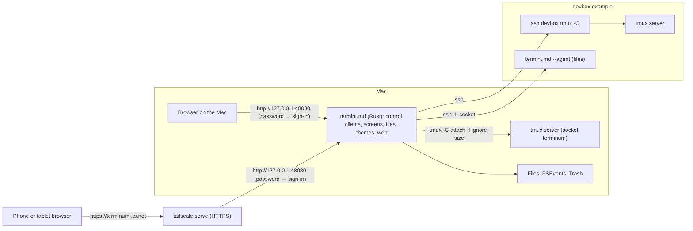
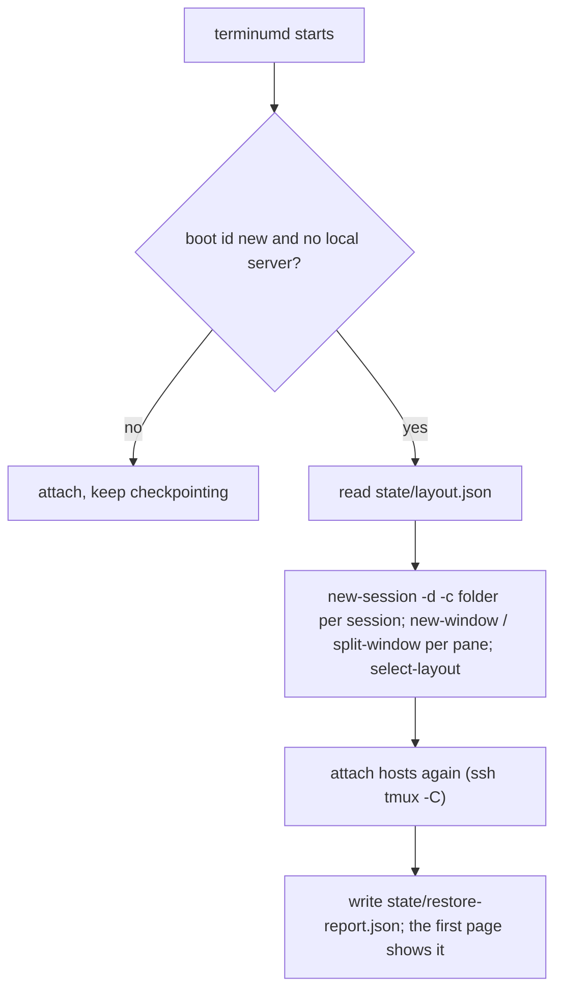

# terminum — Specification (core)

## 0. Metadata

| Field | Value |
|---|---|
| Version | 0.16.1 |
| Date | 2026-10-21 |
| Status | draft |
| Author | Claude (Fable 5.1) for the owner |

Change log:

| Version | Date | Change |
|---|---|---|
| 0.16.1 | 2026-10-21 | Owner: the look from todobem's design code (docs/UI-GUIDELINES.md §2.7, §2.8): an instrument panel's material (corners 2/3/4 px, edges as light and shade, matte keys that sink when pressed, recessed fields, a seam under the bars, a raster grain on the chrome, never on the terminal), no bowed outlines, no ripple; the palette, the blobs and the wavy bookmark and reminder marks stay; the system font stays (no Fira). Pragmatic review: Page, Panel and look tests changed together; todobem's colors not ported. |
| 0.16.0 | 2026-10-21 | Owner: Claude Code's teammates split a session's window (its pane 35 of 117 columns) and the page showed a narrow terminal with no word why: a banner says the window is split and how wide this pane is, with Full width (tmux zooms the pane, and a zoomed pane's window is sized as a window of one pane) and Other pane (AC-13). Pragmatic review: rejected drawing the panes side by side and resizing a split window (see the scenario). |
| 0.15.1 | 2026-10-21 | Owner, on what 0.15.0 left: at tmux's history-limit the rows read while the pane printed are numbered by the last frame's screen rows found where they moved, not dropped for a new history (AC-02); a project's pane closed in the 5 s after it joined leaves when they end, without another change (AC-92). |
| 0.15.0 | 2026-10-21 | Owner, then: rows of a host's Claude Code session showed in another place (4 rows replaced by the 4 rows 60 lines later, then those again in their place): a capture's range is counted back from tmux's history end when tmux runs it, and the history had grown since the frame that numbered it; now each capture reaches above its range and comes with the history's size, and the rows are taken where they moved (AC-02). Pragmatic review applied: one round trip, no wait for a quiet pane (a burst over ssh never gives one); no shift trusted where tmux may have trimmed. Owner, then: switching between sessions drew the new pane at its old size, scaled, and then at the view's: the text size jumped; now "sub" carries the view's grid (after the session's own Files are laid out), terminumd sizes the window before the pane's first frame, and the view keeps the pane shown before until that frame, then draws it at once (AC-04); the once-a-second limit is a window's, so a quick switch is not held back (AC-13). Owner: a session of the user's own tmux on a host, opened without typing, kept the 158×59 tmux gave it and was drawn at a smaller text size until a key was typed. Now a pane of the user's own tmux is sized as any pane: on opening, on its page becoming active and on typing (AC-13); when no page in sight shows it any more (the page hidden, another pane, the page closed) its window gets tmux's own size back, so a locked phone never keeps the user's terminal at its size; a window at the page's grid already is still held (`window-size manual`), or tmux's own policy would give it to another client. A host's control clients a dropped link left behind are ended (terminum-remote.md AC-81). Pragmatic review applied: the release when the page is hidden (awaited, before the page's next message), a resize that waited its second skipped once the page is hidden (checked again as it is recorded), a window shown only by hidden pages given back when its page shows another pane (AC-13, AC-89). |
| 0.14.10 | 2026-10-20 | Owner (iPhone): opening a session did not always reach its last message. The view now stays on the last line through what settles late, checked each frame until 4 s after the first frame or until the user scrolls, presses, types or selects text or a jump to a line takes the view (AC-02). Before it, one growth of the page outside the page's own redraws (a widget, an image, a note) left the view short and it stopped following. |
| 0.14.9 | 2026-10-20 | Owner: a row's unread mark stands level with its second line, its program's, not its name (AC-93). |
| 0.14.8 | 2026-10-20 | Owner: a project's tinted group has as much space under its last session as above its name (its last row touched its edge) (AC-92). |
| 0.14.7 | 2026-10-20 | Owner: Claude Code's process, named by its version ("2.1.304"), is "claude" in a row's line under its title, not its version (AC-01). |
| 0.14.6 | 2026-10-20 | Owner: a view that changes width (docked Files opened, a dragged window, a phone turned, − and +) keeps the text at the chosen size, its rows clipped at the view's edge, until tmux has the new width, 2 s at most after the last change; the text no longer shrank to the old width and grew back when the pane re-wrapped a moment later (AC-04). |
| 0.14.5 | 2026-10-20 | Owner: a tap on a program that did not ask for the mouse opens the keyboard only on the cursor's row, as in the terminal (terminum-terminal.md AC-37) (AC-06). |
| 0.14.4 | 2026-10-20 | Owner: a project's bookmarks and reminders are its own, a project that goes orphans them; a restore again keeps the sessions still running in their projects (they left them) (AC-92; terminum-terminal.md AC-33, AC-91). |
| 0.14.3 | 2026-10-19 | Owner: background work alone holds a turn's end 10 minutes at most (AC-93; terminum-terminal.md AC-39). |
| 0.14.2 | 2026-10-19 | Owner: a finger held still on the terminal's input for 2.5 s opens a menu of Paste (unless the clipboard is known empty), Undo and Redo; iOS's own menu never came there (the field is invisible); the keyboard button's menu is the same; a paste of an empty clipboard says so and sends nothing (AC-03); on a phone Attach (several files, their paths at the cursor), the bookmarks, the reminders and the split stand in a row at the bottom left under the input, and the agent's input box has no frame; Files and View on a phone take the terminal's place whole again (since the split view the terminal's row kept its half of the height) (AC-18); the reminders' bell on the plain buttons' fill, the bell itself pink (AC-91); a project's name has no mark before it (AC-92); the list: every row's bar at one place, the bookmarks' and reminders' waves thinner and gentler, a group's count in words and in one column, a terminal's icon white on a dark gray tile, no hourglass (its bar pulses), the shown session's row see-through (AC-01, AC-57, AC-39), the unread blob 6 px in the name's color on Clone (AC-93); a turn read from the screen ends only once its pane stayed done 10 s, Claude Code's "Waiting for 2 background agents to finish" is working, so is its footer's "1 shell, 1 monitor" (a shell still running in the background), and a busy row shows no unread mark (it showed while the turn went on) (AC-93, AC-39). |
| 0.14.1 | 2026-10-19 | Owner: the row's menu is modal (the page shaded; a press outside closes it and does nothing else) (AC-07); New project… asks the project's name at once, Enter takes a name (it pressed Cancel: renaming did nothing), a double click on a project's name renames it; the name dialog looks as the page's others; projects' colors in pastel (lighter, muted, the hues as far apart); no colored line along a rounded box's side, a project group tinted only, a bookmark's mark the list's wavy line (AC-92, AC-33). |
| 0.14.0 | 2026-10-19 | Owner: every row has Clone (a new window right after it, in its folder; the groups' [+] goes) and a menu on a right click or a long press, its head the session's name and ×: Clone, Add to Project, Remove from Project, Close Session, Move to the Top, Up, Down, to the Bottom (AC-07); projects, named groups of sessions with a color of their own, [+] and drag, the same on every page (AC-92); a row whose agent finished a turn nobody saw is unread until shown (AC-93); a row's second line puts its folder first and its program at the right edge (AC-01); ⌘Z and ⌘⇧Z send the program's undo and redo where it has one, a finger resting on the keyboard button offers both (AC-03); the search's magnifier is out of sight while its field is open; ⌘V after a copy from the history pastes into the terminal's input with no click first (AC-03); text that starts with "-" pasted on a host, a window named so or a path typed by Files is no longer a tmux flag ("invalid flag -", AC-03). |
| 0.13.0 | 2026-10-19 | Owner: the color scheme is one for every browser, kept in settings.json (page.colorScheme) and shown at once on every page (AC-12); a pane's grid stays within 45×14 (an iPhone in portrait at 13 px) and 240×70 (a large desktop window) whatever the view (AC-13); the last pane closed by the user ends its tmux with nothing made again, a host's, terminum's own or the user's own (tmux's own %exit while one pane was shown: a closed window came back as "Restored host ai4: 0 sessions, 1 window"), a reboot or a crash restored as before (AC-15); a tmux reached twice (two hosts that are one machine, a host that is this Mac, grouped sessions, a linked window) lists each pane once and refuses to attach a session listed already (AC-89); ⌘[ and ⌘] back and forward through the last 20 sessions shown, ⌘F the history's search, ⌘B Files (AC-07). |
| 0.12.2 | 2026-10-19 | AC-15: a host is restored only when its tmux server started after the checkpoint (#{start_time}), not when its terminum session was made again because the user closed its last window (the closed window came back); the restore report goes with × on every page and by itself after 30 s, and a page connecting 10 minutes later gets none (it stayed on every page). AC-31: a pipe table is a widget of its own where an agent colored the text around it (Codex's inline code), its rows re-joined where they were wrapped. The page shows its version and build date under the session list. |
| 0.12.1 | 2026-10-19 | Owner: 20 color schemes in the menu over the session's theme (AC-12); Markdown size and history lines in the menu (AC-19); Option/⌘ + ↑/↓ page (AC-03); the split's button is the header's on a computer, the floating one on a phone; no floating button on a split's page (AC-88). |
| 0.12.0 | 2026-10-19 | Owner: one view, the pane as tmux has it, sized to the active browser window: Wrap, Grid, Fit, Screen mode (Auto/Always/Never), "Fit to this screen" and the size policies `largest` and `manual` are gone (AC-04, AC-05, AC-13); a page sizes on opening, on becoming the active page and on typing; a plain view change resizes only a window it sizes; a window of several panes is never resized; a wider pane is scaled to the view (7 px at least); the mouse reaches full-screen programs (Codex: the wheel only; Shift selects). The menu's tmux "Split right/below" is gone: the splits are the quick shell's (AC-07, AC-88). Pragmatic review applied: claims on open/active/typing only (a phone's toolbar would take the window), split windows never resized, the 7 px floor kept, the mouse predicate keeps selection in agents, full-screen programs still hide history, old settings reported, old messages tolerated for a release. |
| 0.11.1 | 2026-10-19 | AC-13: a hidden page (a locked phone) no longer keeps the window it sized: the pages still looking at it take it at once ("Sized for another screen" stayed on the Mac after a split while a phone that typed last lay locked). |
| 0.11.0 | 2026-10-19 | `terminum hooks [status\|install\|remove] [claude\|codex]` and `POST /hook` on the socket for coding agents' hooks; sent history kept in `~/.terminum/sessions` (terminum-terminal.md AC-39, AC-90, AC-91). |
| 0.10.0 | 2026-10-17 | Owner: one listener, one password. The loopback listener on 47900 with its one-time codes (`terminum open`) and the second, cookie-signed listener of web access (`terminum web on/off`, 48080) were two ways in with two sign-ins; now terminumd listens only on `127.0.0.1:48080` (held by launchd as 47900 was) and every browser, the Mac's and, through `tailscale serve` (HTTPS), other devices', signs in with the password set by `terminum password`; until one is set the page says how. The sign-in is the header token of 0.9 with its hello proof (not a cookie: a cookie on 127.0.0.1 reaches every local port). Mac-only actions are judged by forwarding headers, never the Host (tailscale serve passes the browser's Host through); Tailscale Funnel is refused; `terminum signout` and a new password restart the brakes; the old sign-in files are removed at start and the old web.json keys dropped; an install waits until the old terminumd has let go of the port before launchd binds it; a closed page's socket ends at once. Pragmatic review applied: the port handover, forwarding headers instead of the Host, every old sign-in dropped, Funnel refused, the brakes reset by the CLI, `terminum open` kept as an opener, a scheme per kind of name; rejected: a 12-character minimum (the brakes and PBKDF2 hold for 8, and the owner's password stays valid) and asking for the password during install (`curl … \| sh` has no terminal to ask on; the install says the command). Pragmatic review of the code applied: the brakes' count of all kept apart for this Mac's own requests and forwarded ones (guesses from the tailnet held the Mac's browser too), a Files panel socket of a revoked sign-in ends at its next ping, and (found here) a login the old password passed during `terminum password` makes no sign-in; documented: a program on this Mac can name any X-Forwarded-For; left as they were (not this change): `?t=` on any GET, `/custom.css` without a sign-in, the 10 s port wait of a stop when another program holds the port. AC-08, AC-09, AC-10. |
| 0.9.5 | 2026-10-17 | Owner: after the hint's `tailscale serve --bg --https=443` (AC-10), the Mac's tailnet name opened terminum where iterm-enhancer had been, the same as terminum's own Tailscale Service name. The hint now says it takes the Mac's name and names the Service command as the way to keep that name for another program; README "Over Tailscale" starts from that choice. |
| 0.9.4 | 2026-10-17 | Owner, on an iPad over `tailscale serve`: the web listener's page offered Add host and Attach tmux sessions but terminumd refused them, so the form waited on "Looking for running sessions…" and the refusal stayed in the page's banner; the form's fields were 16 px beside the form's text at the terminal's size. Now host, attach and restore actions work from the web listener's page too (its password already opens a shell as the user, so they add no power); fields follow the terminal's size on touch screens too, the viewport's `maximum-scale=1` keeping iOS from zooming in on focus (pinching still zooms on iOS; Chrome on Android, not a stated client, also stops pinch zoom). Pragmatic review applied: no pending form for the listing, which answers with a list and never an error (AC-10, AC-89). |
| 0.9.3 | 2026-10-17 | Owner, serving terminum through `tailscale serve` beside iterm-enhancer: the web listener's default port was 8765, iterm-enhancer's, and on macOS a wildcard bind succeeds beside a program on `127.0.0.1` of the same port, so `terminum web on` opened 0.0.0.0:8765 without a word; with `host` 127.0.0.1 it printed this Mac's network addresses, which do not answer; its hint `tailscale serve --bg <port>` takes port 443 from whatever served it. Now the default port is 48080; a port another program holds on 127.0.0.1 is in use for a wildcard listener too; a listener on loopback is said to be for a proxy on this Mac, with its address; a new password waits for the old listener to close before the new one binds (pragmatic review: the CLI named 127.0.0.1 for every host, `::` had the same hole, the wildcard's hint suggested a proxy closes plain HTTP, and the restart race; all applied; the race did not reproduce here, so its check covers the behavior only); the hint is the full `tailscale serve --bg --https=443 http://127.0.0.1:<port>` and says it replaces what port 443 serves. A web.json that names its port keeps it (terminumd writes the port into each file it saves). AC-10. |
| 0.9.2 | 2026-10-17 | Owner: scrolling Codex (it asks for the mouse) on a host lagged seconds behind the trackpad. Measured through a stand-in ssh 25 ms each way: 120 wheel events in 1.2 s were drawn 5.8 s after the last, as each mouse message waited for its own round trip, and the page's next messages (keys too) waited behind it. Now the page makes a step of each text line scrolled, at most one an event (as xterm.js), and sends a frame's steps as one message with `count`; terminumd queues mouse reports with the keys, in order, one `send-keys -H` a round trip for what came meanwhile, never awaited in the page's message loop: drawn 0.11 s after the last (AC-06). Pragmatic review applied: the key of a mouse report read with its pane, the right words when a mouse report finds no tmux; kept: a batch of keys and mouse reports is a round trip a run (rare and short), one step at most an event (xterm.js; a native terminal sends one a line, uncapped). The page's own drawing was measured apart: 30 full 50-row frames a second in Screen mode's Wrap, no long task, 60 frames a second in Chromium and WebKit. |
| 0.9.1 | 2026-10-16 | Owner: Codex in a host's own session, only looked at, was drawn as Fit at about 11 px where iterm-enhancer shows it at the chosen 13 px. A full-screen program in a pane wider than the view that this page does not size (a session of the user's own tmux only looked at, another screen's size, a refused resize; with Screen mode "never" in Wrap) is drawn by iterm-enhancer's frame rule (its spec 0.44.0): a frame (at least half of the rows with text reach past the columns that fit at the chosen size: mc, htop) as Fit, as Grid at the chosen size when Fit would go below 7 px; rows that end at their text (Codex, a coding agent's full-screen mode, vim) re-flow as Wrap at the chosen size; a frame stays one while a third of its rows reach past the view. A pane this page sizes stays Fit until its resize lands. Pragmatic review applied: the rule only where no resize of this page's comes (it first applied while one was on its way too), hysteresis, the "never" case a sentence of its own (AC-05, AC-13, AC-89). |
| 0.9.0 | 2026-10-16 | Owner: AC-89 also on hosts: sessions of a host's own tmux (the server its `terminum` session is on) attached by name (`hosts.<name>.attach`), offered after Add host and by an icon on the host's group with the count of its other sessions; one Attach tmux sessions form for this Mac and hosts ("On", running sessions as ticks, one message for several names); messages name the server by id. Pragmatic review: one control client per session (tmux sends `%output` only for the client's session; checked on 3.6a), host session clients one at a time with back-off 1…30 s, attached by session id (`$N`: no name in the host's shell), `-E` on hosts too, the host's link waits on its `terminum` client only, sized windows marked `@tm-sized` and released on reconnect and on host change. |
| 0.8.0 | 2026-10-16 | Owner: AC-88 quick shell (a tmux window of its own marked `@tm-quick <pane>`, shown under or beside its pane by a second page in embed mode `/?embed=<key>`; computers only; listed under its pane; not restored); AC-89 sessions of the user's own tmux attached by name (`attach` in settings.json, `terminum tmux`, "Add tmux"; servers told apart by `<host>:<socket>`, group ids `local:<socket>/<session>`; no sizing until the page types). Pasted images go to `~/.terminum/tmp` here and on hosts (AC-36). Pragmatic review: window not split-window (a page sizes the window it shows), an iframe of the page not a second view (a page holds one pane), servers keyed by id before attaching a second local one. |
| 0.7.1 | 2026-10-16 | AC-01: a row's window number names its host on hover ("This machine" here). Dialogs, forms and search speak at the terminal's size; a touch screen's fields keep 16 px (iOS zooms in below). |
| 0.7.0 | 2026-10-15 | Owner: the server is named terminumd, after the app (was terminusd): launchd agent `io.terminum.terminumd`; starting or stopping it unloads `io.terminum.terminusd` and removes its plist first (it holds the port); a rollback to a build of the old name is refused. |
| 0.6.0 | 2026-10-15 | Owner: a group's copy button gives the command that attaches another terminal (AC-01); dialogs, forms and search use the terminal's font; the shipped remote theme stays violet while the system is light. |
| 0.5.1 | 2026-10-15 | AC-13: a size held back by the once-a-second limit is dropped for a later one. |
| 0.5.0 | 2026-10-15 | No Python for users: the `terminum` command is terminumd itself (`~/.terminum/bin/terminum` links the newest build's terminumd; the name it is run by selects the command), the package ships no `.py` and no launcher, `install.sh` runs the package's terminumd for this Mac's architecture (`sysctl hw.optional.arm64`, Rosetta-proof) with `install`. launchd socket activation: launchd holds `127.0.0.1:<port>` from the moment the agent is loaded (plist `Sockets`), so no other program can bind it while terminumd is down, restarting or being upgraded; upgrades and rollbacks restart with `launchctl kickstart -k`; a port another program held at bootstrap is reported ("free it, then run `terminum restart`"); new `terminum restart`. The residual risk of a squatter's page narrowed to the time before the agent is loaded and to the web listener. No release or install of the Python-era command exists, so no compatibility path for it is kept. |
| 0.4.0 | 2026-10-15 | Implementation: assumptions measured on tmux 3.6a (AS-02, AS-03, AS-06, AS-09, AS-11 verified); corrected commands (`-f ignore-size` is a flag of `attach-session`/`new-session`, not of `tmux`; every tmux command a line of its own, as `a ; b` answers with several blocks and a failure stops the rest; the bulk client takes `no-output`); `window-size latest` globally and `manual` per window while a page sizes it (OQ-01, AC-13); the hello proof keyed by a proof key derived from the sign-in, named by an id (`/api/hello?n=&id=`, 404 `unknown_signin`); the Files API under `/fb/api/*`; history numbering across tmux's trims at its limit (it drops the oldest tenth at once); the residual risk of a page loaded from a port squatter corrected; a frame carries `mouse`; the server's pid ends a shown pane after a kill-server; `sized`, `update`, `updatechoice` messages; group ids `<server>/<session>`. |
| 0.3.0 | 2026-10-15 | Owner's decisions: the server is `terminumd` (not `termd`, taken by other projects); OQ-01: a private tmux server (`-L terminum`, its own config file, started by terminumd); OQ-03: the client that typed last sizes the pane; OQ-04: no App, the clients are a Mac browser on a wide screen and Safari on an iPhone (AC-11 dropped, acceptance on those two); OQ 81: one session `terminum` per host, made from the ssh string alone. |
| 0.2.0 | 2026-10-15 | Pragmatic review applied: sizing in stage 1 (AC-13 P0); Screen mode zooms a pane of a split window; a resize re-wraps tmux's history (AS-09, OQ-05 resolved: reset when rows cannot be matched, marks found by text); `history-limit` 12,000 on the user's server too; one control client per session plus a bulk client per server (OQ-02); capture at once after idle, then throttle; the system's memory (terminumd + tmux + WebKit) budgeted, not terminumd alone; `#` doubled in every format-expanded tmux argument (probed: `-c`, `-n`, `rename-window`, `select-pane -T` run `#(…)`); paste through `load-buffer` from a 0600 file; the local sign-in kept by the page per origin and sent as a header, not a cookie (a cookie on 127.0.0.1 reaches every local port); the proof against a port squatter kept; a table of what each listener allows; the page's real protocol (`/ws`, `/fb/`, message renames); 100 pages, as iterm-enhancer's 100 windows; the parity map moved to `parity-map.md`. Rejected: keeping the cookie as accepted risk (the owner runs many local servers). |
| 0.1.0 | 2026-10-15 | Initial draft: the successor of iterm-enhancer with tmux as the terminal emulator and the browser or a WebKit window as the only client. Feature parity with iterm-enhancer 0.42 is split over four specs: this core, `terminum-terminal.md` (AC 31…), `terminum-files.md` (AC 51…), `terminum-remote.md` (AC 81…). Section 2 maps every iterm-enhancer case to its successor or says why it is dropped. |

## 1. Overview

**Problem.** iterm-enhancer mirrors iTerm2: the terminal's size belongs to an iTerm2 window the user may not even look at, so the web page re-flows and scales text that was laid out for someone else's width; every screen travels iTerm2 → its Python API → a Python bridge → the browser, four hops with one request in flight at a time; sessions die with iTerm2, so a third of the bridge rebuilds windows after a quit; full-screen programs (vim, mc, htop) are a jumble on a phone because their grid is iTerm2's. The Files panel, the terminal features for coding agents, bookmarks, search and widgets are good and stay.

**Who it affects.** Developers on macOS who run shells, tmux sessions, ssh sessions and coding agents, locally and on remote hosts, and read them on a Mac, an iPad or a phone.

**Expected outcome.** Terminals live in tmux. One Rust server, `terminumd`, is tmux's control client for a private local server and for each remote host over ssh, and serves one page to a browser: Safari or Chrome on the Mac, Safari on an iPhone. The pane's size follows the view that shows it, so text is laid out for the screen it is read on. Screens are tmux's own grid: terminumd never emulates a terminal. Sessions outlive terminumd, the page and the window. The page, its looks, colors and fonts are those of iterm-enhancer's web app; the Files panel is iterm-enhancer's panel. Full-screen programs get a mode of their own. Everything is configurable from files in `~/.terminum/`.

**Scenario, before and after.**
- Before: Alex opens the web app on a phone. Claude Code runs in an iTerm2 pane 151 columns wide on the Mac. Prose re-flows well; `mc` in another pane is scaled to a stamp. A key takes 80 ms to echo through iTerm2's API. After a reboot, Alex rebuilds windows from the recovery dialog.
- After: Alex opens the same page. The pane Alex reads on the phone is 48 columns wide, laid out by Claude Code itself for that width; the Mac's window of the same pane is wide again when Alex brings it to the front. `mc` fills the phone's screen as a 48×30 grid in Screen mode, arrows and F-keys work, a tap is a click. A key echoes in 25 ms. After a reboot, the sessions are back with their folders before Alex opens the page.

## 2. Scope and non-goals

In scope:
- `terminumd`: the tmux control client (local server, remote hosts over ssh), screens, history, typing, session management, the Files backend of iterm-enhancer, themes, web access, the embedded page and panel.
- The page (iterm-enhancer's web app, unchanged in looks and behavior where it does not name iTerm2) and the Files panel (iterm-enhancer's panel).
- One-line install, launchd, upgrades, rollback, signed releases, the CLI.

Out of scope (explicit):
- Terminal emulation of our own (no VT parser in terminumd or the page): tmux is the emulator. Inline images (iTerm2's OSC 1337, sixel) are not shown in the terminal, as tmux does not keep them (images named in the output open as widgets, `terminum-terminal.md`).
- A native terminal renderer (Metal, ligatures): the page draws text with web fonts; WebKit is the renderer.
- Shells outside tmux: every local terminal is a tmux pane. A user who wants a shell outside tmux uses another terminal.
- Windows and Linux desktops: terminumd builds for Linux as the remote agent. The page works in any modern browser; acceptance is on a Mac browser and an iPhone (OQ-04).
- Several users or several passwords for web access; HTTPS of our own (use `tailscale serve`).

Every iterm-enhancer case is mapped to its successor, or dropped with a reason, in `docs/specs/parity-map.md` (a case of another spec is written `AC nn`, a space; `AC-nn` is this spec's own).

## 3. Assumptions, dependencies, open questions

Assumptions:

| ID | Assumption | Owner | Status |
|---|---|---|---|
| AS-01 | tmux 3.6a is on the Mac (`/opt/homebrew/bin/tmux`); control mode (`tmux -C`) delivers `%output`, `%layout-change`, `%window-add`, `%window-close`, `%window-renamed`, `%session-changed`, `%sessions-changed`, `%pane-mode-changed`, `%extended-output`, `%pause`, `%continue`, and `%begin`/`%end` blocks for commands in order. | Claude | verified (man tmux 3.6a) |
| AS-02 | A control client attached with `-f ignore-size` does not take part in window sizing, so `window-size manual` plus `resize-window -x -y` sets a window's size exactly, also while another client (iTerm2 -CC, a plain `tmux -L terminum attach`) is attached. | Claude | verified 2026-10-15 (tmux 3.6a): a window resized with per-window `window-size manual` keeps that size with `attach-session -f ignore-size` control clients attached; `scripts/e2e_core.py` |
| AS-03 | `capture-pane -p -e -J -t %N -S a -E b` returns the pane's rows with SGR sequences and joins rows tmux wrapped, so hard line ends are where `-J` left a line break; a joined line is cut back into rows at `#{pane_width}` cells (wide characters two cells). | Claude | verified 2026-10-15: `-J` joins wrapped rows within the range (never past `-E`); a wide character that would straddle the edge goes to the next row; SGR state runs across the lines of one capture; `-e` also emits OSC 8 links, which are skipped (`screen/rows_tests.rs`, a real tmux fixture) |
| AS-04 | `#{history_size}` is the number of lines above the screen until `history-limit` is reached; after that tmux drops the oldest lines silently. terminumd's own config sets `history-limit 12000` for every pane of its server (OQ-01). | Claude | verified (man tmux) |
| AS-05 | `send-keys -l` delivers text as typed (no key names), key names (`Up`, `C-c`, `F5`, `S-Tab`) are encoded by tmux for the pane's mode (application cursor keys included), and `send-keys -H` sends hex bytes, so a mouse report (`ESC [ < 0;10;5 M`) reaches a program that asked for mouse events. | Claude | verified for `-l` and names in iterm-enhancer 0.38; `-H` unverified |
| AS-06 | `%output` carries the pane's raw output as octal-escaped text and arrives for every pane of the sessions the control client is attached to; a `%output` is only a signal to capture, never parsed for content. | Claude | verified 2026-10-15: `%output` arrives for panes of every window of the attached session, not of other sessions |
| AS-07 | The clients are Safari or Chrome on the Mac (a window 1400 px and wider) and Safari on an iPhone; the inherited page's e2e checks run in Chromium and WebKit at both sizes. | Owner | stated 2026-10-15 |
| AS-08 | One user, one Mac, local SSD. The owner keeps about 60 panes in 2 tmux sessions and 1–3 pages open. | Owner | stated |
| AS-09 | `resize-window` re-wraps the pane's history, so `#{history_size}` changes with the width; a resize is a history reset for the page unless the rows match (OQ-05). | Claude | verified 2026-10-15; also: at its limit tmux drops the oldest tenth before adding a row, so `history_size` falls by limit/10 while rows still scroll off (`screen/history.rs` models it) |
| AS-10 | With `extended-keys on` and `extended-keys-format csi-u` (tmux 3.4+), `send-keys S-Enter` reaches a program that asked for extended keys as `ESC[13;2u` and a plain shell as a plain Enter, so terminumd never sends raw bytes for them. | Claude | verified on tmux 3.6a: Claude Code 2.1 makes a new line, zsh runs the line (bytes by `-H` would leave `3;2u` in zsh's line); `keys_tests.rs` `shift_enter_is_csi_u_only_for_programs_that_ask`; with `extended-keys off` (tmux's default, so a host's) S-Enter arrives as Enter even to a program that asked, hence the bytes there |
| AS-11 | Arguments tmux expands as formats (`-c` and `-n` of `new-window`, `new-session`, `split-window`; `rename-window`; `select-pane -T`) run `#(…)` and substitute `#{…}`; `##` escapes; `send-keys -l` expands nothing. | Claude | verified 2026-10-15 on a private server (tmux 3.6a) |

Dependencies:

| ID | Dependency | Owner | Status |
|---|---|---|---|
| DEP-01 | Rust stable; crates: axum 0.8 (ws), tokio 1, notify 8, rust-embed 8, trash 5, serde_json 1, unicode-width 0.2 (cells of wide characters), vte 0.13 or a 120-line SGR parser of our own (the spike decides: only `CSI … m` is parsed). | Claude | available |
| DEP-02 | tmux ≥ 3.2 on PATH on the Mac and on every remote host (`ignore-size`, `window-size manual`, `send-keys -H`); verified 3.6a locally. | Owner | available |
| DEP-03 | Node 26 + npm 11 at build time only: esbuild, CodeMirror 6, markdown-it 14, mermaid 11 (inherited `ui/package.json`). | Claude | available |
| DEP-04 | macOS 14+; crates objc2 0.6, objc2-app-kit, objc2-web-kit (MIT/Apache-2.0) for the App; no Tauri, no wry. | Claude | dropped with AC-11 |
| DEP-05 | The inherited page `web/static/` (6.9 k lines) and panel `ui/` (3.6 k lines) from iterm-enhancer 0.42, copied into this repository. | Claude | available |

Open questions:

| ID | Question | Owner | Status | Decision |
|---|---|---|---|---|
| OQ-01 | Which tmux server holds local terminals: the user's default server (sessions shared with any `tmux attach`) or a private `-L terminum` server? | Owner | resolved | A private server: socket `terminum`, started by terminumd with its own config `~/.terminum/tmux.conf` (history-limit 12000, window-size latest (terminumd sets `manual` per window while a page sizes it, AC-13), extended-keys on, focus-events on, escape-time 0; the user may edit it), so the user's sessions and `~/.tmux.conf` are never touched and every pane has terminumd's options; `tmux -L terminum attach` from any terminal still works. Owner, 2026-10-15. Since 0.8.0 the user may also attach sessions of their own server by name (AC-89); terminumd still never starts it or makes sessions there. |
| OQ-02 | How many control clients: one per server, or one per session? | Claude | resolved | One per session for notices and typing (safe whatever AS-06 says), plus one bulk client per server for history pages, search, `list-panes` and layout reads, so a bulk read never queues ahead of an echo. 2026-10-15 |
| OQ-03 | When two clients of different widths show one pane (a phone and the Mac's browser), whose width wins? | Owner | resolved | The client that typed last, as tmux's `window-size latest` (2026-10-15); since 2026-10-19 the active page (in sight and focused): it sizes on opening, on becoming active and on typing (AC-13). Owner. |
| OQ-04 | Does the App replace the browser for daily use on the Mac, or is a browser tab pinned to the Dock enough? | Owner | resolved | No App: the clients to build and test for are a browser on the Mac (wide screen, 1400 px and more) and Safari on an iPhone (mobile). AC-11 dropped. Owner, 2026-10-15. |
| OQ-06 | Should the page ship JetBrains Mono Nerd Font as woff2 (OFL, about 100 KB a weight) so the phone shows the Mac's font, or keep `local()` with Menlo as the fallback? | Owner | open | Proposed: ship it, loaded only when `local()` is missing. |
| OQ-05 | Absolute line numbers after `history-limit` is reached (AS-04) or a resize re-wrapped the history (AS-09): keep counting by matching rows, or reset the page's history as a cleared scrollback does today? | Claude | resolved | Stage 1: reset when the previous frame's rows cannot be matched; bookmarks and search marks are found again by their text, as today. Counting across a match is stage 2. 2026-10-15 |

## 4. Acceptance cases

| ID | Priority | Case |
|---|---|---|
| AC-01 | [MUST / P0] | The user sees every tmux session, window and pane of the local server (and of attached hosts) in the session list within 2 s of a change, grouped by session, with the titles, program, folder and host iterm-enhancer shows, and can filter them. |
| AC-02 | [MUST / P0] | The user opens a pane and sees tmux's screen in the session's theme within 1 s with the last 1000 lines of history, loads older lines up to 10,000, and sees output as it arrives, at most 30 frames a second, each frame only the rows that changed. |
| AC-03 | [MUST / P0] | The user types, pastes and presses hot keys and the bytes reach the pane as a terminal would send them: a key echoes within 100 ms on the Mac's network, held keys repeat, special keys go by tmux's names so a full-screen program gets its own encoding. |
| AC-04 | [SHOULD / P1] | The page draws the pane as tmux has it, sized to the active browser window; a pane wider than the view is scaled to its width (7 px at least). |
| AC-05 | [SHOULD / P1] | A full-screen program (vim, mc, htop, a plain tmux inside) is drawn as its grid without history or widgets, and keys reach it as tmux key names. |
| AC-06 | [SHOULD / P1] | A click, a tap, a drag and the wheel reach a full-screen program that asked for mouse events as the mouse events a terminal would report; a coding agent gets the wheel only. |
| AC-07 | [MUST / P0] | The user creates a window, a session or a split next to the shown pane in its folder, renames a window or pane, reorders windows, moves a window to another session and closes a pane after a confirmation, and the list shows it within 2 s. |
| AC-08 | [MUST / P0] | The user installs with one line, terminumd runs as a launchd agent that starts at login and after a crash, the command prints the page's address and opens it, and `terminum status` tells what runs. |
| AC-09 | [MUST / P0] | A web page or local process cannot list sessions, read screens, type or touch files through terminumd without the sign-in, which only the password set by `terminum password` gets; wrong passwords are braked; writes need the exact Host, Origin and Content-Type. |
| AC-10 | [SHOULD / P1] | A browser on another device reaches the same page through `tailscale serve` over HTTPS and signs in with the same password; what only the Mac may do is refused to forwarded requests; Tailscale Funnel is refused. |
| AC-11 | [SHOULD / P1] | On the Mac the user opens terminum as an app: a WebKit window per ⌘N showing the page, with ⌘W closing the window (never a pane), ⌘+/⌘− for text size, full screen, the Dock icon, and windows remembered across launches. [DROPPED — the owner wants no app: a Mac browser and an iPhone browser are the clients, 2026-10-15] |
| AC-12 | [SHOULD / P1] | The user sees each session in a theme (colors, ANSI palette, font) chosen by rules per host and session from theme files, with light and dark variants following the system, changed live when a file changes; the defaults are iterm-enhancer's looks for local and remote sessions. |
| AC-13 | [MUST / P0] | The pane's size follows the client that shows it: a wide window gets a wide pane and a phone a narrow one, by a policy the user controls; "Fit to this screen" resizes the pane to the view, and a tmux client attached by hand keeps working. |
| AC-14 | [MUST / P0] | After terminumd crashes, restarts or is upgraded, every page reconnects by itself and shows the same pane, no terminal is lost, and a tmux server that is gone is said so; nothing runs that depends on a GUI being open. |
| AC-15 | [SHOULD / P1] | After a reboot the sessions, windows, splits and their folders are back before the user opens a page, remote hosts attach again, and the user is told which panes ran programs that have to be started by hand. |
| AC-16 | [SHOULD / P1] | The user upgrades, rolls back and uninstalls with one command each; a new build is checked before it goes live, open pages reload themselves keeping unsaved edits, and state written by either build stays readable by both. |
| AC-17 | [SHOULD / P1] | The user learns from the page that a newer release exists and can copy the command that installs it, skip that release, or stop the check. |
| AC-18 | [SHOULD / P1] | On a touch screen or a narrow window the hot keys panel, the keyboard button and the floating buttons work as in iterm-enhancer, and the panel's layout comes from a file the user can change. |
| AC-19 | [SHOULD / P1] | The user customizes the page with a stylesheet of their own (`custom.css`) and settings in `settings.json`, with the page reloading when they change and refusing nothing silently. |
| AC-20 | [SHOULD / P1] | terminumd stays within its budgets: under 60 MB with 60 panes and two pages, under 0.5 % CPU idle, a key echoed in 25 ms median on the Mac, a frame encoded in 3 ms; the page under 150 MB with 10,000 lines. |
| AC-88 | [SHOULD / P1] | On a computer the user opens a quick shell for the shown pane, below it or on its left, in the pane's folder: a terminal of its own taking a third of the view, resized by dragging its edge and closed with its ×; it stays with its pane until closed. |
| AC-92 | [SHOULD / P1] | The user groups sessions into named projects, each in a color of its own far from the others, listed first with a [+] that opens a window in the project's folder, reordered by dragging; every page shows the same. |
| AC-93 | [SHOULD / P1] | A session whose coding agent finished a turn while no page in sight showed it is marked unread until a page shows it. |
| AC-89 | [SHOULD / P1] | The user attaches a session of their own tmux on this Mac or on a host by its name ("Attach tmux sessions", offered after Add host): it is listed and used like terminum's own sessions, is never started or closed by terminum, is sized as any pane while a page in sight shows it and gets tmux's own size back after, and shows while it does not run as a group that says so. |

## 5. BDD scenarios

### AC-01 — The session list is the tmux server [MUST / P0]

```gherkin
Scenario: AC-01 happy path — sessions, windows and panes
  Given the local tmux server has sessions "main" (windows 1 "api" in ~/work/api, 2 "docs") and "notes"
  And window 1 is split into panes %3 (running claude) and %4 (zsh)
  When the page opens
  Then the list shows group "main" with row "1 api", its second line "~/work/api" with "claude" at its right edge (host and folder first, then the titles; what runs there on the right), and, under it shifted in, "%4" as "~/work/api … zsh", then "2 docs"
  And group "notes" below it, each group with its count in words ("2 sessions": its rows, not the panes and quick shells under them), the counts of all groups in one column whatever buttons follow; each row with its Clone (AC-07)
  And a row's window number names, on hover, the host the window runs on: "This machine" here, the host's name on a host
  And each group has a copy button (its title the command) that copies how another terminal attaches to that session: "tmux -L terminum attach -t =main" (a host's group: its session's name "terminum" beside the host's, and "ssh -t <recipe> -- <destination> 'tmux attach -t =terminum'")
  And a window the user named (automatic-rename off) shows that name; one tmux names after its program shows the pane's title, else its program; status marks of coding agents (✳ ✻ ✶ ◐ ⏺) are stripped
Scenario: AC-01 happy path — what runs in a pane
  Given rows running Claude Code (its process named by its version, "2.1.302", whatever the window's title), Codex (also as npm's "node", by its screen) and a shell
  Then a row's line under its title names Claude Code's program "claude", never its version
  And each row, before its title, and the header, before the shown pane's title, show Claude Code's mark, Codex's mark (their owners' trademarks, outside terminum's licenses: NOTICE) or the terminal icon (white on a dark gray tile with small round corners); a build without the marks' files shows the terminal icon for them
Scenario: AC-01 happy path — a folder's color
  Given rows in ~/work/api, ~/work/web, ~/notes and two in ~/tools, and a row in ~/work/api/db
  Then the bar left of each row (and of the header's title), at one place in every row, is a pastel color of its folder: rows in the same folder (on the same host) share it, folders not inside one another get hues as far apart as their count allows
  And a folder inside another listed folder gets a hue near that folder's, the nearer the deeper it lies, yet its own; "~" and "/" are no parent; a row with no folder has a grey bar
  And on a light theme the same hues are darker, so the bar keeps 3:1 against the list
Scenario: AC-01 happy path — the list follows tmux
  Given the page is open
  When the user runs "tmux new-window -n build" in any terminal
  Then within 2 s the list shows "3 build" in "main" (the %window-add notice, then list-panes)
  When the user runs "tmux kill-window -t build"
  Then within 2 s the row is gone and the page, if it showed that pane, says "This pane has closed. Pick another one."
Scenario: AC-01 happy path — filter and ⌘K
  When the user types "doc" in the filter (or presses "/" or ⌘K and types)
  Then only rows whose title, folder, host or program contains "doc" stay, flat, and Enter opens the first
Scenario: AC-01 edge — a remote host's session
  Given host "devbox" is attached (AC 81)
  Then its group reads "devbox" in cornflower blue (its session on the host is always "terminum"), every row names the host in violet, and its folders are the host's
Scenario: AC-01 edge — the first start
  Given no tmux server on the "terminum" socket
  When terminumd starts
  Then it starts the server with ~/.terminum/tmux.conf and a session "main" (a shell in ~), and the page shows it; the user's default tmux server and its sessions are never touched
Scenario: AC-01 failure — tmux is missing
  Given tmux is not on PATH
  Then the list shows "tmux is needed for terminals: brew install tmux" and nothing else; terminumd looks again every 10 s
```

### AC-02 — The screen is tmux's screen [MUST / P0]

```gherkin
Scenario: AC-02 happy path — open a pane
  Given pane %3 is 150×50 with 4,200 lines of history
  When the user opens it
  Then within 1 s the page shows the theme, the last 1000 history lines and the screen (50 rows) with the cursor, in the session's theme
  And scrolling up loads older lines 1000 at a time, up to 10,000 (TM_HISTORY)
  And every line is tmux's: rows tmux wrapped join when copied, a hard line end stays one (AS-03)
  And the view stays on the last line through what settles late (fonts, widgets, images, a phone's list closing, the keyboard), until 4 s after the first frame or the user scrolls, presses, types or selects text, or a jump to a line takes the view
Scenario: AC-02 happy path — output streams
  When the pane prints 5,000 lines in 2 s
  Then terminumd captures the screen on its %output notices at most every 33 ms and sends only the rows that changed ("full": false, "ch": [[row, line]…]); lines that scrolled off the screen are appended to the history ("hist", "append") with their absolute numbers
  And the page draws each frame in under 16 ms and follows the output while the view is at its end
Scenario: AC-02 edge — the pane prints while its history is read
  Given a frame said tmux's history holds h rows, and before the rows that scrolled off are read the pane prints 60 more (a coding agent's long result, over a host's ssh)
  Then terminumd's capture reaches 64 rows above the range (further once more when more scrolled) and comes with #{history_size} and #{pane_width} read before and after it, and the rows asked for are taken from where the rows that scrolled meanwhile moved them: the page gets the rows it numbered, never those 60 rows on shown in their place (a paragraph doubled, text out of its place); rows tmux no longer has are empty, never others
  And where the count cannot say how far rows moved (a history that shrank, or 90% of history-limit or more: tmux drops a tenth at once) one capture from 512 rows above the range down to the screen's end finds the last frame's top screen rows (six, two at least not blank) where they moved, and they number the rows (further once more when tmux still has rows above its reach); a width that changed meanwhile, those rows found nowhere or at two moves (output that repeats itself), sends no rows and the next frame starts the page's history anew
  And the page fills a folded line only into the record of its own number
Scenario: AC-02 edge — the scrollback is cleared
  When the user runs "clear && tmux clear-history" (or Claude Code's /clear)
  Then #{history_size} drops, terminumd sends "hist" "reset" and a full screen, and the page's history starts anew (folds and line numbers with it)
Scenario: AC-02 edge — the screen does not change
  Given a pane prints the same spinner frame twice
  Then the second capture equals the last frame sent and nothing is sent; a pane nobody shows is never captured
Scenario: AC-02 failure — the capture fails
  When "capture-pane" answers %error (the pane closed meanwhile)
  Then the page shows "This pane has closed. Pick another one." for that pane only, and the log names the command and the error
```

### AC-03 — Typing [MUST / P0]

```gherkin
Scenario: AC-03 happy path — text and keys
  When the user types "ls -la", presses Enter, then ↑, Tab, ⌃C
  Then terminumd sends "send-keys -t %3 -l 'ls -la'" then "send-keys -t %3 Enter Up Tab C-c" (keys by tmux's names, text literal), in order, one command per run
  And the echo of each key shows within 100 ms on the Mac's network (AC-20 for the budget)
Scenario: AC-03 happy path — keys that arrive while one is on its way go together
  When the user holds → for a second
  Then the keys go as one "send-keys … Right Right Right…" per round trip, in order, at the keyboard's repeat rate, never one round trip a key
Scenario: AC-03 happy path — paste
  When the user pastes 20 KB of text
  Then terminumd loads it into a tmux buffer ("set-buffer -b tm-<n>" from the control channel, 64 KB a command, more in parts) and pastes it with "paste-buffer -p -d -b tm-<n> -t %3", so a program that asked for bracketed paste gets its markers (the menu's "Bracketed paste" switch turns -p off)
  And a paste holding control characters other than newline and tab is refused with "The text holds control characters and was not sent"
  And text that starts with "-" (a paste on a host, a name, a path the Files panel types) is text: tmux takes a word that starts with "-" before the first other word for a flag, so every such argument comes after "--" (a paste of "-x …" said "invalid flag -")
  When the user selects lines in the history, copies them (⌘C) and presses ⌘V with the keys anywhere but a field (the selection, the list, a button)
  Then the terminal's input takes the keys back first and the text is pasted into the pane at its cursor, typing going on there without a click (not under a dialog, nor while Files is shown in the terminal's place)
Scenario: AC-03 happy path — undo and redo
  When the user presses ⌘Z on the terminal's input (another field keeps its own undo)
  Then the shown program's undo goes: Ctrl+_ for Claude Code, zsh, bash and fish; another program gets nothing and a toast says so (Ctrl+_ is nano's Go To Line)
  When the user presses ⌘⇧Z
  Then fish gets its redo (Alt+/); Claude Code, Codex, zsh and bash have no redo by default, so nothing is sent and a toast says "zsh has no redo" (Codex has no undo either: "Codex has no undo")
  When on a phone the user rests a finger on the keyboard button (half a second), or holds one still on the terminal's input (the cursor's row, an agent's input box) for 2.5 s
  Then a modal menu offers Paste, Undo and Redo, which do as ⌘V, ⌘Z and ⌘⇧Z; Paste is left out when the browser lets the page read the clipboard and it is empty (Safari never does: there a Paste of an empty clipboard says "The clipboard is empty" and sends nothing)
  And a finger that slides or swipes before then moves the cursor or scrolls and opens no menu; iOS's own undo on the input (three fingers, a shake) undoes as ⌘Z does
Scenario Outline: AC-03 happy path — special keys by name
  When the user presses "<key>"
  Then terminumd sends "send-keys -t %3 <name>" and tmux encodes it for the pane's mode (application cursor keys in vim and mc)
  Examples:
    | key           | name   |
    | ↑             | Up     |
    | ⇧Tab          | BTab   |
    | F5            | F5     |
    | ⌃→            | C-Right|
    | Home          | Home   |
    | Delete (fwd)  | DC     |
Scenario: AC-03 edge — paging with the arrows
  When the user presses Option+↑ or ⌘↑ (Option+↓, ⌘↓)
  Then the pane gets Page Up (Page Down), as tmux's PPage (NPage); with Shift too the arrow goes with its modifiers
Scenario: AC-03 edge — Shift+Enter and Ctrl+Enter
  When the user presses ⇧↩ or ⌃↩ (a key or the hot key)
  Then terminumd sends "send-keys S-Enter" or "C-Enter": a program that asked for extended keys (Claude Code) gets ESC[13;2u or ESC[13;5u and makes a new line, a shell gets Enter (AS-10)
  But on a server whose "extended-keys" is off (a host's own tmux by default; asked once per connection with "show-options -sv extended-keys") tmux would send Enter, so there the keys go as those bytes ("send-keys -H"), as iTerm2 sends them with CSI u on: Claude Code makes a new line, a shell shows them as text
Scenario: AC-03 edge — a held delete
  When the user holds Backspace in a shell at its prompt or in a coding agent's input box
  Then a character goes at a time, and after 1.5 s a word (C-w) at a time, at most one every 90 ms; in other programs characters only (the pane's program comes with the list, AC-01)
Scenario: AC-03 failure — the pane is gone or the server stalls
  When "send-keys" answers %error, or the control client has not answered for 3 s
  Then the keys are dropped, not queued forever; the page shows "tmux did not take the keys: <error>" over the terminal; a line "tmux on this Mac is not responding (N s)" counts while a server stalls and goes when it answers
```

### AC-04 — The pane as tmux has it [SHOULD / P1]

```gherkin
Scenario: AC-04 happy path — one view, the tmux window's grid
  Given the Mac's browser shows %3
  Then the page draws the pane's rows exactly as tmux has them, at the chosen text size, its history above (AC-02); the pane is sized to this view's grid (AC-13), so its rows fill the view; there is no view mode to pick
Scenario: AC-04 edge — a pane wider than the view
  Given the pane is wider than the view at the chosen text size: a window of several panes (never resized, AC-13), another page's size, a refused resize
  Then the rows are scaled down to the view's width, and when that would make the text smaller than 7 px (the smallest size − and + allow) they are drawn at the chosen size with the rest by scrolling sideways; "Sized for another screen (W×H)" says so when another page sized it
Scenario: AC-04 edge — the view changes width
  Given this page sized the pane to its view (its columns are the ones it sent)
  When the view's width or the text size changes (docked Files opened or closed, a dragged window, a phone turned, − and +)
  Then the text stays at the chosen size and rows wider than the view are clipped at its edge, with no sideways scrolling, until tmux's pane has the view's new width; then the pane is drawn re-wrapped, so the text size changes once at most and never shrinks to the old width first
  And when the pane does not take the width within 2 s of the last change (a window of several panes, another page's size, a refused resize, the 45-column floor) it is drawn as a pane wider than the view
Scenario: AC-04 edge — another pane opened
  When the user opens another pane (the list, ⌘[ ⌘], a bookmark, a new window) whose window has another size than this view's grid
  Then the page lays the new pane's session out first (its own docked Files, AC-70 of terminum-files.md) and sends "sub" with the grid that leaves; terminumd sizes the window to it before the pane's first frame (AC-13), so that frame comes at this view's grid
  And the view keeps showing the pane shown before, still (never blank), until that first frame, 1.5 s at most, then draws the new pane at once, at the chosen text size: no frame at the window's old size, scaled, is drawn first, so the text size never jumps; a window of several panes (never resized) comes at its own size, scaled as before
  And a second window resized within a second of the first is not held back: the once-a-second limit is a window's
Scenario: AC-04 edge — settings of earlier versions
  Given settings.json still has "size", "page.lines" or "page.screenMode"
  Then they are not used, and the page says once "settings.json: size, page.lines and page.screenMode are no longer used: the active page sizes the pane"
```

### AC-05 — Full-screen programs [SHOULD / P1]

```gherkin
Scenario: AC-05 happy path — mc on a phone
  Given pane %5 (zsh) is shown on a phone whose view holds 48×30 cells at the chosen text size, and the pane is sized to it (AC-13)
  When the user runs "mc"
  Then tmux reports #{alternate_on} 1 with the next frame; the page hides the history and the widgets while it runs and draws its 48×30 grid, blank rows included; mc draws itself for 48×30: both panels fit, the menu bar and function key bar are whole
  When the user presses F10 (the hot keys' Fn row), Esc, arrows, Enter, ⌃O
  Then they reach mc as tmux's key names (AC-03) and mc acts on them
Scenario: AC-05 edge — a coding agent's own full screen
  Given the shown pane runs Codex, which draws on the alternate screen
  Then its history and widgets stay (as on the normal screen), and its input box and footer are the page's (AC 40)
Scenario: AC-05 happy path — the program ends
  When mc exits
  Then #{alternate_on} is 0 and the screen shows the shell with its history again
```

### AC-06 — Mouse and touch for full-screen programs [SHOULD / P1]

```gherkin
Scenario: AC-06 happy path — click, drag, wheel
  Given mc runs on the alternate screen and asked for mouse events (#{mouse_any_flag} 1)
  When the user clicks cell (10, 5), drags from (10, 5) to (30, 5), or scrolls the wheel
  Then terminumd sends the SGR mouse reports a terminal would ("send-keys -H" of ESC [ < 0;11;6 M, motion and release, buttons 64/65 for the wheel), with the pane's cell coordinates (1-based)
  And mc selects the file, drags the selection, scrolls the panel
Scenario: AC-06 happy path — a trackpad on a far host
  Given Codex asked for the mouse on a host 50 ms away and the user scrolls with a trackpad (120 small wheel events a second)
  Then each text line scrolled is one wheel step, at most one an event (a wheel's notch is one), and a frame's steps go as one message with their count
  And terminumd hands the reports that came while one round trip was on its way to tmux in the next, as one "send-keys -H", in order with the keys typed; the page's other messages never wait for them
  And the program has every step and the screen is drawn within 0.2 s of the last event (it was 5.8 s for 120 events)
Scenario: AC-06 happy path — touch
  When the user taps a cell, or swipes up or down in the grid
  Then a tap is a click at that cell, a swipe is wheel events, a two-finger tap is a right click; a long press selects text as in the terminal (no event sent)
Scenario: AC-06 edge — the program did not ask for the mouse
  Given a program with #{mouse_any_flag} 0 (vim without "set mouse=a")
  Then clicks move no cursor and send nothing; a tap on the cursor's row opens the keyboard, elsewhere it leaves it as it was, as in the terminal; the wheel scrolls the page
Scenario: AC-06 edge — coding agents and selection
  Given Codex on the alternate screen asked for the mouse
  Then the wheel and a swipe go to it (it scrolls its own transcript), but presses and drags select text as on any page; on any program Shift held while pressing selects text instead of sending the press
  And on the normal screen nothing is sent: the wheel scrolls the history
Scenario: AC-06 failure — the report cannot be sent
  When "send-keys -H" answers %error
  Then the event is dropped and the status line says "Mouse event not sent: <error>" once a second at most
```

### AC-07 — Manage sessions [MUST / P0]

```gherkin
Scenario: AC-07 happy path — new window, new session, split
  Given the page shows pane %3 of window "api" in session "main", folder /Users/alex/work/api
  When the user presses Clone on the row of "api" (the groups have no [+]: AC-07 Clone)
  Then terminumd runs "new-window -a -t @2 -c '/Users/alex/work/api'" and the page shows the new pane within 2 s, placed right after "api" (the `new` message, a group's window after the shown pane's, stays for scripts)
  When the user picks "Split below", "Split right" or "Split left" from the pane's menu
  Then the pane's quick shell opens there (AC-88); the page offers no tmux split, and a window of several panes made elsewhere (the user's own tmux, an agent, the `split` message) shows its panes under the window's first one
  When the user presses "New session" at the list's foot and types "scratch"
  Then terminumd runs "new-session -d -s scratch -c ~" and the page shows its pane; a name tmux refuses (empty, with ":" or ".") is refused inline with tmux's message
Scenario: AC-07 happy path — Clone and the row's menu
  Then every row has a Clone button at its right end (over the row's end on hover with a mouse, a column of its own with a finger); the groups have no [+]
  When the user presses Clone on window "api" (or picks Clone in its menu)
  Then terminumd runs "new-window -a -t @2 -c '/Users/alex/work/api'" (right after it, in its folder, a shell: its program is not copied) and the page shows the new pane; a session of a project gives the project's window (AC-92); one a second per client, as New window; a host that is not attached offers no Clone
  When the user right-clicks a row, or rests a finger on it for half a second
  Then a modal menu opens there (the page shaded behind it; a press outside closes it and reaches nothing under it; Esc too; below the finger; from the keyboard's menu key or ⇧F10 at the row, ↑ ↓ through it): Clone, Add to Project…, Remove from <project> (in one), Move to the Top, Move Up, Move Down, Move to the Bottom (those its place allows), Close Session (asked first: "Close the session api? The program running in it (claude) ends."); its head names the session and has × to close it
  And a move reorders the row among its group's rows: a tmux session's windows in tmux ("swap-window"), a project's sessions in the project
Scenario: AC-07 happy path — rename and reorder
  When the user presses the pencil beside the title, types "deploy" and presses Enter
  Then terminumd runs "rename-window -t @2 'deploy'" and "select-pane -t %3 -T 'deploy'", and the list, the header and tmux's own status line show it within 2 s; an empty name restores "automatic-rename on"
  When the user drags a window's row by its grip above another in its group
  Then terminumd runs "move-window -s main:3 -t main:1" (and renumbers) and the list shows the new order within 2 s; rows of another session are never moved by a drag
Scenario: AC-07 happy path — move a window to another session
  When the user picks "Move to session…" on a window and chooses "notes"
  Then terminumd runs "move-window -s main:3 -t notes:" and the window appears under "notes"; tmux keeps its panes running
Scenario: AC-07 happy path — close a pane
  When the user picks "Close pane" (or presses the hot key ⌃D in a shell, which needs no dialog)
  Then the page asks "Close this pane? The program running in it (claude) ends." with "Close" and "Cancel"
  When the user confirms
  Then terminumd runs "kill-pane -t %3", the list drops it within 2 s, and the page shows the next pane of the same window, else the list
Scenario: AC-07 happy path — an IDE's keys
  Given the user showed "api", then "docs", then "notes"
  When the user presses ⌘[ twice and ⌘] once
  Then "docs", then "api", then "docs" again are shown, as an IDE's Back and Forward; past the first or the last nothing moves; showing another session drops what was ahead
  And the last 20 sessions shown are kept in this browser across reloads; a pane that is gone is skipped
  When the user presses ⌘F (the terminal shown) or ⌘B
  Then the search in the history opens with its field focused (AC-56), or Files opens or closes (docked on a computer, in the terminal's place on a phone); the browser's own Back, Forward, Find and bookmarks bar do not take these keys; inside Files and View (their own frames) the editor keeps ⌘[, ⌘] and ⌘F for indent and its own search, and ⌘B does nothing there
Scenario: AC-07 edge — names and folders on tmux's command line
  Given a folder name holds a quote, "#(…)", "$" or a newline
  Then quoted names reach tmux as single arguments and run nothing; a name with a control character is not put on the command line: the window opens in the home folder with a note "folder name not usable: opened in ~"
Scenario: AC-07 failure — tmux refuses
  When a command answers %error ("no such window", "session exists")
  Then the status line shows the message in words and nothing else changes; at most one new window, session or split a second per client, a second press within it says so
```

### AC-08 — Install and run [MUST / P0]

```gherkin
Scenario: AC-08 happy path — one line
  When the user runs "curl -fsSL https://github.com/extractumio/terminum/releases/latest/download/install.sh | sh"
  Then it downloads the latest package and SHA256SUMS, checks the signature and the checksum, installs under "~/.terminum/builds/<build>/" with "current" linking to it and "~/.terminum/bin/terminum"
  And the installer is the package's own terminumd for this Mac's architecture ("sysctl -n hw.optional.arm64", right under Rosetta too) run as "terminumd install"; nothing needs Python, a compiler, npm or make
  And it writes "~/Library/LaunchAgents/io.terminum.terminumd.plist" (RunAtLoad, KeepAlive, log to ~/.terminum/logs/terminumd.log, ProgramArguments [".../builds/current/terminumd", "serve"], Sockets "Listeners" on 127.0.0.1:<port>) and loads it, so terminumd runs now and at every login
  And "~/.terminum/bin/terminum" links the newest installed build's terminumd, which acts as the command when run by that name
  And with a password set it prints "Installed <build>. Open http://127.0.0.1:48080/ and sign in with your password (terminum open)" and opens the page in the default browser; without one "Installed <build>. Set the password every browser signs in with: terminum password; then open http://127.0.0.1:48080/ (terminum open)"; then how other devices reach it (AC-10)
Scenario: AC-08 happy path — launchd holds the port
  Given the agent is loaded
  Then launchd listens on 127.0.0.1:48080 and hands the socket to terminumd ("launch_activate_socket"); while terminumd is killed, crashes, is restarted or upgraded, connections wait in launchd's queue and another program's bind of 127.0.0.1:48080 fails with "address in use", SO_REUSEPORT or not
  And before it loads the agent again (an install whose plist changed, `terminum restart`) the command waits until nothing answers on 127.0.0.1:<port> (at most 10 s): an old terminumd that bound the port itself (0.5.0's web listener on 48080) has let go of it
Scenario: AC-08 happy path — tmux missing
  Given tmux is not on PATH
  Then the install goes through and prints "tmux is needed for terminals: brew install tmux", and the page says the same until tmux appears (checked every 10 s)
Scenario: AC-08 happy path — status
  When the user runs "terminum status"
  Then it prints the running build, terminumd's pid and uptime, the page's address, whether a password is set, the tmux servers and sessions attached, the hosts and their state, and the pages connected
  And when settings.json names another port than the one launchd holds, it says "port: settings.json says <a>, launchd holds <b>: run terminum restart"
Scenario: AC-08 edge — another program held the port when launchd loaded the agent
  Given another program listened on 127.0.0.1:48080 when the agent was bootstrapped (launchd then hands an unbound socket and never tries again)
  Then terminumd logs and prints "port 48080 was held by another program when launchd loaded terminum: free it, then run `terminum restart`" once and waits (exiting would only have launchd start it again on the same unbound socket), and "terminum status" says so
  When the user frees the port and runs "terminum restart"
  Then the agent is booted out and bootstrapped again, launchd holds the port, and terminumd answers within 10 s
Scenario: AC-08 edge — the port is in use (terminumd not run by launchd, TM_NO_LAUNCHD=1)
  Given another program listens on 127.0.0.1:48080
  Then terminumd exits with "port 48080 is in use (set `port` in ~/.terminum/settings.json)" in its log after 9 s, and "terminum status" says so
Scenario: AC-08 failure — bad download or wrong user
  When the checksum or signature does not match, or the line runs as root
  Then nothing is installed and the line exits non-zero with the reason
Scenario: AC-08 failure — launchd could not bind the port at a bootstrap (install, restart, import)
  Given the agent was just bootstrapped and terminumd logged "port 48080 was held by another program when launchd loaded terminum: …"
  Then the command exits non-zero with that message at once (the user frees the port, then runs "terminum restart"); launchd binds through a closing connection's TIME_WAIT (measured), so only another program's listener leads here
```

### AC-09 — Only the page can use terminumd, with the password [MUST / P0]

```gherkin
Scenario: AC-09 happy path — every browser signs in with the password
  Given the user ran "terminum password" and typed a password of at least 8 characters twice
  Then web.json (0600) holds it as a salted PBKDF2-SHA256 hash (200,000 iterations), every sign-in made before is revoked and every open page closes
  When a browser opens the page (the Mac's at "http://127.0.0.1:48080/", another device's through "tailscale serve") and sends the password in its form
  Then terminumd answers {"secret"}: a 256-bit sign-in (kept as its SHA-256 and proof key in state/signins.json, 0600, at most 20, 30 days), which the page keeps in its own origin's storage (not a cookie: a cookie on 127.0.0.1 would reach every local port) and sends as the header "X-TM-Session" on requests and as the WebSocket's subprotocol; images carry it as "?t=" on the same origin only; the page's address never holds it
Scenario: AC-09 happy path — no password yet
  Given no password is set (a new install)
  Then the page's form says "No password is set yet. On the Mac, run: terminum password" and cannot be sent, and asks again every 5 s; "POST /auth/login" answers 503 no_password; "terminum status" says "password: not set — no browser signs in: terminum password"; "terminum open" says to set it first
Scenario Outline: AC-09 error — requests without a sign-in or from elsewhere are refused
  When a client sends "<request>"
  Then the response is "<status>" with body {"error": "<code>"} and no screen, session or file is read or changed
  Examples:
    | request                                                                | status | code             |
    | GET /ws (no sign-in)                                                   | 401    | bad_session      |
    | GET /fb/api/ls?path=/Users/alex, Host: evil.example:48080              | 403    | bad_host         |
    | GET /ws with a sign-in, Origin: http://evil.example                    | 403    | bad_origin       |
    | POST /fb/api/fs/mkdir with a sign-in, Content-Type: text/plain         | 415    | bad_content_type |
    | POST /fb/api/os/reveal with X-Forwarded-Host (through a proxy)         | 403    | not_here         |
    | any request with Tailscale-Funnel-Request (the public internet)        | 403    | funnel           |
Scenario: AC-09 failure — wrong passwords
  When a wrong password is sent
  Then it answers 401 "Wrong password."; passwords are checked one at a time, a wrong one holds the next for 1 s, after 5 from one address that address waits 15 s doubling to 5 min, after 20 from all addresses every address waits (429, "Too many wrong passwords. Try again in <n> s."), all counted apart for this Mac's own requests and for forwarded ones, so guesses from the tailnet never hold the Mac's browser; behind "tailscale serve" the address is X-Forwarded-For's last entry, believed only from loopback (so a program on this Mac can name any address: for it only the "all" count holds)
  And "terminum password" and "terminum signout" start the brakes over, so guesses from elsewhere never keep the owner out for long
Scenario: AC-09 edge — signed out
  When the user chooses Sign out in the menu
  Then that browser's sign-in is revoked ("POST /auth/logout" with its X-TM-Session), forgotten by the page, and the form shows
  When the page's sign-in has expired (30 days) or was revoked ("terminum signout", a new password)
  Then the page drops it from its storage and shows the form with "Signed out: sign in again."; the page behind stays as it is, unsaved edits in its editor included, until the user signs in again
Scenario: AC-09 edge — the sign-ins of 0.5.0
  Given an install of 0.5.0 or before (sign-ins from one-time codes on 127.0.0.1:47900, cookie sign-ins of the second listener)
  When the new build starts
  Then local-sessions.json and web-sessions.json are removed: their secrets stay in the storage of an origin any program may serve now, so none is carried over; web.json's "enabled", "host", "port" and "history" are dropped and its password kept
Scenario: AC-09 security — the page proves the server before it sends its secret
  Given another program may hold the port (terminumd down during a load)
  When the page loads or reconnects
  Then it asks "/api/hello?n=<nonce>&id=<the first 16 hex of SHA-256(secret)>" and sends its secret only when the answer is HMAC-SHA256(proof key, "tm-hello-v1:" + nonce), the proof key being HMAC-SHA256(secret, "tm-proof-key") (terminumd keeps it, never the secret); another program cannot answer, so it never sees the secret on a reconnect; an unknown id answers 404 unknown_signin (signed out)
Scenario: AC-09 security — private files and the socket
  Then "~/.terminum" is 0700 and everything terminumd and the installer create in it is 0600 (files) or 0700 (folders); the CLI talks to terminumd through the Unix socket "~/.terminum/state/terminumd.sock" (health, the password, sign-out), never with a sign-in over TCP; "/internal/*" and the socket's routes over TCP answer 404
Scenario: AC-09 security — the page runs no content
  Then the page's CSP is "default-src 'self'; img-src 'self' data:; style-src 'self' 'unsafe-inline'; script-src 'self'; connect-src 'self'; frame-ancestors 'self'", terminal output reaches only the panel's Markdown rules and Mermaid strict, and a link never navigates the page
```

### AC-10 — Other devices through tailscale serve [SHOULD / P1]

```gherkin
Scenario: AC-10 happy path — a phone on the tailnet
  Given "tailscale serve --bg --service=svc:terminum --https=443 http://127.0.0.1:48080" (or "--https=443" on the Mac's own name; README "Over Tailscale")
  When a phone on the tailnet opens "https://terminum.<tailnet>.ts.net/" and signs in with the password
  Then it gets the same page as the Mac, over HTTPS (Tailscale's certificate); terminumd itself listens only on 127.0.0.1:48080 and speaks plain HTTP there, which never leaves the Mac
  And "terminum password" and the install say how to serve it: "Other devices: serve it over HTTPS on your tailnet: tailscale serve --bg --https=443 http://127.0.0.1:48080 (it takes the Mac's name; a name of its own: README "Over Tailscale")"
Scenario: AC-10 failure — other names, other schemes
  Then a request whose Host is not "127.0.0.1:<port>" exactly, a "*.ts.net" name or one of web.json's "allow_hosts" is refused (403 bad_host: DNS rebinding); the Origin of a write, a sign-in or the WebSocket must be the page's own: "http://127.0.0.1:<port>" for the loopback name, "https://<name>" for a ts.net name, either for an allowed name
Scenario: AC-10 edge — what only the Mac's own browser may do
  Given a request carries a forwarding header (Forwarded, X-Forwarded-*, Tailscale-*: tailscale serve always adds X-Forwarded-Host and passes the browser's Host through as it came)
  Then it is not the Mac's own browser's whatever its Host: Finder and default apps (/fb/api/os/*), typing a path into a terminal (/fb/api/terminal/*) answer 403 not_here, and updatechoice is ignored; everything else is allowed (the password already opens a shell as the user, so this is a guard against accidents, not a boundary)
Scenario: AC-10 edge — Tailscale Funnel
  Given "tailscale funnel" is pointed at the port
  Then every request it forwards (Tailscale-Funnel-Request) answers 403 funnel: terminum is not served on the public internet
```

### AC-12 — Themes and fonts [SHOULD / P1]

```gherkin
Scenario: AC-12 happy path — defaults
  Given a fresh install
  Then "~/.terminum/themes/local.json" and "remote.json" exist (section 9: local = iterm-enhancer's Default profile, remote = its tmux profile) and settings.json says {"themes": {"default": "local", "hosts": {"*": "remote"}}}
  And a local pane is shown in "local" and a remote host's pane in "remote": the page's chrome mixes the theme's background and foreground as iterm-enhancer's web app does, the terminal uses its ANSI palette, bold color and cursor colors, the font is "JetBrainsMonoNFM-Regular" at 15 (a font WebKit does not have falls back to Menlo)
  And the text size is the theme's (settings.json's page.textSize over it; on a phone 14 at most); the menu's − and + step from it, a step remembered per browser, so a theme's new size still shows
Scenario: AC-12 happy path — rules and live changes
  When the user writes {"hosts": {"devbox": "work"}, "sessions": {"notes": "paper"}} into settings.json and a "work.json" theme
  Then within 1 s (the folder is watched) panes of devbox wear "work", session "notes" wears "paper", others as before; every page redraws without reload
  When the system switches to light mode
  Then themes with a "light" variant switch (the page is told "dark": false); others stay
Scenario: AC-12 happy path — a color scheme from the menu
  When the user presses one of the menu's 20 color swatches (Dracula, Solarized Dark and Light, Nord, Gruvbox Dark and Light, One Dark, Monokai, Tokyo Night, Catppuccin Mocha and Latte, GitHub Dark and Light, Tomorrow Night, Night Owl, Ayu Dark, Everforest Dark, Rosé Pine, Kanagawa, Cobalt2)
  Then the terminal, the page's chrome and the widgets take its background, text, cursor, selection and 16 ANSI colors at once over the session's theme (its font and size stay); the choice is kept in settings.json (page.colorScheme: the scheme's name) and every page, in every browser, shows it at once; "Theme" removes it, back to the session's theme; a scheme an older page kept in its own browser is not carried over (picked once again)
Scenario: AC-12 error — a theme that does not parse
  Given "work.json" has a syntax error or a color that is not "#rrggbb"
  Then the page keeps the last good theme, shows "Theme work.json: line 7: expected a color" once as a toast, and terminumd logs it; a rule naming a missing theme uses the default and says so
Scenario: AC-12 edge — the Files panel and the View window
  Then the Files panel and the viewer wear the shown pane's theme (bg, fg, font), as iterm-enhancer's panel did the profile's
```

### AC-13 — Sizing [MUST / P0]

```gherkin
Scenario: AC-13 happy path — the active page sizes the pane
  When the Mac's browser opens %3 in a window that holds 180×50 cells
  Then terminumd runs "resize-window -t @2 -x 180 -y 50" (window-size manual) and the program lays itself out for 180 columns
  When the iPhone opens %3 (its page in sight) or types there
  Then the window is resized to the phone's 48×30; the Mac's view draws the 48-column grid as it is until the Mac's page is the active one again
  When the Mac's browser window comes to the front (focus) or its page types
  Then the window is 180×50 again; a page sizes on opening the pane, on becoming the active page (in sight and, on a computer, focused), and on typing; a change of its view's size (a split, a dragged edge, the keyboard, the phone's toolbar) resizes only a window this page already sizes or nobody does, so a phone's toolbar never takes the window from the Mac being typed on; a window is resized at most once a second per client (another window at once: switching panes waits for none), and a size held back for that second is dropped when a later one comes (a dragged window reaches tmux at its first and its last size: each narrowing re-wraps the pane, and a program that redraws, such as Claude Code, leaves its old top lines in the history, as it does on each switch between pages of different sizes)
Scenario: AC-13 edge — the smallest and the largest grid
  When a page's view holds fewer than 45×14 cells (a phone's split, a narrow window, big text) or more than 240×70 (a large display)
  Then terminumd sizes the window to 45 to 240 columns and 14 to 70 rows: an iPhone in portrait at 13 px holds the smallest, about a 1920×1200 window the largest; a pane wider than the view is drawn scaled to it (7 px at least), rows the view does not hold scroll, and a view larger than the grid leaves the rest blank; a view under 20×5 (an animation, a dragged edge, a hidden part) sends no size and the pane keeps its own
Scenario: AC-13 edge — the page that sized it is put away
  Given the iPhone sized %3 (the window is 103×21) and the Mac's browser shows %3 too
  When the iPhone's page is hidden (the phone locked, Safari in the background, another tab)
  Then the window goes to the Mac's view at once, without a key, and a hidden page's new size takes nothing
Scenario: AC-13 edge — a window of several panes
  Given %3's window holds two panes (split by the user's own tmux, an agent such as Claude Code's teammates, or restored, AC-15)
  Then no page resizes it: each pane is drawn at its own size, scaled to the view when wider (AC-04)
  And a banner over the terminal says "This window is split: 2 panes, this one 35 of 117 columns" with Full width and Other pane, on a computer and a phone, within a frame of the split and gone within 2 s of the last other pane's end
  When the user presses Full width
  Then terminumd zooms %3 in tmux ("resize-pane -Z"): it fills its window, which is sized as a window of one pane (the active page's grid); the banner says "This window is split: 2 panes, this one zoomed" with Show split, which unzooms it
  When a program splits the window again (tmux unzooms it then) or the user's own tmux unzooms it
  Then the banner shows the split again within 2 s; nothing zooms by itself
  When the user presses Other pane
  Then the page shows the window's next pane, as its row in the list does
  And rejected (pragmatic review, 2026-10-21): drawing the panes side by side as tmux does (a page per pane is scaled apart and splits keys and focus across pages; one page of several panes is a large change, kept until watching several panes at once is wanted) and resizing a split window (each resize re-wraps every pane, Claude Code leaves its old lines in each one's history, and the layout drifts from what its maker chose)
Scenario: AC-13 edge — another tmux client is attached
  Given the user ran "tmux -L terminum attach -t main" in Terminal.app, or iTerm2's "tmux -CC -L terminum attach"
  Then terminumd's control client is attached with "-f ignore-size" (AS-02) and "window-size manual" on the windows it sizes: both clients see the size terminumd set; a window no page shows keeps tmux's own policy (latest) for that client
Scenario: AC-13 failure — the resize is refused
  When "resize-window" answers %error
  Then the view draws the pane as a wider one (AC-04) with "Sized for another screen (<cols>×<rows>)" and the log has the error; nothing is retried faster than once a second
```

### AC-14 — Lifecycle [MUST / P0]

```gherkin
Scenario: AC-14 happy path — terminumd crashes or is upgraded
  Given a page shows %3 and vim runs in %5
  When terminumd is killed with SIGKILL
  Then launchd starts it again within 1 s, it attaches to the tmux servers within 1 s, the page reconnects within 3 s (amber dot meanwhile, no "not running" notice under 3 s) and shows %3 with its history again; vim in %5 never noticed
  And unsaved edits in the page's editor are still there
Scenario: AC-14 happy path — every page closes
  When the user closes every browser tab
  Then terminumd and every tmux session keep running; `terminum status` lists them; nothing of terminumd depends on a page being open
Scenario: AC-14 edge — the tmux server stops
  When the user runs "tmux -L terminum kill-server"
  Then within 2 s a shown pane says "This pane has closed", terminumd starts the server again with a session "main" (AC-15 restores the layout when its checkpoint is newer than the kill), and the list shows it
Scenario: AC-14 edge — a long gap
  Given terminumd stays down for 3 s or more
  Then the page shows "terminum's server is not running" and retries every 2 s; typing is refused with "Not connected" and nothing is queued
Scenario: AC-14 failure — a hung control client
  Given a control client has not answered a command for 10 s while the process lives
  Then terminumd logs "control client of <server> timed out", kills and restarts it, and the page shows the stall line meanwhile (AC-03)
```

### AC-15 — Layout survives a reboot [SHOULD / P1]

```gherkin
Scenario: AC-15 happy path — checkpoint and restore
  Given settings.json has {"restore": true} (the default) and sessions "main" (3 windows, one split, folders known) and "notes", host "devbox" attached
  Then terminumd writes "state/layout.json" within 5 s of a change: sessions, windows (name, index, #{window_layout}), panes (folder, the program's kind: shell, ssh <recipe>, other), hosts
  When the Mac reboots and terminumd starts with no local tmux server (or that server has no session)
  Then before any page connects it recreates "main" and "notes" with shells at the saved folders (a missing folder opens in ~ with a note), applies each window's layout string ("select-layout"), attaches "devbox" again (its session survived on the host) and writes a report
  And the first page shows "Restored 2 sessions, 4 windows. 1 pane ran ssh devbox: start it again" with the pane's row linked; × closes it on every page; it goes by itself after 30 s and a page that connects more than 10 minutes later does not get it
Scenario: AC-15 happy path — tmux killed, a host's tmux started anew, the user's own tmux
  Given the checkpoint also keeps, by server, host devbox's "terminum" session and the sessions of the user's own tmux attached by name (AC 89), here and on hosts (windows, layouts, folders)
  When terminum's tmux server is killed while terminumd runs (the same boot)
  Then terminumd makes its sessions again as after a reboot, with the report
  When devbox's tmux starts anew (a reboot of the host, its server killed: #{start_time} after the checkpoint) and devbox is attached again
  Then its "terminum" session gets its windows back in their folders on the host (its fresh first window goes), and the user's sessions attached there that no longer run are made again
  When the user closes the last window of devbox's "terminum" session while devbox's tmux runs (another session keeps it)
  Then terminumd makes the session anew with one shell and restores nothing: what the user closed stays closed
  When the user closes the last pane of devbox's tmux (no other session keeps it), of terminum's here, or of an attached server of the user's own, and that tmux ends with it
  Then nothing is made again (tmux said %exit itself while terminumd showed one pane there, as its main control client saw): devbox's "terminum" is made anew with one shell, terminum's tmux starts "main" in ~, the user's own stays down; tmux ends the same way on kill-server and on SIGTERM (a host shut down cleanly), so a server stopped so while it showed one pane is not restored either (its one shell comes back in ~, not in its folder); one that showed more is restored as a killed server
  When the server of the user's own tmux on this Mac does not run (a reboot, it was killed)
  Then the sessions attached from it are made again with their windows and folders (once per checkpoint); a session the user closed while that server runs stays closed
  And a host or a server that cannot be read keeps what the checkpoint held for it
Scenario: AC-15 edge — nothing to restore, or the user said no
  Given the server runs already (terminumd restarted), or {"restore": false}
  Then nothing is recreated; the checkpoint goes on (or stops with "restore": false)
Scenario: AC-15 edge — what is never stored
  Then layout.json holds no output, history, environment, command lines other than an ssh recipe (destination and allowlisted options), or passwords
Scenario: AC-15 failure — a session cannot be made
  When "new-session" fails (tmux missing, a bad name)
  Then the report names it, the other sessions are restored, and "Restore again" in the page's menu retries once
```

### AC-16 — Upgrade, rollback, uninstall [SHOULD / P1]

```gherkin
Scenario: AC-16 happy path — upgrade
  Given build "A" runs
  When the user runs "terminum upgrade" (the latest signed release, or --to vX.Y.Z)
  Then the package is verified (signature, checksum), "builds/B" is unpacked, "B/terminumd --version" prints its id, "previous" → "A", "current" → "B" (one rename each), terminumd is restarted with "launchctl kickstart -k gui/<uid>/io.terminum.terminumd" (launchd keeps the port; the plist is neither rewritten nor loaded again: a changed port or environment takes effect with "terminum restart"; only a failed kickstart loads the agent again), and within 10 s its health (on the socket) reports "build": "B"; then other build folders are pruned
  And "~/.terminum/bin/terminum" links B's terminumd (the newest build's; a rollback never moves it to an older one)
  And every open page learns the build from the WebSocket and reloads itself once; one with unsaved edits or a dialog waits and says "An update is ready: the page reloads after you save"
Scenario: AC-16 happy path — rollback and uninstall
  When the user runs "terminum rollback"
  Then "current" → "A", "previous" → "B", terminumd restarts (kickstart) and reports "A" within 10 s; a state file written by "B" with fields "A" does not know is read by "A" (unknown fields ignored, every field has a default)
  When the user runs "terminum restart"
  Then the plist is written again (a changed port in settings.json takes effect), the agent is booted out and bootstrapped, and terminumd answers within 10 s
  When the user runs "terminum uninstall"
  Then terminumd stops, the launchd agent is removed, builds and links are removed; state/ (token, workspaces, themes, layout) and logs/ are kept; tmux sessions are untouched
Scenario: AC-16 failure — the new build does not come up
  When "B" does not report its build within 10 s
  Then "current" → "A", terminumd restarts on "A", and the command exits non-zero with "Upgrade to B failed (<reason>); rolled back to A — see ~/.terminum/logs/"
```

### AC-17 — Update notice [SHOULD / P1]

```gherkin
Scenario: AC-17 happy path — a newer release
  Given the running build is release "v0.3.0"
  When terminumd's daily check finds the latest release tag "v0.4.0" (one HEAD request, no data of the user's)
  Then every page shows the chip "↑ v0.4.0" in its header; its menu offers "Copy upgrade command" (copies "terminum upgrade"), "Skip v0.4.0" and "Don't check for updates" (creates state/no-update-check)
Scenario: AC-17 edge — nothing to show
  Given the latest release is the running one or older, the check failed, or the build is from a checkout
  Then no chip, nothing reported; a failed try repeats within the hour, a successful one a day later
Scenario: AC-17 security — untrusted text
  When the redirect names anything but "vMAJOR.MINOR.PATCH", it is dropped: no text from the network reaches the page
```

### AC-18 — Hot keys and touch [SHOULD / P1]

```gherkin
Scenario: AC-18 happy path — the panel
  Given a touch screen or a window narrower than 861 px
  Then two floating buttons at the bottom right open and close the keyboard and the hot keys panel (hidden until asked, remembered per browser), with the copy button beside them while terminal text is selected and the ⓘ button for an agent's status lines
  And at the bottom left, across from them and under the input, a row of Attach (several files uploaded where the pane's shell runs, their paths typed at the cursor as Upload does, without Enter), the bookmarks' button, the reminders' bell and the split (AC-57, AC-91, AC-88), each while it applies; the magnifier and the sent history stay at the top right; while a selection's Copy shows, the row is out of sight (both rows do not fit a phone); a pane opened from the row opens above it; a computer has no Attach (Upload, a drop)
  And a coding agent's input box is a tint of the terminal's colors with no frame
  And Files and View, shown in the terminal's place, fill the whole space under the tabs
  And the panel is four rows of six as iterm-enhancer's: Copy, Paste, Upload, ⇧↩, Tab, Enter; Esc, ^C, ^D, ^Z, ^R, Fn; Ctrl, Alt, arrows; Home, End, PgUp, PgDn, ⇧←, ⇧Tab; Fn swaps the last two rows for F1–F12
  And a hot key held repeats after 400 ms 30 times a second, but not Copy, Paste, Upload, Fn, Ctrl, Alt, Enter, ^C, ^D, ^Z; a character key held on a keyboard repeats although macOS sends no repeat
  And the phone's or tablet's own keyboard and the hot keys panel are never up together, so the line being typed stays in sight: when the on-screen keyboard comes up the panel closes, and opening the panel while it is up puts it away; with a hardware keyboard (an iPad's: no on-screen keyboard, only its small shortcut bar) the panel stays open while the user types
Scenario: AC-18 happy path — a layout of the user's
  Given "~/.terminum/hotkeys.json" lists rows of keys by name ("F5", "C-r", "text:git status", "Paste")
  Then the panel shows those rows within 1 s of the file changing; a key tmux has no name for is refused with its line number in a toast and the default panel stays
Scenario: AC-18 edge — where the keys go
  Given a computer with a mouse and a keyboard
  When the page opens, the user returns to the window, picks a session, or comes back from Files or View
  Then the terminal has the keys without a click, but not while the filter, a name, Files, View, a dialog or the menu has them; a touch screen never focuses the terminal by itself
```

### AC-19 — Customization [SHOULD / P1]

```gherkin
Scenario: AC-19 happy path — custom.css and settings.json
  Given "~/.terminum/custom.css" sets "#nav { --nav-w: 360px }" and settings.json {"page": {"textSize": 15, "lines": "grid"}}
  Then the page loads "/custom.css" after its own stylesheets (CSP: style-src 'self') and applies the settings as defaults for a browser with no choice of its own; a change to either file reaches every page within 1 s without reload
Scenario Outline: AC-19 error — a setting that is wrong
  Given settings.json holds "<value>"
  Then the page keeps the default for that key and shows a toast "<message>" once; terminumd logs it
  Examples:
    | value                         | message                                                   |
    | {"size": "manual"}            | settings.json: size, page.lines and page.screenMode are no longer used: the active page sizes the pane |
    | {"page": {"textSize": 300}}   | settings.json: page.textSize must be 8–40                 |
    | {not json                     | settings.json: line 1: expected a value                   |
Scenario: AC-19 happy path — the menu's Markdown size and history lines
  When the user steps "Markdown size" (10–32 px; settings.json page.markdownSize is the default, 14)
  Then rendered Markdown (widgets, sent history, reminders, Files and View) takes it at once; the step is kept in this browser
  When the user sets "History lines" (1000–1000000)
  Then terminumd writes tmux.history in settings.json and sets tmux's history-limit on terminum's tmux server: terminals opened from then on keep that many lines; a change of tmux.history in the file does the same
Scenario: AC-19 edge — nothing is refused silently
  Then every key of settings.json is listed in section 9; an unknown key is reported once ("settings.json: unknown key foo") and ignored
```

### AC-20 — Budgets [SHOULD / P1]

```gherkin
Scenario: AC-20 happy path — memory and CPU
  Given 60 panes in 2 sessions (AS-08), two pages open, each showing a pane that prints a line a second
  Then terminumd's RSS stays under 60 MB and its CPU under 2 % (scripts/bench_load.py samples ps for 5 minutes); with no output and no page, under 0.5 % CPU
  And the whole stack (terminumd + the tmux server with its 12,000-line histories + one Safari tab) stays under the iTerm2 stack it replaces (iTerm2 + bridge + fbd, measured by the same script on the owner's Mac before the switch, written into the report)
  And the page's JS heap stays under 150 MB with 10,000 history lines loaded (the ?trace=2 report)
Scenario: AC-20 happy path — latency
  When scripts/bench_echo.py types 200 keys into a local shell and times each echo (?trace=1 stages)
  Then the median from the key's arrival at terminumd to the changed row sent is under 25 ms and p95 under 60 ms; a capture and encode of a 200×60 pane takes under 3 ms; frames are at most 30 a second
Scenario: AC-20 failure — a budget is missed
  Then the bench exits non-zero naming the number and the budget; the Definition of Done is not met until it passes on the delivered tree
```

### AC-88 — Quick shell [SHOULD / P1]

```gherkin
Scenario: AC-88 edge — the split's buttons
  Then a computer splits with the header's button (and ⌘D, ⌘⇧D, the menu's Split below, right, left), a phone with the button in the row at the bottom left (AC-18); a split's page shows none of the terminal's floating buttons
Scenario: AC-88 happy path — open, use, close
  Given the page on a computer shows pane %3 (claude) in /Users/alex/work/api
  When the user presses the quick shell button in the header (or "Quick shell below" / "Quick shell on the left" in the menu)
  Then terminumd runs "new-window -d -a -t @2 -c '/Users/alex/work/api'" and marks the new window with "@tm-quick %3", and the page shows its shell under the terminal (or on its left) in a third of the view, its keys going there while it has the focus; its row in the list sits under %3's, as "quick shell"
  When the user drags the edge between the two
  Then both terminals resize when the drag ends (6 rows or 20 columns at least, 80 % at most), and this browser remembers the share for that side
  When the user presses ⌘D, or ⌘⇧D or the split button (under the magnifier at the terminal's top right; a phone's at the bottom left) (as iTerm2's splits)
  Then the pane's quick shell opens on the right (⌘D) or below, or the one it has moves there; the browser's own ⌘D (bookmark) does not come
  When the user presses ⇄ on its bar
  Then it moves to the other side
  When the user presses its ×
  Then terminumd closes the window ("kill-window"), at once when only a shell runs in it, after "Close the quick shell? The program running in it (npm) ends." otherwise
Scenario: AC-88 happy path — it stays with its pane
  When the user shows another pane and comes back to %3, or reloads the page, or opens %3 on another computer
  Then %3's quick shell shows again where it was; one pane has at most one quick shell (the button focuses it)
  When the user clicks the quick shell's row in the list
  Then the page shows %3 with its quick shell focused
Scenario: AC-88 edge — a phone, a lost pane, a reboot
  Given a phone or a narrow window
  Then there is no quick shell beside the terminal: the button under the magnifier (and the menu's "Quick shell") shows the quick shell's pane as the shown pane, and on it that button leads back to %3 (so does the list)
  When %3 closes while its quick shell lives
  Then the quick shell is listed as an ordinary window (nothing is lost)
  When the layout is restored after a reboot (AC-15)
  Then quick shells are not restored
Scenario: AC-88 edge — a host
  Given the shown pane runs on host devbox
  Then the quick shell opens on devbox in the pane's folder there
```

### AC-92 — Projects [SHOULD / P1]

```gherkin
Scenario: AC-92 happy path — a project
  When the user picks Add to Project… → New project… in the menu of "api" (in ~/work/api)
  Then a dialog asks its name at once ("Group 1" suggested, Enter or Create takes it, Cancel makes none) and terminumd makes it (the lowest "Group N" free when no name comes), its color the first of ten pastel hues far apart no other project has, its folder ~/work/api; it keeps it in projects.json and tells every page
  And the list shows the projects first, each a group tinted and named in its color (nothing before its name but the chevron; under its last session as much space as above its name), with its sessions (the shown one's row a deeper tint of it, not a box of its own), their bars in the project's color (not the folder's), their panes and quick shells under them; their tmux groups list them no more (a group left empty goes); a project's rows are counted there
  When the user adds "docs" to Group 1, or a second project
  Then "docs" joins Group 1 (a session is in one project at most: added to another, it moves); Group 2 takes the next color
Scenario: AC-92 happy path — new sessions, order, names
  When the user presses the project's [+]
  Then a window opens right after its last session, in the project's folder (the session's own when that folder is gone), and joins the project; Clone of a project's session joins it right after that session
  When the user drags a project by its grip, or a session in it, or picks a move in a session's menu
  Then the projects (every page's order) or its sessions are in that order
  When the user picks Rename… in the project's ⋯ menu (or double-clicks its name) and types "API" (Enter or Rename), or picks Ungroup
  Then it is named "API" (1–40 characters), or it goes and its sessions are back in their tmux groups
Scenario: AC-92 edge — sessions that close
  When a project's pane closes
  Then it leaves its project when its server's list is read next (one added in the last 5 s is spared: a read on its way may not have it; the list is read again when those 5 s end, so it leaves then without another change); a project left without sessions goes (a server that cannot be read keeps its panes' places)
  When a tmux server starts anew (a reboot, a crash) its panes are numbered anew
  Then the sessions restored from its checkpoint keep their projects (restore says which new pane each old one is); without a restore (its @terminum-id differs) its old members go, never naming other panes
  And a projects.json that cannot be read is set aside as projects.json.bak, never written over
  And a move in a tmux group reorders only the windows that group lists (a project's windows keep their places in tmux)
  And a bookmark or a reminder made in a project's session is the project's (terminum-terminal.md AC-33): a project that goes orphans it
```

### AC-93 — Unread [SHOULD / P1]

```gherkin
Scenario: AC-93 happy path — a finished turn nobody saw
  Given the user sent a prompt to Claude Code in %3 and went to another session (or locked the phone)
  When its turn ends: its hook's Stop with no subagent left running (else the last one's SubagentStop), or, read from its screen, its pane done for 10 s on end (not working, not waiting, no subagents: a moment's done between two steps of the turn ends nothing); either way not while Claude Code's footer counts work it runs in the background ("1 shell, 1 monitor", "2 local agents": the turn ends once the count has gone, or after 10 minutes of that count alone; terminum-terminal.md AC-39)
  Then %3's row shows a small blob (6 px, not round) in the color of the session's name, level with the middle of its second line (the folder and its program): under Clone's middle, hidden while Clone shows (a mouse over the row); on a touch screen, Clone always shown, just left of it; "Unread: its agent finished", on every page, while no page in sight showed %3 at that moment
  When a page in sight shows %3 (opened, or a hidden page showing it comes back)
  Then the mark goes on every page; a turn that ends while a page in sight shows it leaves none
  And "in sight" is as for streaming (AC-13): a page in front and, on a computer, focused; a window on another display while the user types elsewhere is not looking, so a turn that ends there is unread
  And the marks live while terminumd runs; a pane gone takes its mark with it
  And a row that is busy again (working, waiting, its subagents running) shows no mark while it is: its work goes on
```

### AC-89 — Sessions of the user's own tmux [SHOULD / P1]

```gherkin
Scenario: AC-89 happy path — attach by name
  Given the user's own tmux (plain "tmux", socket "default") runs session "work"
  When the user presses "Attach tmux sessions" at the list's foot ("On: This Mac"; the sessions running there that are not attached are ticks, one with tmux's destroy-unattached on saying beside its tick "destroy-unattached is on: tmux closes it when terminum is its last client and lets go", the field names one that does not run yet) and ticks "work" (one message attaches all ticked and named, all or none), or runs "terminum tmux attach work"
  Then settings.json gets "attach": {"default": ["work"]}, terminumd attaches it as a control client (never starting that server, never making or closing a session there), and within 2 s the list shows group "work" with its windows and panes, marked "tmux", its copy button "tmux attach -t =work"
  And its panes are used as terminum's own: screens, typing, Files, a new window, a split, rename, bookmarks
Scenario: AC-89 happy path — sizing
  Given "work"'s window is 158×59, the size tmux gave it for the user's own terminal (window-size latest)
  When the user opens a pane of "work" (or its page becomes the active one, or the user types there)
  Then it is sized as any pane (AC-13), without a key: drawn at the chosen text size, never scaled down to fit the 158 columns; another terminal attached to "work" sees the window at that size, as tmux does for two clients
  When no page in sight shows it any more (the page hidden with no other page on it, another pane opened, the page closed)
  Then its window gets tmux's own size back ("set-option -w -u window-size"), so the user's own terminal is never left at a browser's or a locked phone's size; the page back in sight sizes it again
Scenario: AC-89 happy path — not running, detach
  Given "later" is attached and does not run (or the user's tmux does not run)
  Then the list shows group "later" with "not running on your tmux: attached when it starts" (or "your tmux is not running (/tmp/tmux-501/default)"), and it attaches within 2 s of starting
  When the user picks "Detach from terminum" in the group's ⋯ menu (or runs "terminum tmux detach work")
  Then the group goes and the session goes on running in the user's tmux
Scenario: AC-89 happy path — a host's own sessions
  Given host "devbox" is attached (AC 81) and its tmux (the server its session "terminum" is on) also runs "work" and "api"
  Then the host's group shows an import icon, its tooltip "Attach tmux sessions running on devbox (2)"; the host's ⋯ menu has "Attach tmux sessions…"
  When the user has just added "devbox" in Add host, or presses that icon or menu item
  Then the Attach tmux sessions form opens with "On: devbox" and "work" and "api" as ticks (unticked); Cancel leaves the icon for later
  When the user ticks "work" and presses "Attach" (or runs "terminum tmux attach work --host devbox")
  Then settings.json gets hosts.devbox.attach ["work"], terminumd attaches it over a second ssh connection ("tmux -u -C attach-session -E -f ignore-size -t '$3'": by session id, so no name reaches the host's shell) and the list shows group "work" on devbox with its panes, Files through the host's agent; sizing, absent, detach and release as on this Mac
  And while devbox is not attached, "work" shows with the host's state ("reconnecting (4 s)", "off", "failed: …"); removing devbox forgets it
Scenario: AC-89 edge — many sessions on a host
  Then the host's session connections start one at a time, after its "terminum" connection answered; one that ends is started again after 1, 2, 4 … 30 s, never in a loop; the host's link is judged by its "terminum" connection alone (when it drops, all the host's connections end and come back with it)
Scenario: AC-89 failure — refused
  When the user attaches a session attached already, one of terminum's own server ("main") or a host's "terminum", a name with ":" or ".", or a 33rd session (hosts and this Mac together)
  Then the form (or the command) says why and nothing changes
Scenario: AC-89 edge — one tmux reached twice
  Given two hosts are one machine (two ssh strings for it), a host is this Mac, or a window is in two sessions of one tmux (grouped sessions, a linked window)
  Then each pane is listed once, under the first group of the list that shows it (by an id terminumd gives each tmux server, its option @terminum-id, set where none is and read once a connection); a group left without rows says "the same tmux as devbox's terminum: shown there" and offers no new window
  When the user attaches there a session listed already from the other place
  Then it is refused: "work is listed already from devbox: the same tmux", and the form does not offer it
Scenario: AC-89 edge — the user's tmux.conf
  Then terminumd's control clients are clients of the user's server ("tmux -N … attach-session -E": they never start it, and the session's environment is not updated from terminumd's): hooks such as client-attached and plugins such as tmux-resurrect see them; a session attached on a server of another tmux version says tmux's own message ("protocol version mismatch")
  When the user detaches a session, terminum stops, or the socket goes from settings.json
  Then the windows terminumd sized there get tmux's own size back ("set-option -w -u window-size"); terminumd marks each window it sizes there "@tm-sized", so after a crash or a dropped host link the marked windows no page shows get their size back when the server is attached again
```

## 6. Flow and sequence diagrams

### Architecture (AC-01, AC-02, AC-03, AC-09, AC-10)



terminumd is the only process between a client and tmux. It listens on 127.0.0.1 only; other devices come through `tailscale serve`, which adds HTTPS. Every client gets the same page and signs in with the same password (AC-09, AC-10). Remote hosts are two ssh processes: the control client for terminals (AC 81) and the agent for files (AC 82).

### A key and its echo (AC-03, AC-02, AC-20)

```mermaid
sequenceDiagram
  participant P as Page
  participant D as terminumd
  participant T as tmux
  P->>D: ws {"t":"in","data":"l"} (k=17)
  D->>T: send-keys -t %3 -l l
  T-->>D: %begin … %end
  T-->>D: %output %3 l
  D->>T: capture-pane -p -e -J -t %3 ; display -p … cursor, alt, history_size
  T-->>D: rows + fields
  D->>D: cut rows, parse SGR, diff with last frame (≤ 3 ms)
  D-->>P: {"t":"screen","ch":[[23, {"r":[…],"e":true}]], "keys":[17]}
  P->>P: draw changed rows (< 16 ms)
```

`%output` is the wake-up; the content comes from `capture-pane`, so terminumd never interprets escape sequences other than SGR in the capture. Captures are coalesced to one per 33 ms per shown pane; a pane nobody shows is never captured.

### Who sizes a pane (AC-04, AC-13)

```mermaid
stateDiagram-v2
  [*] --> Sized: a page opens the pane (nobody sizes it, or it is the active page)
  Sized --> Sized: the sizing page's view changes; it types
  Sized --> Other: another page becomes active (focus, in sight) or types there
  Other --> Sized: this page becomes active again or types
  Sized --> Other: this page is hidden: a page still looking takes it at once
  note right of Other: drawn as it is; scaled to the width when wider (7 px at least)
```



### Install, run and restart (AC-08, AC-14, AC-16)

```mermaid
sequenceDiagram
  participant U as User
  participant I as install.sh / terminumd install
  participant L as launchd
  participant D as terminumd
  participant T as tmux
  U->>I: curl … | sh
  I->>I: verify signature and checksum, unpack, run the package's terminumd install
  I->>I: copy builds/B, current → B, bin/terminum → B's terminumd
  I->>L: bootstrap io.terminum.terminumd (KeepAlive, Sockets 127.0.0.1:48080)
  L->>L: bind and listen on 127.0.0.1:48080 (held from now on)
  L->>D: start "terminumd serve"
  D->>L: launch_activate_socket("Listeners") → the listening fd
  D->>T: attach default server (or wait for one)
  I->>D: health over terminumd.sock → build B
  I-->>U: "Installed B. Set the password …: terminum password" (or, with one set, opens http://127.0.0.1:48080/)
  Note over D,L: crash → launchd restarts within 1 s; upgrade → current → C, kickstart -k; the port stays launchd's
```

The installer never talks to terminumd over TCP. A failed health check after an upgrade switches `current` back and restarts (AC-16).

### Reboot restore (AC-15)



Only shells are recreated; programs are reported. Remote sessions usually survived on their host and are attached, not rebuilt.

## 7. Current behavior and gaps

Today is iterm-enhancer 0.42 (`../iterm-enhancer`); the page and panel are inherited into this repository (`web/static/`, `ui/`).

| AC | Today | Gap | Evidence |
|---|---|---|---|
| AC-01 | iTerm2 windows, tabs and panes polled every 2 s through the Python API; tmux panes asked by `list-panes`. | A list from `list-panes -a -F` and control-mode notices; groups are tmux sessions. | `iterm-enhancer/bridge/fbbridge/web/layout.py:82`, `web/static/nav.js:1` |
| AC-02 | Screens from `async_get_screen_contents`, diffed per row, history by iTerm2's line numbers. | `capture-pane` reader, SGR encoder producing the same `{"r","e"}` lines, history numbering (AS-04). | `iterm-enhancer/bridge/fbbridge/web/mirror.py:166`, `screen.py:43`, `web/static/term.js:1` |
| AC-03 | Text through iTerm2, special keys by tmux names for -CC panes only. | All keys by name, paste through tmux buffers, CSI u by hex. | `iterm-enhancer/bridge/fbbridge/web/tmuxkeys.py:57`, `web/static/input.js:1` |
| AC-04 | Wrap, Grid, Fit in the page. | None in the page; Wrap is a no-op when the pane fits (AC-13). | `web/static/term.js:1`, `web/static/rejoin.js:1` |
| AC-05 | In Wrap a full-screen frame wider than the view shows as Fit (Grid under 7 px), its text re-flows; no resize. | Screen mode, resize to the view, menu override. | `iterm-enhancer/bridge/fbbridge/web/mirror.py:219` |
| AC-06 | no mouse in the web app | everything | — |
| AC-07 | New tab, new window, rename, reorder, merge through iTerm2. | tmux commands; split and close new; merge becomes move. | `iterm-enhancer/bridge/fbbridge/web/newsession.py:50`, `merge.py:1`, `rename.py:41` |
| AC-08 | AutoLaunch script, `iterm-enhancer` CLI (Python), versioned builds. | launchd agent holding the port (socket activation), `terminum` CLI built into terminumd (no Python), a tmux check. | `iterm-enhancer/scripts/install.py:1` |
| AC-09 | Token in the tool URL, proof, Host/Origin checks. | One password for every browser → a header sign-in with the proof; same checks. | `iterm-enhancer/fbd/src/auth.rs:1` |
| AC-10 | The bridge's listener (Python). | No second listener: `tailscale serve` to terminumd's one (Rust). | `iterm-enhancer/bridge/fbbridge/web/httpd.py:1`, `auth.py:1` |
| AC-11 | iTerm2's Toolbelt and a "Files Viewer" browser profile. | dropped: a browser tab | `iterm-enhancer/bridge/fbbridge/windows.py:1` |
| AC-12 | Theme from the iTerm2 profile. | Theme files, rules, watcher. | `iterm-enhancer/bridge/fbbridge/resolve.py:140`, `web/static/style.css:4` |
| AC-13 | "Resize iTerm to this screen" sets the iTerm2 grid. | Policies, `resize-window`, `ignore-size`. | `iterm-enhancer/bridge/fbbridge/web/hub.py:96` |
| AC-14 | Bridge lock, takeover, exit with iTerm2; fbd restarted by the bridge. | launchd; re-attach; nothing GUI-bound. | `iterm-enhancer/bridge/fbbridge/lifecycle.py:1` |
| AC-15 | Native checkpoints and reconstruction of iTerm2 windows (5 modules each side). | A layout file and `select-layout`. | `iterm-enhancer/bridge/fbbridge/recovery_tmux.py:105` |
| AC-16 | `iterm-enhancer upgrade/rollback/uninstall`, pages reload. | The same for terminumd and launchd. | `iterm-enhancer/scripts/cli.py:1`, `ui/src/upgrade.ts:1` |
| AC-17 | Daily check in the bridge, chip in the panel. | The same in terminumd and the page. | `iterm-enhancer/bridge/fbbridge/updates.py:1` |
| AC-18 | Hot keys panel and floating buttons in the page. | A layout file. | `web/static/keys.js:1`, `web/static/app.js:1` |
| AC-19 | nothing user-editable | custom.css, settings.json. | — |
| AC-20 | Bridge: one iTerm2 request at a time, stalls measured; fbd ~31 MB. | Benchmarks of our own. | `iterm-enhancer/bridge/fbbridge/web/stall.py:1` |

## 8. Recommendation and ownership

**Recommended approach.** One Rust process, `terminumd`, holds for each tmux server a control client (`tmux -C attach-session -f ignore-size`, one process, a reader task for notices and `%begin`/`%end` answers, a writer with a queue of commands and their waiters). For each shown pane a frame task waits for `%output` (or a 250 ms idle poll for programs that draw without output notices), runs `capture-pane` and `display`, cuts and parses the rows into the page's line format, diffs against the last frame and sends the changed rows; history pages are `capture-pane -S -E` ranges. Typing is `send-keys` and tmux buffers. Sessions are tmux commands. The Files backend, workspaces, watcher and agent proxy are iterm-enhancer's `fbd` modules moved in. The page and the panel are iterm-enhancer's, with the bridge's message names kept (`screen`, `hist`, `layout`, `theme`…), so the renderer, widgets, bookmarks, search and agent features port without change. There is no app: a browser tab is the client on the Mac and on the phone (OQ-04).

**Rejected alternative.** A VT emulator in terminumd fed by `%output` (`alacritty_terminal`) — rejected for now because tmux already keeps the grid, the history and the sizes, and a second emulator would have to agree with it on every escape sequence; it stays the upgrade path if `capture-pane` proves too slow for many shown panes (AC-20). xterm.js in the page was rejected because the page's reading features (Wrap, folds, widgets, bookmarks, box navigation) are built on a line model the server owns, and the owner wants the UI as it is.

| Part | Owner |
|---|---|
| `terminumd` (Rust): control clients, frames, sessions, files, web, themes | Claude |
| `web/static` (page) and `ui/` (panel) | Claude (inherited) |
| Install, launchd, CLI, releases | Claude |
| Acceptance on the owner's Mac, phone and hosts | Owner |

## 9. Technical details and specifications

### Interfaces

Sign-in: `POST /auth/login {"password"}` → `{"secret"}` (401 `wrong`, 429 `locked` with `retry`, 503 `no_password`); the page keeps the secret in its origin's storage. Every request needs `X-TM-Session: <secret>` (images `?t=`), the WebSocket the secret as its subprotocol. Errors are `{"error": "<code>", "message": "<text>"}`.

What each request may do (forwarded: it carries Forwarded, X-Forwarded-* or Tailscale-*, as through `tailscale serve`):

| Request | The Mac's own browser (127.0.0.1, not forwarded) | Forwarded (another device) |
|---|---|---|
| page, `/ws` (screens, typing, sessions, bookmarks, search, traces), `/fb/` files (ls, file, raw, fs/*, workspace, prefs), uploads | yes | yes |
| `/fb/api/os/*` (Finder, default app), `/fb/api/terminal/*` (insert a path, cd) | yes | 403 `not_here` |
| `addhost`, `hostaction`, `addtmux`, `detachtmux`, `tmuxsessions`, `restore` (page messages) | yes | yes |
| `updatechoice` (page message) | yes | ignored |
| `password`, `signout` of every browser | CLI over the socket only | CLI over the socket only |
| `/api/hello`, `/auth/check`, `/auth/login`, `/auth/logout` | yes | yes |
| through Tailscale Funnel (`Tailscale-Funnel-Request`) | 403 `funnel` | 403 `funnel` |

| Method and path | Purpose | Case |
|---|---|---|
| `GET /` | the page | all |
| `GET /ws` | the page's WebSocket (below; the page opens `/ws`, `app.js:135`) | AC-01–07 |
| `GET /fb/`, `/fb/api/*`, `/fb/renderers.js` | the Files panel and its API as the page fetches them (`panefiles.js:57`, `views.js:124`, `widgetui.js:13`): `/fb/api/state`, `ls`, `file` (GET, PUT), `raw`, `fs/*`, `workspace`, `prefs`, `os/*`, `terminal/*`; `X-TM-Host` for a remote host | `terminum-files.md` |
| `GET /api/hello?n=&id=` | the proof (no sign-in): `{"proof": HMAC-SHA256(proof key, "tm-hello-v1:" + n)}`; 404 `unknown_signin` for an unknown id | AC-09 |
| `GET /custom.css`, `/api/settings` | the user's stylesheet and the page settings | AC-19 |
| `GET /health`, `POST /password`, `POST /signout` on `terminumd.sock` | the CLI | AC-08, AC-09 |
| `POST /hook` on `terminumd.sock` | `terminum hook claude\|codex`, run by a coding agent's hooks (`terminum hooks install`) | `terminum-terminal.md` AC-39 |
| `GET /auth/check`, `POST /auth/login`, `POST /auth/logout` | 204 when signed in, else 401 with `login` `password` or `none`; the sign-in; this browser's sign-out | AC-09 |

WebSocket messages, page → terminumd (`t` names iterm-enhancer's where they exist):

| `t` | Fields | Does |
|---|---|---|
| `sub` | `id` | show pane `id` (`tmux:local:default:%3`) |
| `in` | `data`, `k?` | type `data` (text with escape sequences; terminumd splits text and named keys) |
| `paste` | `data` | paste through a tmux buffer (bracketed unless `bracket: false`) |
| `mouse` | `x, y, button, action, mods`, `count` (wheel steps, 1–100) | a mouse report to a full-screen program (AC-06) |
| `more` | `before, to?` | older history lines |
| `size` | `cols, rows, typing` | the view's grid; typing says the client acted (policy `latest`) |
| `zoom` | `on` | Full width (true: tmux zooms the shown pane of a split window) or Show split (false) (AC-13) |
| `fit`, `unfit` | `cols, rows` | Fit to this screen, Restore size |
| `screenmode` | `mode: auto/always/never` | per pane |
| `new`, `newsession`, `split` | `group`, `name`, `dir`, `id`, `how` | sessions (AC-07) |
| `rename`, `reorder`, `move`, `kill` | `id`, `name`, `ids`, `session` | sessions (AC-07) |
| `unfold`, `find`, `mark`, `unmark`, `locate`, `marks` | as in iterm-enhancer | `terminum-terminal.md` |
| `trace`, `pause`, `resume`, `files` | as in iterm-enhancer | — |

terminumd → page: `layout`, `theme`, `screen` (with `alt`, `mouse` and, when it changed, `split`: null or `{panes, zoomed, wcols}`, AC-13), `hist`, `folds`, `lines`, `found`, `marks`, `marked`, `created`, `files`, `fit`, `sized` (`cols`, `rows`, `mine`), `note`, `error`, `build`, `settings`, `restore` (the report), `stall`, `update` (`latest`); page → terminumd also `updatechoice` (`skip` with `tag`, `off`), the Mac's page only.

The inherited page's protocol (`web/static/app.js`, `nav.js`, `navtools.js`, `panefiles.js`) and what changes for tmux, the only edits to the page:

| Message | Status | Edit |
|---|---|---|
| `sub`, `in`, `more`, `fit`, `unfit`, `prefs`, `new`, `reorder`, `rename`, `unfold`, `mark`, `unmark`, `locate`, `find`, `files`, `trace`, `pause`, `resume` (page → terminumd); `layout`, `theme`, `screen`, `hist`, `folds`, `lines`, `found`, `marks`, `marked`, `created`, `files`, `fit`, `note`, `error`, `build` (terminumd → page) | kept | none |
| `newwindow` → `newsession` (`profiles` answers theme names, the "New session" menu) | renamed | `navtools.js` |
| `merge` → `move` (a window to a session, no dialog about iTerm2) | renamed | `navtools.js`, `index.html` merge box |
| `iterm` (stall line) → `stall` with `server` | renamed | `app.js:253` |
| `split`, `kill`, `size`, `mouse`, `screenmode`, `settings`, `restore` | new | `navtools.js`, `term.js`, `app.js` |
| `reattach`, `dismiss`, `drops`, the "Show this session in iTerm" switch | removed | `app.js:252`, `index.html` menu |
| layout group: `wid` is `<server>/<session>` (`local/main`, `devbox/terminum`), `label` the session's name or the host's, `kind` `tmux`, `new` "New window", a host's `state` (attached, reconnecting, failed, off), `why` and `files`; item: `profile` is the theme's name, `index` the window index, `window`, `alt` | kept fields, new meaning | `nav.js` |

A screen frame (unchanged from iterm-enhancer's `screen.py`): `{"t":"screen","sid":"tmux:local:default:%3","full":false,"n":50,"cols":150,"rows":50,"alt":false,"ch":[[23,{"r":[["$ ls -la",null,null,0],[" ",null,null,256]],"e":true}]],"keys":[17]}`. A run is `[text or cells, fg, bg, flags]`; fg and bg are `null` (default), an integer (palette index) or `"#rrggbb"`; flags: bold 1, faint 2, italic 4, underline 8, strikethrough 16, inverse 32, invisible 64, blink 128, cursor 256; trailing blank cells are trimmed; a cell list instead of text when a wide character is present (`""` marks its right half).

### The control client

| Item | Design |
|---|---|
| Process | one `tmux -C -u -L <socket> attach-session -f ignore-size -t =<session>` per session (notices, typing, screens; OQ-02) and one bulk client per server (`-f ignore-size,no-output`: history pages, search, `list-panes`, layout) for the local server; for a host one `ssh <options> -- <destination> 'tmux -u -C new-session -A -f ignore-size -s terminum'`; stdin takes commands, one a line (a line `a ; b` is answered by several blocks and a failure stops the rest), written at once and answered in order |
| Arguments | one function builds every tmux argument: single-quoted with `'\''` for a quote (no `$VAR`, no `~` inside), `#` doubled to `##` in arguments tmux expands as formats (AS-11), control characters refused before a command is formed; a round-trip test on `tmux -L tm-test` creates windows and folders named `a#{pane_id}`, `#(id)`, `#S`, `$HOME`, `~x`, `a;b`, `it's` and reads them back exactly |
| Frame | on `%output %N` for a shown pane: capture at once when the pane was idle (no capture in the last 33 ms), else at the next 33 ms tick; a frame task per shown pane: `capture-pane -p -e -J -t %N -S 0 -E <rows-1>` and `display -p -t %N -F '#{cursor_x}␉#{cursor_y}␉#{alternate_on}␉#{history_size}␉#{pane_width}␉#{pane_height}␉#{mouse_any_flag}␉#{mouse_sgr_flag}␉#{history_limit}␉#{cursor_flag}␉#{window_id}␉#{window_zoomed_flag}␉#{window_panes}␉#{pid}␉#{pane_current_command}␉#{pane_current_path}'`; both written at once; a shown pane is also looked at every second (a safety net: AS-06 holds); another server pid than the first frame's ends the pane ("This pane has closed") |
| Rows | the joined capture is cut at `pane_width` cells (`unicode-width`), each row `{"r": runs, "e": hard}` where `e` is true on the last row of a joined line; the cursor cell gets the cursor flag; a row with a changed key is sent, others reused |
| SGR | `CSI … m` only: 0, 1, 2, 3, 4, 5, 7, 8, 9, 21–29, 30–37, 39, 40–47, 49, 90–97, 100–107, 38/48;5;n, 38/48;2;r;g;b; everything else in the capture is text (tmux emits no other sequences with `-e`) |
| History | absolute line `a` of the screen's top = rows tmux dropped + `history_size`; while it grows, the rows that scrolled off are appended; at the limit tmux drops its oldest tenth before adding a row, so the rows that scrolled off are the fewest consistent with the new count (the screen's shift decides between counts a tenth apart); a shrink no trim explains (a clear) or a new width (a re-wrap, AS-09) resets the page's history (OQ-05); a redraw in place is no scroll; `more` asks the bulk client `capture-pane -p -e -J -S -<n> -E -<m>` |
| Typing | `send-keys -t %N -l '<text>'` for text runs, `send-keys -t %N <names…>` for named keys (`S-Enter`, `C-Enter` with `extended-keys on`, `extended-keys-format csi-u`, AS-10), `send-keys -H` only for mouse reports built from terminumd's own tables (SGR when `#{mouse_sgr_flag}`, else X10) and for Shift/Ctrl+Enter on a server with `extended-keys off` (AC-03 edge), never for bytes from the page; a queue per client, one command in flight, later keys coalesced |
| Paste | the page sends a paste as `in` data (bracketed by the page when on); text over 1 KB or holding a newline goes through a buffer: on the Mac `load-buffer -b tm-<n> <0600 file in TM_APP_DIR>` then `paste-buffer -p -d -b tm-<n> -t %N` (`-p` when the page bracketed it, the markers stripped); on a host through the agent's file when its files are enabled, else `set-buffer` in 64 KB parts |
| Sizing | `set-option -w -t @W window-size manual` then `resize-window -t @W -x C -y R` (a window of one pane), a window of several panes is never resized; at most once a second per client, the newest held-back size only; the policy of AC-13; restore on `unfit`, pane switch, page close |
| Sessions | `list-panes -a -F '#{session_name}␉#{window_index}␉#{window_id}␉#{window_name}␉#{automatic-rename}␉#{pane_id}␉#{pane_index}␉#{pane_title}␉#{pane_current_command}␉#{pane_current_path}␉#{alternate_on}␉#{pane_active}'` every 2 s while a page looks and at once (coalesced 100 ms) on `%window-*`, `%layout-change`, `%session*` notices; the agent's state from the last 25 rows of its screen, read only when its title changed or 6 s passed |
| Key | `tmux:<host>:<socket>:%N`; `local` for this Mac; the socket name (`default`) |

### Data formats

Theme `~/.terminum/themes/local.json` (the defaults, shipped in `terminumd/assets/themes/` and written at install; `remote.json` is the tmux profile's dark variant, without a light one). The values are the owner's iTerm2 profiles "Default" and "tmux" read on 2026-10-15. The font is used through `local()`: a device without it (an iPhone) falls back to Menlo; shipping JetBrains Mono NF as woff2 (OFL) is open, see OQ-06.

```json
{"name": "local", "font": "JetBrainsMonoNFM-Regular", "size": 15,
 "bg": "#322925", "fg": "#e2ded9", "cursor": "#969486", "cursorText": "#403715",
 "sel": "#073642", "selfg": "#93a1a1", "bold": "#93a1a1", "useBold": false, "link": "#315f78",
 "ansi": ["#073642","#dc322f","#859900","#b58900","#268bd2","#d33682","#2aa198","#eee8d5",
          "#002b36","#cb4b16","#586e75","#657b83","#839496","#6c71c4","#93a1a1","#fdf6e3"],
 "light": null}
```

`remote.json`: `bg #311d30, fg #dcdcdc, cursor #ffffff, cursorText #000000, sel #b3d7ff, selfg #000000, bold #ffffff, link #328eee, ansi [#14191e,#b43c2a,#00c200,#c7c400,#2744c7,#c040be,#00c5c7,#c7c7c7,#686868,#dd7975,#58e790,#ece100,#a7abf2,#e17ee1,#60fdff,#ffffff]`, `"light": null` (violet also while the system is light, as iTerm2's remote profile). The page receives `{"t":"theme","sid":…,"theme":{…, "dark": true}}` as from iterm-enhancer's bridge.

Settings `~/.terminum/settings.json` (every key optional):

```json
{"port": 48080, "tmux": {"socket": "terminum", "history": 12000},
 "size": "latest", "restore": true,
 "themes": {"default": "local", "hosts": {"*": "remote", "devbox": "work"}, "sessions": {"notes": "paper"}},
 "page": {"textSize": 13, "lines": "wrap", "screenMode": "auto"},
 "hosts": {"devbox": {"ssh": ["-p", "2222", "alex@devbox.example"], "files": "enabled"}}}
```

Layout checkpoint `~/.terminum/state/layout.json` (AC-15):

```json
{"version": 1, "boot": "8F2C…", "at": 1792000000,
 "sessions": [{"name": "main", "windows": [{"index": 1, "name": "api", "layout": "b1a2,180x50,0,0{90x50,0,0,3,89x50,91,0,4}",
   "panes": [{"id": "%3", "dir": "/Users/alex/work/api", "kind": "shell"}, {"id": "%4", "dir": "/Users/alex/work/api", "kind": "other", "program": "claude"}]}]}],
 "hosts": ["devbox"]}
```

Local sign-ins `state/local-sessions.json`: `{"items": [{"sha256": "…", "expires": 1794592000, "by": "app"}]}` (at most 20, oldest dropped). Workspaces, bookmarks and web files keep iterm-enhancer's formats (`workspaces.json`, `web-bookmarks.json`, `web.json`, `web-sessions.json`).

### Configuration

| Key (settings.json) or env | Default | Example | Effect |
|---|---|---|---|
| `port` / `TM_PORT` | `48080` | `48081` | the page's port on 127.0.0.1 |
| `tmux.socket` / `TM_TMUX_SOCKET` | `terminum` | `tm-test` | the local server's `-L` name (OQ-01); its config `~/.terminum/tmux.conf` |
| `attach` | `{}` | `{"default": ["work"]}` | sessions of the user's own tmux servers on this Mac by `-L` socket ("default": plain `tmux`); a host's are `hosts.<name>.attach` (terminum-remote.md); at most 32 in all (AC-89) |
| `tmux.history` | `12000` | `20000` | `history-limit` written into `~/.terminum/tmux.conf` (TM_HISTORY plus a margin) |
| `TM_HISTORY` | `10000` | `20000` | lines a page may load |
| `size`, `page.lines`, `page.screenMode` | — | — | no longer used (AC-04): reported once |
| `restore` | `true` | `false` | reboot restore (AC-15) |
| `themes.*` | local, hosts `*` remote | — | theme rules (AC-12) |
| `page.*` | `textSize 13, lines wrap, screenMode auto` | — | page defaults (AC-19) |
| `TM_WRITABLE_ROOTS` | `$HOME:/tmp` | `$HOME:/tmp:/opt/work` | Roots |
| `TM_APP_DIR` | `~/.terminum/state` | `/tmp/tm-test` | state folder; tests use a private one |
| `TM_LOG` | `info` | `debug` | log level |
| `web.json` | no password | `{"allow_hosts": ["proxy.example"]}` | the password's hash (`terminum password`) and names another proxy forwards besides `*.ts.net` (AC-09, AC-10) |
| `TM_HOME` | `~/.terminum` | `/tmp/tme/r` | install root; a moved root is passed to terminumd in the plist |
| `TM_NO_LAUNCHD` | unset | `1` | run terminumd as a plain process with a pid file (tests, `scripts/e2e_install.sh`) |
| `TM_LAUNCH_AGENTS` | `~/Library/LaunchAgents` | `/tmp/tme/la` | where the plist goes (tests) |
| `TM_LAUNCHD_LABEL` | `io.terminum.terminumd` | `io.terminum.test-4242` | only `io.terminum.test-*` is accepted: the opt-in launchd test's own agent |
| `TM_PORT_WAIT_S` | `9` | `1` | seconds terminumd waits before exiting when it has no port |
| `TM_RELEASE_URL` | the GitHub releases page | `file:///tmp/rel` | where `upgrade` and `install.sh` download |
| `TM_NO_OPEN`, `TM_WEB_PASSWORD`, `NO_COLOR` | unset | `1`, `…`, `1` | no browser after install; the password for `terminum password` without a prompt; no colors |

### Install, launchd and the command

| Item | Design |
|---|---|
| One binary | `terminumd` is the server and the command: run by the name `terminum` (`~/.terminum/bin/terminum`, a link to the newest build's terminumd) or with a command as its first argument (`terminumd install`) it is the CLI; with no argument or `serve` it is the server; `--agent`, `--version`, `--agent-id` as before |
| Package | `terminum/`: `BUILD`, `AGENT_ID`, `agents/<platform>/terminumd` (macOS arm64 and x86_64, Linux x86_64 and arm64), `release-signers`, licenses, README; no script interpreter needed |
| Install | refused as root; umask 077; `install.lock` (flock, also taken by `import` and `restart`); `<pkg>/agents/<mac>/terminumd --version` must equal `BUILD`; copied to `builds/.<build>.tmp` then renamed; `current`, `previous`, `bin/terminum` switched by one rename each; the log made 0600 before launchd opens it; a build that does not answer as itself within 10 s is switched back with `previous` restored; builds pruned only after success |
| launchd | plist `io.terminum.terminumd`: ProgramArguments `[<root>/builds/current/terminumd, serve]`, RunAtLoad, KeepAlive, ThrottleInterval 1, EnvironmentVariables (PATH: Homebrew's, the system's, then the installing shell's absolute folders outside the home folder; `TM_HOME`, `TM_APP_DIR` when moved), log paths, `Sockets` → `Listeners` = {SockNodeName `127.0.0.1`, SockServiceName `"<port>"` (settings.json `port`), SockFamily `IPv4`, SockType `stream`}; written with one rename and only when its content changes; a start of a loaded agent (upgrade, rollback) is `kickstart -k` only while the plist it would write differs at most in PATH (which follows the shell), else and on `restart`, a first install or a failed kickstart the plist is rewritten and loaded again (`bootout` + `bootstrap`, retried for 5 s); after every bootstrap the command checks that launchd bound the port (terminumd answers, or logged the unbound reason) and fails at once with the reason; terminumd on an unbound socket logs it once and waits instead of exiting; `launchctl` is called for the live label only when the install's folders are the real home's (`getpwuid`, not `$HOME`) |
| Socket activation | terminumd calls `launch_activate_socket("Listeners")`: `ESRCH` (not run by launchd) → it binds the port itself; another error or not exactly one fd → exits with the error; the fd gets `O_NONBLOCK` and `FD_CLOEXEC`; a socket not bound to `127.0.0.1:<port>` (launchd found the port taken at bootstrap and hands `0.0.0.0:0`) → the "held by another program … `terminum restart`" message; `/health` reports the listener's real port; Linux builds have no activation |
| Upgrade | `/usr/bin/curl -q -fsSL` for the tarball, `SHA256SUMS` and its signature; `/usr/bin/ssh-keygen -Y verify` with the installed build's `release-signers`; the `# release` line (the tag asked for; not older than this build unless asked by name); SHA-256 of the tarball; `/usr/bin/tar` into an empty folder, then every entry must be a regular file or a folder (modes masked to 0755); then the package's own `terminumd install` |
| Direct mode | `TM_NO_LAUNCHD=1`: terminumd started with `setsid`, its pid and start time (`ps -o lstart`) in `state/terminumd.pid`, so a reused pid is never signalled |

### Performance

| Operation | Target | Measured by |
|---|---|---|
| Key → changed row sent (local shell) | p50 < 25 ms, p95 < 60 ms | `scripts/bench_echo.py` (200 keys, ?trace=1 stages) |
| Capture + cut + SGR + diff, 200×60 | < 3 ms | `cargo bench frame` on fixtures |
| Frames per shown pane | ≤ 30/s; one capture per 33 ms | ?trace=1 report |
| Open a pane (theme, 1000 lines, screen) | p95 < 1 s | `web/test/e2e_term.mjs` |
| List refresh with 60 panes | < 50 ms terminumd time | `scripts/bench_load.py` |
| terminumd RSS, 60 panes, 2 pages | < 60 MB | `scripts/bench_load.py` (`ps -o rss`) |
| terminumd idle CPU | < 0.5 % | `top -l 2` |
| Page heap, 10,000 lines | < 150 MB | ?trace=2 state |
| 500K-entry folder, first page | p95 < 2.5 s | `scripts/bench_ls.sh` (inherited) |

### Constraints and limits

| Limit | Value | When exceeded |
|---|---|---|
| History a page may load | 10,000 lines (`TM_HISTORY`) | older lines are not offered; the note at the top says so |
| tmux history | `history-limit` 12,000 in terminumd's tmux.conf (AS-04) | tmux drops the oldest; numbering per OQ-05 |
| Paste | 1 MB | refused: "Paste is larger than 1 MB" |
| A set-buffer command | 64 KB | split into parts |
| A pane's grid | 45×14 to 240×70 | a smaller view draws the pane scaled down; a larger one leaves the rest blank |
| Resizes per client | 1 a second | later ones wait for the next second |
| New sessions, windows, splits per client | 1 a second | "Wait a second" in the status line |
| Pages per terminumd | 100 WebSockets (iterm-enhancer's 100 windows, AC 41) | the 101st is refused with 503 "Too many pages" |
| Local sign-ins | 20 | the oldest is dropped |
| Control command answer | 10 s | the client is restarted (AC-14) |
| Theme and settings files | 64 KB each | refused with a toast |
| Window and session names | 100 characters, no control characters | refused inline |

### Security

- The listener: `127.0.0.1:<port>` only; other devices come through `tailscale serve`, which adds HTTPS (the plain HTTP on loopback never leaves the Mac). Every browser signs in with the password (PBKDF2-SHA256, brakes per address and for all, one check at a time); the sign-in is kept by the page in its origin's storage and sent as a header (not a cookie: cookies on 127.0.0.1 ignore the port and would reach every local server the user opens); the page proves the server first (`/api/hello`); the Host is `127.0.0.1:<port>` exactly, a `*.ts.net` name or one of `allow_hosts`; writes need `Content-Type: application/json` and the exact `Origin` of the name's scheme (only the Mac's own, unforwarded requests may leave it out); the WebSocket needs the exact `Origin`; no CORS headers; Tailscale Funnel is refused. Forwarded requests (any forwarding header: `tailscale serve` passes the browser's Host through as it came) may not use Finder or type a path into a terminal; a signed-in user has a shell anyway, so this guards against accidents, not a boundary. launchd holds the port from the moment the agent is loaded (socket activation), also while terminumd is down, restarting or upgraded, so no other program can serve a page in the page's origin. Residual: before the agent is first loaded (or after `terminum uninstall`, or when the port was already taken at bootstrap, which `terminum status` reports; and on Linux or with `TM_NO_LAUNCHD`, where terminumd binds the port itself) another program can bind `127.0.0.1:<port>` and serve its own page, which can ask for the password (the proof protects only a page that is already loaded and reconnects); `tailscale serve` then forwards to it as well. Lost with the one-time codes: a sign-in proved that its user sat at the Mac; now any local program can try passwords on loopback, against the brakes. A script injected into the page could read the storage, which the CSP is there to prevent.
- tmux commands: every user string is one quoted argument with `#` doubled where tmux expands formats (AS-11, probed: a folder named `#(cmd)` would run `cmd`); control characters are refused before a command is formed; keys go as names; `-H` only from terminumd's tables; `send-keys -l` is never given a newline the user did not type.
- The page: CSP as AC-09; terminal output is text; Markdown raw HTML off; Mermaid strict; links open new tabs with `noopener`.
- Files: writes under Roots on resolved paths; Trash only; regular files only; as `terminum-files.md`.
- Nothing leaves the Mac by itself except the daily release check (one HEAD request) and the ssh connections the user configured.

Denied request:

```bash
curl -s -X POST -H "X-TM-Session: …" -H "Origin: http://evil.example" -H "Content-Type: application/json" \
  -d '{"paths":["/Users/alex/work"]}' http://127.0.0.1:48080/fb/api/fs/trash
# 403 {"error":"bad_origin","message":"Origin http://evil.example is not allowed"}
```

### Compatibility

- State files: every field optional with a default; unknown fields ignored and dropped on the next write; `version` bumped only for a changed meaning.
- iterm-enhancer's `workspaces.json` and `web-bookmarks.json` are read as they are (`terminum import` copies them from `~/.iterm-enhancer/state`; keys `tmux:<host>:<socket>:%N` match for tmux panes; iTerm2 session keys are dropped).
- tmux 3.2–3.6 (DEP-02); a server without `ignore-size` (older) is refused with "tmux 3.2 or newer is needed".

```bash
terminum upgrade            # forward: builds/B, current → B, restart, health, prune
terminum rollback           # back: current → previous, restart; state stays readable
```

### Logging and observability

```text
2026-10-15T09:14:03.412Z level=info event=frame.sent sid=tmux:local:default:%3 rows=2 bytes=412 capture_ms=1.3 since_output_ms=4.1
2026-10-15T09:14:03.900Z level=warn event=tmux.error server=local cmd=send-keys msg="can't find pane: %9"
2026-10-15T09:14:10.001Z level=info event=client.attach server=local pid=4242 sessions=2 panes=61
```

| Metric (in `/health`) | Type | Alert when |
|---|---|---|
| `frames_sent`, `frame_ms_p95` | counter, gauge | p95 > 3 ms for a minute |
| `tmux_errors` | counter | > 10 a minute |
| `client_restarts` | counter | > 0 |
| `pages`, `panes_shown` | gauge | pages ≥ 32 |
| `rss_mb` | gauge | > 60 |

## 10. Delivery stages

Order across the four specs: this stage 1, then `terminum-files.md` stage 1 (the panel against terminumd), then stage 2 here, then `terminum-terminal.md`, `terminum-remote.md`, and the rest. No effort estimates (CLAUDE.md §7).

| Stage | Cases | What a user can do once it ships | Effort |
|---|---|---|---|
| Stage 1 (fast lane) | AC-01, AC-02, AC-03, AC-07, AC-08, AC-09, AC-13, AC-14 | Install, open the page in a browser, see the tmux sessions, open a pane sized for the screen it is read on (policy `latest`; `largest` and `manual` follow in stage 2), type, create and close panes; terminumd survives crashes; nothing reachable without a sign-in. Exit: the stage 1 spike's encoder matches iterm-enhancer's frames on 20 fixtures; `scripts/bench_echo.py` p50 under the iTerm2 path's | — |
| Stage 2 | AC-04, AC-05, AC-12, AC-20 | The pane as tmux has it, full-screen programs; panes sized for the screen they are read on; themes; budgets met | — |
| Stage 3 | AC-10, AC-18, AC-19 | Phones over the network; hot keys; customization | — |
| Stage 4 | AC-06, AC-15, AC-16, AC-17 | Mouse in full-screen programs; reboot restore; upgrades, rollback, update notice | — |

## 11. Checklist with Definition of Done

Evidence of 2026-10-15 on the delivered tree (release build `terminumd/target/release/terminumd`; tmux 3.6a; private servers `-L tm-test-*` only). Python e2e checks speak the page's protocol to a private terminumd; `web/test/e2e_live.mjs` drives the real page in Chromium and WebKit against one; `web/test/e2e_all.mjs` drives the page against a fake terminumd (509 checks).

- [x] AC-01 — `scripts/e2e_core.py` (first start makes `main`, the user's server untouched, a window made by hand within 2 s, sessions and splits listed) and `web/test/e2e_live.mjs` → pass. tmux missing: `scripts/e2e_install.sh` ("tmux is needed") → pass. A folder's color (2026-10-18): `web/test/dircolors.test.mjs` (one hue per folder and host, unrelated folders evenly apart, "~" and "/" no parent, a nested folder near its parent's hue and nearer the deeper) → 5 pass; after-shots of the list on a dark and a light theme.
- [x] AC-02 — `cargo test screen::` (SGR, rows, a real tmux capture, numbering incl. tmux's trims at its limit); `scripts/e2e_core.py` (history then screen, 3000 lines appended with their numbers, older lines, clear-history reset) → pass. Not done: a comparison with iterm-enhancer's frames on 20 fixtures (no iTerm2 here). Update 0.14.10: `web/test/e2e_openend.mjs` (after the first frame the page grows, the view is moved short of the end by no user's doing, then the page grows again: the view is at the end; after a wheel event later growth leaves it where it is) → pass in Chromium and WebKit at both sizes, and fails with the pin off.
- [x] AC-03 — `scripts/e2e_core.py` (text, keys by name, a 20 KB bracketed paste through a buffer, refused control characters), `cargo test tmux::keys` (round trip into a raw pane; `shift_enter_is_csi_u_only_for_programs_that_ask`: S-Enter by name with extended-keys on, as bytes with it off) → pass; `scripts/bench_echo.py` → p50 11.2 ms, p95 14.9 ms.
- [x] AC-04 — `web/test/e2e_all.mjs` (inherited Wrap, Grid, Fit cases) → pass.
- [x] AC-05 — `web/test/e2e_live.mjs` (vim switches the page to Screen mode within ~30 ms and back) and `web/test/e2e_all.mjs` (screen cases) → pass; `scripts/e2e_sizing.py` (mc in a 48×30 Screen mode: the window 48×30, the menu bar whole, the key bar on row 30 as mc lays it out for 48 columns (six keys), F9 and ↓ open a menu, F10 quits and the frame leaves the alternate screen; in a split window the pane is zoomed to 48×30 and unzoomed after) → 16/16 pass. Update 0.9.1 (a pane wider than the view that the page does not size): `web/test/e2e_screen.mjs` in Chromium and WebKit at both sizes (a wider pane waiting for this view's size is Fit; in a session of the user's own tmux Codex-like text rows in a 210-column pane re-flow at the chosen size, a 120-column frame is Fit at the wide size and Grid on the phone, under 7 px, a 600-column frame is Grid at the chosen size, sideways, a frame with a third of its rows wide stays one and with a sixth re-flows; another screen's size re-flows text; each fails when its part of the fix is undone: the old "Fit" rule, the hysteresis, the own-tmux condition, the frame told on each frame).
- [x] AC-06 — `scripts/e2e_core.py` (a program printing its reports gets SGR click, release and wheel reports at 1-based cells) and `web/test/e2e_all.mjs` (mouse messages) → pass. Update 0.9.2 (a trackpad on a far host): `scripts/e2e_core.py` (a count of 3 is three wheel reports, in order with a key typed between); `web/test/e2e_screen.mjs` (24 small wheel events of 120 px are a step a text line, one message with the count, in Chromium and WebKit; a swipe's steps); `typing::tests` (a batch keeps its order and joins each kind); each fails when its part is undone (no accumulation, a message an event, the count ignored); a scratch benchmark through a stand-in ssh 25 ms each way: 120 wheel events in 1.2 s drawn 5.77 s after the last before, 0.11 s after.
- [x] AC-07 — `scripts/e2e_core.py` (new window in the shown pane's folder named `it's #(id) $HOME`, nothing run; split; refused and new sessions; rename keeping `#`; move; close; one a second) and `cargo test tmux::args` (round trip of `a#{pane_id}`, `#(id)`, `#S`, `$HOME`, `~x`, `a;b`, `it's`) → pass.
- [x] AC-08 — `scripts/e2e_install.sh` (temporary HOME, direct mode instead of launchd; each package installed by its own terminumd run as `install`, as install.sh does: install, the package holds no script, `bin/terminum` is the build's terminumd, health over the socket, tmux missing, port in use, status, open; with AC-16 42 checks) → PASS. `cargo test cli::` (77 cases ported from the Python suites and added: install, upgrade, rollback, import, the plist checked with `plutil` incl. `Sockets`, launchctl verbs against a stub: bootstrap, `kickstart -k` only for a loaded agent even when its plist would change, bootout + bootstrap for a failed kickstart and for `restart`, a port unbindable at bootstrap loaded again until bound with one progress line, failing after the deadline, failing at once with a listener, the guard for the live label, install.sh's signature, checksum and replay checks with the arch-picked terminumd) → pass. Real launchd, opt-in (`TM_LAUNCHD_TEST=1 cargo test --test launchd`, agent `io.terminum.test-<pid>` on a free port): the port refused to a squatter with and without SO_REUSEPORT while terminumd runs, is SIGKILLed and is kickstarted; a connection made while it was dead is answered after the restart; `terminum restart` right after it (its TIME_WAIT on the port, which blocks a user program's bind for ~30 s) ends with launchd holding the port (observed: launchd bound at once, no retry needed); `/health` reports launchd's port; a port taken at bootstrap gives "port <p> was held by another program when launchd loaded terminum: free it, then run `terminum restart`" in `restart` and `status`, and `terminum restart` takes it back once free → PASS (33 s; nothing left in `launchctl list`). `make package` → `dist/package/terminum` holds `BUILD`, `AGENT_ID`, `release-signers`, licenses, README and terminumd for macOS arm64/x86_64 and Linux x86_64/arm64, no `.py`. Not done: the one-line install from a published release (none exists). Update 0.10.0: `scripts/e2e_install.sh` with the tree's terminumd (`TERMINUMD_BIN`) → PASS (install says to set the password and how other devices reach it, status says none is set, `open` refuses until `terminum password`, then gives `http://127.0.0.1:<port>/`); `cli::tests` (default port 48080 in the plist, install greeting).
- [x] AC-09 — `cargo test auth::` (the table, codes, proof) and `scripts/e2e_access.py` (the table of refusals, a spent code 410, the proof, 0700/0600, signout) → 26/26; `scripts/security_check.sh` → PASS. Update 0.10.0: `cargo test` 377 pass (`auth::checks`: the table with forwarding headers by name in any case, a loopback Host through a proxy still forwarded, Funnel, the scheme of each kind of name; `auth::signin`: one browser's sign-out, the files of 0.5.0 dropped; `auth::web`: 0.5.0's keys dropped; `auth::websignin`: brakes, one check at a time, this Mac's own guesses counted apart; `cli::`: `password`, `open`, `signout`, status lines); `scripts/e2e_access.py` 32/32 against a private terminumd started over 0.5.0's files (local-sessions.json and web-sessions.json gone, web.json's listener keys dropped; no password: 401 `login: none`, 503 `no_password`; short password refused; PBKDF2 file 0600; wrong password held 1 s; sign-in in the body, no cookie; the refusals table with `not_here` through X-Forwarded-Host and `funnel`; the same sign-in through a ts.net name; proof; Sign out ends one browser's; `terminum signout` ends every one and closes its page at once, a Files panel's socket at its next ping; a new password signs everyone out; 5 wrong from one tailnet address lock it, the right one too, another address not; `terminum signout` restarts the brakes); `scripts/security_check.sh` → PASS against a private terminumd (its hello check now names a sign-in's id, which /api/hello needs since 0.9; it asked without one and got 400); `web/test/e2e_signin.mjs` 10/10 in Chromium and WebKit (form, wrong password, sign-in kept and carried after the proof, Sign out, signed out elsewhere, no password set, a server that cannot prove, an unknown sign-in); `web/test/e2e_live.mjs` 61/61 (signs in through the form; found and fixed: the form's field kept the keys, so typing after a sign-in reached no pane); `cd ui && node test/e2e_panel.mjs` 128/128; `scripts/e2e_remote.py` 22/22. Not covered by a test: a login whose check was passed by the old password while `terminum password` runs (the new check is swapped in before the sign-ins are revoked, and such a login drops its sign-in), Safari on iOS dropping storage after 7 days.
- [x] AC-10 — `scripts/e2e_access.py` (password rules, PBKDF2 file, Host refusal, brakes, cookie, not_here, off closes the listener; bound to 127.0.0.1 in the test) → pass Update 0.9.3: `webaccess::tests` (the printed addresses by host; a port another program holds on 127.0.0.1 or ::1 is taken for `0.0.0.0` and `::` on macOS, terminumd's own wildcard listener is not), `cli::tests::cmd_tests` (`web_on_*`: the hint for every interface and for loopback; the web line by host), `auth::web` (default 48080); `scripts/e2e_access.py` 28/28 (a loopback listener has no network address; a new password while on: old cookie 401, new password 204); the probe and the loopback hint each fail their test when undone. A scratch probe (pragmatic review) on macOS: the trial bind fails beside a listener on 127.0.0.1 whatever its SO_REUSEADDR/SO_REUSEPORT, and passes beside terminumd's own wildcard socket, an open connection and TIME_WAIT. Not checked: Linux. Update 0.9.5: `cli::tests::cmd_tests` (`web_on_*`: the 443 hint says it takes the Mac's name, a last line gives the `svc:terminum` command with the listener's address, for every interface and for loopback); `make test` 390 pass. Live: `tailscale serve` on the owner's Mac, the Mac's name :443 back to iterm-enhancer, `svc:terminum` → 48080: the two names answer with the pages titled "iTerm2 Web" and "terminum". Update 0.10.0: there is no second listener; `scripts/e2e_access.py` (a ts.net Host with tailscale serve's headers: signed in, Finder and terminal refused) and `cargo test auth::checks` (ts.net is HTTPS only, allowed names either scheme) as listed under AC-09.
- [x] AC-12 — `cargo test theme::` and `web/test/e2e_live.mjs` (a changed theme file reaches the page without reload) → pass. The light variant is unit-tested only.
- [x] AC-13 — `scripts/e2e_core.py` (the opener sizes, a reader never resizes, the typist sizes, the other page is told) and `web/test/e2e_live.mjs` (a phone that types sizes the pane narrow) → pass; `scripts/e2e_sizing.py` (`largest`: a smaller typist does not size, the largest does, the other page is told, the largest left sizes after it goes; `manual`: opening and typing resize nothing, Fit sizes, Restore gives the size back) → pass. Found and fixed: a resize held back by the once-a-second limit toggled a Screen-mode zoom off again.
- [x] AC-14 — `scripts/e2e_core.py` (kill-server: the pane says closed, `main` started again) and `web/test/e2e_live.mjs` (terminumd restarted: the page reconnects and shows the pane) → pass. A hung client's restart is unit-tested (`tmux::control`).
- [x] AC-15 — `scripts/e2e_restore.py` (checkpoint, a new boot id with no server: sessions, windows, splits, folders back with a report; same boot recreates nothing; no output or environment stored) → 8/8.
- [x] AC-16 — `scripts/e2e_install.sh` (upgrade A→B, rollback with the command left on the newest build, `restart`, a broken build rolled back, uninstall keeps state and logs) → PASS; `cargo test cli::tests::upgrade_tests` (signed release installs, wrong checksum, unsigned, another key, no key, links, hard links, devices and `..` refused, setuid stripped, an older release refused unless named, a tag must match) → pass. `terminum upgrade` against a real GitHub release is not exercised (none exists).
- [x] AC-17 — `cargo test update::` (tags, skip, off) and `web/test/e2e_all.mjs` (the chip and its menu) → pass. No live request to GitHub was made.
- [x] AC-18 — `cargo test hotkeys::` and `web/test/e2e_all.mjs` (a layout from settings, a bad key refused) → pass.
- [x] AC-19 — `cargo test settings::` and `web/test/e2e_live.mjs` (custom.css live, a wrong setting toasted once) → pass.
- [x] AC-20 — `scripts/bench_load.py` (60 panes, 2 pages, 1 minute): RSS 16.4 MB, CPU 0.06 %, idle 0.00 %; 5 minutes: RSS max 17.5 MB, CPU 0.10 %, idle 0.02 %; `scripts/bench_echo.py`: p50 11.2 ms, p95 14.9 ms; `cargo bench --bench frame`: 0.21 ms per 200×60 frame. The comparison with the iTerm2 stack was not run.
- [x] AC-88 (2026-10-16) — `web/test/e2e_livequick.mjs` (in `e2e_live.mjs`, Chromium and WebKit at 1400×900): opens below in the pane's folder as a marked window, takes the keys (none reach the pane), listed under its pane, a third of the view, dragged larger and remembered, ⇄ to the left, back after a reload where it was, × closes the window; `cargo test quick_shells_are_tagged_under_their_pane` (tagging, a quick shell's own, a second one, a gone pane); `scripts/e2e_restore.py` (not in the checkpoint) → pass. Not checked by a test: the phone path (the menu shows the quick pane itself) and a quick shell on a host.
- [x] AC-89 (2026-10-16) — `scripts/e2e_attach.py` against a second private server standing for the user's own (`-L tm-test-own`): attach by name, kept in settings.json, its copy command, refusals (twice, terminum's own), a session not running yet shows and attaches when it starts, no resize by looking (also after a later size) and a resize after typing, the private server's same window id untouched, the environment not updated (`-E`), New window there, `terminum tmux`, detach leaves it running at tmux's own size → 15/15; the size and environment checks fail without their fixes (checked); `cargo test` (servers told apart by socket, `attach` settings); `web/test/e2e_tmux.mjs` (the form with its choices, a waiting group, Detach) in Chromium and WebKit.
- [x] AC-89 destroy-unattached and AC 81 no new window without tmux (2026-10-16) — `e2e_attach.py`: the choices name a session held by a client with destroy-unattached on in `ends`; `e2e_remote.py`: a failed host's group has no `new`; `e2e_tmux.mjs`: the warning beside that tick only, no "+" on a host that is not attached; `cargo test` (`list-sessions` lines read with the option's values off, on, keep-last).
- [x] AC-89 on hosts (2026-10-16) — `scripts/e2e_hostattach.py` through `scripts/fake_ssh.py` (a private tmux server for the host's): the host's other sessions counted and offered by name, `terminum` and an unknown host refused, attach by name kept in the host's record, one more ssh connection attached by id with `-E` (no name in its command), the environment kept, no resize by looking and a marked resize after typing, a client that keeps ending started again with back-off (≤ 4 starts in 6 s; 30 without it, checked), the host's link dropping (sessions wait with its state, come back with it), a marked window no page sizes reclaimed on reconnect (fails without `reclaim`, checked), `terminum tmux` naming the host, detach, a removed host's sized window given its size back (fails without the release, checked) → 17/17; `e2e_attach.py` 15/15 and `e2e_remote.py` 22/22 on the same tree; `cargo test` (a host's attached sessions shown and the user's, attach command by id only, `hosts.*.attach` checked); `web/test/e2e_tmux.mjs` (On and ticks, a late answer ignored, one message for ticked and named, the offer after Add host once attached, the import icon with its count and the menu item, none without others) in Chromium and WebKit at both sizes.
- [x] 0.14.3 (2026-10-19) — AC-93 `cargo test tmux::agentstate` (the footer's count alone: Working, with a limit; the agent spinning: no limit; done ten minutes after the count alone began, counted anew after a turn of its own) and `page::turns` (a hook's end: its footer read ten minutes after the Stop at most) → pass; `make test`, `node web/test/e2e_all.mjs`, `scripts/e2e_hooks.py`, `scripts/e2e_agentstate.py`, `scripts/e2e_core.py`, `scripts/security_check.sh` pass; the limit itself is not run end to end (ten minutes).
- [x] 0.14.2 (2026-10-19) — AC-03 `web/test/e2e_touch.mjs` (Chromium, a CDP touch screen: a finger held still on the input 2.5 s opens Paste, Undo and Redo, lifted at 1.2 s none and no tap; Undo sends Ctrl+_), `web/test/e2e_phonerow.mjs` (with clipboard-read granted: an empty clipboard leaves Paste out, a full one's Paste pastes it); AC-18 `web/test/e2e_phonerow.mjs` in Chromium and WebKit (a phone: Attach, bookmarks, reminders, split in a row at the bottom left at the keyboard buttons' height, clear of them; find and sent at the top right; the input box without a frame; the panes above their buttons; Attach uploads two files and types both paths, no Enter; the row out of sight beside a selection's Copy; Files and View fill the space under the tabs, which fails without the fix; a computer: no Attach, the column as before), `web/test/e2e_sent.mjs` (the bell beside the bookmarks on a phone, on the plain buttons' fill, pink); AC-92 `web/test/e2e_projects.mjs` (nothing before a project's name; the unread blob 6 px in the name's color on Clone's middle, covered by Clone on hover, left of it on a phone), `cargo test page::turns` (a turn ends once done for 10 s, not when busy again or gone; busy rows: working, waiting, subagents) and `tmux::agentstate` ("Waiting for 2 background agents to finish" working, a later "Worked for" done; the footer's "1 shell, 1 monitor", "2 local agents", "1 cloud session" … working, "← 1 agent", "1 Artifact comment monitor, 1 shell" working; "← 1 agent", an Artifact comment monitor, "1 shell script added", a turn line's "1 shell still running" alone, a count above the input box, under a transcript's rule or under Codex's composer not), `scripts/e2e_agentstate.py` (a Codex stand-in working, done 7 s, working, done: no unread until 10 s after the last done, none while working; a Claude Code stand-in done with "1 shell" in its footer for 9 s: working, no unread, then unread 10 s after the count went; 11/11), `scripts/e2e_hooks.py` (a Stop while the stand-in's footer counts "1 shell": working, no unread for 5 s; unread once the count went; 24/24), `cargo test page::turns` (a hook's end at once when not busy, waiting while busy, kept while its host did not answer, gone when closed); reviewed by the pragmatic agent: a stale cached read after a short turn, any screen guess over the hooks' done, loose footer words and an end lost on an incomplete list fixed; a background job that never ends holding the mark kept (the owner's rule), `web/test/e2e_rows.mjs` in Chromium and WebKit at both sizes (the bars at one place, the waves 4 px, the counts "3 sessions" in one column, the terminal's dark gray tile, no hourglass, the shown row see-through) → pass; `node web/test/e2e_all.mjs` 778, live 67, Panel 129, `make test`, `scripts/security_check.sh` pass; screenshots: the phone's row dark and light with a toast, the bookmarks' and reminders' panes, the hot keys up.
- [x] 0.14.0 (2026-10-19) — AC-07, AC-92 `scripts/e2e_core.py` (Clone right after the row's window in its folder; Group 1 in the pane's folder; a project's Clone joins it after its session; a pane closed leaves it; rename; the last session out, the project goes; projects.json), `cargo test page::projects` (names, colors, one project a pane, order, members, closed panes by server); AC-93 `scripts/e2e_hooks.py` (a turn ended on a hidden page: unread; shown: read; a turn ended while shown: none); `web/test/e2e_projects.mjs` (Clone on every row and no [+]; the row's menu by right click and long press and its moves; projects first, out of their tmux groups, one color each, [+], Rename…; unread; the folder first and the program at the right; ⌘Z Ctrl+_, ⌘⇧Z fish's Alt+/ and "zsh has no redo"; the magnifier out of sight while the search is open) → pass.
- [x] 0.13.0 (2026-10-19) — AC-12 `web/test/e2e_live.mjs` (a scheme picked in one browser shows in another at once, is in settings.json, Theme removes it), `cargo test settings` (a bad page.colorScheme said); AC-13 `scripts/e2e_core.py` (10×3 → 45×14, 500×200 → 240×70), `cargo test page::sizing`, `e2e_screen.mjs` (a small view still says its size); `scripts/e2e_sizing.py` drag check waits for the first resize to land (it assumed the second began at it: a late opening resize let a passing size through); AC-15 `scripts/e2e_remote.py` (the host's only session's last pane closed: one fresh shell, no report; fails without the fix) and `scripts/e2e_restore.py` (the same for terminum's tmux and the user's own; terminumd runs with a HOME of its own, so the user's tmux.conf and its plugins never run on the test server); AC-89 `e2e_remote.py` (a second host for the same machine: no rows, "the same tmux as devbox's terminum") and `cargo test tmux::layout`; AC-07 `web/test/e2e_idekeys.mjs`, `recent.test.mjs` → pass.
- [x] 0.15.0 (2026-10-21) — AC-89 `scripts/e2e_attach.py` (opening a session of the user's tmux sizes it without a key, `window-size manual`; its view's new size follows; given back on detach) and `scripts/e2e_hostattach.py` (on a host: sized on opening, marked `@tm-sized`; the page hidden with no other page: tmux's own size back; back in sight: sized again; another pane opened while only a hidden page shows it: its own size back; the removed host's windows given back), `cargo test`, `scripts/e2e_sizing.py`, `scripts/e2e_core.py`, `web/test/e2e_all.mjs` → pass. AC-04 switching: `scripts/e2e_sizing.py` (a pane opened with the page's grid comes at it from its first frame, the window 90×25 before: (132, 40)), `scripts/e2e_core.py` (a page that sends its size after "sub" still sizes it, "sized" may come before the frame), `web/test/e2e_switch.mjs` (Chromium and WebKit: the pane shown before stays, not blank, until the new one's first frame 500 ms later, then the new one at once, the text size the same; "sub" carries the grid), `node --test web/test/switchgate.test.mjs` (the queue goes in order after one reset; another pane's messages never wait; an empty error waits, a pane's error ends it; 1.5 s at most; a pane opened meanwhile replaces the one waiting) → pass.
- [x] 0.15.0 history (2026-10-21) — AC-02 `cargo test page::hist` against a private tmux server: 60 rows scroll off between the frame and the capture, the capture returns the rows asked for (L0081…L0084; the old way L0141…L0144, shown), a width tmux re-wrapped and a history near its limit are errors; AC-32 `cargo test page::folds` (a running tool's command folds alike with its dot on and blinked off, also with a blank row before its result; indented text that looks like a call does not); `term.js` refill only into its own number → pass.
- [x] 0.15.1 (2026-10-21) — AC-02 `cargo test page::hist` (a private tmux at history-limit 100, 20 rows on while tmux trimmed: the 5 rows above the frame's screen come back as they were; the count alone says fewer moved; output that repeats itself (`yes`): an error, not a guess); AC-92 `cargo test page::projects` (a fresh member the list lost asks one read when it stops being fresh; none for a listed one, none twice), `scripts/e2e_core.py` twice (a pane closed leaves its project within 8 s) → pass.
