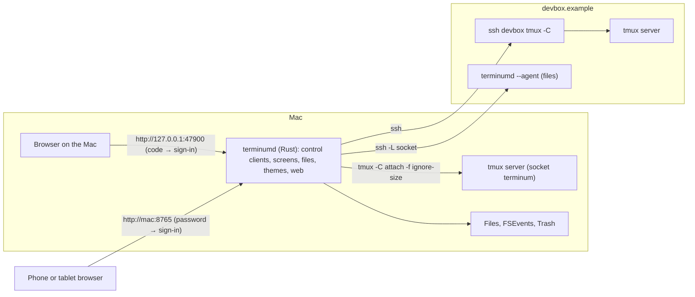
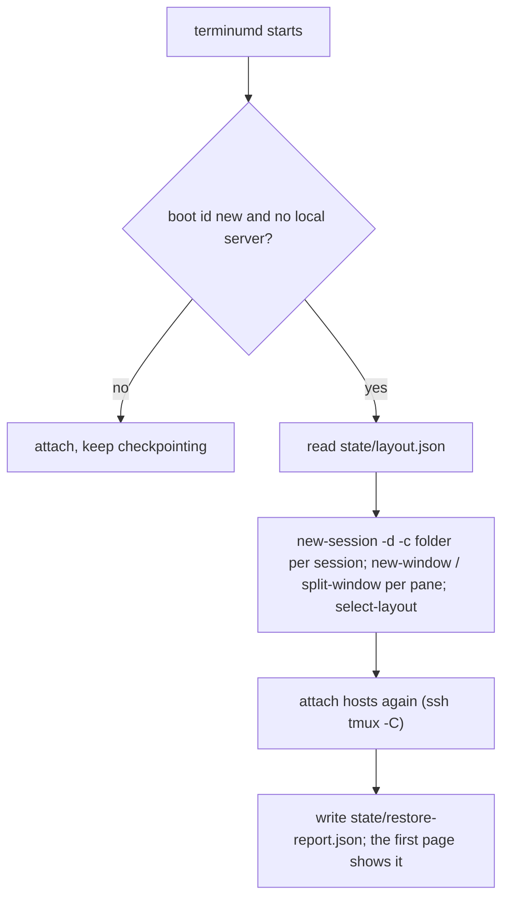

# terminum — Specification (core)

## 0. Metadata

| Field | Value |
|---|---|
| Version | 0.7.1 |
| Date | 2026-10-16 |
| Status | draft |
| Author | Claude (Fable 5.1) for the owner |

Change log:

| Version | Date | Change |
|---|---|---|
| 0.7.1 | 2026-10-16 | AC-01: a row's window number names its host on hover ("This machine" here). Dialogs, forms and search speak at the terminal's size; a touch screen's fields keep 16 px (iOS zooms in below). |
| 0.7.0 | 2026-10-15 | Owner: the server is named terminumd, after the app (was terminusd): launchd agent `io.terminum.terminumd`; starting or stopping it unloads `io.terminum.terminusd` and removes its plist first (it holds the port); a rollback to a build of the old name is refused. |
| 0.6.0 | 2026-10-15 | Owner: a group's copy button gives the command that attaches another terminal (AC-01); dialogs, forms and search use the terminal's font; the shipped remote theme stays violet while the system is light. |
| 0.5.1 | 2026-10-15 | AC-13: a size held back by the once-a-second limit is dropped for a later one. |
| 0.5.0 | 2026-10-15 | No Python for users: the `terminum` command is terminumd itself (`~/.terminum/bin/terminum` links the newest build's terminumd; the name it is run by selects the command), the package ships no `.py` and no launcher, `install.sh` runs the package's terminumd for this Mac's architecture (`sysctl hw.optional.arm64`, Rosetta-proof) with `install`. launchd socket activation: launchd holds `127.0.0.1:<port>` from the moment the agent is loaded (plist `Sockets`), so no other program can bind it while terminumd is down, restarting or being upgraded; upgrades and rollbacks restart with `launchctl kickstart -k`; a port another program held at bootstrap is reported ("free it, then run `terminum restart`"); new `terminum restart`. The residual risk of a squatter's page narrowed to the time before the agent is loaded and to the web listener. No release or install of the Python-era command exists, so no compatibility path for it is kept. |
| 0.4.0 | 2026-10-15 | Implementation: assumptions measured on tmux 3.6a (AS-02, AS-03, AS-06, AS-09, AS-11 verified); corrected commands (`-f ignore-size` is a flag of `attach-session`/`new-session`, not of `tmux`; every tmux command a line of its own, as `a ; b` answers with several blocks and a failure stops the rest; the bulk client takes `no-output`); `window-size latest` globally and `manual` per window while a page sizes it (OQ-01, AC-13); the hello proof keyed by a proof key derived from the sign-in, named by an id (`/api/hello?n=&id=`, 404 `unknown_signin`); the Files API under `/fb/api/*`; history numbering across tmux's trims at its limit (it drops the oldest tenth at once); the residual risk of a page loaded from a port squatter corrected; a frame carries `mouse`; the server's pid ends a shown pane after a kill-server; `sized`, `update`, `updatechoice` messages; group ids `<server>/<session>`. |
| 0.3.0 | 2026-10-15 | Owner's decisions: the server is `terminumd` (not `termd`, taken by other projects); OQ-01: a private tmux server (`-L terminum`, its own config file, started by terminumd); OQ-03: the client that typed last sizes the pane; OQ-04: no App, the clients are a Mac browser on a wide screen and Safari on an iPhone (AC-11 dropped, acceptance on those two); OQ 81: one session `terminum` per host, made from the ssh string alone. |
| 0.2.0 | 2026-10-15 | Pragmatic review applied: sizing in stage 1 (AC-13 P0); Screen mode zooms a pane of a split window; a resize re-wraps tmux's history (AS-09, OQ-05 resolved: reset when rows cannot be matched, marks found by text); `history-limit` 12,000 on the user's server too; one control client per session plus a bulk client per server (OQ-02); capture at once after idle, then throttle; the system's memory (terminumd + tmux + WebKit) budgeted, not terminumd alone; `#` doubled in every format-expanded tmux argument (probed: `-c`, `-n`, `rename-window`, `select-pane -T` run `#(…)`); paste through `load-buffer` from a 0600 file; the local sign-in kept by the page per origin and sent as a header, not a cookie (a cookie on 127.0.0.1 reaches every local port); the proof against a port squatter kept; a table of what each listener allows; the page's real protocol (`/ws`, `/fb/`, message renames); 100 pages, as iterm-enhancer's 100 windows; the parity map moved to `parity-map.md`. Rejected: keeping the cookie as accepted risk (the owner runs many local servers). |
| 0.1.0 | 2026-10-15 | Initial draft: the successor of iterm-enhancer with tmux as the terminal emulator and the browser or a WebKit window as the only client. Feature parity with iterm-enhancer 0.42 is split over four specs: this core, `terminum-terminal.md` (AC 31…), `terminum-files.md` (AC 51…), `terminum-remote.md` (AC 81…). Section 2 maps every iterm-enhancer case to its successor or says why it is dropped. |

## 1. Overview

**Problem.** iterm-enhancer mirrors iTerm2: the terminal's size belongs to an iTerm2 window the user may not even look at, so the web page re-flows and scales text that was laid out for someone else's width; every screen travels iTerm2 → its Python API → a Python bridge → the browser, four hops with one request in flight at a time; sessions die with iTerm2, so a third of the bridge rebuilds windows after a quit; full-screen programs (vim, mc, htop) are a jumble on a phone because their grid is iTerm2's. The Files panel, the terminal features for coding agents, bookmarks, search and widgets are good and stay.

**Who it affects.** Developers on macOS who run shells, tmux sessions, ssh sessions and coding agents, locally and on remote hosts, and read them on a Mac, an iPad or a phone.

**Expected outcome.** Terminals live in tmux. One Rust server, `terminumd`, is tmux's control client for a private local server and for each remote host over ssh, and serves one page to a browser: Safari or Chrome on the Mac, Safari on an iPhone. The pane's size follows the view that shows it, so text is laid out for the screen it is read on. Screens are tmux's own grid: terminumd never emulates a terminal. Sessions outlive terminumd, the page and the window. The page, its looks, colors and fonts are those of iterm-enhancer's web app; the Files panel is iterm-enhancer's panel. Full-screen programs get a mode of their own. Everything is configurable from files in `~/.terminum/`.

**Scenario, before and after.**
- Before: Alex opens the web app on a phone. Claude Code runs in an iTerm2 pane 151 columns wide on the Mac. Prose re-flows well; `mc` in another pane is scaled to a stamp. A key takes 80 ms to echo through iTerm2's API. After a reboot, Alex rebuilds windows from the recovery dialog.
- After: Alex opens the same page. The pane Alex reads on the phone is 48 columns wide, laid out by Claude Code itself for that width; the Mac's window of the same pane is wide again when Alex types there. `mc` fills the phone's screen as a 48×30 grid in Screen mode, arrows and F-keys work, a tap is a click. A key echoes in 25 ms. After a reboot, the sessions are back with their folders before Alex opens the page.

## 2. Scope and non-goals

In scope:
- `terminumd`: the tmux control client (local server, remote hosts over ssh), screens, history, typing, session management, the Files backend of iterm-enhancer, themes, web access, the embedded page and panel.
- The page (iterm-enhancer's web app, unchanged in looks and behavior where it does not name iTerm2) and the Files panel (iterm-enhancer's panel).
- One-line install, launchd, upgrades, rollback, signed releases, the CLI.

Out of scope (explicit):
- Terminal emulation of our own (no VT parser in terminumd or the page): tmux is the emulator. Inline images (iTerm2's OSC 1337, sixel) are not shown in the terminal, as tmux does not keep them (images named in the output open as widgets, `terminum-terminal.md`).
- A native terminal renderer (Metal, ligatures): the page draws text with web fonts; WebKit is the renderer.
- Shells outside tmux: every local terminal is a tmux pane. A user who wants a shell outside tmux uses another terminal.
- Windows and Linux desktops: terminumd builds for Linux as the remote agent. The page works in any modern browser; acceptance is on a Mac browser and an iPhone (OQ-04).
- Several users or several passwords for web access; HTTPS of our own (use `tailscale serve`).

Every iterm-enhancer case is mapped to its successor, or dropped with a reason, in `docs/specs/parity-map.md` (a case of another spec is written `AC nn`, a space; `AC-nn` is this spec's own).

## 3. Assumptions, dependencies, open questions

Assumptions:

| ID | Assumption | Owner | Status |
|---|---|---|---|
| AS-01 | tmux 3.6a is on the Mac (`/opt/homebrew/bin/tmux`); control mode (`tmux -C`) delivers `%output`, `%layout-change`, `%window-add`, `%window-close`, `%window-renamed`, `%session-changed`, `%sessions-changed`, `%pane-mode-changed`, `%extended-output`, `%pause`, `%continue`, and `%begin`/`%end` blocks for commands in order. | Claude | verified (man tmux 3.6a) |
| AS-02 | A control client attached with `-f ignore-size` does not take part in window sizing, so `window-size manual` plus `resize-window -x -y` sets a window's size exactly, also while another client (iTerm2 -CC, a plain `tmux -L terminum attach`) is attached. | Claude | verified 2026-10-15 (tmux 3.6a): a window resized with per-window `window-size manual` keeps that size with `attach-session -f ignore-size` control clients attached; `scripts/e2e_core.py` |
| AS-03 | `capture-pane -p -e -J -t %N -S a -E b` returns the pane's rows with SGR sequences and joins rows tmux wrapped, so hard line ends are where `-J` left a line break; a joined line is cut back into rows at `#{pane_width}` cells (wide characters two cells). | Claude | verified 2026-10-15: `-J` joins wrapped rows within the range (never past `-E`); a wide character that would straddle the edge goes to the next row; SGR state runs across the lines of one capture; `-e` also emits OSC 8 links, which are skipped (`screen/rows_tests.rs`, a real tmux fixture) |
| AS-04 | `#{history_size}` is the number of lines above the screen until `history-limit` is reached; after that tmux drops the oldest lines silently. terminumd's own config sets `history-limit 12000` for every pane of its server (OQ-01). | Claude | verified (man tmux) |
| AS-05 | `send-keys -l` delivers text as typed (no key names), key names (`Up`, `C-c`, `F5`, `S-Tab`) are encoded by tmux for the pane's mode (application cursor keys included), and `send-keys -H` sends hex bytes, so a mouse report (`ESC [ < 0;10;5 M`) reaches a program that asked for mouse events. | Claude | verified for `-l` and names in iterm-enhancer 0.38; `-H` unverified |
| AS-06 | `%output` carries the pane's raw output as octal-escaped text and arrives for every pane of the sessions the control client is attached to; a `%output` is only a signal to capture, never parsed for content. | Claude | verified 2026-10-15: `%output` arrives for panes of every window of the attached session, not of other sessions |
| AS-07 | The clients are Safari or Chrome on the Mac (a window 1400 px and wider) and Safari on an iPhone; the inherited page's e2e checks run in Chromium and WebKit at both sizes. | Owner | stated 2026-10-15 |
| AS-08 | One user, one Mac, local SSD. The owner keeps about 60 panes in 2 tmux sessions and 1–3 pages open. | Owner | stated |
| AS-09 | `resize-window` re-wraps the pane's history, so `#{history_size}` changes with the width; a resize is a history reset for the page unless the rows match (OQ-05). | Claude | verified 2026-10-15; also: at its limit tmux drops the oldest tenth before adding a row, so `history_size` falls by limit/10 while rows still scroll off (`screen/history.rs` models it) |
| AS-10 | With `extended-keys on` and `extended-keys-format csi-u` (tmux 3.4+), `send-keys S-Enter` reaches a program that asked for extended keys as `ESC[13;2u` and a plain shell as a plain Enter, so terminumd never sends raw bytes for them. | Claude | verified on tmux 3.6a: Claude Code 2.1 makes a new line, zsh runs the line (bytes by `-H` would leave `3;2u` in zsh's line); `keys_tests.rs` `shift_enter_is_csi_u_only_for_programs_that_ask`; with `extended-keys off` (tmux's default, so a host's) S-Enter arrives as Enter even to a program that asked, hence the bytes there |
| AS-11 | Arguments tmux expands as formats (`-c` and `-n` of `new-window`, `new-session`, `split-window`; `rename-window`; `select-pane -T`) run `#(…)` and substitute `#{…}`; `##` escapes; `send-keys -l` expands nothing. | Claude | verified 2026-10-15 on a private server (tmux 3.6a) |

Dependencies:

| ID | Dependency | Owner | Status |
|---|---|---|---|
| DEP-01 | Rust stable; crates: axum 0.8 (ws), tokio 1, notify 8, rust-embed 8, trash 5, serde_json 1, unicode-width 0.2 (cells of wide characters), vte 0.13 or a 120-line SGR parser of our own (the spike decides: only `CSI … m` is parsed). | Claude | available |
| DEP-02 | tmux ≥ 3.2 on PATH on the Mac and on every remote host (`ignore-size`, `window-size manual`, `send-keys -H`); verified 3.6a locally. | Owner | available |
| DEP-03 | Node 26 + npm 11 at build time only: esbuild, CodeMirror 6, markdown-it 14, mermaid 11 (inherited `ui/package.json`). | Claude | available |
| DEP-04 | macOS 14+; crates objc2 0.6, objc2-app-kit, objc2-web-kit (MIT/Apache-2.0) for the App; no Tauri, no wry. | Claude | dropped with AC-11 |
| DEP-05 | The inherited page `web/static/` (6.9 k lines) and panel `ui/` (3.6 k lines) from iterm-enhancer 0.42, copied into this repository. | Claude | available |

Open questions:

| ID | Question | Owner | Status | Decision |
|---|---|---|---|---|
| OQ-01 | Which tmux server holds local terminals: the user's default server (sessions shared with any `tmux attach`) or a private `-L terminum` server? | Owner | resolved | A private server: socket `terminum`, started by terminumd with its own config `~/.terminum/tmux.conf` (history-limit 12000, window-size latest (terminumd sets `manual` per window while a page sizes it, AC-13), extended-keys on, focus-events on, escape-time 0; the user may edit it), so the user's sessions and `~/.tmux.conf` are never touched and every pane has terminumd's options; `tmux -L terminum attach` from any terminal still works. Owner, 2026-10-15. |
| OQ-02 | How many control clients: one per server, or one per session? | Claude | resolved | One per session for notices and typing (safe whatever AS-06 says), plus one bulk client per server for history pages, search, `list-panes` and layout reads, so a bulk read never queues ahead of an echo. 2026-10-15 |
| OQ-03 | When two clients of different widths show one pane (a phone and the Mac's browser), whose width wins? | Owner | resolved | The client that typed last, as tmux's `window-size latest`; a client that only reads keeps Wrap or Fit (AC-13). Owner, 2026-10-15. |
| OQ-04 | Does the App replace the browser for daily use on the Mac, or is a browser tab pinned to the Dock enough? | Owner | resolved | No App: the clients to build and test for are a browser on the Mac (wide screen, 1400 px and more) and Safari on an iPhone (mobile). AC-11 dropped. Owner, 2026-10-15. |
| OQ-06 | Should the page ship JetBrains Mono Nerd Font as woff2 (OFL, about 100 KB a weight) so the phone shows the Mac's font, or keep `local()` with Menlo as the fallback? | Owner | open | Proposed: ship it, loaded only when `local()` is missing. |
| OQ-05 | Absolute line numbers after `history-limit` is reached (AS-04) or a resize re-wrapped the history (AS-09): keep counting by matching rows, or reset the page's history as a cleared scrollback does today? | Claude | resolved | Stage 1: reset when the previous frame's rows cannot be matched; bookmarks and search marks are found again by their text, as today. Counting across a match is stage 2. 2026-10-15 |

## 4. Acceptance cases

| ID | Priority | Case |
|---|---|---|
| AC-01 | [MUST / P0] | The user sees every tmux session, window and pane of the local server (and of attached hosts) in the session list within 2 s of a change, grouped by session, with the titles, program, folder and host iterm-enhancer shows, and can filter them. |
| AC-02 | [MUST / P0] | The user opens a pane and sees tmux's screen in the session's theme within 1 s with the last 1000 lines of history, loads older lines up to 10,000, and sees output as it arrives, at most 30 frames a second, each frame only the rows that changed. |
| AC-03 | [MUST / P0] | The user types, pastes and presses hot keys and the bytes reach the pane as a terminal would send them: a key echoes within 100 ms on the Mac's network, held keys repeat, special keys go by tmux's names so a full-screen program gets its own encoding. |
| AC-04 | [SHOULD / P1] | The user reads a pane in Wrap (lines re-flow to the view), Grid (tmux's exact layout) or Fit (the grid scaled to the width), remembered per pane. |
| AC-05 | [SHOULD / P1] | When a pane runs a full-screen program (vim, mc, htop, a plain tmux inside) the view switches to Screen mode: the pane is resized to the view's grid, the grid is drawn as it is, arrows and F-keys reach the program, and the mode ends with the program. |
| AC-06 | [SHOULD / P1] | In Screen mode a click, a tap, a drag and the wheel reach a program that asked for mouse events as the mouse events a terminal would report. |
| AC-07 | [MUST / P0] | The user creates a window, a session or a split next to the shown pane in its folder, renames a window or pane, reorders windows, moves a window to another session and closes a pane after a confirmation, and the list shows it within 2 s. |
| AC-08 | [MUST / P0] | The user installs with one line, terminumd runs as a launchd agent that starts at login and after a crash, the command prints the page's address and opens it, and `terminum status` tells what runs. |
| AC-09 | [MUST / P0] | A web page or local process cannot list sessions, read screens, type or touch files through terminumd without the sign-in: a one-time code opens a local page, a password opens a network page; writes need the exact Host, Origin and Content-Type. |
| AC-10 | [SHOULD / P1] | With web access switched on, a browser on another device signs in with a password and gets the same page; wrong passwords are braked; switching it off signs every browser out. |
| AC-11 | [SHOULD / P1] | On the Mac the user opens terminum as an app: a WebKit window per ⌘N showing the page, with ⌘W closing the window (never a pane), ⌘+/⌘− for text size, full screen, the Dock icon, and windows remembered across launches. [DROPPED — the owner wants no app: a Mac browser and an iPhone browser are the clients, 2026-10-15] |
| AC-12 | [SHOULD / P1] | The user sees each session in a theme (colors, ANSI palette, font) chosen by rules per host and session from theme files, with light and dark variants following the system, changed live when a file changes; the defaults are iterm-enhancer's looks for local and remote sessions. |
| AC-13 | [MUST / P0] | The pane's size follows the client that shows it: a wide window gets a wide pane and a phone a narrow one, by a policy the user controls; "Fit to this screen" resizes the pane to the view, and a tmux client attached by hand keeps working. |
| AC-14 | [MUST / P0] | After terminumd crashes, restarts or is upgraded, every page reconnects by itself and shows the same pane, no terminal is lost, and a tmux server that is gone is said so; nothing runs that depends on a GUI being open. |
| AC-15 | [SHOULD / P1] | After a reboot the sessions, windows, splits and their folders are back before the user opens a page, remote hosts attach again, and the user is told which panes ran programs that have to be started by hand. |
| AC-16 | [SHOULD / P1] | The user upgrades, rolls back and uninstalls with one command each; a new build is checked before it goes live, open pages reload themselves keeping unsaved edits, and state written by either build stays readable by both. |
| AC-17 | [SHOULD / P1] | The user learns from the page that a newer release exists and can copy the command that installs it, skip that release, or stop the check. |
| AC-18 | [SHOULD / P1] | On a touch screen or a narrow window the hot keys panel, the keyboard button and the floating buttons work as in iterm-enhancer, and the panel's layout comes from a file the user can change. |
| AC-19 | [SHOULD / P1] | The user customizes the page with a stylesheet of their own (`custom.css`) and settings in `settings.json`, with the page reloading when they change and refusing nothing silently. |
| AC-20 | [SHOULD / P1] | terminumd stays within its budgets: under 60 MB with 60 panes and two pages, under 0.5 % CPU idle, a key echoed in 25 ms median on the Mac, a frame encoded in 3 ms; the page under 150 MB with 10,000 lines. |

## 5. BDD scenarios

### AC-01 — The session list is the tmux server [MUST / P0]

```gherkin
Scenario: AC-01 happy path — sessions, windows and panes
  Given the local tmux server has sessions "main" (windows 1 "api" in ~/work/api, 2 "docs") and "notes"
  And window 1 is split into panes %3 (running claude) and %4 (zsh)
  When the page opens
  Then the list shows group "main" with rows "1 api · claude · ~/work/api" and, under it shifted in, "%4" as "zsh · ~/work/api", then "2 docs"
  And group "notes" below it, each group with its count and a [+]
  And a row's window number names, on hover, the host the window runs on: "This machine" here, the host's name on a host
  And each group has a copy button (its title the command) that copies how another terminal attaches to that session: "tmux -L terminum attach -t =main" (a host's group: its session's name "terminum" beside the host's, and "ssh -t <recipe> -- <destination> 'tmux attach -t =terminum'")
  And a window the user named (automatic-rename off) shows that name; one tmux names after its program shows the pane's title, else its program; status marks of coding agents (✳ ✻ ✶ ◐ ⏺) are stripped
Scenario: AC-01 happy path — the list follows tmux
  Given the page is open
  When the user runs "tmux new-window -n build" in any terminal
  Then within 2 s the list shows "3 build" in "main" (the %window-add notice, then list-panes)
  When the user runs "tmux kill-window -t build"
  Then within 2 s the row is gone and the page, if it showed that pane, says "This pane has closed. Pick another one."
Scenario: AC-01 happy path — filter and ⌘K
  When the user types "doc" in the filter (or presses "/" or ⌘K and types)
  Then only rows whose title, folder, host or program contains "doc" stay, flat, and Enter opens the first
Scenario: AC-01 edge — a remote host's session
  Given host "devbox" is attached (AC 81)
  Then its group reads "devbox" in cornflower blue (its session on the host is always "terminum"), every row names the host in violet, and its folders are the host's
Scenario: AC-01 edge — the first start
  Given no tmux server on the "terminum" socket
  When terminumd starts
  Then it starts the server with ~/.terminum/tmux.conf and a session "main" (a shell in ~), and the page shows it; the user's default tmux server and its sessions are never touched
Scenario: AC-01 failure — tmux is missing
  Given tmux is not on PATH
  Then the list shows "tmux is needed for terminals: brew install tmux" and nothing else; terminumd looks again every 10 s
```

### AC-02 — The screen is tmux's screen [MUST / P0]

```gherkin
Scenario: AC-02 happy path — open a pane
  Given pane %3 is 150×50 with 4,200 lines of history
  When the user opens it
  Then within 1 s the page shows the theme, the last 1000 history lines and the screen (50 rows) with the cursor, in the session's theme
  And scrolling up loads older lines 1000 at a time, up to 10,000 (TM_HISTORY)
  And every line is tmux's: rows tmux wrapped join in Wrap, a hard line end stays one (AS-03)
Scenario: AC-02 happy path — output streams
  When the pane prints 5,000 lines in 2 s
  Then terminumd captures the screen on its %output notices at most every 33 ms and sends only the rows that changed ("full": false, "ch": [[row, line]…]); lines that scrolled off the screen are appended to the history ("hist", "append") with their absolute numbers
  And the page draws each frame in under 16 ms and follows the output while the view is at its end
Scenario: AC-02 edge — the scrollback is cleared
  When the user runs "clear && tmux clear-history" (or Claude Code's /clear)
  Then #{history_size} drops, terminumd sends "hist" "reset" and a full screen, and the page's history starts anew (folds and line numbers with it)
Scenario: AC-02 edge — the screen does not change
  Given a pane prints the same spinner frame twice
  Then the second capture equals the last frame sent and nothing is sent; a pane nobody shows is never captured
Scenario: AC-02 failure — the capture fails
  When "capture-pane" answers %error (the pane closed meanwhile)
  Then the page shows "This pane has closed. Pick another one." for that pane only, and the log names the command and the error
```

### AC-03 — Typing [MUST / P0]

```gherkin
Scenario: AC-03 happy path — text and keys
  When the user types "ls -la", presses Enter, then ↑, Tab, ⌃C
  Then terminumd sends "send-keys -t %3 -l 'ls -la'" then "send-keys -t %3 Enter Up Tab C-c" (keys by tmux's names, text literal), in order, one command per run
  And the echo of each key shows within 100 ms on the Mac's network (AC-20 for the budget)
Scenario: AC-03 happy path — keys that arrive while one is on its way go together
  When the user holds → for a second
  Then the keys go as one "send-keys … Right Right Right…" per round trip, in order, at the keyboard's repeat rate, never one round trip a key
Scenario: AC-03 happy path — paste
  When the user pastes 20 KB of text
  Then terminumd loads it into a tmux buffer ("set-buffer -b tm-<n>" from the control channel, 64 KB a command, more in parts) and pastes it with "paste-buffer -p -d -b tm-<n> -t %3", so a program that asked for bracketed paste gets its markers (the menu's "Bracketed paste" switch turns -p off)
  And a paste holding control characters other than newline and tab is refused with "The text holds control characters and was not sent"
Scenario Outline: AC-03 happy path — special keys by name
  When the user presses "<key>"
  Then terminumd sends "send-keys -t %3 <name>" and tmux encodes it for the pane's mode (application cursor keys in vim and mc)
  Examples:
    | key           | name   |
    | ↑             | Up     |
    | ⇧Tab          | BTab   |
    | F5            | F5     |
    | ⌃→            | C-Right|
    | Home          | Home   |
    | Delete (fwd)  | DC     |
Scenario: AC-03 edge — Shift+Enter and Ctrl+Enter
  When the user presses ⇧↩ or ⌃↩ (a key or the hot key)
  Then terminumd sends "send-keys S-Enter" or "C-Enter": a program that asked for extended keys (Claude Code) gets ESC[13;2u or ESC[13;5u and makes a new line, a shell gets Enter (AS-10)
  But on a server whose "extended-keys" is off (a host's own tmux by default; asked once per connection with "show-options -sv extended-keys") tmux would send Enter, so there the keys go as those bytes ("send-keys -H"), as iTerm2 sends them with CSI u on: Claude Code makes a new line, a shell shows them as text
Scenario: AC-03 edge — a held delete
  When the user holds Backspace in a shell at its prompt or in a coding agent's input box
  Then a character goes at a time, and after 1.5 s a word (C-w) at a time, at most one every 90 ms; in other programs characters only (the pane's program comes with the list, AC-01)
Scenario: AC-03 failure — the pane is gone or the server stalls
  When "send-keys" answers %error, or the control client has not answered for 3 s
  Then the keys are dropped, not queued forever; the page shows "tmux did not take the keys: <error>" over the terminal; a line "tmux on this Mac is not responding (N s)" counts while a server stalls and goes when it answers
```

### AC-04 — Wrap, Grid and Fit [SHOULD / P1]

```gherkin
Scenario: AC-04 happy path — the three modes
  Given a pane 150 columns wide shown on a phone 48 columns wide
  When the user picks Wrap
  Then lines re-flow to the view as iterm-enhancer's web app does: prose wrapped at the pane's width re-joins, a word broken at the edge joins without a space, list items and agent marks start lines, separator lines span the view
  When the user picks Grid
  Then the page shows 150 columns as they are, scrolling sideways
  When the user picks Fit
  Then the grid is scaled to the view's width (text at least 4 px)
  And the choice is remembered per pane (the last 100) and the last choice is the default for new panes; Wrap before any choice
Scenario: AC-04 edge — Wrap and a pane resized to the view
  Given the pane was resized to this view's width (AC-13)
  Then Wrap and Grid show the same rows: nothing re-flows, and the mode buttons still say Wrap
Scenario: AC-04 error — the mode cannot apply
  Given the pane shows its alternate screen (AC-05)
  Then Wrap shows it as Screen mode and the Wrap button's title names the exception
```

### AC-05 — Screen mode for full-screen programs [SHOULD / P1]

```gherkin
Scenario: AC-05 happy path — mc on a phone
  Given pane %5 (zsh) is shown on a phone whose view holds 48×30 cells at the chosen text size
  When the user runs "mc"
  Then tmux reports #{alternate_on} 1 with the next frame, the page switches to Screen mode within one frame: it asks terminumd to size the pane to 48×30 ("resize-window -t @2 -x 48 -y 30" for a window of one pane; in a split window the pane is zoomed, "resize-pane -Z", so it gets the whole window, and unzoomed when Screen mode ends; AC-13), draws the grid exactly (no re-flow, no scaling, no history, no widgets), hides the Lines buttons and shows "Screen · mc" in the header
  And mc draws itself for 48×30: both panels fit, the menu bar and function key bar are whole
  When the user presses F10 (the hot keys' Fn row), Esc, arrows, Enter, ⌃O
  Then they reach mc as tmux's key names (AC-03) and mc acts on them
Scenario: AC-05 happy path — the program ends
  When mc exits
  Then #{alternate_on} is 0, the pane is resized back to its previous size (or left as the policy says, AC-13), the page returns to the Lines mode it had, and the screen shows the shell with its history
Scenario: AC-05 edge — programs that do not use the alternate screen
  Given a pane runs less, man, nano or Claude Code (no alternate screen)
  Then the view stays in Wrap, Grid or Fit, as today; the user can force Screen mode for that pane from the menu ("Screen mode: auto / always / never", remembered per pane)
Scenario: AC-05 edge — the view changes size
  Given Screen mode is on
  When the phone rotates or the keyboard opens
  Then the pane is resized to the new grid within 300 ms (debounced) and the program redraws; a grid under 20×5 is refused: the view keeps the last size and says "Too small for Screen mode"
Scenario: AC-05 edge — two clients show the pane
  Given the Mac's browser shows %5 at 180×50 and the iPhone opens it
  Then the policy of AC-13 decides the size; the client whose size lost shows the grid as Fit (scaled) and says "Sized for another screen (180×50)" until it types
Scenario: AC-05 failure — the resize is refused
  When "resize-window" answers %error ("size too small", a window the user set manual with a lock)
  Then the page stays in Screen mode at the pane's own size, scaled as Fit, and the header says why
```

### AC-06 — Mouse and touch in Screen mode [SHOULD / P1]

```gherkin
Scenario: AC-06 happy path — click, drag, wheel
  Given mc runs and asked for mouse events (#{mouse_any_flag} 1)
  When the user clicks cell (10, 5), drags from (10, 5) to (30, 5), or scrolls the wheel
  Then terminumd sends the SGR mouse reports a terminal would ("send-keys -H" of ESC [ < 0;11;6 M, motion and release, buttons 64/65 for the wheel), with the pane's cell coordinates (1-based)
  And mc selects the file, drags the selection, scrolls the panel
Scenario: AC-06 happy path — touch
  When the user taps a cell, or swipes up or down in the grid
  Then a tap is a click at that cell, a swipe is wheel events, a two-finger tap is a right click; a long press selects text as in the terminal (no event sent)
Scenario: AC-06 edge — the program did not ask for the mouse
  Given a program with #{mouse_any_flag} 0 (vim without "set mouse=a")
  Then clicks move no cursor and send nothing; a tap opens the keyboard as in the terminal; the wheel scrolls nothing (Screen mode has no history)
Scenario: AC-06 failure — the report cannot be sent
  When "send-keys -H" answers %error
  Then the event is dropped and the status line says "Mouse event not sent: <error>" once a second at most
```

### AC-07 — Manage sessions [MUST / P0]

```gherkin
Scenario: AC-07 happy path — new window, new session, split
  Given the page shows pane %3 of window "api" in session "main", folder /Users/alex/work/api
  When the user presses the group's [+] ("New window")
  Then terminumd runs "new-window -a -t main:api -c '/Users/alex/work/api'" and the page shows the new pane within 2 s, placed right after "api"
  When the user picks "Split right" (or "Split below") from the pane's menu
  Then terminumd runs "split-window -h -t %3 -c '/Users/alex/work/api'" and the page shows the new pane; the list shows it under the window's first pane
  When the user presses "New session" at the list's foot and types "scratch"
  Then terminumd runs "new-session -d -s scratch -c ~" and the page shows its pane; a name tmux refuses (empty, with ":" or ".") is refused inline with tmux's message
Scenario: AC-07 happy path — rename and reorder
  When the user presses the pencil beside the title, types "deploy" and presses Enter
  Then terminumd runs "rename-window -t @2 'deploy'" and "select-pane -t %3 -T 'deploy'", and the list, the header and tmux's own status line show it within 2 s; an empty name restores "automatic-rename on"
  When the user drags a window's row by its grip above another in its group
  Then terminumd runs "move-window -s main:3 -t main:1" (and renumbers) and the list shows the new order within 2 s; rows of another session are never moved by a drag
Scenario: AC-07 happy path — move a window to another session
  When the user picks "Move to session…" on a window and chooses "notes"
  Then terminumd runs "move-window -s main:3 -t notes:" and the window appears under "notes"; tmux keeps its panes running
Scenario: AC-07 happy path — close a pane
  When the user picks "Close pane" (or presses the hot key ⌃D in a shell, which needs no dialog)
  Then the page asks "Close this pane? The program running in it (claude) ends." with "Close" and "Cancel"
  When the user confirms
  Then terminumd runs "kill-pane -t %3", the list drops it within 2 s, and the page shows the next pane of the same window, else the list
Scenario: AC-07 edge — names and folders on tmux's command line
  Given a folder name holds a quote, "#(…)", "$" or a newline
  Then quoted names reach tmux as single arguments and run nothing; a name with a control character is not put on the command line: the window opens in the home folder with a note "folder name not usable: opened in ~"
Scenario: AC-07 failure — tmux refuses
  When a command answers %error ("no such window", "session exists")
  Then the status line shows the message in words and nothing else changes; at most one new window, session or split a second per client, a second press within it says so
```

### AC-08 — Install and run [MUST / P0]

```gherkin
Scenario: AC-08 happy path — one line
  When the user runs "curl -fsSL https://github.com/extractumio/terminum/releases/latest/download/install.sh | sh"
  Then it downloads the latest package and SHA256SUMS, checks the signature and the checksum, installs under "~/.terminum/builds/<build>/" with "current" linking to it and "~/.terminum/bin/terminum"
  And the installer is the package's own terminumd for this Mac's architecture ("sysctl -n hw.optional.arm64", right under Rosetta too) run as "terminumd install"; nothing needs Python, a compiler, npm or make
  And it writes "~/Library/LaunchAgents/io.terminum.terminumd.plist" (RunAtLoad, KeepAlive, log to ~/.terminum/logs/terminumd.log, ProgramArguments [".../builds/current/terminumd", "serve"], Sockets "Listeners" on 127.0.0.1:<port>) and loads it, so terminumd runs now and at every login
  And "~/.terminum/bin/terminum" links the newest installed build's terminumd, which acts as the command when run by that name
  And it prints "Installed <build>. Open http://127.0.0.1:47900/open/<code> (valid 60 s) — or run: terminum open" and opens that link in the default browser
Scenario: AC-08 happy path — launchd holds the port
  Given the agent is loaded
  Then launchd listens on 127.0.0.1:47900 and hands the socket to terminumd ("launch_activate_socket"); while terminumd is killed, crashes, is restarted or upgraded, connections wait in launchd's queue and another program's bind of 127.0.0.1:47900 fails with "address in use", SO_REUSEPORT or not
Scenario: AC-08 happy path — tmux missing
  Given tmux is not on PATH
  Then the install goes through and prints "tmux is needed for terminals: brew install tmux", and the page says the same until tmux appears (checked every 10 s)
Scenario: AC-08 happy path — status
  When the user runs "terminum status"
  Then it prints the running build, terminumd's pid and uptime, the port, "web access: off" (or its addresses), the tmux servers and sessions attached, the hosts and their state, and the pages connected
  And when settings.json names another port than the one launchd holds, it says "port: settings.json says <a>, launchd holds <b>: run terminum restart"
Scenario: AC-08 edge — another program held the port when launchd loaded the agent
  Given another program listened on 127.0.0.1:47900 when the agent was bootstrapped (launchd then hands an unbound socket and never tries again)
  Then terminumd logs and prints "port 47900 was held by another program when launchd loaded terminum: free it, then run `terminum restart`" once and waits (exiting would only have launchd start it again on the same unbound socket), and "terminum status" says so
  When the user frees the port and runs "terminum restart"
  Then the agent is booted out and bootstrapped again, launchd holds the port, and terminumd answers within 10 s
Scenario: AC-08 edge — the port is in use (terminumd not run by launchd, TM_NO_LAUNCHD=1)
  Given another program listens on 127.0.0.1:47900
  Then terminumd exits with "port 47900 is in use (set `port` in ~/.terminum/settings.json)" in its log after 9 s, and "terminum status" says so
Scenario: AC-08 failure — bad download or wrong user
  When the checksum or signature does not match, or the line runs as root
  Then nothing is installed and the line exits non-zero with the reason
Scenario: AC-08 failure — launchd could not bind the port at a bootstrap (install, restart, import)
  Given the agent was just bootstrapped and terminumd logged "port 47900 was held by another program when launchd loaded terminum: …"
  Then the command exits non-zero with that message at once (the user frees the port, then runs "terminum restart"); launchd binds through a closing connection's TIME_WAIT (measured), so only another program's listener leads here
```

### AC-09 — Only the page can use terminumd [MUST / P0]

```gherkin
Scenario: AC-09 happy path — a local page signs in with a code
  When the user runs "terminum open"
  Then terminumd makes a one-time code (128 random bits, valid 60 s, spent on first use) and the browser opens "http://127.0.0.1:47900/open/<code>"
  Then terminumd answers the page with a 256-bit sign-in (kept as its SHA-256 in state/local-sessions.json, 0600, 30 days), which the page keeps in its own origin's storage (127.0.0.1:47900: a cookie on 127.0.0.1 would reach every local port) and sends as the header "X-TM-Session" on requests and as the WebSocket's subprotocol; images carry it as "?t=" on the same origin only; the page's address never holds it
Scenario Outline: AC-09 error — requests without a sign-in or from elsewhere are refused
  When a client sends "<request>"
  Then the response is "<status>" with body {"error": "<code>"} and no screen, session or file is read or changed
  Examples:
    | request                                                         | status | code             |
    | GET /ws (no sign-in)                                            | 401    | bad_session      |
    | GET /fb/api/ls?path=/Users/alex, Host: evil.example:47900       | 403    | bad_host         |
    | GET /ws with a sign-in, Origin: http://evil.example             | 403    | bad_origin       |
    | POST /fb/api/fs/mkdir with a sign-in, Content-Type: text/plain  | 415    | bad_content_type |
    | POST /fb/api/os/reveal on the web listener                      | 403    | not_here         |
    | GET /open/<spent or expired code>                               | 410    | code_spent       |
Scenario: AC-09 edge — a spent code, an expired or revoked sign-in
  When the user opens a code link a second time
  Then the page says "This link was used already. Run terminum open for a new one." and retries nothing
  When the page's sign-in has expired (30 days) or was revoked ("terminum signout", a new build with a new secret)
  Then the page says "Signed out: run terminum open" once, stops retrying, and keeps unsaved edits in its editor until the user signs in again
Scenario: AC-09 security — the page proves the server before it sends its secret
  Given another program may hold the port (terminumd down during a load)
  When the page loads or reconnects
  Then it asks "/api/hello?n=<nonce>&id=<the first 16 hex of SHA-256(secret)>" and sends its secret only when the answer is HMAC-SHA256(proof key, "tm-hello-v1:" + nonce), the proof key being HMAC-SHA256(secret, "tm-proof-key") (terminumd keeps it, never the secret); another program cannot answer, so it never sees the secret on a reconnect; an unknown id answers 404 unknown_signin (signed out)
Scenario: AC-09 security — private files and the socket
  Then "~/.terminum" is 0700 and everything terminumd and the installer create in it is 0600 (files) or 0700 (folders); the CLI talks to terminumd through the Unix socket "~/.terminum/state/terminumd.sock" (health, codes, web switches), never with a sign-in over TCP; "/internal/*" over TCP answers 404
Scenario: AC-09 security — the page runs no content
  Then the page's CSP is "default-src 'self'; img-src 'self' data:; style-src 'self' 'unsafe-inline'; script-src 'self'; connect-src 'self'; frame-ancestors 'self'", terminal output reaches only the panel's Markdown rules and Mermaid strict, and a link never navigates the page
```

### AC-10 — Web access [SHOULD / P1]

```gherkin
Scenario: AC-10 happy path — switch on and sign in
  Given the user ran "terminum web password" and typed a password of at least 8 characters twice, then "terminum web on"
  Then web.json (0600) holds a salted PBKDF2-SHA256 hash, terminumd listens on 0.0.0.0:8765 within 2 s and prints its addresses
  When a browser on the network opens "http://<mac>:8765/" and signs in
  Then it gets an HttpOnly, SameSite=Strict cookie for 7 days (30 and Secure behind HTTPS), kept across terminumd restarts as its SHA-256 in web-sessions.json (0600, at most 100), and the same page as on the Mac
  And before sign-in a request carries at most 4 KB, its head arrives within 10 s, at most 64 connections are open
Scenario: AC-10 failure — wrong passwords, other sites
  When a wrong password is sent
  Then passwords are checked one at a time, a wrong one holds the next for 1 s, after 5 from one address that address waits 15 s doubling to 5 min, after 20 from all addresses every address waits; behind "tailscale serve" the address is X-Forwarded-For's last entry, believed only from loopback
  And a request whose Host is not this Mac's name or address (or *.ts.net) is refused; a sign-in, sign-out or WebSocket whose Origin is not the page's own is refused
Scenario: AC-10 edge — off, port in use, broken settings
  When the user runs "terminum web off"
  Then the listener closes within 2 s with every connection and every browser returns to the sign-in; panes sized for those browsers are left as they are
  But when the port is in use, "terminum web on" says so and how to choose another; a web.json that cannot be read keeps web access off and says why
```

### AC-12 — Themes and fonts [SHOULD / P1]

```gherkin
Scenario: AC-12 happy path — defaults
  Given a fresh install
  Then "~/.terminum/themes/local.json" and "remote.json" exist (section 9: local = iterm-enhancer's Default profile, remote = its tmux profile) and settings.json says {"themes": {"default": "local", "hosts": {"*": "remote"}}}
  And a local pane is shown in "local" and a remote host's pane in "remote": the page's chrome mixes the theme's background and foreground as iterm-enhancer's web app does, the terminal uses its ANSI palette, bold color and cursor colors, the font is "JetBrainsMonoNFM-Regular" at 14 (a font WebKit does not have falls back to Menlo)
Scenario: AC-12 happy path — rules and live changes
  When the user writes {"hosts": {"devbox": "work"}, "sessions": {"notes": "paper"}} into settings.json and a "work.json" theme
  Then within 1 s (the folder is watched) panes of devbox wear "work", session "notes" wears "paper", others as before; every page redraws without reload
  When the system switches to light mode
  Then themes with a "light" variant switch (the page is told "dark": false); others stay
Scenario: AC-12 error — a theme that does not parse
  Given "work.json" has a syntax error or a color that is not "#rrggbb"
  Then the page keeps the last good theme, shows "Theme work.json: line 7: expected a color" once as a toast, and terminumd logs it; a rule naming a missing theme uses the default and says so
Scenario: AC-12 edge — the Files panel and the View window
  Then the Files panel and the viewer wear the shown pane's theme (bg, fg, font), as iterm-enhancer's panel did the profile's
```

### AC-13 — Sizing [MUST / P0]

```gherkin
Scenario: AC-13 happy path — a pane follows its client
  Given settings.json has {"size": "latest"} (the default)
  When the Mac's browser opens %3 in a window that holds 180×50 cells
  Then terminumd runs "resize-window -t @2 -x 180 -y 50" (window-size manual) and the program lays itself out for 180 columns
  When the iPhone opens %3 and types
  Then the window is resized to the phone's 48×30; the Mac's view shows the 48-column grid in Wrap (nothing to re-flow) until it types, then the window is 180×50 again; a client that only reads never resizes; a pane is resized at most once a second per client, and a size held back for that second is dropped when a later one comes (a dragged window reaches tmux at its first and its last size: each narrowing re-wraps the pane, and a program that redraws, such as Claude Code, leaves its old top lines in the history)
Scenario Outline: AC-13 happy path — policies
  Given settings.json has {"size": "<policy>"}
  Then "<effect>"
  Examples:
    | policy  | effect                                                                                  |
    | latest  | the client that typed last sizes the pane (default)                                     |
    | largest | the largest client showing the pane sizes it; others read it in Wrap or Fit             |
    | manual  | nothing resizes by itself; the menu's "Fit to this screen" does, until "Restore size"   |
Scenario: AC-13 happy path — Fit to this screen and restore
  When the user picks "Fit to this screen" from the menu
  Then the pane is resized to this view's grid now, the menu item becomes "Restore size", and leaving the pane or the page restores the size it had
Scenario: AC-13 edge — another tmux client is attached
  Given the user ran "tmux -L terminum attach -t main" in Terminal.app, or iTerm2's "tmux -CC -L terminum attach"
  Then terminumd's control client is attached with "-f ignore-size" (AS-02) and "window-size manual" on the windows it sizes: both clients see the size terminumd set; a window no page shows keeps tmux's own policy (latest) for that client
Scenario: AC-13 failure — the resize is refused
  When "resize-window" answers %error
  Then the view shows the grid scaled (Fit) with "Sized for another screen (<cols>×<rows>)" and the log has the error; nothing is retried faster than once a second
```

### AC-14 — Lifecycle [MUST / P0]

```gherkin
Scenario: AC-14 happy path — terminumd crashes or is upgraded
  Given a page shows %3 and vim runs in %5
  When terminumd is killed with SIGKILL
  Then launchd starts it again within 1 s, it attaches to the tmux servers within 1 s, the page reconnects within 3 s (amber dot meanwhile, no "not running" notice under 3 s) and shows %3 with its history again; vim in %5 never noticed
  And unsaved edits in the page's editor are still there
Scenario: AC-14 happy path — every page closes
  When the user closes every browser tab
  Then terminumd and every tmux session keep running; `terminum status` lists them; nothing of terminumd depends on a page being open
Scenario: AC-14 edge — the tmux server stops
  When the user runs "tmux -L terminum kill-server"
  Then within 2 s a shown pane says "This pane has closed", terminumd starts the server again with a session "main" (AC-15 restores the layout when its checkpoint is newer than the kill), and the list shows it
Scenario: AC-14 edge — a long gap
  Given terminumd stays down for 3 s or more
  Then the page shows "terminum's server is not running" and retries every 2 s; typing is refused with "Not connected" and nothing is queued
Scenario: AC-14 failure — a hung control client
  Given a control client has not answered a command for 10 s while the process lives
  Then terminumd logs "control client of <server> timed out", kills and restarts it, and the page shows the stall line meanwhile (AC-03)
```

### AC-15 — Layout survives a reboot [SHOULD / P1]

```gherkin
Scenario: AC-15 happy path — checkpoint and restore
  Given settings.json has {"restore": true} (the default) and sessions "main" (3 windows, one split, folders known) and "notes", host "devbox" attached
  Then terminumd writes "state/layout.json" within 5 s of a change: sessions, windows (name, index, #{window_layout}), panes (folder, the program's kind: shell, ssh <recipe>, other), hosts
  When the Mac reboots and terminumd starts (a new boot id) with no local tmux server
  Then before any page connects it recreates "main" and "notes" with shells at the saved folders (a missing folder opens in ~ with a note), applies each window's layout string ("select-layout"), attaches "devbox" again (its session survived on the host) and writes a report
  And the first page shows "Restored 2 sessions, 4 windows. 1 pane ran ssh devbox: start it again" with the pane's row linked
Scenario: AC-15 edge — nothing to restore, or the user said no
  Given the server runs already (terminumd restarted without a reboot), or {"restore": false}
  Then nothing is recreated; the checkpoint goes on (or stops with "restore": false)
Scenario: AC-15 edge — what is never stored
  Then layout.json holds no output, history, environment, command lines other than an ssh recipe (destination and allowlisted options), or passwords
Scenario: AC-15 failure — a session cannot be made
  When "new-session" fails (tmux missing, a bad name)
  Then the report names it, the other sessions are restored, and "Restore again" in the page's menu retries once
```

### AC-16 — Upgrade, rollback, uninstall [SHOULD / P1]

```gherkin
Scenario: AC-16 happy path — upgrade
  Given build "A" runs
  When the user runs "terminum upgrade" (the latest signed release, or --to vX.Y.Z)
  Then the package is verified (signature, checksum), "builds/B" is unpacked, "B/terminumd --version" prints its id, "previous" → "A", "current" → "B" (one rename each), terminumd is restarted with "launchctl kickstart -k gui/<uid>/io.terminum.terminumd" (launchd keeps the port; the plist is neither rewritten nor loaded again: a changed port or environment takes effect with "terminum restart"; only a failed kickstart loads the agent again), and within 10 s its health (on the socket) reports "build": "B"; then other build folders are pruned
  And "~/.terminum/bin/terminum" links B's terminumd (the newest build's; a rollback never moves it to an older one)
  And every open page learns the build from the WebSocket and reloads itself once; one with unsaved edits or a dialog waits and says "An update is ready: the page reloads after you save"
Scenario: AC-16 happy path — rollback and uninstall
  When the user runs "terminum rollback"
  Then "current" → "A", "previous" → "B", terminumd restarts (kickstart) and reports "A" within 10 s; a state file written by "B" with fields "A" does not know is read by "A" (unknown fields ignored, every field has a default)
  When the user runs "terminum restart"
  Then the plist is written again (a changed port in settings.json takes effect), the agent is booted out and bootstrapped, and terminumd answers within 10 s
  When the user runs "terminum uninstall"
  Then terminumd stops, the launchd agent is removed, builds and links are removed; state/ (token, workspaces, themes, layout) and logs/ are kept; tmux sessions are untouched
Scenario: AC-16 failure — the new build does not come up
  When "B" does not report its build within 10 s
  Then "current" → "A", terminumd restarts on "A", and the command exits non-zero with "Upgrade to B failed (<reason>); rolled back to A — see ~/.terminum/logs/"
```

### AC-17 — Update notice [SHOULD / P1]

```gherkin
Scenario: AC-17 happy path — a newer release
  Given the running build is release "v0.3.0"
  When terminumd's daily check finds the latest release tag "v0.4.0" (one HEAD request, no data of the user's)
  Then every page shows the chip "↑ v0.4.0" in its header; its menu offers "Copy upgrade command" (copies "terminum upgrade"), "Skip v0.4.0" and "Don't check for updates" (creates state/no-update-check)
Scenario: AC-17 edge — nothing to show
  Given the latest release is the running one or older, the check failed, or the build is from a checkout
  Then no chip, nothing reported; a failed try repeats within the hour, a successful one a day later
Scenario: AC-17 security — untrusted text
  When the redirect names anything but "vMAJOR.MINOR.PATCH", it is dropped: no text from the network reaches the page
```

### AC-18 — Hot keys and touch [SHOULD / P1]

```gherkin
Scenario: AC-18 happy path — the panel
  Given a touch screen or a window narrower than 861 px
  Then two floating buttons at the bottom right open and close the keyboard and the hot keys panel (hidden until asked, remembered per browser), with the copy button beside them while terminal text is selected and the ⓘ button for an agent's status lines
  And the panel is four rows of six as iterm-enhancer's: Copy, Paste, Upload, ⇧↩, Tab, Enter; Esc, ^C, ^D, ^Z, ^R, Fn; Ctrl, Alt, arrows; Home, End, PgUp, PgDn, ⇧←, ⇧Tab; Fn swaps the last two rows for F1–F12
  And a hot key held repeats after 400 ms 30 times a second, but not Copy, Paste, Upload, Fn, Ctrl, Alt, Enter, ^C, ^D, ^Z; a character key held on a keyboard repeats although macOS sends no repeat
Scenario: AC-18 happy path — a layout of the user's
  Given "~/.terminum/hotkeys.json" lists rows of keys by name ("F5", "C-r", "text:git status", "Paste")
  Then the panel shows those rows within 1 s of the file changing; a key tmux has no name for is refused with its line number in a toast and the default panel stays
Scenario: AC-18 edge — where the keys go
  Given a computer with a mouse and a keyboard
  When the page opens, the user returns to the window, picks a session, or comes back from Files or View
  Then the terminal has the keys without a click, but not while the filter, a name, Files, View, a dialog or the menu has them; a touch screen never focuses the terminal by itself
```

### AC-19 — Customization [SHOULD / P1]

```gherkin
Scenario: AC-19 happy path — custom.css and settings.json
  Given "~/.terminum/custom.css" sets "#nav { --nav-w: 360px }" and settings.json {"page": {"textSize": 15, "lines": "grid"}}
  Then the page loads "/custom.css" after its own stylesheets (CSP: style-src 'self') and applies the settings as defaults for a browser with no choice of its own; a change to either file reaches every page within 1 s without reload
Scenario Outline: AC-19 error — a setting that is wrong
  Given settings.json holds "<value>"
  Then the page keeps the default for that key and shows a toast "<message>" once; terminumd logs it
  Examples:
    | value                         | message                                                   |
    | {"size": "biggest"}           | settings.json: size must be latest, largest or manual     |
    | {"page": {"textSize": 300}}   | settings.json: page.textSize must be 8–40                 |
    | {not json                     | settings.json: line 1: expected a value                   |
Scenario: AC-19 edge — nothing is refused silently
  Then every key of settings.json is listed in section 9; an unknown key is reported once ("settings.json: unknown key foo") and ignored
```

### AC-20 — Budgets [SHOULD / P1]

```gherkin
Scenario: AC-20 happy path — memory and CPU
  Given 60 panes in 2 sessions (AS-08), two pages open, each showing a pane that prints a line a second
  Then terminumd's RSS stays under 60 MB and its CPU under 2 % (scripts/bench_load.py samples ps for 5 minutes); with no output and no page, under 0.5 % CPU
  And the whole stack (terminumd + the tmux server with its 12,000-line histories + one Safari tab) stays under the iTerm2 stack it replaces (iTerm2 + bridge + fbd, measured by the same script on the owner's Mac before the switch, written into the report)
  And the page's JS heap stays under 150 MB with 10,000 history lines loaded (the ?trace=2 report)
Scenario: AC-20 happy path — latency
  When scripts/bench_echo.py types 200 keys into a local shell and times each echo (?trace=1 stages)
  Then the median from the key's arrival at terminumd to the changed row sent is under 25 ms and p95 under 60 ms; a capture and encode of a 200×60 pane takes under 3 ms; frames are at most 30 a second
Scenario: AC-20 failure — a budget is missed
  Then the bench exits non-zero naming the number and the budget; the Definition of Done is not met until it passes on the delivered tree
```

## 6. Flow and sequence diagrams

### Architecture (AC-01, AC-02, AC-03, AC-09, AC-10)



terminumd is the only process between a client and tmux. Local and network clients get the same page; the sign-in differs (AC-09, AC-10). Remote hosts are two ssh processes: the control client for terminals (AC 81) and the agent for files (AC 82).

### A key and its echo (AC-03, AC-02, AC-20)

```mermaid
sequenceDiagram
  participant P as Page
  participant D as terminumd
  participant T as tmux
  P->>D: ws {"t":"in","data":"l"} (k=17)
  D->>T: send-keys -t %3 -l l
  T-->>D: %begin … %end
  T-->>D: %output %3 l
  D->>T: capture-pane -p -e -J -t %3 ; display -p … cursor, alt, history_size
  T-->>D: rows + fields
  D->>D: cut rows, parse SGR, diff with last frame (≤ 3 ms)
  D-->>P: {"t":"screen","ch":[[23, {"r":[…],"e":true}]], "keys":[17]}
  P->>P: draw changed rows (< 16 ms)
```

`%output` is the wake-up; the content comes from `capture-pane`, so terminumd never interprets escape sequences other than SGR in the capture. Captures are coalesced to one per 33 ms per shown pane; a pane nobody shows is never captured.

### Lines modes and Screen mode (AC-04, AC-05, AC-13)

```mermaid
stateDiagram-v2
  [*] --> Wrap
  Wrap --> Grid: user picks Grid
  Grid --> Fit: user picks Fit
  Fit --> Wrap: user picks Wrap
  Wrap --> Screen: alternate_on=1 (auto) or "always"
  Grid --> Screen: alternate_on=1
  Fit --> Screen: alternate_on=1
  Screen --> Wrap: alternate_on=0, mode was Wrap
  Screen --> Grid: alternate_on=0, mode was Grid
  Screen --> Fit: alternate_on=0, mode was Fit
  note right of Screen: resize-window to the view's grid; keys by name; mouse reports (AC-06)
```

Screen mode is entered from any Lines mode when tmux reports the alternate screen and left back into the mode the user had. The pane is resized to the view on entry and restored on exit as the size policy says.

### Install, run and restart (AC-08, AC-14, AC-16)

```mermaid
sequenceDiagram
  participant U as User
  participant I as install.sh / terminumd install
  participant L as launchd
  participant D as terminumd
  participant T as tmux
  U->>I: curl … | sh
  I->>I: verify signature and checksum, unpack, run the package's terminumd install
  I->>I: copy builds/B, current → B, bin/terminum → B's terminumd
  I->>L: bootstrap io.terminum.terminumd (KeepAlive, Sockets 127.0.0.1:47900)
  L->>L: bind and listen on 127.0.0.1:47900 (held from now on)
  L->>D: start "terminumd serve"
  D->>L: launch_activate_socket("Listeners") → the listening fd
  D->>T: attach default server (or wait for one)
  I->>D: health over terminumd.sock → build B
  I-->>U: "Installed B. Open http://127.0.0.1:47900/open/<code>"
  Note over D,L: crash → launchd restarts within 1 s; upgrade → current → C, kickstart -k; the port stays launchd's
```

The installer never talks to terminumd over TCP. A failed health check after an upgrade switches `current` back and restarts (AC-16).

### Reboot restore (AC-15)



Only shells are recreated; programs are reported. Remote sessions usually survived on their host and are attached, not rebuilt.

## 7. Current behavior and gaps

Today is iterm-enhancer 0.42 (`../iterm-enhancer`); the page and panel are inherited into this repository (`web/static/`, `ui/`).

| AC | Today | Gap | Evidence |
|---|---|---|---|
| AC-01 | iTerm2 windows, tabs and panes polled every 2 s through the Python API; tmux panes asked by `list-panes`. | A list from `list-panes -a -F` and control-mode notices; groups are tmux sessions. | `iterm-enhancer/bridge/fbbridge/web/layout.py:82`, `web/static/nav.js:1` |
| AC-02 | Screens from `async_get_screen_contents`, diffed per row, history by iTerm2's line numbers. | `capture-pane` reader, SGR encoder producing the same `{"r","e"}` lines, history numbering (AS-04). | `iterm-enhancer/bridge/fbbridge/web/mirror.py:166`, `screen.py:43`, `web/static/term.js:1` |
| AC-03 | Text through iTerm2, special keys by tmux names for -CC panes only. | All keys by name, paste through tmux buffers, CSI u by hex. | `iterm-enhancer/bridge/fbbridge/web/tmuxkeys.py:57`, `web/static/input.js:1` |
| AC-04 | Wrap, Grid, Fit in the page. | None in the page; Wrap is a no-op when the pane fits (AC-13). | `web/static/term.js:1`, `web/static/rejoin.js:1` |
| AC-05 | The alternate screen forces Fit in Wrap; no resize. | Screen mode, resize to the view, menu override. | `iterm-enhancer/bridge/fbbridge/web/mirror.py:219` |
| AC-06 | no mouse in the web app | everything | — |
| AC-07 | New tab, new window, rename, reorder, merge through iTerm2. | tmux commands; split and close new; merge becomes move. | `iterm-enhancer/bridge/fbbridge/web/newsession.py:50`, `merge.py:1`, `rename.py:41` |
| AC-08 | AutoLaunch script, `iterm-enhancer` CLI (Python), versioned builds. | launchd agent holding the port (socket activation), `terminum` CLI built into terminumd (no Python), a tmux check. | `iterm-enhancer/scripts/install.py:1` |
| AC-09 | Token in the tool URL, proof, Host/Origin checks. | Code → cookie for local pages; same checks. | `iterm-enhancer/fbd/src/auth.rs:1` |
| AC-10 | The bridge's listener (Python). | The same in terminumd (Rust). | `iterm-enhancer/bridge/fbbridge/web/httpd.py:1`, `auth.py:1` |
| AC-11 | iTerm2's Toolbelt and a "Files Viewer" browser profile. | dropped: a browser tab | `iterm-enhancer/bridge/fbbridge/windows.py:1` |
| AC-12 | Theme from the iTerm2 profile. | Theme files, rules, watcher. | `iterm-enhancer/bridge/fbbridge/resolve.py:140`, `web/static/style.css:4` |
| AC-13 | "Resize iTerm to this screen" sets the iTerm2 grid. | Policies, `resize-window`, `ignore-size`. | `iterm-enhancer/bridge/fbbridge/web/hub.py:96` |
| AC-14 | Bridge lock, takeover, exit with iTerm2; fbd restarted by the bridge. | launchd; re-attach; nothing GUI-bound. | `iterm-enhancer/bridge/fbbridge/lifecycle.py:1` |
| AC-15 | Native checkpoints and reconstruction of iTerm2 windows (5 modules each side). | A layout file and `select-layout`. | `iterm-enhancer/bridge/fbbridge/recovery_tmux.py:105` |
| AC-16 | `iterm-enhancer upgrade/rollback/uninstall`, pages reload. | The same for terminumd and launchd. | `iterm-enhancer/scripts/cli.py:1`, `ui/src/upgrade.ts:1` |
| AC-17 | Daily check in the bridge, chip in the panel. | The same in terminumd and the page. | `iterm-enhancer/bridge/fbbridge/updates.py:1` |
| AC-18 | Hot keys panel and floating buttons in the page. | A layout file. | `web/static/keys.js:1`, `web/static/app.js:1` |
| AC-19 | nothing user-editable | custom.css, settings.json. | — |
| AC-20 | Bridge: one iTerm2 request at a time, stalls measured; fbd ~31 MB. | Benchmarks of our own. | `iterm-enhancer/bridge/fbbridge/web/stall.py:1` |

## 8. Recommendation and ownership

**Recommended approach.** One Rust process, `terminumd`, holds for each tmux server a control client (`tmux -C attach-session -f ignore-size`, one process, a reader task for notices and `%begin`/`%end` answers, a writer with a queue of commands and their waiters). For each shown pane a frame task waits for `%output` (or a 250 ms idle poll for programs that draw without output notices), runs `capture-pane` and `display`, cuts and parses the rows into the page's line format, diffs against the last frame and sends the changed rows; history pages are `capture-pane -S -E` ranges. Typing is `send-keys` and tmux buffers. Sessions are tmux commands. The Files backend, workspaces, watcher and agent proxy are iterm-enhancer's `fbd` modules moved in. The page and the panel are iterm-enhancer's, with the bridge's message names kept (`screen`, `hist`, `layout`, `theme`…), so the renderer, widgets, bookmarks, search and agent features port without change. There is no app: a browser tab is the client on the Mac and on the phone (OQ-04).

**Rejected alternative.** A VT emulator in terminumd fed by `%output` (`alacritty_terminal`) — rejected for now because tmux already keeps the grid, the history and the sizes, and a second emulator would have to agree with it on every escape sequence; it stays the upgrade path if `capture-pane` proves too slow for many shown panes (AC-20). xterm.js in the page was rejected because the page's reading features (Wrap, folds, widgets, bookmarks, box navigation) are built on a line model the server owns, and the owner wants the UI as it is.

| Part | Owner |
|---|---|
| `terminumd` (Rust): control clients, frames, sessions, files, web, themes | Claude |
| `web/static` (page) and `ui/` (panel) | Claude (inherited) |
| Install, launchd, CLI, releases | Claude |
| Acceptance on the owner's Mac, phone and hosts | Owner |

## 9. Technical details and specifications

### Interfaces

Local sign-in: `GET /open/<code>` → the page with the sign-in in its body (`<meta name="tm-session">`, read once and moved into the origin's storage); the web listener's `POST /login` answers the same way. Every request needs `X-TM-Session: <secret>` (images `?t=`), the WebSocket the secret as its subprotocol. Errors are `{"error": "<code>", "message": "<text>"}`.

What each listener allows:

| Request | Loopback (the Mac's browser) | Web listener (network) |
|---|---|---|
| page, `/ws` (screens, typing, sessions, bookmarks, search, traces), `/fb/` files (ls, file, raw, fs/*, workspace, prefs), uploads | yes | yes |
| `/fb/api/os/*` (Finder, default app), `/fb/api/terminal/*` (insert a path, cd) | yes | 403 `not_here` |
| `addhost`, `hostaction`, `web on/off`, update actions, `signout` of others | CLI over the socket only | 403 |
| `/api/hello` | yes | yes |

| Method and path | Purpose | Case |
|---|---|---|
| `GET /` | the page | all |
| `GET /ws` | the page's WebSocket (below; the page opens `/ws`, `app.js:135`) | AC-01–07 |
| `GET /fb/`, `/fb/api/*`, `/fb/renderers.js` | the Files panel and its API as the page fetches them (`panefiles.js:57`, `views.js:124`, `widgetui.js:13`): `/fb/api/state`, `ls`, `file` (GET, PUT), `raw`, `fs/*`, `workspace`, `prefs`, `os/*`, `terminal/*`; `X-TM-Host` for a remote host | `terminum-files.md` |
| `GET /api/hello?n=&id=` | the proof (no sign-in): `{"proof": HMAC-SHA256(proof key, "tm-hello-v1:" + n)}`; 404 `unknown_signin` for an unknown id | AC-09 |
| `GET /custom.css`, `/api/settings` | the user's stylesheet and the page settings | AC-19 |
| `GET /health`, `POST /code`, `POST /web/{on,off,password}` on `terminumd.sock` | the CLI | AC-08, AC-09, AC-10 |
| `GET /login`, `POST /login`, `POST /logout` (web listener) | sign-in | AC-10 |

WebSocket messages, page → terminumd (`t` names iterm-enhancer's where they exist):

| `t` | Fields | Does |
|---|---|---|
| `sub` | `id` | show pane `id` (`tmux:local:default:%3`) |
| `in` | `data`, `k?` | type `data` (text with escape sequences; terminumd splits text and named keys) |
| `paste` | `data` | paste through a tmux buffer (bracketed unless `bracket: false`) |
| `mouse` | `x, y, button, action, mods` | a mouse report in Screen mode |
| `more` | `before, to?` | older history lines |
| `size` | `cols, rows, typing` | the view's grid; typing says the client acted (policy `latest`) |
| `fit`, `unfit` | `cols, rows` | Fit to this screen, Restore size |
| `screenmode` | `mode: auto/always/never` | per pane |
| `new`, `newsession`, `split` | `group`, `name`, `dir`, `id`, `how` | sessions (AC-07) |
| `rename`, `reorder`, `move`, `kill` | `id`, `name`, `ids`, `session` | sessions (AC-07) |
| `unfold`, `find`, `mark`, `unmark`, `locate`, `marks` | as in iterm-enhancer | `terminum-terminal.md` |
| `trace`, `pause`, `resume`, `files` | as in iterm-enhancer | — |

terminumd → page: `layout`, `theme`, `screen` (with `alt` and `mouse`), `hist`, `folds`, `lines`, `found`, `marks`, `marked`, `created`, `files`, `fit`, `sized` (`cols`, `rows`, `mine`), `note`, `error`, `build`, `settings`, `restore` (the report), `stall`, `update` (`latest`); page → terminumd also `updatechoice` (`skip` with `tag`, `off`), the Mac's page only.

The inherited page's protocol (`web/static/app.js`, `nav.js`, `navtools.js`, `panefiles.js`) and what changes for tmux, the only edits to the page:

| Message | Status | Edit |
|---|---|---|
| `sub`, `in`, `more`, `fit`, `unfit`, `prefs`, `new`, `reorder`, `rename`, `unfold`, `mark`, `unmark`, `locate`, `find`, `files`, `trace`, `pause`, `resume` (page → terminumd); `layout`, `theme`, `screen`, `hist`, `folds`, `lines`, `found`, `marks`, `marked`, `created`, `files`, `fit`, `note`, `error`, `build` (terminumd → page) | kept | none |
| `newwindow` → `newsession` (`profiles` answers theme names, the "New session" menu) | renamed | `navtools.js` |
| `merge` → `move` (a window to a session, no dialog about iTerm2) | renamed | `navtools.js`, `index.html` merge box |
| `iterm` (stall line) → `stall` with `server` | renamed | `app.js:253` |
| `split`, `kill`, `size`, `mouse`, `screenmode`, `settings`, `restore` | new | `navtools.js`, `term.js`, `app.js` |
| `reattach`, `dismiss`, `drops`, the "Show this session in iTerm" switch | removed | `app.js:252`, `index.html` menu |
| layout group: `wid` is `<server>/<session>` (`local/main`, `devbox/terminum`), `label` the session's name or the host's, `kind` `tmux`, `new` "New window", a host's `state` (attached, reconnecting, failed, off), `why` and `files`; item: `profile` is the theme's name, `index` the window index, `window`, `alt` | kept fields, new meaning | `nav.js` |

A screen frame (unchanged from iterm-enhancer's `screen.py`): `{"t":"screen","sid":"tmux:local:default:%3","full":false,"n":50,"cols":150,"rows":50,"alt":false,"ch":[[23,{"r":[["$ ls -la",null,null,0],[" ",null,null,256]],"e":true}]],"keys":[17]}`. A run is `[text or cells, fg, bg, flags]`; fg and bg are `null` (default), an integer (palette index) or `"#rrggbb"`; flags: bold 1, faint 2, italic 4, underline 8, strikethrough 16, inverse 32, invisible 64, blink 128, cursor 256; trailing blank cells are trimmed; a cell list instead of text when a wide character is present (`""` marks its right half).

### The control client

| Item | Design |
|---|---|
| Process | one `tmux -C -u -L <socket> attach-session -f ignore-size -t =<session>` per session (notices, typing, screens; OQ-02) and one bulk client per server (`-f ignore-size,no-output`: history pages, search, `list-panes`, layout) for the local server; for a host one `ssh <options> -- <destination> 'tmux -u -C new-session -A -f ignore-size -s terminum'`; stdin takes commands, one a line (a line `a ; b` is answered by several blocks and a failure stops the rest), written at once and answered in order |
| Arguments | one function builds every tmux argument: single-quoted with `'\''` for a quote (no `$VAR`, no `~` inside), `#` doubled to `##` in arguments tmux expands as formats (AS-11), control characters refused before a command is formed; a round-trip test on `tmux -L tm-test` creates windows and folders named `a#{pane_id}`, `#(id)`, `#S`, `$HOME`, `~x`, `a;b`, `it's` and reads them back exactly |
| Frame | on `%output %N` for a shown pane: capture at once when the pane was idle (no capture in the last 33 ms), else at the next 33 ms tick; a frame task per shown pane: `capture-pane -p -e -J -t %N -S 0 -E <rows-1>` and `display -p -t %N -F '#{cursor_x}␉#{cursor_y}␉#{alternate_on}␉#{history_size}␉#{pane_width}␉#{pane_height}␉#{mouse_any_flag}␉#{mouse_sgr_flag}␉#{history_limit}␉#{cursor_flag}␉#{window_id}␉#{window_zoomed_flag}␉#{window_panes}␉#{pid}␉#{pane_current_command}␉#{pane_current_path}'`; both written at once; a shown pane is also looked at every second (a safety net: AS-06 holds); another server pid than the first frame's ends the pane ("This pane has closed") |
| Rows | the joined capture is cut at `pane_width` cells (`unicode-width`), each row `{"r": runs, "e": hard}` where `e` is true on the last row of a joined line; the cursor cell gets the cursor flag; a row with a changed key is sent, others reused |
| SGR | `CSI … m` only: 0, 1, 2, 3, 4, 5, 7, 8, 9, 21–29, 30–37, 39, 40–47, 49, 90–97, 100–107, 38/48;5;n, 38/48;2;r;g;b; everything else in the capture is text (tmux emits no other sequences with `-e`) |
| History | absolute line `a` of the screen's top = rows tmux dropped + `history_size`; while it grows, the rows that scrolled off are appended; at the limit tmux drops its oldest tenth before adding a row, so the rows that scrolled off are the fewest consistent with the new count (the screen's shift decides between counts a tenth apart); a shrink no trim explains (a clear) or a new width (a re-wrap, AS-09) resets the page's history (OQ-05); a redraw in place is no scroll; `more` asks the bulk client `capture-pane -p -e -J -S -<n> -E -<m>` |
| Typing | `send-keys -t %N -l '<text>'` for text runs, `send-keys -t %N <names…>` for named keys (`S-Enter`, `C-Enter` with `extended-keys on`, `extended-keys-format csi-u`, AS-10), `send-keys -H` only for mouse reports built from terminumd's own tables (SGR when `#{mouse_sgr_flag}`, else X10) and for Shift/Ctrl+Enter on a server with `extended-keys off` (AC-03 edge), never for bytes from the page; a queue per client, one command in flight, later keys coalesced |
| Paste | the page sends a paste as `in` data (bracketed by the page when on); text over 1 KB or holding a newline goes through a buffer: on the Mac `load-buffer -b tm-<n> <0600 file in TM_APP_DIR>` then `paste-buffer -p -d -b tm-<n> -t %N` (`-p` when the page bracketed it, the markers stripped); on a host through the agent's file when its files are enabled, else `set-buffer` in 64 KB parts |
| Sizing | `set-option -w -t @W window-size manual` then `resize-window -t @W -x C -y R` (a window of one pane), `resize-pane -Z` for Screen mode in a split window; at most once a second per client, the newest held-back size only; the policy of AC-13; restore on `unfit`, pane switch, page close |
| Sessions | `list-panes -a -F '#{session_name}␉#{window_index}␉#{window_id}␉#{window_name}␉#{automatic-rename}␉#{pane_id}␉#{pane_index}␉#{pane_title}␉#{pane_current_command}␉#{pane_current_path}␉#{alternate_on}␉#{pane_active}'` every 2 s while a page looks and at once (coalesced 100 ms) on `%window-*`, `%layout-change`, `%session*` notices; the agent's state from the last 25 rows of its screen, read only when its title changed or 6 s passed |
| Key | `tmux:<host>:<socket>:%N`; `local` for this Mac; the socket name (`default`) |

### Data formats

Theme `~/.terminum/themes/local.json` (the defaults, shipped in `terminumd/assets/themes/` and written at install; `remote.json` is the tmux profile's dark variant, without a light one). The values are the owner's iTerm2 profiles "Default" and "tmux" read on 2026-10-15. The font is used through `local()`: a device without it (an iPhone) falls back to Menlo; shipping JetBrains Mono NF as woff2 (OFL) is open, see OQ-06.

```json
{"name": "local", "font": "JetBrainsMonoNFM-Regular", "size": 14,
 "bg": "#322925", "fg": "#e2ded9", "cursor": "#969486", "cursorText": "#403715",
 "sel": "#073642", "selfg": "#93a1a1", "bold": "#93a1a1", "useBold": false, "link": "#315f78",
 "ansi": ["#073642","#dc322f","#859900","#b58900","#268bd2","#d33682","#2aa198","#eee8d5",
          "#002b36","#cb4b16","#586e75","#657b83","#839496","#6c71c4","#93a1a1","#fdf6e3"],
 "light": null}
```

`remote.json`: `bg #311d30, fg #dcdcdc, cursor #ffffff, cursorText #000000, sel #b3d7ff, selfg #000000, bold #ffffff, link #328eee, ansi [#14191e,#b43c2a,#00c200,#c7c400,#2744c7,#c040be,#00c5c7,#c7c7c7,#686868,#dd7975,#58e790,#ece100,#a7abf2,#e17ee1,#60fdff,#ffffff]`, `"light": null` (violet also while the system is light, as iTerm2's remote profile). The page receives `{"t":"theme","sid":…,"theme":{…, "dark": true}}` as from iterm-enhancer's bridge.

Settings `~/.terminum/settings.json` (every key optional):

```json
{"port": 47900, "tmux": {"socket": "terminum", "history": 12000},
 "size": "latest", "restore": true,
 "themes": {"default": "local", "hosts": {"*": "remote", "devbox": "work"}, "sessions": {"notes": "paper"}},
 "page": {"textSize": 13, "lines": "wrap", "screenMode": "auto"},
 "hosts": {"devbox": {"ssh": ["-p", "2222", "alex@devbox.example"], "files": "enabled"}}}
```

Layout checkpoint `~/.terminum/state/layout.json` (AC-15):

```json
{"version": 1, "boot": "8F2C…", "at": 1792000000,
 "sessions": [{"name": "main", "windows": [{"index": 1, "name": "api", "layout": "b1a2,180x50,0,0{90x50,0,0,3,89x50,91,0,4}",
   "panes": [{"id": "%3", "dir": "/Users/alex/work/api", "kind": "shell"}, {"id": "%4", "dir": "/Users/alex/work/api", "kind": "other", "program": "claude"}]}]}],
 "hosts": ["devbox"]}
```

Local sign-ins `state/local-sessions.json`: `{"items": [{"sha256": "…", "expires": 1794592000, "by": "app"}]}` (at most 20, oldest dropped). Workspaces, bookmarks and web files keep iterm-enhancer's formats (`workspaces.json`, `web-bookmarks.json`, `web.json`, `web-sessions.json`).

### Configuration

| Key (settings.json) or env | Default | Example | Effect |
|---|---|---|---|
| `port` / `TM_PORT` | `47900` | `47901` | loopback port |
| `tmux.socket` / `TM_TMUX_SOCKET` | `terminum` | `tm-test` | the local server's `-L` name (OQ-01); its config `~/.terminum/tmux.conf` |
| `tmux.history` | `12000` | `20000` | `history-limit` written into `~/.terminum/tmux.conf` (TM_HISTORY plus a margin) |
| `TM_HISTORY` | `10000` | `20000` | lines a page may load |
| `size` | `latest` | `largest` | sizing policy (AC-13) |
| `restore` | `true` | `false` | reboot restore (AC-15) |
| `themes.*` | local, hosts `*` remote | — | theme rules (AC-12) |
| `page.*` | `textSize 13, lines wrap, screenMode auto` | — | page defaults (AC-19) |
| `TM_WRITABLE_ROOTS` | `$HOME:/tmp` | `$HOME:/tmp:/opt/work` | Roots |
| `TM_APP_DIR` | `~/.terminum/state` | `/tmp/tm-test` | state folder; tests use a private one |
| `TM_LOG` | `info` | `debug` | log level |
| `web.json` | off, `0.0.0.0:8765`, `history 10000` | — | web access (AC-10) |
| `TM_HOME` | `~/.terminum` | `/tmp/tme/r` | install root; a moved root is passed to terminumd in the plist |
| `TM_NO_LAUNCHD` | unset | `1` | run terminumd as a plain process with a pid file (tests, `scripts/e2e_install.sh`) |
| `TM_LAUNCH_AGENTS` | `~/Library/LaunchAgents` | `/tmp/tme/la` | where the plist goes (tests) |
| `TM_LAUNCHD_LABEL` | `io.terminum.terminumd` | `io.terminum.test-4242` | only `io.terminum.test-*` is accepted: the opt-in launchd test's own agent |
| `TM_PORT_WAIT_S` | `9` | `1` | seconds terminumd waits before exiting when it has no port |
| `TM_RELEASE_URL` | the GitHub releases page | `file:///tmp/rel` | where `upgrade` and `install.sh` download |
| `TM_NO_OPEN`, `TM_WEB_PASSWORD`, `NO_COLOR` | unset | `1`, `…`, `1` | no browser after install; the web password without a prompt; no colors |

### Install, launchd and the command

| Item | Design |
|---|---|
| One binary | `terminumd` is the server and the command: run by the name `terminum` (`~/.terminum/bin/terminum`, a link to the newest build's terminumd) or with a command as its first argument (`terminumd install`) it is the CLI; with no argument or `serve` it is the server; `--agent`, `--version`, `--agent-id` as before |
| Package | `terminum/`: `BUILD`, `AGENT_ID`, `agents/<platform>/terminumd` (macOS arm64 and x86_64, Linux x86_64 and arm64), `release-signers`, licenses, README; no script interpreter needed |
| Install | refused as root; umask 077; `install.lock` (flock, also taken by `import` and `restart`); `<pkg>/agents/<mac>/terminumd --version` must equal `BUILD`; copied to `builds/.<build>.tmp` then renamed; `current`, `previous`, `bin/terminum` switched by one rename each; the log made 0600 before launchd opens it; a build that does not answer as itself within 10 s is switched back with `previous` restored; builds pruned only after success |
| launchd | plist `io.terminum.terminumd`: ProgramArguments `[<root>/builds/current/terminumd, serve]`, RunAtLoad, KeepAlive, ThrottleInterval 1, EnvironmentVariables (PATH: Homebrew's, the system's, then the installing shell's absolute folders outside the home folder; `TM_HOME`, `TM_APP_DIR` when moved), log paths, `Sockets` → `Listeners` = {SockNodeName `127.0.0.1`, SockServiceName `"<port>"` (settings.json `port`), SockFamily `IPv4`, SockType `stream`}; written with one rename and only when its content changes; a start of a loaded agent (upgrade, rollback) is `kickstart -k` only while the plist it would write differs at most in PATH (which follows the shell), else and on `restart`, a first install or a failed kickstart the plist is rewritten and loaded again (`bootout` + `bootstrap`, retried for 5 s); after every bootstrap the command checks that launchd bound the port (terminumd answers, or logged the unbound reason) and fails at once with the reason; terminumd on an unbound socket logs it once and waits instead of exiting; `launchctl` is called for the live label only when the install's folders are the real home's (`getpwuid`, not `$HOME`) |
| Socket activation | terminumd calls `launch_activate_socket("Listeners")`: `ESRCH` (not run by launchd) → it binds the port itself; another error or not exactly one fd → exits with the error; the fd gets `O_NONBLOCK` and `FD_CLOEXEC`; a socket not bound to `127.0.0.1:<port>` (launchd found the port taken at bootstrap and hands `0.0.0.0:0`) → the "held by another program … `terminum restart`" message; `/health` reports the listener's real port; Linux builds have no activation |
| Upgrade | `/usr/bin/curl -q -fsSL` for the tarball, `SHA256SUMS` and its signature; `/usr/bin/ssh-keygen -Y verify` with the installed build's `release-signers`; the `# release` line (the tag asked for; not older than this build unless asked by name); SHA-256 of the tarball; `/usr/bin/tar` into an empty folder, then every entry must be a regular file or a folder (modes masked to 0755); then the package's own `terminumd install` |
| Direct mode | `TM_NO_LAUNCHD=1`: terminumd started with `setsid`, its pid and start time (`ps -o lstart`) in `state/terminumd.pid`, so a reused pid is never signalled |

### Performance

| Operation | Target | Measured by |
|---|---|---|
| Key → changed row sent (local shell) | p50 < 25 ms, p95 < 60 ms | `scripts/bench_echo.py` (200 keys, ?trace=1 stages) |
| Capture + cut + SGR + diff, 200×60 | < 3 ms | `cargo bench frame` on fixtures |
| Frames per shown pane | ≤ 30/s; one capture per 33 ms | ?trace=1 report |
| Open a pane (theme, 1000 lines, screen) | p95 < 1 s | `web/test/e2e_term.mjs` |
| List refresh with 60 panes | < 50 ms terminumd time | `scripts/bench_load.py` |
| terminumd RSS, 60 panes, 2 pages | < 60 MB | `scripts/bench_load.py` (`ps -o rss`) |
| terminumd idle CPU | < 0.5 % | `top -l 2` |
| Page heap, 10,000 lines | < 150 MB | ?trace=2 state |
| 500K-entry folder, first page | p95 < 2.5 s | `scripts/bench_ls.sh` (inherited) |

### Constraints and limits

| Limit | Value | When exceeded |
|---|---|---|
| History a page may load | 10,000 lines (`TM_HISTORY`) | older lines are not offered; the note at the top says so |
| tmux history | `history-limit` 12,000 in terminumd's tmux.conf (AS-04) | tmux drops the oldest; numbering per OQ-05 |
| Paste | 1 MB | refused: "Paste is larger than 1 MB" |
| A set-buffer command | 64 KB | split into parts |
| Screen mode grid | at least 20×5 | "Too small for Screen mode"; the last size kept |
| Resizes per client | 1 a second | later ones wait for the next second |
| New sessions, windows, splits per client | 1 a second | "Wait a second" in the status line |
| Pages per terminumd | 100 WebSockets (iterm-enhancer's 100 windows, AC 41) | the 101st is refused with 503 "Too many pages" |
| Local sign-ins | 20 | the oldest is dropped |
| Control command answer | 10 s | the client is restarted (AC-14) |
| Theme and settings files | 64 KB each | refused with a toast |
| Window and session names | 100 characters, no control characters | refused inline |

### Security

- Loopback listener: a sign-in made by a one-time code that only the CLI can get (over `terminumd.sock`, 0600 in a 0700 folder), kept by the page in its origin's storage and sent as a header (not a cookie: cookies on 127.0.0.1 ignore the port and would reach every local server the user opens); the page proves the server first (`/api/hello`); exact `Host` `127.0.0.1:<port>`; writes need `Content-Type: application/json` and an absent or exact `Origin`; the WebSocket needs the exact `Origin`; no CORS headers. launchd holds the port from the moment the agent is loaded (socket activation), also while terminumd is down, restarting or upgraded, so no other program can serve a page in the page's origin. Residual: before the agent is first loaded (or after `terminum uninstall`, or when the port was already taken at bootstrap, which `terminum status` reports) another program can bind `127.0.0.1:<port>`; a page loaded from it is that program's page, whose own script shares the origin and can read the stored sign-in (the proof protects only a page that is already loaded and reconnects). The web listener (8765) is bound by terminumd itself and has the same window while terminumd is down, against its cookie's origin. A script injected into the page could read the storage, which the CSP is there to prevent.
- Web listener: as iterm-enhancer's (password, PBKDF2, brakes, Host allowlist, Origin, body limits), the same storage sign-in; the table above says what it refuses.
- tmux commands: every user string is one quoted argument with `#` doubled where tmux expands formats (AS-11, probed: a folder named `#(cmd)` would run `cmd`); control characters are refused before a command is formed; keys go as names; `-H` only from terminumd's tables; `send-keys -l` is never given a newline the user did not type.
- The page: CSP as AC-09; terminal output is text; Markdown raw HTML off; Mermaid strict; links open new tabs with `noopener`.
- Files: writes under Roots on resolved paths; Trash only; regular files only; as `terminum-files.md`.
- Nothing leaves the Mac by itself except the daily release check (one HEAD request) and the ssh connections the user configured.

Denied request:

```bash
curl -s -X POST -H "Cookie: tm=…" -H "Origin: http://evil.example" -H "Content-Type: application/json" \
  -d '{"paths":["/Users/alex/work"]}' http://127.0.0.1:47900/api/fs/trash
# 403 {"error":"bad_origin","message":"Origin http://evil.example is not allowed"}
```

### Compatibility

- State files: every field optional with a default; unknown fields ignored and dropped on the next write; `version` bumped only for a changed meaning.
- iterm-enhancer's `workspaces.json` and `web-bookmarks.json` are read as they are (`terminum import` copies them from `~/.iterm-enhancer/state`; keys `tmux:<host>:<socket>:%N` match for tmux panes; iTerm2 session keys are dropped).
- tmux 3.2–3.6 (DEP-02); a server without `ignore-size` (older) is refused with "tmux 3.2 or newer is needed".

```bash
terminum upgrade            # forward: builds/B, current → B, restart, health, prune
terminum rollback           # back: current → previous, restart; state stays readable
```

### Logging and observability

```text
2026-10-15T09:14:03.412Z level=info event=frame.sent sid=tmux:local:default:%3 rows=2 bytes=412 capture_ms=1.3 since_output_ms=4.1
2026-10-15T09:14:03.900Z level=warn event=tmux.error server=local cmd=send-keys msg="can't find pane: %9"
2026-10-15T09:14:10.001Z level=info event=client.attach server=local pid=4242 sessions=2 panes=61
```

| Metric (in `/health`) | Type | Alert when |
|---|---|---|
| `frames_sent`, `frame_ms_p95` | counter, gauge | p95 > 3 ms for a minute |
| `tmux_errors` | counter | > 10 a minute |
| `client_restarts` | counter | > 0 |
| `pages`, `panes_shown` | gauge | pages ≥ 32 |
| `rss_mb` | gauge | > 60 |

## 10. Delivery stages

Order across the four specs: this stage 1, then `terminum-files.md` stage 1 (the panel against terminumd), then stage 2 here, then `terminum-terminal.md`, `terminum-remote.md`, and the rest. No effort estimates (CLAUDE.md §7).

| Stage | Cases | What a user can do once it ships | Effort |
|---|---|---|---|
| Stage 1 (fast lane) | AC-01, AC-02, AC-03, AC-07, AC-08, AC-09, AC-13, AC-14 | Install, open the page in a browser, see the tmux sessions, open a pane sized for the screen it is read on (policy `latest`; `largest` and `manual` follow in stage 2), type, create and close panes; terminumd survives crashes; nothing reachable without a sign-in. Exit: the stage 1 spike's encoder matches iterm-enhancer's frames on 20 fixtures; `scripts/bench_echo.py` p50 under the iTerm2 path's | — |
| Stage 2 | AC-04, AC-05, AC-12, AC-20 | Wrap, Grid, Fit and Screen mode; panes sized for the screen they are read on; themes; budgets met | — |
| Stage 3 | AC-10, AC-18, AC-19 | Phones over the network; hot keys; customization | — |
| Stage 4 | AC-06, AC-15, AC-16, AC-17 | Mouse in full-screen programs; reboot restore; upgrades, rollback, update notice | — |

## 11. Checklist with Definition of Done

Evidence of 2026-10-15 on the delivered tree (release build `terminumd/target/release/terminumd`; tmux 3.6a; private servers `-L tm-test-*` only). Python e2e checks speak the page's protocol to a private terminumd; `web/test/e2e_live.mjs` drives the real page in Chromium and WebKit against one; `web/test/e2e_all.mjs` drives the page against a fake terminumd (509 checks).

- [x] AC-01 — `scripts/e2e_core.py` (first start makes `main`, the user's server untouched, a window made by hand within 2 s, sessions and splits listed) and `web/test/e2e_live.mjs` → pass. tmux missing: `scripts/e2e_install.sh` ("tmux is needed") → pass.
- [x] AC-02 — `cargo test screen::` (SGR, rows, a real tmux capture, numbering incl. tmux's trims at its limit); `scripts/e2e_core.py` (history then screen, 3000 lines appended with their numbers, older lines, clear-history reset) → pass. Not done: a comparison with iterm-enhancer's frames on 20 fixtures (no iTerm2 here).
- [x] AC-03 — `scripts/e2e_core.py` (text, keys by name, a 20 KB bracketed paste through a buffer, refused control characters), `cargo test tmux::keys` (round trip into a raw pane; `shift_enter_is_csi_u_only_for_programs_that_ask`: S-Enter by name with extended-keys on, as bytes with it off) → pass; `scripts/bench_echo.py` → p50 11.2 ms, p95 14.9 ms.
- [x] AC-04 — `web/test/e2e_all.mjs` (inherited Wrap, Grid, Fit cases) → pass.
- [x] AC-05 — `web/test/e2e_live.mjs` (vim switches the page to Screen mode within ~30 ms and back) and `web/test/e2e_all.mjs` (screen cases) → pass; `scripts/e2e_sizing.py` (mc in a 48×30 Screen mode: the window 48×30, the menu bar whole, the key bar on row 30 as mc lays it out for 48 columns (six keys), F9 and ↓ open a menu, F10 quits and the frame leaves the alternate screen; in a split window the pane is zoomed to 48×30 and unzoomed after) → 16/16 pass.
- [x] AC-06 — `scripts/e2e_core.py` (a program printing its reports gets SGR click, release and wheel reports at 1-based cells) and `web/test/e2e_all.mjs` (mouse messages) → pass.
- [x] AC-07 — `scripts/e2e_core.py` (new window in the shown pane's folder named `it's #(id) $HOME`, nothing run; split; refused and new sessions; rename keeping `#`; move; close; one a second) and `cargo test tmux::args` (round trip of `a#{pane_id}`, `#(id)`, `#S`, `$HOME`, `~x`, `a;b`, `it's`) → pass.
- [x] AC-08 — `scripts/e2e_install.sh` (temporary HOME, direct mode instead of launchd; each package installed by its own terminumd run as `install`, as install.sh does: install, the package holds no script, `bin/terminum` is the build's terminumd, health over the socket, tmux missing, port in use, status, open; with AC-16 42 checks) → PASS. `cargo test cli::` (77 cases ported from the Python suites and added: install, upgrade, rollback, import, the plist checked with `plutil` incl. `Sockets`, launchctl verbs against a stub: bootstrap, `kickstart -k` only for a loaded agent even when its plist would change, bootout + bootstrap for a failed kickstart and for `restart`, a port unbindable at bootstrap loaded again until bound with one progress line, failing after the deadline, failing at once with a listener, the guard for the live label, install.sh's signature, checksum and replay checks with the arch-picked terminumd) → pass. Real launchd, opt-in (`TM_LAUNCHD_TEST=1 cargo test --test launchd`, agent `io.terminum.test-<pid>` on a free port): the port refused to a squatter with and without SO_REUSEPORT while terminumd runs, is SIGKILLed and is kickstarted; a connection made while it was dead is answered after the restart; `terminum restart` right after it (its TIME_WAIT on the port, which blocks a user program's bind for ~30 s) ends with launchd holding the port (observed: launchd bound at once, no retry needed); `/health` reports launchd's port; a port taken at bootstrap gives "port <p> was held by another program when launchd loaded terminum: free it, then run `terminum restart`" in `restart` and `status`, and `terminum restart` takes it back once free → PASS (33 s; nothing left in `launchctl list`). `make package` → `dist/package/terminum` holds `BUILD`, `AGENT_ID`, `release-signers`, licenses, README and terminumd for macOS arm64/x86_64 and Linux x86_64/arm64, no `.py`. Not done: the one-line install from a published release (none exists).
- [x] AC-09 — `cargo test auth::` (the table, codes, proof) and `scripts/e2e_access.py` (the table of refusals, a spent code 410, the proof, 0700/0600, signout) → 26/26; `scripts/security_check.sh` → PASS.
- [x] AC-10 — `scripts/e2e_access.py` (password rules, PBKDF2 file, Host refusal, brakes, cookie, not_here, off closes the listener; bound to 127.0.0.1 in the test) → pass.
- [x] AC-12 — `cargo test theme::` and `web/test/e2e_live.mjs` (a changed theme file reaches the page without reload) → pass. The light variant is unit-tested only.
- [x] AC-13 — `scripts/e2e_core.py` (the opener sizes, a reader never resizes, the typist sizes, the other page is told) and `web/test/e2e_live.mjs` (a phone that types sizes the pane narrow) → pass; `scripts/e2e_sizing.py` (`largest`: a smaller typist does not size, the largest does, the other page is told, the largest left sizes after it goes; `manual`: opening and typing resize nothing, Fit sizes, Restore gives the size back) → pass. Found and fixed: a resize held back by the once-a-second limit toggled a Screen-mode zoom off again.
- [x] AC-14 — `scripts/e2e_core.py` (kill-server: the pane says closed, `main` started again) and `web/test/e2e_live.mjs` (terminumd restarted: the page reconnects and shows the pane) → pass. A hung client's restart is unit-tested (`tmux::control`).
- [x] AC-15 — `scripts/e2e_restore.py` (checkpoint, a new boot id with no server: sessions, windows, splits, folders back with a report; same boot recreates nothing; no output or environment stored) → 8/8.
- [x] AC-16 — `scripts/e2e_install.sh` (upgrade A→B, rollback with the command left on the newest build, `restart`, a broken build rolled back, uninstall keeps state and logs) → PASS; `cargo test cli::tests::upgrade_tests` (signed release installs, wrong checksum, unsigned, another key, no key, links, hard links, devices and `..` refused, setuid stripped, an older release refused unless named, a tag must match) → pass. `terminum upgrade` against a real GitHub release is not exercised (none exists).
- [x] AC-17 — `cargo test update::` (tags, skip, off) and `web/test/e2e_all.mjs` (the chip and its menu) → pass. No live request to GitHub was made.
- [x] AC-18 — `cargo test hotkeys::` and `web/test/e2e_all.mjs` (a layout from settings, a bad key refused) → pass.
- [x] AC-19 — `cargo test settings::` and `web/test/e2e_live.mjs` (custom.css live, a wrong setting toasted once) → pass.
- [x] AC-20 — `scripts/bench_load.py` (60 panes, 2 pages, 1 minute): RSS 16.4 MB, CPU 0.06 %, idle 0.00 %; 5 minutes: RSS max 17.5 MB, CPU 0.10 %, idle 0.02 %; `scripts/bench_echo.py`: p50 11.2 ms, p95 14.9 ms; `cargo bench --bench frame`: 0.21 ms per 200×60 frame. The comparison with the iTerm2 stack was not run.
